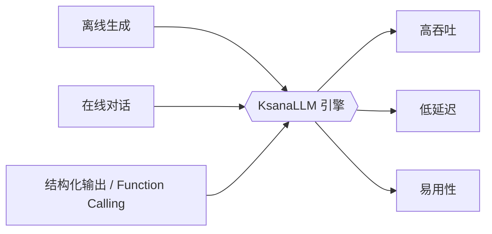
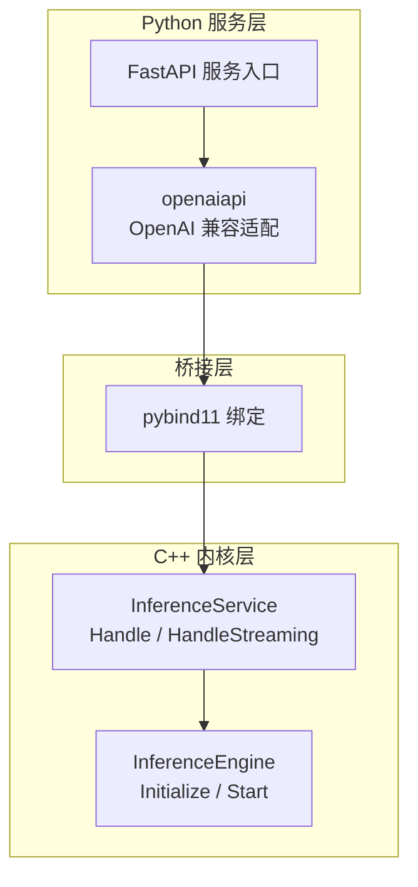
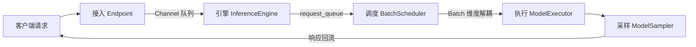
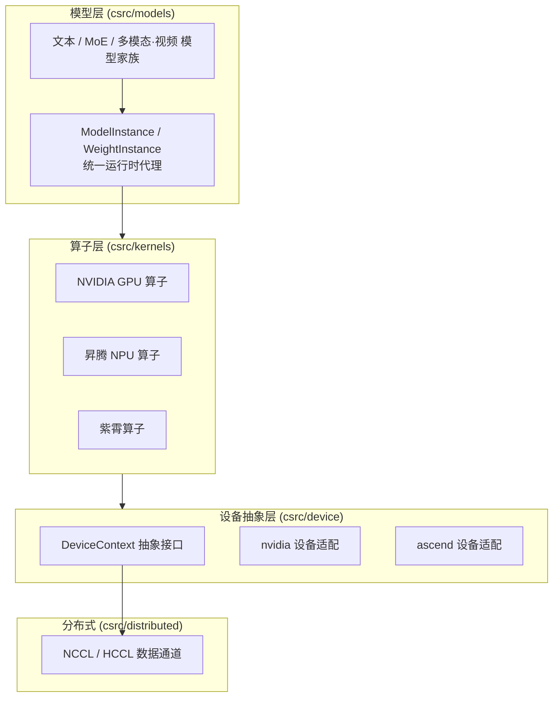

# KsanaLLM 项目概述

> 本文是 KsanaLLM Wiki 的开篇总览（全库第一章），面向新开发者、项目维护者与架构师，以较低技术深度建立项目的首因印象与全局心智模型。后续章节的详细解读，均可在本章末尾的「业务领域全景」中找到跳转入口。

## 1. KsanaLLM 是什么

KsanaLLM 是一款面向大规模大语言模型（LLM）的高性能推理与服务引擎，以高吞吐、低延迟、易用性为核心目标，为从离线批处理到在线交互的各类 LLM 推理场景提供统一支撑。它是本 Wiki 的全文基调：后文所有技术架构与模块细节，都是对这一核心定位的展开。

### 1.1 一句话定位

> 面向大规模 LLM 的高性能推理与服务引擎。

KsanaLLM 不是单个模型或脚本，而是一套完整的**推理与服务底座**：将训练好的大模型加载进来，高效完成推理计算，并以标准服务接口对外输出结果。

### 1.2 解决的痛点

LLM 上生产环境，通常绕不开三个核心难题，KsanaLLM 逐一回应。

| 痛点 | 说明 | KsanaLLM 的价值 |
| --- | --- | --- |
| 高吞吐 | 大模型推理算力开销大，单请求成本高 | 服务多用户并发而非单请求，摊薄成本 |
| 低延迟 | 在线场景对响应时间极其敏感 | 快速返回首字，提升交互体验 |
| 易用性 | 面向少量用户的学术框架难以上生产 | 提供推理与服务的整套能力，开箱即用 |

### 1.3 支撑的 LLM 推理场景

- **离线生成**：批量文本生成、摘要、改写等大规模一次性任务。
- **在线对话**：多用户并发交互的实时问答、聊天服务。
- **结构化输出 / Function Calling**：让模型输出符合既定结构，便于程序化消费与工具调用。

上图展示 KsanaLLM 的「引擎守关」定位：上游是三类典型推理场景，下游以高吞吐、低延迟、易用性三项价值回馈用户。

### 1.4 目标读者与核心价值主张

- **新开发者**：快速理解 KsanaLLM 是什么、能做什么，建立全局心智模型。
- **项目维护者**：掌握引擎定位与能力范围，便于后续深入各模块。
- **架构师**：评估 KsanaLLM 是否适配业务场景，以及如何集成对接。

核心价值主张：**用一个引擎，同时满足大规模 LLM 推理对性能、响应速度与工程易用性的综合要求。**

> 提示：关于技术栈、管道模型、并行策略等深度内容，详见后续对应章节。

## 2. 核心技术概览：C++ 高性能内核 + Python 服务包装

KsanaLLM 采用**「C++ 高性能内核 + Python 服务包装」**的混合技术栈：C++ 侧重推理吞吐与显存效率，Python 侧重易用性与生态接入，二者以 pybind11 为桥接相互衔接。整体代码量占比约 C++ 60%、Python 35%、其余 5%。

| 侧 | 定位 | 职责 | 代表实体 |
|---|---|---|---|
| C++ 内核 | 要性能 | 推理内核、模型加载、算子与设备管理 | `csrc/` 下的 `InferenceService`、`InferenceEngine` |
| Python 服务 | 要易用 | 服务封装、请求解析、协议与接口适配 | `python/` 下的 `openaiapi`、`ksana_llm` |
| 桥接 | 衔接 | 双向调用与数据透传 | pybind11 |

- **C++ 侧**以 `csrc/service/inference_service.h` 的 `InferenceService` 与 `csrc/engine/inference_engine.h` 的 `InferenceEngine` 为核心，通过 `Handle` / `HandleStreaming` / `HandleForward` 与 `Initialize` / `Start` 面向上层暴露推理能力。
- **Python 侧**提供服务封装与 OpenAI 兼容 API，`python/openaiapi/openai_adapter.py` 即 OpenAI API Adapter 适配层。
- **桥接**：C++ 与 Python 之间通过 pybind11 绑定衔接，实现「内核要性能、服务要易用」的分工。

> 注：各模块（batch_scheduler、cache_manager、openaiapi、ksana_plugin 等）的具体职责见「工程结构」章节，此处不展开。

**Sources:** <ref_code path="setup.py" /> <ref_code path="python/openaiapi/openai_adapter.py" /> <ref_code path="csrc/service/inference_service.h" /> <ref_code path="csrc/engine/inference_engine.h" /> <ref_code path="csrc/" /> <ref_code path="python/" />

## 3. 分层解耦的异步管道模型

KsanaLLM 采用**分层解耦的异步管道模型**承载推理请求：把「接入、引擎、调度、执行、采样」拆成相对独立的阶段，各阶段通过 **Channel** 通道异步衔接。这一设计让每个阶段得以独立扩展、独立演进，同时把长耗时操作（前向计算、采样）从请求接收中解耦出来，避免阻塞式串行通路成为吞吐瓶颈。

一条普通请求的主链路如下（各阶段间用 Channel 解耦）：

**请求生命周期**可拆为五个阶段：

| 阶段 | 实体 | 职责 |
| --- | --- | --- |
| 接入 Endpoint | `InferenceService` | `Handle` / `HandleStreaming` / `HandleForward` 接收请求 |
| 引擎 | `InferenceEngine` | `Initialize` 加载权重、注册模型实例并启动服务，`Start` 启动 |
| 调度 | `BatchScheduler` | 动态 batching，在 Batch 维度归并请求 |
| 前向/采样 | `ModelExecutor` / `ModelSampler` | 执行前向计算与采样解码 |
| 回流响应 | `InferenceService` | 将结果返回客户端 |

**1. 接入（Endpoint）→ 引擎。** `InferenceService` 持有 `inference_engine_` 及一条 `Channel<std::pair<Status, std::shared_ptr<Request>>>`（即 `request_queue_`）：接入层只接收并解析请求，随后异步投入通道即返回，不做耗时处理。由此接入吞吐与后端处理速度解耦，具备水平扩展能力。

**2. 引擎 → 调度。** `InferenceEngine` 消费通道中的请求，交由 `BatchScheduler`（`csrc/batch_scheduler/`，含 `schedule_processor`、`strategy/`、`event_driven_scheduler/`）统一归并。

**3. 调度的核心演进——动态 Batching。** 请求不再「一请求一处理」，而是在 **Batch 维度**把多条请求糅合为一个批次，动态决定哪些请求进入该轮前向（具体策略属「批量调度」章节）。

**4. 执行与采样。** 汇聚好的 Batch 交给 `csrc/executor/` 的 `ModelExecutor` 执行前向，再由 `ModelSampler` 采样产出 token，最终结果回流到接入层返回给客户端。前向/采样在独立线程上运行，不阻塞新请求的接入。

综上，一条请求以「接入 → 引擎 → 调度 → 前向/采样 → 回流」的自上而下路径流过整条管道，各段间的 Channel 既是数据枢纽也是解耦点，让每个阶段可独立水平扩展。

**Sources:** <ref_code path="csrc/service/inference_service.h" /> <ref_code path="csrc/engine/inference_engine.h" /> <ref_code path="csrc/batch_scheduler/" /> <ref_code path="csrc/executor/" />

## 4. 核心能力与特性概览

KsanaLLM 面向高性能大模型推理与服务，围绕「显存效率、算力利用率、动态扩展与易用对接」四条主线，沉淀了一批标志性能力。下表为能力速览，每项对应详细技术解读可跳转各业务领域章节。

| 能力特性 | 一句话说明 | 相关章节 |
| --- | --- | --- |
| PagedAttention 与 KV Cache | 把 KV 缓存按分块管理，按需分配、减少碎片浪费 | 详见缓存管理章节 |
| 动态 Batching | 在 Batch 维度动态合并不同请求、不同阶段的 token，持续填满 GPU | 详见调度章节 |
| 前缀缓存 Prefix Caching | 复用多请求共享的公共前缀 token 的 KV 结果，减少重复计算 | 详见缓存章节 |
| 四类并行 TP/DP/PP/EP | 张量切分、请求均衡、多 batch 流水、专家并行（基于 DeepEP），可组合支撑超大 MoE | 详见分布式章节 |
| PD 分离 Prefill/Decode | 将 Prefill 与 Decode 两个阶段拆开部署、独立扩展，避免互相拖累 | 详见 PD 分离章节 |
| 全局 KV | 跨节点共享、存取 KV 缓存，实现大规模集群下的缓存复用 | 详见 PD/全局缓存章节 |
| 投机解码 | 先用小模型快速猜测多个 token，再由大模型并行校验，一次前向产出多 token | 详见推理加速章节 |
| 结构化输出 / Function Calling | 约束输出格式、支持工具调用，便于与业务系统对接 | 详见 OpenAI API 章节 |
| OpenAI 兼容 REST API、流式输出 | 提供标准 HTTP 接口与实时流式返回，开箱即用、降低迁移成本 | 详见服务接入章节 |

**核心能力组织原则：** KsanaLLM 将上述能力收敛为两个层次——底层的显存与调度引擎（`csrc/cache_manager`、`csrc/batch_scheduler`）负责高效利用算力；上层的分布式与服务层（`csrc/distributed`、`csrc/pd_v2`、`python/openaiapi`）提供扩展性与易用性。二者组合，使同一套推理核心既能支撑单机轻载，也能弹性扩展至超大规模集群。

**Sources:** <ref_code path="csrc/cache_manager/" /> <ref_code path="csrc/batch_scheduler/" /> <ref_code path="csrc/distributed/" /> <ref_code path="csrc/pd_v2/" /> <ref_code path="python/openaiapi/" />

## 5. 支持的模型与硬件平台

KanaLLM 面向主流大模型提供开箱即用的覆盖能力：适配 20+ 主流模型家族，并通过统一的设备抽象层，将「一套内核」迁移到三类异构后端硬件。本章仅介绍生态覆盖面与「一套内核多硬件」的整体思路，不涉及具体模型的注册与算子实现。

### 5.1 模型覆盖

模型分目录组织在 `csrc/models/` 下，可归纳为**文本家族、MoE 稀疏架构、多模态/视频**三类。各类模型通过 `csrc/runtime/` 下的运行时代理统一接入——其中 `csrc/runtime/model_instance.h` 的 `ModelInstance` 与 `csrc/runtime/weight_instance.h` 的 `WeightInstance` 作为上层模型与底层执行之间的运行时代理，实现统一的模型接入、权重加载与实例管理。

| 模型家族 | 说明 |
|---|---|
| Llama / Llama4 | 自回归文本、Dense 稠密解码 |
| Qwen / Qwen2-MoE / Qwen3-MoE | 稠密与稀疏混合的 Qwen 系 |
| DeepSeek-V3 / DeepSeek-V4 | 大规模 MoE 稀疏模型 |
| Mixtral、GLM4-MoE 等 | 稀疏专家并行 MoE |
| Baichuan、ChatGLM、InternLM2 | 中文大语言模型家族 |
| Qwen2-VL 等 | 多模态视觉语言模型 |
| Hunyuan-Large / Hunyuan-Video 等 | 多模态·视频生成模型 |
| Kimi-K3、Bge-Reranker-MiniCPM | 检索/重排（RAG）模型 |

### 5.2 异构硬件后端

KanaLLM 以 `csrc/device/` 的设备抽象接口为承轴，屏蔽底层差异；算子分配在 `csrc/kernels/` 下按后端分目录实现。因此同一份模型→算子→设备的前向逻辑可平滑迁移到不同硬件，而无需改动上层代码。

| 后端 | 对应目录 | 关键技术栈 |
|---|---|---|
| NVIDIA GPU | `csrc/device/nvidia/`、`csrc/kernels/nvidia/` | CUDA、FlashAttention、Triton、DeepGEMM |
| 华为昇腾 NPU | `csrc/device/ascend/`、`csrc/kernels/ascend/` | ACL / HCCL / ATB |
| 紫霄（自研加速器） | `csrc/device/zixiao/`、`csrc/kernels/zixiao/` | TOPS 自定义运行栈 |
| 分布式通信 | `csrc/distributed/nvidia/` | NCCL，配套 HCCL 数据通道 |

### 5.3 一套内核，多硬件迁移

以下示意「模型/算子层 → 设备抽象层 → 多种后端」的分层关系：

如上方，上层（`ModelInstance` / `WeightInstance`）只依赖统一的设备抽象与算子约定，无直接的硬件绑定；后端差异由 `DeviceContext` 各实现与算子 wrapper 吸收，从而实现「一套内核，多硬件迁移」。

**Sources:** <ref_code path="csrc/models/" /> <ref_code path="csrc/runtime/model_instance.h" /> <ref_code path="csrc/runtime/weight_instance.h" /> <ref_code path="csrc/device/" /> <ref_code path="csrc/kernels/nvidia/" /> <ref_code path="csrc/kernels/ascend/" /> <ref_code path="csrc/distributed/nvidia/" />

## 6. 核心业务领域全景与阅读导航

本章是 KsanaLLM 的「导航地图」：将整个引擎按**核心 / 重要**两级标注业务领域，每个领域用一句话界定职责边界，并为读者标注可跳转的详细章节。建议先通读本表建立全局视野，再按需进入对应章节深入。

| 领域 | 级别 | 一句话职责 | 对应详细章节 |
| --- | --- | --- | --- |
| 推理入口 | 核心 | 请求接入（`csrc/service`）、OpenAI 兼容 API（`csrc/endpoints`、`python/openaiapi`），支持流式与 Function Calling | 推理入口 |
| 推理引擎 | 核心 | 加载权重、注册模型实例、驱动整体调度与执行流程 | 推理引擎 |
| 批量调度 | 核心 | 动态 batching 与批处理策略，承载 continuous batching | 批量调度 |
| 执行器与采样解码 | 核心 | 前向推理执行与采样解码产出 token | 执行器与采样解码 |
| KV 缓存 | 核心 | PagedAttention、前缀缓存及 MHA/MLA/DSA 缓存布局管理 | KV 缓存 |
| 分布式并行 | 核心 | 支撑 TP/DP/PP/EP 的多卡、多机分布式并行 | 分布式并行 |
| 模型与算子 | 核心 | 内置 20+ 模型与覆盖多硬件的算子层实现 | 模型与算子 |
| PD 分离与全局 KV | 重要 | Prefill/Decode 拆分，以及跨节点的全局 KV 连接（`csrc/pd_v2`、`csrc/global_cache_connector`） | PD 分离 |
| 权重加载 | 重要 | 模型权重的加载与解析（`csrc/model_loader`） | 权重加载 |
| 多模态插件与编码服务 | 重要 | 多模态插件与编码服务实现（`python/ksana_plugin`、`python/ksana_encoder`） | 多模态插件 |
| 部署与使用 | 重要 | 三种部署形态与使用方式（`examples/`、`python/serving_*`、`setup.py`） | 部署配置与使用 |

**阅读顺序建议**：先读「推理引擎」建立请求到输出的主干流程，再依次深入「批量调度」「执行器与采样解码」「KV 缓存」三个核心执行环节；服务化部署与多模态能力可并行阅读；分布式场景在理解单机流程后再展开「分布式并行」与「PD 分离」。

**Sources:** <ref_code path="csrc/" /> <ref_code path="python/" />