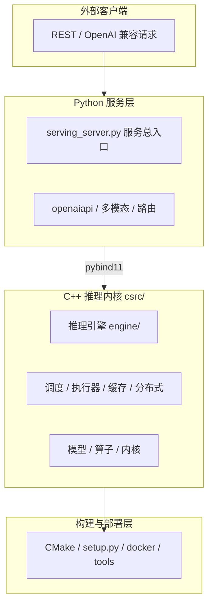
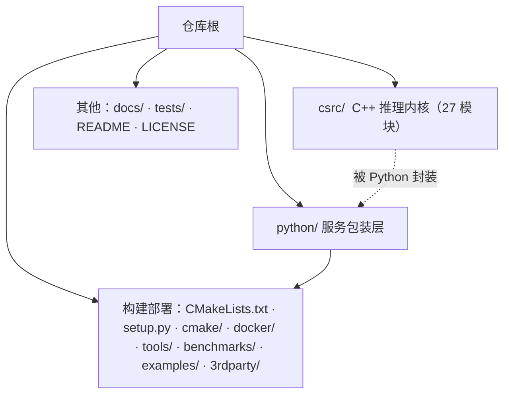
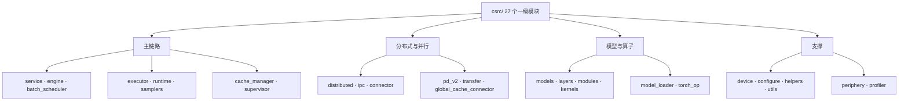
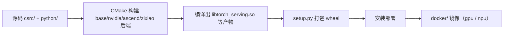
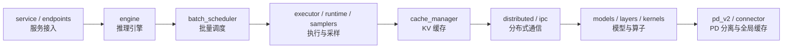

# 工程结构

## 1. 项目定位与技术栈

KsanaLLM 是一款面向大规模 LLM（大语言模型）推理与服务的高性能推理引擎，面向高吞吐、低延迟的大模型线上推理场景。本文档介绍其工程仓库的组织结构，帮助新开发者建立文件导航心智地图。

工程采用「**C++ 高性能内核 + Python 服务包装**」的混合技术栈：C++/CMake 核心推理运行时 + Python（FastAPI/pybind11/uvicorn）服务层。仓库是混合多语言工程（C++ 约 60%、Python 约 35%、其余 5%），同时支持 NVIDIA GPU 与昇腾 NPU 的异构计算。

下方为整体分层概念图：上层 REST 请求进入 Python 服务层，向下经封装调用 C++ 推理内核，最终落到部署与构建层支撑。

分层原因：C++ 内核承载全部高性能推理逻辑（调度、执行、算子、缓存、分布式通信），Python 层负责服务接口、多模态预处理与路由编排，二者通过 pybind11 绑定衔接，兼顾性能与开发效率。

**Sources:** <ref_code path="python/serving_server.py" /> <ref_code path="setup.py" />

## 2. 仓库整体布局（三大层骨架）

仓库顶层包含 `tools/ benchmarks/ docs/ examples/ tests/ 3rdparty/ python/ csrc/ cmake/ setup.py` 等，整体划分为三大层：**C++ 内核（csrc/）、Python 服务层（python/）、构建部署资源**。

下方为仓库整体架构关系树，展示了三层的核心目录与依赖关系。

各顶层目录的核心作用：

| 目录/文件 | 定位 |
| --- | --- |
| `csrc/` | C++ 高性能推理内核，含 27 个一级模块（本文第 3 章） |
| `python/` | Python 服务包装层，服务总入口与各子包（第 4 章） |
| `setup.py` | 根构建/打包入口，基于 CMake 打包 wheel，属构建部署层锚点 |
| `CMakeLists.txt` / `cmake/` | 顶层构建组织与第三方依赖（第 5 章） |
| `examples/` | 各模型 YAML 配置与示例脚本 |
| `docker/` | GPU / NPU 等镜像 |
| `tools/` / `benchmarks/` | 构建、部署、性能工具与基准脚本 |
| `3rdparty/` | 内部子模块仓库（LLM_kernels 等） |
| `docs/` / `tests/` | 文档与测试 |

Python 侧服务总入口位于 `python/serving_server.py` 的 `start_executor()`（工程结构锚点）：它启动 `KsanaExecutor` 各执行进程并初始化 IPC，是理解 "C++ 服务包装如何拉起" 的切入点。

**Sources:** <ref_code path="setup.py" /> <ref_code path="python/serving_server.py" /> <ref_code path="csrc/" />

## 3. C++ 推理内核 `csrc/`：27 个模块划分

这是本文档的核心章节。`csrc/` 下共 27 个一级模块，按「推理主链路 / 分布式与并行 / 模型算子 / 缓存配置与支撑」等多个分组垂直划分，职责清晰。下方是完整模块清单树。

以**推理主链路**来看：`service`（服务入口）→ `engine`（推理引擎）→ `batch_scheduler`（批量调度）→ `executor`（执行器）→ `runtime`/`samplers`（运行态与采样）→ `cache_manager`（KV 缓存）。下方对照表给出 27 个模块的职责定位与后续对应文档方向。

| 模块 | 职责一句话 | 对应领域文档 |
| --- | --- | --- |
| `service` | 对外推理服务入口（inference_service） | 推理服务 |
| `endpoints` | 各类端点（http/local/rpc/pd_v2 等） | 推理服务 |
| `engine` | 推理引擎与模型驱动（inference_engine / model_driver） | 推理引擎 |
| `supervisor` | 服务生命周期与监督（inference_supervisor） | 推理服务 |
| `batch_scheduler` | 批量调度（strategy / event_driven_scheduler / workload_balance） | 调度 |
| `executor` | 执行器（model_runner / model_executor） | 执行 |
| `runtime` | 运行态请求/输入输出/model_instance/采样输出 | 执行 |
| `samplers` | 采样器（sampler / topk） | 执行 |
| `cache_manager` | KV 缓存管理（block_allocator / cache_layout / prefix / swa） | 缓存 |
| `distributed` | 分布式通信（nccl / expert_parallel） | 分布式 |
| `ipc` | 跨进程通信封装（core / functions） | 分布式 |
| `connector` | 跨节点连接与任务分发（communicator / router_client） | 分布式 |
| `transfer` | 传输引擎与张量搬运（transfer_engine） | 分布式 |
| `global_cache_connector` | 全局 KV 缓存连接（mooncake_connector） | 缓存/分布式 |
| `pd_v2` | PD 分离（prefill / decode / mooncake / public） | PD 分离 |
| `models` | 模型实现（llama/qwen/deepseek_v3/v4/mixtral/chatglm/baichuan 等 20+ 架构与 base/weight_method） | 模型 |
| `layers` | 层算子（attention/matmul/moe/flash_attention 等） | 模型/算子 |
| `modules` | 模块组装（attention / basic / ffn） | 模型/算子 |
| `kernels` | 内核封装（nvidia / ascend / zixiao） | 算子 |
| `torch_op` | PyTorch 算子桥接（serving_op） | 算子 |
| `model_loader` | 权重加载（file_loader / weight_loader / config_parser） | 模型 |
| `device` | 异构设备抽象（nvidia / ascend / zixiao） | 分布式/缓存 |
| `configure` | 配置解析（yaml / model / schedule / quant 解析） | 部署配置 |
| `helpers` | 公共测试辅助（model_test_helper 等） | 测试 |
| `utils` | 通用工具（内存/张量/请求/日志/分词等） | 支撑 |
| `periphery` | 版本信息上报（version_reporter） | 支撑 |
| `profiler` | 性能剖析（profiler / timer / reporter） | 性能 |

模型层覆盖 20+ 主流架构，分布在 `csrc/models/` 各子目录；算子与内核分别在 `layers/`、`layers` 与 `kernels/` 中按后端（nvidia/ascend/zixiao）组织。跨进程、PD 分离与全局缓存相关能力集中在 `ipc/`、`pd_v2/`、`connector/`、`transfer/`、`global_cache_connector/`。

**Sources:** <ref_code path="csrc/" /> <ref_code path="csrc/service/" /> <ref_code path="csrc/engine/" /> <ref_code path="csrc/batch_scheduler/" /> <ref_code path="csrc/executor/" /> <ref_code path="csrc/cache_manager/" /> <ref_code path="csrc/distributed/" /> <ref_code path="csrc/models/" /> <ref_code path="csrc/layers/" /> <ref_code path="csrc/modules/" /> <ref_code path="csrc/kernels/" />

## 4. Python 服务层 `python/`：各子包职责

`python/` 层的定位是「服务包装 + 业务胶水」：负责 OpenAI 兼容 API 适配、多模态预处理、编码服务与 PD 路由，底层推理逻辑全部集中在 C++ 内核，Python 通过 pybind11 封装调用。`python/serving_server.py` 是服务总入口，其中 `start_executor()` 拉起各执行进程。

`python/` 下各子包与文件职责如下：

| 子包/文件 | 一句话职责 | 配合的 C++ 模块 |
| --- | --- | --- |
| `serving_server.py` | 服务总入口，`start_executor()` 拉起执行进程 | engine/executor |
| `openaiapi/` | OpenAI 兼容 API（openai_adapter / openai_protocol / chat / completion / embedding） | service/endpoints |
| `ksana_llm/` | C++ 引擎的 Python 封装（KsanaService / KsanaExecutor / ksana_engine） | engine/executor |
| `ksana_encoder/` | 基于 ZMQ 的编码服务（encoder_server / encoder_gateway / encoder_client） | ipc/utils |
| `ksana_plugin/` | 多模态视觉插件（qwen2_vl / qwen3_vl / internvl_chat / trt_engine） | models/layers |
| `simple_router/` | PD 轻量路由（node / services / generate / name_service） | connector/transfer |
| `weight_map/` / `kv_scale_files/` | 模型权重映射与量化缩放 | model_loader |
| `utilize/` | 公共工具 | utils |

其中 `ksana_llm/` 是 C++ 引擎在 Python 侧的封装面（`ksana_engine.py`、`ksana_executor.py`、`ksana_service.py`），`openaiapi/` 提供 OpenAI 兼容接入，`ksana_encoder/` 用 ZMQ 实现编码服务，`ksana_plugin/` 承载多模态视觉插件。编码与多模态的更多细节见「多模态」相关文档。

Python 层不承担高性能计算，只做参数解析、请求编排、接口适配与进程/进程资源拉起，契合"混合多语言仓库"的分工设计。

**Sources:** <ref_code path="python/serving_server.py" /> <ref_code path="python/openaiapi/" /> <ref_code path="python/ksana_llm/" /> <ref_code path="python/ksana_encoder/" /> <ref_code path="python/ksana_plugin/" /> <ref_code path="python/simple_router/" />

## 5. 构建与部署组织结构

工程的构建基于 CMake，顶层 `CMakeLists.txt` 负责整体组织；`setup.py` 在 CMake 之上打包 wheel 并安装。第三方依赖通过 `cmake/external/*.cmake` 引入，本仓库还以子模块形式内置 `3rdparty/`（LLM_kernels、mooncake-mock-store）。

下方构建流程从源码到安装的整体走向：

构建相关目录与职责：

| 目录/文件 | 职责 |
| --- | --- |
| `CMakeLists.txt` | 顶层构建组织 |
| `cmake/` | 构建设置（base / nvidia / ascend / zixiao 后端） |
| `cmake/external/` | 第三方依赖（xgrammar / mooncake / re2 / yaml-cpp / pybind11 等 20+） |
| `setup.py` | wheel 打包入口，基于 CMake 编译 |
| `3rdparty/` | 内置子模块（LLM_kernels、mooncake-mock-store） |
| `examples/` | 各模型 YAML 配置（单机 / 分布式 / PD 分离 / 昇腾） |
| `docker/` | GPU / NPU 镜像（Dockerfile.gpu / Dockerfile.npu） |
| `tools/` | 构建部署与性能工具 |
| `benchmarks/` | 基准与压测脚本 |

配置上工程采用「YAML 配置 + 环境变量」双通道，`examples/*.yaml` 与 `csrc/configure` 解析共同支撑多种部署形态（单机 / 分布式 / PD 分离 / 昇腾）。具体配置字段与部署步骤见「部署配置与使用」文档。

**Sources:** <ref_code path="CMakeLists.txt" /> <ref_code path="cmake/" /> <ref_code path="setup.py" /> <ref_code path="docker/" /> <ref_code path="examples/" /> <ref_code path="tools/" /> <ref_code path="benchmarks/" /> <ref_code path="3rdparty/" />

## 6. 渐进式阅读路径与模块依赖关系

本工程模块按职责垂直划分，依赖与数据流大体沿「服务接入 → 引擎 → 调度 → 执行/采样 → 缓存 → 分布式 → 模型 → PD 分离」方向推进。下方为模块依赖流向图，可作为后续逐章深入的方向导航。

给新开发者的渐进式阅读建议（"按图索骥"）：

| 步骤 | 进入点 | 建立认知 |
| --- | --- | --- |
| 1 | 本文「概述」→「仓库布局」 | 全局地图与三大层骨架 |
| 2 | 服务入口 `service/`、`endpoints/`、`serving_server.py` | 请求如何进入 |
| 3 | 推理引擎 `engine/` | 引擎如何驱动推理 |
| 4 | 调度 `batch_scheduler/` | 请求如何被批量调度 |
| 5 | 执行/采样 `executor/`、`runtime/`、`samplers/` | 一次推理如何被执行与采样 |
| 6 | 缓存 `cache_manager/` | KV 缓存如何管理 |
| 7 | 分布式 `distributed/`、`ipc/`、`connector/` | 多机多卡如何协作 |
| 8 | 模型/算子 `models/`、`layers/`、`kernels/` | 各模型如何落地 |
| 9 | PD 分离 `pd_v2/`、`transfer/` | 预填充/解码分离与全局缓存 |

按上述顺序可沿依赖方向逐层深入：先理解服务与引擎如何承接请求，再进入调度与执行的运行主链路，随后探索缓存、分布式与模型实现，最后理解 PD 分离形态。每个领域均有对应主题文档承接，本文档只做导航，不展开实义链路与业务细节。

**Sources:** <ref_code path="csrc/" /> <ref_code path="python/serving_server.py" />