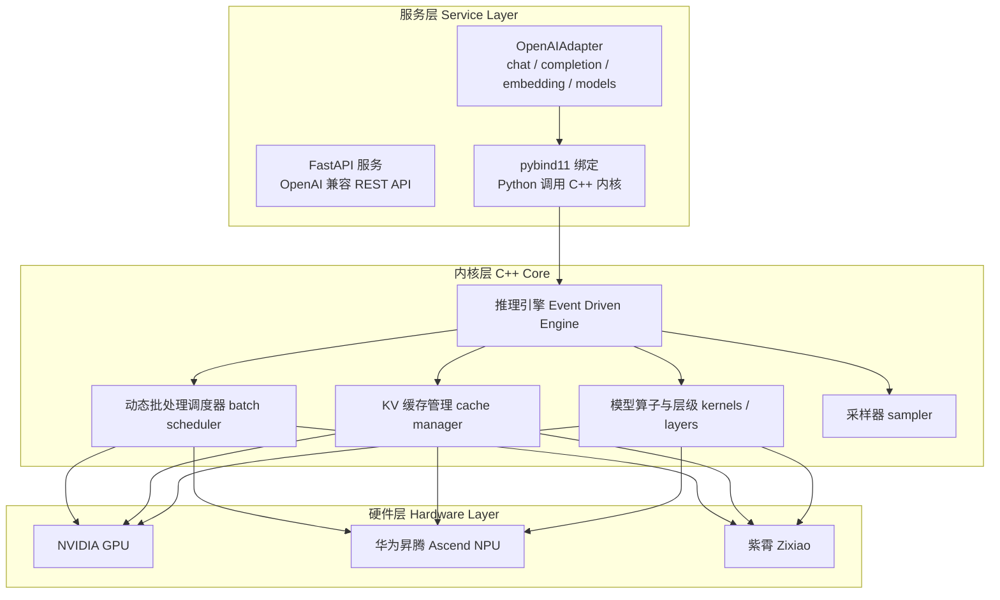
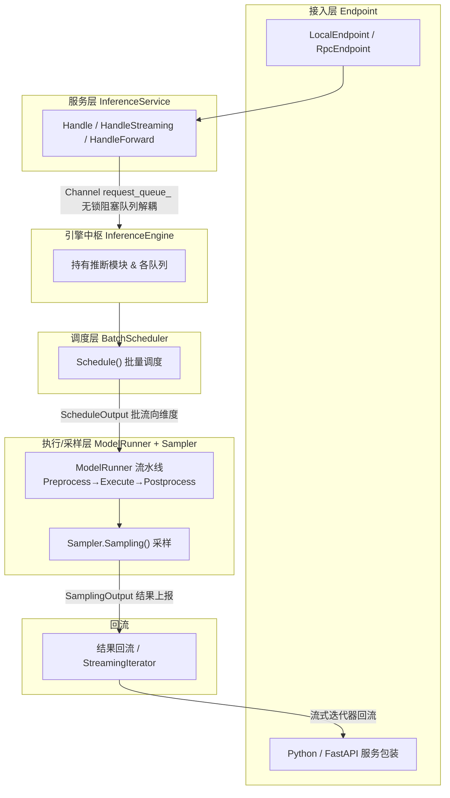
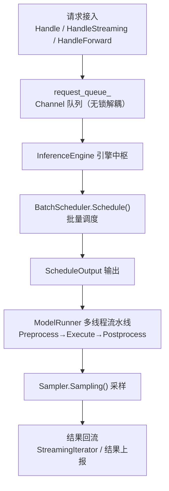
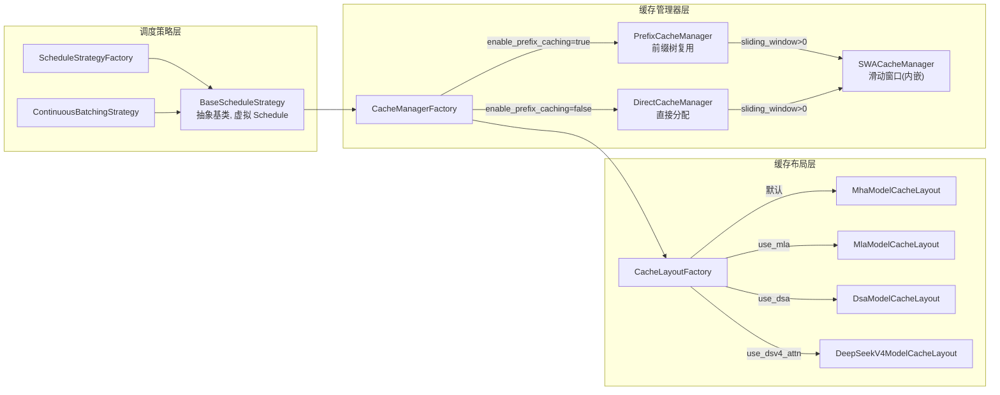
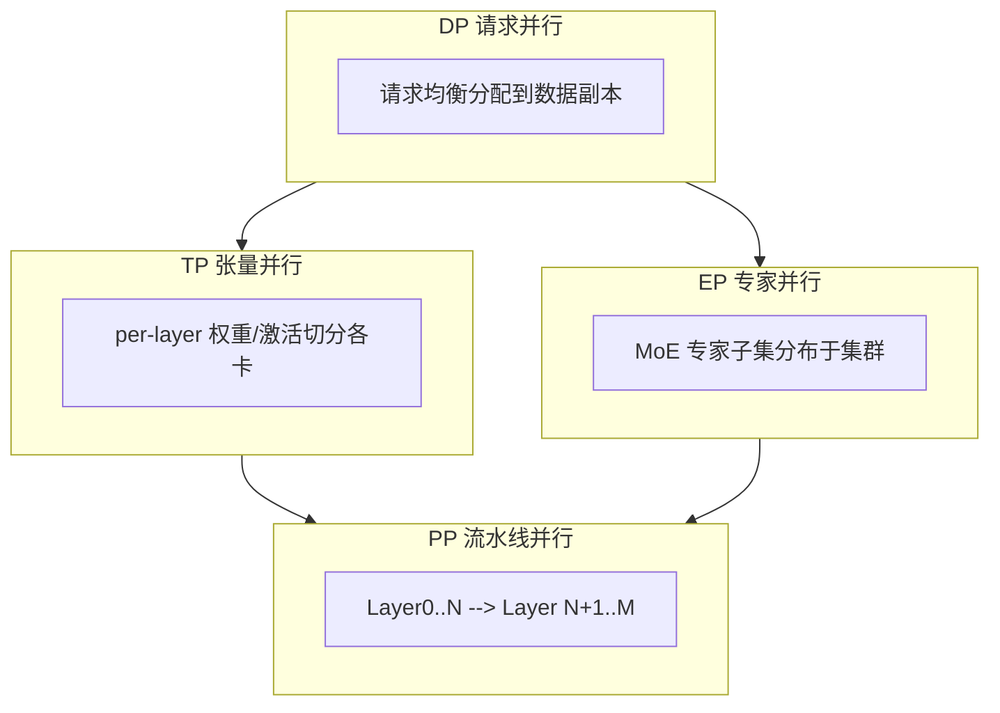
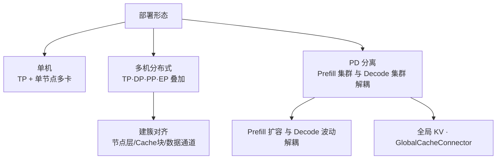
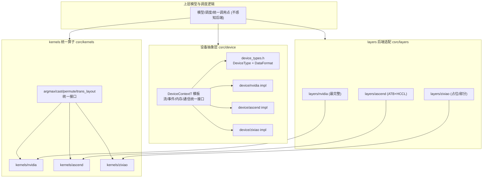
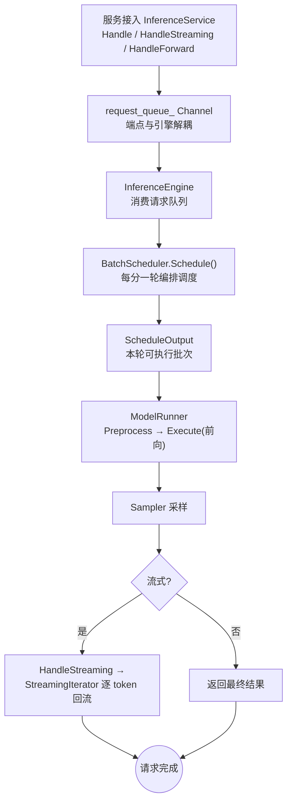

# 核心特性与架构特点

> **文档定位**：本文面向架构师与新用户，对 KsanaLLM（一念 LLM）推理引擎的**系统架构特点与核心特性**做整体性介绍。本文不逐模块展开源码实现，而从四个架构视角勾勒系统全貌、概览六类核心特性，并以请求生命周期总览收束全篇，为阅读后续深层模块文档提供宏观导航。

---

# 第 1 章 认识 KsanaLLM：定位与技术栈

## 1.1 KsanaLLM 是什么

KsanaLLM（一念 LLM）是面向大语言模型（LLM）推理与服务的高性能推理引擎，核心目标是在多硬件、多模型场景下同时做到**高吞吐、低延迟、易用**。

- **高吞吐**：通过极致优化的算子、动态批处理与高效的 KV 缓存管理，最大化单位时间内的解码 token 数。
- **低延迟**：优化调度路径与显存占用，减少首 token 时延（TTFT）与逐 token 时延（TPOT）。
- **易用**：面向 Hugging Face 权重格式，支持流式输出与 OpenAI 兼容接口，开箱即用。

## 1.2 混合技术栈

KsanaLLM 采用「C++ 高性能内核 + Python 服务包装」的混合技术栈。C++ 负责与硬件强相关的性能关键路径，Python（FastAPI）负责对外协议与服务编排，两者通过 pybind11 绑定桥接。

- **C++ 高性能推理内核**：覆盖引擎、动态批处理调度、KV 缓存管理、模型算子与层级、采样器等模块，由 CMake 构建，并经由 pybind11 暴露接口给上层 Python。
- **Python 服务包装**：FastAPI 提供 OpenAI 兼容的 REST API；openaiapi 中的 `OpenAIAdapter` 组合了 chat/completion/embedding/models 四类 serving。

### 内核层（C++）

内核层是 KsanaLLM 的性能主体，负责推理与调度的高频热点路径。

| 模块 | 职责 |
|---|---|
| 推理引擎（engine） | 编排 prefill / decode 推理流程，驱动整体执行 |
| 批处理调度（batch scheduler） | 动态批处理，将请求按需组织为可并行执行批次 |
| 缓存管理（cache manager） | KV 缓存分配与复用，支持前缀缓存等策略 |
| 模型算子与层级（kernels / layers） | 模型前向计算算子与 Transformer 层级实现 |
| 采样器（sampler） | 控制解码抽样策略（并行采样、beam search 等） |

### 服务层（Python）

服务层向上提供对外协议接口，向下通过 pybind11 调用 C++ 内核。

- **FastAPI**：承载 OpenAI 兼容的 REST 服务端点。
- **OpenAIAdapter**：组合 chat / completion / embedding / models 四类 serving，对外暴露 `chat/completions`、`completions`、`embeddings` 及模型列表等接口。

### 硬件层

内核层通过统一的设备抽象适配多种加速卡，实现「一套引擎、多硬件部署」。

- **NVIDIA GPU**：A10、A100、L20、L40、H20 等。
- **华为昇腾（Ascend）NPU**。
- **紫霄（Zixiao）**。

## 1.3 本文档在「项目概述」体系中的位置

本文档属于「项目概述」体系，与「项目概述」、「工程结构」互为补充。

- **项目概述**：站点级描述，回答「KsanaLLM 是什么」。
- **工程结构**：面向代码，介绍代码目录的组织与模块划分。
- **核心特性与架构特点**（本文档）：面向概念，回答「KsanaLLM 如何工作」，从整体架构出发串联各特性。

### 面向的读者与阅读路径

本文档面向架构师与新用户两类读者。

- **架构师**：希望理解整体技术栈分层、模块职责与设计思路，建议从第 2 章起自上而下阅读。
- **新用户**：希望快速了解能力边界与阅读路径，建议先读第 2、3、4 章快速上手，再按需深入。
- 各章节主题相对独立，支持按需跳读与交叉引用。

---

# 第 2 章 分层解耦的异步管道架构

> **本章结论**：KsanaLLM 把一条推理请求拆解为「接入→调度→前向→采样→回流」五个阶段，各阶段通过 Channel（无锁阻塞队列）/ 异步队列解耦，彼此独立演进、可水平扩展。这套分层的异步管道是引擎支撑高并发与吞吐扩展的基座；调度策略、执行器流水线、采样算法内部实现归下游细分文档，本章只覆盖阶段职责与衔接。

## 2.1 五阶段总览

推理请求以"请求"为主视角，自进入引擎到结果返回，依次流经五个解耦的阶段。每个阶段职责单一、以队列为边界，可与上下游逃逸（backpressure）而各自独立推进。

| 阶段 | 核心组件 | 职责 |
| --- | --- | --- |
| 接入 | `InferenceService`（`Handle`/`HandleStreaming`/`HandleForward`） | 接收用户请求与请求上下文，包装为统一 `Request` 入队 |
| 调度 | `BatchScheduler`（`Schedule()`） | 从等待队列按批流向维度选出本轮可执行的请求，产出 `ScheduleOutput` |
| 前向 | `ModelRunner`（`HandlePreprocess`/`HandleExecute`） | 将调度输出转为模型输入，执行真正的设备端推理 |
| 采样 | `Sampler`（`Sampling()`） | 基于 logits 依据采样参数选出下一 token |
| 回流 | `ModelRunner` 结果上报 / `StreamingIterator` | 收集采样结果、回写生成的输出并返回调用方 |

**Channel** 是 KsanaLLM 提供的无锁阻塞队列（内部由 `deque` + 互斥量 + 条件变量实现，语义类似 Go 的 copyable channel），用于连接上游生产者与下游消费者，是阶段解耦的核心载体。

### 2.1.1 分层图示

## 2.2 接入层：请求进引擎的唯一入口

`InferenceService` 是用户请求的唯一入口，面向 Python（FastAPI/pybind11）服务包装与本地/RPC 端点。提供三条接入方法：

- `Handle()`：一次性（非流式）推理入口；
- `HandleStreaming()`：流式推理入口，返回 `StreamingIterator`；
- `HandleForward()`：直接前向请求入口，输入输出为字节串。

接入层不做推理，只把请求封成统一数据结构，并写入连接引擎中枢的 Channel。

## 2.3 Channel 解耦：端点与引擎之间的枢纽

`InferenceService` 持有一条 `Channel<std::pair<Status, std::shared_ptr<Request>>> request_queue_`，它是端点与引擎之间的唯一衔接点。

- 端点在接入时把请求写入 `request_queue_`，无需等待引擎空闲；
- `InferenceEngine` 构造函数接收同一 `request_queue_` 引用，从队列摄入请求后驱动后续调度；
- 队列读写在空间/无元素时会自动阻塞等待（关闭时唤醒），天然实现流量退避与背压保护，避免端点被拖慢。

借此，接入层与调度层在生产/消费两个维度完全解耦，可各自伸缩。

## 2.4 调度层：批流向维度的动态 Batching

`BatchScheduler` 是引擎统一的调度中枢，通过 `Schedule()` 从等待请求中按「批流向维度」选出本轮可执行的请求，产出 `ScheduleOutput`。

- **动态 Batching（ContinuousBatching）**：按照请求生成进度，动态地把可执行的请求拼进同一批，将同一批内的 Prefill 与 Decode token 混合处理，避免旧批空等，提升吞吐与利用率。
- 调度结果经由 `ScheduleOutput` 传递给下游执行/采样层，命令在批/流向上对齐（即"批流向维度"）。

调度策略的具体算法（事件驱动、跨节点协作等）归下游批量调度细分文档。

## 2.5 执行与采样层：流水线推进与 token 选择

`ModelRunner` 承担多线程执行流水线，围绕调度输出构建：

- `HandlePreprocess`：读取 `ScheduleOutput` 并组装模型输入（经队列传递）；
- `HandleExecute`：驱动真正的设备前向计算；
- `HandlePostprocess` / `HandleResultReportProcess`：处理后线流程并上报结果。

`Sampler` 在采样阶段基于设备 logits 与采样参数（top-k/top-p/temperature 等）通过 `Sampling()` 选出下一 token，产物写入 `SamplingOutput` 上报回流。

> 执行器流水线内部的线程分工与采样算法内部实现，均归下游细分文档。

## 2.6 回流：结果写回与流式迭代

采样结果自 `SamplingOutput` 汇总后，经 `HandleResultReportProcess` 上报、回写到请求对应的生成状态，最终由 `StreamingIterator`（流式）或输出对象（一次性）返回调用方。

### 2.6.1 总览流程

## 2.7 小结

KsanaLLM 以「接入→调度→前向→采样→回流」五阶段 + Channel/异步队列作为主干，每一层职责单一、以队列解耦衔接，端点、调度、执行、采样与回流各自可独立步进与伸缩。这一基座配合批流向维度的动态 Batching，为高并发接入与吞吐扩展提供了结构性的支撑。调度策略、执行器流水线、采样算法内部实现，由对应细分文档展开。

**Sources:** <ref_code path="csrc/service/inference_service.h" /> <ref_code path="csrc/engine/inference_engine.h" /> <ref_code path="csrc/batch_scheduler/batch_scheduler.h" /> <ref_code path="csrc/executor/model_runner.h" /> <ref_code path="csrc/samplers/sampler.h" /> <ref_code path="csrc/utils/channel.h" />

---

# 第 3 章 特性驱动的调度与缓存设计

> **本章结论**：KsanaLLM 把「调度策略可扩展」与「缓存复用最大化」作为系统设计主线：通过 `BaseScheduleStrategy` 抽象与策略工厂解耦批处理算法，以 PagedAttention 为基础用 `CacheLayoutFactory` 按模型注意力特性（MHA/MLA/DSA/DeepSeekV4）生成最小化显存浪费的 KV 缓存布局，并由 `CacheManagerFactory` 按配置选择前缀复用、直接分配、滑动窗口等缓存管理器。不同模型注意力形态自动映射到对应缓存布局与调度策略，无需修改服务层。

## 3.1 调度：ContinuousBatching 的策略抽象

**PagedAttention** 指把整段 KV cache 按固定 `block_token_num` 拆成物理块，用逻辑到物理的映射按需分配，消除长序列的显存碎片与预留浪费，它是本层调度与缓存设计共同的地基。

调度器在每步确定「下一轮可运行的请求子集」，把混合的 prefill 与 decode token 一并处理，最大化单次迭代的有效 token 吞吐。

### 3.1.1 调度策略抽象与工厂

`BaseScheduleStrategy` 是批处理策略的抽象基类，暴露两个纯虚拟接口：

- `Schedule(waiting_reqs)`：从等待队列选出本轮可运行的请求。
- `UpdateRunningRequests(running_reqs)`：更新运行态、回收已完成/超时请求。

`ScheduleStrategyFactory` 按 `ScheduleStrategy` 枚举创建策略对象，当前提供 `ContinuousBatchingStrategy`（继承自 `BaseScheduleStrategy`）。策略实例通过 `SetCacheManager` 注入 `CacheManagerInterface`，使调度逻辑与缓存管理解耦且复用同一套缓存。

## 3.2 缓存管理器：Prefix / Direct / SWA 按配置选择

`CacheManagerFactory` 依据 `CacheManagerConfig.enable_prefix_caching` 在两类管理器间二选一，并按滑动窗口配置内嵌 `SWACacheManager`。

- **Prefix Cache**：相同 token 前缀的 KV 块在请求间共享复用，未命中部分才重新计算。`PrefixCacheManager` 以 `hash_code` 为键把已计算块组织成前缀树，命中前缀块可被多请求同时引用。存储层 cache_allocator 分层管理 device/host 内存。
- **Direct CacheManager**：不做跨请求复用，每个请求独占其 KV 块分配路径最短。
- **SWA（Sliding Window Attention，滑动窗口注意力）**：只保留最近 `sliding_window_size` 个 token 的 KV，窗口滑动时释放旧块，控制显存上限。

## 3.3 缓存布局：注意力形态对应的 KvCacheLayout

`CacheLayoutFactory::CreateModelCacheLayout` 按优先级生成布局：`use_dsv4_attn` → DeepSeekV4、`use_dsa` → DSA、`use_mla` → MLA、否则默认为 MHA。各布局通过 `BaseModelCacheLayout` 注册一个或多个 `BaseBlockCacheLayout`，初始化时一次性算出逐层 offset 与块大小。

| 布局 | 注意力形态 | 块内结构 | 显存表现 |
| --- | --- | --- | --- |
| `MHA` | 标准多头注意力 | `[K \| V]` 错址 | 每 token 全量 K/V |
| `MLA` | 潜空间多头注意力 | 单头潜向量 K/V 共址 | 较 MHA 显著降低 |
| `DSA` | 稀疏前缀注意力 | `[indexer \| attention]` 两段 | indexer fp8 量化索引 |
| `DeepSeekV4` | V4 分层稀疏 | 主 KV + 额外 SWA/tail 布局 | 按 `compress_ratio` 分层压缩 |

### 3.3.1 特性驱动的选型关系

下图展示调度策略层、缓存管理器层、缓存布局层各自的工厂「特性驱动」选择关系。

### 3.4 缓存管理器适用场景

| 管理器 | 复用能力 | 分配路径 | 适用场景 |
| --- | --- | --- | --- |
| `PrefixCacheManager` | 相同前缀跨请求共享 | 需查前缀树 | system prompt 复用高、多客户端共享 |
| `DirectCacheManager` | 无跨请求复用 | 最短 | 求最小分配路径、普通场景 |
| `SWACacheManager` | 窗口内滚动复用 | 随窗滑动分配回收 | 流式超长序列、窗口语义模型 |

## 3.5 特性驱动的整体结论

- **调度可扩展**：`BaseScheduleStrategy` 提供稳定抽象，新增批策略只需实现 `Schedule`/`UpdateRunningRequests` 并由工厂注册。
- **缓存复用最大化**：前缀（共享）、直接（独立）、滑动窗口三类管理器按业务特性切换，KV 布局再按注意力形态细化到省显存。
- KV 块分配、LFU 驱逐与缓存查找内部细节不属本章，由下游 **KVCache 细分文档**覆盖。

**Sources:** <ref_code path="csrc/batch_scheduler/strategy/base_strategy.h" /> <ref_code path="csrc/batch_scheduler/strategy/continuous_batching.h" /> <ref_code path="csrc/batch_scheduler/strategy/strategy_factory.h" /> <ref_code path="csrc/cache_manager/cache_manager_factory.h" /> <ref_code path="csrc/cache_manager/prefix_cache_manager.h" /> <ref_code path="csrc/cache_manager/direct_cache_manager.h" /> <ref_code path="csrc/cache_manager/swa_cache_manager.h" /> <ref_code path="csrc/cache_manager/cache_layout/cache_layout_factory.h" /> <ref_code path="csrc/cache_manager/cache_layout/mha_cache_layout.h" /> <ref_code path="csrc/cache_manager/cache_layout/mla_cache_layout.h" /> <ref_code path="csrc/cache_manager/cache_layout/dsa_cache_layout.h" /> <ref_code path="csrc/cache_manager/cache_layout/deepseek_v4_cache_layout.h" />

---

# 第 4 章 核心特性概览

> **本章核心**：KsanaLLM 将对外价值最高的六类能力收敛为六大核心特性，从显存层面的 KV 高效管理，到采样与解码加速，再到面向 Agent 场景的输出结构化与部署形态解耦。本章对每个特性只做「是什么 + 解决什么 + 入口代码在哪」的总览，内部机制由下游细分文档覆盖。

| 特性 | 一句话作用 | 对应模块·文件 | 延伸文档 |
| --- | --- | --- | --- |
| PagedAttention | 按块分配 KV cache，显存高效管理 | `csrc/cache_manager/block_allocator/`、`csrc/layers/paged_attention_layer.h` | KVCache |
| Prefix Caching | 复用已算前缀，降低首 token 延迟 | `csrc/cache_manager/prefix_cache_manager.h` | KVCache |
| 投机解码 | 草稿 token 加速解码 | `csrc/runtime/draft_generator/` | 采样加速 |
| 结构化输出 | xgrammar 语法约束，输出合规 | `csrc/runtime/structured_generation/` | 结构化生成 |
| Function Calling | 工具调用解析，返还结构化调用 | `python/openaiapi/tool_parsers/`、`python/openaiapi/reasoning/` | 工具调用 |
| PD 分离 | Prefill/Decode 分离 + 全局 KV | `csrc/pd_v2/`、`csrc/connector/`、`csrc/global_cache_connector/` | 分离式推理 |

## 4.1 PagedAttention

**PagedAttention** 是把 KV cache 按固定大小的块（block）分配与索引的注意力实现，逻辑连续、物理离散，按需分配以消除内部碎片与过度预留，在同样显存下容纳更多并发请求。块由 `BlockAllocatorManager` 统一托管。

- 入口代码：`csrc/cache_manager/block_allocator/block_allocator_manager.h`（`BlockAllocatorManager`）、`engine_block_allocator.h`、`executor_block_allocator.h`；注意力 Kernel 见 `csrc/layers/paged_attention_layer.h`。

## 4.2 Prefix Caching

**Prefix Caching（前缀缓存）** 按内容哈希缓存已计算的前缀块，后续请求复用相同前缀的 KV，跳过重复预填充。适合公共系统提示词、多轮对话等场景，显著降低 `TTFT` 与 Prefill 计算量。缓存块按树状结构组织，支持父/子块与跨请求共享。

入口代码：`PrefixCacheManager`（`csrc/cache_manager/prefix_cache_manager.h`）。

## 4.3 投机解码

**投机解码（Speculative Decoding）** 用廉价草稿 token 先生成候选序列，经目标模型并行验证，一次前向推进多个 token，加速解码。由统一控制器调度、可挂多个草稿生成器（Trie、PTP 等），独立运行并按序合并。

入口代码：`draft_generator_controller.h`（`DraftGeneratorController`）、`trie_generator.h`（`TrieGenerator`）、`ptp_generator.h`（`PtpGenerator`），位于 `csrc/runtime/draft_generator/`。

## 4.4 结构化输出

**结构化输出** 通过语法约束（xgrammar）限制采样候选 token，使输出严格满足 `json_object`/`json_schema` 等格式。相比生成后解析重试，约束做进采样源头，一次生成即合规。引擎以工厂按约束类型动态创建生成器，可扩展新后端。

入口代码：`StructuredGeneratorFactory`（`csrc/runtime/structured_generation/structured_generator_factory.h`）、xgrammar 后端 `xgrammar_structured_generator.h`。

## 4.5 Function Calling

**Function Calling（函数调用）** 由服务端把模型输出中携带的工具调用解析回结构化调用（工具名与参数），供上层编排执行。不同模型格式（DeepSeek、GLM、Qwen、InternLM、Mistral 等）各自维护解析器，并支持剥离思维链内容。

入口代码：`python/openaiapi/tool_parsers/`（`ToolParser` 基类及各类私有解析器）、`python/openaiapi/reasoning/`（`ReasoningParser`）。

## 4.6 PD 分离

**PD（Prefill / Decode）分离** 把请求的两阶段交由不同节点集群执行，配合全局 KV 缓存实现独立伸缩：Prefill 节点处理长上下文并产出 KV，Decode 节点负责自回归采样；两者经 Connector 与全局 KV 连接，KV 跨节点写入读取。

**Prefill / Decode 阶段职责对比：**

| 维度 | Prefill（预填充） | Decode（解码） |
|---|---|---|
| 主要工作 | 并行处理长输入，产出并落 KV | 逐 token 自回归生成，读 KV 采样 |
| 关注指标 | 高吞吐、短 TTFT | 低 TPOT、较高并发 |
| 典型负载 | 长上下文、首 token 前计算 | 大批量短 token 步进 |
| KV 行为 | 计算并将 KV 写入全局 KV | 从全局 KV 读取查询已有 KV |

入口代码：`csrc/pd_v2/`（PD 分离核心，`prefill/` `pd_v2_kv_barrier.h`、`decode/` `linucb_router.h`）、`csrc/connector/connector.h`（`Connector`）、`csrc/global_cache_connector/global_cache_connector_factory.h`（`GlobalCacheConnectorFactory`）、`mooncake_connector.h`（`MooncakeConnector`，RDMA 全局 KV）。

**Sources:** <ref_code path="csrc/cache_manager/prefix_cache_manager.h" /> <ref_code path="csrc/cache_manager/block_allocator/block_allocator_manager.h" /> <ref_code path="csrc/layers/paged_attention_layer.h" /> <ref_code path="csrc/runtime/draft_generator/draft_generator_controller.h" /> <ref_code path="csrc/runtime/draft_generator/trie_generator.h" /> <ref_code path="csrc/runtime/draft_generator/ptp_generator.h" /> <ref_code path="csrc/runtime/structured_generation/structured_generator_factory.h" /> <ref_code path="csrc/runtime/structured_generation/xgrammar/xgrammar_structured_generator.h" /> <ref_code path="python/openaiapi/tool_parsers/abstract_tool_parser.py" /> <ref_code path="python/openaiapi/reasoning/abs_reasoning_parsers.py" /> <ref_code path="csrc/pd_v2/prefill/pd_v2_kv_barrier.h" /> <ref_code path="csrc/pd_v2/prefill/pd_v2_kv_dispatcher.h" /> <ref_code path="csrc/pd_v2/decode/linucb_router.h" /> <ref_code path="csrc/pd_v2/decode/pd_v2_decode_hook.h" /> <ref_code path="csrc/connector/connector.h" /> <ref_code path="csrc/global_cache_connector/global_cache_connector_factory.h" /> <ref_code path="csrc/global_cache_connector/mooncake_connector.h" />

---

# 第 5 章 多维度并行与上下文感知部署

> **本章核心**：KsanaLLM 以四类并行策略 **TP（张量）/DP（请求均衡）/PP（流水线）/EP（专家）** 在同一集群内叠加，并通过多机建簇对齐支撑千亿级模型；其高层形态是 **上下文感知部署**——把 Prefill 与 Decode 两类上下文特征的请求拆分到独立集群弹性调度。本章从「维度划分 + 配置结合」的宏观视角串起四类并行与 PD 分离，具体切分算法与建簇同步协议归下游分布式并行细分文档。

## 5.1 四维并行的分工与组合

四类并行分别沿模型/请求的不同轴度切分，互不冲突、可叠加：

| 并行维度 | 切分对象 | 典型收益 |
|---|---|---|
| TP 张量并行 | 模型层的权重/激活 | 放大单层规模，容纳超大隐藏维度 |
| DP 请求并行 | 输入请求分到不同数据副本 | 提升吞吐，善用同 TP 组算力 |
| PP 流水线并行 | 模型层沿深度切成多段 | 跨层流水化，容纳超深网络 |
| EP 专家并行 | MoE 专家子集分布到集群 | 超大规模 MoE 参数分布部署 |

### 5.1.1 维度叠加关系

- **TP 内嵌于 DP**：每个 DP 组内仍按张量并行分卡，注意力相关并行度由 TP 与 DP 换算得到。
- **PP 跨层切段**：层序列按节点界切为流水线段，配合批期上限限制并发。
- **EP 跨节点调度 tokens**：以 `ExpertParallelManager` 完成 Dispatch（分发到专家）与 Combine（聚合返回），节点分 chief/standalone 角色。

## 5.2 多机建簇对齐与通信

多机部署时，各节点就并行度、节点角色、数据通道先对齐，由 `DistributedControlCoordinator.InitializeCluster` 统一拉起，经 `GlobalContext` 表达当前并行度与节点角色。建簇同步由 `Synchronize*` 系列覆盖：

- `SynchronizeNodeLayers`：对齐每节点负责的模型层范围；
- `SynchronizeCacheBlockNum`：对齐每节点设备/主机 KV Cache 块数；
- `SynchronizeTcpDataPort` / `SynchronizeNcclUniqueId`：对齐数据通道（TCP / NCCL，`DistributedDataCoordinator`）；
- `SynchronizeEPCommunicationConfig`：聚合并广播 EP 通信配置，供 `ExpertParallelManager.Initialize` 落地。

## 5.3 三类部署形态

按目标从单卡到千亿级，部署收敛为单机、多机分布式、PD 分离三种形态。

- **单机**：并行仅落于单节点多卡，无跨机控制/数据通道。
- **多机分布式**：四维并行叠加，配以建簇对齐，支撑千亿级模型。
- **PD 分离**：上下文感知部署的高级形态，见 5.4。

## 5.4 PD 分离：上下文感知部署的高级形态

**上下文感知部署**的核心是让资源跟随上下文移动：长输入 `Prefill` 阶段计算密集、突发性强，而 `Decode` 阶段每步只产一个 token、时延敏感且负载波动。PD 分离把这两类拆分到不同集群，使 Prefill 可独立扩容、Decode 波动被隔离。

- **Prefill 扩容与 Decode 波动解耦**：`LinUCBRouter` 用上下文特征做 LOCAL-vs-REMOTE 决策（本端执行或转发给 Prefill 集群），守护 TPOT/TTFT 预算；`PeerSelector` 按健康快照选择目标 Prefill 节点。
- **全局 KV**：KV 经 `GlobalCacheConnectorInterface`（`QueryAndFetch` / `PutGlobalCacheBlocks`）在节点间流转，Decode 可复用远端 Prefill 落下的 KV；PP 分离经 `PdV2KvDispatcher` 逐层写、`PdV2KvBarrier` 在写完成后放行。

PD 分离的价值在于：Prefill 只为各自突发配置算力（可横向扩容），Decode 专注稳态 TPOT；全局 KV 让两阶段工作产物天然衔接。代价是引入控制面往返与跨机 KV 传输成本。

**Sources:** <ref_code path="csrc/distributed/distributed_control_coordinator.h" /> <ref_code path="csrc/distributed/distributed_data_coordinator.h" /> <ref_code path="csrc/distributed/expert_parallel/expert_parallel_manager.h" /> <ref_code path="csrc/configure/global_context.h" /> <ref_code path="csrc/pd_v2/decode/linucb_router.h" /> <ref_code path="csrc/pd_v2/decode/pd_v2_decode_hook.h" /> <ref_code path="csrc/pd_v2/decode/peer_selector.h" /> <ref_code path="csrc/pd_v2/prefill/pd_v2_kv_dispatcher.h" /> <ref_code path="csrc/pd_v2/prefill/pd_v2_kv_barrier.h" /> <ref_code path="csrc/global_cache_connector/global_cache_connector_interface.h" />

---

# 第 6 章 异构硬件迁移：一套推理内核的适配基线

> **本章核心**：KsanaLLM 以**统一的 C++ 推理内核 + 设备抽象层**支撑 NVIDIA GPU、昇腾 NPU 与紫霄（Zixiao）多后端：上层「模型结构与调度逻辑」只依赖层抽象与统一算子接口，不触碰任何后端细节，新增硬件时无需改动上层即可迁移。设备类型在编译期由条件宏选取，运行时通过 `DeviceContextT` 模板统一屏蔽流、内存与通信差异。

## 6.1 整体迁移架构

异构迁移的核心是「自底向上的四层适配」，每一层只对上层暴露统一接口，后端差异收敛到各自实现目录。

- **上层（设备无关）**：模型结构、算子调用点、调度统一写在通用代码，不引用后端头文件。
- **设备抽象层**：`device_types.h` 定义三种设备类型与数据格式/类型枚举；`DeviceContextT` 模板统一管理流/事件/内存/通信，各后端以特化实现。
- **kernels 统一算子**：上层以 `argmax/cast/permute/trans_layout` 等统一接口为准，实际执行在对应后端子目录编译。
- **layers 后端适配**：每个模型层按后端各有一份实现，通过编译条件选中。

## 6.2 设备抽象与 kernels 统一接口

- **设备抽象**：`DeviceContextT` 统一封装 compute 流、h2d/d2h 流、通信流及同步事件；`DeviceType` 枚举与数据格式/类型枚举统一。各后端提供 `device_context_impl` 特化。
- **统一算子接口**：`csrc/kernels` 顶层提供 `argmax.h/cast.h/permute.h/trans_layout.h` 等统一声明，签名只依赖 `Tensor/Stream` 等抽象，不含后端类型，具体实现按后端编译。

## 6.3 layers 后端适配现状

各后端接入并非对称完成，当前 NVIDIA 最完整。下表为三后端能力对比：

| 维度 | nvidia | ascend | zixiao |
|---|---|---|---|
| 通信库 | NCCL | HCCL | tops |
| 注意力实现 | flash / fused / paged | ATB 范式 | 多为占位 |
| MoE | 完整（含量化变体） | 部分 | 未覆盖 |
| layer 文件数 | 66 | 34 | 15 |
| 适配状态 | 最完整、生产就绪 | 较完整（依赖 ATB） | 早期/部分 |

实际验证关键差异：

- **ascend 走 ATB 范式**：`layers/ascend/flash_attention_layer.cpp` 通过 `ATBAttention` 调用 ATB 执行算子。
- **zixiao 大量占位**：`layers/zixiao/flash_attention_layer.cpp` 的 `Forward` 直接返回未实现占位，基础算子（cast/permute/trans_layout）部分可用。
- **上层无需改动**：无论编译到哪个后端，上层基于统一接口，后端差异由编译单元替换完成。

**Sources:** <ref_code path="csrc/device/device_types.h" /> <ref_code path="csrc/device/device_context.h" /> <ref_code path="csrc/device/device_context_impl.h" /> <ref_code path="csrc/kernels/cast.h" /> <ref_code path="csrc/layers/ascend/flash_attention_layer.cpp" /> <ref_code path="csrc/layers/zixiao/flash_attention_layer.cpp" />

---

# 第 7 章 请求生命周期总览与延伸阅读

> **本章核心**：一条推理请求从服务接入开始，经调度、前向、采样最终回流，各阶段与前面章节的架构特性一一对应，构成贯穿始终的完整图景。本章不新增实现细节，只做整体串接；如需深入某阶段，沿 7.2 延伸阅读路径按需下沉。

## 7.1 请求生命周期总览

一条请求的生命周期可归纳为「接入 → 调度 → 前向 → 采样 → 回流」五个阶段，各阶段分别由服务层、调度器、执行器承担，通过 Channel 与结果回流解耦衔接。

| 阶段 | 负责方 | 一句话职责 |
|---|---|---|
| 接入 | `InferenceService::Handle*` | `Handle`（非流式）、`HandleStreaming`（流式）、`HandleForward` 承接请求，入 `request_queue_` |
| 接入→引擎 | `Channel` | `request_queue_` 作为服务层与引擎的解耦衔接，屏蔽两端生命周期差异 |
| 调度 | `InferenceEngine` + `BatchScheduler.Schedule` | 从队列取请求，每轮编排出 `ScheduleOutput` |
| 前向/采样 | `ModelRunner` + Sampler | `ModelRunner` 完成 Preprocess、Execute（前向）与采样 |
| 回流 | 服务出口 | 非流式返回最终结果；流式经 `StreamingIterator` 逐 token 回流 |

下图为一条请求的完整生命周期，含流式/非流式分流分支。

### 各阶段的特性分工

- **接入与回流**由服务层与端点统一受理：非流式返回最终结果，流式分支通过 `HandleStreaming` 交 `StreamingIterator`。
- **调度**由 `BatchScheduler.Schedule()` 每分一轮完成请求择取与缓存分配，是第 3 章「调度策略、缓存管理器、缓存布局」的集中落点。
- **执行**由 `ModelRunner` 的 Preprocess → Execute（前向）→ 采样 → 回流串成，是第 4 章「执行器与采样」的职责映射。
- **解耦衔接**：Channel 贯穿接入到回流，使服务层阻塞语义与引擎异步流水线相互独立。

## 7.2 延伸阅读：因需深入的下游路径

前几章因篇幅未展开的细节由下游细分文档承接：

| 本章主题 | 关注点 | 下游细分文档 |
|---|---|---|
| 接入与服务入口 | 服务分层、端点、`Handle` 调用边界 | 工程结构、推理服务与 OpenAI API |
| 调度与批次 | `Schedule()` 择取、ContinuousBatching、批策略 | 批量调度 |
| 前向与采样 | `ModelRunner` Preprocess/Execute、采样器 | 执行器与采样 |
| KVCache | 缓存布局、复用、驱逐 | KVCache |
| 分布式并行 | 多卡分工、流水线 | 分布式并行 |
| 模型与算子 | 算子实现与模型映射 | 模型与算子 |
| 部署 | 配置、启动与运维 | 部署 |
| 流式回流 | `StreamingIterator` 逐 token 回流 | 推理服务与回调接口 |

**Sources:** <ref_code path="csrc/service/inference_service.h" /> <ref_code path="csrc/batch_scheduler/batch_scheduler.h" /> <ref_code path="csrc/executor/model_runner.h" /> <ref_code path="csrc/engine/inference_engine.h" /> <ref_code path="csrc/utils/channel.h" />