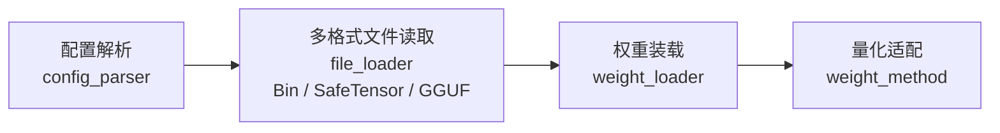
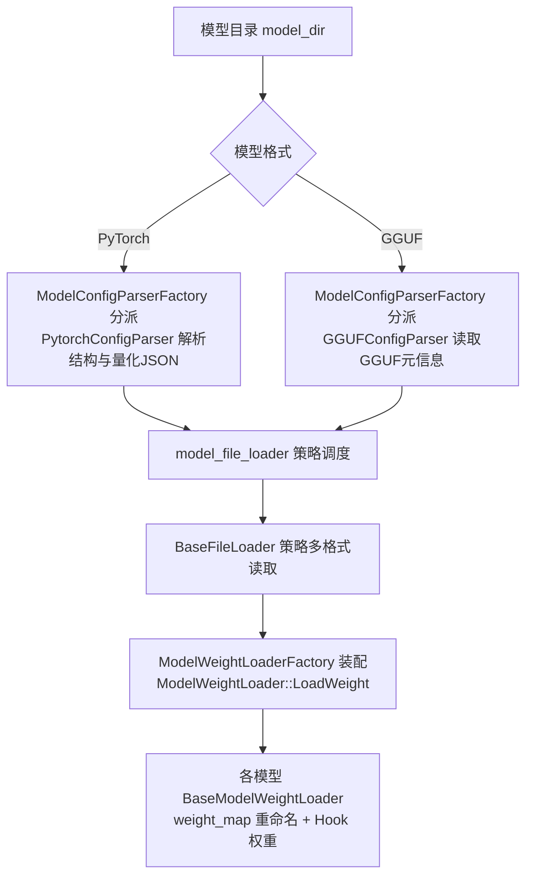
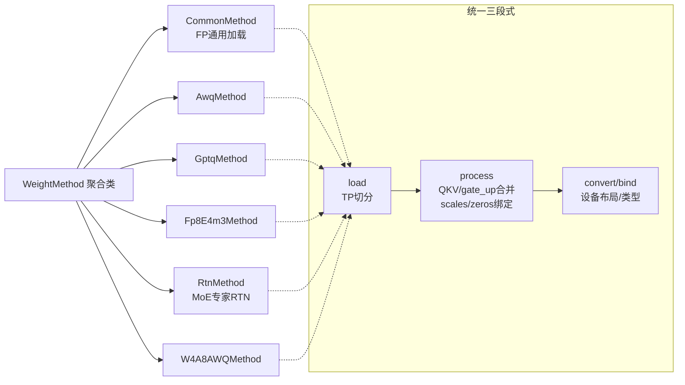
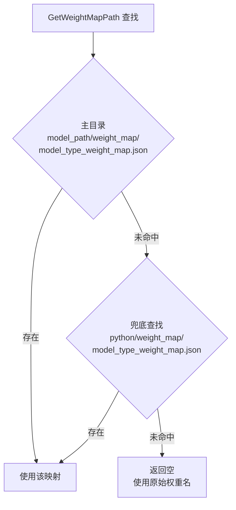
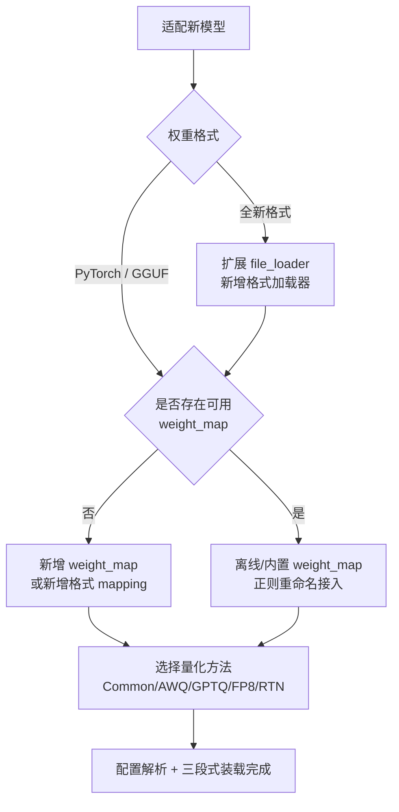
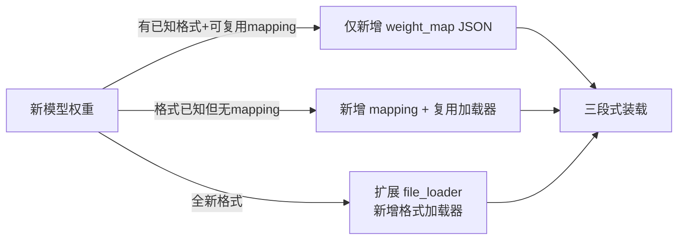

# 模型权重加载

KsanaLLM 的权重加载采用「配置解析 → 文件读取 → 权重装载」三段式框架，配合 `weight_method` 量化适配与 `weight_map` 权重重命名，实现任意新模型在推理启动阶段的低成本接入。本文面向部署与模型适配工程师，讲解多格式读取、量化适配与名称映射的完整链路。

---

## 1. 权重加载体系总览

KsanaLLM 将权重加载拆分为结构解析、多格式读取、量化装载三个独立环节，各环节职责单一、可独立扩展，是新增模型接入的核心扩展点。

三段式框架位于 `csrc/model_loader/`，内部按职责拆分为 `config_parser`、`file_loader`、`weight_loader` 三个子目录，分别对应模型结构解析、配置文件读取、权重装配。



| 环节 | 目录 | 职责 |
| --- | --- | --- |
| 配置解析 | `csrc/model_loader/config_parser/` | 按模型类型解析结构/量化配置（PyTorch JSON、GGUF 元信息） |
| 文件读取 | `csrc/model_loader/file_loader/` | 以 `BaseFileLoader` 抽象调度多格式权重文件读取 |
| 权重装载 | `csrc/model_loader/weight_loader/` | 装配权重加载器，驱动 LoadWeight 流程 |

三段式框架在引擎 `LoadWeight`/`Initialize` 启动阶段被调用，将磁盘权重搬运进设备内存并完成量化布局，供后续前向计算使用。本文仅覆盖权重加载领域，启动与引擎生命周期细节属部署章节。

**Sources:** <ref_code path="csrc/model_loader/" /> <ref_code path="csrc/models/weight_method/" />

## 2. 模型权重多格式加载（三段式框架）

三段式框架以「配置解析 + 文件读取 + 权重装配」为主线，将「模型长什么样」「权重存成什么格式」「如何装进设备」三件事解耦，其中文件读取通过策略模式支持多种权重格式。

### 2.1 配置解析：ModelConfigParserFactory 分派

模型配置解析由 `ModelConfigParserFactory` 按 `ModelArchitecture` 分派到对应解析器，返回统一的配置对象。

- `ModelConfigParserFactory::CreateModelConfigParser`：按模型架构创建解析器入口。
- `PytorchConfigParser`：解析 PyTorch 格式模型的 `config.json` 结构与量化参数。
- `GGUFConfigParser`：读取 GGUF 文件的元信息（`GetGGUFMeta`），得到结构配置。



### 2.2 文件读取：BaseFileLoader 策略调度多格式

文件读取由 `model_file_loader` 调度，`InitFileLoader` 依据格式创建对应加载器实例，全部实现 `BaseFileLoader` 抽象接口。

`BaseFileLoader` 定义两个纯虚接口：`LoadWeightNames` 仅读取权重名不加载数据，`LoadModelWeights` 按名单装载权重张量。

| 加载器 | 目标格式 | 读取方式 | 是否 mmap | 适用场景 |
| --- | --- | --- | --- | --- |
| `PytorchBinFileLoader` | PyTorch Bin | 顺序反序列化 | 否 | 旧式 `.bin` 权重文件 |
| `PytorchSafetensorFileLoader` | SafeTensor | 按偏移零拷贝映射 | 是 | 主流 `.safetensors`，低内存开销 |
| `GGUFFileLoader` | GGUF | 按量化张量解析 | 部分 | GGUF 量化模型文件 |

`PytorchSafetensorFileLoader` 构造时即对文件执行 `mmap`，`LoadModelWeights` 依据张量头的 `data_offsets` 直接映射到宿主地址，张量以 `MemoryLocation::LOCATION_HOST` 及原始 dtype（含 `F8_E4M3` 等量化类型）落入结果表，避免整文件拷贝。

### 2.3 权重装配：ModelWeightLoaderFactory 驱动

`ModelWeightLoaderFactory::CreateModelWeightLoader` 按模型架构创建具体 `BaseModelWeightLoader`；`ModelWeightLoader::LoadWeight` 以每设备一线程并行的方式驱动整个装载流程。

`BaseModelWeightLoader` 是各模型加载器的基类，暴露 `FilterModelFiles`、`ProcessModelWeights`、`PreProcessModelWeights`、`PostProcessModelWeights` 等扩展点，是后续 weight_map 重命名与张量搬运的宿主。

**Sources:** <ref_code path="csrc/model_loader/config_parser/model_config_parser_factory.h" /> <ref_code path="csrc/model_loader/config_parser/pytorch_config_parser.h" /> <ref_code path="csrc/model_loader/config_parser/gguf_config_parser.h" /> <ref_code path="csrc/model_loader/file_loader/base_file_loader.h" /> <ref_code path="csrc/model_loader/file_loader/model_file_loder.cpp" /> <ref_code path="csrc/model_loader/file_loader/pytorch_safetensor_file_loader.cpp" /> <ref_code path="csrc/model_loader/weight_loader/model_weight_loader_factory.h" /> <ref_code path="csrc/model_loader/weight_loader/model_weight_loader.h" />

## 3. weight_method 量化适配

`weight_method` 是权重装载的量化适配层，根据 `QuantConfig` 选择一种量化子方法，以统一的 load → process → convert/bind 三段式处理权重，并支持张量并行切分。

### 3.1 WeightMethod 聚合六种子方法

`WeightMethod` 聚合类持有六个子方法对象：`CommonMethod`、`AwqMethod`、`GptqMethod`、`Fp8E4m3Method`、`RtnMethod`、`W4A8AWQMethod`，按量化配置择一装配，并提供 `GetXXXMethod()` 访问入口。



| 子方法 | 用途 | 关键处理 |
| --- | --- | --- |
| `CommonMethod` | FP16/BF16/FP32 通用加载 | norm/embed/lm_head 及各类投影的普通装载 |
| `AwqMethod` | AWQ 4bit | `PreprocessAwqWeightForTpSplit`、`convert_weight_and_bind` 绑定 scales/zeros |
| `GptqMethod` | GPTQ 4bit | `PreprocessGptqWeightForTpSplit`，支持 desc_act/act_order |
| `Fp8E4m3Method` | FP8（含 Block FP8） | `ConvertWeightToFp8` 动态量化、blockwise scale、scale_fmt |
| `RtnMethod` | MoE 专家 RTN | 专家权重合并、scale interleave、生成 act_scale/alpha |
| `W4A8AWQMethod` | 权重 4bit / 激活 8bit | `convert_weight_and_bind` 绑定缩放 |

各子方法统一按三段式处理：`load`（按 dev_rank 做张量并行切分）→ `process`（QKV/gate_up 多投影合并、绑定 scales/zeros）→ `convert`/`bind`（量化内存布局与类型转换）。每种子方法均配有对应 `*_method_test.cpp` 测试用例。

### 3.2 QuantMode 与量化参数解析

量化类型由 `QuantMode` 枚举描述，定义于 `csrc/configure/model_config.h`，涵盖普通与 MoE 两种形态。

- 普通模式：`QUANT_NONE` / `QUANT_GPTQ` / `QUANT_AWQ` / `QUANT_FP8_E4M3` / `QUANT_BLOCK_FP8_E4M3` / `QUANT_W4A8_AWQ`。
- MoE 模式：`MOE_QUANT_*` 系列，对应 None / Block FP8 / FP8 / GPTQ。
- `GetQuantModeString`：将枚举映射为人可读字符串，用于日志输出。

量化参数解析集中在 `quant_config_parser`，各入口从 `config_json` 与 `is_moe` 填充 `QuantConfig`。

| 解析函数 | 读取字段 | 产出 |
| --- | --- | --- |
| `ParseGPTQQuantConfig` | `bits`、`group_size`、`desc_act`、`input_scale` | 非 GPU 下 GPTQ |
| `ParseAWQQuantConfig` | `bits`、`group_size` | `QUANT_AWQ`（拒绝 MoE） |
| `ParseFP8QuantConfig` | `weight_block_size`、`activation_scheme`、`scale_fmt` | FP8 或 Block-FP8 |
| `ParseModelOptQuantConfig` | `quant_algo` | 仅支持 `W4A8_AWQ` |
| `ParseCompressedTensorsQuantConfig` | `config_groups[].weights` | compressed-tensors GPTQ |

FP8 解析中，`weight_block_size` 为数组时置 `is_fp8_blockwise` 并选 `QUANT_BLOCK_FP8_E4M3`，`activation_scheme` 决定静态/动态，`scale_fmt` 控制缩放格式。

**Sources:** <ref_code path="csrc/models/weight_method/weight_method.h" /> <ref_code path="csrc/models/weight_method/common_method.h" /> <ref_code path="csrc/models/weight_method/awq_method.h" /> <ref_code path="csrc/models/weight_method/gptq_method.h" /> <ref_code path="csrc/models/weight_method/fp8_e4m3_method.h" /> <ref_code path="csrc/models/weight_method/rtn_method.h" /> <ref_code path="csrc/models/weight_method/w4a8_awq_method.h" /> <ref_code path="csrc/configure/model_config.h" /> <ref_code path="csrc/configure/quant_config_parser.cpp" />

## 4. weight_map 权重重命名与扩展接入

`BaseModelWeightLoader` 通过 weight_map 机制，用「正则 key → 目标名」的 JSON 映射，把任意模型原始权重名改写为 KsanaLLM/HuggingFace 标准名，是低成本接入新模型的关键。

### 4.1 兜底查找与正则重命名

`GetWeightMapPath` 以「主目录优先、SDK 内置兜底」的顺序查找映射文件，未命中时返回空并使用原始权重名。



查找逻辑要点：

- PyTorch 格式后缀为 `_weight_map.json`，GGUF 格式为 `_gguf_weight_map.json`。
- 初始化时通过 `InitRegexPatterns` 读取 JSON，将每个 key 编译为正则，value 作为替换格式存入 `patterns_`。
- `GetCustomWeightMap` 对每个权重名执行 `regex_search` 命中后 `regex_replace` 重命名，层号捕获组 `(\d+)` 映射为 `$1`。

以 `python/weight_map/qwen3_weight_map.json` 为例，将外部权重前缀重写为 KsanaLLM 标准名：

```json
"model.language_model.embed_tokens.weight": "model.embed_tokens.weight",
"model.language_model.layers.(\\d+).mlp.gate_proj.weight": "model.layers.$1.mlp.gate_proj.weight",
"model.language_model.layers.(\\d+).self_attn.k_proj.weight": "model.layers.$1.self_attn.k_proj.weight",
"model.language_model.norm.weight": "model.norm.weight"
```

### 4.2 张量搬运与类型转换辅助

`BaseModelWeightLoader` 提供一组受保护辅助函数，供各模型加载器在 weight_map 之后编排张量搬运。

- `CopyHostTensorToDevice`：将宿主张量复制到设备，用于填充输出 dtype/shape。
- `PermuteDeviceTensor`：按 permutation 换位并在部分设备做布局转换。
- `CastDeviceTensorType` / `CastDeviceTensorTypePytorch`：在 FP32/FP16/BF16 之间转换设备张量类型。

`python/weight_map/` 目录收录大量现成映射（`qwen3_weight_map.json`、`deepseek_v3_weight_map.json`、`llama_gguf_weight_map.json` 等），`README.md` 提供自定义 mapping 指南，新增模型只需补充一张映射 JSON 即可低成本挂接。

**Sources:** <ref_code path="csrc/models/base/base_model_weight_loader.cpp" /> <ref_code path="csrc/models/base/base_model_weight_loader.h" /> <ref_code path="csrc/utils/get_custom_weight_name.cpp" /> <ref_code path="python/weight_map/" />

## 5. 扩展实践与注意事项

接入新模型的路径遵循「格式就绪 → 配置解析 → 名称映射 → 量化选择」的决策流，多数模型仅需补充映射 JSON 即可完成加载。



### 5.1 扩展路径

新模型接入按以下顺序评估：

- 主目录组织：在模型目录或 `python/weight_map/` 放置 `{model_type}_weight_map.json`。
- 配置解析：PyTorch 用 `PytorchConfigParser`，GGUF 用 `GGUFConfigParser`，必要时在 `config_parser` 扩展解析。
- 格式读取：优先 SafeTensor（mmap 零拷贝）；`.bin` 走 `PytorchBinFileLoader`；GGUF 走 `GGUFFileLoader`。
- 量化方法：根据权重格式在 `Common/AWQ/GPTQ/FP8/RTN` 中选择对应 `weight_method`。
- 校验逻辑：以 `model_loader` 下多个 `*_test.cpp` 与各 `weight_method` 的 `*_method_test.cpp` 作为加载正确性参照。

对接新模型的决策示意：



### 5.2 排查与注意事项

常见问题与对应检查点：

- SafeTensor 与 bin 差异：SafeTensor 已含 dtype/shape 头，无需额外解析；若报 dtype 缺失，检查 `GetTensorDataType` 是否覆盖该类型。
- 量化配置字段：`ParseFP8QuantConfig` 依赖 `weight_block_size`、`activation_scheme`、`scale_fmt`，缺字段会解析失败。
- weight_map 前缀一致性：`InitRegexPatterns` 会统一 `hunyuan_large`/`hunyuan_turbo` 为 `hunyuan`；新增模型需保证正则与权重名前缀一致。
- 正则优先级：`GetCustomWeightMap` 命中最先匹配的 pattern 即停止，多条规则需注意先后顺序。

### 5.3 可深入方向

本领域仍可继续演进：更多新型量化格式的加载器、跨格式映射的自动生成、以及 SafeTensor mmap 下更大模型的零拷贝直接上设备等方向均属后续扩展空间。

**Sources:** <ref_code path="csrc/models/base/base_model_weight_loader.h" /> <ref_code path="csrc/model_loader/" />