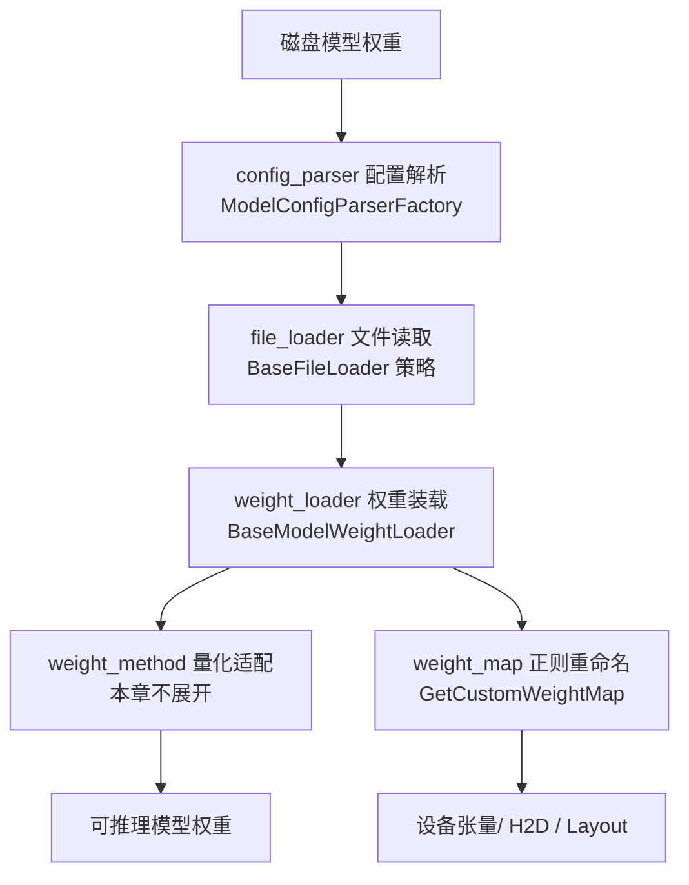
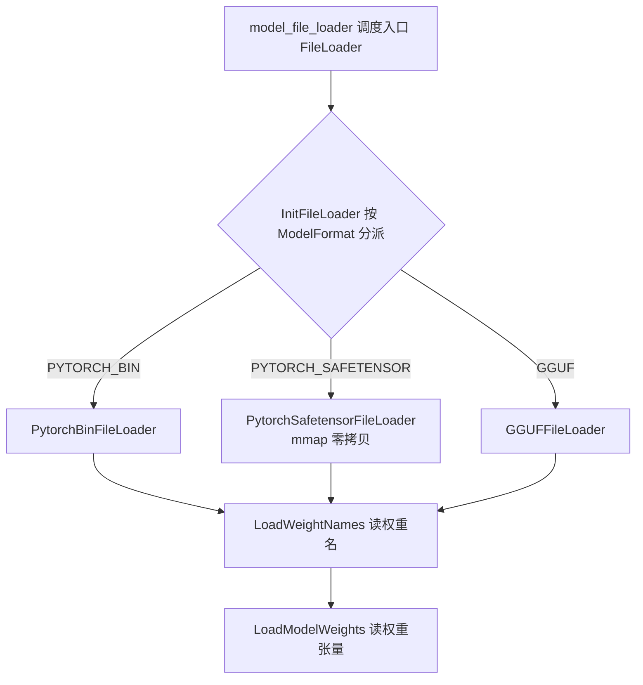
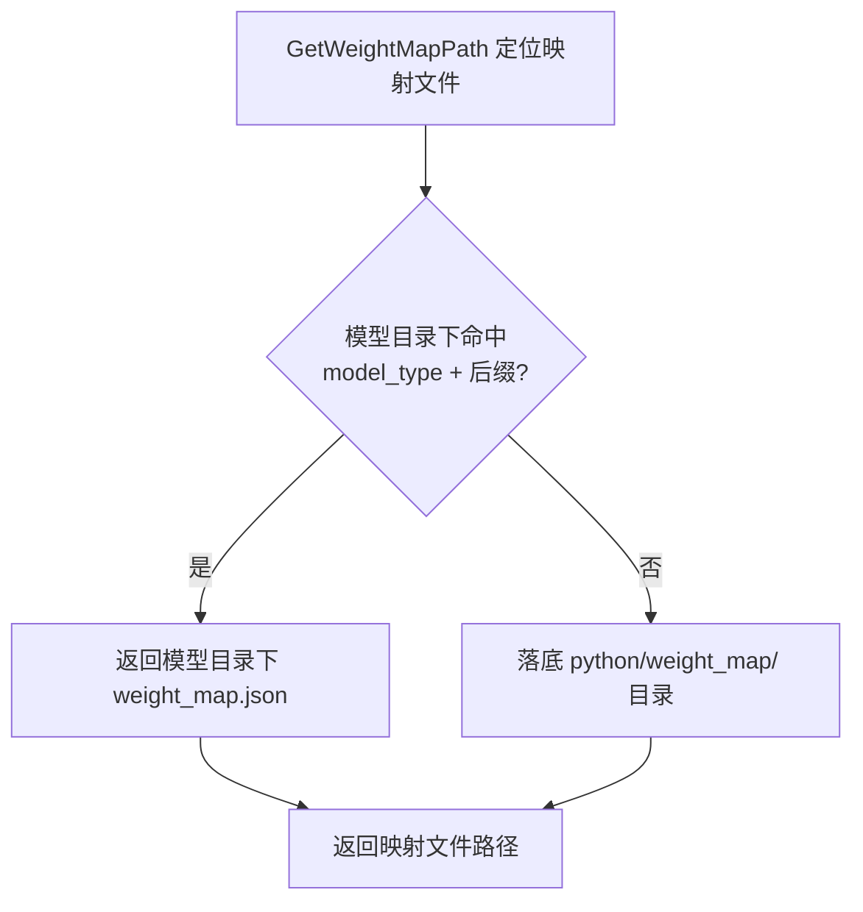
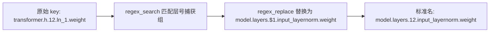
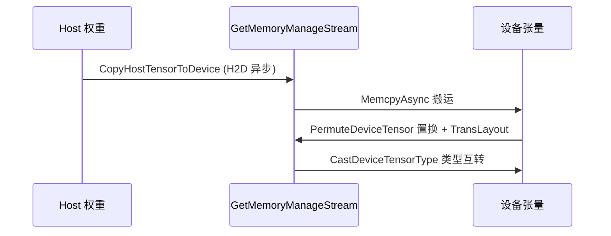
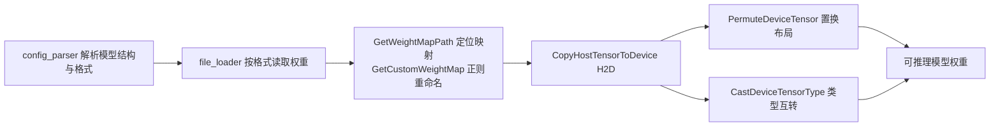

# 加载流程与多格式

本文档面向部署与模型适配工程师，系统介绍 KsanaLLM 模型权重加载中的「加载流程与多格式」：从磁盘权重到设备张量的完整通路，涵盖配置解析、多格式读取、权重名重映射、Host→Device 复制与类型转换。

## 1. 权重加载全景与整体流程

权重加载解决一个根本问题：**如何把磁盘上的模型权重，正确读入并装配成设备上具有预期命名与布局的可推理模型**。它是模型适配的前置环节，上游衔接格式识别、下游衔接量化处理。

### 1.1 三段式加载框架

KsanaLLM 将权重加载拆成三段式流水，各司其职：

| 阶段 | 目录 | 职责 |
| --- | --- | --- |
| 配置解析 | `csrc/model_loader/config_parser` | 决定模型结构与量化诉求（ModelConfigParserFactory 分派） |
| 文件读取 | `csrc/model_loader/file_loader` | 以策略模式读取 PyTorch Bin / SafeTensor / GGUF |
| 权重装载 | `csrc/model_loader/weight_loader` | 装配权重：映射、复制、置换、类型转换 |



### 1.2 与相邻模块的协作

`BaseModelWeightLoader` 是权重装载基类，位于 `csrc/models/base/`，承载重命名与张量操作，作为各模型 weight_loader 的公共底座。它通过 `context_` 访问设备上下文，张量操作统一使用内存管理流。

链路止于「设备张量就绪」，量化数字处理由 weight_method 专章覆盖。

**Sources:** <ref_code path="csrc/model_loader/" /> <ref_code path="csrc/models/base/base_model_weight_loader.cpp" /> <ref_code path="csrc/models/base/base_model_weight_loader.h" />

## 2. 配置解析 ModelConfigParser

配置解析决定「模型结构与量化诉求」，是加载流程的输入源头。它只回答「模型长什么样、需要什么格式」，不读取权重内容。

### 2.1 统一分发入口 ModelConfigParserFactory

`ModelConfigParserFactory` 按 `ModelArchitecture` 枚举分派具体解析器，覆盖 llama、qwen、deepseek、mixtral、internlm2 等主流架构。

- 输入：`ModelArchitecture` 架构枚举
- 输出：对应模型的 `BaseModelConfigParser` 派生实例
- 常见架构：`ARCH_LLAMA`、`ARCH_QWEN`、`ARCH_DEEPSEEK`、`ARCH_MIXTRAL`、`ARCH_CHATGLM` 等
- 未支持架构：返回 `RET_INVALID_ARGUMENT`

### 2.2 PyTorch 与 GGUF 两种解析器

两种格式的配置来源不同：

| 解析器 | 配置来源 | 入口方法 | 判定方式 |
| --- | --- | --- | --- |
| `PytorchConfigParser` | 模型目录下 `config.json` | `GetJsonConfig` | 读 `model_type`/`architectures` 字段 → 架构枚举 |
| `GGUFConfigParser` | GGUF 文件头部元数据 | `GetGGUFMeta` | 读 `general.architecture` → 仅支持 llama |

`PytorchConfigParser` 还会做架构归一化，如 `qwen2_vl`→`qwen2`、`hunyuan` 按 `use_mixed_mlp_moe` 拆分为 `hunyuan_large`/`hunyuan_turbo`。

### 2.3 与量化配置解析的边界

量化参数解析位于 `csrc/configure/quant_config_parser`（QuantMode 枚举、FP8 参数等），属于量化章节，本文将配置解析的量化部分留给下游，不做展开。

**Sources:** <ref_code path="csrc/model_loader/config_parser/model_config_parser_factory.cpp" /> <ref_code path="csrc/model_loader/config_parser/model_config_parser.h" /> <ref_code path="csrc/model_loader/config_parser/pytorch_config_parser.cpp" /> <ref_code path="csrc/model_loader/config_parser/gguf_config_parser.cpp" />

## 3. 多格式权重文件读取（file_loader）

文件读取层解决「从磁盘读出权重张量」：将 PyTorch Bin、SafeTensor、GGUF 三种格式统一成一致的读取接口。

### 3.1 策略模式与调度入口

- `BaseFileLoader`：格式读取抽象基类，声明 `LoadWeightNames`（只列名字不读）与 `LoadModelWeights`（读张量）两个纯虚方法。
- `FileLoader`：调度入口，`InitFileLoader` 按 `ModelFormat` 分派出具体加载器，`model_file_loader` 对外提供统一入口。



### 3.2 三种格式的读取途径

| 加载器 | 文件组织 | 读取特点 | 适用 |
| --- | --- | --- | --- |
| `PytorchBinFileLoader` | 一个 `.bin` 文件序列化全部权重 | 直接读取 | 常见 PyTorch 权重 |
| `PytorchSafetensorFileLoader` | 一个 `.safetensors` 文件，内含索引与数据 | mmap 零拷贝读取，内存友好 | 大模型加载 |
| `GGUFFileLoader` | GGUF 头 + 元数据 + 张量块 | 从头部读元数据、逐张量读取，并供 `GetGGUFMeta` 取配置 | llama 等 GGUF 权重 |

### 3.3 三格式特性对比

| 维度 | PyTorch Bin | SafeTensor | GGUF |
| --- | --- | --- | --- |
| 读取方式 | 反序列化整体读取 | mmap 零拷贝按需读取 | 元数据 + 张量块 |
| 内存占用 | 高（.bin 全量入内存） | 低（按索引映射） | 中 |
| 读取速度 | 快（一次性） | 快（按需 + 内存映射） | 中 |
| 典型来源 | PyTorch `save` | HF safetensors 权重 | llama.cpp / GGUF |

读取层到「读出权重张量」为止；权重名重命名与 H2D 复制在后续章节，量化处理在其专章。

**Sources:** <ref_code path="csrc/model_loader/file_loader/model_file_loder.cpp" /> <ref_code path="csrc/model_loader/file_loader/model_file_loader.h" /> <ref_code path="csrc/model_loader/file_loader/base_file_loader.h" /> <ref_code path="csrc/model_loader/file_loader/pytorch_bin_file_loader.cpp" /> <ref_code path="csrc/model_loader/file_loader/pytorch_safetensor_file_loader.h" /> <ref_code path="csrc/model_loader/file_loader/gguf_file_loader.cpp" />

## 4. 权重映射路径 GetWeightMapPath

映射文件决定了「原始权重名 → 标准张量名」从哪来。`GetWeightMapPath` 负责定位 weight_map JSON 文件的路径。

### 4.1 两级查找策略

查找顺序为「模型目录优先，落底 ksana_llm 默认目录」：

1. GGUF 格式将后缀改为 `_gguf_weight_map.json`，其余为 `_weight_map.json`
2. 第一级：在模型目录下查找 `{model_type}_weight_map.json`
3. 第二级：未找到则落到内置 `python/weight_map/` 默认资源目录



### 4.2 低成本接入入口

该机制是「低成本接入新模型命名」的扩展点：只需在默认目录放一个 `{model_type}_weight_map.json`，无需改动 C++ 代码即可让新模型命名生效。`csrc/utils/get_custom_weight_name.cpp` 亦提供工具侧同名能力（`GetWeightMapPath` / `GetCustomNameList`），供 Python 侧标准化命名时复用。

**Sources:** <ref_code path="csrc/models/base/base_model_weight_loader.cpp" /> <ref_code path="csrc/utils/get_custom_weight_name.cpp" /> <ref_code path="python/weight_map/" />

## 5. 正则权重重映射 CustomWeightMap

读取出的权重张量用的是第三方命名，需通过「正则 key → 目标名」重写为标准张量名，才能被后续装配识别。

### 5.1 正则重命名机制

核心流程由 `BaseModelWeightLoader` 的两个方法实现：

- `InitRegexPatterns`：定位并解析 weight_map JSON，把每条 key 编译为 `std::regex`，存入 `patterns_`（正则与替换格式串的键值对）。
- `GetCustomWeightMap`：遍历每个权重名，用 `regex_search` + `regex_replace` 将命中的 key 重写为目标张量名。

替换规则：key 用 `()` 标记需保留的部分（如层号 `(\d+)`），value 用 `$1` `$2` 依次回填。



### 5.2 典型模型映射片段

`python/weight_map/` 覆盖 qwen、llama_gguf、mixtral、deepseek 等模型。以 qwen 与 llama_gguf 为例：

| 原始命名 | 正则 key / 替换 | 标准名 | 模型 |
| --- | --- | --- | --- |
| `transformer.wte.weight` | → `model.embed_tokens.weight` | 词嵌入 | qwen |
| `transformer.h.(\d+).ln_1.weight` | → `model.layers.$1.input_layernorm.weight` | 层归一化 | qwen |
| `transformer.h.(\d+).mlp.w2.weight` | → `model.layers.$1.mlp.gate_proj.weight` | MoE 门控 | qwen |
| `blk.(\d+).attn_q.weight` | → `model.layers.$1.self_attn.q_proj.weight` | Q 投影 | llama_gguf |
| `blk.(\d+).ffn_down.weight` | → `model.layers.$1.mlp.down_proj.weight` | 下投影 | llama_gguf |

qwen 中 `.*visual.*` 映射为 `deprecated`，用于标记应被过滤的权重。工具侧 `GetCustomNameList`（`csrc/utils/get_custom_weight_name.cpp`）用同一套正则规则把原始权重名转自定义张量名。

**Sources:** <ref_code path="csrc/models/base/base_model_weight_loader.cpp" /> <ref_code path="csrc/utils/get_custom_weight_name.cpp" /> <ref_code path="python/weight_map/qwen_weight_map.json" /> <ref_code path="python/weight_map/llama_gguf_weight_map.json" />

## 6. Host 到 Device 复制、Permute 与类型转换

重命名后，权重从主机内存搬运到设备显存，并完成布局调整与类型转换。

### 6.1 三类张量操作

`BaseModelWeightLoader` 提供三个公共底座方法，所有操作的流统一取自 `GetMemoryManageStream()`：

| 方法 | 作用 | 说明 |
| --- | --- | --- |
| `CopyHostTensorToDevice` | 主机→设备异步拷贝 | 分配设备张量后 `MemcpyAsync(H2D)` |
| `PermuteDeviceTensor` | 维度置换 + 布局转换 | 调用 `Permute` 后按置换更新 shape，并 `TransLayout` 兼容 Ascend |
| `CastDeviceTensorType` / `CastDeviceTensorTypePytorch` | 设备张量类型互转 | FP32/FP16/BF16 在 CUDA 上互转（Ascend/Tops 暂不支持） |

示例（一次 H2D 拷贝）：

```cpp
MemcpyAsync(dev_tensor.GetPtr<void>(), host_tensor.GetPtr<void>(),
            host_tensor.GetTotalBytes(), MEMCPY_HOST_TO_DEVICE,
            context_->device->GetMemoryManageStream());
```

### 6.2 多流与多设备衔接

- 张量操作统一走 `GetMemoryManageStream` 内存管理流，与设备上下文、多 GPU 并行度对齐。
- `ModelWeightLoader` 用线程池为每个设备准备一个线程，权重名处理按设备 rank 展开。
- 这些操作为各模型 weight_loader 的公共底座，量化子方法基于它完成设备加载。



**Sources:** <ref_code path="csrc/models/base/base_model_weight_loader.cpp" /> <ref_code path="csrc/device/device_context_impl.cpp" />

## 7. 加载主链路串联与模型适配实践

本章把四环节串成一条完整加载链路，并给出模型适配工程师的落地指引。

### 7.1 端到端加载链路



四环节依次为：解析配置 → 读取文件 → 重命名为标准名 → H2D 复制/类型转换/布局置换。量化参数解析在 `csrc/configure/quant_config_parser`，与加载链路正交，量化数字处理不在本章范围。

### 7.2 低成本接入新命名

基于 Llama 结构且改动不大的模型，可通过扩展 weight_map 接入：

- 在模型目录放 `{model_type}_weight_map.json`，或落入内置 `python/weight_map/`。
- 与 Llama 命名完全相同的权重（如 `lm_head.weight`）无需添加映射项。
- 与 Llama 不同的权重按 `key`（正则）→ `value`（替换格式）填入。

模型适配接入步骤清单：

| 步骤 | 动作 |
| --- | --- |
| 1 | 确认模型类型与格式（PyTorch / SafeTensor / GGUF） |
| 2 | 使 `ModelConfigParserFactory` 能分派到该架构的解析器 |
| 3 | 编写 `{model_type}_weight_map.json` 正则映射 |
| 4 | 复用 `BaseModelWeightLoader` 底座完成 H2D/置换/类型转换 |
| 5 | 量化数字处理移交 weight_method 专章 |

**Sources:** <ref_code path="python/weight_map/README.md" /> <ref_code path="python/weight_map/" /> <ref_code path="csrc/models/base/base_model_weight_loader.cpp" />