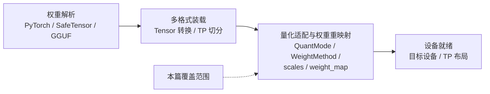
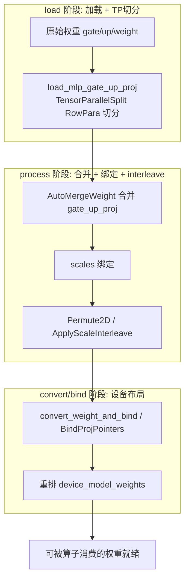
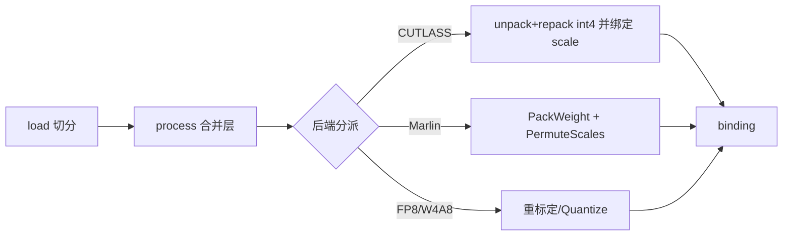
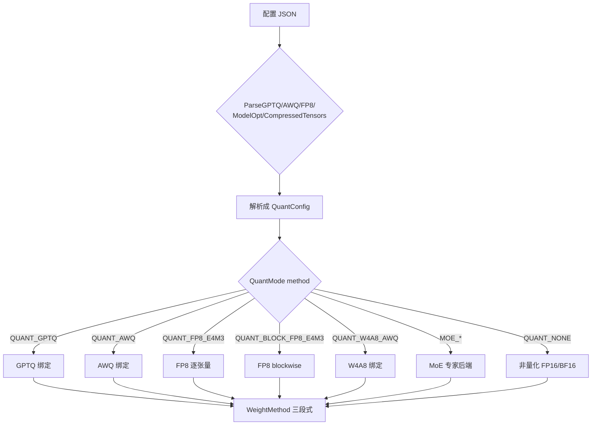
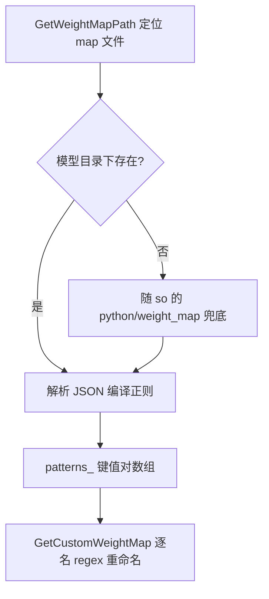

# 量化适配与权重重映射

量化适配与权重重映射是 KsanaLLM 推理初始化中权重加载的第二大环节。它在解析与多格式装载之后、算子就绪之前，把不同量化精度的权重按量化语义装入设备内存，并按张量并行（TP）布局切分、绑定缩放因子（scales/zeros），最终产出可被算子直接消费的设备权重。

本文档覆盖两个相互衔接的子主题：量化权重适配与权重重命名映射。前者解决「同一套装载编排如何服务不同量化格式」，后者解决「不同导出命名如何接入统一标准名」。

## 1 量化适配与权重重映射概述

### 1.1 加载链路中的位置

权重加载遵循「配置解析 → 多格式装载 → 量化适配/重映射 → 算子消费」的整体链路，本环节位于装载与算子之间：



上级输出为原始权重张量（仍为宿主内存、原始命名），本环节将其规整为设备内存、统一标准名、量化元数据齐全的资源集后交给算子。

### 1.2 关键概念一句话指引

| 概念 | 一句话含义 | 所在环节 |
|---|---|---|
| WeightMethod | 六类量化子方法的统一聚合与三段式编排入口 | `csrc/models/weight_method/` |
| QuantMode | 量化模式枚举，决定选中哪条量化绑定路径 | `csrc/configure/model_config.h` |
| scales/zeros | 量化缩放因子与零点，反量化所需附加元数据 | 各 weight_method |
| weight_map | 正则 key → 标准名的重命名映射 JSON | `python/weight_map/*.json` |
| TP 切分 | 张量并行维度对权重按 Row/Col 度的切分 | 各 weight_method load |

### 1.3 本文档边界

本文档是「模型权重加载」领域内兄弟文档「加载流程与多格式」的延续，两者分工如下：

- 兄弟文档覆盖：配置解析（ModelConfigParser）、多格式读取（file_loader）、Host→Device 复制 / Permute / Cast 等通用装载能力。
- 本文档覆盖：量化权重适配（WeightMethod 聚合、三段式、各子方法）、QuantMode 配置解析、weight_map 重命名接入。

排除在外：量化内核数值推导与 GEMM 反量化算法、模型结构与层工厂五元组、分布式并行切分策略本身。

**Sources:** <ref_code path="csrc/models/weight_method/weight_method.h" /> <ref_code path="csrc/models/weight_method/weight_method.cpp" />

## 2 WeightMethod 聚合类与统一三段式流程

### 2.1 WeightMethod：六类子方法的统一聚合入口

`WeightMethod` 是承上启下的聚合类，持有 `CommonMethod`、`AwqMethod`、`W4A8AWQMethod`、`GptqMethod`、`RtnMethod`、`Fp8E4m3Method` 六个成员。它向流程外观层暴露同一套 `GetXxxMethod()`/`GetRegistry()` 接口，屏蔽具体量化格式差异。

其核心是两层注册表 `registry_[name][stage]`：

- 外层以方法名（`load_attn_q_k_v_proj`、`process_mlp_gate_up_proj` 等）为键；
- 内层以阶段（load / process / convert）为键；
- 叶节点为 `FunctionHelper`，通过 `std::any` + `std::index_sequence` 把任意签名的成员函数封装为可统一调用的载体。

| 构造入口 | 实例化成员 | 用途 |
| --- | --- | --- |
| `WeightMethod(loader, tp)` | Common + W4A8AWQ + Rtn；AWQ/GPTQ/FP8 置空 | 无显式 `QuantConfig` 的默认路径 |
| `WeightMethod(loader, tp, QuantConfig)` | 六类成员全部实例化 | 按量化配置完整聚合 |

`RegistryType` 定义为 `unordered_map<string, unordered_map<string, FunctionHelper>>`，运行期据此把外部散件的 `load_*` / `process_*` 调用统一分发到对应子方法。`FunctionHelper` 只做签名擦除的统一封装，不做业务逻辑——真正的加载编排由各子类承接。

### 2.2 三段式流程：load → process → convert/bind

三类方法都遵循同一套三段式契约，职责切分如下：

| 阶段 | 主要职责 | 对应接口示例 |
| --- | --- | --- |
| load | 加载原始张量并完成 TP 切分 | `load_attn_q_k_v_proj` / `load_mlp_gate_up_proj` |
| process | 层合并、scales/zeros 绑定与 interleave | `process_attn_qkv_proj` / `process_mlp_gate_up_proj` |
| convert/bind | 设备布局转换与指针绑定 | `convert_weight_and_bind` / `BindProjPointers` |

**阶段 1 load（加载 + TP 切分）**：按张量名称后缀分发。

- `.weight` 走 `TensorParallelSplit`，Q/K/V、gate/up 按 `ColPara`（dim=1 输出维切分），o_proj、down_proj、embed 按 `RowPara`（dim=0 输入维切分）；
- 非切分张量（norm、experts_gate）走 `MoveToDevice` 整张拷贝；
- `lm_head` 在 vocab 不可整分时回退 `LmHeadTensorParallelSplit`。

`load_attn_q_k_v_proj` / `load_mlp_gate_up_proj` 等命名按投影类型对齐，子类可覆盖同名字节进行量化专属切分（如 `PreprocessAwqWeightForTpSplit`）。

**阶段 2 process（层合并 + 绑定 + interleave）**：做层间合并与量化附加元数据装配。

- 通过 `AutoMergeWeight` 把 `q_proj`/`k_proj`/`v_proj` 合并为 `query_key_value`，把 `gate_proj`/`up_proj` 合并为 `gate_up_proj`；
- 子类将 scales/zeros 绑定到权重张量（详见章节 3）；
- `Permute2D`、`ApplyScaleInterleave` 等把布局整理为后端期望形态。

**阶段 3 convert/bind（设备布局转换）**：`convert_weight_and_bind` 判定量化后端后把附加张量绑定到主权重，`BindProjPointers` 在 `device_model_weights` 完成 map 插入后再钉指针，避免 rehash 使引用失效。

### 2.3 典型权重流转示意

以一次完整的 MLP 通道为例：



流程图展示三段单向流转：`load` 决定每张量在 TP 上的归属与切分结果，`process` 完成跨张量合并与量化元数据装配，`convert/bind` 最终把结构固定为 `device_model_weights` 中可直接消费的布局。该框架使新增量化方法仅需实现同名 `load_*` / `process_*` 并注册进 `registry_`，无需改动外观层，保持聚合入口稳定。

**Sources:** <ref_code path="csrc/models/weight_method/weight_method.h" /> <ref_code path="csrc/models/weight_method/weight_method.cpp" /> <ref_code path="csrc/models/weight_method/common_method.h" /> <ref_code path="csrc/models/weight_method/common_method.cpp" />

## 3 各量化子方法的实现与差异

`WeightMethod` 按 `QuantMode` 实例化对应的量化子方法类，每类方法都以三段式（load → process → convert/bind）承载统一流程。本章逐一剖析六类方法的职责划分、scales/zeros 处理与后端绑定差异，并给出横向对比表。

### 3.1 AWQ：scales 转 zeros + 双后端打包

AwqMethod 是处理最完整的一类，同时绑定 scales 与 zeros。load 阶段解析 `.qweight`、`.qzeros`、`.scales` 与 `.bias`：MLP gate/up 与 attention q/k/v 走 `ColPara`，down 与 o_proj 走 `RowPara`。CUTLASS 后端下 qweight/qzeros 会在切分前经 `PreprocessAwqWeightForTpSplit` 预处理：qweight 经 unpack → 减 `2^(bits-1)` 做零偏移 → 重打包为 int4；qzeros 则 unpack 后转 half。

`process_attn_qkv_proj` 用匹配与映射把 `q_proj` 映射为 `k_proj`/`v_proj`/`query_key_value`，再把 q/k/v 的 qweight/qzeros/scales 按 dim=1 合并。`convert_weight_and_bind` 分三步完成：先把 qzeros 转 zeros（CUTLASS 分支算 `scales*(2^(bits-1)-qzeros)`，Marlin 分支调 Marlin 零点转换）；随后按后端打包 qweight，Marlin 还需按 dtype 重排 scales；最后把 scales/zeros 绑定到 weight 张量。

### 3.2 GPTQ：分段加载 + 全量重打包

GptqMethod 只绑定 scales（无 zeros）。load 与 AWQ 结构一致，仅匹配 `.qweight`/`.scales`/`.bias`，skip 掉 `.qzeros`；前端 CUTLASS 同样对 qweight 做 unpack→零偏移→重打包。`convert_weight_and_bind` 只打包 qweight，并注释标明 `desc_act==true` 的 GPTQ 尚未支持。QKV/MLP 分段加载逻辑与 AWQ 相同，仅名称模式不同，故共用一套 process 骨架。

### 3.3 RTN：MoE 专家权重的 CUTLASS interleave

RtnMethod 专门服务 MoE 专家权重（int4 + blockwise weight_scale + per-expert input_scale），目标是 CUTLASS MoE 内核。load_experts_proj 把 `.weight`/`.weight_scale` 原样入表（weight_scale 强制转 bf16），`.input_scale` 仅 MoveToDevice。process 阶段通过扫描 `*.gate_proj.weight` 动态探测本地专家索引，对 up_gate 与 down 分别做按专家合并、reshape 三维，再按 K 维计算 interleave 因子，经 permute 重排。

`ComputeMaxInputScale` 取各专家 input_scale 最大值并删除原条目；生成 `1/max_input_scale` 的 act_scale 与 `[num_experts,1]` 的 alpha。校验 scale 齐全后 `BindProjPointers` 把 weight_scale/act_scale/alpha 绑定到合并权重，且刻意延迟到所有 map 插入完成后执行，规避 unordered_map 扩容导致的指针失效。

### 3.4 FP8 E4M3：静态/动态/block 三分支

Fp8E4m3Method 按三个开关分派：是否 checkpoint FP8 序列化、激活方案是否静态、是否 FP8 blockwise。load 阶段统一走 `LoadProjTensor`：`.weight_scale` 经 TP 切分（TP≤1 或不可整除时退化为整拷贝），`.input_scale` 直接上设备，`.weight`/`.bias` 走加载与 TP 切分。

process 阶段由 `ProcessProjWeight` 分派：静态时直接绑定 checkpoint 的 weight_scale，动态激活方案下 input_scale 缺失不算错误；非静态则调 `ConvertWeightToFp8`，将权重实时量化并生成 fp32 per-tensor 的 `.weight_scale` 绑定。对 qkv/gate_up 合并采用「取 max scale 后重标定」策略；block FP8 下 scales 是 2D，改用拼接并禁止重标定。专家路径（`process_experts_proj`）仅支持静态，逐专家取 max 后并入 up_gate_weight_scale 合并。

### 3.5 W4A8 AWQ 变体

W4A8AWQMethod 面向 W4A8 混合精度，额外处理 `.weight_scale_2`、`.pre_quant_scale` 等中间 scale。load 对共享 scale 走 `MoveToDevice`，`weight`/`weight_scale` 按行/列并行切分，`pre_quant_scale` 另走行并行。process 合并 qkv/gate_up 后共享 `input_scale`/`weight_scale_2`，`convert_weight_and_bind` 中计算 `alpha = input_scale * weight_scale_2`，`weight_scale` 按 `weight_scale_2` 归一化并 Cast 到 fp16，weight 经混合精度重排，再把 input_scales/weight_scales/alpha 绑定，并将 `QuantMode::QUANT_W4A8_AWQ` 写入权重状态。

### 3.6 Common：非量化通用路径

CommonMethod 覆盖 embed_tokens、norm、expert_gate、lm_head 等大量非量化/通用场景。其 process 仅做转置与 `AutoMergeWeight` 合并 qkv/gate_up，load 中对 lm_head 提供整 divisible 与 `lm_head` 专用切分两个分支。它可作为基线，量化类的 convert 步骤在此均退化为空或转置，衔接 `WeightMethod` 的统一编排。

### 3.7 横向对比

| 方法 | 量化类型 | scales 处理 | zeros 处理 | TP 绑定 | 关联后端 |
|---|---|---|---|---|---|
| AWQ | INT4(W4A16) | scales 绑定；Marlin 需 Permute | 绑 zeros（CUTLASS 算 `scale*(2^b-qzeros)`；Marlin 用零点转换） | Col/Row 双维，CUTLASS 预处理后再切 | Cutlass / Marlin |
| GPTQ | INT4(W4A16) | scales 绑定，Marlin Permute | 无（skip .qzeros） | Col/Row 双维，CUTLASS 预处理后切 | Cutlass / Marlin |
| RTN | INT4(MoE) | blockwise weight_scale + act_scale/alpha | 无 | 不切分，专家权重整体合并 reshape 3D | CUTLASS MoE（interleave） |
| FP8 E4M3 | FP8(W8A8) | 静态绑定或 `ConvertWeightToFp8` 动态生成 | 无 | weight_scale 按 TP 切分，可整除才 split | FP8 量化/重标定内核 |
| W4A8 AWQ | INT4/FP8 混合 | weight_scale 归一化 + weight_scale_2 | 无 | 行/列混合，pre_quant 行并行 | 混合精度 GEMM 封装 |
| Common | NONE | 无 | 无 | 全量切分（lm_head 有专用分支） | 通用权重 kernel |

### 职责矩阵

| 阶段 | AWQ | GPTQ | RTN | FP8 | W4A8 | Common |
|---|---|---|---|---|---|---|
| load | 预处理后 Col/Row 切分 | 预处理后 Col/Row 切分 | 专家权重搬运 | 统一 LoadProjTensor 分派 | 职责式 move/split | 切分/MoveToDevice |
| process | AutoMerge q/g | AutoMerge q/g | ProcessExpertProj 合并 reshape | qkv/gate_up 合并 + 重标定 | AutoMerge + alpha | AutoMerge + Permute2D |
| convert/bind | qzeros→zeros、打包、绑定 | 打包、绑定 | 绑定 weight_scale/act_scale/alpha | 绑定/动态转换绑定 | 混合精度重排 | 无 |

各量化子方法的共性体现在 `convert_weight_and_bind` 的三段编排上：先把 qzeros/scale 规整为后端期望的布局，再打包 qweight 为运行期形态，最后把 scale/tensor 绑定到 weight 的指针字段，统一经 `WeightMethod` 组合成 `.weight_scale`/`.input_scale`/`.zeros` 等资源。



**Sources:** <ref_code path="csrc/models/weight_method/awq_method.cpp" /> <ref_code path="csrc/models/weight_method/gptq_method.cpp" /> <ref_code path="csrc/models/weight_method/rtn_method.cpp" /> <ref_code path="csrc/models/weight_method/fp8_e4m3_method.cpp" /> <ref_code path="csrc/models/weight_method/w4a8_awq_method.cpp" /> <ref_code path="csrc/models/weight_method/common_method.cpp" />

## 4 QuantMode 枚举与量化配置解析

量化加载的通道由 `QuantMode` 量化模式枚举与解析器（Parser）共同驱动。配置解析最终落成 `QuantConfig`，其中 `method` 字段决定 `WeightMethod` 走哪条绑定规则。

### 4.1 QuantMode 枚举语义

`enum QuantMode` 定义在 `csrc/configure/model_config.h`，涵盖 Dense 与 MoE 两大分支共 10 个取值：

| QuantMode 值 | 语义 | 对应量化路径 |
|---|---|---|
| `QUANT_NONE` | 无量化 | 走原始 FP16/BF16 绑定 |
| `QUANT_GPTQ` | GPTQ 权重按比特量化 | 走 GPTQ int4 后端 |
| `QUANT_AWQ` | AWQ 权重按比特量化 | 走 AWQ int4 后端 |
| `QUANT_FP8_E4M3` | FP8 逐张量缩放 | FP8 常量化 GEMM |
| `QUANT_BLOCK_FP8_E4M3` | FP8 块状缩放 | FP8 blockwise GEMM |
| `QUANT_W4A8_AWQ` | ModelOpt W4A8 | int4 权重 + FP8 激活 |
| `MOE_QUANT_NONE` | MoE 层不量化 | 走 MoE 非量化后端 |
| `MOE_QUANT_BLOCK_FP8_E4M3` | MoE 专家 FP8 blockwise | 专家走块状 FP8 |
| `MOE_QUANT_FP8_E4M3` | MoE 专家 FP8 | 专家走逐张量 FP8 |
| `MOE_QUANT_GPTQ` | MoE 专家 GPTQ | 专家走 GPTQ MoE 后端 |

`GetQuantModeString` 将枚举映射为可读字符串，用于日志打印与调试。同一语义在 MoE 下有独立枚举分支，是让「专家层」与「非专家层」可配置不同的量化路径。

### 4.2 QuantConfig 与解析入口分工

`struct QuantConfig` 聚合一条量化路径所需全部参数。其中 `method` 为枚举出口，其余字段定义该路径的几何与格式：

- GPTQ/AWQ：`bits`、`group_size`、`desc_act`（GPTQ 激活序）、`input_scale`。
- FP8：`is_fp8_blockwise`、`weight_block_size`、`is_checkpoint_fp8_serialized`、`is_activation_scheme_static`、`scale_fmt`。
- 通用：`backend`（LinearComputeBackend）、`is_compressed_tensors`、`pattern_layers` / `ignored_layers`。

解析函数头声明在 `csrc/configure/quant_config_parser.h`，各函数按量化算法分工，互不覆盖：

| 解析函数 | 产出 method | 职责 |
|---|---|---|
| `ParseGPTQQuantConfig` | `QUANT_GPTQ` | 读 bits/group_size/desc_act/input_scale |
| `ParseAWQQuantConfig` | `QUANT_AWQ` | 读 bits/group_size；MoE 直接抛出 |
| `ParseFP8QuantConfig` | `QUANT_FP8_E4M3` / `QUANT_BLOCK_FP8_E4M3` | FP8 参数拆解，见 4.3 |
| `ParseModelOptQuantConfig` | `QUANT_W4A8_AWQ` | 检查 quant_algo |
| `ParseCompressedTensorsQuantConfig` | `QUANT_GPTQ` + MOE 子配置 | 从 config_groups 提取 GPTQ 等价参数 |
| `ParseAndConvertQuantConfig` | 组装典型配置 JSON | 把 Mixed Precision 规格转成统一 JSON |

`ParseAWQQuantConfig` 对 MoE 直接抛错，说明 AWQ 路径不向 MoE 开放。`ParseCompressedTensorsQuantConfig` 在有 `ignore` 数组时拆分出专家子配置（`pattern_layers = {".mlp.experts."}`），本层置 `QUANT_NONE` 并置 `enable_moe_int4`，实现「仅专家量化」。

### 4.3 FP8 参数解析拆解

`ParseFP8QuantConfig` 是解析最为精细的一路，先落 `QUANT_FP8_E4M3`，再据入参逐项改写：

- `is_checkpoint_fp8_serialized` 强制置真，表示 checkpoint 内权重已 FP8 序列化。
- `activation_scheme` 为 `static` 时置 `is_activation_scheme_static`；MoE + 非 block 且非静态（即动态）会抛错，即 MoE 拒绝动态 FP8 激活。
- 若 `weight_block_size` 为数组，则置 `is_fp8_blockwise` 并改写为 `QUANT_BLOCK_FP8_E4M3`，读取块形状。
- `scale_fmt` 读取 FP8 scale 的编码格式（默认 `none`，即标准 float32 scale；`ue8m0` 为 2 的幂 scale）。

### 4.4 决策链

解析结果落为 `QuantConfig::method` 后，`WeightMethod` 依此选中对应的子方法，走 load/process/convert 三段式。



**Sources:** <ref_code path="csrc/configure/model_config.h" /> <ref_code path="csrc/configure/quant_config_parser.h" /> <ref_code path="csrc/configure/quant_config_parser.cpp" />

## 5 weight_map 权重重命名接入机制

### 5.1 机制定位

不同模型/同一模型的 PyTorch 与 GGUF 导出对权重命名各不相同（如 `blk.0.attn_norm.weight` 与 `transformer.h.0.ln_1.weight`），而 KsanaLLM 内核统一以 `model.layers.<n>.<子层>_proj.weight` 这类标准名装载。

weight_map 提供一条低成本接入路径：仅编写一个「正则 key → 标准名」的 JSON，即可把任意命名的权重重映射为引擎内部标准名，无需改动 C++ 装载代码。它面向模型适配工程师，是接入新模型/新导出格式的第一道适配层。

### 5.2 加载器如何定位 weight_map 文件

装载在 `BaseModelWeightLoader::InitRegexPatterns` 中完成：先按 `model_type` 取统一化，再调用 `GetWeightMapPath` 定位文件。

文件定位遵循「模型目录优先，随库兜底」两级策略（实现于 `GetWeightMapPath`，`csrc/models/base/base_model_weight_loader.cpp`）：



文件后缀因格式而异：PyTorch/SafeTensor 用 `_weight_map.json`，GGUF 用 `_gguf_weight_map.json`。

查找时，可以在模型目录下检索 `model_type + 后缀`，未命中的回退到随安装的 `python/weight_map/` 目录。统一模型名再拼接后缀（如 `hunyuan_large`/`hunyuan_turbo` 统一为 `hunyuan`，GGUF 用 `llama_gguf`）。

加载时用 `std::regex` 对 JSON 每个 key 编译，存入 `patterns_`（`InitRegexPatterns`）；若已加载则直接返回，保证每模型只解析一次。

### 5.3 正则重命名规则

`GetCustomWeightMap` 对每个原始权重名做一次 `regex_search`，命中第一个模式后用 `regex_replace` 按目标串替换，并改键回插原 map；同一权重命中一个模式即 `break`，故 JSON 键顺序一般按「先行后层级」排列。

正则 `(\d+)` 捕获层号，目标串用 `$1` 回引。以 `llama_gguf_weight_map.json` 真实项为例：

```json
"blk.(\\d+).attn_q.weight": "model.layers.$1.self_attn.q_proj.weight"
```

把 GGUF 的 `blk.7.attn_q.weight` 重命名为 `model.layers.7.self_attn.q_proj.weight`。

下表给出 `llama_gguf_weight_map.json` 的典型映射键与对应标准名：

| 原始键（正则） | 标准名（含 `$1`） |
| --- | --- |
| `token_embd.weight` | `model.embed_tokens.weight` |
| `blk.(\\d+).attn_norm.weight` | `model.layers.$1.input_layernorm.weight` |
| `blk.(\\d+).attn_q.weight` | `model.layers.$1.self_attn.q_proj.weight` |
| `blk.(\\d+).attn_k.weight` | `model.layers.$1.self_attn.k_proj.weight` |
| `blk.(\\d+).attn_v.weight` | `model.layers.$1.self_attn.v_proj.weight` |
| `blk.(\\d+).attn_output.weight` | `model.layers.$1.self_attn.o_proj.weight` |
| `blk.(\\d+).ffn_norm.weight` | `model.layers.$1.post_attention_layernorm.weight` |
| `blk.(\\d+).ffn_up.weight` | `model.layers.$1.mlp.up_proj.weight` |
| `blk.(\\d+).ffn_gate.weight` | `model.layers.$1.mlp.gate_proj.weight` |
| `blk.(\\d+).ffn_down.weight` | `model.layers.$1.mlp.down_proj.weight` |
| `output.weight` | `lm_head.weight` |
| `output_norm.weight` | `model.norm.weight` |

### 5.4 量化权重与接入要点

weight_map 不限于常规权重，也覆盖量化字段。`qwen_weight_map.json` 把 `transformer.h.(\\d+).attn.c_attn.qweight/qzeros/scales/g_idx` 映射为 `model.layers.$1.self_attn.W_pack.*`，所有层、线性投影的量化张量逐一对应，便于 GPTQ/AWQ 权重在重命名后绑定 scale/zero。

部分键值对以 `".*visual.*": "deprecated"` 显式丢弃 VLM 视觉分支权重。


整体重命名发生在装载流程 `GetCustomWeightMap`（在 VLM 前缀剥除之后、三段式装载之前），保证所有后续 TP 切分、量化绑定都基于统一标准名进行。

**Sources:** <ref_code path="csrc/models/base/base_model_weight_loader.cpp" /> <ref_code path="csrc/model_loader/weight_loader/model_weight_loader.cpp" /> <ref_code path="python/weight_map/llama_gguf_weight_map.json" /> <ref_code path="python/weight_map/qwen_weight_map.json" />

## 6 实践建议与注意事项

本章汇总面向量化适配/性能工程师的工程实践提示，帮助把「权重加载 + 量化适配 + 权重重映射」从配置跑通到稳定上线。不展开 benchmark 调参与量化精度分析。

### 6.1 选择正确的量化路径

正确路径的第一前提是 QuantMode 与权重文件实际格式严格一致。QuantMode 是 `QuantConfig::method`，取值见 `csrc/configure/model_config.h` 的 `QuantMode` 枚举（`QUANT_NONE/GPTQ/AWQ/FP8_E4M3/BLOCK_FP8_E4M3/W4A8_AWQ` 及 MOE 变体）。

选择建议（依权重格式决策，勿照搬同类模型配置）：

| 权重格式 | QuantMode | 推荐 LinearComputeBackend |
|---|---|---|
| FP8 逐张量/逐通道 | FP8_E4M3 | DEFAULT_LINEAR_BACKEND |
| FP8 blockwise | BLOCK_FP8_E4M3 | DEFAULT_LINEAR_BACKEND |
| GPTQ int4（含 act_order） | GPTQ | MARLIN_LINEAR_BACKEND |
| AWQ int4 | AWQ | CUTLASS_LINEAR_BACKEND 或 MARLIN |
| W4A8 AWQ | W4A8_AWQ | CUTLASS_LINEAR_BACKEND |
| FP4 MoE（DeepSeek 系） | MOE_QUANT_GPTQ/FP8 组合 | MACHETE / HUMMING 系 |

同一模型不同 layer 使用不同 QuantMode 属常态，务必让配置声明的 mode 与 checkpoint 实际编码一致。MoE 模型的普通层与共享专家层的 `QuantConfig` 需分别对齐，避免共享层误走默认后端。

### 6.2 TP 切分与 scales/zeros 绑定的正确性

量化权重在 load 阶段随 TP 切分，scales/zeros 必须与切分维度对齐，否则数值错位。

- 对输出维度切分（如 Q/K/V、全连接权重）的列，scales/zeros 沿列方向同步切。
- 对输入维度切分（如 gate/up/down）的行，scales/zeros 相应方向切分。
- group_size 需整除切分后的维度，否则需重新广播或报错，先用小规模验证。
- `is_fp8_blockwise` 相关 weight_block_size 边界与切分边界冲突时，优先约束切分粒度。
- 核对 `QuantConfig.backend`（LinearComputeBackend）与 MoE 侧 backend 枚举语义是否匹配；选择不当会在 TP 下形变量不一致。

### 6.3 新增量化模型从加载到跑通

接入新量化模型需准备以下要素：

- 配置文件：量化相关字段（format→方法名、group_size、desc_act、weight_block_size、scale、backend 等），MoE 模型另配 MoeConfig。
- weight_map 正则重命名映射 JSON：将 checkpoint 权重名映射到框架内部规范名，确保每个模块都被命中，否则静默跳过我方适配。

按阶段验证，逐步缩小问题范围：

| 步骤 | 验证点 | 常见问题与切口 |
|---|---|---|
| 1. 确认 format 与 QuantMode 一致 | 反量化结果与参考实现对齐 | 二者不匹配，启用错误反量化路径 |
| 2. 确认 weight_map 命中 | 打印未命中 key 列表 | 正则不合格、命名空间不一致导致权重缺失 |
| 3. 验证 TP 下 scales/zeros 形状 | 打印各 rank 的 scale/zero 形状与值 | 切分维度方向相反、group_size 未整除 |
| 4. 确认算子后端 | 核对 LinearComputeBackend / MoeComputeBackend | int4 误选 DEFAULT，FP8 误选 int4-only 后端 |
| 5. 小规模推理 | 单卡/小规模输出与参考对齐 | 定性量化路径 vs 重映射问题 |

### 6.4 与算子后端衔接

`LinearComputeBackend` 语义决定了哪个后端能消费相应量化格式。关键衔接提示：

- **int4-only 后端**（`CUTLASS_LINEAR_BACKEND`、`MARLIN_LINEAR_BACKEND`、Hopper 限定 `MACHETE_LINEAR_BACKEND`）仅适用 GPTQ/AWQ，FP8/BF16 模型若误选会直接报错。
- **CUTLASS int4** 支持 act_order 与 interleave；Marlin/Machete 侧重吞吐但对格式要求更严格，选用时需核对是否满足支持条件。
- MoE 侧 Machete 由 MoeComputeBackend 选择独有后端，DeepSeek 只能走相应路线。
- 排查切入：形状不匹配时先查后端支持的最小块/对齐布局；错误集中特定层时检查该层权重文件格式占比。

性能层面遵循：先用最小可用配置验证正确性，再对目标后端做专属调参。

**Sources:** <ref_code path="csrc/configure/model_config.h" />