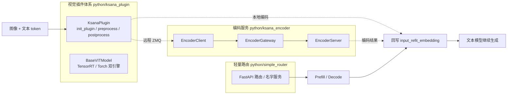
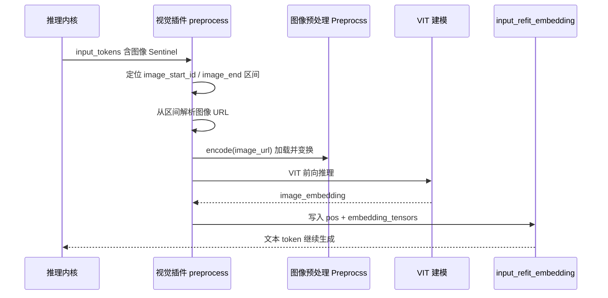
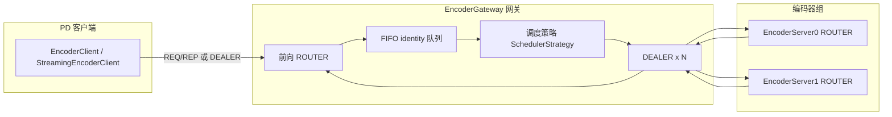
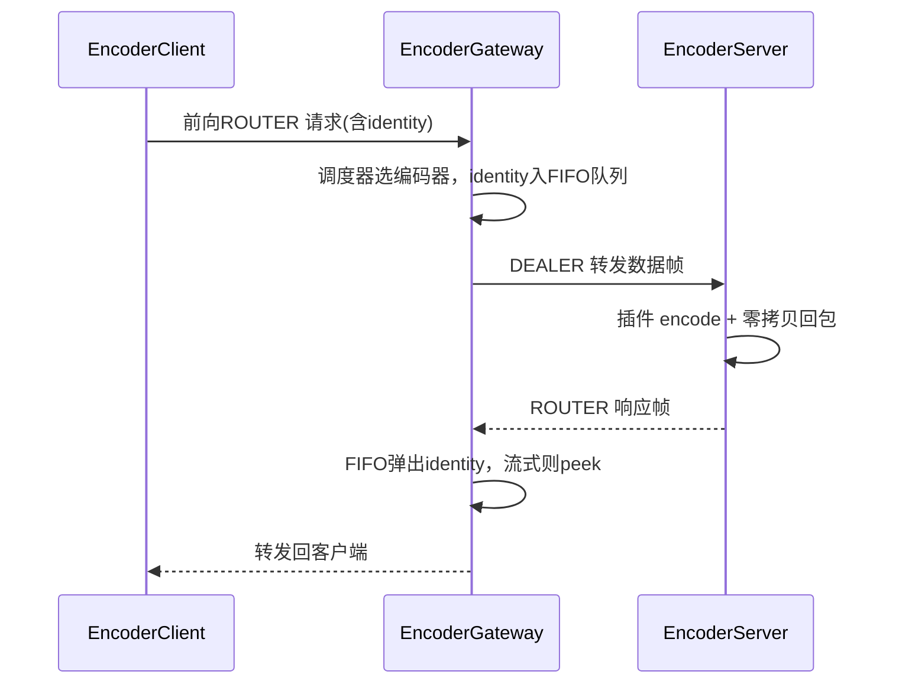
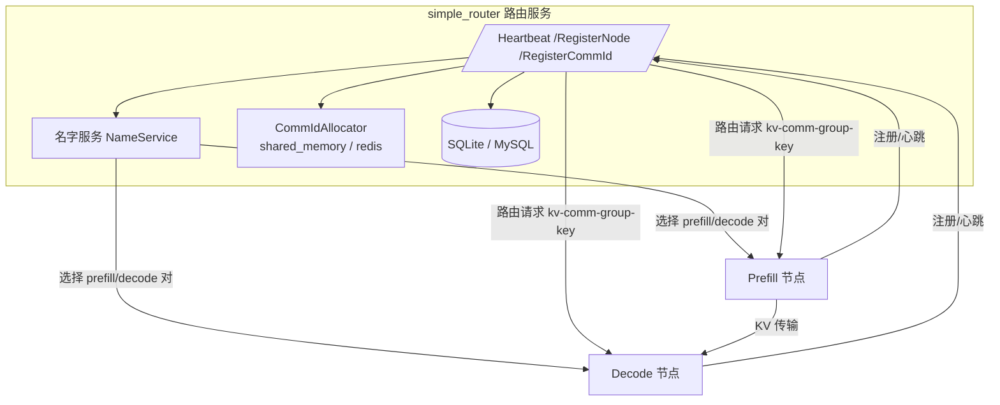
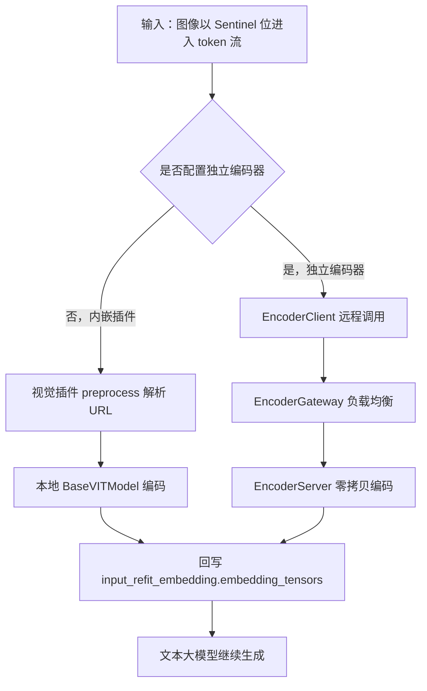

# 多模态插件与编码服务

本文档面向多模态应用开发者与服务集成工程师，讲解 KsanaLLM 如何把"图像接入文本推理"。多模态能力并未硬编码在 C++ 推理内核中，而是由 Python 层三大模块协作支撑：**视觉插件体系**（`python/ksana_plugin/`）、**ZMQ 编码服务**（`python/ksana_encoder/`）与**轻量路由组件**（`python/simple_router/`）。

## 1. 多模态支撑体系总览

本章定位多模态能力在 KsanaLLM 中的位置，说明三模块各自职责与整体闭环。

三层各自承担不同角色：

| 模块 | 目录 | 职责 |
| :--- | :--- | :--- |
| 视觉插件体系 | `python/ksana_plugin/` | 定义统一接入接口，加载并运行视觉编码器（TensorRT/Torch） |
| ZMQ 编码服务 | `python/ksana_encoder/` | 将编码拆成独立服务，以 ZMQ 零拷贝传输大张量，支持负载均衡与缓存 |
| 轻量路由组件 | `python/simple_router/` | PD（Prefill/Decode）形态下维护节点注册、心跳与通信组，并转发请求 |

三者分工的动机：单机场景下视觉编码可内嵌在插件中直接完成；当并发高、视觉 tensor 巨大、需要多副本横向扩展时，把编码抽成独立服务能解耦 GPU 资源；而 PD 分离部署下，则由路由组件把请求转发到合适的 Prefill/Decode 节点。

整体闭环如下：



Sentinel 是文本 token 流中标记"此处插入了图像"的特殊 token 位；由插件识别它对应的区间、取出图像 URL，编码后把图像 embedding 回写到推理输入，从而让文本大模型把图像当成可感知的 token 一起继续生成。

**Sources:** <ref_code path="python/ksana_plugin/" /> <ref_code path="python/ksana_encoder/" /> <ref_code path="python/simple_router/" />

## 2. 视觉插件体系

### 章节小结

视觉插件以统一 `KsanaPlugin` 接口承载各模型目录，核心三入口为 `init_plugin / preprocess / postprocess`；公共基类 `BaseVITModel` 管理视觉编码器的路径、动态轴与推理形状。本节以 `qwen_vl` 为示例讲解完整接入流程。

`python/ksana_plugin/` 下每个视觉模型一个目录，均以 `KsanaPlugin` 类暴露统一接口：

| 模型目录 | 核心文件 | 说明 |
| :--- | :--- | :--- |
| `qwen_vl` | `ksana_plugin.py` + `ksana_plugin_model.py` | `KsanaPlugin` + `VITModel`/`Preprocss` |
| `qwen2_vl` | `ksana_plugin.py` | qwen2 系列视觉插件 |
| `qwen3_vl` | `ksana_plugin.py` + `modeling.py` | qwen3 系列视觉插件 |
| `internvl_chat` | `ksana_plugin.py` | InternVL 系列 |
| `internlmxcomposer2` | `ksana_plugin.py` | InternLM-XComposer2 |
| `arc_hunyuan_video` | `ksana_plugin.py` | 混元视频视觉 |

宿主侧 `KsanaPlugin`（`python/ksana_llm/ksana_plugin.py`）负责按模型名查找插件路径并逐线程加载，把 `encoder_url`、`model_path`、`enable_trt` 等配置下发给具体插件。

### 统一接口 `init_plugin / preprocess / postprocess`

`init_plugin` 根据传入的配置加载视觉模型并给出插件状态：

```python
def init_plugin(self, **kwargs):
    if "preprocess" in kwargs:
        model_path = kwargs["model_path"]
        enable_trt = kwargs.get('enable_trt', True)
        self.model = VITModel(model_path)
        self.visual = None
        self.trt = False
        if enable_trt:
            try:
                self.visual = self._init_trt(model_path)   # TensorRT 引擎
                self.trt = True
            except Exception:
                pass
        if not self.trt:
            self.visual = self._init_torch(model_path)     # Torch 建模回退
        free_cache()
        adjust_device_memory_ratio(kwargs["config_file"], 0.01 if self.trt else 0.04)
        return {'plugin_trt': self.trt}
    if "postprocess" in kwargs:
        pass
```

要点：

- 优先尝试 TensorRT，失败时回退到 Torch，两者由 `self.trt` 标志区分。
- 视觉权重先落盘为 FP16，再按双引擎加载（TensorRT 引擎或 Torch 权重）。
- `adjust_device_memory_ratio` 按引擎类型预留不同的显存比例（TRT 0.01、Torch 0.04）。

`preprocess` 是图像接入闭环的中枢，`postprocess` 在 `qwen_vl` 中通常为空实现。

### 预处理：Sentinel → URL → 编码 → 回写 embedding

`preprocess` 从 `ksana_python_input.input_tokens` 中解析图像 Sentinel，取图像 URL，编码后回写 `input_refit_embedding`：

```python
def preprocess(self, **kwargs):
    config = self.model.config
    input_tokens = kwargs['ksana_python_input'].input_tokens
    url_srt = [int(pos+1) for pos, ids in enumerate(input_tokens)
               if ids == config.visual["image_start_id"]]
    url_end = [int(pos-1) for pos, ids in enumerate(input_tokens)
               if ids == config.visual["image_start_id"]+1]
    image_url = []
    for i in range(len(url_srt)):
        url = input_tokens[url_srt[i]:url_end[i]]
        url = url[:url.index(config.visual['image_start_id']+2)]
        image_url.append(bytes(url).decode('utf-8'))
    if len(image_url) == 0:
        return
    image_embedding = self._infer_torch(image_url) if not self.trt else self._infer_trt(image_url)
    ksana_python_input.input_refit_embedding.pos = url_srt
    ksana_python_input.input_refit_embedding.embedding_tensors = torch.unbind(image_embedding.cpu().float())
```

对应时序：



要点：

- Sentinel 区间以 `image_start_id` 与 `image_start_id+1` 界定，图像数据终止于 `image_start_id+2`。
- URL 既支持本地路径也支持 `http(s)://` 远程地址（`Preprocss.encode` 内处理）。
- 回写的 `pos` 对应图像 Sentinel 的位置，`embedding_tensors` 为按位置的图像 embedding 列表。

### 编码器基类与双引擎

`BaseVITModel`（`plugin_model.py`）统一管理视觉编码器的路径、动态轴与推理形状：

- `get_onnx_path` / `get_trt_path`：返回 ONNX（`onnx/visual_encoder.onnx`）与 TensorRT（`trt/visual_encoder_fp16.plan`）文件路径。
- `get_input_names` / `get_output_names`：默认 `['input']` / `['output']`。
- `get_dynamic_axes` / `get_trt_profile` / `get_infer_shape`：定义动态批量轴与形状。
- `get_sample_input` / `get_infer_data`：提供样例输入与推理入参。

引擎封装位于 `trt_engine.py`，TensorRT 文件缺失时由 `build_trt_process`（`plugin_utils.py`）同步构建。`qwen_vl` 的 `VITModel` 继承 `BaseVITModel` 并新增 `get_preprocess`/`get_model`，其中 `get_model` 从 `visual.py` 动态加载视觉模型类、读取权重。

### 接入新视觉模型

- 在 `python/ksana_plugin/` 下新建模型目录，实现 `KsanaPlugin` 的 `init_plugin`、`preprocess`、`postprocess`。
- 复用 `BaseVITModel` 派生模型类，覆盖路径、动态轴与推理形状。
- 在 YAML 配置中指定 `plugin_model` 段的 `model_type` 与 `model_dir`，`KsanaPlugin` 会通过 `search_plugin_path` 定位到对应 `ksana_plugin.py`。
- 若该模型已有独立 ViT 类型差异（如 InternVL2 / InternVL2.5），通过 `vit_model_type` 区分，共享同一插件入口。

> 本节只说明插件接口约定与视觉编码流水线。视觉模型的训练、微调与其内部算子实现不属于本文档范围。

**Sources:** <ref_code path="python/ksana_plugin/plugin_model.py" /> <ref_code path="python/ksana_plugin/qwen_vl/ksana_plugin.py" /> <ref_code path="python/ksana_plugin/qwen_vl/ksana_plugin_model.py" /> <ref_code path="python/ksana_plugin/trt_engine.py" /> <ref_code path="python/ksana_plugin/plugin_utils.py" /> <ref_code path="python/ksana_llm/ksana_plugin.py" />

## 3. ZMQ 编码服务（ksana_encoder）

### 章节小结

`python/ksana_encoder/` 把多模态大 Tensor 编码抽成基于 ZMQ 的独立服务：`EncoderServer` 提供 ROUTER 服务端，`EncoderClient`/`StreamingEncoderClient` 作为客户端，`EncoderGateway` 在多编码器之间做负载均衡与响应路由，`MultimodalCache` 复用 LRU 缓存。

适配大 Tensor 传输的两项关键能力：

- **零拷贝**（`zmq_zero_copy.py`）：以 msgpack 打包元数据、以独立帧传输 tensor，避免大张量反复拷贝。
- **流式**（DEALER 模式）：中间结果边算边传，最终消息后再终止。

各组件职责：

| 组件 | ZMQ Socket | 职责 |
| :--- | :--- | :--- |
| `EncoderServer` | ROUTER | 接收 ROUTER 请求、调插件 encode、零拷贝回包 |
| `EncoderClient` | REQ/REP | 线程安全的同步客户端，每线程独立连接 |
| `StreamingEncoderClient` | DEALER | 支持接收多条流式中间消息 |
| `EncoderGateway` | ROUTER↔DEALER×N | PD 客户端与多编码器之间的路由层 |
| `MultimodalCache` | — | LRU + 容量限制的 tensor 缓存 |

### EncoderServer：ROUTER 服务端与零拷贝

`EncoderServer` 初始化 ZMQ ROUTER socket，加载编码插件（`KsanaPlugin.load_plugin`），随后进入主循环：

- **后台接收线程** `_recv_loop` 持续把请求放入 `_request_queue`。
- **主循环**从队列取请求，调用 `self.plugin.encode`，构造带 `status`、`encode_time`、`queue_time` 的响应，再以 ROUTER 零拷贝发送。
- 流式启用时（`KSANA_ENABLE_ENCODER_STREAMING=1`），`on_intermediate_ready` 回调通过 `mark_stream_intermediate` + `send_zero_copy_router` 边算边发中间结果，最终结果调用 `mark_stream_final`。

零拷贝实现分为发送与接收两半：

- 发送：`_extract_tensors` 把 dict 中的 tensor/tensor 列表弹出并替换为 `__tensor_metas__` 元数据；`_pack_frames` 用 msgpack 打包元数据，tensor 以 `copy=False` 的 frame 发送。
- 接收：`_unpack_data` 从元数据重建 shape/dtype，用 `torch.from_numpy(...).view(...).reshape(...)` 零拷贝还原，并保留 `__zmq_frames__` 引用防止底层内存提前释放。

### EncoderClient / StreamingEncoderClient

`_BaseEncoderClient` 提供线程安全的连接池管理、请求构造（`request_id`、`client_send_timestamp`）与响应处理（分阶段耗时、清理内部字段）。子类通过 `_SOCKET_TYPE` 决定 ZMQ 类型：

- `EncoderClient`：REQ/REP，`_send_recv` 用 `send_zero_copy` + `recv_zero_copy`。
- `StreamingEncoderClient`：DEALER，手动 prepend 空分隔帧以兼容 ROUTER 协议；`streaming=True` 时用 `recv_zero_copy_streaming` 收多条消息并由 `_merge_streaming_results` 把 `deepstack_feature` 合并进最终消息。

### EncoderGateway：负载均衡与响应路由

`EncoderGateway` 位于 PD 客户端与多编码器之间，前向 ROUTER、后端每编码器一个 DEALER：

- **响应路由**：每个请求把客户端 identity 压入对应编码器的 FIFO `identity` 队列；返回时按队列 FIFO 弹出，保证"先发的请求先回"。流式中间消息只 peek 队列头部 identity 而不可用 `pop`（`_handle_backend` 中据 `peek_stream_metadata` 判断）。
- **负载均衡**：通过可插拔的 `SchedulerStrategy` 选择编码器，注册在 `SCHEDULER_REGISTRY`：

| 策略 | 类名 | 选择逻辑 |
| :--- | :--- | :--- |
| round-robin | `RoundRobinScheduler` | 顺序轮询 |
| least-outstanding | `LeastOutstandingScheduler` | 选在途请求最少的编码器，平局轮询 |
| data-size-balanced | `DataSizeBalancedScheduler` | 选待处理字节最少的编码器，平局轮询 |

默认 `DEFAULT_SCHEDULER = "data-size-balanced"`。三种策略均实现 `SchedulerStrategy` 的 `select`、`on_request_sent`、`on_response_received` 回调。FIFO 严格顺序对正确响应路由是前提——若编码器乱序处理会静默错配响应。

整体交互：



客户端 → 网关 → 编码器的交互流程：



> 本节只说明编码服务的 ZMQ 通信、负载均衡与缓存。编码器内部的视觉模型推理算子见第 2 章插件/模型层；编码服务的部署拓扑见对应部署文档。

**Sources:** <ref_code path="python/ksana_encoder/encoder_server.py" /> <ref_code path="python/ksana_encoder/encoder_gateway.py" /> <ref_code path="python/ksana_encoder/encoder_client.py" /> <ref_code path="python/ksana_encoder/zmq_zero_copy.py" /> <ref_code path="python/ksana_encoder/multimodal_cache.py" /> <ref_code path="python/ksana_encoder/utils.py" />

## 4. 轻量路由组件（simple_router）

### 章节小结

`python/simple_router/` 是 PD（Prefill/Decode）部署下的轻量 HTTP 路由层，基于 FastAPI + SQLAlchemy + uvicorn，负责节点注册、心跳、通信组注册与名字服务，并在 PD 间维护 KV 通信键。

技术栈：FastAPI 暴露 HTTP 端点，SQLAlchemy 访问 SQLite/MySQL，uvicorn 承载多 worker。启动参数见 `main.py`：`--host`、`--port`、`--workers`。

核心 HTTP 端点：

| 端点 | 对应函数 | 职责 |
| :--- | :--- | :--- |
| `/RegisterNode` | `register_node_endpoint` | 注册或刷新节点元数据（节点声明 prefill/decode 角色） |
| `/Heartbeat` | `node_heartbeat` | 更新心跳、判定推理组就绪、返回通信组元数据 |
| `/RegisterCommId` | `register_comm_id_endpoint` | 为 prefill 通信组注册/刷新 comm_id（仅 prefill rank-0） |

### 数据模型

`models.py` 以 SQLAlchemy ORM 定义三张核心表：

| 表 | 类 | 说明 |
| :--- | :--- | :--- |
| `node_info` | `NodeInfo` | 物理节点，含角色 `NODE_ROLE`（prefill/decode）、心跳、在线状态 |
| `comm_group_pair` | `CommGroupPair` | prefill↔decode 通信对，含 `comm_key`、控制/数据通道元数据、`data_channel_meta_state`（`""` 或 `bootstrap`） |
| `inference_group_status` | `InferenceGroupStatus` | 每个 inference 地址/角色的聚合就绪态 |

`services.py` 提供 `register_node`、`register_comm_group`、`get_comm_metadata`，以及心跳触发的就绪判定 `update_inference_group_status`。`comm_key` 遵循 `prefill_addr__decode_addr` 格式。

### 名字服务与 request-id 分配

路由把 `/generate`、`/v1/*`、`/v2/*` 转发到名字服务选出的 prefill/decode 节点（见 `generate.py` 的 `forward_request`）：

- **名字服务**（`name_service/`）：`NameServiceProvider` 抽象按 dotted path 加载，通过 `create_provider` 注入具体实现。

| 实现 | 说明 |
| :--- | :--- |
| `auto_provider`（默认） | 直接从路由数据库选活跃通信对（`CommGroupPair.is_active`）与在线节点 |
| `polaris_provider` | 从 Polaris 名字服务拉取 prefill/decode 实例，并在调用后回传结果 |

- **request-id 分配**（`comm_id_allocator.py` + `request_id.py`）：`CommIdAllocator` 抽象提供 `shared_memory`（`/dev/shm/` + mmap，单机多进程，微秒级）与 `redis`（跨机器唯一）两种实现，由 `CommIdAllocatorFactory` 按配置创建；配置选择 `redis` 时注册全局分配器以跨物理机唯一。
- **路由注入**：`forward_request` 同时在 header 注入 `kv-comm-group-key`（`{prefill_name}__{decode_name}`）与 `request-id`，并把 prefill、decode 请求并发发出，避免 KV 传输死锁。

配置位于 `config.ini`，由 `PrefillDecodeSettings`（`config.py`）读取，分四段：

- `[general]`：`cluster_name`、`log_level`、`heartbeat_timeout_seconds`。
- `[name_service]`：`name_service_provider`、`namespace`、`prefill_service`、`decode_service`。
- `[database]`：`storage_mode`（`sqlite` / `mysql`）及对应连接参数。
- `[comm_id_allocator]`：`comm_id_allocator_type`、Redis 连接参数。

整体关系：



> 本节只跟踪 simple_router 的路由、注册与名字服务职责。PD 分离的底层传输（KV 上传、RDMA、connector）归「PD 分离与全局缓存」文档。

**Sources:** <ref_code path="python/simple_router/main.py" /> <ref_code path="python/simple_router/services.py" /> <ref_code path="python/simple_router/models.py" /> <ref_code path="python/simple_router/comm_id_allocator.py" /> <ref_code path="python/simple_router/name_service/name_service.py" /> <ref_code path="python/simple_router/name_service/auto_provider.py" /> <ref_code path="python/simple_router/name_service/polaris_provider.py" /> <ref_code path="python/simple_router/config.py" /> <ref_code path="python/simple_router/config.ini" /> <ref_code path="python/simple_router/generate.py" /> <ref_code path="python/simple_router/node.py" />

## 5. 接入流程与示例

### 章节小结

本章串联前四章，演示一条"图像接入"的完整闭环，并给出"内嵌编码 vs 独立编码器"的决策依据与部署建议。

端到端流程：



### 何时使用独立编码器 vs 内嵌插件

| 维度 | 内嵌插件编码 | 独立编码服务（ksana_encoder） |
| :--- | :--- | :--- |
| 适用场景 | 单机、低并发 | 多副本、高位（并发） |
| GPU 资源 | 与 LLM 共享 | 可用 `encoder_gpu` 单独指定 |
| 大 Tensor | 内存内直接处理 | ZMQ 零拷贝传输 |
| 横向扩展 | 不支持 | 通过多编码器 + `EncoderGateway` |

`serving_server.py` 根据 `encoder_gpu` 存在且 `encoder_url` 为空判定"内嵌编码"模式，自动 `start_encoder_processes` 拉起每个 GPU 一个编码子进程，用 DEALER socket 监控 `EVENT_CONNECTED` 等待就绪（`wait_encoders_ready`），并拼接 `build_encoder_urls` 回写 `engine_args.encoder_url`。信号处理 `_signal_handler` 负责 `cleanup_encoder_processes` 优雅清理编码子进程。

### 部署 / 验证建议

- 独立编码器：为每个编码 GPU 启动一个 `encoder_server.py`，再启动 `encoder_gateway.py --port ... --encoder-url ...` 做负载均衡，最后在 LLM 侧指定 `encoder_url` 指向网关。
- PD 形态：以 `main.py`（simple_router）作为统一入口，`--host --port --workers` 启动路由，配合注册/心跳与名字服务完成节点发现。
- 验证时先以单张图像本地编码确认 `embedding_tensors` 正确回写，再切换到独立编码链路观察 `encode_time`/`queue_time` 等分阶段耗时。

> 本节为接入与编排视角的收拢；各模块底层原理见第 2~4 章。

**Sources:** <ref_code path="python/serving_server.py" /> <ref_code path="python/simple_router/main.py" /> <ref_code path="python/ksana_encoder/utils.py" />