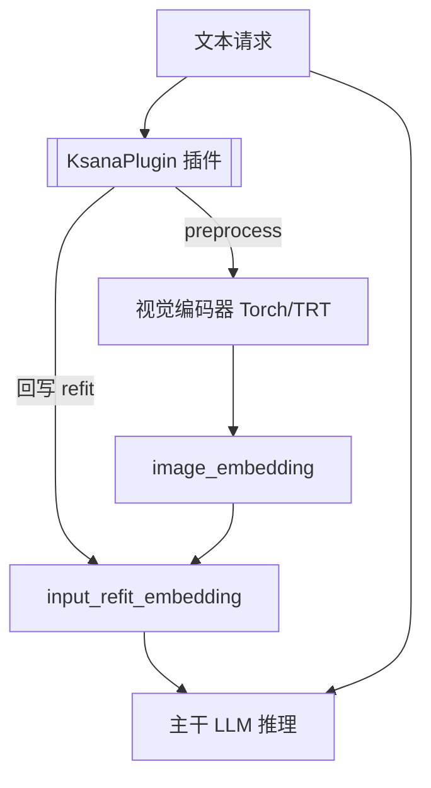
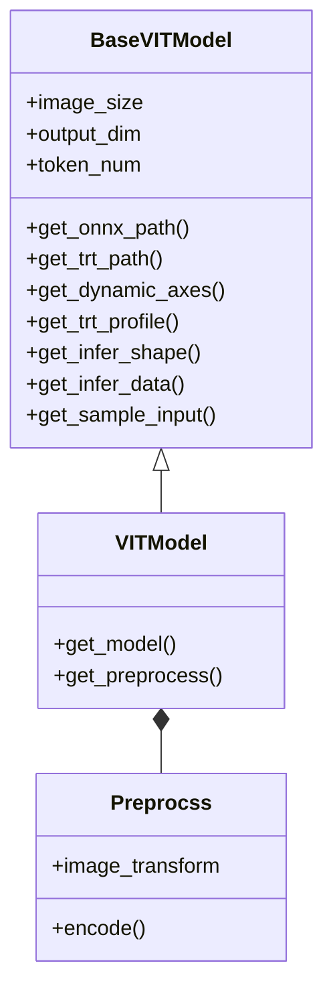
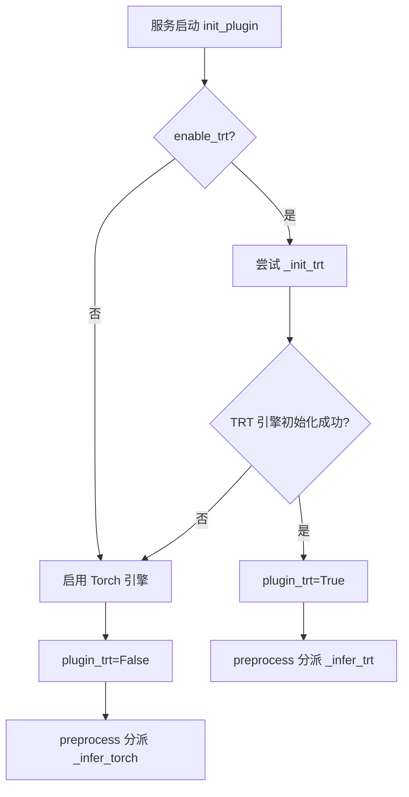
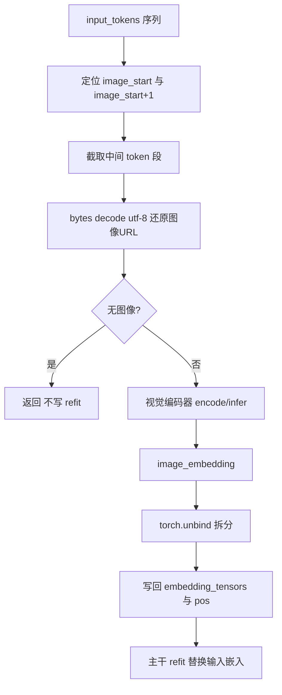

# 视觉插件与接口

KsanaLLM 的多模态能力经由 `python/ksana_plugin` 子包以"插件"形式接入推理服务。本文档聚焦视觉插件的统一接口、视觉编码器基类、TensorRT/Torch 双引擎机制，以及核心的图像 Sentinel 位预处理链路。

> **范围说明**：本文只讲插件本身。`python/ksana_encoder` 编码服务与 `python/simple_router` 路由转发分别由《编码服务》等文档覆盖。

## 1. 视觉插件体系概述

视觉插件是「文本请求 → 视觉编码 → 主干推理」链路中的视觉编码环节。它把用户请求中的图像/视频取出来，编码成主干模型可用的 `image_embedding`，再以 refit 方式替换回输入 token 流。

一条多模态请求的处理链路如下：



插件体系按模型家族组织为若干独立目录，每个目录实现对应模型的 `KsanaPlugin` 接入逻辑：

| 目录 | 覆盖模型 |
| --- | --- |
| `qwen_vl` / `qwen2_vl` / `qwen3_vl` | Qwen-VL / Qwen2-VL / Qwen3-VL 系列 |
| `internvl_chat` | InternVL / InternVL2.5 |
| `internlmxcomposer2` | InternLM-XComposer2 |
| `arc_hunyuan_video` | 混元视频（ARC-Hunyuan-Video） |

公共能力沉淀在插件根目录：`plugin_model.py` 提供视觉模型基类，`trt_engine.py` 提供 TensorRT 引擎封装，`plugin_utils.py` 提供权重加载、显存清理、ONNX/TRT 转换等通用工具。

**Sources:** <ref_code path="python/ksana_plugin/" />

## 2. KsanaPlugin 统一接口与启动机制

每个模型目录的 `ksana_plugin.py` 都定义一个 `KsanaPlugin` 类，对外暴露 `init_plugin` / `preprocess` / `postprocess` 三段式接口。推理服务启动时自动调用 `init_plugin` 完成统一初始化。

| 方法 | 调用时机 | 职责 |
| --- | --- | --- |
| `init_plugin(**kwargs)` | 服务启动时自动调用 | 加载模型、初始化视觉编码器（TRT/Torch）、调整显存比例 |
| `preprocess(**kwargs)` | 每次请求预处理 | 解析图像、调用编码器、回写 `input_refit_embedding` |
| `postprocess(**kwargs)` | 每次请求后处理 | 目前各模型大多为空实现 |

`init_plugin` 通过 `kwargs` 接收 `model_path`、`enable_trt`、`config_file` 等参数，并以字典形式返回 `plugin_trt` 标识，告知服务侧当前插件启用的是 TensorRT 还是 Torch 引擎。以 qwen_vl 的实现为例：

```python
def init_plugin(self, **kwargs):
    if "preprocess" in kwargs:
        model_path = kwargs["model_path"]
        enable_trt = kwargs.get('enable_trt', True)

        # 初始化模型实例
        self.model = VITModel(model_path)
        self.visual = None
        self.trt = False
        if enable_trt:
            try:
                self.visual = self._init_trt(model_path)
                self.trt = True
            except Exception as e:
                print(f"[E] Failed to initialize TensorRT model : {e}")

        if not self.trt:
            self.visual = self._init_torch(model_path)

        free_cache()
        adjust_device_memory_ratio(kwargs["config_file"], 0.01 if self.trt else 0.04)

        # 返回结果必须是字典
        return {'plugin_trt': self.trt}
```

不同模型家族对统一接口的实现各有侧重，但它们都遵循同一套 `KsanaPlugin` 约定：

| 模型目录 | 视觉编码初始化 | `plugin_trt` | 引擎策略 |
| --- | --- | --- | --- |
| `qwen_vl` | `VITModel` + TRT/Torch | 动态 | 双引擎，优先 TRT |
| `qwen2_vl` / `qwen3_vl` | AutoProcessor + 视觉建模 | 恒为 `False` | 固定 Torch，可接远程编码器 |
| `internvl_chat` | InternVL 预处理器 | 不返回 `plugin_trt` | Torch（模板拼接） |
| `internlmxcomposer2` | `IXCModel` | 动态 | 双引擎，TRT 时 hack `vit_infer` |
| `arc_hunyuan_video` | `VideoAudioEncoder` | 恒为 `False` | Torch，可接远程编码器 |

> 部分新模型（Qwen2.5-VL、Qwen3-VL、混元视频）将视觉编码部署到独立的编码服务，插件侧通过 `EncoderClient` 走远程编码，不在此文档展开。

**Sources:** <ref_code path="python/ksana_plugin/qwen_vl/ksana_plugin.py" /> <ref_code path="python/ksana_plugin/qwen3_vl/ksana_plugin.py" /> <ref_code path="python/ksana_plugin/internlmxcomposer2/ksana_plugin.py" /> <ref_code path="python/ksana_plugin/internvl_chat/ksana_plugin.py" /> <ref_code path="python/ksana_plugin/qwen2_vl/ksana_plugin.py" /> <ref_code path="python/ksana_plugin/arc_hunyuan_video/ksana_plugin.py" />

## 3. BaseVITModel 视觉模型基类

`plugin_model.py` 定义视觉编码器的公共基类 `BaseVITModel`。它从预训练配置读取图像尺寸 `image_size`、输出维度 `output_dim`、token 数 `token_num`，并提供了 ONNX/TRT 路径生成、动态轴配置、推理形状计算等一套可被子类复用的方法。

基类核心职责与方法：

- **配置读取**：`__init__` 中通过 `AutoConfig` 读取 `image_size`、`output_dim`，并设置缺省 `token_num=256`、批大小 `min/opt/max_batch`。
- **路径生成**：`get_onnx_path` / `get_trt_path` 分别拼出 `onnx/visual_encoder.onnx` 与 `trt/visual_encoder_fp16.plan`，并确保目录存在。
- **动态轴与 profile**：`get_dynamic_axes` 把 batch 维设为动态轴，`get_trt_profile` 给出 (min,opt,max) 三档输入的 shape。
- **推理形状与数据**：`get_infer_shape` 计算推理输入/输出 shape，`get_infer_data` 包装输入张量，`get_sample_input` 提供 ONNX 导出用的样例输入。

各模型子类继承 `BaseVITModel` 并扩展预处理。qwen_vl 的 `VITModel` 与 `Preprocss` 是典型实现：

```python
class VITModel(BaseVITModel):
    def get_model(self, model_path, precision=None):
        # 加载 VisionTransformer -> 读取权重 -> 移入 GPU 并设精度
        ...
    def get_preprocess(self):
        if self.image_pre_obj is not None:
            return
        self.image_pre_obj = Preprocss(self.image_size)

class Preprocss:
    def __init__(self, image_size: int):
        # Resize(BICUBIC) -> ToTensor -> Normalize 变换流水线
        self.image_transform = transforms.Compose([...])
    def encode(self, image_paths: List[str]):
        # 支持从 http(s):// 或本地路径读取图像，统一转 RGB，逐张 transform
        images = []
        for image_path in image_paths:
            if image_path.startswith("http://") or image_path.startswith("https://"):
                image = Image.open(requests.get(image_path, stream=True).raw)
            else:
                image = Image.open(image_path)
        images = torch.stack(images, dim=0)
        return images
```

`VITModel` 持有预处理对象，`Preprocss` 负责真正的图像加载与变换流水线。子类间的继承关系如下：



通用插件工具由 `plugin_utils.py` 提供：`load_safetensors`、`get_weight_map`、`free_cache`、`adjust_device_memory_ratio`、`build_trt_process`、`build_trt`、`get_module`、`check_file_dir` 等，供各模型子类与转换流程复用。

**Sources:** <ref_code path="python/ksana_plugin/plugin_model.py" /> <ref_code path="python/ksana_plugin/qwen_vl/ksana_plugin_model.py" /> <ref_code path="python/ksana_plugin/plugin_utils.py" />

## 4. TensorRT / Torch 双引擎推理

视觉编码器支持 TensorRT 与 Torch 双引擎，优先尝试 TensorRT，失败后回退 Torch。引擎选择发生在 `init_plugin` 阶段，并通过返回的 `plugin_trt` 标识告知服务侧。

降级决策流程如下：



TRT 路径（qwen_vl 的 `_init_trt`）的执行逻辑：设置 `CUDA_MODULE_LOADING=LAZY`，从 `trt_engine` 导入 `Engine`，用 `get_trt_path` 取得引擎路径，若引擎文件不存在则调用 `build_trt_process` 启动子进程执行 ONNX→TRT 转换，随后 `engine.load()` 反序列化引擎并装载预处理对象。Torch 路径（`_init_torch`）则直接调用 `get_model` 加载模型原生视觉编码器。

`trt_engine.py` 的 `Engine` 类封装了 TRT 引擎的完整生命周期：

| 方法 | 职责 |
| --- | --- |
| `load()` | 反序列化 CUDA 引擎（`deserialize_cuda_engine`），创建执行上下文并登记 IO 绑定信息 |
| `build_trt(onnx_path, ...)` | 从 ONNX 转换构建 TRT plan，支持 FP16 与 REFIT 开关、优化 profile |
| `export_onnx(model, ...)` | 将视觉模型导出为 ONNX（`torch.onnx.export`） |
| `allocate_buffers(shape_dict, ...)` | 按推理 shape 动态分配输入/输出缓冲区，shape 未变化时复用缓存 |
| `infer(feed_dict, stream)` | 拷贝输入、设置 tensor 地址、异步执行（`execute_async_v3`） |

推理分支体现在 `preprocess` 中：

```python
if not self.trt:
    image_embedding = self._infer_torch(image_url)
else:
    image_embedding = self._infer_trt(image_url)
```

- **Torch 路径 `_infer_torch`**：在 `no_grad` 下直接调用视觉模型原生的 `encode(image_url)`。
- **TRT 路径 `_infer_trt`**：先由 `Preprocss.encode` 预处理出图像张量，再按 `max_batch` 拆分批次，逐批 `allocate_buffers`、`get_infer_shape`、`get_infer_data`，最后 `infer` 并 `torch.cat` 拼接输出。

双引擎的取舍：

| 维度 | TensorRT | Torch |
| --- | --- | --- |
| 推理速度 | 快（优化引擎） | 一般 |
| 启动成本 | 首次需 ONNX→TRT 转换 | 直接加载即可 |
| 兼容性 | 依赖 TRT 环境，失败需回退 | 原生模型，兼容性好 |
| 显存预留比例 | 较低（如 qwen_vl 取 0.01） | 较高（0.04） |

**Sources:** <ref_code path="python/ksana_plugin/trt_engine.py" /> <ref_code path="python/ksana_plugin/qwen_vl/ksana_plugin.py" /> <ref_code path="python/ksana_plugin/qwen_vl/ksana_plugin_model.py" />

## 5. 图像 Sentinel 位接入与预处理流程

图像在 token 流中以 Sentinel 占位符形式出现：请求中的图像先被编码为对应 URL 的 token 序列，嵌入 `input_tokens`，并在 `image_start_id` / `image_start_id+1` 这类哨兵位之间包围。`preprocess` 的核心任务，就是定位这些哨兵位、解析出图像 URL、调用视觉编码器生成 embedding，再回写供主干模型以 refit 方式替换。

> **关键概念**：Sentinel 指在 token 序列中起占位/定界作用的特殊 token；refit embedding 指在推理前用视觉 embedding 替换主干 token 序列中对应位置的输入嵌入，从而注入多模态信息。

以 qwen_vl 的 `preprocess` 为例，链路如下：

```python
def preprocess(self, **kwargs):
    input_tokens = ksana_python_input.input_tokens
    # 1. 遍历 token 流，定位哨兵位
    url_srt = [int(pos+1) for pos, ids in enumerate(input_tokens)
               if ids == config.visual["image_start_id"]]
    url_end = [int(pos-1) for pos, ids in enumerate(input_tokens)
               if ids == config.visual["image_start_id"]+1]
    # 2. 截取哨兵位之间的 token 段，还原图像 URL
    image_url = []
    for i in range(len(url_srt)):
        url = input_tokens[url_srt[i]:url_end[i]]
        url = url[:url.index(config.visual['image_start_id']+2)]
        image_url.append(bytes(url).decode('utf-8'))
    if len(image_url) == 0:
        return
    # 3. 调用视觉编码器编码
    if not self.trt:
        image_embedding = self._infer_torch(image_url)
    else:
        image_embedding = self._infer_trt(image_url)
    # 4. 回写 refit embedding，主干用其替换对应位置输入嵌入
    ksana_python_input.input_refit_embedding.pos = url_srt
    ksana_python_input.input_refit_embedding.embedding_tensors = torch.unbind(image_embedding.cpu().float())
```

完整数据流转「插入→解析→编码→回写」如下：



要点说明：

- **哨兵定位**：图像 token 段由 `image_start_id` 与 `image_start_id+1` 两个哨兵符包围定界，`preprocess` 据此切出中间段。
- **URL 解码**：中间 token 段按字节还原成字符串，`bytes(url).decode('utf-8')` 得到图像 URL；末尾多余的哨兵 `image_start_id+2` 被截掉。
- **无图短路**：若能解析出的 `image_url` 为空，直接返回，不写 refit，避免空 embedding 注入。
- **编码分派**：根据第 4 章确定的引擎走 `_infer_torch` 或 `_infer_trt`，得到 `image_embedding`。
- **refit 回写**：把图像位置 `pos` 存入 `input_refit_embedding.pos`，用 `torch.unbind` 把 `image_embedding` 按每图拆分写入 `embedding_tensors`，供主干在对应位置替换输入嵌入。

不同模型的 Sentinel 形态不同，但都收敛到同一套「定位视觉段 → 编码 → 回写 `pos` + `embedding_tensors`」的约定，例如 qwen3_vl 用 `vision_start_token_id`/`vision_end_token_id` 分段后 `torch.cat` 重组 embedding，混元视频用 `im_start_id` 定位并叠加 `additional_tensors`。

**Sources:** <ref_code path="python/ksana_plugin/qwen_vl/ksana_plugin.py" /> <ref_code path="python/ksana_plugin/qwen_vl/ksana_plugin_model.py" /> <ref_code path="python/ksana_plugin/qwen3_vl/ksana_plugin.py" /> <ref_code path="python/ksana_plugin/arc_hunyuan_video/ksana_plugin.py" />