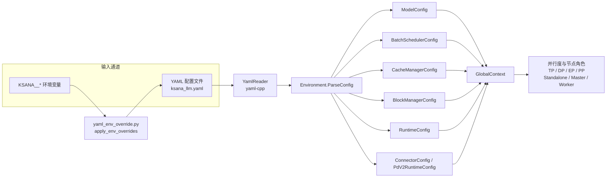
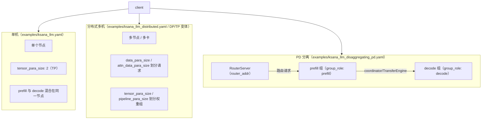
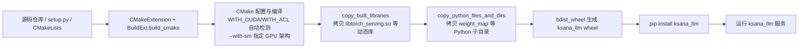
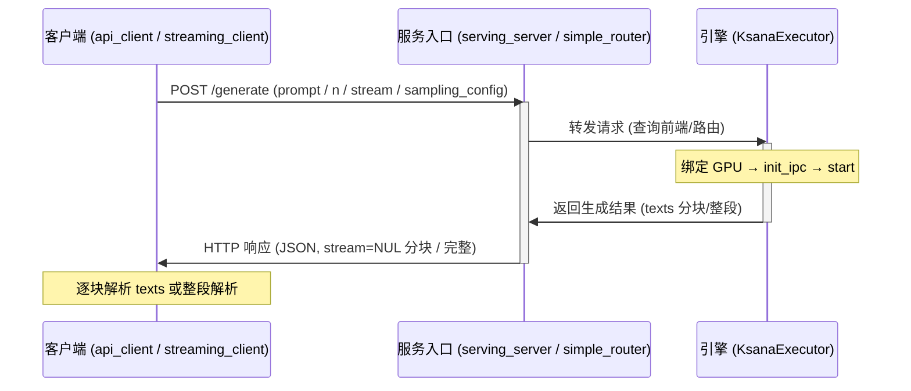

# 部署配置与使用

本文档面向新用户、运维与部署工程师，系统讲解 KsanaLLM 的部署、配置与使用。核心覆盖四部分：YAML + 环境变量双通道配置体系、wheel 构建与 Docker 镜像两种分发方式、单机 / 分布式 / PD 分离三类部署形态、以及服务启动与客户端调用的上手路径。

---

## 1 部署形态与配置总览

## 1.1 三种部署形态

KsanaLLM 依据集群规模与业务诉求，提供三种部署形态：**单机部署**、**分布式部署**与 **PD（Prefill-Decode）分离部署**。三种形态共用同一套配置体系，均以 YAML 文件描述推理服务，可由 `python/serving_server.py` 作为服务入口启动。

- 单机部署：在单台 GPU 节点上完成推理，配置简单、上手快，适用于小模型体验与开发调试。
- 分布式部署：将模型切分到多节点并行推理，通过张量并行等并行维度提升吞吐与容量，适用于生产化大模型服务。
- PD 分离部署：将 Prefill 与 Decode 阶段分离到不同节点，通过 `connector` 连接，适用于对首 Token 时延与并发吞吐有极致要求的场景。

### 三种形态对照

| 部署形态 | 典型 YAML | 关键特征 | 适用环境 |
| --- | --- | --- | --- |
| 单机 | `examples/ksana_llm.yaml` | 单节点内完成推理，配置最简 | 体验、调试、小规模推理 |
| 分布式 | `examples/ksana_llm_distributed.yaml` | 多节点横向扩展，并行切分模型 | 生产化大模型在线服务 |
| PD 分离 | `examples/ksana_llm_disaggregating_pd.yaml` | Prefill 与 Decode 分节点，`connector` 组网 | 高并发、低首 Token 时延场景 |

### 新人最小上手路径


1. **安装 wheel 包**：通过 `pip install` 安装 KsanaLLM 预构建的 wheel 包，或按指南自行构建。
2. **选定 YAML**：依据部署形态，从 `examples/` 目录挑选对应的 YAML 配置。
3. **启动服务**：以 `python/serving_server.py` 为入口拉起服务进程。
4. **发请求**：使用 `python/examples/api_client.py`、`python/examples/streaming_client.py` 或 `tools/cpp_client/serving_forward_client.cpp` 发送推理请求并获取结果。

**Sources:** <ref_code path="examples/ksana_llm.yaml" /> <ref_code path="examples/ksana_llm_distributed.yaml" /> <ref_code path="examples/ksana_llm_disaggregating_pd.yaml" /> <ref_code path="python/serving_server.py" /> <ref_code path="examples/api_client.py" /> <ref_code path="examples/streaming_client.py" /> <ref_code path="tools/cpp_client/" />

## 2 配置体系：YAML 与环境变量双通道

KsanaLLM 提供两条配置输入通道：YAML 配置文件与 `KSANA__` 前缀环境变量。两条通道均由运行时配置系统收敛为统一的领域配置对象，下文简述其读取与覆盖机制。

## 2.1 双通道读取与覆盖机制

配置的入口是 C++ 侧的 `Environment` 类。它通过 `YamlReader` 从磁盘读取 YAML 配置，并集中向外提供各领域配置，是 YAML 与环境变量收敛为配置对象的汇聚点。



节点说明：

- **YAML 通道**：`Environment::ParseConfig` 以配置文件路径为入参（可携带 `model_dir_override` 覆盖模型目录），调用 `YamlReader::LoadFile` 加载 YAML，并通过 `GetScalar` / `GetSequence` / `GetMap` 提取标量、序列与映射节点。
- **环境变量通道**：Python 打包侧在启动前将 `KSANA__*` 环境变量实时覆盖进 YAML，再交给同一个 `Environment` 读取。
- **汇聚输出**：`Environment` 对外提供 `GetModelConfig`、`GetBatchSchedulerConfig`、`GetCacheManagerConfig`、`GetBlockManagerConfig`、`GetRuntimeConfig`、`GetConnectorConfigs`、`GetPdV2RuntimeConfig` 等接口，产出模型、调度、缓存、块管理、运行、PD 与连接器配置。

## 2.2 `ModelConfig` 常用字段

| 字段 | 说明 |
| --- | --- |
| `model_dir` / `tokenizer_dir` | 模型权重的推理路径与 tokenizer 路径，可用 `model_dir_override` 覆盖 |
| `vocab_size` | 词表大小，来自模型配置 |
| `weight_dtype` / `quant_method` | 权重精度与量化方式（如 gptq/awq） |
| `seq_len` / `num_layers` | 序列长度与层数等模型结构参数 |

`ModelConfig` 由 `Environment` 维护并提供 `GetModelConfig` 读取，`ParseConfig` 的 `model_dir_override` 参数保证无需修改 YAML 即可切换模型目录。

## 2.3 `KSANA__` 环境变量覆盖

Python 侧 `python/utilize/yaml_env_override.py` 提供在喂给 `Environment` 之前改写 YAML 的机制：

- 前缀固定为 `KSANA__`，路径分隔符为 `__`（双下划线），单下划线保留为键名的一部分。
- 键统一转小写，与 KsanaLLM 的 YAML 风格一致。
- 使用 ruamel.yaml 的 round-trip 模式：注释与原格式保留，仅被环境变量命中的字段被改写。
- `override_yaml_file` 读入源 YAML、写新 YAML；`apply_env_overrides` 直接在配置对象上原位应用覆盖。

### 映射规则

| 环境变量 | YAML 路径 | 对应配置项 |
| --- | --- | --- |
| `KSANA__SETTING__BLOCK_MANAGER__BLOCK_HOST_MEMORY_FACTOR` | `setting.block_manager.block_host_memory_factor` | 块管理器的宿主机内存系数 |
| `KSANA__SETTING__BATCH_SCHEDULER__ENABLE_AUTO_PREFIX_CACHE` | `setting.batch_scheduler.enable_auto_prefix_cache` | 调度器的自动前缀缓存开关 |
| `KSANA__MODEL_SPEC__BASE_MODEL__MODEL_DIR` | `model_spec.base_model.model_dir` | 模型权重目录 |

### 类型处理

- **键已存在**：环境变量字符串按 YAML 已有值的类型强制转换（bool / int / float / str），避免 `"1.10"` 被误转为浮点 `1.1`。
- **键不存在**：新键自动探测类型，支持 bool / int / float / null / JSON / 字符串。

## 2.4 `GlobalContext`：并行度与节点角色汇总

`Environment` 收敛各配置后，`GlobalContext` 汇总并行度与节点角色，供引擎在运行时识别全局视图。

| 类别 | 方法 / 字段 |
| --- | --- |
| 并行度 | `GetTensorParallelSize`（TP）、`GetAttentionDataParallelSize`（DP）、`expert_world_size`（EP）、`max_pp_batch_num`（PP） |
| 节点角色 | `IsStandalone`、`IsDistributedMaster`、`IsDistributedWorker`、`IsDistributedLastWorker`、`IsSamplingNode` |
| 资源规模 | `GetWorldSize`、`GetNodeRank`、`GetMasterHost`、`GetMasterPort` |

`GlobalContext` 构造时接收 tensor 并行度与 attention 数据并行度，向外暴露 `GetTensorParallelSize` / `GetAttentionDataParallelSize`，并由 `expert_parallel_config_` 提供 EP 侧的 `expert_world_size` 等规模信息。节点角色判定（standalone / master / worker 等）均在此类完成。

## 2.5 改配置的两种实操方式

**方式一：编辑 YAML 文件**，适用于环境无关、随仓库交付的静态配置，如并行度基础值。修改后需重启服务生效。

**方式二：设置 `KSANA__*` 环境变量**，适用于不落入库文件、按进程或部署形态区分的动态覆盖，例如：

```bash
export KSANA__SETTING__BLOCK_MANAGER__BLOCK_HOST_MEMORY_FACTOR=0.01
export KSANA__SETTING__BATCH_SCHEDULER__ENABLE_AUTO_PREFIX_CACHE=false
```

环境中未命中的字段保持原 YAML 值，改动只落在目标键上，便于零侵入地做差异化部署。环境变量的路径以 `__` 为分隔符，键名内下划线用单 `_`，写入时请与目标 YAML 路径逐段对齐。

**Sources:** <ref_code path="csrc/configure/environment.h" /> <ref_code path="csrc/configure/yaml_reader.h" /> <ref_code path="csrc/configure/global_context.h" /> <ref_code path="python/utilize/yaml_env_override.py" />

## 3 示例 YAML 与三类部署形态

本章以 `examples/` 目录下三类部署形态的真实 YAML 为主线，讲解配置字段含义与形态差异，并给出各形态适用的硬件场景与挑选模板的方法。

## 3.1 通用顶级结构：`setting` 与 `model_spec`

所有 KsanaLLM 配置文件在顶层都分为两大块：

- `setting`：运行引擎与资源相关的全部配置，其下按职责又细分为 `global`、`batch_scheduler`、`block_manager`、`attn_backend`、`quantization_config`、`profiler`、`tokenization` 等小节。
- `model_spec`：模型定义，核心是 `base_model`（只能有一个）。其中 `model_dir` 指向本机模型目录，**是部署前必须按实际路径修改的字段**。

两类关键块的字段分布如下：

| 位置 | 字段 | 含义 |
| --- | --- | --- |
| `setting.global` | `tensor_para_size` | 张量并行度（TP） |
| `setting.global` | `pipeline_para_size` | 流水线（层）并行度（PP） |
| `setting.global` | `attn_data_para_size` | 节点内 Attention 数据并行度（DP） |
| `setting.global` | `expert_world_size` | 专家并行涉及的节点数 |
| `setting.global` | `expert_para_size` | 节点内专家并行度 |
| `setting.global` | `embed_tokens_use_cpu` | 是否用 CPU 保存 `embed_tokens` |
| `setting.global` | `enable_cuda_graph` | 是否启用 CUDA Graph 加速 decode |
| `setting.global` | `pipeline_para_comm_type` | PP 通讯模式（`default` / `scatter`） |
| `setting.global` | `device` | 运行设备（`gpu` 或昇腾 `npu`，默认 `gpu`） |

**调度相关 `setting.batch_scheduler`**：

| 字段 | 含义 |
| --- | --- |
| `scheduler_type` | 调度器类型（`0` 旧调度器 / `1` 事件驱动） |
| `max_batch_size` | 每一步推理的最大 batch size |
| `max_step_tokens` | 一个调度 step 处理的最大 token 数 |
| `max_token_len` | 最大输入输出长度之和（`prompt_len + max_new_tokens`） |
| `max_waiting_queue_len` | 请求队列最大等待长度（流控） |
| `enable_auto_prefix_cache` | 是否开启自动前缀匹配 |
| `split_fuse_token_num` | 单轮推理中单次处理的最大 token 数 |
| `enable_async` | 是否开启异步调度以减少 GPU 空泡 |

**显存块相关 `setting.block_manager`**：

| 字段 | 含义 |
| --- | --- |
| `block_token_num` | 单个 block 可容纳的最大 token 数 |
| `reserved_device_memory_ratio` | 保留显存占比 |
| `block_device_memory_ratio` | block 部分的显存占比（<0 使用全部剩余显存） |
| `block_host_memory_factor` | block 在 host 上相对 device 的预分配倍数 |

> 以上字段仅给出名称与所在位置；具体数值以各形态真实 YAML 为准，部署时应结合模型规模与硬件显存微调。

## 3.2 三类部署形态差异总览

三种形态的拓扑关系如下：



三类形态在 YAML 关键字段上的对照（重点看并行度与 PD 连接器字段）：

| 维度 | 单机 `ksana_llm.yaml` | 分布式 `ksana_llm_distributed.yaml` | PD 分离 `ksana_llm_disaggregating_pd.yaml` |
| --- | --- | --- | --- |
| 并行度字段 | `tensor_para_size`、`pipeline_para_size`、`attn_data_para_size`、`expert_world_size`、`expert_para_size` | `tensor_para_size`、`pipeline_para_size`（多卡/多机），DP 变体另有 `data_para_size` | `tensor_para_size`、`pipeline_para_size` |
| prefill/decode 阶段 | 同节点混合 | 同节点混合 | `setting.connector.group_role`（`prefill` / `decode`）分开 |
| PD 连接器字段 | 无 `connector` | 无 `connector` | `setting.connector`：`router_addr`、`inference_addr`、`coordinator_addr`、`cluster_name`、`communication_type`、`group_role`、`heartbeat_interval_ms` 等 |
| 适用场景 | 单机单卡 / 单机多卡 | 多机多卡，扩大吞吐与模型容量 | 长上下文、prefill / decode 负载解耦 |

## 3.3 形态一：单机部署（`examples/ksana_llm.yaml`）

`ksana_llm.yaml` 是默认的单机形态，推理（prefill 与 decode）在同一节点完成。顶层结构与通用字段一致，其中 `global` 小节完整覆盖 TP/PP/DP/EP 并行项：

```yaml
setting:
  global:
    tensor_para_size: 2
    pipeline_para_size: 1
    attn_data_para_size: 1
    expert_world_size: 1
    expert_para_size: 1
    embed_tokens_use_cpu: false
    enable_cuda_graph: false
    pipeline_para_comm_type: "default"
  batch_scheduler:
    enable_auto_prefix_cache: true
    split_fuse_token_num: 256
    enable_async: false
  block_manager:
    block_token_num: 16
    reserved_device_memory_ratio: 0.05
    block_device_memory_ratio: -1.0
    block_host_memory_factor: 1.0
model_spec:
  base_model:
    model_dir: /model/qwen1.5-hf/0.5B-Chat
```

单机形态下 `pipeline_para_size` 通常为 1；卡数越多可适当调大 `tensor_para_size`。修改 `model_dir` 指向本机模型目录即可运行。

## 3.4 形态二：分布式多机（`ksana_llm_distributed.yaml` 与 TP/DP 变体）

`ksana_llm_distributed.yaml` 面向多节点 / 多卡部署，通过 `setting.global` 的并行度把层（TP/PP）与请求（DP）拆分到多张卡 / 多个节点，并配套 Lora 相关显存项。精简结构如下：

```yaml
setting:
  global:
    tensor_para_size: 1
    pipeline_para_size: 1
    enable_lora_adapter: false
    embed_tokens_use_cpu: false
  batch_scheduler:
    max_batch_size: 128
    max_token_len: 2048
    enable_auto_prefix_cache: true
  block_manager:
    block_token_num: 16
    reserved_device_memory_ratio: 0.01
    block_device_memory_ratio: -1.0
model_spec:
  base_model:
    model_dir: /model/qwen1.5-hf/0.5B-Chat
```

在 `examples/llama7b/` 目录下提供了标准化调并行的变体：

- `ksana_llm_tp.yaml`：`tensor_para_size: 2`，张量并行切分权重。
- `ksana_llm_dp.yaml`：额外声明 `data_para_size: 2`，数据并行切分请求 batch：

```yaml
setting:
  global:
    tensor_para_size: 1
    pipeline_para_size: 1
    data_para_size: 2
  batch_scheduler:
    max_batch_size: 40
    max_token_len: 1024
  block_manager:
    block_token_num: 16
model_spec:
  base_model:
    model_dir: /model/llama-hf/7B/
```

## 3.5 形态三：PD 分离（`ksana_llm_disaggregating_pd.yaml`）

PD 分离把 prefill 与 decode 拆分到不同节点，由 RouterServer 统一路由。相比前两形态，其特有配置在 `setting.connector`：

```yaml
setting:
  global:
    tensor_para_size: 2
    pipeline_para_size: 1
    pipeline_para_comm_type: "default"
  connector:
    router_addr: "127.0.0.1:9080"     # RouterServer 地址
    inference_addr: "127.0.0.1:8088"  # 本节点推理服务地址
    coordinator_addr: "127.0.0.1:65521"
    cluster_name: "default_cluster"
    communication_type: "nccl"        # nccl / zmq
    group_role: "prefill"             # prefill 或 decode
    heartbeat_interval_ms: 2000       # 心跳上报间隔
model_spec:
  base_model:
    model_dir: /model/qwen1.5-hf/0.5B-Chat
```

`connector` 关键字段含义：

| 字段 | 含义 |
| --- | --- |
| `router_addr` | RouterServer（简单路由）地址，PD 各节点据此上报与寻址 |
| `inference_addr` | 本节点的推理服务地址，供 Router 自动寻址 |
| `coordinator_addr` | PD 之间信号传输通讯地址 |
| `cluster_name` | 多 P / 多 D 所在的统一集群名称 |
| `communication_type` | 通讯器类型，`nccl` 或 `zmq` |
| `group_role` | 本节点角色，`prefill` 或 `decode` |
| `heartbeat_interval_ms` | 心跳上报间隔，供 RouterServer 检查节点状态 |

部署时 `group_role` 规则：`prefill` 与 `decode` 节点各自使用同一份以 `disaggregating_pd` 为蓝本的配置，但 `group_role`、`inference_addr` 按节点互不相同；多节点需指向同一 `cluster_name` 与 `router_addr`。

## 3.6 按硬件场景挑选模板并修改 `model_dir`

不同硬件与拓扑可直接套用真实模板，仅需修改 `model_spec.base_model.model_dir`。常见模板概览如下：

| 示例文件 | 模型 / 硬件 | 并行度 | 形态 |
| --- | --- | --- | --- |
| `examples/ksana_llm.yaml` | 通用，默认单机 | TP=2 / PP=1 | 单机 |
| `examples/ksana_llm_distributed.yaml` | 通用，分布式多卡 | TP=1 / PP=1 | 分布式 |
| `examples/ksana_llm_disaggregating_pd.yaml` | 通用，PD 分离 | TP=2 / PP=1 | PD 分离 |
| `examples/llama7b/ksana_llm.yaml` | Llama-7B | TP=1 / PP=1 | 单机 |
| `examples/llama7b/ksana_llm_tp.yaml` | Llama-7B，TP 变体 | TP=2 / PP=1 | 分布式/多卡 |
| `examples/llama7b/ksana_llm_dp.yaml` | Llama-7B，DP 变体 | DP=2（`data_para_size`） | 分布式 |
| `examples/llama7b/ksana_llm_ascend.yaml` | Llama-7B，昇腾 NPU | — | 单机 NPU |
| `examples/ksana_llm_ascend_llama13b.yaml` | Llama-13B，昇腾 NPU | TP=1 / PP=1 | 单机 NPU |
| `examples/ksana_llm_ascend_llama13b_multi_npu.yaml` | Llama-13B，多 NPU | TP=2 / PP=1 | 多 NPU |
| `examples/ksana_llm_qwen2.yaml` | Qwen-14B（`device: gpu`） | TP=2 / PP=1 | 单机 |
| `examples/ksana_llm_llama2_13b.yaml` | Llama2-13B | TP=2 / PP=1 | 单机 |

按下列步骤挑选并落地：

1. **确定硬件**：GPU（NVIDIA）套用通用模板，昇腾 NPU 套用 `ascend` 系列模板。
2. **确定拓扑**：单机用默认模板；多卡/多机用分布式模板并按需套用 TP / DP / PP 变体；prefill 与 decode 解耦用 PD 分离模板。
3. **改 `model_dir`**：所有模板中必须写的通用项，指向本机实际 Hugging Face 格式模型目录。
4. **校对并行度**：确认 `tensor_para_size`、`data_para_size` 等与卡数一致，避免超出硬件。
5. **PD 分离额外检查**：核对 `connector` 下的 `router_addr`、`group_role`、`cluster_name`。

**Sources:** <ref_code path="examples/ksana_llm.yaml" /> <ref_code path="examples/ksana_llm_distributed.yaml" /> <ref_code path="examples/ksana_llm_disaggregating_pd.yaml" /> <ref_code path="examples/llama7b/" />

## 4 构建 wheel 与 Docker 镜像

本章介绍如何将 KsanaLLM 源码构建为可安装的 wheel 包，以及如何基于 `docker/` 目录下的 Dockerfile 构建运行环境。构建产物是二进制动态库与 Python 源码组装而成的 `ksana_llm` Python 包，可直接安装后运行。

## 4.1 构建流程总览

KsanaLLM 的 Python 包由 `setup.py` 驱动，底层通过 CMake 完成 C++ 核心编译，再借助 `bdist_wheel` 将动态库与 Python 子目录打包成 wheel。整体流程如下：



设计要点：

- C++ 扩展通过 `CMakeExtension`（继承自 `setuptools.Extension`）声明，无内联源码。
- 自定义 `BuildExt`（继承自 `build_ext`）在 `run()` 中先调用 `build_cmake()` 完成编译，再继续标准打包流程。
- 编译与打包均围绕 `ksana_llm` 单一 Python 包展开。

## 4.2 CMake 编译与设备检测

`BuildExt.build_cmake` 负责调用 CMake 配置并构建目标。它先扫描 `csrc/endpoints/wrapper` 目录下的端点，再依据运行环境决定编译选项。

设备类型由 `is_run_on_npu_device()` 自动判定——通过检测环境中是否存在 `torch_npu` 包来判断是否处于 NPU 设备。构建选项按设备区分：

| 设备 | 检测依据 | CMake 选项 |
| --- | --- | --- |
| NPU | 安装了 `torch_npu` | `WITH_CUDA=OFF`、`WITH_ACL=ON` |
| CUDA / GPU | 未安装 `torch_npu` | `WITH_CUDA=ON`、`SM=SM_ARCHS` |

关键构建参数：

- `CMAKE_BUILD_TYPE`：`Debug` 或 `Release`（由 `--debug` 决定，默认 Release）。
- `WITH_TESTING=OFF`：关闭测试。
- 各端点默认开启，可通过 `CMAKE_ARGS` 中传入 `-DWITH_XXX_ENDPOINT=OFF` 关闭。
- 并行编译任务数由 `BUILD_JOBS` 覆盖，默认使用全部 CPU 核心。

默认编译目标为 `torch_serving` 及所有启用且非 triton 的 `*_endpoint`，其中 triton 端点在运行时通过 `dlopen` 动态加载。

## 4.3 版本与 GPU 架构控制

### 4.3.1 版本策略

`get_version()` 按以下优先级确定 wheel 版本号：

1. 环境变量 `CUSTOM_KSANA_VERSION`：完整覆盖，逐字使用。
2. `--with-tag`：仅使用 git tag 版本（如 `v0.8.1.post3`）。
3. 默认 / `--with-commit-id`：使用固定基础版本加上最近一次提交的短 commit id，组成 PEP 440 局部版本号。

控制标志由 `pop_version_flags()` 解析并从 `sys.argv` 中剥离：

| 命令标志 | 说明 | 默认 |
| --- | --- | --- |
| `--with-commit-id` | 基础版本 + 短 commit id，作为 PEP 440 局部版本 | 默认 |
| `--with-tag` | 仅使用 git tag 版本号 | 仅在显式给出且未带 `--with-commit-id` 时生效 |

### 4.3.2 GPU 架构

`--with-sm` 用于覆盖 CUDA 目标架构（如 `90a,89`）。该标志由 `pop_sm_arch()` 解析并剥离，缺省时使用 `DEFAULT_SM_ARCHS="80,86,89,90a"`。

SM 值仅在 CUDA 构建下作为 `SM` 选项传给 CMake；NPU 构建（`WITH_ACL=ON`）不需要指定 SM。建议根据实际 GPU 型号选择对应架构，例如 H200 使用 `90a`，可缩短针对无关架构的编译时间。

## 4.4 打包产物组装

`build_cmake` 在编译完成后，将构建产物与源码拷贝进 `ksana_llm` 包目录。

### 4.4.1 动态库拷贝

静态库与动态库统一拷贝到包目录。`libtorch_serving.so` 放置在 `site-packages/ksana_llm` 根目录，其余动态库放入 `ksana_llm/lib/`：

- `libtorch_serving.so`：pybind11 绑定入口。
- 其他运行库：`libloguru.so`、`libglobal_cache_connector.so.1`、`libmooncake_store.so` 及（存在时）`libtbb.so.12`。
- 每个启用的非 triton 端点对应一个 `lib<endpoint>_endpoint.so`。

拷贝时仅复制实际存在的库（`src_lib.exists()` 检查），避免缺失文件导致失败。若 `DeepGEMM` 第三方源码存在，则其 `deep_gemm` 子目录会被拷贝为 `ksana_llm/deepseek_deep_gemm`。

### 4.4.2 Python 源码与子目录拷贝

`copy_python_files_and_dirs` 将以下内容并入包：

- 固定子目录：`weight_map`、`ksana_plugin`、`simple_router`、`openaiapi`、`utilize`、`ksana_encoder`。
- 端点相关：triton 端点拷贝为 `ksana_llm/triton_backend` 并附带默认 `ksana_llm.yaml`，其他端点拷贝 `rpc_config`。
- 服务脚本：`serving_server.py`、`serving_generate_client.py`、`serving_forward_client.py`、`request_id.py`。
- 默认配置与辅助：根目录 `ksana_llm.yaml`、`yaml_env_override.py`。
- 附加内核包：`deep_gemm`、`humming`、`humming_tool.py`。
- triton kernel 文件：取自 `KSANA_TRITON_KERNEL_PATH`。

`setup.py` 的 `setup()` 将 `package_dir` 设为 `"" -> "python/"`，`ext_modules` 注册 `CMakeExtension("ksana_llm")`，`cmdclass` 将 `build_ext` 指向自定义 `BuildExt`，从而让编译与打包一气呵成。

## 4.5 构建 wheel 的典型命令

以 AWS H200 为例，构建仅针对 SM90a 的 wheel：

```bash
numactl --membind=0 --cpunodebind=0 python setup.py bdist_wheel --with-sm 90a
```

- `--with-sm 90a`：仅针对 H200 的 SM90a 架构编译，减少非必要架构的编译开销。
- `numactl` 绑定构建进程到 NUMA 节点 0，提升编译稳定性。
- 产物输出到 `dist/` 下的 `*.whl`。

源码根目录直接运行等价命令：

```bash
python setup.py bdist_wheel      # 默认 --with-sm 80,86,89,90a
python setup.py bdist_wheel --with-sm 90a,89
```

可选环境变量：

| 环境变量 | 作用 |
| --- | --- |
| `CMAKE_GENERATOR` | CMake 生成器，缺省 Ninja |
| `CMAKE_ARGS` | 追加 CMake `-D` 选项 |
| `BUILD_JOBS` | 并行编译任务数 |
| `CUSTOM_KSANA_VERSION` | 覆盖 wheel 版本号 |

完整脚本见 `tools/cicd/pkg/aws_h200_build_wheel.sh`，其中还设置了 `WITH_FLASH_ATTN_CACHE=ON`、`WITH_VLLM_FLASH_ATTN=ON`，关闭 trpc 端点并指定 gcc/g++-12 编译器。

### 4.5.1 安装与验证

构建产物安装后运行：

```bash
pip install dist/ksana_llm-*.whl
pip show ksana_llm
```

`pip show ksana_llm`（或包内 `ksana_llm.__version__`）显示版本号，用于核对打包时的 commit 或 tag。

## 4.6 构建辅助与打包脚本

除 `setup.py` 外，`tools/cicd/pkg/` 目录提供用于分布式部署的打包辅助脚本：

| 脚本 | 说明 |
| --- | --- |
| `aws_h200_build_wheel.sh` | 面向 AWS H200 构建 wheel 的一键脚本，固定 `--with-sm 90a` |
| `pkg.sh` | 在 build 目录 CMake 编译后，打包相关文件生成 `build/package.tar` |
| `unpkg.sh` | 解包 `package.tar`，生成 `KsanaLLM_runtime` 目录 |

> 编译存在路径依赖，`pkg.sh` 与 `unpkg.sh` 必须在相同路径下使用。

## 4.7 Docker 镜像

`docker/` 目录提供三套 Dockerfile，对应不同的硬件环境：

| Dockerfile | 基础镜像与系统 | 环境 | 适用场景 |
| --- | --- | --- | --- |
| `Dockerfile.gpu` | `nvcr.io/nvidia/pytorch:25.01-py3`（Ubuntu 24.04） | NVIDIA PyTorch 容器自带 CUDA 12.8 运行时 | 通用 NVIDIA GPU 的构建与运行环境 |
| `Dockerfile.tencentos4.gpu` | `tencentos/tencentos4-minimal` | 安装 CUDA 12.4、CuDNN、NCCL | 腾讯云 TencentOS 4 的 NVIDIA GPU |
| `Dockerfile.npu` | openEuler 22.03，Python 3.10.13 | 需搭配独立昇腾 CANN 运行环境 | 昇腾 NPU 设备运行环境 |

各 Dockerfile 的主要内容：

- ** `Dockerfile.gpu`**：基于 NVIDIA NGC PyTorch 25.01，安装 `libpython3-all-dev`、`git-lfs`，并从源码构建 `flash-attention v2.6.2`（适配 CUDA 12.8）及 `utf8_range`。
- ** `Dockerfile.tencentos4.gpu`**：基于腾讯云 `tencentos-minimal`，安装 `cuda-toolkit-12-4`、`cudnn9-cuda-12-4`、`libnccl`，配置 `LD_LIBRARY_PATH` 指向 CUDA 12.4，并安装 `torch==2.6.0`（cu124）。
- ** `Dockerfile.npu`**：基于 openEuler 22.03，编译安装 Python 3.10.13 并配置工具链；运行时需配合昇腾 CANN 与 `torch_npu`，`setup.py` 据此识别为 NPU 构建（`WITH_ACL=ON`）。

> Docker 镜像仅提供基础系统与驱动/依赖环境。实际构建 wheel 与启动服务前，请在镜像中按 4.5 节命令编译，或直接以预构建 wheel 通过 `pip install` 安装。

**Sources:** <ref_code path="setup.py" /> <ref_code path="CMakeLists.txt" /> <ref_code path="docker/Dockerfile.gpu" /> <ref_code path="docker/Dockerfile.npu" /> <ref_code path="docker/Dockerfile.tencentos4.gpu" /> <ref_code path="tools/cicd/pkg/aws_h200_build_wheel.sh" />

## 5 上手使用与服务启动

本章面向新用户，演示从安装到拉起服务、再到发起请求的完整上手路径。

- 安装 wheel 包。
- 选择模型配置 YAML 并修改 `model_dir`。
- 启动服务（单机 / 分布式 / PD 分离三种形态）。
- 使用 Python 与 C++ 客户端发起请求并读取响应。

有关 REST 接口协议细节（OpenAI 兼容接口语义）见对应章节；内核模块内部实现与本章无关；预构建、wheel 打包与镜像细节见第 4 章。

## 5.1 安装 wheel

在源码根目录或已有构建产物目录下，用 pip 安装构建好的 wheel：

```bash
pip install dist/ksana_llm-*.whl
```

安装完成后，`python/serving_server.py` 中的 `ksana_llm`（`KsanaService` / `KsanaExecutor` / `EngineArgs`）即可被导入。若以源码方式直接运行，请确认 `python/` 在 `PYTHONPATH` 中。

依赖已随 wheel 声明，`pip install` 自动解决；`requests` 为客户端示例所需，若缺失请先行安装：

```bash
pip install requests
```

## 5.2 选择模型配置并修改 model_dir

示例配置位于 `examples/`，可按形态与并行度选择：

| 文件 | 形态 | 说明 |
| --- | --- | --- |
| `examples/ksana_llm.yaml` | 单机 | 单节点默认配置 |
| `examples/ksana_llm_distributed.yaml` | 分布式 | 多节点配置模板 |
| `examples/ksana_llm_disaggregating_pd.yaml` | PD 分离 | Prefill / Decode 分离 + Router |
| `examples/llama7b/ksana_llm_tp.yaml` | 单机/TP | `tensor_para_size: 2` 张量并行 |
| `examples/llama7b/ksana_llm_dp.yaml` | 单机/DP | `data_para_size: 2` 数据并行 |

选择对应模型与形态的 YAML，把其中的模型路径改为本地实际路径。以单机 LLaMA-7B 为例，编辑 `examples/ksana_llm.yaml` 中 `model_spec.base_model.model_dir`：

```yaml
model_spec:
  base_model:
    model_dir: /your/data/llama-7b   # 改为实际模型目录
```

> `setting.global` 下的 `tensor_para_size` / `pipeline_para_size` / `data_para_size` 等并行度参数在 YAML 中声明；PD 分离形态还需在 `connector` 中配置 `router_addr`、`inference_addr`、`coordinator_addr` 等地址。具体字段与取值以对应 YAML 为准。

## 5.3 启动服务

服务统一入口为 `python/serving_server.py`。启动后：

1. `EngineArgs.from_command_line()` 读取启动参数。
2. 逐个 `start_executor(rank_id)` 绑定 GPU（`torch.cuda.set_device(rank_id)`），创建 `KsanaExecutor(engine_args, rank_id)`，执行 `init_ipc()` 与 `start()`。
3. `KsanaService(engine_args)` 先 `init_ipc()` 再 `start()`，对外提供 HTTP 服务。
4. `_signal_handler` 捕获 SIGTERM / SIGINT 清理子进程后退出。

分布式与 PD 分离形态涉及节点归属、`world_size` 等信息：

- 分布式：须在多个节点分别运行服务入口，节点角色、全局 `world_size`、`node_rank` 等通过环境变量自动识别。
- PD 分离：Prefill 与 Decode 分组各自启动，并额外启动一个独立的 PD Router 服务（见 5.3.2）。

分布式与 PD 的启动命令随所选形态与 YAML 的节点划分而异，具体环境变量与命令以对应章节为准。

### 5.3.1 单机启动

```bash
python serving_server.py --model_config ./examples/ksana_llm.yaml
```

> 实际参数名以 `EngineArgs.from_command_line()` 支持的选项为准；模型配置通过 `--model_config` 或等价参数传入。

启动成功后将打印类似运行日志并监听端口等待请求。

### 5.3.2 PD 分离：额外启动 Router

PD 分离形态需要在 Prefill / Decode 服务之外，再启动一个 PD Router，入口为 `python/simple_router/main.py`。它基于 uvicorn 启动 FastAPI 服务，可选参数：

| 参数 | 默认值 | 说明 |
| --- | --- | --- |
| `--host` | `0.0.0.0` | 绑定网卡地址 |
| `--port` | `9080` | 监听端口 |
| `--workers` | `6` | worker 进程数 |

```bash
python python/simple_router/main.py --host 0.0.0.0 --port 9080 --workers 6
```

Router 在启动时完成数据库初始化、`init_name_service()`，并按配置选择共享内存或 Redis 的通讯 ID 分配器。客户端请求先打到 Router，再由 Router 转发到 Prefill / Decode 实体。

### 5.3.3 服务调用链

以下时序图展示客户端 → 服务入口 → 引擎 → 响应的调用链路：



> PD 分离形态下，请求先进 PD Router（`simple_router`），再由 Router 分发到 Prefill / Decode 引擎，时序与上一致，仅多一跳转发。

## 5.4 客户端请求

服务启动后，可用以下客户端发起请求。

### 5.4.1 Python 客户端

- `examples/api_client.py`：`post_http_request` 向 `${host}:${port}/generate` 发 POST 请求，payload 含 `prompt` / `n` / `stream` / `sampling_config`；`get_response` / `get_streaming_response` 解析响应中的 `texts`。
- `examples/streaming_client.py`：`test_http_chat` 以 `temperature=0.0`、`topk=1`、`topp=0.0`、`stream=True` 发送，`get_streaming_response` 逐块解析 `texts`。

内置默认参数：

| 参数 | api_client 默认 | streaming_client 默认 |
| --- | --- | --- |
| `--host` | `localhost` | `127.0.0.1` |
| `--port` | `8000` | `8080` |
| `--prompt` | `Shanghai is` | 内置中文 prompt（套 `[INST]...[/INST]`） |
| 端点 | `/generate` | `/generate` |

> 两个客户端默认端口不同（8000 vs 8080）。使用时须将 `--port` 指向实际服务监听端口。

普通请求：

```bash
python examples/api_client.py --host localhost --port 8000 --prompt "Hello, who are you?"
```

流式请求（`--stream`）：

```bash
python examples/api_client.py --host localhost --port 8000 --stream
python examples/streaming_client.py --host 127.0.0.1 --port 8080
```

> `streaming_client` 会套 `[INST]...[/INST]`，目标为 Llama 系模型时可在普通客户端手动拼接该标记。stream 客户端以 `\0` 为分隔符逐块读 `texts`，便于增量展示。

### 5.4.2 C++ 客户端

`tools/cpp_client/serving_forward_client.cpp` 提供 C++ 版示例。通过目录内 `CMakeLists.txt` 构建后运行，可将任意 prompt 发至服务并读取响应：

```bash
cmake -B build -S tools/cpp_client && cmake --build build
./build/serving_forward_client --url http://127.0.0.1:8000/generate --prompt "Hello"
```

> 具体参数与默认地址以 `tools/cpp_client/README.md` 及 `serving_forward_client.cpp` 为准。

## 5.5 启动命令速查

| 形态 | 服务启动 | 附加启动 | 客户端请求 |
| --- | --- | --- | --- |
| 单机 | `python serving_server.py`（配置单机 YAML） | 无 | `python examples/api_client.py --port <端口>` |
| 分布式 | 多节点分别启动 `serving_server.py`（分布式 YAML，设置节点/world_size 环境变量） | 无 | 同上，`--host` 指向任一服务节点 |
| PD 分离 | 各组启动 `serving_server.py`（PD 分离 YAML） | `python simple_router/main.py --host --port --workers` | `--host` 指向 Router 地址（如 `127.0.0.1:9080`） |

> 上表中未固化的具体参数名（如节点/world_size 环境变量名、`--model_config` 等）以实际源码与各章节为准，此处仅示意流程。

**Sources:** <ref_code path="python/serving_server.py" /> <ref_code path="python/simple_router/main.py" /> <ref_code path="examples/api_client.py" /> <ref_code path="examples/streaming_client.py" /> <ref_code path="tools/cpp_client/serving_forward_client.cpp" />