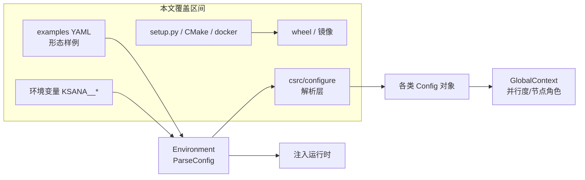
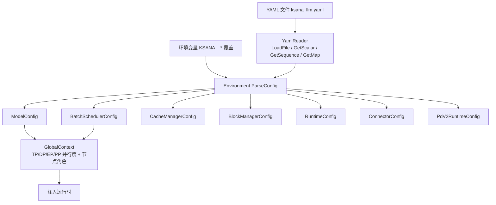
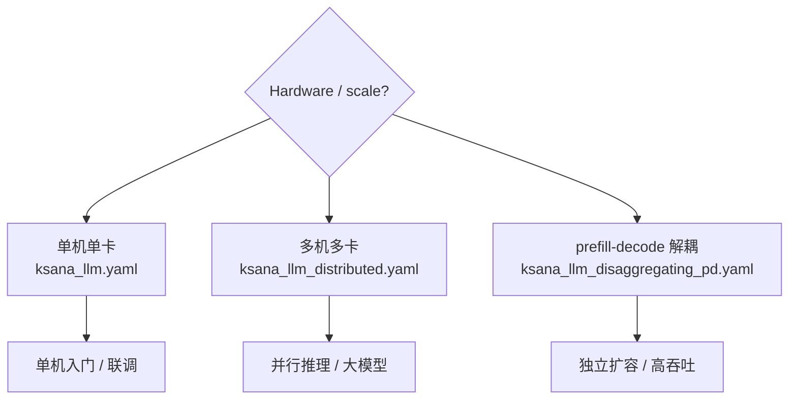
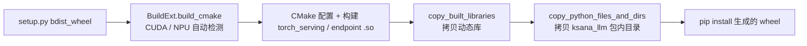

# 配置体系与部署构建

> 面向新用户与运维，聚焦 KsanaLLM 的**配置读取机制与部署构建产物**。本文回答三个问题：配置文件从哪来、怎么被读取；不同部署形态该改哪些字段；如何把源码构建成可分发的 wheel 与镜像。请求上手与启动步骤见同大文档下一篇《上手使用与服务示例》。

## 1. 部署与配置体系总览

KsanaLLM 的「部署配置」涉及四类工程资产，共同构成从源码到运行时的链路：

- `csrc/configure`：运行时配置解析层
- 「YAML + 环境变量」双通道：配置输入
- `examples/*.yaml`：三类部署形态样例
- `setup.py + CMake + docker`：把代码打包成 wheel 与镜像

按「配置怎么读 → 跟着哪个样例走 → 怎么构建产物」阅读本节即可建立整体地图。



四类资产的分工如下：

| 资产 | 位置 | 职责 |
| --- | --- | --- |
| 配置解析层 | `csrc/configure/` | `Environment` 为入口，`YamlReader` 解析 YAML，产出各类 Config 对象 |
| 配置主源 | `csrc/configure/environment.cpp` | YAML + 环境变量双通道读取 |
| 部署形态样例 | `examples/*.yaml` | 单机 / 分布式 / PD 分离三类模板 |
| 构建产物 | `setup.py`、`docker/` | 生成 wheel 与多硬件镜像 |

本文边界：只讲「配置怎么读、产物怎么构建」，不涉及调度/缓存/执行器等系统模块的内部实现，也不包含安装到启动的完整上手步骤。

**Sources:** <ref_code path="csrc/configure/environment.h" /> <ref_code path="csrc/configure/yaml_reader.h" /> <ref_code path="csrc/configure/global_context.h" /> <ref_code path="examples/" /> <ref_code path="setup.py" /> <ref_code path="docker/" />

## 2. 双通道配置体系：YAML 与环境变量

配置读取链路的入口是 `Environment`，它通过 `YamlReader` 解析 YAML 文件，并支持 `KSANA__*` 环境变量逐字段覆盖，最终产出 `ModelConfig`、`BatchSchedulerConfig`、`CacheManagerConfig`、`BlockManagerConfig`、`RuntimeConfig`、`ConnectorConfig`、`PdV2RuntimeConfig` 等各类配置对象，并由 `GlobalContext` 汇总并行度与节点角色。

双通道的含义：**YAML 提供完整默认配置，环境变量做定点覆盖**。运行时优先级为「环境变量 > YAML > 内置默认值」。



### 2.1 读取入口：Environment 与 YamlReader

`Environment` 是配置体系的统一入口，`ParseConfig(config_file)` 接收 YAML 文件路径完成解析，并向外暴露一组 `GetXxxConfig` 方法取回各类配置。`Environment` 的声明见 <ref_code path="csrc/configure/environment.h" />。

| 方法 | 产出的配置对象 | 说明 |
| --- | --- | --- |
| `ParseConfig` | — | 解析入口，接收 YAML 路径与若干覆盖参数 |
| `GetModelConfig` | `ModelConfig` | 模型结构、权重、量化信息 |
| `GetBatchSchedulerConfig` | `BatchSchedulerConfig` | 调度器类型、批处理策略、长度/队列限制 |
| `GetCacheManagerConfig` | `CacheManagerConfig` | KV/前缀缓存管理 |
| `GetBlockManagerConfig` | `BlockManagerConfig` | 显存块划分与占用比例 |
| `GetRuntimeConfig` | `RuntimeConfig` | 运行时通用配置 |
| `GetConnectorConfigs` | `ConnectorConfig` | PD 分离形态的连接器 |
| `GetPdV2RuntimeConfig` | `PdV2RuntimeConfig` | PD v2 运行时（仅后端为 v2 时返回） |
| `GetProfilerConfig` | `ProfilerConfig` | OTel 性能上报 |

`YamlReader` 是底层 YAML 解析器，提供 `LoadFile` 从磁盘载入、`GetScalar` 取标量、`GetSequence` 取序列、`GetMap` 取映射，`GetScalar` 在字段缺失时返回默认值。声明见 <ref_code path="csrc/configure/yaml_reader.h" />。

### 2.2 环境变量覆盖的两种实现

环境变量覆盖在 Python 侧与运行时侧以不同形式实现，运维同学需留意两者命名不同：

| 机制 | 前缀 | 命名规则 | 位置 |
| --- | --- | --- | --- |
| YAML 定点覆盖 | `KSANA__` | `KSANA__SETTING__BLOCK_MANAGER__BLOCK_HOST_MEMORY_FACTOR` 映射 `setting.block_manager.block_host_memory_factor` | `python/utilize/yaml_env_override.py` |
| 分布式/进程级变量 | 大写直用 | `WORLD_SIZE`、`NODE_RANK`、`MASTER_HOST`、`MASTER_PORT` 等 | `GlobalContext` 读取 |

`KSANA__` 覆盖用双下划线 `__` 分隔路径段，单下划线 `_` 保留为键名一部分，避免与嵌套冲突。值转换时优先沿用 YAML 中已有值的类型（bool/int/float/str），避免字符串被误转数值。见 <ref_code path="python/utilize/yaml_env_override.py" />。

### 2.3 配置对象与全局上下文

`GlobalContext` 在 `ParseConfig` 之后汇总并行度与节点角色：张量并行 `GetTensorParallelSize`、注意力数据并行 `GetAttentionDataParallelSize`、以及 `IsStandalone` / `IsDistributedMaster` / `IsDistributedWorker` 等节点角色判断；同时持有 `WORLD_SIZE`、`NODE_RANK`、`MASTER_HOST`、`MASTER_PORT`。详见 <ref_code path="csrc/configure/global_context.h" />。

`ModelConfig` 内定义的 `QuantMode` 枚举（`QUANT_NONE`/`QUANT_GPTQ`/`QUANT_AWQ`/`QUANT_FP8_E4M3` 等）表示量化方式，见 <ref_code path="csrc/configure/model_config.h" />；FP8 KV/权重的量化解析由 `quant_config_parser.h` 的 `ParseFP8QuantConfig` 等函数完成，`ParseGPTQQuantConfig`/`ParseAWQQuantConfig` 分别解析 GPTQ/AWQ，见 <ref_code path="csrc/configure/quant_config_parser.h" />。

### 2.4 优先级与覆盖规则

三者在解析时的优先级关系：**环境变量 > YAML 显式字段 > 代码内置默认值**。`YamlReader::GetScalar` 在字段缺失时返回默认值即可覆盖第三层，「YAML 字段」「内置默认值」由 Environment 与各配置的默认构造承担。

| 覆盖层 | 举例 | 生效时机 |
| --- | --- | --- |
| 环境变量 | `KSANA__SETTING__BLOCK_MANAGER__RESERVED_DEVICE_MEMORY_RATIO=0.1` | 生成最终 YAML 前 |
| YAML 字段 | `block_manager: reserved_device_memory_ratio: 0.05` | `ParseConfig` 解析时 |
| 内置默认 | `BatchSchedulerConfig` 中字段缺省值 | 构造 Config 时 |

**Sources:** <ref_code path="csrc/configure/environment.h" /> <ref_code path="csrc/configure/yaml_reader.h" /> <ref_code path="csrc/configure/global_context.h" /> <ref_code path="csrc/configure/model_config.h" /> <ref_code path="csrc/configure/schedule_config_parser.h" /> <ref_code path="csrc/configure/quant_config_parser.h" /> <ref_code path="python/utilize/yaml_env_override.py" />

## 3. 三类部署形态的示例 YAML（核心字段）

`examples/` 下三份 YAML 对应三类部署形态：单机 `ksana_llm.yaml`、分布式 `ksana_llm_distributed.yaml`、PD 分离 `ksana_llm_disaggregating_pd.yaml`。三份都以 `setting` + `model_spec` 两个顶级块组织，差异集中在并行度、是否包含 `connector` 块与角色字段。

单机（最常见的入门形态）用 `ksana_llm.yaml`；要跨多卡的并行推理用分布式；想解耦 prefill 与 decode 以便独立增扩容量，则用 PD 分离并配置 `connector` 块。

### 3.1 YAML 顶层结构

三份 YAML 共用 `setting` + `model_spec` 两块骨架；`setting.log` 仅单机 YAML 出现。常用块如下：

- `setting.global`：TP/PP 并行度、LoRA 开关、设备类型
- `setting.batch_scheduler`：调度器、批处理长度与队列
- `setting.block_manager`：显存块 token 数与显存占比
- `setting.attn_backend`：Flash Attention 实现与 FlashInfer 后端
- `setting.quantization_config`：KV cache 与权重量化
- `setting.profiler`：OTel 性能上报
- `setting.tokenization`：特殊 token 处理
- `model_spec.base_model.model_dir`：模型权重路径
- `model_spec.plugin_model`：多模态插件（TensorRT 加速、线程数）

### 3.2 单机形态：ksana_llm.yaml

单机 YAML 默认 `tensor_para_size: 2`、`pipeline_para_size: 1`，`model_dir` 指向本地模型权重。核心字段见下：

| 字段 | 作用 | 示例值 |
| --- | --- | --- |
| `tensor_para_size` | 张量并行度（TP） | `2` |
| `pipeline_para_size` | 流水线并行度（PP） | `1` |
| `attn_data_para_size` | 节点内注意力数据并行 | `1` |
| `expert_world_size` / `expert_para_size` | 专家并行的节点数 / 节点内专家并行 | `1` / `1` |
| `enable_cuda_graph` | 是否用 cudagraph 加速 decode | `false` |
| `moe_all_to_all_mode` | MoE All-to-All 通信模式 | `"auto"` |
| `batch_scheduler.max_batch_size` | 每步最大 batch | `128` |
| `batch_scheduler.max_token_len` | prompt+生成 最大长度之和 | `2048` |
| `block_manager.block_token_num` | 单个 block 容纳 token 数 | `16` |
| `block_manager.reserved_device_memory_ratio` | 保留显存占比 | `0.05` |
| `attn_backend.flash_attn_impl` | Flash Attention 实现（auto/fa3/vllm_v26 等） | `auto` |
| `quantization_config` | 量化后端与 KV/权重 dtype | `gptq_backend: cutlass` |
| `model_spec.base_model.model_dir` | 模型权重路径 | `/model/qwen1.5-hf/0.5B-Chat` |

### 3.3 分布式形态：`ksana_llm_distributed.yaml`

分布式 YAML 与单机结构相近，但并行度与资源配置为多卡场景（`tensor_para_size: 1` 起步）。差异体现在全局并行字段与显存块比例：

| 字段 | 与单机的差异 | 说明 |
| --- | --- | --- |
| `global.tensor_para_size` | `1`（可调大适配多卡） | 张量并行度按卡数对齐 |
| `global.enable_lora_adapter` | 新增 | LoRA 适配开关，分布式常启用 |
| `block_manager.lora_deivce_memory_ratio` | 新增 `0.0` | LoRA 权重显存占比 |
| `block_manager.lora_host_memory_factor` | 新增 `10.0` | LoRA 权重 host 预分配倍数 |
| `block_manager.block_host_memory_factor` | `0.1` | block 在 host 的预分配倍数 |

分布式的实际建簇依赖进程级环境变量（`WORLD_SIZE`/`NODE_RANK`/`MASTER_HOST`/`MASTER_PORT`），见第 6 章。

### 3.4 PD 分离形态：`ksana_llm_disaggregating_pd.yaml`

PD 分离在单机骨架基础上新增 `setting.connector` 块，用于连接 prefill 与 decode 两组节点，并靠 `connector.group_role` 声明本节点角色。

| `connector.*` 字段 | 作用 | 示例值 |
| --- | --- | --- |
| `router_addr` | Router server 地址 | `127.0.0.1:9080` |
| `inference_addr` | 本节点推理服务地址 | `127.0.0.1:8088` |
| `coordinator_addr` | PD 间信号传输通讯地址 | `127.0.0.1:65521` |
| `cluster_name` | 多 P 多 D 统一集群名 | `default_cluster` |
| `communication_type` | 通讯器类型 | `nccl`（或 `zmq`） |
| `group_role` | 本节点角色 | `prefill` 或 `decode` |
| `heartbeat_interval_ms` | 心跳上报间隔 | `2000` |
| `connector_waiting_sec` | 首次建链等待时长 | `1800` |
| `transfer_batch` | 一次可传输最大 Tensor 数 | `1048576` |
| `send_thread_num` | 传输线程数 | `6` |

同一份 YAML 中按节点分别将 `group_role` 设为 `prefill` 或 `decode`，即构成两套角色的配置模板。

### 3.5 三形态差异与选型

| 形态 | 对应 YAML | 关键差异 | 适用场景 |
| --- | --- | --- | --- |
| 单机 | `ksana_llm.yaml` | 单节点、单模型、无 connector | 入门、单卡/单机部署、联调 |
| 分布式 | `ksana_llm_distributed.yaml` | 多机多卡、`pipeline_para_size` 对齐、多节点并行 | 大规模并行推理、多卡显存叠加 |
| PD 分离 | `ksana_llm_disaggregating_pd.yaml` | 含 `connector` 块、`group_role` 角色划分 | prefill 与 decode 解耦、独立增扩容量 |

`examples/` 下另有按模型/后端选配的扩展样例，可作为参考：`ksana_llm_qwen2.yaml`（Qwen）、`deepseek_fp8_perf.yaml`（DeepSeek FP8 性能）、`ksana_llm_ascend_llama13b.yaml`（昇腾 NPU）、`llama7b/ksana_llm_dp.yaml` 与 `llama7b/ksana_llm_tp.yaml`（DP/TP 变体）。



**Sources:** <ref_code path="examples/ksana_llm.yaml" /> <ref_code path="examples/ksana_llm_distributed.yaml" /> <ref_code path="examples/ksana_llm_disaggregating_pd.yaml" /> <ref_code path="examples/ksana_llm_qwen2.yaml" /> <ref_code path="examples/deepseek_fp8_perf.yaml" /> <ref_code path="examples/ksana_llm_ascend_llama13b.yaml" /> <ref_code path="examples/llama7b/ksana_llm_dp.yaml" /> <ref_code path="examples/llama7b/ksana_llm_tp.yaml" />

## 4. 构建：setup.py 与 CMake、wheel 打包

wheel 构建以 `setup.py` 为入口，基于 `setuptools` 的自定义 `BuildExt` 驱动 CMake。核心流程：`setup.py bdist_wheel` → `BuildExt.build_cmake` 依据环境自动切换 CUDA/NPU → CMake 配置与编译 → 拷贝动态库与 Python 包 → 生成 wheel。



### 4.1 后端自动检测与 GPU 架构

`BuildExt.build_cmake` 通过 `is_run_on_npu_device()` 检测是否安装 `torch_npu` 来判断当前为 NPU 还是 CUDA 环境，并据此设置 CMake 开关：

| 条件 | 设置的 CMake 选项 | 说明 |
| --- | --- | --- |
| NPU（`torch_npu` 已装） | `WITH_CUDA=OFF`、`WITH_ACL=ON` | 走昇腾 CANN 链路 |
| CUDA（默认） | `WITH_CUDA=ON`、`SM=SM_ARCHS` | 指定 GPU 架构（`SM_ARCHS`） |

GPU 架构由 `SM_ARCHS` 控制，可从三处获得：`--with-sm` 命令行参数（如 `--with-sm 90a,89`）、或未提供时回退到 `DEFAULT_SM_ARCHS`（`"80,86,89,90a"`）。`pop_sm_arch` 与 `pop_version_flags` 负责把 `--with-sm`、`--with-tag` 等自定义 flag 从 `sys.argv` 剥离，避免 setuptools 报错。见 <ref_code path="setup.py" />。

### 4.2 端点逐项开关与构建目标

`setup.py` 扫描 `csrc/endpoints/wrapper/` 目录，对每个端点生成形如 `WITH_<端点名>_ENDPOINT` 的 CMake 选项（默认 `ON`），并可在 `CMAKE_ARGS` 中带 `-DWITH_XX_ENDPOINT=OFF` 显式关闭：

| 项 | 作用 | 说明 |
| --- | --- | --- |
| `WITH_<END>_ENDPOINT` | 端点编译开关 | 枚举 `wrapper/` 下实现的端点，默认启用 |
| `CMAKE_LIBRARY_OUTPUT_DIRECTORY` | 动态库输出目录 | 指向包内目录 |
| `CMAKE_BUILD_TYPE` | Debug / Release | 由 `--debug` 决定，默认 Release |

构建目标固定为 `torch_serving`（连同静态库与 loguru/tbb 传递引入），其余端点逐个追加 `${endpoint}_endpoint` 目标；`triton` 端点特殊处理为 Triton 后端。`BUILD_JOBS` 环境变量控制并行编译核数（缺省用全部 CPU 核）。

### 4.3 产物拷贝与包组织

构建完成后，`copy_built_libraries` 与 `copy_python_files_and_dirs` 把产物组织进 `python/ksana_llm/` 包：

| 产物类别 | 目标位置 | 内容 |
| --- | --- | --- |
| 核心动态库 | `ksana_llm/libtorch_serving.so`、`ksana_llm/lib/` | `libtorch_serving.so`、`libloguru.so`、`libglobal_cache_connector.so.1`、`libmooncake_store.so`、各 endpoint `.so` |
| 工具目录 | `ksana_llm/` 下各目录 | `weight_map`、`ksana_plugin`、`simple_router`、`openaiapi`、`utilize`、`ksana_encoder` |
| 启动脚本 | `ksana_llm/` | `serving_server.py`、`serving_generate_client.py`、`serving_forward_client.py`、`request_id.py` |
| 默认配置 | `ksana_llm/` | `ksana_llm.yaml`、`yaml_env_override.py` |
| Triton 内核 | `ksana_llm/triton_kernel_files/` | 从 `KSANA_TRITON_KERNEL_PATH` 或 `~/.cache/KsanaLLM/triton_kernel_files` 拷贝 |

### 4.4 构建命令骨架

给出从源码到 wheel 的构建命令骨架（仅引用真实参数名，非固定数值）：

```bash
# 安装构建依赖（依 requirements.txt）
pip install -r requirements.txt

# 在仓库根目录构建 wheel（以 CUDA GPU 为例）
#   --with-sm 90a 指定 GPU 架构；BUILD_JOBS 控制并行核数；CMAKE_ARGS 透传后端参数
BUILD_JOBS=48 \
CMAKE_ARGS="-DWITH_FLASH_ATTN_CACHE=ON" \
python setup.py bdist_wheel --with-sm 90a

# 安装生成的 wheel
pip install dist/ksana_llm-*.whl
```

底层 CMake 组织见根 `CMakeLists.txt` 与 `cmake/`：`CMakeLists.txt` 定义 `WITH_CUDA`/`WITH_ACL`/`WITH_TOPS` 等硬件开关与 GCC 版本检测；`cmake/external/*.cmake` 引入 20+ 第三方依赖（`pybind11`、`yaml-cpp`、`libzmq`、`xgrammar`、`polaris_cpp`、`mooncake_tent` 等）；`cmake/module/CMakeCCE*.cmake` 提供昇腾 CCE 编译器支持。声明见 <ref_code path="CMakeLists.txt" />、<ref_code path="cmake/external/" />、<ref_code path="cmake/module/" />。

产物可按 `tools/cicd/pkg/` 下的打包脚本归档，例如 `aws_h200_build_wheel.sh` 演示了面向 AWS H200 的构建（将 `--with-sm` 固定为 `90a`，并通过 `CMAKE_ARGS` 传入 NCCL 与 FlashAttention 选项）。见 <ref_code path="tools/cicd/pkg/aws_h200_build_wheel.sh" />。

**Sources:** <ref_code path="setup.py" /> <ref_code path="CMakeLists.txt" /> <ref_code path="cmake/external/" /> <ref_code path="cmake/module/" /> <ref_code path="tools/cicd/pkg/aws_h200_build_wheel.sh" /> <ref_code path="csrc/endpoints/wrapper/" /> <ref_code path="python/" />

## 5. Docker 镜像与多硬件后端

`docker/` 下提供多份 Dockerfile，分别面向 NVIDIA GPU、昇腾 NPU 与腾讯云环境等不同硬件，负责在容器最外层装配驱动、CANN 与编译依赖。镜像是后端链路的最外层装配，与 `csrc/device/` 下的 `nvidia`（CUDA）、`ascend`（NPU）、`zixiao` 后端对应。

| Dockerfile | 基础镜像 | 硬件 | 关键装配内容 |
| --- | --- | --- | --- |
| `Dockerfile.gpu` | `nvcr.io/nvidia/pytorch:25.01-py3` | NVIDIA GPU | `libpython3-all-dev`、`git-lfs`、flash-attention v2.6.2、`utf8_range` |
| `Dockerfile.npu` | `openeuler:22.03-lts` | 昇腾 NPU | Python 3.10、yum 开发工具、CANN 相关依赖 |
| `Dockerfile.tencentos4.gpu` | `tencentos4-minimal` | 腾讯云 GPU | `cuda-toolkit-12-4`、`cudnn9`、`libnccl`、torch 2.6.0 cu124 |

镜像选择依据硬件确定：GPU 用 `Dockerfile.gpu`；昇腾 NPU 用 `Dockerfile.npu`；腾讯云等基于 TencentOS 的环境用 `Dockerfile.tencentos4.gpu`。CUDA 镜像内编译 flash-attention 并安装 `vllm_flash_attn`，以满足 `WITH_FLASH_ATTN_CACHE` 等 KV cache 管理需求。

### 5.1 硬件后端与构建开关的关联

镜像装配决定编译期可用的后端，运行期构建再由 CMake 开关选定：

| 后端 | `csrc/device/` 目录 | CMake 开关 | 镜像 |
| --- | --- | --- | --- |
| NVIDIA GPU | `csrc/device/nvidia/` | `WITH_CUDA=ON` | `Dockerfile.gpu` / `Dockerfile.tencentos4.gpu` |
| 昇腾 NPU | `csrc/device/ascend/` | `WITH_ACL=ON` | `Dockerfile.npu` |
| 腾讯 ZiXiao | `csrc/device/zixiao/` | `WITH_TOPS=ON` | — |

镜像与开关必须匹配：选用 NPU 镜像时，`setup.py` 检测到 `torch_npu` 会自动设 `WITH_ACL=ON`；GPU 镜像则保持 `WITH_CUDA=ON`。硬件与镜像不匹配是常见的部署事故来源。

**Sources:** <ref_code path="docker/Dockerfile.gpu" /> <ref_code path="docker/Dockerfile.npu" /> <ref_code path="docker/Dockerfile.tencentos4.gpu" /> <ref_code path="csrc/device/nvidia/" /> <ref_code path="csrc/device/ascend/" /> <ref_code path="csrc/device/zixiao/" /> <ref_code path="CMakeLists.txt" />

## 6. 关键环境变量说明（world_size 等）

除 `KSANA__*` 定点覆盖外，进程级和构建期的配置主要靠一组大写环境变量。它们与双通道配置体系协同：`KSANA__*` 覆盖 YAML 字段，而以下变量定位集群拓扑、角色、通信与日志，由 `GlobalContext` 读取并持有。

| 环境变量 | 作用 | 相关接口/模块 |
| --- | --- | --- |
| `WORLD_SIZE` | 参与分布式推理的总进程数（集群规模） | `GlobalContext::GetWorldSize` |
| `NODE_RANK` | 当前节点在集群中的编号（角色定位） | `GlobalContext::GetNodeRank` |
| `MASTER_HOST` | 分布式主节点主机地址 | `GlobalContext::GetMasterHost` |
| `MASTER_PORT` | 主节点端口 | `GlobalContext::GetMasterPort` |
| `USE_TCP_DATA_CHANNEL` | 数据通道选择，默认走 NCCL，置可切 TCP 数据通道 | 分布式通信 |
| `KLLM_LOG_LEVEL` | 日志级别 | `utils/logger.h` 的 `KLLM_LOG_*` 宏 |
| `CMAKE_ARGS` | 透传给 CMake 的额外 `-D` 选项 | `setup.py` 的 `build_cmake` |
| `BUILD_JOBS` | 并行编译核数 | `setup.py` 构建参数 |
| `KSANA_TRITON_KERNEL_PATH` | Triton kernel 文件的路径 | `setup.py` 拷贝逻辑 |

### 6.1 集群拓扑与角色定位

`WORLD_SIZE` 描述并行推理的总进程数，`NODE_RANK` 定位当前节点在集群中的编号，`MASTER_HOST` / `MASTER_PORT` 指向主节点用于建连。`GlobalContext` 在此基础上推导节点角色（`IsStandalone`/`IsDistributedMaster`/`IsDistributedWorker` 等）。

### 6.2 通信通道与日志

通信层面，GPU 数据通道默认走 NCCL；需要时可用数据通道相关开关选择 TCP 通道。日志级别由 `KLLM_LOG_LEVEL` 控制，运行时日志输出通过 `KLLM_LOG_*` 宏（见 `utils/logger.h`）实现。

### 6.3 构建期变量

`CMAKE_ARGS`、`BUILD_JOBS`、`KSANA_TRITON_KERNEL_PATH` 仅在构建 wheel 时读取（见第 4 章），不参与运行时配置。`CMAKE_ARGS` 透传第三方依赖与后端开关，`BUILD_JOBS` 控制并行编译，`KSANA_TRITON_KERNEL_PATH` 指定 Triton kernel 文件来源。

**Sources:** <ref_code path="csrc/configure/global_context.h" /> <ref_code path="csrc/configure/environment.h" /> <ref_code path="csrc/utils/logger.h" /> <ref_code path="setup.py" />

## 7. 配置与部署的注意事项与最佳实践

本节沉淀各章的实践要点，帮助从配置到启动平稳衔接（启动的完整流程见下一篇《上手使用与服务示例》）。

### 7.1 部署形态选择建议

| 场景 | 推荐形态 | 理由 |
| --- | --- | --- |
| 入门、单卡、联调 | 单机 `ksana_llm.yaml` | 配置最简单，无需多进程变量 |
| 模型过大需多卡 | 分布式 `ksana_llm_distributed.yaml` | 并行度对齐多卡、多节点 |
| prefill 与 decode 负载不均 | PD 分离 `disaggregating_pd.yaml` | 解耦两类阶段，独立增扩容量 |

起步建议从单机形态开始，逐步调大 `tensor_para_size` 走向分布式；吞吐成为瓶颈且负载可分时再拆分为 PD 分离。

### 7.2 常见陷阱与排查

| 陷阱 | 现象 | 排查方向 |
| --- | --- | --- |
| 并行度与节点数不对齐 | 分布式建簇失败 | 核对 `tensor_para_size` / `pipeline_para_size` 与 `WORLD_SIZE`、`NODE_RANK` 一致 |
| 镜像与硬件不匹配 | 启动报后端缺失/算子找不到 | 镜像选用与 `WITH_CUDA`/`WITH_ACL` 开关对齐 |
| 环境变量覆盖优先级误用 | 配置未按预期生效 | 确认 `KSANA__*` 变量命名（`__` 分段、`_` 保留键名）及优先级：环境变量 > YAML > 默认值 |
| `--with-sm` 与卡型不符 | 编译的 kernel 无法运行 | 按目标 GPU 架构配置 `--with-sm`（如 H200 用 `90a`） |
| 量化 dtype 配置错误 | 推理精度异常 | 检查 `quantization_config` 的 `kv_cache.dtype` / `weight.quant_method` 与 `QuantMode` 一致 |

### 7.3 从配置到启动的衔接

- 配置文件定位：单机默认 `examples/ksana_llm.yaml`，模型路径改 `model_spec.base_model.model_dir`。
- 构建产物：wheel 内含 `ksana_llm.yaml` 与 `serving_server.py`，安装后可直接使用。
- 下一步：安装 wheel → 选择对应形态 YAML → 启动服务 → 发请求的完整步骤，见《上手使用与服务示例》。

**Sources:** <ref_code path="examples/ksana_llm.yaml" /> <ref_code path="examples/ksana_llm_distributed.yaml" /> <ref_code path="examples/ksana_llm_disaggregating_pd.yaml" /> <ref_code path="csrc/configure/environment.h" /> <ref_code path="setup.py" />