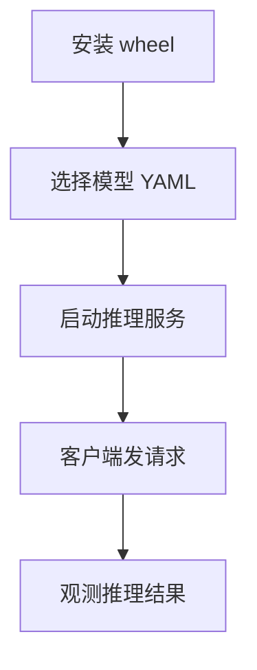
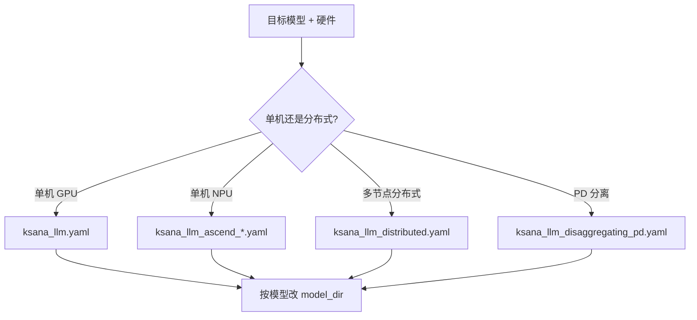
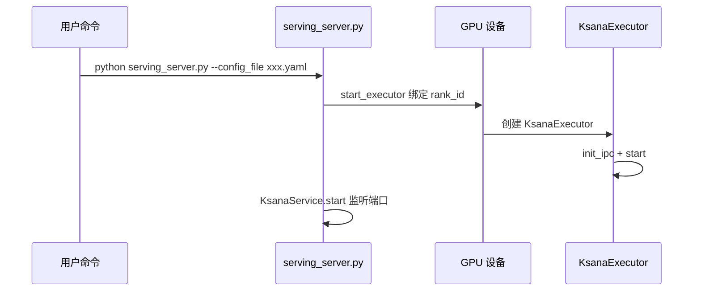
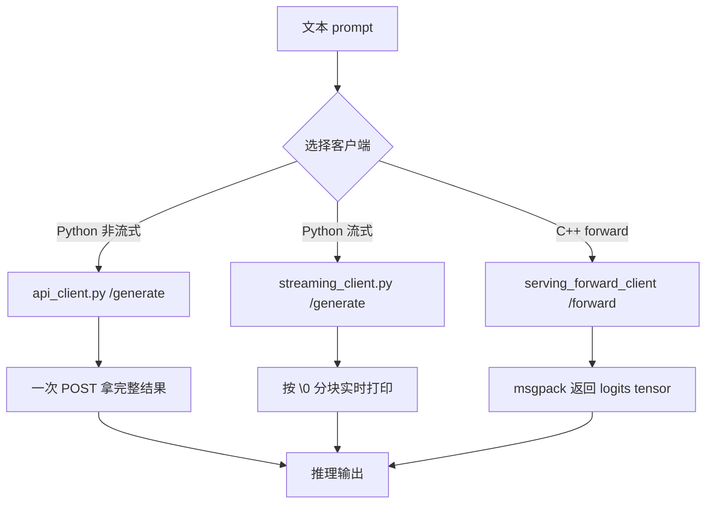
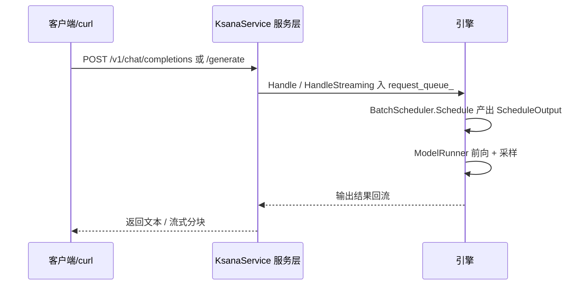
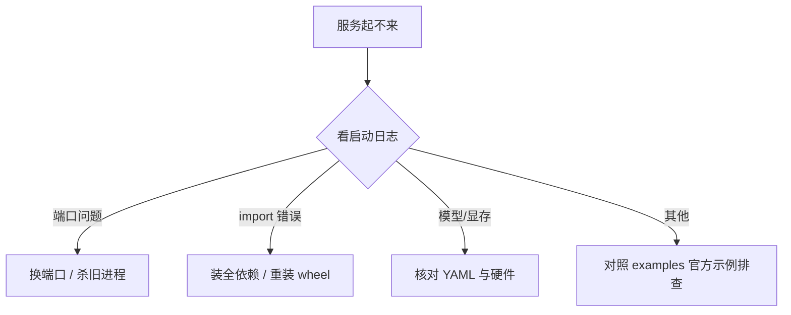

# 上手使用与服务示例

> 面向新用户的 KsanaLLM 上手指引：从安装、选配置、启动服务，到用三类客户端发出第一次推理请求。

## 1. 上手使用概览与前置准备

本章说明本文档能帮你完成什么，并给出从零到第一条推理结果的操作路径总览。

### 1.1 你能用它做什么

本文档帮助你在最短时间内跑通 KsanaLLM 的一次完整推理。你只需完成四步：**安装 wheel → 选择模型 YAML → 启动推理服务 → 用客户端发请求**。

全程聚焦用户可见的操作，不深入调度、执行、缓存等核心模块的实现细节。这些模块的机制由「推理引擎与运行时」「配置体系与部署构建」等文档覆盖。

### 1.2 首次上手五步总览



### 1.3 前置条件清单

开始前请确认以下三项目已就绪：

- **硬件环境**：具备 NVIDIA GPU 或华为昇腾 NPU 的计算节点，可被 CUDA / 昇腾工具链识别。
- **可安装的 wheel**：已构建并打包好的 `ksana_llm` wheel 产物（构建步骤见「配置体系与部署构建」文档，本文只使用打包结果）。
- **模型权重目录**：待推理模型已下载到本地，如 `examples/ksana_llm.yaml` 中 `model_dir` 指向的路径。

三者就绪后，即可进入第 2 章执行安装与配置。

**Sources:** <ref_code path="examples/ksana_llm.yaml" /> <ref_code path="setup.py" />

## 2. 安装 wheel 与模型 YAML 选择

本章介绍两类部署产物：可 `pip install` 的 wheel，以及针对目标模型与硬件挑选的 YAML 配置文件。

### 2.1 安装 wheel

KsanaLLM 以 wheel 形式交付，使用 pip 即可快速安装，无需手工编译。

- 源码构建与打包由 `setup.py` 的 `bdist_wheel` 命令产出可安装的 wheel（基于 CMake，构建期可通过 `WITH_CUDA` / `WITH_ACL` 等开关控制后端）。
- 构建细节（编译、跨平台、打包）不在本文展开，见「配置体系与部署构建」文档，这里只使用已生成的产物。

```bash
pip install ksana_llm-<version>.whl
```

安装完成后验证导入是否成功：

```bash
python -m pip show ksana_llm
```

> 技术栈提示：KsanaLLM 采用「C++ 高性能推理内核 + Python 服务包装」的混合架构。新用户多数时候只接触 Python 侧的 `serving_server.py` 与客户端脚本，C++ 内核以 `libtorch_serving` 库形式被 Python 侧加载，无需直接改动。

### 2.2 按模型与硬件选择 YAML

`examples/` 目录提供了多模型、多硬件、三种部署形态的 YAML 全集，作为选择起点。

| 模型 / 硬件 | 推荐 YAML | 说明 |
| --- | --- | --- |
| Qwen 系列（默认示例） | `examples/ksana_llm.yaml` | 单机最小可用配置，内置 qwen1.5 0.5B 示例 |
| Qwen2 | `examples/ksana_llm_qwen2.yaml` | 单机 qwen2 配置 |
| Llama2 13B | `examples/ksana_llm_llama2_13b.yaml` | 单机 llama2 13B |
| 昇腾 NPU | `examples/ksana_llm_ascend_llama13b.yaml` | 单卡 NPU；另有 `*_multi_npu.yaml` 用于昇腾多卡 |
| 分布式（多节点） | `examples/ksana_llm_distributed.yaml` | 认知提示，完整部署另见配置文档 |
| PD 分离 | `examples/ksana_llm_disaggregating_pd.yaml` | 认知提示，完整部署另见配置文档 |

### 2.3 YAML 中最需要改写的字段

- `model_spec.base_model.model_dir`：模型权重目录，必改，指向你的模型路径。
- `setting.global.tensor_para_size`：张量并行度，需与实际使用的 GPU 数匹配。
- `setting.endpoint_type`：服务端类型，默认 `python`，新用户无需改动。

其余调度、缓存、量化字段对「跑通第一个请求」不是必填项，保持默认即可。

选择 YAML 的决策流程：



分布式与 PD 分离形态仅作为认知提示，详细部署步骤见「配置体系与部署构建」。

**Sources:** <ref_code path="setup.py" /> <ref_code path="examples/ksana_llm.yaml" /> <ref_code path="examples/ksana_llm_distributed.yaml" /> <ref_code path="examples/ksana_llm_disaggregating_pd.yaml" /> <ref_code path="examples/" />

## 3. 使用 serving_server.py 启动推理服务

本章介绍服务总入口 `python/serving_server.py`，从「敲命令」到「服务就绪监听请求」的完整视角说明。

### 3.1 最小可运行启动命令

`serving_server.py` 通过 `EngineArgs.from_command_line()` 读取命令行参数，其中 `--config_file` 是核心必填项（默认指向 `examples/ksana_llm.yaml`），其余可选参数可覆盖 YAML 中的默认值。

```bash
cd <KsanaLLM 工程目录>
python python/serving_server.py --config_file examples/ksana_llm.yaml
```

可选参数（常用）：

| 参数 | 作用 | 默认值 |
| --- | --- | --- |
| `--config_file` | 服务配置文件（YAML） | `examples/ksana_llm.yaml` |
| `--host` | 服务监听地址 | 来自 YAML |
| `--port` | 服务监听端口 | `8080`（YAML 默认） |
| `--endpoint` | 端点类型（`python` / `trpc`） | 来自 YAML |
| `--served-model-name` | 覆盖 `/v1/models` 返回的模型名 | 自动推断 |
| `--access-log` | 开启端点访问日志 | 开 |
| `--json-model-override-args` | JSON 覆盖模型配置字段 | 无 |

### 3.2 启动链路

`serving_server.py` 的 `main` 依次完成：读取参数 → 创建 `KsanaService` 并 `init_ipc()` → 按 GPU 编号 `mp.spawn` 拉起多个 `start_executor` → `service.start()` 启动服务进程。

`start_executor` 是执行器启动函数，其链路为：`torch.cuda.set_device(rank_id)` 绑定 GPU → 创建 `KsanaExecutor` → `executor.init_ipc()` 初始化 IPC → `executor.start()` 进入主循环。



### 3.3 确认服务就绪

服务进程拉起后，会为每个 GPU 启动一个执行器进程，并最终在指定端口（默认 8080）以 uvicorn 监听请求。此时可通过健康检查确认就绪，服务层暴露了 `GET /health` 接口：

```bash
curl http://localhost:8080/health
```

返回 `200` 即服务已就绪，可进入第 4 章发起请求。

**Sources:** <ref_code path="python/serving_server.py" /> <ref_code path="python/ksana_llm/ksana_executor.py" /> <ref_code path="python/ksana_llm/ksana_service.py" />

## 4. 客户端请求示例：api_client / streaming_client / C++ 客户端

本章是文档核心，给出三种发起请求的典型客户端及对应的最小可运行片段与期望输出。

### 4.1 三类客户端对照

| 客户端 | 语言 | 请求类型 | 流式 | 端点 | 样例文件 |
| --- | --- | --- | --- | --- | --- |
| `api_client.py` | Python | 文本生成 | 非流式 / 流式 | `POST /generate` | `examples/api_client.py` |
| `streaming_client.py` | Python | 文本生成 | 流式 | `POST /generate` | `examples/streaming_client.py` |
| `serving_forward_client` | C++ | `forward` 推理 | — | `POST /forward` | `tools/cpp_client/serving_forward_client.cpp` |

三条路径的宏观分叉：



### 4.2 api_client.py：非流式 HTTP 请求

`api_client.py` 通过 `post_http_request` 发送 POST，非流式时用 `get_response` 解析完整响应中 `texts` 字段。

```bash
python examples/api_client.py --host localhost --port 8080 --prompt "Shanghai is" --n 1
```

核心请求构造（取自 `<ref_code path="examples/api_client.py" lines="17-52" />`）携带 `sampling_config`（温度、topk、topp）与 `stream` 开关。

期望输出（约）：输入 prompt `"Shanghai is"`，服务端返回续写文本，如：

```
['Shanghai is a city in China...']
```

非流式对应 `get_response(response)`，解析 `data["texts"]`；若要流式，加 `--stream` 并改用 `get_streaming_response`。

### 4.3 streaming_client.py：流式请求

`streaming_client.py` 固定以 `stream=True` 发起，通过 `get_streaming_response` 按分块实时打印增量 token。其请求使用 `[INST]...[/INST]` 包裹 prompt（针对 llama）。

```bash
python examples/streaming_client.py --host 127.0.0.1 --port 8080
```

- 核心函数 `<ref_code path="examples/streaming_client.py" lines="11-47" />`：`get_streaming_response` 用 `iter_lines(chunk_size=8192, delimiter=b"\0")` 逐行解析，`test_http_chat` 组装请求并实时打印。

期望输出：token 逐块呈现在终端，直到生成结束。

### 4.4 C++ 客户端：serving_forward_client

`tools/cpp_client/serving_forward_client.cpp` 基于 msgpack 发起非生成的 `forward` 推理请求，适合需要原始 logits / 中间层输出的场景。

```bash
./serving_forward_client --host localhost --port 8080 --api forward
```

- `PostRequestMsgPack` 将 `BatchRequestSerial` 用 msgpack 打包后 POST 到 `application/x-msgpack` 端点，返回 `BatchResponseSerial`。
- 请求携带 `target_name="logits"`、`slice_pos`、`token_reduce_mode` 等字段（见 `<ref_code path="tools/cpp_client/serving_forward_client.cpp" lines="66-110" />`）。

期望输出：对若干输入 token，打印对应的 logits tensor 数值数组，及 `request duration` 耗时。

---
> 说明：`forward` 用于"前置输入 + 取中间/最终 logits"的非纯生成场景；大多数对话类场景用第 4.2/4.3 的 `/generate` 即可。C++ 端点更底层的 msgpack 协议由序列化相关文档覆盖。

**Sources:** <ref_code path="examples/api_client.py" /> <ref_code path="examples/streaming_client.py" /> <ref_code path="tools/cpp_client/serving_forward_client.cpp" /> <ref_code path="python/serving_forward_client.py" />

## 5. 从入口到发请求的完整路径

本章把前三章串起来，从用户视角梳理一条请求从入口到返回的宏观链路，不展开具体机制。

### 5.1 请求链路总览

请求从 HTTP 入口进入服务层，异步经队列进入引擎，由调度器安排前向与采样，最终回流客户端。


- 服务层（`python/ksana_llm/ksana_service.py`）暴露 `generate` / `forward` / `health` 路由，client 请求先进此处。
- 在 C++ 侧，请求进入 `InferenceService.Handle` / `HandleStreaming`，作为服务入口承接第一环（见 `<ref_code path="csrc/service/inference_service.h" />`）。
- 端点与引擎之间通过 `request_queue_`（`Channel`）异步传递请求。
- `BatchScheduler::Schedule` 产出 `ScheduleOutput`，作为调度与执行之间的核心契约对象，交由执行/前向与采样阶段。
- 采样结果回流至服务层，编排成 `texts` / 流式分块返回客户端。

### 5.2 最小闭环时序

以客户端 / curl 访到 `/generate` 的完整闭环：



### 5.3 从服务启动到第一次拿到输出

把前文串成一份最小闭环清单：

- 安装 wheel → 按模型选好 YAML → `python serving_server.py --config_file ...` 启动 → `/health` 返回 200 → 用 `api_client.py` 发 `/generate` → 终端打印首次推理文本。

至此，已完成"入口 → 发请求 → 得到结果"的完整水滴。

> 说明：OpenAI 兼容 REST 适配（`/v1/chat/completions` 等）由 `python/openaiapi/` 接住，细节见「推理服务与OpenAI接口」文档。

**Sources:** <ref_code path="csrc/service/inference_service.h" /> <ref_code path="csrc/batch_scheduler/batch_scheduler.h" /> <ref_code path="python/ksana_llm/ksana_service.py" /> <ref_code path="python/openaiapi/openai_adapter.py" /> <ref_code path="python/openaiapi/" />

## 6. 常见问题与排障

本章围绕「服务起不来」和「请求报错」两类场景，给出新手的排障入口与进一步学习方向。

### 6.1 常见问题与排查动作

| 现象 | 可能原因 | 排查 / 解决动作 |
| --- | --- | --- |
| 服务无法监听端口 | 端口被占用或未就绪 | `ss -tlnp` 看端口，换 `--port` |
| `/health` 不返回 200 | 服务仍在初始化或引擎异常 | 查启动日志，等待模型加载完成 |
| YAML 加载报错 | `model_dir` 路径不存在 | 核对 `model_spec.base_model.model_dir` |
| 显存不足 / 并行度不匹配 | `tensor_para_size` 与实际 GPU 数不符 | 调整并行度字段，确认 GPU 可用数 |
| 启动即 ModuleNotFoundError | Python 环境 / dependency 缺失 | 确认 wheel 正确安装，`pip install -r requirements.txt` |
| 请求返回参数非法报错 | 采样参数超出范围 | 检查 `sampling_config` 中的 temperature / topk 等 |

### 6.2 服务启动失败的快速定位



排查时可对照 `examples/` 下的官方 YAML 与客户端脚本，检查自己的配置 / 脚本差异。

### 6.3 异常表现与清理

`serving_server.py` 注册了信号处理 `_signal_handler`，收到 SIGTERM / SIGINT 时会调用 `cleanup_encoder_processes` 清理编码器子进程后退出。若异常终止，可手动清理残留进程后重试。

### 6.4 分布式 / PD 部署提示

- 分布式或 PD 分离部署时，除启动 `serving_server.py` 外，还需额外启动路由层 `python/simple_router/main.py`（配合 `--host` / `--port` / `--workers`）。
- 仅作为提示，完整部署步骤见「配置体系与部署构建」文档。

### 6.5 进一步学习

- 完整部署与配置：见「部署配置与使用/配置体系与部署构建」。
- OpenAI 兼容接口与推理服务：见「推理服务与OpenAI接口」文档。

**Sources:** <ref_code path="python/serving_server.py" /> <ref_code path="examples/" /> <ref_code path="python/simple_router/main.py" />