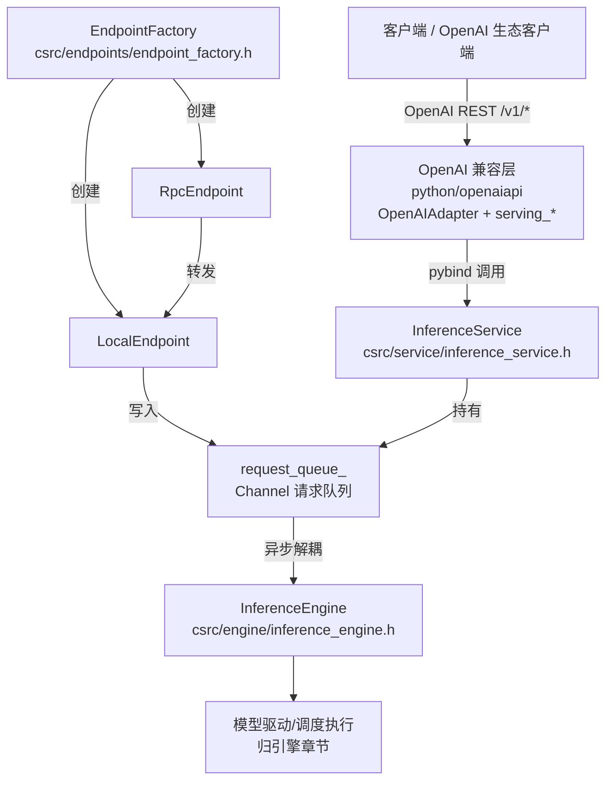
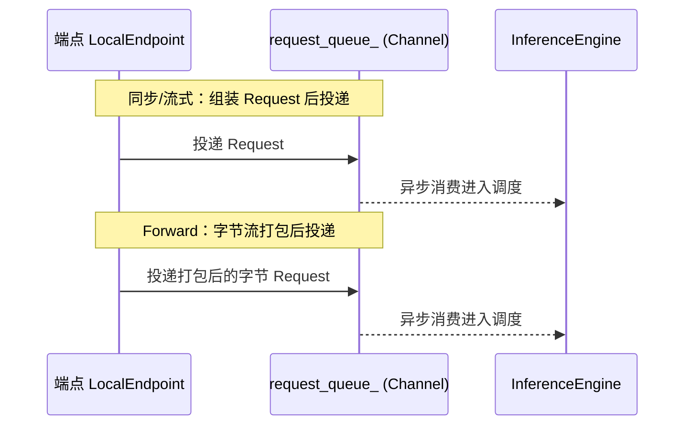
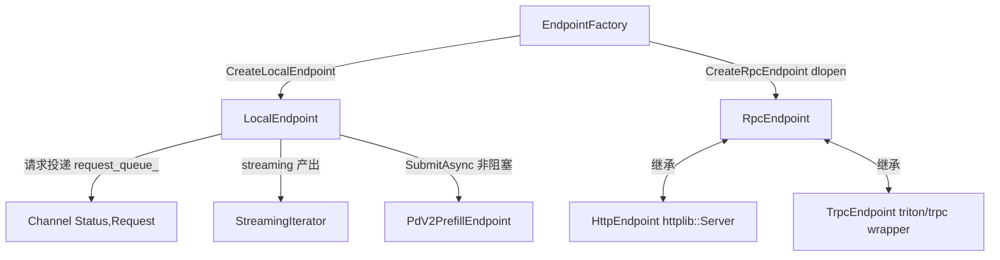
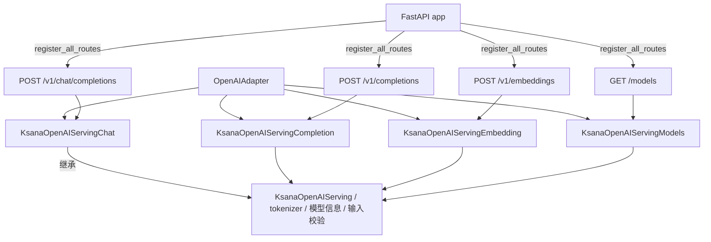
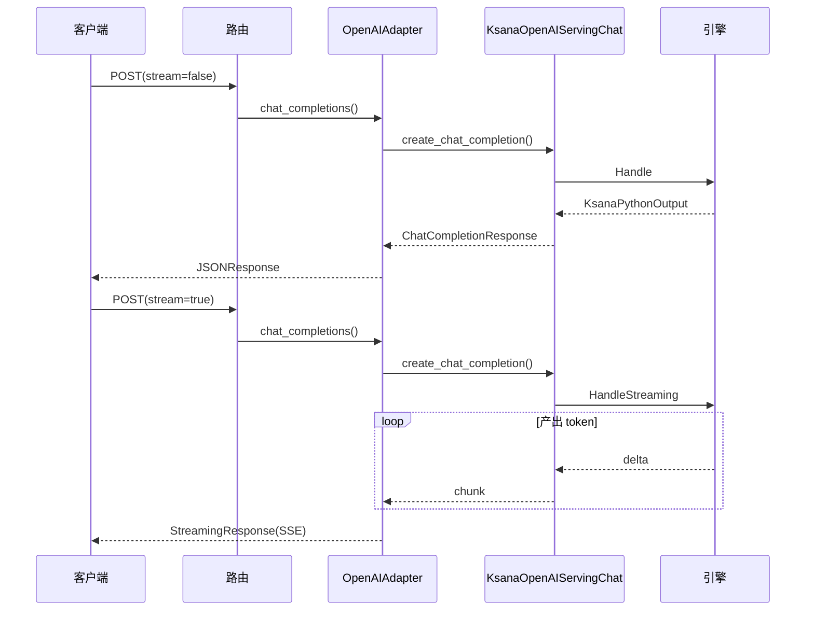
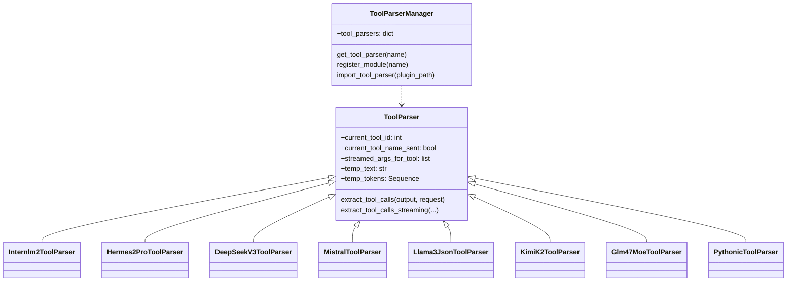
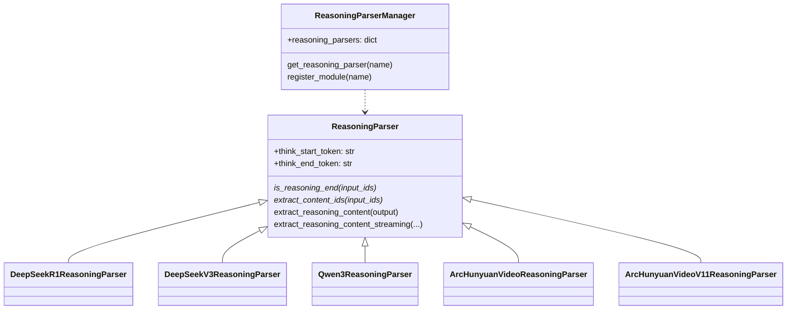
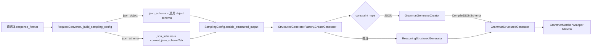

# 推理服务与OpenAI接口

本文档介绍 KsanaLLM 对外推理入口体系与 OpenAI 兼容 API 层，覆盖三条主线：C++ 侧 `InferenceService` 的同步/流式/Forward 三种入口与 `csrc/endpoints` 多端点体系；Python 侧`python/openaiapi` 的 OpenAI 兼容 REST API；以及对外的流式输出（SSE）、Function Calling、推理内容解析与基于 xgrammar 的结构化输出。调度、执行、缓存与结构化 bitmask 生成的内部细节不在本文范围。

---

## 第一章 推理服务与 OpenAI 接口总览

KsanaLLM 对外暴露推理能力采用 **C++ 高性能内核 + Python 服务包装**的混合栈：核心推理在 C++ 内核完成，OpenAI 兼容层在 Python 侧暴露。推理请求从客户端出发，穿过 OpenAI 适配层，最终落入 C++ 侧推理入口。

总体接入层次如下。



- C++ 内核 `InferenceService` 提供 `Handle`（同步）、`HandleStreaming`（流式）、`HandleForward`（字节 Forward）三种入口，内部通过 `request_queue_` 与引擎异步解耦。
- `EndpointFactory` 依据配置创建 `LocalEndpoint` / `RpcEndpoint`，端点把请求组装后写入 `request_queue_`。
- Python 侧 `python/openaiapi` 提供 OpenAI 兼容 REST API，`python/serving_server.py` 通过 `start_executor` 拉起服务承载层。
- 三种入口对应端点与协议形态见下表。

| 入口 | 调用形态 | 端点/协议 | 返回形态 | 典型场景 |
| --- | --- | --- | --- | --- |
| `Handle` | 一次性同步 | `LocalEndpoint::Handle` | 阻塞至完成，返回完整 `KsanaPythonOutput` | 一次性生成 |
| `HandleStreaming` | 流式 | `LocalEndpoint::HandleStreaming` | 返回 `StreamingIterator`，逐步取 token | SSE 流式输出 |
| `HandleForward` | 字节透传 | `LocalEndpoint::HandleForward` | 字节流 `RequestPacker` 拆包/回包 | 原生字节请求客户端 |

**Sources:**
<ref_code path="csrc/service/inference_service.h"/>
<ref_code path="csrc/endpoints/endpoint_factory.h"/>
<ref_code path="csrc/engine/inference_engine.h"/>
<ref_code path="python/serving_server.py"/>

---

## 第二章 InferenceService：三种推理入口与请求投递

`InferenceService` 是 C++ 内核对外暴露推理的统一服务入口，负责承载端点、维护端点到引擎的请求通道，并把三类推理调用委托给端点处理。

### InferenceService 的构成

`csrc/service/inference_service.h` 的 `InferenceService` 由以下成员装配而成。

- `inference_engine_`：引擎实例，承载调度与推理主体。
- `local_endpoint_`：本地端点，持有请求处理主逻辑。
- `rpc_endpoint_`：可选 RPC 端点，复用同一 `LocalEndpoint`。
- `request_queue_`：端点到引擎共享的 `Channel` 请求队列。

构造时 `local_endpoint_` 由 `EndpointFactory::CreateLocalEndpoint` 创建并注入 `request_queue_`，再接入引擎；配置类型为 RPC 时额外创建 `rpc_endpoint_`。`Initialize/Start/Stop` 分别透传至引擎与端点，按顺序协作完成服务生命周期。

### 三类请求入口

`InferenceService` 暴露三套方法，各自委托 `LocalEndpoint` 对应能力，覆盖同步、流式与字节透传三种形态。

| 方法 | 入参 | 出参 | 语义 |
| --- | --- | --- | --- |
| `Handle` | `KsanaPythonInput` | `KsanaPythonOutput` | 阻塞直至一次推理完成，返回完整输出 |
| `HandleStreaming` | `KsanaPythonInput` | `StreamingIterator` | 返回流式迭代器，逐步取 token |
| `HandleForward` | `request_bytes` | `response_bytes` | 字节透传，`RequestPacker` 拆包/回包 |

三种入口均通过 `request_queue_` 进入引擎。流式路径由 `StreamingIterator` 承载：`GetNext` 阻塞等待下一批 token，`Abort` 唤醒被阻塞的迭代以释放 KV 块。

### Mermaid 时序图（三入口投递路径）



### 端点到引擎的通道

`request_queue_` 是 `Channel<std::pair<Status, std::shared_ptr<Request>>>`，同时被 `LocalEndpoint` 与 `InferenceEngine` 持有。

- 端点侧把解析后的请求组装成 `Request` 后投递入队。
- 引擎侧消费队列，解耦端点的网络/调度处理与内核的调度执行。
- `EndpointFactory` 依据配置与同一队列引用创建端点实例，保证端点与引擎共享同一通道。

### Python 侧绑定与服务生命周期

Python 通过 pybind11 模块 `libtorch_serving` 暴露的 `Serving` 与 C++ 服务衔接：

- `KsanaLLMEngine` 与 `KsanaExecutor` 各自构造 `Serving` 实例，经 `init_serving` / `init_ipc` 与 `start_executor` 初始化启动。
- `python/serving_server.py` 的 `main` 创建服务、`init_ipc` 后经 `mp.spawn` 按 GPU rank 轮流拉起 executor 进程。
- `EndpointConfig` 控制端点类型：`python` 走本地协议直连引擎，否则切为 RPC 端点。

**Sources:**
<ref_code path="csrc/service/inference_service.h"/>
<ref_code path="csrc/service/inference_service.cpp"/>
<ref_code path="csrc/endpoints/local/local_endpoint.h"/>
<ref_code path="csrc/endpoints/streaming/streaming_iterator.h"/>
<ref_code path="csrc/endpoints/endpoint_factory.h"/>
<ref_code path="csrc/engine/inference_engine.h"/>
<ref_code path="python/ksana_llm/ksana_engine.py"/>
<ref_code path="python/serving_server.py"/>

---

## 第三章 端点体系：多端点与 EndpointFactory

`csrc/endpoints` 下按接入方式划分多类端点，把外部请求转换成统一的 `Request` 后沿 `Channel` 投递给推理引擎。`EndpointFactory` 依据配置创建本地端点与 RPC 端点，是接入层的统一入口。

### 端点分类与职责

`csrc/endpoints` 下共六类端点，职责与适用场景如下。

| 端点类型 | 协议/接口 | 适用场景 |
| --- | --- | --- |
| `local`（`LocalEndpoint`） | 内存调用：`Handle`/`HandleStreaming`/`HandleForward` | 进程内同步、流式、Forward 透传 |
| `http`（`HttpEndpoint`） | HTTP（`httplib::Server`） | 直接面向 HTTP 客户端接入 |
| `rpc`（`RpcEndpoint`） | 抽象基类（`Start`/`Stop`） | 远程端点契约，作为 http/trpc 基类 |
| `pd_v2`（`PdV2PrefillEndpoint`） | `SubmitAsync` 非阻塞投递 | Prefill 准入，异步送 `ModelDriver::Enqueue` |
| `streaming`（`StreamingIterator`） | 迭代器输出 | 流式逐 token 返回 |
| `wrapper`（`triton`/`trpc`） | Triton / tRPC | 接入外部推理框架 |

### LocalEndpoint（本地同步与流式）

`LocalEndpoint` 聚合三套入口与一个非阻塞提交接口：

- `Handle`：同步处理单请求，返回 `KsanaPythonOutput`。
- `HandleStreaming`：流式处理，产出 `StreamingIterator` 供逐 token 读取。
- `HandleForward`：字节流透传请求。
- `SubmitAsync`：pd_v2 Prefill 路径，把已组装 `Request` 非阻塞提交，经 `request_queue_` 交给引擎。

端点通过注入的 `Channel<std::pair<Status, shared_ptr<Request>>>& request_queue_` 传请求给引擎。

#### HttpEndpoint（HTTP 接入）

`HttpEndpoint` 继承 `RpcEndpoint`，持有 `httplib::Server`：

- `Start`/`Stop`：监听与关闭 socket。
- `Accept`：等待请求到达。
- `HandleRequest`：解析 HTTP 请求。
- `Send`：把结果填回 `httplib::Response`。

#### RpcEndpoint 与 wrapper 端点

`RpcEndpoint` 是远程端点抽象基类，持有 `local_endpoint_` 与 `endpoint_config_`。`wrapper` 下提供：

- `trpc`（`TrpcEndpoint`）：继承 `RpcEndpoint` 与 `trpc::TrpcApp`，基于 tRPC 的 HTTP 处理，从请求头提取 `x-remote-ip`、`traceparent` 链路上下文。
- `triton`：`client_generate_demo.py` / `client_forward_demo.py` 演示以 gRPC 对接。

#### pd_v2 Prefill 端点

`PdV2PrefillEndpoint` 承担 Prefill 校验准入：把 `IncomingPrefillRequest` 转为 `Request`，经 `LocalEndpoint::SubmitAsync` 非阻塞提交给 `ModelDriver::Enqueue`（经 `PdV2ConnectorInterface`）。`PdV2PrefillCompletion` 负责完成回收。

### EndpointFactory 创建端点

`EndpointFactory` 提供两个静态工厂方法：

- `CreateLocalEndpoint`：直接构造 `LocalEndpoint`，注入配置与 `request_queue` 通道。
- `CreateRpcEndpoint`：按配置的 `rpc_plugin_name` 构造 `lib{plugin}_endpoint.so` 库名，`dlopen` 加载后以 `Create{Plugin}Endpoint` 符号创建对应 rpc 端点（如 `CreateTrpcEndpoint`）。

端点类关系如下图所示。



**Sources:**
<ref_code path="csrc/endpoints/endpoint_factory.h"/>
<ref_code path="csrc/endpoints/endpoint_factory.cpp"/>
<ref_code path="csrc/endpoints/local/local_endpoint.h"/>
<ref_code path="csrc/endpoints/http/http_endpoint.h"/>
<ref_code path="csrc/endpoints/rpc/rpc_endpoint.h"/>
<ref_code path="csrc/endpoints/pd_v2/pd_v2_prefill_endpoint.h"/>
<ref_code path="csrc/endpoints/streaming/streaming_iterator.h"/>
<ref_code path="csrc/endpoints/wrapper/trpc/trpc_endpoint.h"/>
<ref_code path="csrc/endpoints/wrapper/triton/client_generate_demo.py"/>

---

## 第四章 OpenAI 兼容 REST API：适配层与路由注册

`python/openaiapi` 提供 OpenAI 兼容的 REST 层：`OpenAIAdapter` 组合四个 serving 承担 chat/completion/embedding/models 能力，`register_all_routes` 将 REST 路由动态注册到 FastAPI 应用，最终投递到 C++ 推理入口。`KsanaOpenAIServing` 基类统一承担 tokenizer 初始化、模型信息提取与输入校验归一化。

### OpenAIAdapter 与四个 serving

`OpenAIAdapter` 构造时创建四个 serving —— `KsanaOpenAIServingChat`、`KsanaOpenAIServingCompletion`、`KsanaOpenAIServingEmbedding`、`KsanaOpenAIServingModels`，并暴露：

- `chat_completions(request, http_request)`：chat 请求，返回完整 JSON 或流式 `StreamingResponse`。
- `completions(request)` / `embeddings(request)`：completion 与 embedding。
- `list_models` / `get_model`：模型元数据。

适配层与 serving 及路由的组成关系如下。



### KsanaOpenAIServing 基类

`KsanaOpenAIServing` 是所有 serving 的基类，统一承担公共初始化与预处理：

- tokenizer 初始化：`_initialize_tokenizer` 从 `llm_server.tokenizer` 获取，并用线程池包装异步 tokenization。
- 模型信息提取：`_extract_model_info` 从 `engine_args` 提取模型名并生成 OpenAI 兼容元数据。
- 输入校验归一化：`_normalize_prompt_text_to_input` / `_normalize_prompt_tokens_to_input` 归一化为 `TextTokensPrompt`；`_validate_input` 校验是否超过 `max_model_len`。

### 路由注册与统一错误处理

`add_openai_routes` 加载 chat template 后构造 `OpenAIAdapter`，再调用 `register_all_routes` 注册路由。`register_all_routes` 挂载异常处理器并注册以下 FastAPI 路由：

| 方法与路径 | 处理器 | 对应 serving |
| --- | --- | --- |
| `POST /v1/chat/completions` | `_chat_completions` | `chat_completions` |
| `POST /v1/completions` | `_completions` | `completions` |
| `POST /v1/embeddings` | `_create_embeddings` | `embeddings` |
| `GET /models` | `_list_models` | `list_models` |
| `GET /models/{model_id}` | `_get_model` | `get_model` |

统一错误处理走 `_make_openai_error_json(message, error_type, status_code)`，返回含 `error.message / type / code / param` 的 JSON。`register_all_routes` 挂载三类异常处理器（`RequestValidationError`、`StarletteHTTPException`、通用 `Exception`），把异常翻译为该错误 JSON。

`OpenAIConfig` 提供默认采样参数，包括 `default_temperature=1.0`、`default_do_sample=False`、`default_top_k=1`、`default_top_p=1.0`、`default_num_beams=1`、`default_length_penalty=1.0`；并承载 `tool_call_parser`、`reasoning_parser` 等解析器配置（Function Calling 在下一章展开）。

### /v1/chat/completions 请求响应流程

`chat_completions` 调用 `KsanaOpenAIServingChat.create_chat_completion`；非流式返回 `ChatCompletionResponse`（包装为 `JSONResponse`），流式返回可迭代对象（包装为 `text/event-stream` 的 `StreamingResponse`）。



#### 非流式请求与响应

```json
{
  "model": "ksana-llm",
  "messages": [{"role": "user", "content": "你好"}],
  "stream": false,
  "max_tokens": 64
}
```

```json
{
  "id": "req-xxx",
  "object": "chat.completion",
  "created": 1780000000,
  "model": "ksana-llm",
  "choices": [
    {"index": 0, "message": {"role": "assistant", "content": "你好"}, "finish_reason": "stop"}
  ],
  "usage": {"prompt_tokens": 8, "completion_tokens": 12, "total_tokens": 20}
}
```

#### 流式请求与响应

请求设置 `"stream": true`，客户端返回 `text/event-stream`，每 token 一个 `data:` 分块，末尾 `data: [DONE]` 结束。

```
请求: {"model": "ksana-llm", "messages":[{"role":"user","content":"你好"}], "stream": true}
data: {"id":"req-xxx","object":"chat.completion.chunk","model":"ksana-llm",
       "choices":[{"index":0,"delta":{"role":"assistant"},"finish_reason":null}]}
data: {"id":"req-xxx","object":"chat.completion.chunk","model":"ksana-llm",
       "choices":[{"index":0,"delta":{"content":"你好"},"finish_reason":null}]}
data: [DONE]
```

**Sources:**
<ref_code path="python/openaiapi/openai_adapter.py"/>
<ref_code path="python/openaiapi/serving_chat.py"/>
<ref_code path="python/openaiapi/serving_completion.py"/>
<ref_code path="python/openaiapi/serving_embedding.py"/>
<ref_code path="python/openaiapi/serving_models.py"/>

---

## 第五章 函数调用与推理内容解析

`python/openaiapi` 通过两套抽象基类——`ToolParser` 与 `ReasoningParser`——分别把模型输出中的工具调用（Function Calling）和思考过程（reasoning_content）从原始文本中剥离出来，再由各自 Manager 按注册名统一获取。各模型厂商的专用解析器在模块加载时通过 `register_module` 自动注册进对应 Manager，服务初始化时按配置的解析器名查找实例化。

### ToolParser 抽象与注册机制

`ToolParser` 是工具解析的抽象基类，持有关键的流式解析状态：

- `current_tool_id`：当前解析第几个工具调用。
- `current_tool_name_sent`：工具名是否已下发。
- `streamed_args_for_tool`：每个工具已流式下发的参数增量。
- `temp_text` / `temp_tokens`：跨 delta 的临时缓冲区。

派生类需实现两个核心方法：

- `extract_tool_calls(model_output, request)`：对完整模型输出做非流式提取，返回 `ExtractedToolCallInformation`。
- `extract_tool_calls_streaming(...)`：基于状态机对增量 token 流式提取，返回 `DeltaMessage`（工具名、参数增量或普通文本增量）。

`ToolParserManager` 维护 `tool_parsers: dict[str, type]`，用装饰器 `@ToolParserManager.register_module(name)` 把子类注册到指定名字；`get_tool_parser(name)` 按名取用，`import_tool_parser(plugin_path)` 支持从外部文件动态加载。子类与注册名、Manager 的关系如下。



### 各模型专用工具解析器

各解析器以 `@ToolParserManager.register_module("...")` 注册，覆盖不同厂商的 tool call 文本格式：

| 注册名 | 类 | 关键格式标记 |
| --- | --- | --- |
| `internlm` | `Internlm2ToolParser` | `<|action_start|><|plugin|>`...`<|action_end|>` |
| `hermes` | `Hermes2ProToolParser` | `<tool_call>` + `<scratch_pad>` |
| `deepseek_v3` | `DeepSeekV3ToolParser` | 专有标记 |
| `deepseek_v31` / `deepseek_v32` | `DeepSeekV31/V32ToolParser` | DSML XML 标签 |
| `deepseek_v4` | `DeepSeekV4ToolParser` | 外层 `<tool_calls>` |
| `mistral` | `MistralToolParser` | `[TOOL_CALLS]` 数组 |
| `llama3_json` / `llama4_json` | `Llama3JsonToolParser` | `<|python_tag|>` |
| `llama4_pythonic` / `pythonic` | `Llama4Pythonic/PythonicToolParser` | Python 风格调用列表 |
| `glm47` | `Glm47MoeToolParser` | `<tool_call>` 差分流式 |
| `kimi_k2` | `KimiK2ToolParser` | `<|tool_call_begin|>` 标记 |

流式解析普遍借助 `partial_json_parser`（位掩码 `Allow` 控制可解析 JSON 片段）与 `utils.py` 的 `extract_intermediate_diff` 差分工具，仅下发区间增量；`chat_utils.make_tool_call_id` 负责生成工具调用 ID。DeepSeek V3.2/V4 还使用 `encoding_dsv32.py` / `encoding_dsv4.py` 的 DSML 编码承载工具调用消息模板。

### ReasoningParser 抽象与注册机制

`ReasoningParser` 抽象基类把模型输出的思考过程与正式回答分离，默认使用 `thinking` / `response` 两个标记：

- `extract_reasoning_content(model_output)`：完整输出非流式提取，返回 `(reasoning_content, content)`。
- `extract_reasoning_content_streaming(...)`：增量流式提取，返回携带 `reasoning_content` 或 `content` 的 `DeltaMessage`。
- `is_reasoning_end(input_ids)`：供结构化引擎判断推理结束（抽象方法）。
- `extract_content_ids(input_ids)`：提取结束标记后的内容 token（抽象方法）。

`ReasoningParserManager` 结构与 Tool 侧对称。抽象基类与派生子类、Manager 关系如下。



### 各模型专用推理解析器

| 注册名 | 类 | 关键信息 |
| --- | --- | --- |
| `deepseek_r1` | `DeepSeekR1ReasoningParser` | 端 token 后紧跟 `end_confirmation_token_id` 确认结束 |
| `deepseek_v3` | `DeepSeekV3ReasoningParser` | 同 R1 的结束确认机制 |
| `qwen3`（含 `glm45`/`deepseek_v4`） | `Qwen3ReasoningParser` | 支持 `enable_thinking` 关闭推理 |
| `arc_hunyuan_video_v2` | `ArcHunyuanVideoReasoningParser` | `<answer>`/`</answer>` 包裹 |
| `arc_hunyuan_video_v1.1` | `ArcHunyuanVideoV11ReasoningParser` | 中文标记 `思考中:` / `总结如下:` |

R1 与 V3 的 `is_reasoning_end` 使用 `_reasoning_ended` / `_awaiting_end_confirmation` 状态做内存缓存与延迟确认，避免 `"response"` 出现在推理内容中造成误判。解析完成后 `KsanaOpenAIServingChat` 把 `reasoning_content` 与 `content` 分别写入 OpenAI 响应的 `DeltaMessage`。

### transformers_utils 与消息模板转换

`transformers_utils` 把 OpenAI 消息转换为模型模板输入：

- `tokenizer_base.py` 定义 `TokenizerBase` 抽象；`chat_utils.py` 的 `AnyTokenizer` 是 `PreTrainedTokenizer`/`PreTrainedTokenizerFast`/`TokenizerBase` 的联合统一入口。
- `chat_utils.py` 提供 `apply_hf_chat_template` / `apply_mistral_chat_template` 渲染成模型 chat 模板，核心流程为 `resolve_hf_chat_template`（优先显式模板 → AutoProcessor → AutoTokenizer）→ `apply_chat_template`。
- `processor.py` 提供 `get_processor`/`cached_get_processor` 按模型名加载 `AutoProcessor`，并定义 `HashableDict`/`HashableList` 支持 `lru_cache` 缓存多模态 processor。

### DeepSeek 专属消息编码

`encoding_dsv32.py` 与 `encoding_dsv4.py` 为 DeepSeek 系列提供独立消息编码，核心是 DSMO 风格的 `dsml_token`（`ADD`）标记与工具调用消息模板：

- `TOOLS_SYSTEM_TEMPLATE` / `TOOLS_TEMPLATE`：把 tool schema 拼入 system 提示，引导模型以 `<invoke>`/`<parameter>` 输出。
- `response_format_template`：把 JSON Schema 注入 `## Response Format` 段。
- `tool_calls_template`：V3.2 外层 `<function_calls>`，V4 可配置 `tc_block_name`。

`serving_chat.py` 在 `_init_parsers` 中检测 `tool_call_parser` 为 `deepseek_v32` / `deepseek_v4` 时置相应编码开关，选择对应编码路径。

**Sources:**
<ref_code path="python/openaiapi/tool_parsers/abstract_tool_parser.py"/>
<ref_code path="python/openaiapi/tool_parsers/__init__.py"/>
<ref_code path="python/openaiapi/tool_parsers/internlm2_tool_parser.py"/>
<ref_code path="python/openaiapi/tool_parsers/hermes_tool_parser.py"/>
<ref_code path="python/openaiapi/tool_parsers/deepseekv3_tool_parser.py"/>
<ref_code path="python/openaiapi/tool_parsers/deepseekv31_tool_parser.py"/>
<ref_code path="python/openaiapi/tool_parsers/deepseekv32_tool_parser.py"/>
<ref_code path="python/openaiapi/tool_parsers/deepseekv4_tool_parser.py"/>
<ref_code path="python/openaiapi/tool_parsers/mistral_tool_parser.py"/>
<ref_code path="python/openaiapi/tool_parsers/llama_tool_parser.py"/>
<ref_code path="python/openaiapi/tool_parsers/llama4_pythonic_tool_parser.py"/>
<ref_code path="python/openaiapi/tool_parsers/pythonic_tool_parser.py"/>
<ref_code path="python/openaiapi/tool_parsers/glm47_moe_tool_parser.py"/>
<ref_code path="python/openaiapi/tool_parsers/kimi_k2_tool_parser.py"/>
<ref_code path="python/openaiapi/tool_parsers/utils.py"/>
<ref_code path="python/openaiapi/reasoning/abs_reasoning_parsers.py"/>
<ref_code path="python/openaiapi/reasoning/deepseek_r1_reasoning_parser.py"/>
<ref_code path="python/openaiapi/reasoning/deepseek_v3_reasoning_parser.py"/>
<ref_code path="python/openaiapi/reasoning/qwen3_reasoning_parser.py"/>
<ref_code path="python/openaiapi/reasoning/arc_hunyuan_video_v2_reasoning_parser.py"/>
<ref_code path="python/openaiapi/reasoning/arc_hunyuan_video_v11_reasoning_parser.py"/>
<ref_code path="python/openaiapi/transformers_utils/tokenizer_base.py"/>
<ref_code path="python/openaiapi/transformers_utils/chat_utils.py"/>
<ref_code path="python/openaiapi/transformers_utils/processor.py"/>
<ref_code path="python/openaiapi/encoding_dsv32.py"/>
<ref_code path="python/openaiapi/encoding_dsv4.py"/>
<ref_code path="python/openaiapi/serving_chat.py"/>

---

## 第六章 结构化输出与语法约束衔接

结构化输出指基于 `xgrammar` 的约束解码，使生成结果严格符合目标 JSON 结构。本章说明其在服务/适配层的入参衔接：OpenAI 请求体的 `response_format`（`json_object`/`json_schema`）经 `RequestConverter._build_sampling_config` 转成 `SamplingConfig` 的 `enable_structured_output` 与 `json_schema` 字段，再传给 C++ 侧 `StructuredGeneratorFactory` 进入约束解码。xgrammar 编译 JSON Schema 生成 bitmask 的具体机制归"执行器与采样解码/结构化输出"章节。

### 应用场景与请求体承载

结构化 JSON 输出用于需要下游程序化消费的场景，通过 OpenAI `response_format` 字段声明约束类型：

- 接口合同稳定：外部系统按固定 JSON 结构解析结果。
- 工具参数落库：与 Function Calling 配合，参数符合 JSON Schema。
- 数据管道：抽取字段直接进下游 ETL，无需宽松解析。

在 `openai_protocol.py` 中，`ResponseFormat.type` 为 `Literal["text", "json_object", "json_schema"]`。`RequestConverter._build_sampling_config` 依据两类承载写入 `sampling_config`：

- `json_object`：映射为通用 schema `'{"type": "object"}'`。
- `json_schema`：具体 schema 经 `convert_json_schema2str` 序列化为字符串。

```json
{"response_format": {"type": "json_object"}}
{"response_format": {"type": "json_schema", "json_schema": {
  "name": "movie",
  "schema": {"type": "object", "properties": {"title": {"type": "string"}}}
}}}
```

当 `response_format` 非空时 `enable_structured_output` 恒为 `True`；请求体可直接携带该布尔字段覆盖。`tool_choice` 显式指定工具时置位 `enable_structured_output`。

### SamplingConfig 与 StructuredGeneratorFactory

`csrc/utils/request.h` 中 `SamplingConfig` 携带结构化输出字段：

- `enable_structured_output`：是否启用约束解码。
- `json_schema`：约束用的 JSONSchema 字符串。
- `enable_thinking`：控制推理模式，配套 `ReasoningStructuredGenerator`。

数据流：`RequestConverter` 产出 `sampling_config` → pybind 固化为 C++ `SamplingConfig` → 引擎调用 `StructuredGeneratorFactory`。工厂维护 `creator_registry_`，`CreateGenerator(config, enable_thinking)` 依 `constraint_type` 路由到对应 creator；推理模式下用 `ReasoningStructuredGenerator` 包裹内部生成器。`GrammarGeneratorCreator` 构造 `GrammarBackend` 后调用 `CompileJSONSchema` 编译并创建 `GrammarStructuredGenerator`。



`GrammarStructuredGenerator` 实现 `StructuredGeneratorInterface`（`AcceptToken` / `FillNextTokenBitmask` / `Rollback` / `IsTerminated` 等），内部持 `GrammarMatcherWrapper`，其 `FillNextTokenBitmask` 产出的 bitmask 交给采样层约束 token 选取。`GrammarBackend::Create` 当前仅在 NVIDIA 设备可用。

**Sources:**
<ref_code path="csrc/utils/request.h"/>
<ref_code path="csrc/runtime/structured_generation/structured_generator_factory.h"/>
<ref_code path="csrc/runtime/structured_generation/xgrammar/xgrammar_structured_generator_creator.h"/>
<ref_code path="csrc/runtime/structured_generation/xgrammar/xgrammar_structured_generator.h"/>
<ref_code path="csrc/runtime/structured_generation/reasoning_structured_generator.h"/>
<ref_code path="csrc/utils/grammar_backend.h"/>
<ref_code path="csrc/utils/grammar_matcher.h"/>
<ref_code path="python/openaiapi/openai_protocol.py"/>
<ref_code path="python/openaiapi/request_converter.py"/>

---

## 第七章 请求示例与实用注意

对外调用有两类形态，按接入方式区分。

| 入口 | 请求/响应形态 | 面向客户端 | 代码位置 |
| --- | --- | --- | --- |
| OpenAI 兼容层 | OpenAI 协议（`/v1/chat/completions` 等）、SSE 流式 | 标准 OpenAI SDK、通用 HTTP 客户端 | `python/openaiapi/` |
| 原生字节请求 | JSON/msgpack 载荷、同步或流式返回 | 直连 C++ 内核的客户端 | `csrc/service/` `InferenceService` |

`python/serving_server.py` 是服务总入口：主流程解析参数后先建 `KsanaService` 并 `init_ipc()`，随后按 GPU 卡数循环 `mp.spawn(start_executor, ...)` 拉起各 executor，最后 `service.start()` 启动 HTTP 服务与 OpenAI 兼容层。

### 示例客户端与请求构造

`examples/api_client.py` 与 `examples/streaming_client.py` 都基于 `requests` 构造并发起请求，适合做协议验证。

| 函数 | 所在文件 | 作用 |
| --- | --- | --- |
| `post_http_request(prompt, api_url, n, stream)` | `examples/api_client.py` | 组织载荷并 `requests.post(..., stream=stream)` 发起请求 |
| `get_streaming_response(response)` | 两个文件均有 | 按行切分流，逐块 JSON 解析取 `texts` 字段 |
| `get_response(response)` | `examples/api_client.py` | 同步请求，解析 `response.content` 的 `texts` 字段 |
| `test_http_chat(prompt, url)` | `examples/streaming_client.py` | 流式 Chat 测试，置 `stream: True` 逐块打印 |

两类客户端与三种入口的适用形态对比。

| 形态 | 后端入口 | 客户端写法 | 适用场景 |
| --- | --- | --- | --- |
| 同步 | `Handle` | `post_http_request(..., stream=False)` + `get_response` | 单次完成、可等待全部输出 |
| 流式 | `HandleStreaming` | `post_http_request(..., stream=True)` + `get_streaming_response` | 逐 token 展示、低首字延迟 |
| Forward | `HandleForward` | 字节载荷 POST | 原生字节客户端、跨语言桥接 |

### 请求示例

非流式同步请求，取完整 `texts`。

```python
import requests

response = post_http_request(
    prompt="Shanghai is",
    api_url="http://localhost:8000/generate",
    stream=False,
)
print(get_response(response))
```

流式请求，逐块打印增量文本。

```python
response = post_http_request(
    prompt="述一个关于星空的短故事",
    api_url="http://localhost:8080/generate",
    stream=True,
)
for output in get_streaming_response(response):
    print(output, flush=True)
```

### OpenAI 兼容端点选择建议

| 决策点 | 选择 / 用法 | 依据 |
| --- | --- | --- |
| 对话应用 | `/v1/chat/completions` | 走 chat 模板与多轮 `messages` |
| 传统补全 | `/v1/completions` | 文本补全，单段 `prompt` |
| 列出模型 | `/models` / `/models/{model_id}` | 查询已加载模型 |
| 健康检查 | `/health` | 探活与就绪状态 |

### 决策清单：何时用 Function Calling 与结构化输出

| 需求 | 启用方式（请求体 + 启动参数） | 说明 |
| --- | --- | --- |
| 工具调用 | `tools` + `tool_choice`；启动加 `--enable-auto-tool-choice --tool-call-parser <parser>` | 模型输出结构化 tool call |
| 结构化输出 | `response_format`（`json_object`/`json_schema`） | 按 JSON Schema 约束解码 |
| 推理内容解析 | 启动 `--reasoning-parser <model>` | 剥离 `reasoning_content` 与回答 |

### 请求体注意点

- 流式响应按 `text/event-stream` 组织，每块是 JSON，取 `delta`（Chat）或 `texts`（生成）；解析到 `data: [DONE]` 视为结束。
- 工具调用在多轮对话中需把历史 `tool_calls` 与 `tool_call_id` 回传给会话。
- 结构化输出以 `response_format` 声明 schema，非结构化请求不要携带该字段以免误触发约束解码。
- 采样参数（`temperature`/`top_p`）需配合 `do_sample`；`topk=1` 时为贪心。

**Sources:**
<ref_code path="python/serving_server.py"/>
<ref_code path="examples/api_client.py"/>
<ref_code path="examples/streaming_client.py"/>
<ref_code path="python/openaiapi/openai_adapter.py"/>
<ref_code path="python/openaiapi/openai_protocol.py"/>