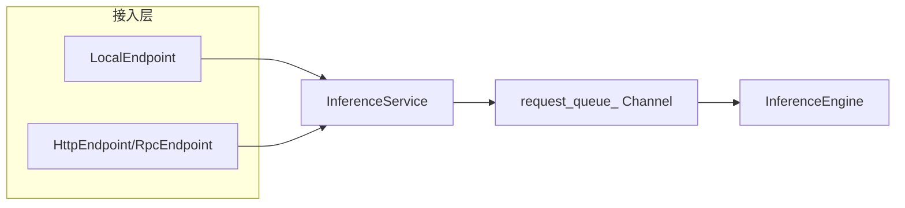
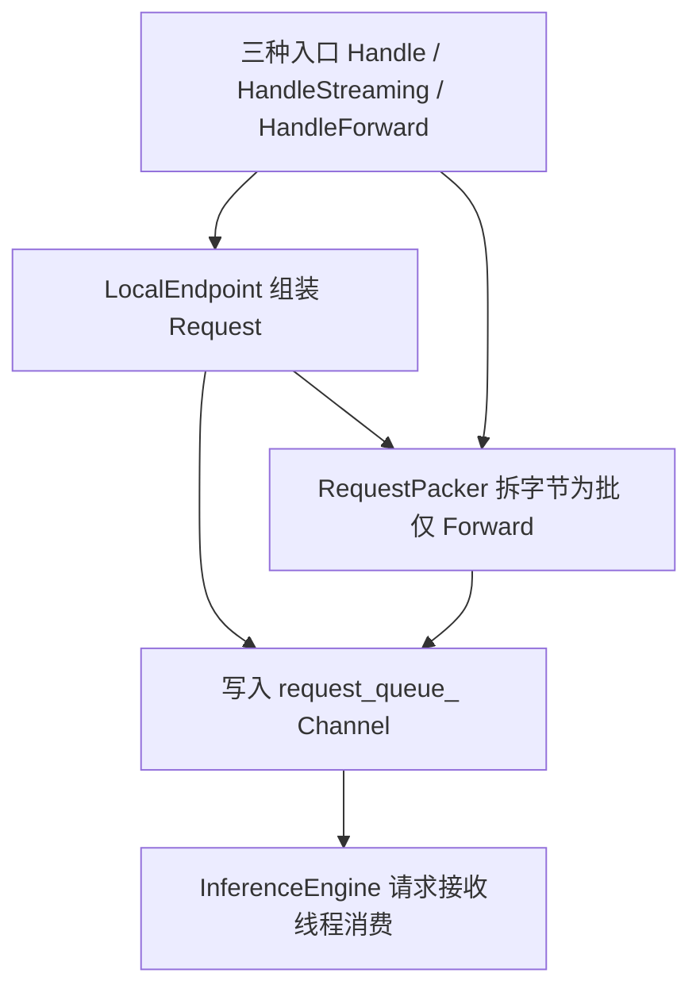
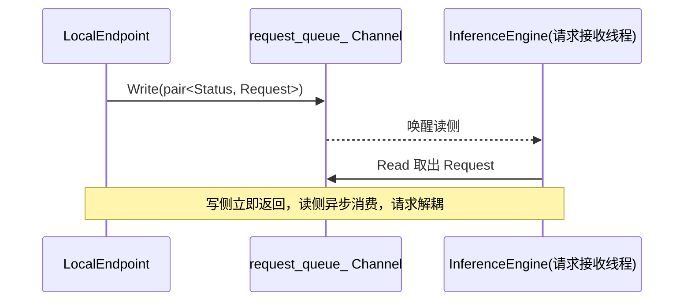
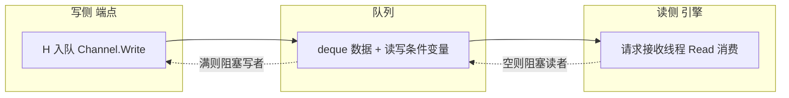
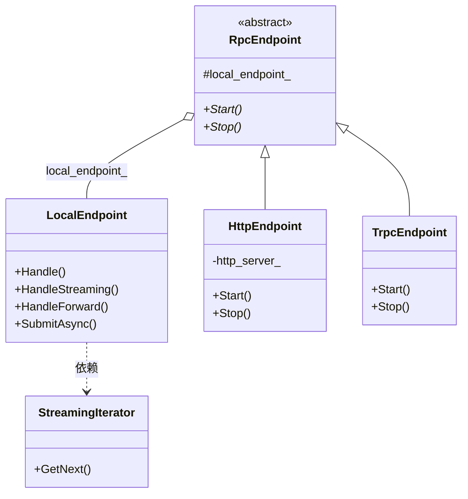
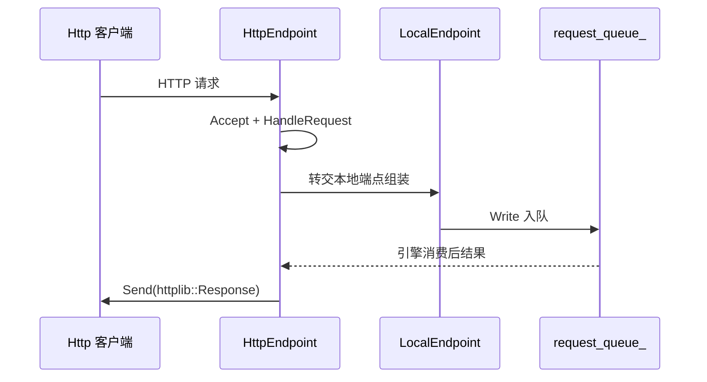

# 推理服务入口与端点

本文档面向后端开发者，介绍 KsanaLLM 推理服务的**接入层**实现。`InferenceService` 是 C++ 推理内核的服务门面，对外提供同步、流式、Forward 三种推理入口；请求经 `LocalEndpoint` 组装为 `Request` 后投递到 `request_queue_`（`Channel` 无锁阻塞队列），与推理引擎异步解耦。`csrc/endpoints` 提供 local/http/pd_v2/rpc/streaming/wrapper 多类端点，由 `EndpointFactory` 统一创建。

## 1. 推理服务入口概述

`InferenceService` 是整个 C++ 推理内核对外承接请求的服务门面，位于端点与推理引擎之间，扮演「端点 ↔ 引擎」的桥梁。它对外暴露同步（`Handle`）、流式（`HandleStreaming`）、Forward（`HandleForward`）三类入口，内部通过共享同一队列实例实现与引擎的跨类、跨线程解耦。

### 1.1 服务门面与核心成员

`InferenceService` 持有引擎、端点与队列三类核心成员，构造时一并完成初始化：

| 成员 | 类型 | 职责 |
| --- | --- | --- |
| `inference_engine_` | `std::shared_ptr<InferenceEngine>` | 底层推理引擎，消费队列中的请求 |
| `local_endpoint_` | `std::shared_ptr<LocalEndpoint>` | 本地同步/流式端点，组装请求 |
| `rpc_endpoint_` | `std::shared_ptr<RpcEndpoint>` | 可选 RPC 端点（按配置创建） |
| `request_queue_` | `Channel<std::pair<Status, std::shared_ptr<Request>>>` | 端点与引擎之间的异步通道 |

构造时 `InferenceService` 先创建推理引擎，再经 `EndpointFactory` 创建本地端点并回填到引擎（`SetLocalEndpoint`），随后按配置决定是否创建 RPC 端点。三个入口方法均通过委派 `local_endpoint_` 完成请求组装与入队。

```cpp
// csrc/service/inference_service.h
struct InferenceService {
  std::shared_ptr<InferenceEngine> inference_engine_;
  std::shared_ptr<LocalEndpoint> local_endpoint_;
  std::shared_ptr<RpcEndpoint> rpc_endpoint_;
  Channel<std::pair<Status, std::shared_ptr<Request>>> request_queue_;
};
```

服务层的生命周期方法 `Start()`/`Stop()` 会依次驱动引擎与 RPC 端点启动/停止，`SetIpcFuncWrapper()` 用于挂载跨进程通信包装，`HasHealthyPrefillPeer()` 用于查询 PD 分离场景下引擎是否可见健康的 Prefill 节点。

### 1.2 服务层在接入链路中的位置

请求从端点进入后，统一汇聚到 `request_queue_`，再由引擎侧消费。`InferenceService` 承担「端点 ↔ 引擎」之间的桥梁角色，把「请求从哪进」与「请求如何被引擎执行」切分为异步两端。



**Sources:** <ref_code path="csrc/service/inference_service.h" /> <ref_code path="csrc/service/inference_service.cpp" /> <ref_code path="csrc/endpoints/endpoint_factory.cpp" />


## 2. 三种推理入口（Handle / HandleStreaming / HandleForward）

`InferenceService` 对外提供三类推理入口，分别对应一次性推理、流式逐 token 返回、以及无需采样的普通前向。三者均在服务层做轻量委派，实质的请求组装与入队由 `LocalEndpoint` 完成。

### 2.1 三入口的差异与适用场景

| 入口 | 服务层方法 | 返回方式 | 宿主请求对象 | 适用场景 |
| --- | --- | --- | --- | --- |
| 同步一次性 | `Handle` | 请求完成后一次性返回 `KsanaPythonOutput` | `Request` | 常规 chat/completions 一次性生成 |
| 流式 | `HandleStreaming` | 逐 token 返回 `StreamingIterator` | `Request` | 需要逐 token 流式输出的生成 |
| Forward | `HandleForward` | 返回序列化的 `response_bytes` | 批量 `Request` | 普通前向、无需采样的推理 |

三者差异的核心在于**返回时机与返回载体**：
- `Handle` 阻塞等待整轮生成完成后一次性回填输出；
- `HandleStreaming` 立即返回一个 `StreamingIterator`，调用方按迭代逐个取 token；
- `HandleForward` 输入输出均为字节串，经 `RequestPacker` 拆包/打包，可承载批处理。

三个方法签名在 `<ref_code path="csrc/service/inference_service.h" />` 中声明一致：均接收 `KsanaPythonInput`（流式多一个 `StreamingIterator` 出参、Forward 为字节串），按 `Request` 组装。

### 2.2 从入口到入队的统一路径

三种入口最终都汇入同一条路径：先构建 `Request`，再写入 `request_queue_`。`Request` 是承载请求状态、采样配置、输出与完成回调的核心对象（`csrc/utils/request.h`）。

| 入口 | 请求组装 | 入队方式 | 请求完成通知 |
| --- | --- | --- | --- |
| `Handle` | `Request(ksana_python_input, req_ctx)`，绑定 `waiter` | `SubmitAsync` → 队列 `Write` | `waiter->Wait()` 阻塞等待 |
| `HandleStreaming` | `Request` 绑定 `step_waiter`/`abort_waiter` | 队列 `Write` | 由 `StreamingIterator::GetNext` 逐 token 读取 |
| `HandleForward` | 字节流经 `RequestPacker::Unpack` 拆成批，逐个建 `Request` | 批量 `Write(reqs.data(), n)` | 共享 `waiter` 一次等待全部完成 |



下面对比三个方法的实现差异（取自 `local_endpoint.cpp`）：

- **`Handle`**：构建单个 `Request`，绑定 `waiter` 后 `SubmitAsync(req)`，随后阻塞等待 `waiter`，完成后把 `Request` 转成 `KsanaPythonOutput` 返回；
- **`HandleStreaming`**：构建 `Request` 绑定 `step_waiter` 与 `abort_waiter`，直接写队列，并构造 `StreamingIterator` 返回，由迭代器逐 token 消费，不阻塞等待；
- **`HandleForward`**：用 `RequestPacker::Unpack` 把字节拆成多个 `KsanaPythonInput`，逐个建 `Request` 并共享一个 `waiter`，一次性批量写入队列，等待全部完成后用 `Pack` 打包响应字节。

```cpp
// csrc/endpoints/local/local_endpoint.cpp - 三种入口的统一入队路径
Status LocalEndpoint::Handle(...) {
  auto req = std::make_shared<Request>(ksana_python_input, req_ctx);
  req->waiter = std::make_shared<Waiter>(1);
  STATUS_CHECK_RETURN(SubmitAsync(req));
  waiter->Wait();
  ksana_python_output = KsanaPythonOutput(req);
  return req->finish_status;
}
```

其中 `SubmitAsync` 是统一入队入口：为请求补齐 `waiter` 后写入 `request_queue_`，`Handle` 之外 `HandleStreaming`、pd_v2 Prefill 路径也复用它：

```cpp
// csrc/endpoints/local/local_endpoint.cpp - SubmitAsync
Status LocalEndpoint::SubmitAsync(const std::shared_ptr<Request> &request) {
  if (request->waiter == nullptr) request->waiter = std::make_shared<Waiter>(1);
  request_queue_.Write(std::pair<Status, std::shared_ptr<Request>>(Status(), request));
  return Status();
}
```

> 本节从接入入口出发，不涉及引擎消费请求后的调度/执行细节，也不展开 Python 适配层如何调用这些入口——两者分别属于调度与 OpenAI 兼容 API 相关文档。

**Sources:** <ref_code path="csrc/service/inference_service.h" /> <ref_code path="csrc/endpoints/local/local_endpoint.h" /> <ref_code path="csrc/endpoints/local/local_endpoint.cpp" /> <ref_code path="csrc/utils/request.h" /> <ref_code path="csrc/utils/request_packer.h" />


## 3. 请求入队与异步解耦（request_queue_ Channel）

`request_queue_` 是端点与推理引擎之间的异步管道，基于 `Channel<T>` 有界阻塞队列实现。端点写入请求后立即返回，引擎侧专用线程消费，实现服务端与引擎的解耦。

### 3.1 Channel 数据结构

`Channel<T>` 是项目自定义的有界阻塞队列（`csrc/utils/channel.h`），底层 `ChannelObject<T>` 基于 `std::deque` 加 `mutex`/`condition_variable` 实现，支持阻塞读、写与无锁等待唤醒。`request_queue_` 的元素类型为 `Channel<std::pair<Status, std::shared_ptr<Request>>>`，即每条消息携带一个状态与一个请求共享指针。

`Channel<T>` 对外提供以下操作：

| 操作 | 说明 |
| --- | --- |
| `Read` | 阻塞读取 n 个元素，元素不足时阻塞直至可读或队列关闭 |
| `Write` | 写入 n 个元素，容量不足时阻塞等待 |
| `WriteMovable` | 以 move 语义写入（避免拷贝） |
| `Close` / `IsClosed` | 关闭队列 / 查询关闭状态 |
| `Size` | 返回当前队列中元素个数 |

底层 `ChannelObject<T>` 通过读写两个条件变量（`read_cond_`/`write_cond_`）协调阻塞唤醒。读者在队列为空时等待 `read_cond_`，写者在队列满时等待 `write_cond_`；`Notify` 在读写结束后唤醒对端。默认容量为 `kChannelDefaultCapacity`，编写由 `capacity_` 与在途读取数共同约束。

```cpp
// csrc/utils/channel.h - 读与写阻塞的核心约束
bool WaitUntilReadReady(std::unique_lock<std::mutex>& lck) {
  while (data_.empty() && !is_closed_) {
    if (waiting_writer_cnt_ != 0) write_cond_.notify_one();
    waiting_reader_cnt_ += 1;
    read_cond_.wait(lck);
    // ...
  }
  return !data_.empty();
}
```

### 3.2 端点 ↔ 引擎的异步解耦链路

`request_queue_` 同一实例被端点与服务层共享：`InferenceService` 持有该队列作为成员，构造时把它传给引擎（`InferenceEngine(request_queue_, ...)`）与 `LocalEndpoint`。端点（写端）与引擎的请求接收线程（读端）通过该队列完成跨类、跨线程交付。



读侧消费由引擎内部线程承担（引擎内部多工作线程的具体分工属「引擎初始化与生命周期」文档，此处不再展开）。队列元素携带的 `Status` 用于在收发两侧传递状态信息，供 `HandleForward` 等批量路径判定整体成功/失败。



**Sources:** <ref_code path="csrc/utils/channel.h" /> <ref_code path="csrc/service/inference_service.h" /> <ref_code path="csrc/utils/status.h" />


## 4. 多端点体系与端点工厂

`csrc/endpoints` 提供多类端点，配合 `EndpointFactory` 统一创建。local 承载本地同步/流式，http/rpc/trpc 作为外部接入形态，pd_v2 服务 PD 分离场景，streaming 提供流式迭代，wrapper 承载第三方框架封装。

### 4.1 端点类型一览

| 端点 | 类型/基类 | 所在路径 | 适用场景 |
| --- | --- | --- | --- |
| `LocalEndpoint` | 本地端点 | `endpoints/local/` | 本地同步/流式推理，请求组装与入队核心 |
| `HttpEndpoint` | `: RpcEndpoint` | `endpoints/http/` | 基于 `httplib::Server` 的 HTTP 接入 |
| `RpcEndpoint` | 抽象基类 | `endpoints/rpc/` | RPC 端点的抽象基类 |
| `PdV2PrefillEndpoint` | PD 分离 | `endpoints/pd_v2/` | PD 分离场景的 Prefill 接入 |
| `PdV2PrefillCompletion` | 完成跟踪 | `endpoints/pd_v2/` | 跟踪 Prefill 的 barrier + 采样完成 |
| `StreamingIterator` | 流式迭代 | `endpoints/streaming/` | 流式逐 token 返回的迭代载体 |
| `TrpcEndpoint` | `: RpcEndpoint` | `endpoints/wrapper/trpc/` | tRPC 框架封装端点 |

### 4.2 端点工厂 EndpointFactory

`EndpointFactory`（`endpoints/endpoint_factory.h`）提供两个静态工厂方法，按配置创建端点实例：

| 方法 | 创建产物 | 说明 |
| --- | --- | --- |
| `CreateLocalEndpoint` | `shared_ptr<LocalEndpoint>` | 直接构造本地端点，绑定 `request_queue_` |
| `CreateRpcEndpoint` | `shared_ptr<RpcEndpoint>` | 按 `rpc_plugin_name` 动态加载共享库创建 RPC 端点 |

`CreateRpcEndpoint` 采用动态加载机制：根据配置中的 `rpc_plugin_name` 拼接出端点共享库名（如 `libtrpc_endpoint.so`）与创建函数名（如 `CreateTrpcEndpoint`），通过 `dlopen`/`dlsym` 加载并调用。tRPC 端点即通过该机制导出 `CreateTrpcEndpoint` 函数接入。

```cpp
// csrc/endpoints/endpoint_factory.cpp - Rpc 端点动态创建
const std::string endpoint_lib = fmt::format("lib{}_endpoint.so", endpoint_config.rpc_plugin_name);
handle = dlopen(endpoint_lib.c_str(), RTLD_LAZY);
std::string create_api = fmt::format("Create{}Endpoint", endpoint_config.rpc_plugin_name);
auto create_rpc_endpoint = reinterpret_cast<create_rpc_endpoint_t*>(dlsym(handle, create_api.c_str()));
return create_rpc_endpoint(endpoint_config, local_endpoint);
```

服务层在构造时统一调用端点工厂：先 `CreateLocalEndpoint` 创建本地端点并回填引擎，再按配置类型判断是否 `CreateRpcEndpoint`（见 <ref_code path="csrc/service/inference_service.cpp" />）。

端点体系存在清晰的继承与组合关系：`RpcEndpoint` 是抽象基类，`HttpEndpoint`、`TrpcEndpoint` 继承它并引用 `local_endpoint_` 复用其请求处理主逻辑；`LocalEndpoint` 是请求组装的底层核心，RPC/HTTP 端点本质上是「把外部流量转交本地端点处理」的接入层。



> pd_v2 的 KV 传输细节分属「PD分离与全局缓存」文档，本章仅交代端点在接入层的角色。

**Sources:** <ref_code path="csrc/endpoints/endpoint_factory.h" /> <ref_code path="csrc/endpoints/endpoint_factory.cpp" /> <ref_code path="csrc/endpoints/local/local_endpoint.h" /> <ref_code path="csrc/endpoints/http/http_endpoint.h" /> <ref_code path="csrc/endpoints/rpc/rpc_endpoint.h" /> <ref_code path="csrc/endpoints/pd_v2/pd_v2_prefill_endpoint.h" /> <ref_code path="csrc/endpoints/streaming/streaming_iterator.h" /> <ref_code path="csrc/endpoints/wrapper/trpc/trpc_endpoint.h" />


## 5. HttpEndpoint 与本地同步路径对比

本章对比两种常见接入形态的实现路径：基于 `httplib::Server` 的 `HttpEndpoint`，与作为请求组装核心的 `LocalEndpoint`。服务层默认走 `LocalEndpoint` 的本地同步/流式链路，HTTP 形态是经 `RpcEndpoint` 派生的外部接入包装。

### 5.1 两种形态的路径差异

| 维度 | `LocalEndpoint` | `HttpEndpoint` |
| --- | --- | --- |
| 启动方式 | 由服务构造时直接创建，无监听 | `Start()` 启动监听线程，`Stop()` 关闭 |
| 服务基类 | 独立类 | 继承 `RpcEndpoint`，复用 `local_endpoint_` |
| 入站处理 | 直接被 `InferenceService` 三入口调用 | `Accept`/`HandleRequest` 接收 HTTP 请求 |
| 请求流转 | 组装 `Request` 后写入 `request_queue_` | 转交本地端点处理，再入队 |
| 出站返回 | 同步回填 `KsanaPythonOutput` | `Send` 组装 `httplib::Response` 返回客户端 |

`HttpEndpoint` 在 `Start()` 中基于 `httplib::Server` 建立监听，并在独立线程中运行处理循环；`Accept` 负责等待请求到来，`HandleRequest` 处理 HTTP 请求，`Send` 把推理结果写回客户端。其自身不重复实现请求组装，而是持有 `local_endpoint_`，把入站请求交给本地端点这条主链路处理。

```cpp
// csrc/endpoints/http/http_endpoint.h - HTTP 端点成员与处理入口
class HttpEndpoint : public RpcEndpoint {
  Status Start() override;      // 建立监听
  Status Stop() override;
  Status Accept(std::shared_ptr<Request>& req);      // 等待请求
  Status Send(const Status, const std::shared_ptr<Request>&, httplib::Response&);
  Status HandleRequest(const httplib::Request&, httplib::Response&);
 private:
  httplib::Server http_server_;
  std::thread http_server_thread_;
};
```

### 5.2 Http 入站与本地同步路径的流转对照

两条路径的**汇聚点都是 `request_queue_`**：本地入口直接组装入队，HTTP 入口经本地端点中转后入队。区别在于上游如何接收请求与如何回写响应。



对照本地同步路径：`InferenceService::Handle` 直接调用 `local_endpoint_->Handle`，后者组装 `Request` 后入队并阻塞等 `waiter` 完成，回填 `KsanaPythonOutput`。可见本地路径省去了 HTTP 监听与打包响应两层，二者共享相同的请求组装与入队核心。

> 本节仅到 C++ 端点层的入站与转发为止，HTTP REST 路径上的协议细节与 OpenAI 语义（chat/completions）不在此展开。

**Sources:** <ref_code path="csrc/endpoints/http/http_endpoint.h" /> <ref_code path="csrc/endpoints/local/local_endpoint.h" /> <ref_code path="csrc/service/inference_service.h" />


## 6. 注意事项与扩展点

本章面向接入层扩展，总结如何新增一种端点、可用支撑能力，以及 pd_v2 Prefill 场景的入队方式等要点，供扩展接入层时参考。

### 6.1 如何新增一种端点

在接入层新增一种端点的通用路径如下：

- 继承端点基类 `RpcEndpoint`（外部接入形态）或复用 `LocalEndpoint`（请求组装核心）；
- 若为外部框架接入，实现 `Start()`/`Stop()` 生命周期与入站处理；
- 若通过共享库方式加载，定义 `Create<Name>Endpoint` 导出函数，供 `EndpointFactory::CreateRpcEndpoint` 的 `dlopen`/`dlsym` 机制发现；
- 通过 `EndpointFactory` 或服务构造逻辑挂载到 `InferenceService`。

扩展时无需修改请求组装与入队核心，把新增端点作为接入层包装，复用 `local_endpoint_` 即可把外部流量接入既有 `request_queue_` 链路。

### 6.2 支撑能力与服务生命周期

`InferenceService` 提供以下几类支撑接口：

| 接口 | 用途 |
| --- | --- |
| `SetIpcFuncWrapper()` | 挂载跨进程通信包装（如 IPC 数据交互） |
| `HasHealthyPrefillPeer()` | 查询 PD 分离 Decode 节点是否可见健康的 Prefill 对端 |
| `Start()` / `Stop()` | 依次驱动引擎与 RPC 端点启动/停止 |
| `Initialize()` | 委派引擎初始化 |

### 6.3 pd_v2 Prefill 的非阻塞入队

pd_v2 Prefill 场景走 `LocalEndpoint::SubmitAsync` 入队，其为非阻塞调用：仅为请求补齐 `waiter` 后直接写入 `request_queue_` 并返回，不等待完成。这与 `Handle` 的阻塞等待形成对照——Prefill 请求的生命周期由 `PdV2PrefillCompletion` 全程持有，直到 barrier 与采样两门闩都完成后释放。

```cpp
// csrc/endpoints/local/local_endpoint.cpp - 非阻塞入队
Status LocalEndpoint::SubmitAsync(const std::shared_ptr<Request>& request) {
  if (request->waiter == nullptr) request->waiter = std::make_shared<Waiter>(1);
  request_queue_.Write(std::pair<Status, std::shared_ptr<Request>>(Status(), request));
  return Status();
}
```

### 6.4 场景选择指引

| 需求 | 推荐入口 / 端点 |
| --- | --- |
| 常规一次性生成 | `Handle` + `LocalEndpoint` |
| 逐 token 流式输出 | `HandleStreaming` + `StreamingIterator` |
| 普通前向、批处理、无采样 | `HandleForward` + `RequestPacker` |
| 外部 HTTP 接入 | `HttpEndpoint`（`RpcEndpoint` 派生） |
| PD 分离 Prefill 接入 | `PdV2PrefillEndpoint` + `SubmitAsync` |

**Sources:** <ref_code path="csrc/service/inference_service.h" /> <ref_code path="csrc/endpoints/endpoint_factory.h" /> <ref_code path="csrc/endpoints/endpoint_factory.cpp" /> <ref_code path="csrc/endpoints/local/local_endpoint.h" /> <ref_code path="csrc/endpoints/local/local_endpoint.cpp" />