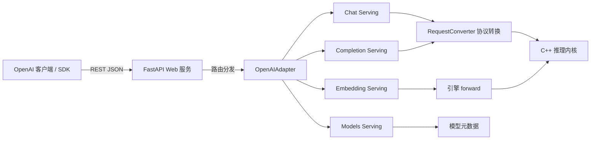
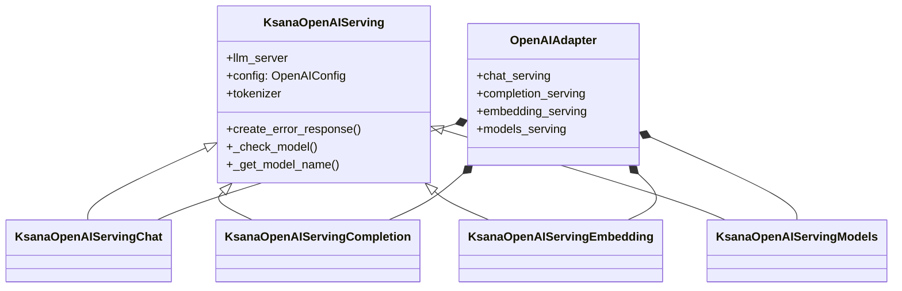
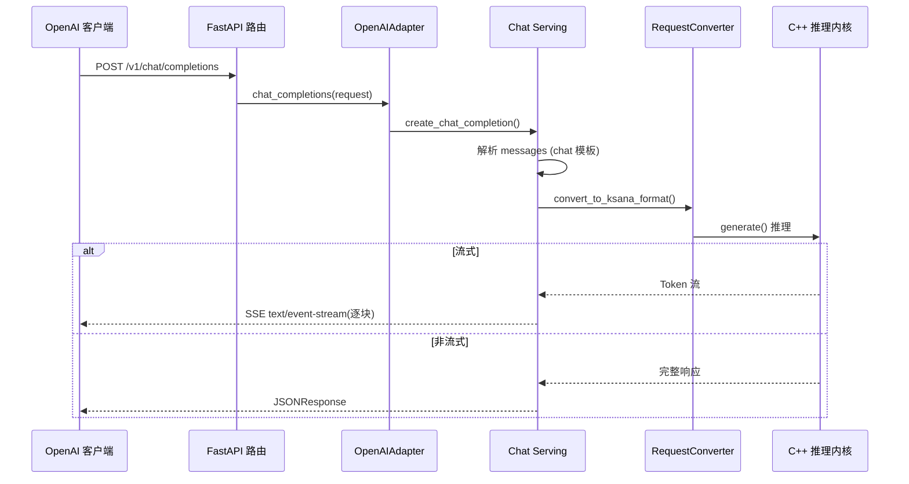

# OpenAI 兼容 API

KsanaLLM 对外提供了一个与 OpenAI 官方协议对齐的 REST API 层，位于 `python/openaiapi/`。本文档讲解这一层的实现机制：`OpenAIAdapter` 如何组合四个 serving、`register_all_routes` 如何注册 FastAPI 路由、FastAPI 如何承载这些接口，并给出 `/v1/chat/completions` 的请求/响应示例与流式用法。

## 1. OpenAI 兼容 API 概览

KsanaLLM 通过 OpenAI 兼容层向开发者暴露标准化的 HTTP 接口，让熟悉 OpenAI 生态的客户端与 SDK 无需改动即可接入本地推理服务。这一层位于整个服务链条的上端，只负责「OpenAI 协议 ↔ KsanaLLM 内部格式」的适配，具体推理由 C++ 内核完成。

### 1.1 定位：兼容层处于服务链条的哪一环

- 对外接收标准 OpenAI 请求（`/v1/chat/completions`、`/v1/completions`、`/v1/embeddings`、`/v1/models`）。
- 对内将请求转换为 KsanaLLM 引擎能处理的内部格式，交给 C++ 推理内核。
- 底层 C++ 推理细节（调度、执行、采样）不属于本层职责。



### 1.2 Web 框架与模块结构

兼容层基于 FastAPI 承载所有接口，核心入口为 `OpenAIAdapter`。`OpenAIAdapter` 在初始化时组合四个功能 serving，`register_all_routes` 再将它们注册为 FastAPI 路由。

模块内关键文件与职责：

| 文件 | 职责 |
| --- | --- |
| `openai_adapter.py` | `OpenAIAdapter`、`KsanaOpenAIServing` 基类、`OpenAIConfig`、`register_all_routes` |
| `serving_chat.py` | 聊天补全服务 |
| `serving_completion.py` | 文本补全服务 |
| `serving_embedding.py` | 嵌入生成服务 |
| `serving_models.py` | 模型管理服务 |
| `openai_protocol.py` | OpenAI 请求/响应数据模型 |
| `request_converter.py` | OpenAI 与内部格式的双向协议转换 |

**Sources:** <ref_code path="python/openaiapi/openai_adapter.py" /> <ref_code path="python/openaiapi/serving_chat.py" /> <ref_code path="python/openaiapi/serving_completion.py" /> <ref_code path="python/openaiapi/serving_embedding.py" /> <ref_code path="python/openaiapi/serving_models.py" /> <ref_code path="python/openaiapi/openai_protocol.py" /> <ref_code path="python/openaiapi/request_converter.py" />

## 2. OpenAIAdapter 与 serving 组合

`OpenAIAdapter` 是兼容层的核心聚合器，在构造时实例化四个功能 serving，把它们组织成一个统一对外对象，同时持有推理配置与 `llm_server` 连接。其上一层的公共逻辑被抽到 `KsanaOpenAIServing` 基类，四个 serving 均继承它。

### 2.1 组合结构

`OpenAIAdapter.__init__` 延迟导入四个 serving 类并分别实例化：

| 组合字段 | 服务类 | 处理对象 |
| --- | --- | --- |
| `chat_serving` | `KsanaOpenAIServingChat` | 聊天补全 |
| `completion_serving` | `KsanaOpenAIServingCompletion` | 文本补全 |
| `embedding_serving` | `KsanaOpenAIServingEmbedding` | 嵌入生成 |
| `models_serving` | `KsanaOpenAIServingModels` | 模型管理 |



`OpenAIAdapter` 对外暴露的方法与 serving 一一对应：`chat_completions`、`completions`、`embeddings`、`list_models`/`get_model`/`delete_model`，请求时直接委托给对应的 serving。

### 2.2 服务基类 KsanaOpenAIServing

`KsanaOpenAIServing` 是所有 serving 的公共基类，负责统一初始化与通用能力：

- 从 `llm_server` 获取 `tokenizer`，并提供异步 tokenize 包装（`_tokenize_prompt_input_async` 等）。
- 从 `engine_args` 提取模型名、最大模型长度等元数据（`_extract_model_info`、`_get_max_model_len`）。
- 输入校验：`_validate_input` 依据 `max_model_len` 检查 token 是否超长，产出 `TextTokensPrompt`。
- 模型校验：`_check_model` 判断请求的 `model` 是否受支持。
- 标准错误响应：`create_error_response`、`create_streaming_error_response`。

### 2.3 OpenAIConfig 与 ErrorType

- `OpenAIConfig` 管理默认推理配置，提供 `default_model_name`、`default_temperature`、`default_top_k` 等默认值，以及工具/推理解析器的启用开关（`tool_call_parser`、`reasoning_parser` 等）。
- `ErrorType` 是字符串枚举，定义 `BadRequestError`、`NotFoundError`、`InternalServerError`、`ValidationError` 四类标准错误标识。

**Sources:** <ref_code path="python/openaiapi/openai_adapter.py" /> <ref_code path="python/openaiapi/serving_chat.py" /> <ref_code path="python/openaiapi/serving_completion.py" /> <ref_code path="python/openaiapi/serving_embedding.py" /> <ref_code path="python/openaiapi/serving_models.py" />

## 3. 路由注册与 /v1/chat/completions 使用示例

`register_all_routes` 把 `OpenAIAdapter` 的能力注册为 FastAPI 路由，并挂接统一的异常处理器。`add_openai_routes` 是装配入口：解析 chat 模板、创建 `OpenAIAdapter`、调用 `register_all_routes`，最后返回适配器实例。

### 3.1 路由与异常处理器

`add_openai_routes` 在调用前通过 `load_chat_template` 解析 chat 模板，再构造 `OpenAIAdapter` 并调用 `register_all_routes(llm_server.app, adapter)`。

`register_all_routes` 注册的路由与 serving 对应关系：

| HTTP 方法与路径 | 处理函数 | 委托 serving |
| --- | --- | --- |
| `POST /v1/chat/completions` | `_chat_completions` | chat |
| `POST /v1/completions` | `_completions` | completion |
| `POST /v1/embeddings` | `_create_embeddings` | embedding |
| `GET /models` | `_list_models` | models |
| `GET /models/{model_id}` | `_get_model` | models |

同一函数内注册的三个异常处理器，将 FastAPI/Starlette 异常统一转换为 OpenAI 风格的 `{"error": {...}}` JSON：

- `RequestValidationError` → 400 `invalid_request_error`。
- `StarletteHTTPException` → 依据状态码映射错误类型。
- 未捕获的通用异常 → 500 `internal_server_error`。

请求/响应数据模型定义在 `openai_protocol.py`（如 `ChatCompletionRequest`、`ChatCompletionResponse`），`RequestConverter` 负责 OpenAI 格式与 KsanaLLM 内部格式的双向转换。

### 3.2 非流式请求/响应示例

发起一次 `POST /v1/chat/completions` 推理请求（请求载荷省略工具调用、结构化输出等深层字段）：

```json
{
  "model": "ksana-llm",
  "messages": [
    {"role": "system", "content": "你是一个有帮助的助手。"},
    {"role": "user", "content": "介绍一下巴黎。"}
  ],
  "max_tokens": 100,
  "temperature": 0.7,
  "stream": false
}
```

非流式响应核心结构：

```json
{
  "id": "chatcmpl-...",
  "object": "chat.completion",
  "model": "ksana-llm",
  "choices": [
    {
      "index": 0,
      "message": {"role": "assistant", "content": "巴黎是法国的首都..."},
      "finish_reason": "stop"
    }
  ],
  "usage": {"prompt_tokens": 12, "completion_tokens": 45, "total_tokens": 57}
}
```

### 3.3 流式响应（SSE）用法

请求中设置 `"stream": true` 后，服务端以 `text/event-stream` 媒体类型逐块返回 Token 流，每块为 `data: {...}` 格式，末尾以 `data: [DONE]` 结束。`OpenAIAdapter.chat_completions` 检测返回值为异步生成器时，用 `StreamingResponse` 包装并设置 `Cache-Control: no-cache` 等流式响应头。

流式响应逐块示例：

```text
data: {"id":"chatcmpl-...","object":"chat.completion.chunk","choices":[{"index":0,"delta":{"role":"assistant"},"finish_reason":null}]}

data: {"id":"chatcmpl-...","object":"chat.completion.chunk","choices":[{"index":0,"delta":{"content":"巴黎"},"finish_reason":null}]}

data: {"id":"chatcmpl-...","object":"chat.completion.chunk","choices":[{"index":0,"delta":{},"finish_reason":"stop"}]}

data: [DONE]
```

示例脚本 `examples/api_client.py` 提供非流式（`get_response`）与流式（`get_streaming_response`）两种发请求的示范；`examples/streaming_client.py` 展示流式 chat 调用。二者均通过 `requests` 发送 POST 请求并迭代解析流式块。



**Sources:** <ref_code path="python/openaiapi/openai_adapter.py" /> <ref_code path="python/openaiapi/openai_protocol.py" /> <ref_code path="python/openaiapi/request_converter.py" /> <ref_code path="examples/api_client.py" /> <ref_code path="examples/streaming_client.py" />

## 4. 各 serving 职责与实现要点

每个 serving 的核心职责一致：把 OpenAI 请求格式转换成 KsanaLLM 内部格式，调用引擎推理，再把引擎输出格式化（或流式逐块）回传。四个 serving 的差异集中在输入解析、推理调用方式与响应构造上。

四个 serving 的对比：

| serving | 输入格式 | 推理调用 | 输出 | 流式 |
| --- | --- | --- | --- | --- |
| chat | `messages` 列表 + chat 模板 | `model.generate` | chat 补全响应 / chunk | 支持 |
| completion | 文本或文本列表 | `model.generate` | 文本补全响应 / chunk | 支持 |
| embedding | 文本、token 或多模态 | `model.forward`（msgpack） | 嵌入向量 | 否 |
| models | 模型 ID | 元数据查询 | 模型对象/列表 | 否 |

### 4.1 Chat Serving

`KsanaOpenAIServingChat` 处理聊天补全，流程是从请求中解析 `messages`，经 chat 模板转换为 prompt，再委托底层 `generate` 推理。

- 请求校验：`ChatCompletionRequest` 通过 Pydantic 模型校验字段（含 `stream_options`、`logprobs`、`tool_choice` 等约束）。
- 模板转换：`_preprocess_chat` 将 messages 经 chat 模板（或 DeepSeek 专用编码）渲染成 prompt，再 tokenize 为引擎输入。
- 推理与响应：非流式返回完整 `ChatCompletionResponse`；流式走 `_chat_completion_stream_generator`，逐块以 delta 形式返回增量 token。

### 4.2 Completion Serving：`KsanaOpenAIServingCompletion`

`KsanaOpenAIServingCompletion` 是传统文本补全接口，接受文本字符串或字符串列表作为 `prompt`。

- 校验 `prompt` 必需的参数，缺失时返回错误响应。
- 用 `_tokenize_prompt_input_async` 分词，经 `RequestConverter` 转为 Ksana 格式。
- 调用 `model.generate` 推理：流式走 `_completion_stream_generator`，非流式由 `format_completion_response` 组装响应。

### 4.3 Embedding Serving：`KsanaOpenAIServingEmbedding`

`KsanaOpenAIServingEmbedding` 在类内完成 tokenize → forward → extract 全流程，只需引擎提供 `forward()`。

- 输入：文本（str/list[str]）、Token ID（list[int]/list[list[int]]）或多模态（text + image）。
- 编码格式：支持 `float` 与 `base64`；`dimensions` 可截断维度。
- 池化策略：支持 `cls`、`last`、`mean`，从 `engine_args` 自动探测，默认 `last`。
- 数据类型映射：`float32`/`float16`/`bfloat16`/`int32`，其中 `bfloat16` 以 `uint16` 承载并经位运算还原为 `float32`。

### 4.4 Models Serving：`KsanaOpenAIServingModels`

`KsanaOpenAIServingModels` 提供模型查询，通过 `_get_available_models` 缓存模型列表 5 分钟，`invalidate_cache` 可主动清理。

- `list_models`：`GET /models`，列出可用模型。
- `get_model`：`GET /models/{model_id}` 查询单个模型，不存在返回 404。
- `delete_model`：`DELETE /models/{model_id}`，当前不支持删除，返回错误。
- 模型名称解析优先 `served_model_name`，其次取 `model_dir` 末段，最后回退默认名。

**Sources:** <ref_code path="python/openaiapi/serving_chat.py" /> <ref_code path="python/openaiapi/serving_completion.py" /> <ref_code path="python/openaiapi/serving_embedding.py" /> <ref_code path="python/openaiapi/serving_models.py" />