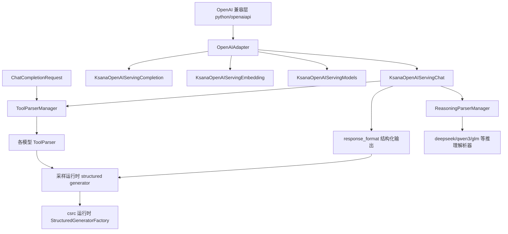
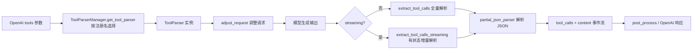
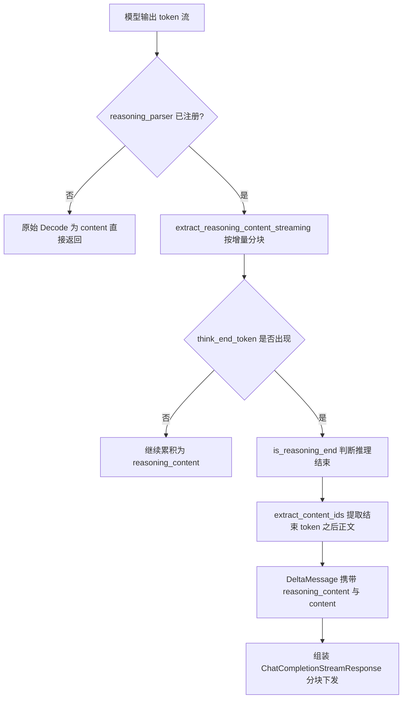
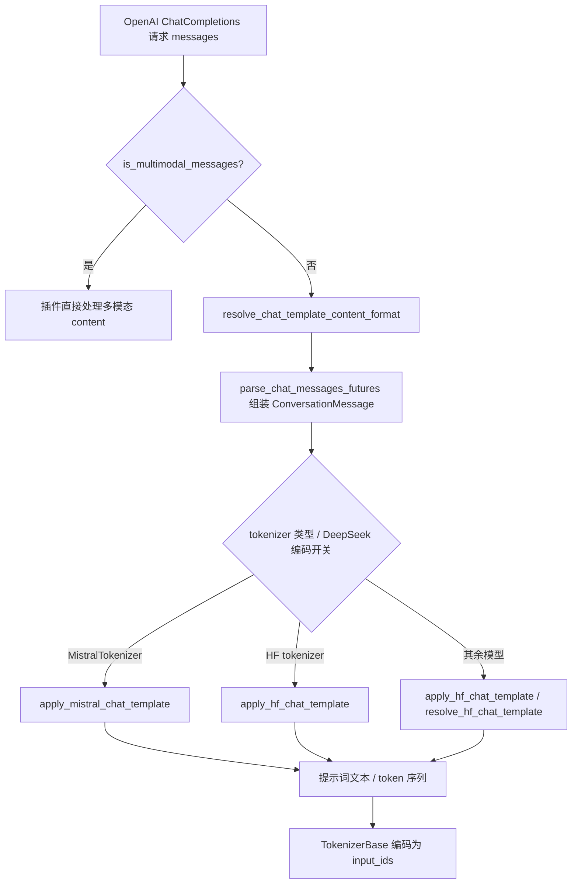
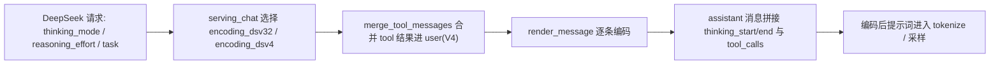
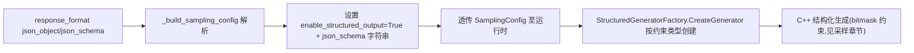

# 函数调用与结构化输出

> 本文档介绍 KsanaLLM 推理服务层 OpenAI 兼容 API（`python/openaiapi/`）中围绕载荷处理与内容结构化的高级能力：函数调用（Function Calling）、推理内容解析（Reasoning）、结构化输出（Structured Output），以及支撑它们的消息处理、模板转换与 DeepSeek 专属编码。面向高级用户与集成工程师，帮助读者把这些能力接入自己的集成场景。

---

# 1. 函数调用与结构化输出能力全景

## 1.1 三层能力总览

KsanaLLM 的 OpenAI 兼容层（`python/openaiapi/`）对外提供三类内容结构化能力：

- 函数调用（Function Calling）：将模型输出中的 tool calls 解析为结构化参数。
- 推理解析（Reasoning）：从模型输出中抽取 reasoning_content 与最终 content 的边界。
- 结构化输出（Structured Output）：基于 `response_format`（`json_object` / `json_schema`）约束生成结果。

三类能力共享同一套载荷处理入口：Python 层负责对外封装与参数解析，运行时（C++）只负责生成约束。

## 1.2 两段式协作：Python 入参 → 运行时生成

结构化能力遵循"Python 入参 → 运行时生成"的两段式协作，中间由请求转换衔接。

- Python 层：解析 OpenAI 请求，把结构化意图转译为调度层可理解的参数。
- 运行时层：`StructuredGeneratorFactory` 依据约束类型创建结构化生成器，控制采样输出。
- 边界约定：本文档只描述 Python 层面向外部的封装与参数解析，不展开采样侧结构化 bitmask 生成细节。

## 1.3 OpenAIAdapter 与路由注册

`OpenAIAdapter` 聚合四类 serving，对外暴露统一的 HTTP 入口。

- chat completion：`KsanaOpenAIServingChat`。
- legacy completion：`KsanaOpenAIServingCompletion`。
- embedding：`KsanaOpenAIServingEmbedding`。
- models：`KsanaOpenAIServingModels`。

`register_all_routes(app, adapter)` 注册路由的同时挂接异常处理，把校验错误与 HTTP 错误统一转成 OpenAI 错误报文，并行支撑流式 SSE、Function Calling、Reasoning Parser 与结构化输出。



## 1.4 解析器与请求转换的协同

- `ResponseFormat`、`ToolParserManager`、`ReasoningParserManager` 三类能力各由统一入口管理，按注册名分发解析器。
- `tool_call_parser`/`reasoning_parser` 配置项与 `response_format` 请求字段共同决定解析路径。
- 解析器在 `KsanaOpenAIServingChat._init_parsers()` 中初始化，把 tokenizer 词表中的分隔 token id 回填到解析器，供流式准确切分。

**Sources:** <ref_code path="python/openaiapi/openai_adapter.py" /> <ref_code path="python/openaiapi/serving_chat.py" /> <ref_code path="python/openaiapi/tool_parsers/abstract_tool_parser.py" /> <ref_code path="python/openaiapi/reasoning/__init__.py" /> <ref_code path="csrc/runtime/structured_generation/structured_generator_factory.h" /> <ref_code path="csrc/utils/request.h" />

---

# 2. 函数调用 Function Calling

## 2.1 抽象基类与统一管理

函数调用解析统一由 `ToolParser`（抽象基类）与 `ToolParserManager`（统一管理入口）提供，定义在 `python/openaiapi/tool_parsers/abstract_tool_parser.py`。

`ToolParser` 定义了三个供子类实现的职责与方法：

- `extract_tool_calls`：非流式静态解析。输入完整模型输出，一次性返回工具调用信息。
- `extract_tool_calls_streaming`：流式有状态解析。输入前后文本与 token id 及增量，返回 `DeltaMessage`。
- `adjust_request`：在解析前调整请求参数（如 `skip_special_tokens=False` 以保留工具标记 token）。

`ToolParserManager` 提供按注册名选择解析器的入口，是接入新模型的核心扩展点。

- `get_tool_parser(name)`：按注册名返回解析器类型，未注册时抛 `KeyError`。
- `register_module`：装饰器式注册，携带一个或多个注册名，接受 `@ToolParserManager.register_module("name")` 写法。
- `import_tool_parser(plugin_path)`：支持从外部文件加载自定义解析器。

## 2.2 解析器职责与工具调用的提取

`extract_tool_calls` 在完整输出中识别工具标记，把 tool calls 与 content 切分开。

- 检测到工具标记时返回 `tools_called=True`、`tool_calls` 与分隔出的 `content`。
- 未检测到工具标记时返回普通文本，防止模型幻觉产生 tool call；判定由请求的 `tool_choice` 参与控制。

流式解析依赖 `partial_json_parser` 完成部分 JSON 解析，并借助工具函数处理增量差异（`python/openaiapi/tool_parsers/utils.py`）：

- `find_common_prefix` / `find_common_suffix`：求两段 JSON 的公共前后缀。
- `extract_intermediate_diff`：计算当前 JSON 与上一轮已发送内容的增量片段。
- `partial_json_loads`：解析部分 JSON，遇额外数据时回退 `JSONDecoder.raw_decode`。
- `is_complete_json`：判断一段字符串是否为完整合法 JSON。

## 2.3 各模型解析器实现

不同模型采用各自的专属工具调用格式，`python/openaiapi/tool_parsers/__init__.py` 汇总如下：

| 模型解析器 | 注册名 | 解析器文件 | 工具格式特点 |
| --- | --- | --- | --- |
| DeepSeekV3ToolParser | deepseek_v3 | deepseekv3_tool_parser.py | 特殊 token `<｜tool▁calls▁begin｜>`/`<｜tool▁calls▁end｜>` 包裹，`<｜tool▁sep｜>` 分隔，`````json````` 参数块 |
| DeepSeekV31ToolParser | deepseek_v31 | deepseekv31_tool_parser.py | 与 V3 相近的 DS 特殊 token |
| DeepSeekV32ToolParser | deepseek_v32 | deepseekv32_tool_parser.py | DSML 标签 `<｜function_calls>` + `<｜invoke name=…>`，参数支持 XML 或直接 JSON |
| DeepSeekV4ToolParser | deepseek_v4 | deepseekv4_tool_parser.py | 与 V3.2 一致，外层块标签改为 `<｜tool_calls>` |
| Internlm2ToolParser | internlm | internlm2_tool_parser.py | 特殊 token `<｜action_start｜><｜plugin｜>`，不并行调用 |
| Hermes2ProToolParser | hermes | hermes_tool_parser.py | `<tool_call>` / `</tool_call>` 包裹 JSON |
| Llama3JsonToolParser | llama3_json | llama_tool_parser.py | `<｜python_tag｜>` + JSON 数组 |
| Llama4PythonicToolParser | llama4_pythonic | llama4_pythonic_tool_parser.py | `<｜python_start｜>` / `<｜python_end｜>` + pythonic 风格调用 |
| MistralToolParser | mistral | mistral_tool_parser.py | `[TOOL_CALLS]`，`MistralToolCall` 生成 9 位字母数字 ID |
| KimiK2ToolParser | kimi_k2 | kimi_k2_tool_parser.py | 区块 token，ID 规则 `functions.{func}.{idx}` |
| Glm47MoeToolParser | glm47 | glm47_moe_tool_parser.py | `<tool_call>` / `</tool_call>` + `<arg_key>` / `<arg_value>` 键值对 |
| PythonicToolParser | pythonic | pythonic_tool_parser.py | Python 风格调用列表，补全括号后解析 |

各模型流式解析均基于"重建当前 JSON 并与上一轮已发送内容做差"策略，只向客户端推送新增片段，避免引号、括号提前收尾。

## 2.4 初始化与运行流程

`KsanaOpenAIServingChat` 在构造时调用 `_init_parsers` 完成解析器初始化。

- 依据 `config.enable_auto_tool_choice` 决定是否启用自动工具选择，并从 `config.tool_call_parser` 取注册名。
- 对 `deepseek_v32` 与 `deepseek_v4` 额外开启对应的 DS 专属编码路径。
- 在非流式全量路径（`_chat_completion_full_generator`）调用 `extract_tool_calls` 得到 `tool_calls` 与 `content`。
- 在流式路径（`_chat_completion_stream_generator`）按增量调用 `extract_tool_calls_streaming`，并 `post_process_tool_calls` 后处理。

调度前，`_should_stream_with_auto_tool_parsing` 判断是否走自动解析：要求请求提供了 `tools`、配置了解析器、启用自动工具选择且 `tool_choice` 为 auto/None。



## 2.5 KimiK2 的 tool_call_id 规则

Kimi K2 的调用 ID 生成规则为 `functions.{func_name}:{idx}`，区别于默认的随机 UUID。

- 生成逻辑在 `python/openaiapi/transformers_utils/chat_utils.py` 的 `make_tool_call_id(id_type='kimi_k2', func_name, idx)`。
- 其余解析器默认走 `chatcmpl-tool-{random}` 形式。
- `post_process_tool_calls` 在 kimi_k2 模式下按函数名与历史序号统一重写 tool_call_id，保证流式与全量路径一致。

**Sources:** <ref_code path="python/openaiapi/tool_parsers/abstract_tool_parser.py" /> <ref_code path="python/openaiapi/tool_parsers/__init__.py" /> <ref_code path="python/openaiapi/tool_parsers/utils.py" /> <ref_code path="python/openaiapi/serving_chat.py" /> <ref_code path="python/openaiapi/transformers_utils/chat_utils.py" /> <ref_code path="python/openaiapi/tool_parsers/deepseekv32_tool_parser.py" /> <ref_code path="python/openaiapi/tool_parsers/kimi_k2_tool_parser.py" /> <ref_code path="python/openaiapi/tool_parsers/mistral_tool_parser.py" /> <ref_code path="python/openaiapi/tool_parsers/internlm2_tool_parser.py" /> <ref_code path="python/openaiapi/tool_parsers/llama_tool_parser.py" /> <ref_code path="python/openaiapi/tool_parsers/glm47_moe_tool_parser.py" />

---

# 3. 推理解释 Reasoning Parser：解析推理内容

## 3.1 章节定位

推理模型在思考段（think 段）与正式回答段之间通过特殊标记切换。服务层在流式或非流式输出时，把模型吐出的 ` thinking` 到 ` response` 之间的内容解析为 `reasoning_content`，其余正文解析为 `content`，再交由 OpenAI 兼容层分别回传。

本章讲解 `python/openaiapi/reasoning/` 中用于该任务的抽象基类 `ReasoningParser`、统一注册入口 `ReasoningParserManager`，以及各模型的解析实现。

## 3.2 抽象基类 ReasoningParser

`ReasoningParser`（`python/openaiapi/reasoning/abs_reasoning_parsers.py`）是所有推理解析器的基类，声明了模型无关的解析契约。基类在 `__init__` 中维护 `think_start_token` / `think_end_token` 与流式缓冲状态，供派生类复用。

| 成员 | 类型 | 作用 |
| --- | --- | --- |
| `think_start_token` / `think_end_token` | 令牌 | 推理段起止标记的字符串形式，默认 ` thinking` / ` response` |
| `_buffer` / `_in_reasoning` / `stream_reasoning` | 状态 | 流式分块缓冲、是否处于推理段、是否即时透出推理内容 |
| `is_reasoning_end(input_ids)` | 抽象方法 | 依据 token ID 判断推理内容是否结束 |
| `extract_content_ids(input_ids)` | 抽象方法 | 抽取结束标记之后的正文字符串 ID |
| `extract_reasoning_content(model_output)` | 具体方法 | 非流式：整串输出拆分为 (reasoning_content, content) |
| `extract_reasoning_content_streaming(...)` | 具体方法 | 流式：按增量 delta 切片并维护 `_buffer` 状态 |

`ReasoningParserManager` 负责解析器的统一注册与按名获取。`get_reasoning_parser(name)` 按注册名返回解析器类；`register_module` 是支持装饰器或函数两种用法的注册器，可一次注册多个别名。未注册的名字抛出 `KeyError`。

## 3.3 各模型实现

各实现位于 `python/openaiapi/reasoning/__init__.py` 暴露的同名模块中，均通过 `@ReasoningParserManager.register_module(...)` 注册。

| 解析器 | 注册名 | 推理格式 | 解析策略 |
| --- | --- | --- | --- |
| `Qwen3ReasoningParser` | `qwen3`、`glm45`、`deepseek_v4` | ` thinking`...` response` | 依赖 tokenizer 前缀匹配 start/end token，按 token ID 起止切分 |
| `DeepSeekR1ReasoningParser` | `deepseek_r1` | ` thinking`...` response` | 采用 `end_confirmation_token_id` 结束确认机制 |
| `DeepSeekV3ReasoningParser` | `deepseek_v3` | ` thinking`...` response` | 采用 `end_confirmation_token_id` 结束确认机制 |
| `ArcHunyuanVideoV11ReasoningParser` | `arc_hunyuan_video_v1.1` | `思考中:\n`...`\n\n总结如下:\n` | 中文标记为纯文本、非 token，按文本切分 |
| `ArcHunyuanVideoReasoningParser` | `arc_hunyuan_video_v2` | ` thinking`...` response`+`<answer>`...`</answer>` | 字符串匹配 + 剥离 answer 标签 |

### 3.3.1 Qwen3ReasoningParser

Qwen3（以及 GLM 4.5/4.7/5、DeepSeek-V4 共用同一解析器）使用 ` thinking`...` response` 标记推理段，并支持 `enable_thinking=False` 参数关闭推理输出。

- `think_start_token_id` / `think_end_token_id` 在 `__init__` 中由 tokenizer 词表解析，未找到时抛 `RuntimeError`。
- `is_reasoning_end` 检查 `think_end_token_id` 是否出现在输入 token ID 中。
- `extract_content_ids` 返回结束 token 之后的正文 ID，未出现结束 token 时返回空列表。

### 3.3.2 DeepSeekR1 / DeepSeekV3 结束确认机制

两个解析器在 ` response` 可能混入推理中间内容时，用 `end_confirmation_token_id`（换行符 token ID）做延迟确认，避免误判推理结束。

- `is_reasoning_end` 命中 `think_end_token_id` 后置位 `_reasoning_ended` 缓存，后续调用直接返回 True。
- `extract_reasoning_content`（非流式）优先识别 ` thinking\n` / ` response\n` 的成对模式再拆分。
- 状态字段用于待确认结束 token 时暂存推理内容，确认失败则退回作为推理内容输出。

### 3.3.3 ArcHunyuanVideo 系列

视频模型 V1.1 使用中文文本标记 `思考中:\n`（开始）与 `\n\n总结如下:\n`（结束），V2 在推理段之外还包裹 `<answer>`...`</answer>`。这两组标记都不是独立 token，解析不依赖 token ID 判断。

- 非流式 `extract_reasoning_content` 直接按标记 partition 文本取推理段与答案段。
- 流式 `extract_reasoning_content_streaming` 用 `_is_partial_suffix` / `_split_partial_suffix` 判断尾缀是否为标记前缀，暂缓发出，确认后再以 `DeltaMessage` 拆分。
- V2 通过 answer 标签处理逻辑剥离并缓冲答案段。

## 3.4 服务层接入点

`serving_chat.py` 的 `_chat_completion_stream_generator` 在流式生成过程中按 `reasoning_parser` 类型调度上述解析方法，将模型输出切分成 `reasoning_content` 与 `content`。

- 请求开始时实例化解析器，以 `_get_enable_thinking_from_request` 决定 `_in_reasoning` 初始值。
- 对增量调用 `extract_reasoning_content_streaming` 生成分块；出现结束标记时调用 `is_reasoning_end` 置位结束，用 `extract_content_ids` 截取剩余正文 ID。
- 生成的 `DeltaMessage` 最终组装进 `ChatCompletionStreamResponse`，随 SSE 分块下发，在 think 段与回答段之间平滑切换。



**Sources:** <ref_code path="python/openaiapi/reasoning/abs_reasoning_parsers.py" /> <ref_code path="python/openaiapi/reasoning/__init__.py" /> <ref_code path="python/openaiapi/reasoning/qwen3_reasoning_parser.py" /> <ref_code path="python/openaiapi/reasoning/deepseek_r1_reasoning_parser.py" /> <ref_code path="python/openaiapi/reasoning/deepseek_v3_reasoning_parser.py" /> <ref_code path="python/openaiapi/reasoning/arc_hunyuan_video_v11_reasoning_parser.py" /> <ref_code path="python/openaiapi/reasoning/arc_hunyuan_video_v2_reasoning_parser.py" /> <ref_code path="python/openaiapi/serving_chat.py" />

---

# 4. OpenAI 文本处理与模板转换：transformers_utils

## 4.1 章节定位

`python/openaiapi/transformers_utils/` 承载 OpenAI 兼容层中"OpenAI 消息 → 模型聊天模板 → 最终 token 序列"的整条文本处理链路。本章聚焦 tokenizer 抽象加载、OpenAI 消息解析与模板渲染，以及多模态 content 解析。它是 Function Calling 与 Chat 请求进入实际 tokenize 的前提。

## 4.2 Tokenizer 加载抽象

`tokenizer_base.py` 定义了 `TokenizerBase` 抽象基类与 `TokenizerRegistry` 注册器，为上层提供统一的 tokenizer 访问接口。

- `TokenizerBase` 声明 `encode` / `decode` / `apply_chat_template` / `get_vocab` 等全部 tokenizer 能力，`__call__` 兼容字符串与 ID 输入。
- `TokenizerRegistry` 以 `{名字: (模块, 类名)}` 维护注册表，`register` 静态注册，`get_tokenizer` 通过 `importlib` 动态导入并 `from_pretrained` 实例化。

`tokenizers/mistral.py` 提供具体实现示例 `MistralTokenizer`：它包装 `mistral_common` 的公共 `MistralTokenizer`，区分底层分词器，并把聊天模板渲染委托给 `encode_chat_completion`。

## 4.3 OpenAI 消息转模型模板

`chat_utils.py` 将 OpenAI ChatCompletions 的 messages 逐步转换为可 token 化的文本。

| 函数 | 作用 |
| --- | --- |
| `parse_chat_messages_futures` | 遍历消息解析为 `ConversationMessage`，处理多模态与工具参数 |
| `resolve_hf_chat_template` | 按优先级解析 HF 聊天模板：显式指定 > AutoProcessor > AutoTokenizer |
| `resolve_mistral_chat_template` | Mistral 场景的模板解析，不支持自定义覆盖 |
| `apply_hf_chat_template` | 对 HF tokenizer 调用 `apply_chat_template` 渲染会话 |
| `apply_mistral_chat_template` | 对 Mistral tokenizer 委托渲染并把断言错误转为 `ValueError` |

多模态 content 由 `MM_PARSER_MAP` 按 part 类型分派：`text` / `image_url` / `image_embeds` / `audio_url` / `input_audio` / `refusal` / `video_url` 各有对应解析函数，据此提取 URL 或嵌套内容。

`_postprocess_messages` 会把 assistant 消息中 JSON 字符串形式的工具参数解析为 dict，以符合 Transformers 工具模板的预期。

## 4.4 chat_templates 工具模板

`python/openaiapi/chat_templates/` 存放针对不同模型的 Jinja2 工具调用模板，在 `apply_hf_chat_template` 时作为 `chat_template` 传入。

| 模板文件 | 目标模型/版本 | 场景 |
| --- | --- | --- |
| `tool_chat_template_deepseekv3.jinja` | DeepSeek-V3 | 函数调用与工具结果渲染 |
| `tool_chat_template_deepseekr1.jinja` | DeepSeek-R1 | 推理模型工具调用 |
| `tool_chat_template_deepseekv31.jinja` | DeepSeek-V3.1 | 推理 + 工具调用 |
| `tool_chat_template_glm47.jinja` | GLM 4.7 | 工具调用 |

模板统一拼接系统提示、工具描述与消息体，并控制 `add_generation_prompt` 时的生成提示符（如 `<｜Assistant｜>`）。



（上图中模型到模板的分支仅列举文本相关路径，DeepSeek 专属编码在下一章节展开。）

## 4.5 多模态处理器

`processor.py` 提供 `get_processor` 及其 `lru_cache` 包装 `cached_get_processor`，按模型名经 HuggingFace `AutoProcessor` 加载多模态处理器并校验返回类型。`HashableDict` / `HashableList` 使 dict/list 可哈希以支持缓存，processor 在 `resolve_hf_chat_template` 中作为模板来源之一被使用。

**Sources:** <ref_code path="python/openaiapi/transformers_utils/tokenizer_base.py" /> <ref_code path="python/openaiapi/transformers_utils/tokenizers/mistral.py" /> <ref_code path="python/openaiapi/transformers_utils/chat_utils.py" /> <ref_code path="python/openaiapi/transformers_utils/processor.py" /> <ref_code path="python/openaiapi/chat_templates/tool_chat_template_deepseekv3.jinja" />

---

# 5. DeepSeek 专属消息编码

## 5.1 章节定位

DeepSeek 系列模型在 OpenAI 兼容层中走独立的消息编码路径，`encoding_dsv32.py` 与 `encoding_dsv4.py` 分别承载 V3.2 与 V4 的编码逻辑。它们把调用方传入的 thinking mode / reasoning_effort / task 等意图参数编码进对 DeepSeek 特定的请求结构，使服务端能正确驱动该模型的推理过程。

本章聚焦"入参形态 → 编码函数"的衔接，说明 DeepSeek 消息如何被装配成最终提示词。底层模型对这些编码后的参数如何执行属于模型层，不在本章范围。

## 5.2 编码入口与切换

`KsanaOpenAIServingChat` 在 `_init_parsers` 中根据 `tool_call_parser` 的注册名开启专属编码开关：

- 配置 `deepseek_v32` 时置位 `use_deepseek_v32_encoding`，走 `encoding_dsv32`。
- 配置 `deepseek_v4` 时置位 `use_deepseek_v4_encoding`，走 `encoding_dsv4`。

两个模块都提供统一的入口函数 `encode_messages(messages, thinking_mode, ...)`，逐条渲染消息并返回编码后的提示词文本。

## 5.3 思考模式与推理强度

`thinking_mode` 参数取 `"chat"` 与 `"thinking"` 两值，控制思考段的开启。

- `thinking` 模式下，在最后一条 user/developer 消息后追加 ` thinking` 起始标记，要求模型先思考再回答。
- `chat` 模式下不加思考标记，直接输出回答。
- 多轮对话中默认 `drop_thinking` 为真，会丢弃早前 assistant 轮次的 `reasoning_content` 以精简上下文。

`reasoning_effort` 仅存在于 V4，取 `"max"` / `"high"` / `None`。V4 在 thinking + max 时于首条消息前插入 `REASONING_EFFORT_MAX` 提示文本，要求穷尽推理，不设捷径。

`encoding_dsv4` 另有分类任务 `task`（action/query/authority/domain/title/read_url）：当最后一个 user 消息带 task 时，按 `DS_TASK_SP_TOKENS` 在消息尾部追加对应任务 token，支持单轮快速任务。

## 5.4 工具结果合并差异

两个版本对工具结果消息的处理方式不同。

- V3.2 保留独立的 `tool` role，用 `<function_results>` / `<result>...</result>` 包裹工具输出。
- V4 无独立 tool role，`merge_tool_messages` 把工具结果转成 `<tool_result>...</tool_result>` 块合并进 user 消息的 `content_blocks`。

因此 V4 在 `encode_messages` 前先执行 `merge_tool_messages` 与 `sort_tool_results_by_call_order`，保证多工具结果按调用顺序排列。

## 5.5 工作流程



**Sources:** <ref_code path="python/openaiapi/encoding_dsv32.py" /> <ref_code path="python/openaiapi/encoding_dsv4.py" /> <ref_code path="python/openaiapi/serving_chat.py" /> <ref_code path="python/openaiapi/tool_parsers/deepseekv32_tool_parser.py" /> <ref_code path="python/openaiapi/tool_parsers/deepseekv4_tool_parser.py" />

---

# 6. 结构化输出与 xgrammar 约束入参衔接

## 6.1 章节定位

结构化输出通过请求中的 `response_format`（`json_object` / `json_schema`）声明约束，由 Python 请求入参侧解析并透传为下层的结构化生成使能，为 C++ 侧的 xgrammar 编译提供入参。

本章只覆盖"入参衔接"：请求参数如何映射到底层 `enable_structured_output`。bitmask 的生成细节（`CompiledGrammar` / `GrammarMatcherWrapper` / `ApplyTokenMask`）属采样章节。

## 6.2 协议类型承载

`openai_protocol.py` 定义了结构化输出的协议类型：

- `ResponseFormat`：`type` 限定 `text` / `json_object` / `json_schema`，`json_schema` 场景携带 `JsonSchemaResponseFormat`。
- `JsonSchemaResponseFormat`：含 `name` / `description` / `schema` / `strict`，其中的 `schema` 即 JSON Schema 定义。
- `ChatCompletionRequest.response_format` 类型为 `ResponseFormat`，同时提供 KsanaLLM 扩展字段 `enable_structured_output`。

## 6.3 入参解析与透传

请求转换器 `_build_sampling_config` 把响应约束写入采样配置：

- 若 `response_format` 非空，`enable_structured_output` 恒为 `True`。
- `json_schema` 类型：把 schema 经 `convert_json_schema2str` 序列化为字符串写入 `json_schema`。
- `json_object` 类型：写入固定约束 `{"type": "object"}`。
- 请求显式传 `enable_structured_output=True` 时同样开启并使能。

这些字段最终落到 C++ 的 `SamplingConfig.enable_structured_output`，驱动 `StructuredGeneratorFactory` 按约束类型创建生成器，进而引导采样。

## 6.4 运行时接入

`StructuredGeneratorFactory.CreateGenerator(config)` 依据 `StructuredConstraintType` 从 `creator_registry_` 选择生成器创建器；`constraint_type` 为 NONE 时返回空，表示关闭结构化输出。工厂同时支持在推理模式下用 `ReasoningStructuredGenerator` 包裹内层生成器。

入参只负责"是否约束、约束什么"，具体 bitmask 由采样侧的语法匹配器生成，见采样章节。



**Sources:** <ref_code path="python/openaiapi/openai_protocol.py" /> <ref_code path="python/openaiapi/request_converter.py" /> <ref_code path="python/openaiapi/serving_chat.py" /> <ref_code path="csrc/runtime/structured_generation/structured_generator_factory.h" /> <ref_code path="csrc/runtime/structured_generation/structured_generator_factory.cpp" /> <ref_code path="csrc/utils/request.h" />

---

# 7. 边界、注意事项与实践建议

## 7.1 与采样章节的边界

本文档覆盖 OpenAI 层（Python）的载荷解析与结构化入参衔接；结构化输出在 token 级的 bitmask 生成属采样章节。

- 本文描述：请求参数如何映射到 `enable_structured_output`、JSON Schema 如何序列化。
- 采样章节：`CompiledGrammar` / `GrammarMatcherWrapper` / `ApplyTokenMask` 等 token 约束实现。

## 7.2 集成注意事项

- 工具调用格式随模型差异大：接入新模型前须确认其 `tool_call_parser` 注册名存在，并对齐 `ToolsTemplate`。
- 推理模型对 thinking 的支持不同：Qwen3/GLM 用 `enable_thinking`，DeepSeek V3/V4 用 `thinking`，Kimi 默认 thinking，按模型选择对应开关。
- DeepSeek 编码与其模型强绑定：V3.2 与 V4 编码逻辑、工具结果合并方式不同，不能混用。
- `response_format` 非空即开启结构化输出，会改变采样行为，仅在需要约束结果时使用。

## 7.3 按场景选型清单

| 场景 | 关键入参 | 说明 |
| --- | --- | --- |
| Agent 工具编排 | `tools` + `tool_choice` + 对应 `tool_call_parser` | 选择模型匹配的工具解析器 |
| 思考-回答分离 | `reasoning_parser` + `enable_thinking`/`thinking` | 按模型选择解析器与开关 |
| JSON 约束输出 | `response_format` = `json_object` / `json_schema` | 自动开启结构化输出 |
| 流式输出 | `stream=true` + 流式解析 | 解析器走增量差分解法 |
| DeepSeek 专属 | `tool_choice` mapping | 编码路径随模型自动选择 |

- 流式场景下工具调用与推理内容均走增量解析，避免引号提前收尾。
- 同时需要工具调用与推理内容时，先按思考段切分推理，再在思考结束后解析工具调用。
- 结构化输出与强制工具调用互斥时，应明确只启用一种约束，避免干扰采样。

**Sources:** <ref_code path="python/openaiapi/utils.py" /> <ref_code path="python/openaiapi/serving_chat.py" />