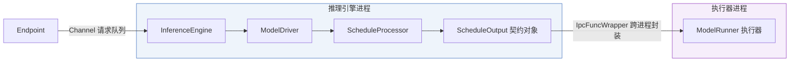
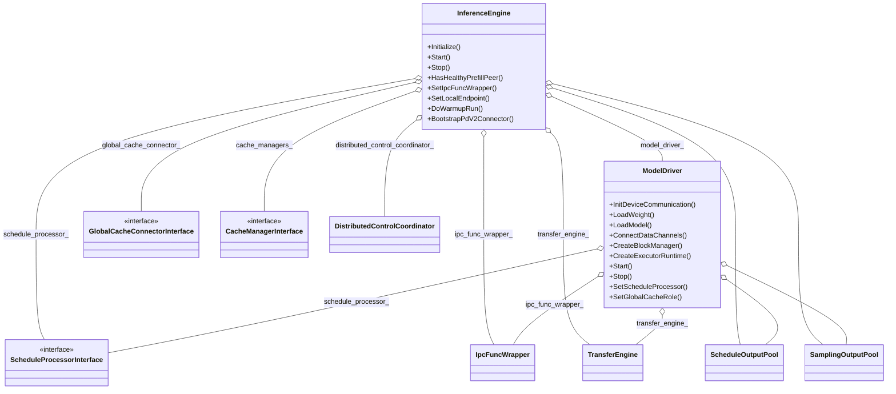
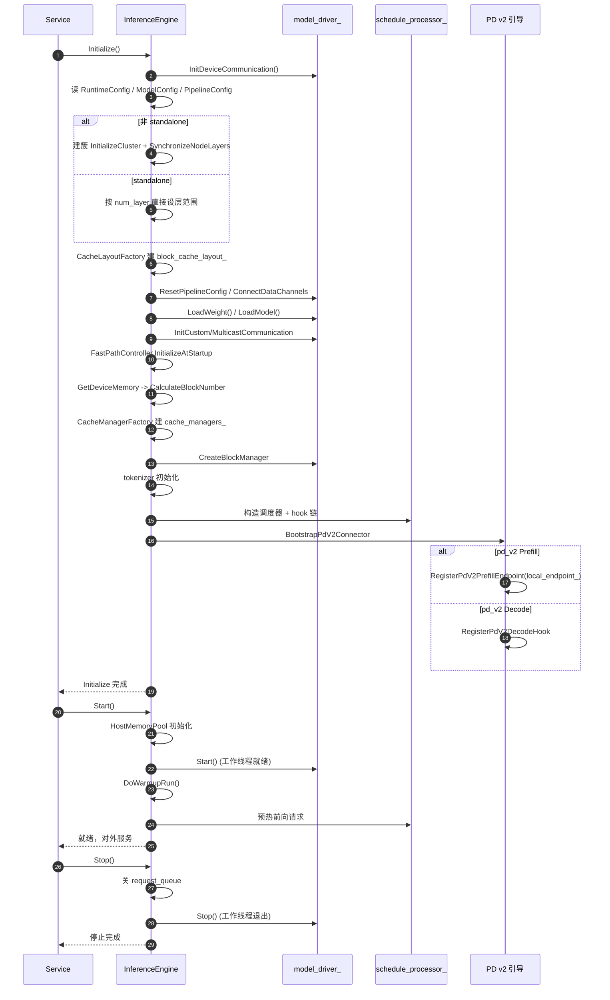
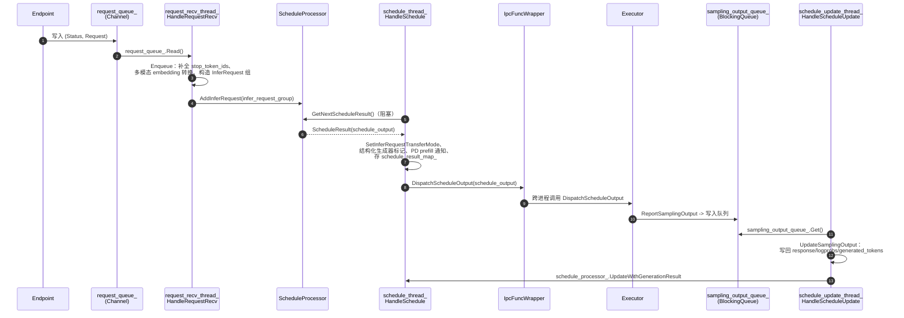
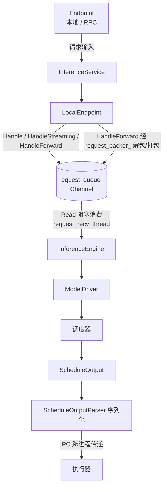
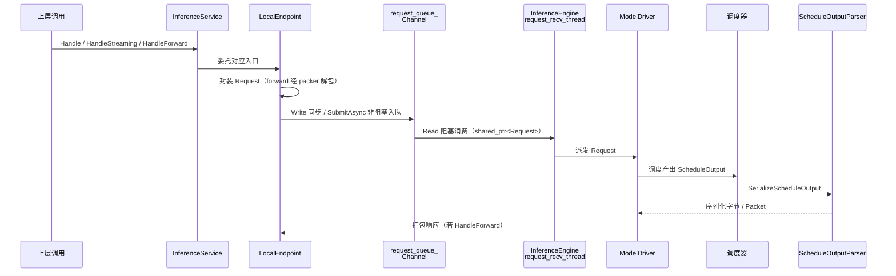
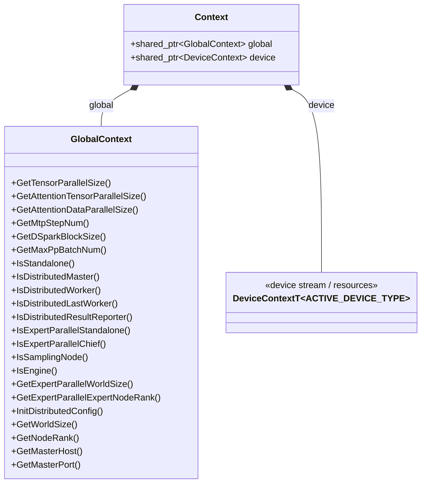
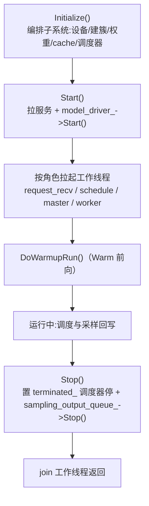

# 推理引擎与运行时

本文档从引擎层整体架构视角，介绍 KsanaLLM 推理引擎与运行时。面向架构师与内核开发者，覆盖推理管道中引擎层的枢纽位置、InferenceEngine 与 ModelDriver 的核心职责、Initialize/Start 生命周期、ModelDriver 多工作线程与 Channel 异步解耦、请求主链路与核心契约对象、全局与设备上下文的贯穿机制，以及工程实践要点。深入行级细节收敛到《引擎初始化与生命周期》《请求主链路与上下文》两个子文档。

## 1 推理引擎与运行时全景

本文件为《推理引擎与运行时》的章节，从引擎层整体架构视角定位文档主题，厘清推理管道中引擎层的枢纽地位、角色划分与文档体系边界。行级生命周期与请求主链路的细节不在此展开，分别收敛到《引擎初始化与生命周期》《请求主链路与上下文》两个子文档。

### 1.1 引擎层在推理管道中的枢纽位置

一条推理请求自进入系统到产出结果，历经「Endpoint → InferenceEngine → ModelDriver → 调度 → 执行」的标准链路。**InferenceEngine**（推理引擎）是引擎侧的总协调者，面向端点吸收请求并统筹整个推理生命周期；它向下托管「调度」与「执行」两级工作，构成管道中承上启下的枢纽。

- **承上**：通过 `Channel` 从端点接收请求，屏蔽端点形态差异（本地断点、PD 分离的 Prefill 断点等），并提供统一的进入入口。
- **启中**：持有调度器与执行运行时，负责在多个引擎线程与队列之间分配并发工作。
- **承接**：经由跨进程边界把调度结果交付给执行器执行，再收敛采样结果回传调度状态。

**ModelDriver**（模型驱动）是承载运行时工作线程的一层实体，统一管理引擎侧全部线程与队列（接收线程、调度线程、调度更新线程等），是 InferenceEngine 内部、位于调度与执行之间的线程调度中枢。上述两级承接关系可用架构图表达：



图中体现了两条关键分界：一是**进程内**引擎层内部由 `InferenceEngine → ModelDriver → ScheduleProcessor` 的线性职责链；二是**跨进程**的「引擎 ↔ 执行器」分界，引擎侧产生的 `ScheduleOutput` 契约对象经 `IpcFuncWrapper` 跨进程封装后交付执行器执行。`Channel` 作为端点与引擎、线程间解耦的容器，贯穿请求投递与结果回传。

### 1.2 「启动 → 常驻分发 → 停止」的角色划分

引擎层在运行时遵循明确的三阶段角色划分：

- **启动**：`Initialize` 加载权重、注册模型实例并启动通信端口，随后 `Start` 拉起常驻服务，并进行预热前向（Warmup）。
- **常驻分发**：引擎进入常驻循环，持续从 `Channel` 取请求、调度、跨进程执行并回传采样输出。
- **停止**：`Stop` 通知全体工作线程优雅退出，回收资源并收敛生命周期终态。

| 阶段 | 关键操作 | 归属文档 |
| ---- | -------- | -------- |
| 启动 | Initialize / Start / Warmup | 子文档《引擎初始化与生命周期》 |
| 常驻分发 | Channel 取请求、调度与执行 | 子文档《请求主链路与上下文》 |
| 停止 | Stop / 工作线程优雅退出 | 子文档《引擎初始化与生命周期》 |

### 1.3 与子文档的分工边界

本文档为总览，只聚焦角色与整体结构，不深挖代码细节。生命周期时序（初始化步骤、上下文、停止流程）详见《引擎初始化与生命周期管理》；请求从进入引擎到执行的完整主链路、请求对象与上下文的传递，详见《请求主链路与上下文》。三个关键术语：

- **InferenceEngine**：推理引擎，引擎侧总协调者，托管调度与执行。
- **ModelDriver**：模型驱动，承载运行时工作线程的枢纽。
- **`Channel<T>` / `ChannelObject<T>`**：基于 deque + mutex + condition_variable 的有界阻塞队列（无锁等待），用作端点与引擎、线程间的解耦容器。

**Sources:** <ref_code path="csrc/engine/inference_engine.h" /><ref_code path="csrc/engine/model_driver.h" />

## 2 引擎与驱动核心职责

本章定位推理引擎（InferenceEngine）与模型驱动（ModelDriver）两大核心组件的角色分工与对外能力入口集合。核心结论：**InferenceEngine 是引擎侧的总协调者，负责初始化、RPC 生命周期与跨进程/跨节点编排；ModelDriver 是其运行时的承载者，负责在引擎进程内管理所有工作线程与队列**。

从职责矩阵看，两者呈「协调—承载」的分层关系。InferenceEngine 作为总协调者，持有 ModelDriver 作为其核心驱动成员，并聚合调度器、cache 管理器、IPC 包装器等全局能力；而 ModelDriver 是实际跑起来的「引擎主体」，其内部的五条工作线程连同输入输出队列一并由它统一调度（各线程运行细节留给第 4 章）。

### 2.1 组件关系



图中「InferenceEngine o-- ModelDriver」的聚合关系，是二者分工的直观表达：总协调者持有一个 ModelDriver 实例，「调度到执行」的核心契约（ScheduleOutput）与采样（SamplingOutput）对象池在两层之间共享同一份引用。

### 2.2 能力矩阵

| 能力 | 所属组件 | 说明 |
| --- | --- | --- |
| 初始化总协调 | InferenceEngine | `Initialize()` 加载权重、注册模型实例并启动 RPC 端口，是引擎启动的唯一入口 |
| Warmup 预热前向 | InferenceEngine | `DoWarmupRun()` 在正式服务前执行预热前向 |
| RPC 服务生命周期 | InferenceEngine | `Start()` / `Stop()` 启停 RPC 服务；`HasHealthyPrefillPeer()` 汇报 pd_v2 Prefill 对端健康状态 |
| PD 分离引导 | InferenceEngine | `BootstrapPdV2Connector()` 通过 dlopen 动态加载 connector 并注册预填充 endpoint；`SetLocalEndpoint()` 指定本地端点 |
| IPC 包装器注入 | 双侧 | `InferenceEngine::SetIpcFuncWrapper()` 与 `ModelDriver::SetIpcFuncWrapper()` 注入跨进程调用封装，引擎与执行器据此解耦 |
| 设备通信初始化 | ModelDriver | `InitDeviceCommunication()`（多设备，如 NCCL）及自定义/多播通信初始化 |
| 权重与模型加载 | ModelDriver | `LoadWeight()` / `LoadModel()`，阻塞至所有执行器完成 |
| 分布式链路构建 | ModelDriver | `ConnectDataChannels()`、`SynchronizeEPCommunicationConfig()`、`InitializeResultReporter()` 构建执行器间数据通道与结果上报通道 |
| 执行器运行资源创建 | ModelDriver | `CreateBlockManager()` 在执行器进程创建 block 管理器、`CreateExecutorRuntime()` 创建执行器运行时 |
| 工作线程启停 | ModelDriver | `Start()` / `Stop()` 管理全部工作线程的启动与优雅退出 |
| 调度器注入与角色设定 | ModelDriver | `SetScheduleProcessor()` 注入调度器、`SetGlobalCacheRole()` 设置 PD 分离下的 GlobalCache 角色 |

### 2.3 边界说明

- 各工作线程（调度、分布式主/从、调度更新、请求接收）的运行逻辑属于单线程行为，整体收敛到「请求主链路与上下文」子文档，本章仅作线程存在性与归属声明。
- 权重加载的内部流程、BatchScheduler 调度策略、执行器流水线、KV Cache 分配细节均不在本章展开。

**Sources:** <ref_code path="csrc/engine/inference_engine.h" /> <ref_code path="csrc/engine/model_driver.h" />

## 3 引擎初始化与生命周期的生死

本章从引擎生命周期视角，梳理 InferenceEngine（推理引擎，引擎侧总协调者）的初始化编排、Start/Stop 生命周期与 Warmup 前向。InferenceEngine 自身不执行推理，而是通过 `model_driver_`（模型驱动，承载运行时工作线程）、`schedule_processor_`（调度器）等成员，把各阶段逐一编排串联，最终让服务进入就绪。行级细节（权重加载、分布式建簇、PD 传输）收敛到对应子文档，本章仅做引擎层总览。

### 3.1 初始化：把各子系统依次编排起来

`Initialize()` 是引擎的编排主入口：它不实现任何特定能力，而是按依赖顺序把设备通信、缓存建簇、权重加载、KV 缓存、调度器与 PD 引导逐一拉起。整体次序如下。

- **设备与配置**：先 `model_driver_->InitDeviceCommunication()`，再从 env 读取 `RuntimeConfig`/`ModelConfig`/`PipelineConfig`。
- **层范围**：非 standalone 时创建 `distributed_control_coordinator_` 并 `InitializeCluster()`，经 `SynchronizeNodeLayers` 生成 pipeline 的层范围；standalone 直接按 `num_layer` 设定层范围。
- **缓存布局**：`CacheLayoutFactory` 创建 `block_cache_layout_`，随后 `model_driver_->ResetPipelineConfig()` 把层范围下发到执行器。
- **权重与模型**：非 standalone 时 `ConnectDataChannels`/`InitializeResultReporter`，再阻塞执行 `model_driver_->LoadWeight()`、`LoadModel()`（内部三段式见《模型权重加载》文档）。
- **通信后置**：`InitCustomCommunication()`/`InitMulticastCommunication()`，并 `SynchronizeEPCommunicationConfig`。
- **启动期门控与内存**：读取 `BatchSchedulerConfig`，`FastPathController.InitializeAtStartup` 做启动期 gate；`GetDeviceMemory` 计算可用内存后 `CalculateBlockNumber`，非 standalone 再同步节点 block 数。
- **缓存管理器与 tokenizer**：`CacheManagerFactory` 构造 `cache_managers_`、`model_driver_->CreateBlockManager`；非 standalone 经 `Barrier()` 对齐后初始化 tokenizer。

调度器与 PD 引导触点挂在收尾：先构造调度器与 hook 链，再按角色接通 PD 分离端点（见 3.4）。

### 3.2 Start 与 Stop：服务就绪与优雅退出

`Start()` 让引擎对外就绪：先初始化 host 内存池；各 `cache_manager` 执行 `InitializeCachedBlocks`；随后拉起 `model_driver_->Start()` 使所有工作线程就绪；非 standalone 下 `Barrier()` 与 `Frozen()` 对齐后才开始服务。`Start()` 后执行 `DoWarmupRun()` 预热（ModelPerfBackend 模式则以性能采集替代）。

`Stop()` 进入关闭：置 `terminated_` 标志、向 `request_queue_` 写入终止信并 `Close()`；停止 TransferEngine、释放 `global_cache_connector_`、销毁 tokenizer、销毁建簇协调器；最后 `model_driver_->Stop()` 让工作线程优雅退出。pd_v2 connector 与 dlopen handle 在析构时按序释放，防止虚表悬垂。

### 3.3 Warmup 前向：DoWarmupRun

`DoWarmupRun()` 在正式服务前验证前向链路。它以 `max_seq_len` 为上限、按固定步长生成一组递增输入长度，构造含 dummy token 的 `Request` 写入 `request_queue`，并用 `Waiter` 等待前向返回、校验输出非空。embedding 模型只做一次 prefill 前向；普通 LLM 做一次 context 加一次 decode。`DISABLE_WARMUP` 环境变量可关闭预热。

### 3.4 PD 引导：BootstrapPdV2Connector 与端点注册

PD 分离场景的接导通过 `BootstrapPdV2Connector()` 完成：先依据 `PdV2RuntimeConfig` 判断本进程是否为 pd_v2 Prefill/Decode 节点，若否则为 no-op；是则经 `BuildEngineConnectorConfig` + `CreateAndInitConnector` 动态加载后端动态库（handle 存于 `pd_v2_dlopen_handle_`）并创建 `pd_v2_connector_`，随后按角色分支：

- **Decode 侧** `RegisterPdV2DecodeHook()`：构造 `PdV2DecodeHook` 挂入调度器 hook 链，并注入负载统计回调。
- **Prefill 侧** `RegisterPdV2PrefillEndpoint()`：要求 `Initialize()` 前已 `SetLocalEndpoint()`（否则抛错），构造注册 `pd_v2_prefill_endpoint_`，经 `SetSnapshotProvider` 提供本引擎负载快照供心跳广播，并注册 barrier 完成回调。

`WaitForPdV2DecodePeer()` 供 Decode warmup 前轮询等待健康 Prefill peer（默认 30s，可用环境变量调整）；健康触点 `HasHealthyPrefillPeer()` 经 service 层上抛到 `/health` 探活。

### 3.5 主生命周期各阶段的输入输出

| 阶段 | 入口 | 主要输入 | 产出/用途 |
|------|------|----------|-----------|
| 设备通信 | `model_driver_->InitDeviceCommunication` | — | 打通设备通信 |
| 读取配置 | env 读取 | ModelConfig/RuntimeConfig/PipelineConfig | 供后续阶段使用 |
| 建簇/层范围 | `InitializeCluster`+`SynchronizeNodeLayers` | 层数、mtp_step | pipeline 层范围 |
| 分发层范围 | `ResetPipelineConfig` | pipeline_config | 下发到执行器 |
| 权重/模型加载 | `LoadWeight`/`LoadModel` | 权重文件 | 完成 KV 装载元数据 |
| 内存与 block | `GetDeviceMemory`→`CalculateBlockNumber` | 可用内存 | 得出设备/host block 数 |
| 构造缓存器 | `CacheManagerFactory`+`CreateBlockManager` | block 配置 | 建立 Cache block 分配器 |
| 调度器与 hook 链 | 构造 + `BootstrapPdV2Connector` | 调度配置 | 主调度与 PD hook/endpoint |
| 预热 | `DoWarmupRun` | 递增输入长度 | 服务前验证链路 |
| 对外服务 | `Start` | — | 工作线程就绪、可接请求 |
| 优雅退出 | `Stop` | — | 线程/通道/集群回收 |

以下时序图给出 `Initialize → Start →（Warmup）→ 就绪 → 对外服务` 的初始化例行序列。



**Sources:** <ref_code path="csrc/engine/inference_engine.h" /> <ref_code path="csrc/engine/inference_engine.cpp" />

## 4 ModelDriver 工作线程与长序列异步解耦

ModelDriver（模型驱动）是引擎侧运行时工作线程的承载者：它把「服务入队、调度驱动、分布式收发、状态更新」四类职责拆分到独立的常驻线程，并以 Channel 与采样上报队列为纽带串成一条高并发异步闭环。本章从引擎线程编排角度说明各线程定位，以及引擎↔执行器如何借助 `request_queue_`、`sampling_output_queue_` 与 `IpcFuncWrapper` 实现跨进程解耦。

> 说明：分布式同步执行细节与次进程建簇见「分布式并行与集群通信」，调度内部流程见「批量调度与动态 Batching」，本章只涉及引擎侧线程编排，不展开调度算法。

### 4.1 引擎侧工作线程的编排

ModelDriver 在 `Start()` 中按角色决定启动哪组线程：非 distributed worker 才启动 `request_recv_thread_` 与 `schedule_thread_`（并同时 `schedule_processor_->Start()`）；非 distributed worker 启动 `schedule_update_thread_`；`IsDistributedMaster()` 启 `distribted_master_thread_`；`IsDistributedWorker()` 启 `distribted_worker_thread_`。`Stop()` 则置 `terminated_`、调 `schedule_processor_->Stop()`、`sampling_output_queue_->Stop()`，随后逐个 `join` 各线程，保证优雅退出。

各工作线程的定位与职责对应如下：

| 线程成员 | 处理函数 | 职责 |
| --- | --- | --- |
| `request_recv_thread_` | `HandleRequestRecv` | 循环 `request_queue_.Read()` 取请求，收到 `RET_REQUEST_TERMINATED` 即退出，否则 `Enqueue(req)` 入调度器 |
| `schedule_thread_` | `HandleSchedule` | 阻塞式 `GetNextScheduleResult` 取调度结果，`SetInferRequestTransferMode` 决定传输模式，构造结构化生成器标记、PD prefill 通知，写入 `schedule_result_map_`，并经 IpcFuncWrapper 下发 |
| `schedule_update_thread_` | `HandleScheduleUpdate` | 消费 `sampling_output_queue_`，调 `UpdateSamplingOutput` 把采样结果写回各请求并通知调度器 |
| `distribted_worker_thread_` | `HandleDistributedScheduleOutput` | 仅 distributed worker 启动：从 schedule output pool 取反序列化包并下发 executor |
| `distribted_master_thread_` | `HandleDistributedSamplingOutput` | 仅 distributed master 启动：收末级 worker 的采样输出并投递到更新队列 |

### 4.2 服务入队到调度（request_queue_ 与 Enqueue）

`InferenceService` 构造时在端点与引擎之间建立 `request_queue_`，类型为 `Channel<std::pair<Status, std::shared_ptr<Request>>>`。`request_recv_thread_` 是入队主链：读到请求后调用 `Enqueue`——先按模型配置补全/清空 `stop_token_ids`，再做多模态 embedding 转换，随后按 `req->output_group` 构造 `InferRequest` 组并 `SetReqGroup`，最终 `schedule_processor_->AddInferRequest()`。这样端点侧发起的请求即被异步送入调度，而 `schedule_thread_` 通过阻塞的 `GetNextScheduleResult` 消费调度产出，完成调度→引擎的驱动。

### 4.3 IPC 下发执行器与解耦

`IpcFuncWrapper`（csrc/ipc/ipc_func_wrapper.h）是引擎↔执行器的跨进程封装，通过 `ipc_func_proxy_` 代理实现对远端 callable 的调用。`IPC_FUNC_*` 枚举统一为跨进程函数编号命名，例如 `IPC_FUNC_DISPATCH_SCHEDULE_OUTPUT`、`IPC_FUNC_REPORT_SAMPLING_OUTPUT`、`IPC_FUNC_LOAD_WEIGHT`、`IPC_FUNC_CREATE_EXECUTOR_RUNTIME` 等。

`schedule_thread_` 在调度完成产出 `ScheduleOutput` 后，直接经 `ipc_func_wrapper_->DispatchScheduleOutput(schedule_output)` 下发执行器。调用方侧，`ModelDriver::LoadWeight`/`InitDeviceCommunication` 等权重加载与通信方法也全部经 `ipc_func_wrapper_` 代理到执行器进程，实现「业务在引擎侧编排、执行在执行器侧隔离」的解耦。

### 4.4 采样结果回流与状态更新

执行器完成采样后，通过 `ReportSamplingOutput` 把结果写入 `sampling_output_queue_`（`BlockingQueue<std::shared_ptr<SamplingOutput>>`）。`HandleScheduleUpdate` 循环 `Get()` 该队列；非 distributed 节点姿态下调 `UpdateSamplingOutput`——按 `schedule_id` 在 `schedule_result_map_` 找到 `ScheduleResult`，写回 `response`、`logprobs`、`generated_tokens` 等，必要时经 `transfer_engine_` 转发 token，最后 `schedule_processor_->UpdateWithGenerationResult()` 更新调度状态并擦除 map 项。

### 一次请求的完整异步闭环

下图为一次请求从入队到采样的完整异步闭环：



图中可见：引擎侧多线程各司其职，`Channel` 与 `BlockingQueue` 分离了「入队→调度→下发→回流」各环节，`IpcFuncWrapper` 把引擎的业务编排与执行器的实际计算隔离在不同进程，构成高并发异步闭环。

**Sources:** <ref_code path="csrc/engine/model_driver.h" /> <ref_code path="csrc/engine/model_driver.cpp" /> <ref_code path="csrc/ipc/ipc_func_wrapper.h" /> <ref_code path="csrc/ipc/core/ipc_func_types.h" /> <ref_code path="csrc/service/inference_service.h" />

## 5 请求主链路与核心契约对象

本章从「接入到回流」的主链路视角贯穿请求旅程：以 `InferenceService` 的三个入口为起点，经本地端点写入 `request_queue_` 通道，由 `InferenceEngine` 的请求接收线程消费，一路流经 `ModelDriver` 与调度器，最终产出调度→执行的核心契约对象 `ScheduleOutput`。本章只覆盖「链路与契约对象」粒度；批量调度细节见「批量调度与动态 Batching」，执行前向细节见「执行器与采样解码」。

### 5.1 主链路总览

**主链路即请求从服务边界流入、经引擎协调、最终把调度决策交给执行器的单向数据流。** 端点是服务边界，引擎是总协调者，`ScheduleOutput` 是调度与执行之间唯一的交接合约。



入口层与引擎之间通过有界通道 `request_queue_` 解耦，实现生产（端点）与消费（引擎请求线程）的异步衔接。

### 5.2 服务入口与端点委托

**`InferenceService` 是推理服务的总入口，对外统一暴露三个处理入口，并以成员 `inference_engine_` 持有引擎、`local_endpoint_`/`rpc_endpoint_` 持有端点。** 三个入口在实现上均委托给 `local_endpoint_` 的对应方法。

| 入口 | 委托目标 | 用途 | 返回载体 |
| --- | --- | --- | --- |
| `Handle` | `local_endpoint_->Handle` | 单次推理，同步返回 | `KsanaPythonOutput&` |
| `HandleStreaming` | `local_endpoint_->HandleStreaming` | 流式推理，逐 token 返回 | `shared_ptr<StreamingIterator>` |
| `HandleForward` | `local_endpoint_->HandleForward` | 前向推理，序列化字节进出 | `std::string& response_bytes` |

构造函数中即回填主链路：`inference_engine_` 以 `request_queue_` 为入参创建，`local_endpoint_` 由端点工厂创建并回设给引擎（`inference_engine_->SetLocalEndpoint`）。生命周期方面，`InferenceService::Initialize()` 委托 `inference_engine_->Initialize()`。

### 5.3 端点与 request_queue_ 通道

**`LocalEndpoint` 把服务接收的请求转成请求对象并写入引擎消费的通道，是主链路的入队端。** 其入口与 `InferenceService` 一一对应，并保留一个仅供 pd_v2 Prefill 路径使用的 `SubmitAsync`（非阻塞异步提交，避免同步写阻塞）。

- `request_queue_`：类型 `Channel<std::pair<Status, shared_ptr<Request>>>`，是端点与引擎之间的唯一请求通道。
- `request_packer_`（`RequestPacker`）：供 `HandleForward` 接口在入队前解包请求、回包前打包响应。

### 5.4 通道实现与并发语义

**`Channel<T>` / `ChannelObject<T>` 是端点与引擎解耦的容器，底层即 `deque + mutex + 读/写 condition_variable` 构成的有界阻塞队列，等待时不占用 CPU（无锁等待）。**

- 容量由构造参数给定，`Channel` 默认使用 `kChannelDefaultCapacity` 构造。
- `Read` 读出一个或多个元素，数据不足时阻塞直至可读或通道关闭；`Write` / `WriteMovable` / `WriteCopyable` 写入元素，容量不足时阻塞。
- `IsClosed` / `Close` 控制生命周期；`Size` 返回当前队列长度。

### 5.5 请求对象跨越通道的传递

请求对象作为 `shared_ptr<Request>` 与步进 `Status` 组合后穿过通道，被引擎请求接收线程消费：



请求对象沿「端点写 → 通道排队 → 引擎读」的异步链路传递，跨进程部分则由序列化后的 `Packet` 接续。

### 5.6 核心契约：ScheduleOutput

**`ScheduleOutput` 是调度到执行之间的核心契约对象：调度器把每个步的决策写入其中，执行器据此前向。** 它与引擎、ModelDriver、调度器共同构成主链路的「调度→执行」交接面。

| 字段 | 含义 |
| --- | --- |
| 调度编号 | 本步调度编号 |
| finish_req_ids / recompute_req_ids | 已完成 / 需重计算请求组 |
| running_reqs（InferRequest） | 引擎侧运行中请求 |
| executor_running_reqs | 执行进程侧运行中请求 |
| running_req_patches（InferRequestPatch） | 运行队列的增量补丁 |
| structured_generator_configs | 执行器创建生成器的结构配置 |
| 序列化快照 | Launch 时刻求字段快照（消除序列化竞争） |

它还提供行为方法：`IsLaunchable(max_depth)` 判定 batch 内每个活跃请求是否还能再压入一个在飞步；`SetPlanningTask()` 将规划任务注入各请求；`LaunchScheduleOutput` 把规划任务推入各请求的 inflight 队列并构造 `forwarding_tokens`。

### 5.7 序列化与对象池：跨进程传递

**`ScheduleOutputParser` 使 `ScheduleOutput` 可脱离引擎进程：由调度器序列化，经 IPC 跨进程传递给执行器还原执行。**

- 静态 `SerializeScheduleOutput` / `DeserializeScheduleOutput`：序列化到字节流或反向还原。
- 静态 `GetSerializedSize`：返回对象序列化字节长度。

**跨进程收发缓冲由 `ScheduleOutputPool` 提供**，避免高频步调度反复申请内存。它用若干 `BlockingQueue` 管理资源：`GetFreeScheduleOutput`/`FreeScheduleOutput` 取用与归还对象；`PutSendScheduleOutput`/`GetSendSerializedPacket`、`PutRecvSerializedPacket`/`GetRecvSerializedPacket` 管理收发 `Packet`；`Stop()` 让所有阻塞队列立即返回以配合停机。

### 5.8 小结

从接入到回流，主链路即「`InferenceService` 三入口 → `LocalEndpoint` → `request_queue_`（`Channel` 有界阻塞队列）→ `InferenceEngine`（request_recv_thread）→ `ModelDriver` → 调度器 → `ScheduleOutput`」。`ScheduleOutput` 作为调度与执行的唯一交接合约，由 `ScheduleOutputParser` 序列化并经 `ScheduleOutputPool` 缓冲后跨进程送达执行器；`Channel` 的有界阻塞语义保证端点与引擎在生产消费上解耦协作，构成贯穿「接入到回流」的并发主链。

**Sources:** <ref_code path="csrc/service/inference_service.h" /> <ref_code path="csrc/service/inference_service.cpp" /> <ref_code path="csrc/endpoints/local/local_endpoint.h" /> <ref_code path="csrc/utils/channel.h" /> <ref_code path="csrc/runtime/schedule_output.h" />

## 6 上下文贯穿机制

**Context** 是贯穿全局配置（GlobalContext）与设备（DeviceContext）的统一封装，集中承载 TP/DP/EP/PP 并行度与节点角色的全部查询入口，并由引擎、调度器、执行器各层共享同一实例以保证配置一致。它把「配置参数」与「设备资源」两类信息收敛为单一对象，随构造链自上而下传递，使各层对并行度与角色作出完全一致的判断。

### 6.1 Context 的构成

Context 在 `csrc/configure/context.h` 中定义：

```cpp
struct Context {
  std::shared_ptr<GlobalContext> global;  // 全局部分：并行度、节点角色、集群信息
  std::shared_ptr<DeviceContext> device;  // 设备部分：流等设备侧资源
};
```

其中 `GlobalContext` 承载所有与部署形态、并行切分、节点角色相关的只读配置；`DeviceContext`（`using DeviceContext = DeviceContextT<ACTIVE_DEVICE_TYPE>;`）承载设备流等设备侧资源，按编译期激活的硬件后端（CUDA/ACL/TOPS）特化。二者通过 Context 聚合，构成全局与设备上下文的分工边界。

### 6.2 类关系

Context 是只含两个成员字段的聚合体，`global` 负责「配置与角色」，`device` 负责「设备资源」，二者均以 `shared_ptr` 持有、随 Context 一并在各层间共享。



### 6.3 GlobalContext：并行度与节点角色的单一来源

GlobalContext 由构造函数 `GlobalContext(tensor_parallel_size, attn_data_parallel_size, max_multi_batch_size, env)` 初始化，将并行度、专家并行、节点角色固化到私有成员。其查询接口可分为两类。

- **并行度与步数**：TP、DP、EP（专家并行）规模，以及 MTP 步数、DSpark 块大小、PP 最大批次等派生量，供建簇与调度侧使用。
- **节点角色/模式**：以布尔接口描述当前进程在集群中的地位（是否单机、是否 master/worker、是否采样节点等），供启动/建簇/采样的分支判定使用。

初始化后需调用 `InitDistributedConfig()` 结合集群信息重算各角色标志与 EP 主节点标志；`SetEngineProcess` 单独标记本进程是否为引擎进程（`IsEngine()`）。

| 接口 | 类别 | 含义/主要适用范围 |
| --- | --- | --- |
| `GetTensorParallelSize()` | 并行度 | 全局 TP 大小，张量切分与通信组规模 |
| `GetAttentionTensorParallelSize()` | 并行度 | 注意力 TP 大小 |
| `GetAttentionDataParallelSize()` | 并行度 | 注意力 DP 大小，cache 分组/请求分片 |
| `GetMtpStepNum()` | 并行度 | MTP 步数，推测解码相关 |
| `GetDSparkBlockSize()` | 并行度 | DSPark 块大小，稀疏注意力分块 |
| `GetMaxPpBatchNum()` | 并行度 | PP 流水线在飞批次上限，负载均衡 |
| `IsStandalone()` | 角色 | 单机模式，决定是否建控制簇 |
| `IsDistributedMaster()` | 角色 | 分布式主节点，启动主侧线程/建簇 |
| `IsDistributedWorker()` | 角色 | 分布式工作节点，决定采样池与数据通道角色 |
| `IsDistributedLastWorker()` | 角色 | 末位 worker，是否向下游转发 |
| `IsDistributedResultReporter()` | 角色 | 结果回传上报节点 |
| `IsExpertParallelStandalone()` | 角色 | EP 单机，决定建簇分支 |
| `IsExpertParallelChief()` | 角色 | EP 主节点 |
| `IsSamplingNode()` | 角色 | 是否承担采样执行 |
| `IsEngine()` | 角色 | 是否引擎进程 |
| `GetExpertParallelWorldSize()` | EP | EP 参与机器数 |
| `GetMasterHost()` / `GetMasterPort()` | 集群 | 主节点地址端口，建簇连接 |

### 6.4 贯穿各层

Context 经构造函数自 service→engine→driver 各层向下传递，scheduler/executor 亦持有同一 Context，从而保证并行度与角色的判定全局一致。

- **InferenceEngine**：依据 `context_->global->IsStandalone()`、`IsDistributedWorker()`、`IsExpertParallelStandalone()` 判断是否构建 `DistributedControlCoordinator`；由 `GetAttentionDataParallelSize()` 决定 cache 分组；由 `IsDistributedWorker()` 决定是否创建 SamplingOutputPool。
- **ModelDriver**：用 `IsDistributedWorker()`/`IsDistributedLastWorker()` 决定启哪些数据通道线程，用 `IsDistributedMaster()` 决定主控线程。
- **设备侧**：`device` 供内核/算子取用设备流等资源；其内部实现见「模型与算子框架/算子封装与硬件后端」。

通过同一 Context 在 engine/scheduler/executor 共享，避免各层各自缓存并行度而产生配置漂移，保证集群拓扑与节点角色的判定自始至终一致。

**Sources:** <ref_code path="csrc/configure/context.h" /> <ref_code path="csrc/configure/global_context.h" /> <ref_code path="csrc/device/device_context.h" />

## 7 工程实践与注意事项

本章从引擎侧架构视角，总结内核开发者与架构师在扩展引擎时需要遵循的关键约定与易踩坑位，涵盖 Channel 的无锁等待与关闭语义、IPC 跨进程任务分布与回调模型、Initialize→Start→Warmup 生命周期与线程时序，以及 PD v2 通过 dlopen 动态载入 connector 的接入约束。各并行策略的具体设计见「四类并行」「PD 分离」文档，本节只做引擎侧提醒。

### 7.1 Channel：无锁等待与关闭语义

Channel\<T\> / ChannelObject\<T\> 是基于 deque + mutex + read/write 两把 condition_variable 的有界阻塞队列，是端点与引擎、线程间解耦的核心容器。其关键语义：

- 读侧在「数据为空且已关闭」时返回，而不是一直阻塞；写完必须显式 Close() 让读侧感知终止。
- `ChannelObject::Close()` 将 `is_closed_` 置为 true 并调用 `Notify()` 唤醒所有等待读侧，使阻塞中的读不再悬挂。
- 容量上限由 `kChannelDefaultCapacity` 约定，实际可用空间远大于业务数据量，工程上可视为「无锁等待 + 队尾追加」的通信原语。

| 关注点 | 约定 | 影响 |
| --- | --- | --- |
| 等待方式 | 读/写 condition_variable 无锁等待 | 避免自旋占用 CPU |
| 读侧终止 | 数据空且已关闭即返回 | 关闭后读侧必须能及时退出 |
| 关闭触发 | Close() 置 is_closed_ 并 Notify() | 关闭前要保证数据已排空或消费侧做好丢弃 |
| 空数据感知 | Read 在空且关闭时返回空结果 | 消费方需区分「正常空」与「已关闭」 |

**坑位提醒：**

- 忘记调用 `Close()` 会导致读侧线程永久阻塞在等待条件变量上，是 Stop 阶段卡死的常见根因。
- 「数据为空」时读侧返回是正常路径，实现方若把空结果误判为异常数据写入日志，会放大噪声。
- 多生产者共享一个 Channel 时，写入顺序不保证，禁止依赖入队次序表达逻辑优先级。

### 7.2 IPC 跨进程任务分布与回调模型

`IpcFuncWrapper` 是引擎↔执行器跨进程的封装，构造签名为 `IpcFuncWrapper(size_t executor_num, bool is_engine, int executor_id)`，用 is_engine 区分引擎进程与执行器进程。引擎侧通过 `SetIpcFunctions()`（私有方法）注册 IPC 函数集，经 `IpcFuncProxy` 按 `IPC_FUNC_*` 枚举分发到远端。

引擎向执行器下发的任务契约围绕调度与采样输出，核心接口包括：`AddExecutor` 登记执行器、`WaitAllExecutorsReady` 等待就绪、`LoadWeight`/`LoadModel` 加载权重与模型、`CreateExecutorRuntime` 建运行时、`DispatchScheduleOutput` 下发调度、`ReportSamplingOutput` 回收采样结果。

回调模型的要点：

- 回调由远端（执行器）发起、引擎侧执行，回调函数必须快速返回，禁止长时间持锁或做重计算，否则阻塞跨进程任务推进。
- 每个 `executor_id` 对应一个执行器槽位；任务分发前需满足 `WaitAllExecutorsReady` 前置约束。
- 引擎/执行器两种进程身份共用一套封装，扩展新 IPC 接口时要在枚举与注册两端同步修改。

### 7.3 生命周期与线程时序

生命周期顺序约定为 Initialize→Start→（Stop）。`Start()` 内部才按角色拉起工作线程，因此 Initialize 阶段只能在启动任何工作线程之前做子系统编排，否则会产生并发竞态。

- 非 distributed worker 角色：Start 才启动 request_recv/schedule 线程。
- IsDistributedMaster：Start 才启动 master 线程。
- IsDistributedWorker：Start 才启动 worker 线程。

`Stop()` 的顺序与 Start 对称：先置 `terminated_`，随后依次调用 `schedule_processor_->Stop()` 与 `sampling_output_queue_->Stop()` 关闭 Channel，最后 join 各工作线程，确保线程退出后才释放资源。



**决策表（生命周期与线程编排的关键顺序建议）：**

| 阶段 | 允许动作 | 禁止动作 | 违反后果 |
| --- | --- | --- | --- |
| Initialize | 编排子系统、建簇、载重、构造调度器 | 启动任何工作线程 | 拿到未初始化线程 |
| Start | 拉服务、拉起各角色线程 | 跳过 Initialize 直接 Start | 编排态缺失 |
| Start 后 | DoWarmupRun 预热 | 在任务中改动已注入依赖 | 并发竞态 |
| Stop | 置终止标志 → 关 Channel → join | 与 Start 并发调用 | 双线程互踩 |
| 析构 | 释放 dlopen 句柄等资源 | 在 Stop 前释放线程资源 | 虚表悬垂 |

### 7.4 PDU2 动态载入（dlopen）接入约束

PD V2 引导通过 `BootstrapPdV2Connector` 使用 dlopen 动态加载 connector，注册预填充端点。约束如下：

- 加载句柄为 `pd_v2_dlopen_handle_`，connector 生命周期以进程级持有。
- 析构顺序有硬约束：必须先释放 `pd_v2_prefill_endpoint_`，再执行 `dlclose`。颠倒顺序会因虚函数表位于 .so 中，先卸载 .so 后访问造成「虚表悬垂」。
- 动态加载要求 connector 按约定暴露固定的符号集/工厂入口，插件实现要遵循 ABI，扩展新协议不改变已有符号签名。

**坑位提醒：**

- 绝不要在持有 connector 实例（如注册到调度器的指针）时 `dlclose`，形成悬挂调用。
- 动态加载失败（dlopen 返回空）要有显式失败处理，不要继续使用未初始化端点。
- `dlclose` 只在析构释放，不要在运行期进行，避免高频反复 load/unload 放大内存整理与符号重解析开销。

### 7.5 普遍性工程约定（引擎侧提醒）

- **编排发生在 Init**：任何线程编排挑选在 Initialize 阶段完成，Start 只负责拉服务与启动线程。
- **关闭必须对称于启动**：先停最「生产」的调度器，再关最「消费」的采样回写出队，与创建顺序对称。
- **回调保持浅快**：远程回调函数不做重计算、不长时间持锁、不反向等待引擎侧主线。
- **空返回不等于失败**：Channel 在空且关闭时正常返回，需按终止语义区分，不要当 error 处理。

**Sources:** <ref_code path="csrc/utils/channel.h" /> <ref_code path="csrc/ipc/ipc_func_wrapper.h" /> <ref_code path="csrc/engine/model_driver.h" /> <ref_code path="csrc/engine/model_driver.cpp" /> <ref_code path="csrc/engine/inference_engine.h" /> <ref_code path="csrc/engine/inference_engine.cpp" />