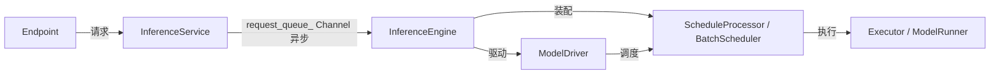
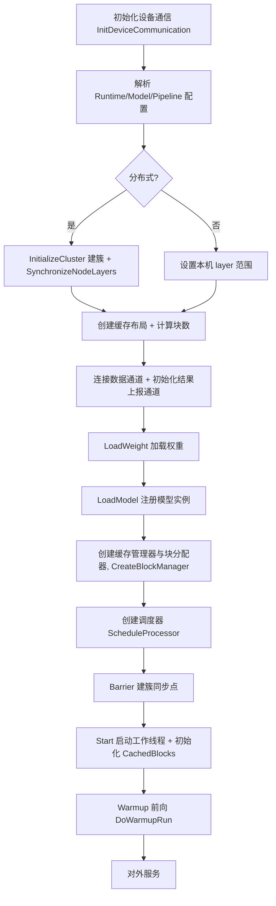
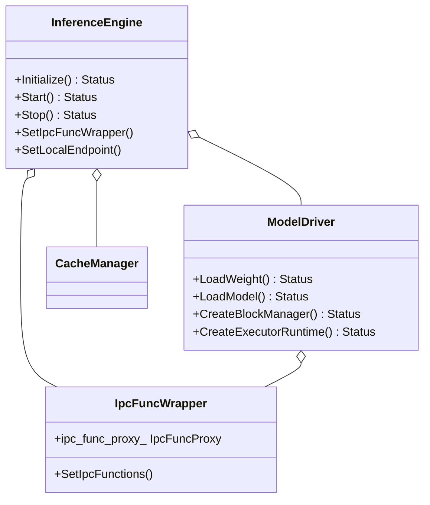
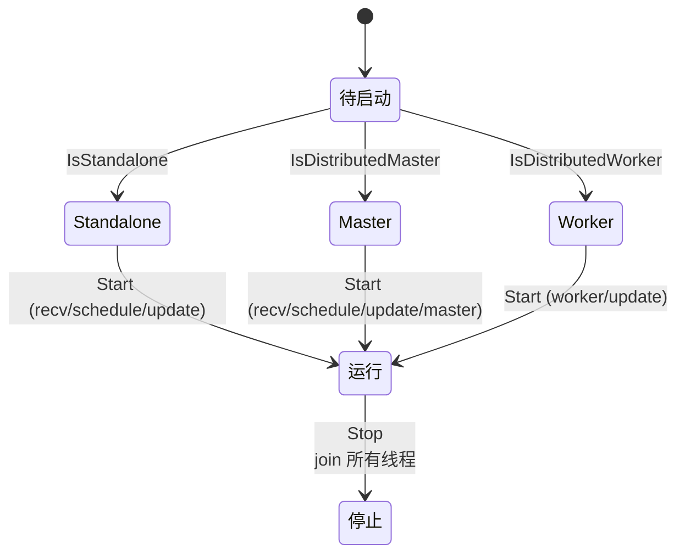
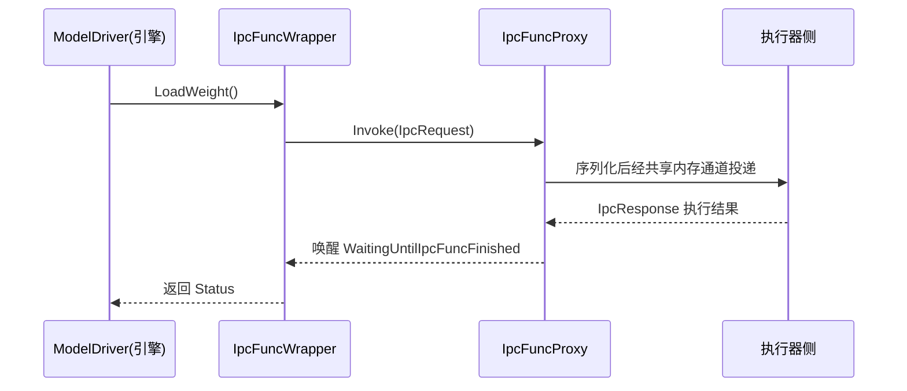
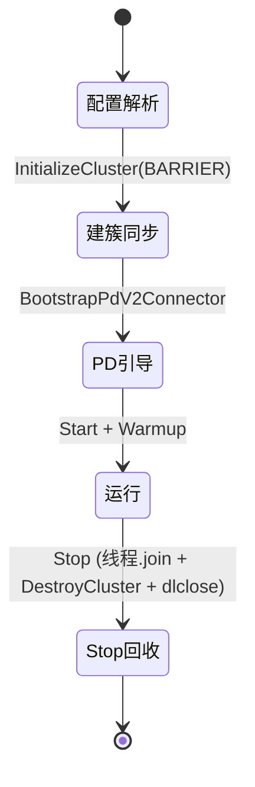

# 引擎初始化与生命周期

> 面向架构师与运维，深入讲解 KsanaLLM 推理引擎的初始化与生命周期管理。核心围绕 `InferenceEngine` 与 `ModelDriver` 从启动到就绪再到稳定运行的完整过程。

## 1. 概述：推理引擎在系统中的定位

`InferenceEngine` 是 KsanaLLM 系统初始化的总协调者，处于「服务接入 → 调度 → 执行」三个环节的承上启下枢纽位置。它继承服务层投递的请求、组装调度器、按节点角色组织多线程运转，是引擎初始化的主导者。

`ModelDriver` 是 `InferenceEngine` 的驱动与多线程承载者，管理引擎全部工作线程与 IPC 跨进程动作。

主链路数据流为：`Endpoint → InferenceService.Handle → request_queue_(Channel) → InferenceEngine → ModelDriver → BatchScheduler → ModelRunner`。

引擎整体包含四个生命周期状态：**Initialize → Start →（运行）→ Stop**，对应系统上电、就绪、稳定服务、回收退出四阶段。

上游经 `request_queue_`（`Channel<T>` 无静等待有界阻塞队列）实现「接入 → 引擎」的异步解耦，下游由 `ModelDriver` 驱动 `ScheduleProcessor` 做批量调度。本文档聚焦引擎初始化与生命周期本身，**不展开** `BatchScheduler` 的调度算法与 `ModelRunner` 的执行流水线细节（相关章节另行覆盖）。

**Sources:** <ref_code path="csrc/engine/inference_engine.h" /> <ref_code path="csrc/engine/model_driver.h" /> <ref_code path="csrc/service/inference_service.h" /> <ref_code path="csrc/service/inference_service.cpp" />

## 2. 引擎生命周期总览：Initialize 与 Start

`InferenceEngine` 的生命周期由六个主线方法驱动：`SetIpcFuncWrapper`（先于 Initialize 注入 IPC 代理）、`SetLocalEndpoint`（PD Prefill 特有，先于 Initialize）、`Initialize()`、`Start()`、`Stop()` 与析构。

`InferenceService` 是外层包装，其 `Initialize()/Start()/Stop()` 依次委托 `InferenceEngine` 对应方法，并在 `Start()` 后再启动 rpc endpoint。

生命周期核心时序如下（以分布式多进程为例）：

`Initialize()` 执行后，引擎仅完成**静态装配**（权重、模型实例、RPC 底座、调度器、缓存管理器），工作线程尚未启动。`Start()` 才真正拉起线程并执行启发式 Warmup 前向验证推理通路。

初始化阶段会触发两条旁路装配：`CacheManagerFactory` 创建缓存管理器（按 DP 分组），PD 分离场景预加载 connector（见第 5 章）。`Initialize()` 核心流程的最后调用 `CreateExecutorRuntime(vocab_info)` 在每台执行器进程侧拉起执行器运行时，随后进入 `Start()`。

`Stop()` 逆序回收：先置 `terminated_` 并向 `request_queue_` 写终止请求、关闭队列，再停 TransferEngine、释放 GlobalCacheConnector、销毁 tokenizer、拆解分布式集群、最后 `model_driver_->Stop()` 回收所有线程。

**Sources:** <ref_code path="csrc/engine/inference_engine.h" /> <ref_code path="csrc/engine/inference_engine.cpp" /> <ref_code path="csrc/service/inference_service.cpp" />

## 3. 初始化细节：权重加载、模型实例注册与 RPC 建立

`InferenceEngine::Initialize()` 的核心职责是「编排装配」：加载权重、注册模型实例、建立块分配器与跨进程 RPC 底座。它通过 `model_driver_` 把真正的设备动作转发到执行器侧执行，自身只做流程编排。

`ModelDriver` 的多数初始化方法是对 `IpcFuncWrapper` 的一层薄封装，例如 `InitDeviceCommunication()`、`LoadWeight()`、`LoadModel()`、`CreateBlockManager()`、`CreateExecutorRuntime()`、`GetDeviceMemory()` 等均直接转发 `ipc_func_wrapper_` 的对应方法。

`Initialize()` 的编排顺序与要点：

1. **设备通信**：`InitDeviceCommunication()` 作为第一动作完成跨设备（如 NCCL）底层初始化。
2. **配置解析**：从 `Environment` 读取 `RuntimeConfig / ModelConfig / PipelineConfig`。
3. **分布式建簇**（非 standalone）：`InitializeCluster()` 建控制集群、`SynchronizeNodeLayers()` 同步各节点的层区间；standalone 则直接设本机 layer 范围，跳过分布式 coordinator。
4. **块缓存规划**：`CacheLayoutFactory` 创建块缓存布局，`InitializeBlockManagerConfig()` 计算块数，`GetDeviceMemory()` 获取显存后 `CalculateBlockNumber()` 推算可容纳块数，分布式下再 `SynchronizeCacheBlockNum()` 统一。
5. **权重与模型**：`LoadWeight()` 经 IPC 下推到执行器侧装载权重，`LoadModel()` 注册模型实例，再 `InitCustomCommunication() / InitMulticastCommunication()` 建立自定义通信、同步 EP 通信配置。
6. **缓存管理器**：按 DP 分组创建 `cache_managers_`，同时 `CreateBlockManager()` 在每台执行器侧创建块分配器。
7. **调度器**：根据 `scheduler_type` 装配事件驱动调度器或经典 `BatchScheduler`（聚合 `schedule_processor_`），并注入 `GlobalCacheFetcher`、hook 链等。
8. **执行器运行时**：尾调用 `CreateExecutorRuntime(vocab_info)` 在每台执行器进程拉起执行器运行时。

权重加载仅是「触发入口」：`ModelDriver::LoadWeight()` 把 `IPC_FUNC_LOAD_WEIGHT` 投递到执行器侧，由 `WeightInstance::Load()` 完成实际装载。权重多格式、量化的适配细节属于「模型权重加载」章节，此处只描述编排。

分派到执行器的动作（`LoadWeight / LoadModel / CreateBlockManager / CreateExecutorRuntime` 等）均通过 `ipc_func_wrapper_` 代理，体现「引擎侧做编排、设备动作由执行器侧完成」的职责分离。

**Sources:** <ref_code path="csrc/engine/inference_engine.cpp" /> <ref_code path="csrc/engine/model_driver.h" /> <ref_code path="csrc/engine/model_driver.cpp" /> <ref_code path="csrc/ipc/ipc_func_wrapper.h" /> <ref_code path="csrc/runtime/model_instance.h" /> <ref_code path="csrc/runtime/weight_instance.h" />

## 4. 工作线程启动：ModelDriver 多线程角色与 Start 策略

`ModelDriver::Start()` 根据 `GlobalContext` 判定的节点角色，**选择性**启用不同的工作线程。`Stop()` 逆序 `join()` 所有线程，保证优雅退出。

### 工作线程角色

| 线程成员 | 处理函数 | 职责 | 启用的节点角色 |
| --- | --- | --- | --- |
| `request_recv_thread_` | `HandleRequestRecv` | 从 request_queue 收请求并入队调度器 | 非 worker |
| `schedule_thread_` | `HandleSchedule` | 循环取调度结果并下发 | 非 worker |
| `schedule_update_thread_` | `HandleScheduleUpdate` | 调度状态更新 | 非 worker |
| `distribted_master_thread_` | `HandleDistributedSamplingOutput` | 接收结果输出并更新调度状态 | master |
| `distribted_worker_thread_` | `HandleDistributedScheduleOutput` | 收调度输出并下发执行器 | worker |

角色-线程矩阵与 `Start()` 判定逻辑如下：

- **standalone / master（非 worker）**：启动 `request_recv_thread_`、`schedule_thread_`、`schedule_update_thread_`，并先 `schedule_processor_->Start()`。
- **master（`IsDistributedMaster`）**：额外启动 `distribted_master_thread_` 处理采样/结果回流。
- **worker（`IsDistributedWorker`）**：仅启动 `distribted_worker_thread_` 与 `schedule_update_thread_`，由 engine 侧（master）经 IPC 下发调度结果，worker 负责广播到执行器。

对应状态机：

除线程外，`ModelDriver` 还承担初始化旁路职责：

- **设备通信**：`InitDeviceCommunication()` 经 IPC 初始化 NVIDIA NCCL 等跨设备通信，另有 `InitCustomCommunication()`、`InitMulticastCommunication()`。
- **数据通道**：`ConnectDataChannels()` 依据 `USE_TCP_DATA_CHANNEL` 选择 TCP 或 NCCL 通道，由 master 建链、worker 监听/连接。
- **EP 通信配置同步**：`SynchronizeEPCommunicationConfig()` 从执行器收集配置、跨节点聚合、再回写各执行器。
- **结果上报器**：`InitializeResultReporter()` 由最后 worker 建立结果上报通道。

**Sources:** <ref_code path="csrc/engine/model_driver.h" /> <ref_code path="csrc/engine/model_driver.cpp" /> <ref_code path="csrc/configure/global_context.h" />

## 5. IPC 注入解耦：IpcFuncWrapper 与通信解耦

引擎通过 `IpcFuncWrapper` 把「跨进程业务调用」与「底层共享内存通信」解耦：业务层只面向语义明确的函数，通道的打开、序列化、唤醒由 IPC 层封装，底层完全不感知调用方。

`IpcFuncWrapper` 在构造时经 `SetIpcFunctions()` 把每个 IPC 函数注册为「请求-响应-回调」模型到 `IpcFuncProxy`，并持有唯一的 `ipc_func_proxy_`。`ModelDriver` 仅持有 `ipc_func_wrapper_`，即可发起对执行器的调用。

IPC 调用模型由四件套构成：`IpcRequest`（请求）、`IpcResponse`（应答）、`IpcCallable`（执行器侧被调函数）、`IpcCallback`（引擎侧回调），通过 `IpcContext` 声明 `func_id / exec_seq / 收发双方 rank / 是否异步 / 是否 oneway / 是否 heavy` 等语义。

引擎侧一次跨进程调用的时序：

`IpcFuncProxy` 是所有 IPC 函数分发的调度中枢：`Invoke()` 负责发送请求与等待应答，内部含 `IpcProcessChannelManager` 管理共享内存通道，并有专用执行线程与 heavy 长任务线程。

注入的解耦价值体现在三层结构：

| 层次 | 承担者 | 职责 |
| --- | --- | --- |
| 业务层（编排） | `ModelDriver` / `InferenceEngine` | 面向语义函数调用，不感知通道 |
| IPC 层（解耦） | `IpcFuncWrapper` / `IpcFuncProxy` | 函数注册、序列化、分发、唤醒 |
| 传输层（channel） | `IpcProcessChannel`（共享内存） | Request/Response 数据的物理搬运 |

共享内存通道的底层数据结构（`IpcProcessChannel`）、watchdog 等由「分布式并行与集群通信」章节覆盖，本层不展开。

**Sources:** <ref_code path="csrc/ipc/ipc_func_wrapper.h" /> <ref_code path="csrc/ipc/ipc_func_wrapper.cpp" /> <ref_code path="csrc/ipc/core/ipc_func_proxy.h" /> <ref_code path="csrc/ipc/core/ipc_func_types.h" />

## 6. 分布式节点角色与 PD 引导

引擎初始化会感知分布式集群与 PD 分离场景下的节点角色，并据此决定建簇同步、线程启停与采样归属。

### 节点角色判定

`GlobalContext` 集中管理 TP/DP/EP/PP 并行度与节点角色，提供 `IsStandalone()`、`IsDistributedMaster()`、`IsDistributedWorker()`、`IsSamplingNode()` 等判定，以及 `GetMasterHost()/GetMasterPort()` 等集群信息。`Context` 把 `GlobalContext`（并行配置）与 `DeviceContext`（CUDA 流管理）封装在一起贯穿引擎、调度、执行各层。

角色来源链：`InferenceService` 构造时经 `InitDistributedConfig()` 与 `InitializeExpertParallelConfig()` 完成节点角色计算，引擎据此在 `Initialize/Start/Stop` 中分支执行。

### PD 引导

PD 分离场景下，引擎通过 `BootstrapPdV2Connector()` 引导 Prefill/Decode 解耦，核心动作：

- **动态加载**：依据 `group_role` 是否为 `prefill/decode`，经 `dlopen` 加载 pd_v2 connector 后端 `.so`，构造 `pd_v2::PdV2ConnectorInterface`。
- **Decode 侧**：`RegisterPdV2DecodeHook()` 把 `PdV2DecodeHook` 注入调度器 hook 链。
- **Prefill 侧**：`RegisterPdV2PrefillEndpoint()` 构造 `PdV2PrefillEndpoint` 并连到 `request_queue_`，须先经 `SetLocalEndpoint()` 注入本地端点。
- **健康感知**：`HasHealthyPrefillPeer()` 向 service/Python `/health` 暴露当前 Decode 引擎是否看到健康的 Prefill 对端。

Warmup 前 `DoWarmupRun()` 会先调用 `WaitForPdV2DecodePeer()` 轮询等待健康 Prefill peer，避免 CanAccept 失败导致空输出。

引擎整体生命周期状态机（含 PD 与守护收尾）：

### Stop 收尾

引擎 `Stop()` 逆序回收资源：置 `terminated_`、通知请求队列终止、停 TransferEngine、释放 GlobalCacheConnector、`DestroyTokenizer()`、非 standalone 下 `DestroyCluster()` 拆解集群并置空 coordinator、`model_driver_->Stop()` join 线程、销毁调度器与 profiler。析构时对 PD 侧先 `Shutdown()` connector、`reset()` 相关智能指针，再 `dlclose` 卸载 `.so`（因其 vtable 位于动态库内）。

**Sources:** <ref_code path="csrc/engine/inference_engine.h" /> <ref_code path="csrc/engine/inference_engine.cpp" /> <ref_code path="csrc/configure/global_context.h" /> <ref_code path="csrc/configure/context.h" />

## 7. 运维与实践

本节聚焦与「引擎初始化/生命周期」直接相关的运维关注点，不覆盖完整部署步骤（属「部署配置与使用」章节）。

### 生效配置位置

初始化各环节由 YAML 中的 `setting.global.*`、`setting.connector.*` 与 `setting.block_manager.*` 驱动。并行度在 `examples/ksana_llm.yaml` 的 `tensor_para_size / pipeline_para_size / attn_data_para_size / expert_world_size`；PD 分离角色在 `examples/ksana_llm_disaggregating_pd.yaml` 的 `setting.connector.group_role`（`prefill | decode`）与 `router_addr / inference_addr / communication_type`；前缀缓存由 `enable_auto_prefix_cache` 控制。具体取值以你这是示例为准，此处仅定位。

三种部署形态的初始化差异：

| 部署形态 | 参考示例 | 关键初始化路径 | 驱动配置 |
| --- | --- | --- | --- |
| 单机 | `ksana_llm.yaml` | 跳过建簇、连数据通道，standalone 单进程 | `setting.global.*` |
| 分布式 | `ksana_llm_distributed.yaml` | 建簇同步、完整分布式建簇与数据通道 | master host/port + 并行度 |
| PD 分离 | `ksana_llm_disaggregating_pd.yaml` | `BootstrapPdV2Connector` 引导 + connector 传输 | `setting.connector.*` + `group_role` |

### 初始化失败与恢复

初始化是「先装配后启动」的同步串行流程，任一步失败通常直接返回非 OK 状态并由上层中止后续步骤：

| 阶段 | 可能失败点 | 处理建议 |
| --- | --- | --- |
| 设备通信 | NCCL 初始化失败 | 检查驱动、多卡可见性，核对 `tensor_parallel_size` |
| 分布式建簇 | `InitializeCluster`/`Barrier` 超时 | 确认 master host/port 可达，节点数一致 |
| 权重加载 | 路径错误或格式不支持 | 核对 `model_dir`、检查权重格式与量化后端 |
| Warmup | 产生空输出（含 PD Decode 无 peer） | 检查 `DISABLE_WARMUP`、`PD_V2_WARMUP_PEER_WAIT_MS`、peer 心跳 |
| connector 加载 | dlopen 失败 | 确认 pd_v2 connector `.so` 安装、`is_pd_v2` 与 `group_role` 匹配 |

日志由 `KLLM_LOG_LEVEL` 控制，初始化阶段打印大量分阶段 INFO 日志（如 "load weight finished"、"create cache manager"），可据日志断点定位失败环节。

### 启停顺序注意

多进程（`WORLD_SIZE > 1`）下存在 `BARRIER` 同步点：

- `Initialize()` 在建簇、数据通道、`CreateBlockManager()` 后有 Barrier；`Start()` 在启动工作线程后再 `Barrier()` + `Frozen()` 宣告全体就绪。
- `Stop()` 先停引擎再停 rpc endpoint，且必须先于进程退出完成集群拆解，避免残留共享内存。
- 引擎 `Stop()` 属于可中断路径，`terminated_` 幂等保护重复调用。

### 常见问题 FAQ

| 问题 | 说明 |
| --- | --- |
| 为何要 Warmup | `Start()` 中通过 `DoWarmupRun()` 用多档长度构造 dummy 请求做一次前向，验证完整链路并预热 kernel 与内存池，避免首个请求过慢 |
| 节点角色错误导致线程异常 | standalone/master/worker 分别启用不同线程集合；角色配置错误会导致调度线程缺失或结果回流失败，应核对并行度配置与节点 rank 是否一致 |
| pd connector dlopen 加载失败 | 检查 `setting.connector.*` 的 `is_pd_v2` 与 `group_role`、connector 动态库是否随平台分发，及 Python 侧接口是否匹配 |

**Sources:** <ref_code path="examples/ksana_llm.yaml" /> <ref_code path="examples/ksana_llm_distributed.yaml" /> <ref_code path="examples/ksana_llm_disaggregating_pd.yaml" /> <ref_code path="csrc/configure/global_context.h" />