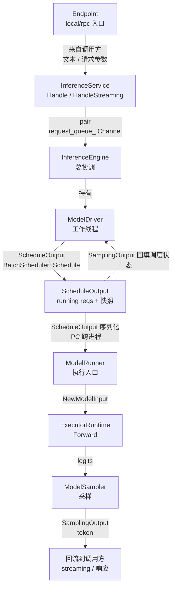
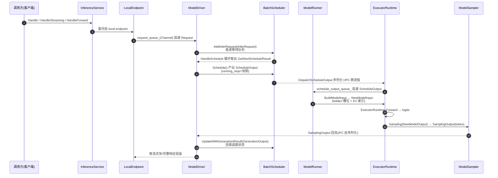
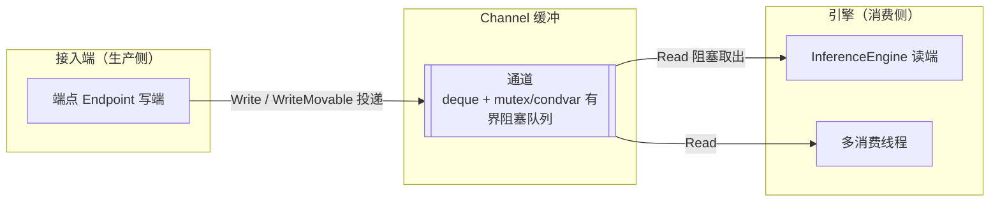
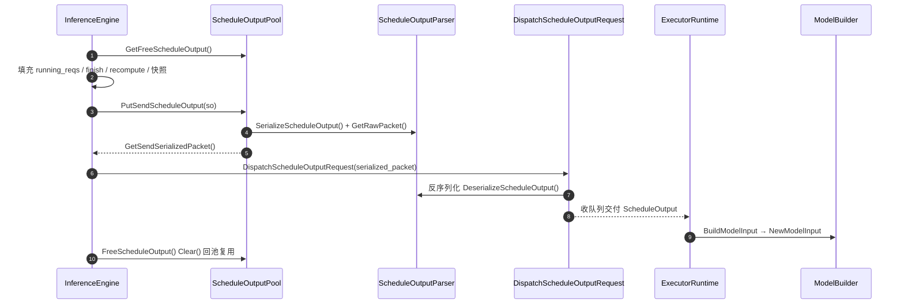
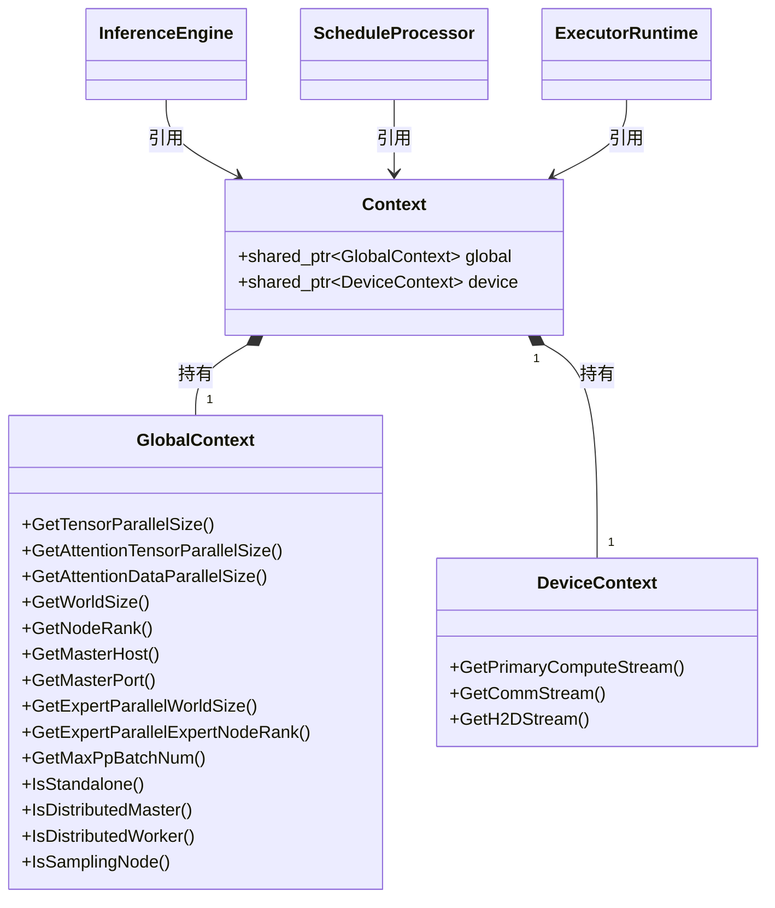

## 1. 概述：请求在推理引擎与运行时中的主链路全景

本文档是 KsanaLLM「推理引擎与运行时」父章下的纵向链路专题，聚焦从「请求接入到结果回流」的端到端主链路与数据流，回答一个核心问题：推理请求进入后，如何被异步解耦、逐级下钻，最终把采样 token 回流到调用方。内容与批量调度、执行采样、KV Cache 等平级专题互斥，各专题细节只在链路行经处点到为止并注明归属。

### 1.1 端到端主链路数据流

下图给出宏观主链路：`接入 → 调度 → 执行 → 采样 → 回流`，箭头旁标注各阶段产出的数据类型。每一步的中间解耦均通过 Channel/阻塞队列完成，使请求与服务、调度、执行线程异步流动。

链路中点明三处数据形态跃迁：调用侧文本/请求经 endpoint 转成 `Request`；调度产出 `ScheduleOutput`（含 running reqs 与各字段快照）；执行/采样逐级下钻为 `NewModelInput → logits → token`，最后由 `SamplingOutput` 回流。

### 1.2 贯穿链路的关键实体

链路可分成三段解耦：服务接入、引擎调度、执行采样。核心实体与职责如下。

| 实体 | 源文件 | 主链路职责 |
| --- | --- | --- |
| `InferenceService` | `csrc/service/inference_service.h` | 接入入口，提供 `Handle`/`HandleStreaming`/`HandleForward`，持有 `request_queue_` 与 engine |
| `Channel` | `csrc/utils/channel.h` | 带容量与阻塞语义的异步信道，承载 endpoint 与 engine 间的 `Request` 传递 |
| `InferenceEngine` | `csrc/engine/inference_engine.h` | 总协调，持有 `model_driver_`/`schedule_processor_`/`schedule_output_pool_` 等 |
| `ModelDriver` | `csrc/engine/model_driver.h` | 管理调度与执行侧的全部工作线程及队列 |
| `BatchScheduler` | `csrc/batch_scheduler/batch_scheduler.h` | `Schedule()` 产出 `ScheduleOutputGroup`，`AddInferRequest()` 收入请求 |
| `ScheduleOutput` | `csrc/runtime/schedule_output.h` | 每步调度契约，含 running reqs、finish/recompute、字段快照 |
| `ModelRunner` | `csrc/executor/model_runner.h` | 执行入口，读取 `ScheduleOutput` 构建模型输入、执行并采样 |
| `Context` | `csrc/configure/context.h` | 全局（`global` 的 `GlobalContext`）与设备（`device` 的 `DeviceContext`）上下文 |

### 1.3 章节拆解

「请求从接入到回流的端到端」按三个主题分章展开。

1. 主链路数据流：`InferenceService → Channel → InferenceEngine/ModelDriver → 调度 → 执行/采样 → 回流`，及数据形态变化。
2. `ScheduleOutput` 核心契约：running reqs、快照、finish/recompute，`ScheduleOutputParser` 序列化 + IPC 跨进程传递，`ScheduleOutputPool` 复用池。
3. `Context` 全局与设备上下文：承载 TP/DP/EP/PP 并行度、设备流资源与分布式节点角色。

**Sources:**
<ref_code path="csrc/service/inference_service.h" />
<ref_code path="csrc/utils/channel.h" />
<ref_code path="csrc/engine/inference_engine.h" />
<ref_code path="csrc/engine/model_driver.h" />
<ref_code path="csrc/batch_scheduler/batch_scheduler.h" />
<ref_code path="csrc/runtime/schedule_output.h" />
<ref_code path="csrc/executor/model_runner.h" />
<ref_code path="csrc/configure/context.h" />

## 2. 端到端主链路与数据流

一条请求从投递到回流，依次经过服务接入、引擎调度、执行采样三段解耦，链路依托各层阻塞队列与 IPC 异步流动：`InferenceService → LocalEndpoint → ModelDriver → 调度 → ModelRunner → ExecutorRuntime → 采样 → 回流`。稳态下每步分属不同工作线程，前一步仅把产物投递到下一条队列即返回，从而把串行推理叠成流水线。

### 2.1 三种入口的稳态差异

`InferenceService` 对外暴露三个入口，均委托给 `LocalEndpoint`，仅是触发方式与返回形态不同。

| 入口 | 触发方式 | 返回形态 |
| --- | --- | --- |
| `Handle` | 同步调用，传入 `KsanaPythonInput` | 同步返回完整 `KsanaPythonOutput`，调用方阻塞至生成结束 |
| `HandleStreaming` | 流式调用，同样传 `KsanaPythonInput` | 返回 `StreamingIterator`，按 token 产出流式块供逐步拉取 |
| `HandleForward` | 同步调用，传入序列化字节串 `request_bytes` | 返回 `response_bytes` 序列化字节供嵌入式/二进制调用 |

三者最终都经由 `request_queue_`（`Channel<pair<Status, Request>>`）把请求投递给引擎，之后走同一主链路；差别仅在结果回流的通道与协议上。

### 2.2 跨模块调用时序

`ModelDriver` 是引擎侧秩序的持有者，负责注册全部工作线程：`HandleRequestRecv` 消费队列、`HandleSchedule` 循环拉取调度产出并分发、`HandleScheduleUpdate` 接收采样结果回填调度。时序如下。

### 2.3 逐级下钻中数据的形态变化

请求在下钻过程中形态层层退化为可执行的机器向量。

- 调用侧：`KsanaPythonInput` 由 endpoint 转成 `Request`（含 sampling_config）进入主链路。
- 调度侧：`ModelDriver::Enqueue` 为每个输出组创建 `InferRequest`，经 `schedule_processor_->AddInferRequest` 收进调度器；调度产出 `ScheduleOutput`，含 `InferRequest` 列表与 `InferRequestSerializationSnapshot`、finish/recompute 快照。
- 执行侧：`ModelRunner` 接收 `ScheduleOutput`，经 `ModelBuilder::BuildModelInput` 转成 `NewModelInput`（携带 schedule_output、重组后的 `ForwardRequest` 列表、hidden buffer 槽位与 KV 索引）。
- 采样侧：`ExecutorRuntime::Forward` 产出 `NewModelOutput`（含 logits），`ExecutorRuntime::Sampling` 依据采样配置产出 `SamplingOutput`，把 `sampling_result`（按 req_id 的 token 序列）回流给引擎。

回流侧 `HandleScheduleUpdate` 拿到 `SamplingOutput` 后，经 `UpdateSamplingOutput` 回填 `ScheduleResult` 中对应 `InferRequest` 的 generated/accepted/draft token，并回调 `UpdateWithGenerationResult` 让调度器进入下一轮；流式请求把数据推给 `StreamingIterator`，同步请求在全部完成后一次回填 `ksana_python_output`。

**Sources:**
<ref_code path="csrc/service/inference_service.h" />
<ref_code path="csrc/service/inference_service.cpp" />
<ref_code path="csrc/engine/model_driver.h" />
<ref_code path="csrc/engine/model_driver.cpp" />
<ref_code path="csrc/batch_scheduler/batch_scheduler.h" />
<ref_code path="csrc/runtime/schedule_output.h" />
<ref_code path="csrc/runtime/sampling_output.h" />
<ref_code path="csrc/runtime/model_input.h" />
<ref_code path="csrc/executor/model_runner.h" />
<ref_code path="csrc/executor/inference_executor.h" />
<ref_code path="csrc/executor/executor_runtime.h" />
<ref_code path="csrc/executor/model_builder.h" />

## 3. Channel 信道：端点与引擎的异步解耦

### 3.1 信道在链路中的位置

`Channel<T>`（`csrc/utils/channel.h`）是有界阻塞线程安全队列，构成接入与引擎间的异步缓冲。`InferenceService` 持有 `request_queue_`，类型为 `Channel<std::pair<Status, std::shared_ptr<Request>>>`；引擎构造时以引用方式接收同一通道。端点把请求投进队列即可返回，引擎侧线程随后异步取出消费，两侧仅在队列上耦合。

典型是一生产者、多消费者：一次写、多次并行阻塞读。投递方不感知消费进度，引擎不以请求抵达为同步边界，因此单请求处理不会阻塞端点线程。

### 3.2 职责分层

通道拆为两层：底层容器 `ChannelObject<T>` 持有数据与同步原语；对外接口 `Channel<T>` 仅薄封装。

| 层 | 类型 | 职责 |
|---|---|---|
| 底层容器 | `ChannelObject<T>` | 持有 `std::deque<T>`、`mutex`、读写 `condition_variable`，实现阻塞读/写、容量与关闭语义 |
| 对外接口 | `Channel<T>` | 类型擦除对象指针，暴露 `Read`/`Write`/`WriteMovable`/`WriteCopyable`/`Close`/`IsClosed`/`Size` |
| 传递对象 | `pair<Status, shared_ptr<Request>>` | 元素类型；携带请求与状态，跨线程转移所有权 |

默认容量为 `kChannelDefaultCapacity`，写满时写入方在 `write_cond_` 上挂起；队列元素按 FIFO 用 `std::move` 转移。

### 3.3 阻塞与关闭语义

读写均持同一 `mutex_` 序列化 Deque 访问，配合两个条件变量实现无锁等待期：

| 操作 | 机制 | 归还时机 |
|---|---|---|
| `Read` | 队列非空才出队；空则等 `read_cond_` | 读到元素或通道关闭 |
| `Write` / `WriteMovable` | 容量待足才可写；不足等 `write_cond_` | 写入元素或通道关闭 |
| `Close` | 置 `is_closed_` 后 `Notify` | 唤醒所有等待方 |
| `IsClosed` / `Size` | 直接读取标志或长度 | 立即 |

关闭后 `Notify` 同时唤醒读写两侧，`WaitUntilReadReady`/`WaitUntilWriteReady` 通过 `is_closed_` 与 `notify_one` 收回，避免线程永久挂起。读写计数与 `PrintWaitRate` 仅作诊断，不影响阻塞决策。

**Sources:**
<ref_code path="csrc/utils/channel.h" />
<ref_code path="csrc/service/inference_service.h" />
<ref_code path="csrc/engine/inference_engine.h" />

## 4. ScheduleOutput

调度器每个 step 产出的 `ScheduleOutput` 是主链路上最核心的契约对象。它既携带本次调度要执行的请求集合，又附带下一步执行所需的增量信息，是 Engine（master/scheduler）与 Executor（worker/engine）之间唯一的「调度结果」载体。单机内联与分布式下，它分别以直接指针与序列化 Packet 两种形态流转，但字段语义保持一致。

### 4.1 契约结构：请求载荷与增量信息

`ScheduleOutput` 的字段可分为四类：调度元信息、请求集合、step 级增量、结构化生成配置。其设计要义在于：running 请求之外的部分都是「增量/指令」，用于告知执行侧「本轮相对上轮发生了什么」。

| 字段 | 类型 | 语义 | 填充方 / 消费方 |
| --- | --- | --- | --- |
| `schedule_id` | `size_t` | step 调度的唯一标识 | 调度器填充 / 全程透传 |
| `running_reqs` | `vector<shared_ptr<InferRequest>>` | master 侧活跃请求集合（共享指针，不拷贝） | Scheduler 填充 / Engine 序列化 |
| `executor_running_reqs` | `vector<shared_ptr<ExecutorInferRequest>>` | executor 侧反序列化重建的请求集合 | Parser 反序列化填充 / ModelBuilder |
| `running_req_patches` | `vector<shared_ptr<InferRequestPatch>>` | 增量请求补丁（patch 传输路径） | Parser 序列化填充 / Executor 合并 |
| `finish_req_ids` | `vector<vector<int64_t>>` | 每个 attention DP 组内已完结 req 集合 | Scheduler 填充 / 执行与回收 |
| `recompute_req_ids` | `vector<vector<int64_t>>` | 需重算的 req（整结构传输） | Scheduler 填充 / 执行 |
| `req_serialization_snapshots` | `map<req_id, InferRequestSerializationSnapshot>` | Launch 时刻各 req 易竞态字段快照 | Engine 填充 / Parser 序列化优先读它 |
| `structured_generator_configs` | `map<req_id, StructuredGeneratorConfig>` | 执行侧创建生成器的结构化约束 | Engine 填充 / Executor 创建生成器 |
| `need_create_generator_req_ids` | `set<req_id>` | 需要执行侧创建生成器的 req 集合 | Engine 填充 / Executor |

`InferRequestSerializationSnapshot` 破解了「共享 `InferRequest` 指针 + 异步 IPC 序列化」之间的竞态。当 `max_depth=2` 时，schedule N+1 可能已在 step N 的 IPC 发出前完并改写 `forwarding_tokens` 等字段；若序列化仍读 live `req->*`，Executor 收到的 step N 数据会被 N+1 污染。快照在持有 `schedule_mutex_` 的 `LaunchScheduleOutput()` 里深拷贝 `forwarding_tokens`、`kv_cached_token_num`、`kv_cache_blocks`、`step`、`patch_transfer` 等字段，`SerializeScheduleOutput()` 优先读快照。slow path（max_depth=1）虽无并发，同样走快照以保持路径统一。

### 4.2 序列化与池化复用

`ScheduleOutputParser` 提供静态的 `SerializeScheduleOutput` / `DeserializeScheduleOutput` / `GetSerializedSize`。序列化在持有 `ScheduleProcessorInterface::Lock()`（串行化与调度互斥）时执行，按 `patch_transfer` 分流：非增量走 full `InferRequest`，增量走 `InferRequestPatch`；结构化生成配置内嵌在每条 `ExecutorInferRequest`，反序列化时再抽取回 map/set。`ScheduleOutputPool` 是调度与序列化的对象池，含三套 `BlockingQueue`：

- `free_queue_`：空闲 `ScheduleOutput` 对象，取用/回池做对象复用。
- `serialized_send_queue_`：已序列化的发送 `Packet`。
- `serialized_recv_queue_`：来自 master 的接收 `Packet`。

`PutReceiveScheduleOutput()` 分配 `Packet`、写 `packet.type=CONTROL_REQ_SCHEDULE`、序列化并将 Packet 入发送队列；`FreeScheduleOutput()` 调 `Clear()` 后回 `free_queue_`。`InferenceEngine` 持有 `schedule_output_pool_` 统一管理该池。

### 4.3 跨进程传递与两种形态

Engine 侧产出的 `ScheduleOutput` 经 `DispatchScheduleOutputRequest` 跨进程下发。该请求携带 `schedule_output` 指针或 `serialized_packet`；`Serialize()` 两者择一交给 `ScheduleOutputParser`，`Deserialize()` 则重建 `ScheduleOutput` 交付执行侧。执行侧将收到的 `ScheduleOutput` 交给 `ExecutorRuntime::BuildModelInput`，再由 `ModelBuilder` 消费 `executor_running_reqs` 转成 `NewModelInput`（内部细分属执行器流水线章节）。

`DispatchScheduleOutputCallable` 与 `ReportSamplingOutputCallable` 分别负责下行下发与上行采样回传，构成跨进程主链路的「下发调度 / 回传结果」闭环。

### 4.4 单机内联与分布式

- 单机内联：Engine 与 Executor 同进程，`ScheduleOutput` 可直接以共享/局部引用传递，无需序列化；复用同一契约对象，序列化环节短路。
- 分布式：master/worker 或 engine/executor 异进程，必须走 `ScheduleOutputParser` 序列化成 `Packet`，经 IPC 发送、对端反序列化重建 `executor_running_reqs`。

两者差异集中在「是否序列化、走哪套请求字段」，`ScheduleOutput` 的调度决策与增量语义完全一致，保证链路逻辑跨形态统一。

**Sources:**
<ref_code path="csrc/runtime/schedule_output.h" />
<ref_code path="csrc/runtime/schedule_output.cpp" />
<ref_code path="csrc/ipc/functions/dispatch_schdule_output.h" />
<ref_code path="csrc/ipc/functions/dispatch_schdule_output.cpp" />
<ref_code path="csrc/engine/inference_engine.h" />
<ref_code path="csrc/executor/executor_runtime.h" />

## 5. Context：全局并行度与设备上下文

主链路自上而下横跨 engine、scheduler、executor 多层。各层都要回答同一组问题：本集群张量切几份、本节点扮演何种分布式角色、用哪条 CUDA 流执行算子。`Context` 正是把这两类答案统一封装、并以共享引用贯穿链路的「全局配置 + 设备资源」容器。

### 5.1 Context 的组合结构

`csrc/configure/context.h` 里 `Context` 是极简组合体，仅持有两个共享指针：`global`（`GlobalContext`）承载分布式全局配置与状态，`device`（`DeviceContext`）承载设备级流与内存资源。二者被 `InferenceEngine`、`ScheduleProcessor`、`ExecutorRuntime` 各层构造时注入并持有，靠 `shared_ptr` 同一实例复用。

### 5.2 GlobalContext：分布式全局配置与节点角色

`GlobalContext` 在构造时接收张量并行度 `tensor_parallel_size`、注意力数据并行度 `attn_data_parallel_size`、`max_multi_batch_size` 与 `Environment`，将其固化为主链路各层并行度口径的单一事实源。

| 查询方法 | 含义 |
| --- | --- |
| `GetTensorParallelSize` | 张量并行度 TP，切分权重/attention 的横向分片数 |
| `GetAttentionTensorParallelSize` | 注意力张量并行度，`tensor_parallel_size / attn_data_parallel_size` |
| `GetAttentionDataParallelSize` | 注意力数据并行度 DP，决定注意力样本的纵向切分 |
| `GetWorldSize` / `GetNodeRank` | 分布式 world size 与当前节点 rank |
| `GetMasterHost` / `GetMasterPort` | 主控节点 host 与端口 |
| `GetExpertParallelWorldSize` / `GetExpertParallelExpertNodeRank` | 专家并行（EP）的机器总数与当前节点 EP rank |
| `GetMaxPpBatchNum` | 可在途的最大流水线并行 batch 数 |

节点角色判定把「当前进程是什么」抽成一组谓词：`IsStandalone`（单机）、`IsDistributedMaster`（分布式主节点）、`IsDistributedWorker` / `IsDistributedLastWorker`（分布式工作/末位工作节点）、`IsSamplingNode`（是否承载采样）、EP 场景的 `IsExpertParallelStandalone` / `IsExpertParallelChief`。这些判定由 `InitDistributedConfig()` 基于环境与拓扑结果写入内部 bool，运行期各层只读查询。

### 5.3 DeviceContext：设备流与内存资源

`device_context.h` 把 `DeviceContext` 定义为设备模板实例 `DeviceContextT<ACTIVE_DEVICE_TYPE>`，按编译宏选 NVIDIA(CUDA)/Ascend 等实现。它管理当前设备流集合：主/副计算流、H2D/D2D 拷贝流、通信流与分布式收发流、内存管理流。主链路执行算子（forward）、参数搬运、跨节点通信各自从同一 `DeviceContext` 取对应流，保证资源不重复创建、线程间可见一致。设备流/内存的具体建流与分配细节归设备与硬件章。

**Sources:**
<ref_code path="csrc/configure/context.h" />
<ref_code path="csrc/configure/global_context.h" />
<ref_code path="csrc/device/device_context.h" />
<ref_code path="csrc/device/device_context_impl.h" />
<ref_code path="csrc/engine/inference_engine.h" />
<ref_code path="csrc/executor/executor_runtime.h" />

## 6. 链路贯穿视角与注意事项

纵览全章，主链路的一致性不是靠某段代码保证，而是由四类贯穿设计共同守住：快照固化、复用池队列、Context 贯穿、Channel 解耦。架构师在扩展与调优时应围绕这些关键点落刀。

### 6.1 快照固化：异步序列化下的竞态规避

master 侧调度与异步 IPC 序列化是并发推进的，序列化若仍读 `req->*` 的 live 字段，会被更晚的 schedule 污染。为此 `LaunchScheduleOutput` 在持有 `schedule_mutex_` 时，把易竞态字段（`forwarding_tokens`、`kv_cached_token_num`、`step`、`patch_transfer` 等）深拷贝进 `InferRequestSerializationSnapshot`，`SerializeScheduleOutput` 据此序列化而非读 live 字段。

- `patch_transfer` 会被相邻 schedule_id 覆写，只有快照才能保证 prefill 首步不被误判走 patch 路径。
- `max_depth=1` 虽无并发 launch，仍走同一快照路径，保持路径统一且结果等价。
- 快照仅 Engine 主进程填充，Executor 反序列化后 `req_serialization_snapshots` 为空，避免跨进程冗余传输。

### 6.2 调度池 + 序列化包队列：规模化传输

`ScheduleOutputPool` 是调度产出的复用池，同时挂三组阻塞队列：`free_queue_`（空闲 `ScheduleOutput` 复用）、`serialized_send_queue_`（待发送序列化包）、`serialized_recv_queue_`（来自 master 的包）。`InferenceEngine` 将 `schedule_output_pool_` 与 `sampling_output_pool_` 一并持有，支撑 master/worker 规模化批量传输。

- `ScheduleOutputParser` 提供成对的 `SerializeScheduleOutput` / `DeserializeScheduleOutput`，`ScheduleOutput` 经 IPC 跨进程传递。
- 池机制让调度产物与序列化包在整条链路反复回收，避免每步重复分配。

### 6.3 Context 贯穿：并行配置一致

`Context` 以 `std::shared_ptr` 形式贯穿引擎全链路，内聚两半：`global`（`GlobalContext`，承载 TP/DP/EP/PP 并行度与节点角色）与 `device`（`DeviceContext`，承载设备流资源）。各阶段从同一 `Context` 读取 `GetTensorParallelSize()`、`GetMaxPpBatchNum()` 等并行参数，天然保证接入、调度、执行三段并行度口径一致。

### 6.4 Channel 解耦：接入与引擎异步并行

`Channel` 是带容量与条件变量的阻塞队列（底层 `ChannelObject`）。`InferenceEngine` 只持有外部注入的 `request_queue_`（`Channel<pair<Status, Request>>`）引用，与服务接入解耦：外部投放即返回，引擎侧 `ModelDriver` 异步消费，从而把接入与推理叠成流水线。

单机内联 vs 分布式跨进程两种传递形态对比如下。

| 维度 | 单机内联 | 分布式跨进程 |
| --- | --- | --- |
| `ScheduleOutput` 载体 | 复用池内 `ScheduleOutput*` 直接流转 | 序列化后以 `Packet` 走发送/接收队列 |
| 数据拷贝 | 指针/移动，近零拷贝 | 序列化 + 反序列化，`req_serialization_snapshots` 仅主进程填充 |
| 节点角色 | 单一进程 | `GlobalContext` 区分 master / worker / last worker |
| 并行度来源 | 同一 `Context` | 各进程分别读同一并行参数，保持一致 |

### 6.5 注意事项

- **竞态**：新增并发调度深度仍需将写请求字段纳入 `InferRequestSerializationSnapshot`，否则序列化读 live 字段会被下一 step 污染。
- **跨进程复用**：复用池的 send/recv 队列完成在 master 与 worker 两侧严格成对；`ResetDataForWorkers` 仅 master 调用、`Clear` 仅 worker 调用，不可交换。
- **并行度统一**：TP/PP/EP 等参数应从贯穿式 `Context` 单一读取，禁止各线程/进程硬编码，否则跨进程批次口径不一致。
- **解耦不阻断**：`Channel` 容量与阻塞语义决定背压行为；扩容时应同步评估发送/接收队列深度与池容量。

**Sources:**
<ref_code path="csrc/runtime/schedule_output.h" />
<ref_code path="csrc/configure/global_context.h" />
<ref_code path="csrc/configure/context.h" />
<ref_code path="csrc/utils/channel.h" />
<ref_code path="csrc/engine/inference_engine.h" />