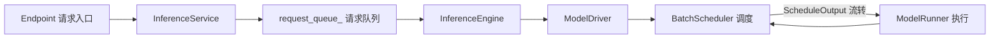
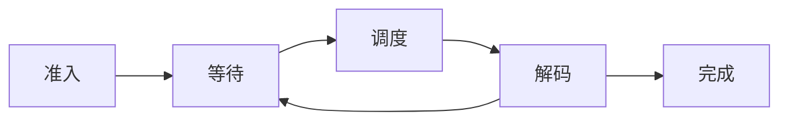
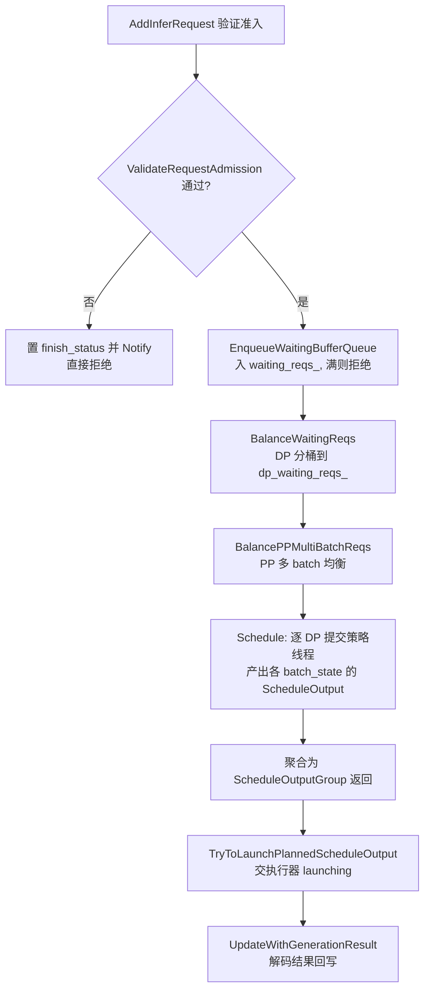
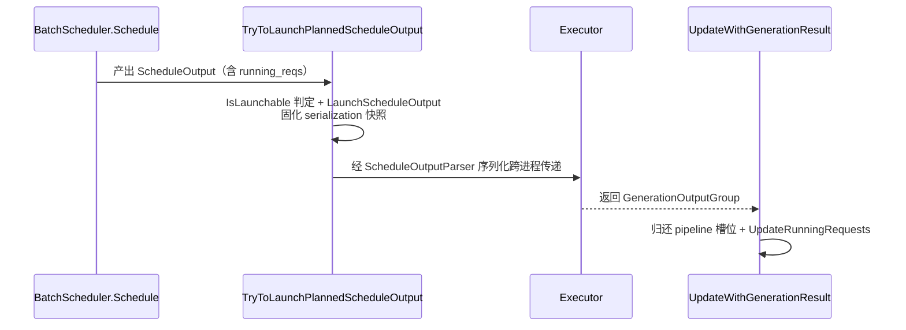
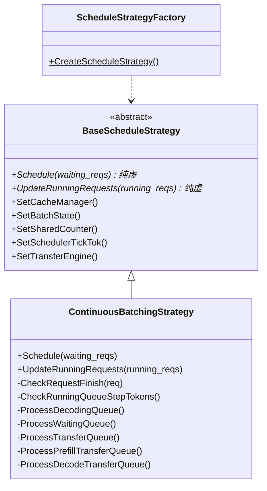
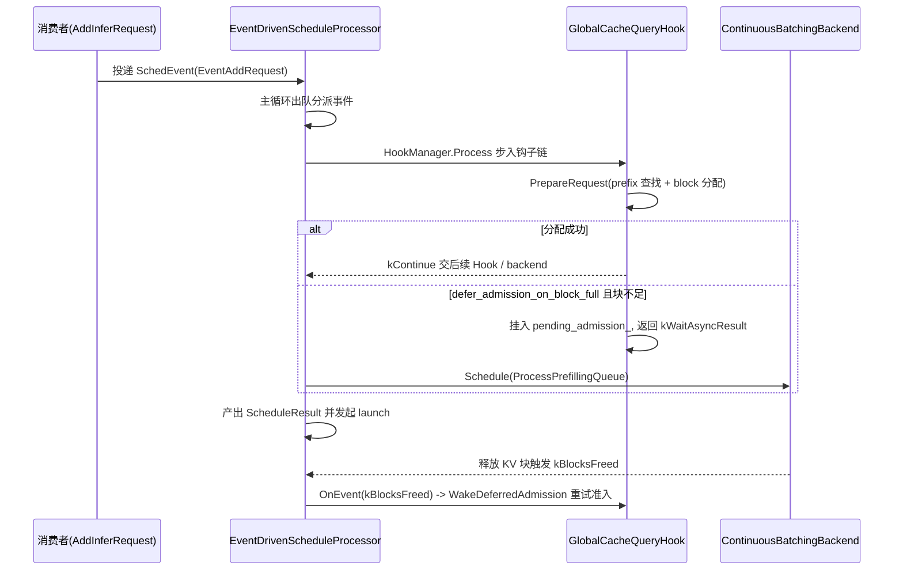
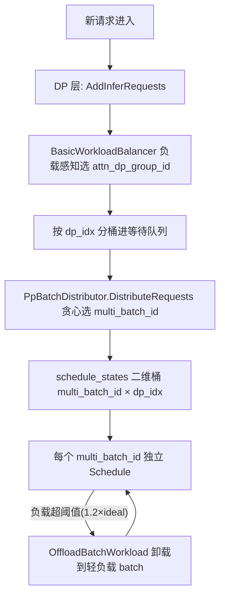
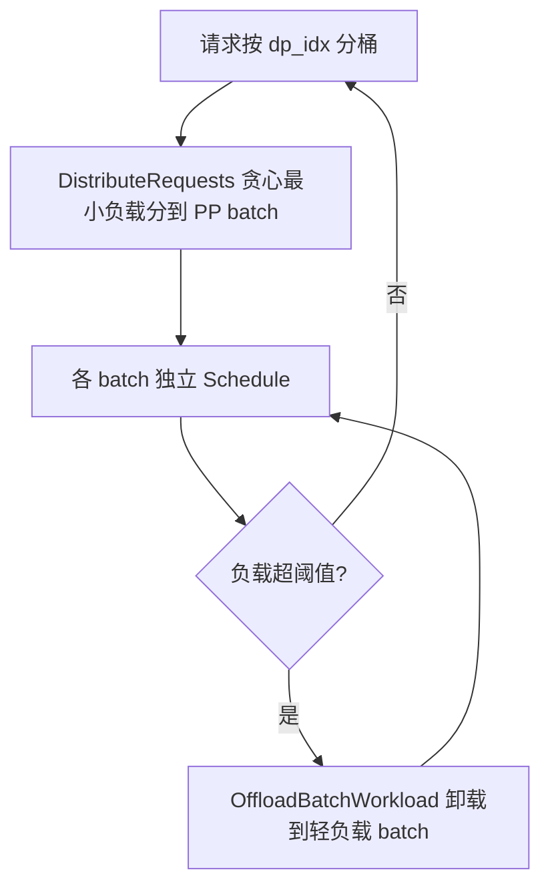

# 批量调度与动态 Batching

> 本文档为 KsanaLLM 推理主链路「引擎 → 调度 → 执行器」中的调度环节总领篇。从 `BatchScheduler` 的请求准入、状态矩阵、`ScheduleOutput` 契约，到动态 Batching 的两套调度实现（ContinuousBatching / EDS）与 DP/PP 两级负载均衡，逐一打通调度主链。与《调度流程与状态机》《调度策略与负载均衡》两个子文档形成「全局纵览 + 局部深入」的互补关系。
>
> **链路定位**：Endpoint → InferenceService → request_queue_ → InferenceEngine → ModelDriver → **BatchScheduler** → ModelRunner。

---

# 1 调度：动态 Batching 的核心位置

## 1.1 一句话定位

调度是推理主链路的承上启下环节，位于**引擎与执行器之间**：上游把请求送入调度器，调度器产出的批次再交给执行层运行。

其中 `BatchScheduler` 是主链路中的调度核心：它从推理引擎侧接收就绪请求，组织成批次后把结果（`ScheduleOutput`）流转给 `ModelRunner` 执行，执行完成后又反馈回调度器以驱动下一轮。

| 角色 | 组件 |
| --- | --- |
| 调度核心 | `BatchScheduler` |
| 调度产出 | `ScheduleOutput`（流转给执行层） |

## 1.2 为什么需要动态 Batching

单请求无法占满 GPU 算力，多请求并发能显著提升吞吐。不同请求通常处于不同生命阶段：有的做 Prefill，有的在逐 token 做 Decode。

静态 batching 需要整批请求同时开始、同时结束，请求长短不齐时会留空、浪费时间。动态 Batching 把处于不同阶段的 token 动态合并进同一批次，让 GPU 始终向上填充，进而提升利用率。

## 1.3 continuous batching 概念

与「整批启动、整批结束」的静态批处理不同，continuous batching 不等整批结束：

- 请求可动态进入或退出 batch；
- 每一步调度都会重新组织批次；
- 新请求可插入当前正在运行的批次中。

## 1.4 请求生命周期宏观概念

一个请求在调度层大致经历五个阶段：

- **准入**：请求进入调度器并接受判定；
- **等待**：未进入运行批次的请求在队列中等待；
- **调度**：调度器把请求组织进批次并产出 `ScheduleOutput`；
- **解码**：批次被 `ModelRunner` 执行，逐步生成 token；
- **完成**：达到终止条件，请求离开批次。

准入的具体策略与调度产出的细节属第 2 章内容，本章仅做定位与概念铺垫。

**Sources:** <ref_code path="csrc/batch_scheduler/batch_scheduler.h" />

# 2 BatchScheduler 主流程与 ScheduleOutput 契约

## 2.1 总体定位

`BatchScheduler` 是动态 Batching 的调度核心，实现 `BatchSchedulerInterface` 抽象接口。它把「请求准入入队 → 负载均衡 → 调度产出 → 结果回写」串成一条完整主链，是第 3、4 章所讲调度策略与负载均衡器的上级联动方。

主链涉及如下方法（均可在 `batch_scheduler.h` 中定位）：

- 准入与入队：`AddInferRequest` / `EnqueueWaitingBufferQueue`
- 两级负载均衡：`BalanceWaitingReqs`（DP） / `BalancePPMultiBatchReqs`（PP）
- 调度产出：`Schedule(size_t multi_batch_id)`
- 结果契约：`TryToLaunchPlannedScheduleOutput` / `UpdateWithGenerationResult`
- 状态查询：`IsIdle` / `WaitUntilHaveReqs`；生命周期：`Stop`

## 2.2 状态矩阵与三类队列

调度器按 `[dp_idx][multi_batch_id]` 组织一张 `batch_states_` 状态矩阵，每个单元是一个 `BatchState`。矩阵维度在构造函数中初始化：`dp_num_ = attn_data_parallel_size`（DP 数），`pp_batch_num_` 取 `max_pp_batch_num`（PP 多 batch 数）。

| 概念 | 说明 |
| --- | --- |
| `batch_states_[dp_idx][multi_batch_id]` | 每个格点保存一个 `std::shared_ptr<BatchState>` |
| `dp_waiting_reqs_[dp_idx]` | DP 分桶后的等待请求，按 DP 维度组织 |
| `ScheduleOutput` | 从 `schedule_output_pool_->GetFreeScheduleOutput()` 取出的池化缓冲，供调度回填 |

`BatchState` 围绕三类队列做状态管理，另有 `mock_queue` 兜底（当无请求时为让 attn 至少有一个请求而注入 Mock 请求）：

- `waiting_queue`：待调度的等待请求。
- `decoding_queue`：在解（解码）请求。
- `transfer_queue`：KV 迁移队列（prefill-decode 分离场景）。
- `mock_queue`：Mock 请求队列，保证总有可 launch 的请求。

三类队列共享同一 `queue_mutex` 保护，并用 `step_sched_finish` 标记当前调度步是否完成。

## 2.3 准入、入队与两级均衡

`AddInferRequest` 先调用 `ValidateRequestAdmission` 做无副作用的公共字段校验（定义于 `request_admission.h`，准入语义由调用方负责）；失败则置 `finish_status`、`finished=true` 并 `Notify()`。通过后调用 `EnqueueWaitingBufferQueue` 进入总等待队列 `waiting_reqs_`，若队满则按 `RET_EXCEED_CAPACITY` 拒绝。

- `BalanceWaitingReqs`：按 DP 分桶。将请求按待算 token 数加权落入 `dp_waiting_reqs_`，负载按估算权重交 `BalanceReqsAlgo` 分配入各 DP 桶。ADP 均衡开启时改走 `BalanceADPRequests`（含 `CalculatePrefillWorkload` / `UpdateQPS`）。
- `BalancePPMultiBatchReqs`：通过 `PPMultibatchWorkloadBalancer` 在 PP 多 batch 之间二次均衡。

`Schedule(multi_batch_id)` 持锁执行两级均衡后，把 `dp_waiting_reqs_[i]` 交给每 DP 的 `BaseScheduleStrategy`（经线程池并行）产出本格的 `ScheduleOutput`，聚合为 `schedule_output_group_` 返回（详见第 3 章策略）。

## 2.4 ScheduleOutput 契约

`ScheduleOutput` 是调度与执行之间的核心交付物。`BatchState` 用池化对象 `schedule_output`，成员含 `running_reqs`、`finish_req_ids`、`recompute_req_ids` 等。

- `TryToLaunchPlannedScheduleOutput`：先经 `schedule_mutex_` 检查深度，按 `IsLaunchable(max_depth)` 决定能否再推一个 inflight 任务；随后 `LaunchScheduleOutput` 固化 serialization 快照，供异步 IPC 序列化使用。
- `UpdateWithGenerationResult`：并行 step 行解码结果（`GenerationOutputGroup`）回写，先归还流水线槽位再调用 `UpdateRunningRequests`。
- `ScheduleOutputParser`：`SerializeScheduleOutput` / `DeserializeScheduleOutput` 负责跨进程（Engine→Executor）传递 `ScheduleOutput`；`ScheduleOutputPool` 提供对象池与收发缓冲。

## 2.5 步级同步与 build-ahead 深度

- `SchedulerSharedCounter`：step 级共享计数，含 `step_batch_size`、`step_token_num`、`step_logits_num`，用自旋锁递增/递减。
- `SchedulerTickTok`：有序锁/屏障，多个 DP 线程按 `visit_order_` 次序进入临界区，支持 `Skip`、`Reorder`、`Barrier` 与 `Reset`。
- build-ahead 深度：`executor_pipeline_depth_` 记录在途未回流的 schedule 数，`kExecutorPipelineMaxDepth = 2`（对齐 ModelInput 双 slot）；`TryToLaunch` 中 `++`、`UpdateWithGenerationResult` 中 `--` 配对。fast path 时 `max_depth=2`，否则 `max_depth=1`（slow path）。

边界说明：`ContinuousBatchingStrategy` / EDS 及均衡器实现细节由第 3、4 章及子文档展开，本章只讲 `BatchScheduler` 骨架与三类队列状态管理。

**Sources:** <ref_code path="csrc/batch_scheduler/batch_scheduler.h"/> <ref_code path="csrc/batch_scheduler/state/batch_state.h"/> <ref_code path="csrc/batch_scheduler/state/scheduler_shared_counter.h"/> <ref_code path="csrc/batch_scheduler/state/scheduler_tick_tok.h"/> <ref_code path="csrc/batch_scheduler/request_admission.h"/> <ref_code path="csrc/batch_scheduler/batch_scheduler_balance_reqs_algo.h"/> <ref_code path="csrc/batch_scheduler/schedule_processor.h"/>

# 3 动态 Batching 与两类调度实现：ContinuousBatching 与 EDS

## 3.1 两个视角，同一职责

第2章 `BatchScheduler::Schedule` 交由「调度策略」产出 `ScheduleOutput`，而这一职责在 KsanaLLM 存在两套实现：经典连续批处理状态机与事件驱动调度器 EDS。二者面向同一调度目标——在同一调度步内协调 prefill/decode、约束 batch 与 token 资源、回收 finished 请求——但架构范式截然不同。

| 维度 | `ContinuousBatchingStrategy`（经典状态机） | EDS（事件 + 钩子链） |
| --- | --- | --- |
| 运行模型 | 每 DP 一个策略实例，多线程并行步进 | 单主线程 + `BlockingQueue<SchedEvent>` 事件队列 |
| 调度入口 | `BaseScheduleStrategy::Schedule(waiting_reqs)` | 事件队列 + 事件分派 |
| 请求流转 | 三类队列 `waiting/decoding/transfer` | `ProcessingBatch` 内的 preprocess/prefill/decode 三阶段 |
| 扩展方式 | 继承/覆写策略子类 | `ScheduleHookInterface` 责任链条挂接 |
| 状态结构 | `BatchState` + `ScheduleOutput` | `PlanningBatch/DpBatch/ScheduleState` |

## 3.2 经典连续批处理状态机

`BaseScheduleStrategy` 是抽象基类：以两个纯虚方法 `Schedule` 与 `UpdateRunningRequests` 定义调度契约，并注入系列依赖（`SetBatchState`、`SetCacheManager`、`SetSharedCounter`、`SetSchedulerTickTok`、`SetTransferEngine`），供子类读取队列、缓存与步级同步设施。

`ContinuousBatchingStrategy` 是默认实现。`Schedule` 协调整个批处理：先是 `CheckRequestFinish`/`CheckRequestTimeout` 清理终止请求，再经 `CheckRunningQueueStepTokens` 以 `dp_max_step_token_num_`/`dp_max_batch_size_`/`dp_max_logits_num_` 约束资源回填可调度请求，最后 `ProcessWaitingQueue`/`ProcessDecodingQueue`/`ProcessTransferQueue` 流转请求。PD（prefill-decode）分离下另有 `ProcessPrefillTransferQueue`/`ProcessDecodeTransferQueue` 处理 KV 传输队列。

`ScheduleStrategyFactory::CreateScheduleStrategy` 依据配置 `schedule_strategy == CONTINUOUS_BATCHING` 实例化 `ContinuousBatchingStrategy`，返回 `std::shared_ptr<BaseScheduleStrategy>`。

## 3.3 事件驱动调度器 EDS 骨架

| 角色 | 组件 | 说明 |
| --- | --- | --- |
| 处理器 | `EventDrivenScheduleProcessor` | 主线程从事件队列取出事件并分派，管理请求全生命周期 |
| 后端 | `ContinuousBatchingBackend` | 规划 `decoding_reqs`/`prefilling_reqs`，全部 Dp 可 launch 时合并写入 `schedule_output->running_reqs`；`ScanAbortedPreprocessingReqs` 收拾取消请求 |
| 钩子链 | `ScheduleHookManager` / `ScheduleHookInterface` | 按 hook 顺序调用 `Process`/`UpdateAsyncResult`，`NextStepAction`（`kContinue`/`kWaitAsyncResult`/`kFailAndEnd`）指引请求下一步 |
| 事件类型 | `SchedEventType` / `HookEventType` | 定义于 `event_driven_types.h` |

## 3.4 全局缓存查询钩子 GlobalCacheQueryHook

`GlobalCacheQueryHook` 是 `ScheduleHookInterface` 的实现，在 `AddRequest` 时对请求执行前缀缓存查找 + block 分配 + 全局缓存异步查询（内存/块细节归缓存章节）。

- 分配失败时的策略由 `defer_admission_on_block_full_` 决定：`false`（V1/非 pd_v2）返回 `kContinue` 回退到后端自行重分配；`true`（pd_v2 Decode）将请求挂入 `pending_admission_` 队列并返回 `kWaitAsyncResult`。
- `max_inflight_reqs_` 以「已准入未离场」的请求集合 `in_flight_admitted_`（`kRequestExited` 事件触发 `ReleaseInflightSlot`）划定并发上限，防止 awaiting-prefill backlog 抽干 KV 池。
- `OnEvent(kBlocksFreed)` → `WakeDeferredAdmission`：EDS 释放块后投递 sentinel 事件，由主线程重跑完整准入（re-match + alloc）。

`event_driven_state.h` 提供规划数据结构：`PlanningBatch`（跨多 DP 的已规划批次）、`DpBatch`（单 DP 运行集与 step token/logits 计数）、`ScheduleState`（`schedule_states[multi_batch_id][dp_idx]` 矩阵与请求映射）。`ScheduleContext` 是钩子与调度器共享的上下文，承载上述状态与缓存管理器的只读访问。

两视角本质是同一调度职责的两套实现：状态机以 `waiting/decoding/transfer` 队列 + 方法调用推进，EDS 以事件队列 + 钩子责任链推进；后者把「准入→规划→产出→回写」拆成可插拔节点，代价是调度主循环变为单线程串行。

**Sources:** <ref_code path="csrc/batch_scheduler/strategy/base_strategy.h"/> <ref_code path="csrc/batch_scheduler/strategy/continuous_batching.h"/> <ref_code path="csrc/batch_scheduler/strategy/strategy_factory.h"/> <ref_code path="csrc/batch_scheduler/event_driven_scheduler/event_driven_schedule_processor.h"/> <ref_code path="csrc/batch_scheduler/event_driven_scheduler/continuous_batching_backend.h"/> <ref_code path="csrc/batch_scheduler/event_driven_scheduler/schedule_hook_manager.h"/> <ref_code path="csrc/batch_scheduler/event_driven_scheduler/schedule_hook_interface.h"/> <ref_code path="csrc/batch_scheduler/event_driven_scheduler/global_cache_query_hook.h"/> <ref_code path="csrc/batch_scheduler/event_driven_scheduler/event_driven_types.h"/> <ref_code path="csrc/batch_scheduler/event_driven_scheduler/event_driven_state.h"/> <ref_code path="csrc/batch_scheduler/event_driven_scheduler/schedule_context.h"/>

# 4 DP 与 PP 两级负载均衡

## 4.1 两级均衡的职责划分

在多 DP/PP 并行下，多机多卡常面临算力不均：某个 DP 或某个 PP batch 负载过高而其余闲置，会拖慢整体吞吐、拉低 GPU 利用率。调度器以「DP 与 PP 两级」协同做负载均衡，保证每台 GPU 上的请求 **不重不漏**、各自均衡：

- **DP 层**：决定请求进入哪个 DP（`attn_dp_group_id`），保证算力并行时各 DP 分配均衡；
- **PP 层**：决定请求归属哪个 PP batch（`multi_batch_id`），让同一 DP 下各 batch 工作量均衡；
- 两级先 DP 后 PP：DP 分配发生在 PP batch 分配之前，因此 DP 层统计的是跨全部 PP batch 的全局负载。

| 维度 | DP 均衡器 | PP 均衡器 |
| --- | --- | --- |
| 核心接口/类 | `WorkloadBalancerInterface` / `BasicWorkloadBalancer` | `PpBatchDistributor` / `PPMultibatchWorkloadBalancer` |
| 分配对象 | DP 组 id（`attn_dp_group_id`） | PP 多 batch id（`multi_batch_id`） |
| 算法 | 负载感知 + 轮询兜底 | 贪心最小工作量 |
| 存在时机 | 每轮调度（含 round-1/round-2） | 请求入站分配 + 运行中动态卸载 |

## 4.2 DP 层：WorkloadBalancer 抽象

`WorkloadBalancerInterface` 定义了 DP 均衡器四个纯接口：`AddInferRequests` 为入站请求分派 `attn_dp_group_id`；`GetDpSchedulingOrderAndQuota` 产出 `WorkloadQuota`（dp_idx + step_token_limit）并决定 DP 调度顺序；`RecordInflightBatch` 在批次落执行后记录在途负载；`IsRequestAcceptable` 做资源与配额校验。

**BasicWorkloadBalancer**（EDS 默认）按负载感知分配：

- `AddInferRequests`：遍历各 PP batch 累加每个 DP 的请求数得到全局 `dp_req_loads`，把新请求分给负载最小的 DP，负载相同时按轮询距离兜底；
- `GetDpSchedulingOrderAndQuota`：以 `running_step_token_num` 升序排序各 DP，先发保守小配额再统一补发大配额，让 head DP 不独占全局 step-token 预算；
- `RecordInflightBatch`：维护 `inflight_dp_loads_`，为在途 DP 负载记账；
- `IsRequestAcceptable`：依次校验整批请求数（`max_batch_size_`）、每 DP logits 数（`dp_max_logits_num_`）、每 DP 配额与全局单步 token 上限（`max_step_token_num_`）。

**ModelPerfWorkloadBalancer** 是 ModelPerfBackend 专用实现：`SubmitBatch` 时 `attn_dp_group_id` 已由后端写死，因此 `AddInferRequests` 直接透传不重写，`GetDpSchedulingOrderAndQuota` 返回全 `INT_MAX` 配额，`RecordInflightBatch` 为 no-op，`IsRequestAcceptable` 恒为 true（其运行集合由 ModelPerfBackend 自行控制）。

## 4.3 PP 层：贪心最小工作量分配

`PpBatchDistributor`（事件驱动调度器）与 `PPMultibatchWorkloadBalancer`（传统调度器）分别承担入站与多 batch 的 PP 负载均衡，核心是 **贪心最小工作量**：

- `DistributeRequests`（PpBatchDistributor）：按 `CalculateWorkload` 计算每个 (multi_batch_id, dp_idx) 槽位负载，用 `CalculateSlotWorkload` 汇总全局各 batch 负载，为请求选择最小负载 `multi_batch_id` 并写入 `schedule_states_[multi_batch_id][dp_idx]`；
- `CalculateWorkload`（PPMultibatchWorkloadBalancer）：按策略折算工作量，token 类策略以请求 token 折算、其余按 batch/请求个数计；
- `BalancePPMultiBatchReqs`：先 `DistributeWaitingReqs` 把等待请求按贪心分给最小负载 batch，再在非 `NO_DYNAMIC_WB` 策略下触发 `OffloadBatchWorkload`；
- `OffloadBatchWorkload`：当目标 batch 工作量超过理想负载（总量/批次）× `threshold_factor`（默认 1.2）时，优先从 waiting_queue（不足再从 decoding_queue 尾部）迁出负载，交 `DistributeWaitingReqs`/`DistributeDecodingReqs` 派发给其它 batch。

## 4.4 两级的整体关系

两级均衡重组了调度主流程：DP 层先把等待请求按 `dp_idx` 分桶，PP 层再在各 DP 桶内按 `multi_batch_id` 贪心分配，形成 `schedule_states[multi_batch_id][dp_idx]` 的二维布局，随后各 batch 独立执行调度。

其意义在于：DP 均衡保持显存/Kernel 单步预算在每个 DP 内充分利用，PP 均衡避免个别 batch 成为瓶颈、同时让 `OffloadBatchWorkload` 的动态卸载维持运行期吞吐稳定。两级配合既保证 GPU 利用率向上填充，又不打破「每请求只属一个 DP、一个 PP batch」的不重不漏约束。

**Sources:**
<ref_code path="csrc/batch_scheduler/event_driven_scheduler/workload_balance/workload_balancer_interface.h" />
<ref_code path="csrc/batch_scheduler/event_driven_scheduler/workload_balance/basic_workload_balancer.h" />
<ref_code path="csrc/batch_scheduler/event_driven_scheduler/workload_balance/pp_batch_distributor.h" />
<ref_code path="csrc/batch_scheduler/workload_balance/pp_multibatch_balancer.h" />
<ref_code path="csrc/batch_scheduler/event_driven_scheduler/model_perf/model_perf_workload_balancer.h" />
<ref_code path="csrc/batch_scheduler/batch_scheduler_balance_reqs_algo.h" />

# 5 扩展机制与调度边界

## 5.1 BatchSchedulerInterface：调度器抽象

调度层向上层（推理引擎、`ScheduleProcessor`）暴露统一接口 `BatchSchedulerInterface`，屏蔽不同调度实现的具体差异。

- 核心方法：`Schedule(multi_batch_id)` 取下一批就绪请求、`UpdateWithGenerationResult` 回填生成结果、`AddInferRequest` 加入等待队列；
- `IsIdle` / `WaitUntilHaveReqs` 提供调度器空闲与等待语义；
- `Stop` 终止调度循环，`SetCacheManager` / `GetCacheManager` 注入缓存管理器。

`BatchScheduler`（continuation batching 路径）与事件驱动调度器均实现该接口，上层通过接口替换或扩展调度器而不改动调用侧。

## 5.2 StrategyFactory：按需创建策略

`ScheduleStrategyFactory::CreateScheduleStrategy` 依据配置创建具体调度策略，返回 `BaseScheduleStrategy`。

| 配置 | 创建产物 |
| --- | --- |
| `CONTINUOUS_BATCHING` | `ContinuousBatchingStrategy` |
| 其他 | 返回空（未支持） |

`BaseScheduleStrategy` 是策略统一基类：`Schedule` 产出结果，并提供 `SetBatchState` / `SetCacheManager` / `SetTransferEngine` 等注入点，便于对接缓存与传输引擎。

## 5.3 ScheduleHookManager：EDS 钩子责任链

事件驱动调度器的扩展点是一条 Hook 责任链，`ScheduleHookManager` 按注册顺序持有并调用各 Hook，`ScheduleHookInterface` 定义单个 Hook。

- `Process`：同步处理一批请求，按 `req_id` 返回下一步指引 `NextStep`（`kContinue` / `kWaitAsyncResult` / `kFailAndEnd`）；
- `UpdateAsyncResult`：异步任务完成时的回调入口，支持从中间环节继续推进；
- `OnEvent`：通用事件广播（`kBlocksFreed` / `kRequestExited`），各 Hook 只处理自己关心的事件。

典型接入：`GlobalCacheQueryHook` 在准入时做前缀缓存查询与 block 分配、KV 不足时挂起等待 `kBlocksFreed` 重试，并维持 in-flight 并发上限。超时停止、异步任务完成等逻辑同样以 Hook 形式插入链上，保持调度主流程不变。

## 5.4 调度结果与下游执行器衔接

`ScheduleOutputParser` 相关的合并逻辑集中在 `schedule_output_process.h`：

- `MergeScheduleOutputGroupRunningRequests` 聚合组内运行请求；
- `MergeScheduleInfoForWorkers` 把多路 `ScheduleOutput` 合并为一路下发给各 worker。

调度结果经 IPC 传输：`DispatchScheduleOutput` 系列函数把 `ScheduleOutput` 序列化并投递到执行器侧 `BlockingQueue`，由执行器消费。

## 5.5 调度状态上报

`BatchScheduler` 内部维护 `ReportBatchState`（按 DP 上报批次状态）与 `ReportTotalState`（上报全实例总览），供监控侧采集调度负载；事件驱动路径对应状态上报，并可通过负载统计快照对外暴露负载指标。

## 5.6 核心类与文件索引

| 核心类/接口 | 文件 |
| --- | --- |
| `BatchSchedulerInterface` | csrc/batch_scheduler/batch_scheduler_interface.h |
| `BatchScheduler` | csrc/batch_scheduler/batch_scheduler.h |
| `ScheduleStrategyFactory` | csrc/batch_scheduler/strategy/strategy_factory.h |
| `BaseScheduleStrategy` | csrc/batch_scheduler/strategy/base_strategy.h |
| `ScheduleHookManager` | csrc/batch_scheduler/event_driven_scheduler/schedule_hook_manager.h |
| `ScheduleHookInterface` | csrc/batch_scheduler/event_driven_scheduler/schedule_hook_interface.h |
| `GlobalCacheQueryHook` | csrc/batch_scheduler/event_driven_scheduler/global_cache_query_hook.h |
| `ScheduleOutputProcessor` 合并函数 | csrc/batch_scheduler/schedule_output_process.h |
| `DispatchScheduleOutput*` | csrc/ipc/functions/dispatch_schdule_output.h |

**Sources:**
<ref_code path="csrc/batch_scheduler/batch_scheduler_interface.h" />
<ref_code path="csrc/batch_scheduler/batch_scheduler.h" />
<ref_code path="csrc/batch_scheduler/strategy/strategy_factory.h" />
<ref_code path="csrc/batch_scheduler/strategy/base_strategy.h" />
<ref_code path="csrc/batch_scheduler/event_driven_scheduler/schedule_hook_manager.h" />
<ref_code path="csrc/batch_scheduler/event_driven_scheduler/schedule_hook_interface.h" />
<ref_code path="csrc/batch_scheduler/event_driven_scheduler/global_cache_query_hook.h" />
<ref_code path="csrc/batch_scheduler/schedule_output_process.h" />
<ref_code path="csrc/ipc/functions/dispatch_schdule_output.h" />