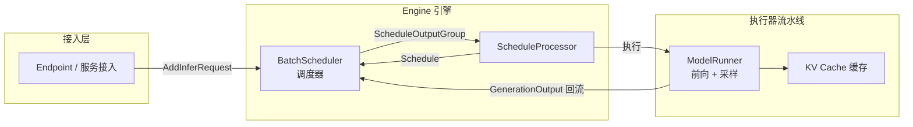
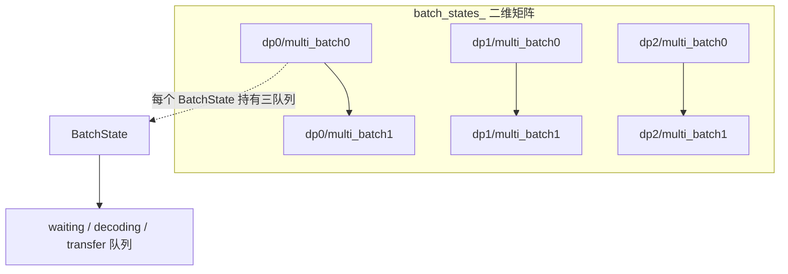
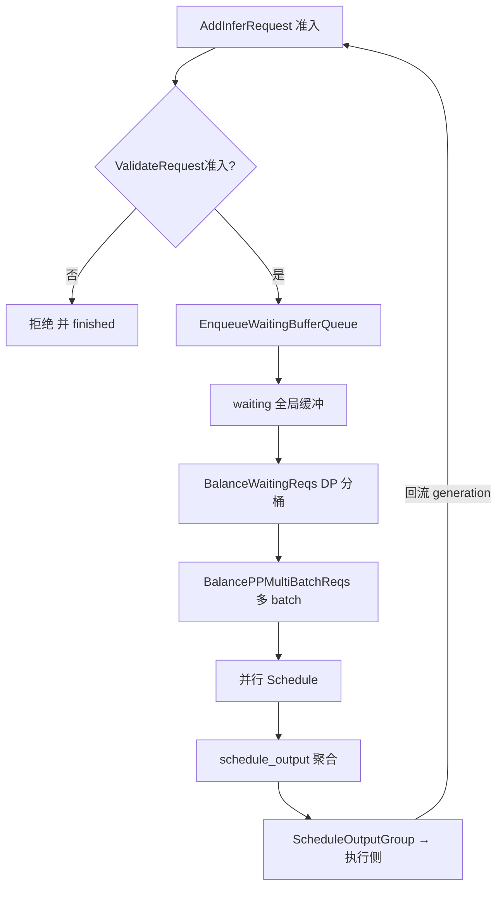
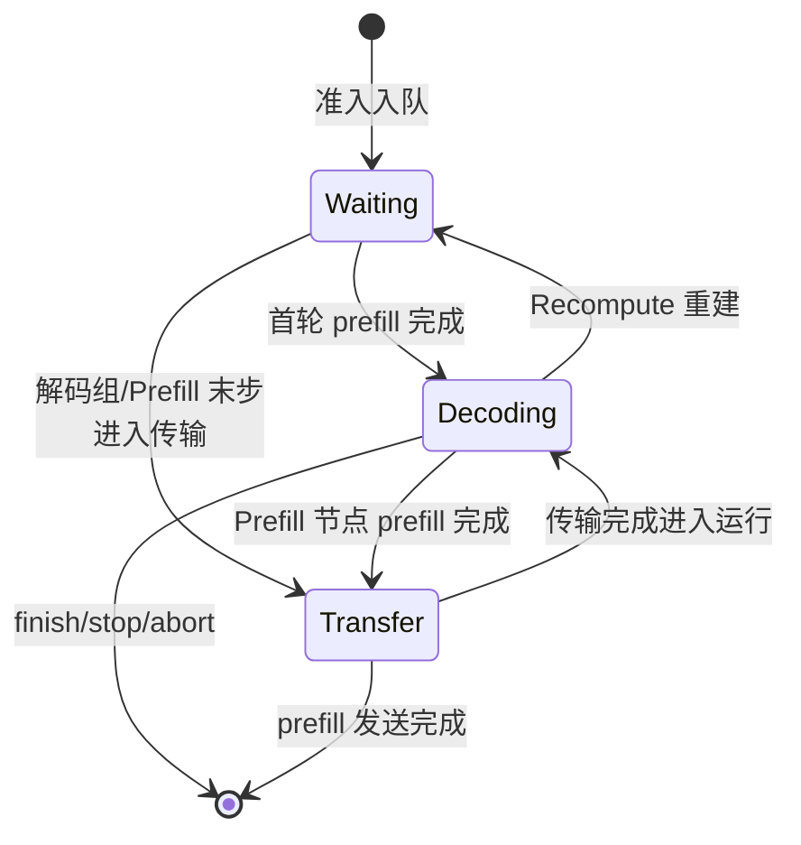
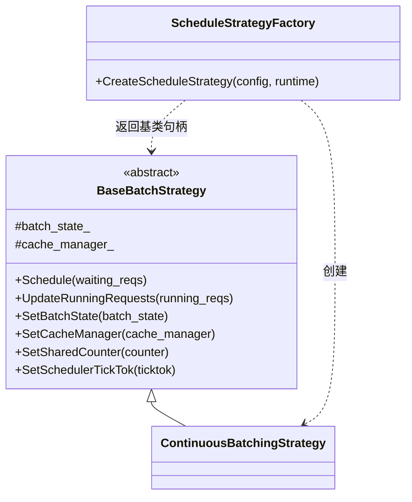

# 调度流程与状态机

## 1. 概述：调度器在推理链路中的位置

KsanaLLM 的推理引擎是一条分层解耦的异步管道，`BatchScheduler` 位于 Engine 与 Executor 之间的枢纽位置，负责把准入的请求聚合成 batch、为每一轮前向决定"批多大、跑哪些请求、产出什么"，是动态 Batching + 前缀缓存 + DP/PP 负载均衡的统合调度中心。本章先给出调度器在整条链路中的定位与职责边界，再给出本文的阅读地图，最后用 `batch_states_` 索引矩阵建立"一个调度器管理多张状态表"的初始印象。

### 1.1 链路定位

调度器夹在两层之间：上游是服务接入与引擎初始化（Endpoint→Engine），下游是 Executor 的模型前向与采样。调度以 **Schedule-Execute 循环**运转：`ScheduleProcessor` 驱动的调度线程调用 `BatchScheduler::Schedule()` 产出 `ScheduleOutputGroup`，经 `ScheduleProcessor` 提交给执行侧；执行在前向、采样完成后通过 `UpdateWithGenerationResult` 把**生成结果回流**给调度器，进入下一轮调度。

- **谁产出 → 谁消费**：Engine/接入层产出 `AddInferRequest`，调度器消费并回 Scheduling；调度器产出 `ScheduleOutputGroup`，`ScheduleProcessor` 消费并提交执行；执行回流 `UpdateWithGenerationResult`，调度再次消费。整条依赖单向、闭环流转。

### 1.2 本文覆盖范围与阅读地图

本文聚焦调度主流程、三队列状态机、`ScheduleOutput` 契约与策略工厂，总计 5 章：

| 章节 | 主题 | 阅读目标 |
| --- | --- | --- |
| 第 2 章 | 请求从准入到调度的主流程 | 一条请求如何在多 DP / 多 batch 维度走完一个调度周期 |
| 第 3 章 | BatchState 三队列状态机 | 请求在等待/解码/传输队列间如何迁移 |
| 第 4 章 | ScheduleOutput 契约与产出 | 调度→执行之间传递什么数据、如何组装 |
| 第 5 章 | 策略器创建工厂 | 调度策略器如何被工厂实例化并注入运行时对象 |

负载均衡算法、批处理与 EDS 事件驱动钩子、IPC 跨进程序列化、执行/采样细节由同级文档覆盖，本文仅在衔接点标注角色，不做展开。

### 1.3 索引矩阵：batch_states_ 的一瞥

调度器内部用 `batch_states_[dp_idx][multi_batch_id]` 二维矩阵组织状态，第一维对应 DP 组（`attn_data_parallel_size`），第二维对应 pipeline-parallel 多 batch 缓冲。

每个 `dp_idx` 持有 `schedule_strategies_[dp_idx]` 对应一个调度策略器，`pp_batch_num_` 决定第二维的尺寸。这样一个 `Schedule(multi_batch_id)` 调用在 threadpool 中并行驱动全部 DP 组，各自作用于自己的 `batch_state`。

**Sources:** <ref_code path="csrc/batch_scheduler/batch_scheduler.h" /> <ref_code path="csrc/batch_scheduler/state/batch_state.h" /> <ref_code path="csrc/batch_scheduler/batch_scheduler.cpp" />

## 2. 请求从准入到调度的主流程

一次调度周期以一条请求的准入为起点，经 Enqueue、Balance（DP 分桶）、BalancePP（PP 多 batch 平衡）、Schedule 四步到达策略产出。核心结论：**AddInferRequest 只做准入 + 入全局缓冲，真正把请求分配到 batch 的是 Schedule 内部的 Balance + strategy 子流程**，多 DP 组在多 batch 上并行推进。

| 阶段 | 对应方法 | 职责 | 产出 |
| --- | --- | --- | --- |
| 准入 | `BatchScheduler::AddInferRequest`(<ref_code path="csrc/batch_scheduler/batch_scheduler.cpp" lines="125-147" />) | 校验请求合法性与容量 | 通过则入队 |
| 入队 | `EnqueueWaitingBufferQueue`(同上 <ref_code path="csrc/batch_scheduler/batch_scheduler.cpp" />) | 写入全局 waiting_reqs_ | 组 ID 入 waiting_reqs_ |
| DP 分桶 | `BalanceWaitingReqs` (<ref_code path="csrc/batch_scheduler/batch_scheduler.cpp" />) | 按负载把 waiting_reqs_ 分到 dp_waiting_reqs_ | dp_waiting_reqs_ |
| PP 平衡 | `BalancePPMultiBatchReqs` (<ref_code path="csrc/batch_scheduler/batch_scheduler.cpp" />) | DP 内多 PP batch 均衡 | 多 batch 各自就绪 |
| 调度 | `BatchScheduler::Schedule` (<ref_code path="csrc/batch_scheduler/batch_scheduler.h" />) | 并行各 DP 策略 | ScheduleOutputGroup |

### 2.1 准入与入队

`AddInferRequest`(<ref_code path="csrc/batch_scheduler/batch_scheduler.cpp" lines="125-147" />) 首先调用 `ValidateRequestAdmission`(<ref_code path="csrc/batch_scheduler/request_admission.h" />) 做无副作用的准入校验；失败则直接置 finished 并回流，成功才进入 `EnqueueWaitingBufferQueue`。入队时为每个请求初始化输出 token（`output_tokens = input_tokens`）、`ResetPrefillingTokens()` 后追加到 `waiting_reqs_`，若缓冲已满触发 `RET_EXCEED_CAPACITY` 拒绝。

### 2.2 Schedule 中的 Balance 衔接

`BatchScheduler::Schedule()` 在调度前先执行两个平衡步骤：

- `BalanceWaitingReqs()`：把 `waiting_reqs_` 中的请求按 token 量打标（`forwarding_tokens 或 input_tokens 减 kv_cached_token_num`），再依据每 DP 的 running + waiting 负载权重，交给 `BalanceReqsAlgo` 分配到 `dp_waiting_reqs_`。
- `BalancePPMultiBatchReqs(multi_batch_id)`：当 DP 内存在多个 PP batch 时，由 `PPMultibatchWorkloadBalancer` 把对应 DP 的待调度请求在多 batch 间再做一次均衡。

随后在主线程不放 `schedule_mutex_` 的情况下，通过 `threadpool_` 并行对每个 DP 提交策略调用：`SetBatchState(dp 的 batch_state)` + `Schedule(dp_waiting_reqs_[i])`，并用 `future.wait()` 等待所有 DP 这一轮完成。

### 2.3 产出的总览

每个 DP 的策略把结果写回各自 `batch_state->schedule_output`，`Schedule()` 把它们聚合成共享的 `schedule_output_group_->outputs[dp]`（`schedule_id` 自增）返回给 `BatchSchedulerInterface` 的调用方。调用方 `ScheduleProcessor` 再接续 merge running_reqs、`BuildFromScheduleOutputGroup` 等步骤交给执行侧。

**Sources:** <ref_code path="csrc/batch_scheduler/batch_scheduler.cpp" /> <ref_code path="csrc/batch_scheduler/batch_scheduler_interface.h" /> <ref_code path="csrc/batch_scheduler/request_admission.h" /> <ref_code path="csrc/batch_scheduler/schedule_processor.cpp" />

## 3. 状态机：BatchState 与等待/解码/传输三类队列

`BatchState`(<ref_code path="csrc/batch_scheduler/state/batch_state.h" />) 是调度状态的核心载体，持有单个 DP×multi-batch 格子的多批次 ID、调度配置与三类请求队列。核心结论：**同一请求在 waiting → decoding → transfer 三队列间的迁移由调度产出、生成结果回流、传输完成三类事件驱动**，且在 DP 之间需经 `SchedulerSharedCounter` / `SchedulerTickTok` 协同保证全局 batch / token 上限不被突破。

### 3.1 结构与二维组织

`batch_state.h` 中 `BatchState` 的字段按职责分组：

| 字段 | 用途 |
| --- | --- |
| `multi_batch_id_` / `batch_scheduler_config_` | 所属 multi-batch 标识与调度配置 |
| `waiting_queue` / `decoding_queue` / `transfer_queue` | 三类请求队列（均存 `shared_ptr<InferRequest>`） |
| `mock_queue` | 保证 ATTN 至少有一个请求的最小占位队列 |
| `async_stoped_reqs` / `async_recomputed_reqs` | 异步模式下延迟处理的中止/重算请求表 |
| `schedule_output` | 当前轮调度产出（来自 `ScheduleOutputPool`） |
| `queue_mutex` | 保护队列互斥 |
| `schedule_time_in_ms` / `step_sched_finish` | 本轮调度时间戳与是否已完成 |

二维矩阵 `batch_states_[dp][multi_batch_id]` 由构造函数初始化：`dp_num_` 来自 `attn_data_parallel_size`，第二维尺寸为 `pp_batch_num_`（`max_pp_batch_num>0 ? : 1`），每个格子 `make_shared<BatchState>(j, config, pool)` 并向策略 Set 注入共享计数器/有序锁。

### 3.2 三类队列状态机

`ContinuousBatchingStrategy::Schedule()` 按固定顺序处理三队列：先 `ProcessTransferQueue()`，再 `ProcessDecodingQueue()`，最后 `ProcessWaitingQueue()`，并把调度成功的请求放入 `schedule_output->running_reqs`。

- **Waiting → Decoding / Transfer**：`ProcessWaitingQueue` 在通过 batch/token/block 容量检查并 `AllocateRequestBlocks` 成功后，`is_last_prefill_step` 时把请求 push 进 `decoding_queue`（或用 `transfer_queue` 进入 prefill 末步/解码预传输）。
- **Decoding → Running**：`ProcessDecodingQueue` 按步骤限制收集可运行的请求，分配 step block 后写入 `schedule_output->running_reqs`。
- **Decoding → Transfer**：PD 分离下 Prefill 节点 prefill 完成后，请求进入 `transfer_queue` 等待 KV 跨节点传递；Decode 节点经过 `transfer_queue` 预传输后移入运行队列。
- **→ Waiting / Recompute**：`UpdateWithGenerationResult` 回流后，若缓存更新失败或超 step 限制，`RecomputeRequest` 会把请求重新放回 `waiting_queue.begin()` 重建。
- **→ 完成**：`CheckRequestFinish`（EOS / max_output_len / stop strings）、超时、abort 触发 `StopRequest`/`SyncStopRequest` 并写入 `finish_req_ids`。

### 3.3 旁路协同：共享计数器与有序锁

两处旁路机制支撑多 DP 全局约束的一致性：

- `SchedulerSharedCounter`(<ref_code path="csrc/batch_scheduler/state/scheduler_shared_counter.h" />) 提供 `step_batch_size` / `step_token_num` / `step_logits_num`，用 spin lock 保护的 共享计数在 DP 间累加出"全局第 N 步已用 batch / token / logits"。
- `SchedulerTickTok`(<ref_code path="csrc/batch_scheduler/state/scheduler_tick_tok.h" />) 提供 `Lock/Unlock/Skip/Barrier/Reorder` 有序锁与屏障：`CheckRunningQueueStepTokens` 在 `scheduler_ticktok_->Lock()` 内统一读全局计数并 `Increase`，`ProcessWaitingQueue` 用 `Barrier` 做 DP 汇聚、dp0 负责 Reset，`Reorder` 循环调度访问顺序以实现 DP 负载轮转。

> 这两者在调度内部协同，使各 DP 组在推进自身队列时能感知全局预算，避免某个 DP 超额而另一组空转。

**Sources:** <ref_code path="csrc/batch_scheduler/state/batch_state.h" /> <ref_code path="csrc/batch_scheduler/state/scheduler_shared_counter.h" /> <ref_code path="csrc/batch_scheduler/state/scheduler_tick_tok.h" /> <ref_code path="csrc/batch_scheduler/strategy/continuous_batching.cpp" />

## 4. ScheduleOutput 契约与产出

`ScheduleOutput`(<ref_code path="csrc/runtime/schedule_output.h" />) 是调度与执行之间的核心契约对象：策略把"这一轮跑哪些、停哪些、重算哪些、要创建什么生成器"汇总成一份 `ScheduleOutput`，再由 `ScheduleOutputGroup` 按 DP 维度聚合成一个批次结果。核心结论：**这份契约（含 `running_reqs` 状态快照与增量字段）既被 IPC 序列化跨进程传递，也被执行侧当作"本轮前向"的唯一输入**，其中 `InferRequestSerializationSnapshot` 用于固化 Launch 时刻的竞争字段。

### 4.1 契约结构

`ScheduleOutput` 由状态类与增量类字段组成，主要字段如下：

| 字段 | 类型 | 用途 |
| --- | --- | --- |
| `schedule_id` | `size_t` | 调度步序号，跨轮递增 |
| `finish_req_ids` | `vector<vector<int64>>` | 外层按 DP 维，本轮结束的请求 ID |
| `recompute_req_ids` | `vector<vector<int64>>` | 需要重算的请求 ID |
| `running_reqs` | `vector<shared_ptr<InferRequest>>` | 本轮将运行的请求（master 节点） |
| `executor_running_reqs` | `vector<ExecutorInferRequest>` | 发给执行进程的运行时副本 |
| `running_req_patches` | `vector<InferRequestPatch>` | running 队列的增量补丁 |
| `structured_generator_configs` | `unordered_map` | Executor 侧创建结构化生成器的配置 |
| `need_create_generator_req_ids` | `unordered_set` | 需要在 Executor 侧创建生成器的请求 |
| `req_serialization_snapshots` | `unordered_map` | req_id→Launch 时刻快照 |

### 4.2 产出与 Launch 语义

`Schedule` 结束后，`schedule_output` 通过两个操作变为可执行状态：

- `IsLaunchable(max_depth)`：逐一检查每个活跃 req 是否还有可 push 的 inflight 名额（`max_depth=1` 慢路径要求 `inflight_count==0`，`max_depth=2` 快速路径允许 `<=1`）。配合 Executor `ModelInput` 双 slot，`TryToLaunchPlannedScheduleOutput` 中 `executor_pipeline_depth_` 保证在途 launch 数不超过 `kExecutorPipelineMaxDepth=2`。
- `LaunchScheduleOutput(max_depth)`：对每个未停止 req 调用 `LaunchPlanningTask`，若是已在飞 step 则末位写占位 token 由 Executor ReplaceKernel 回填；随后在 `schedule_mutex_` 保护下把易竞态字段固化为 `req_serialization_snapshots[req_id]`，供异步 IPC 序列化使用。

### 4.3 快照语义与序列化

`InferRequestSerializationSnapshot` 承载 Launch 时刻的字段拷贝（`forwarding_tokens`、`kv_cached_token_num`、`sampling_token_num`、`kv_cache_blocks`、`prefix_cache_len`、`step`、`patch_transfer` 等）。背景：max_depth=2 时 schedule N+1 可能在 N 的 IPC 发出前被 launch 并改写 `forwarding_tokens`，若序列化仍读 live 字段会把 step N 的数据污染；故 `SerializeScheduleOutput` 统一读 snapshot，慢路径（max_depth=1）虽无并发也走快照以保证路径一致。

### 4.4 产出流向与聚合

`ScheduleOutputGroup` 持有一组 `outputs[dp]`，`ScheduleProcessor::Schedule` 先把 `BatchScheduler::Schedule` 的 group 合并为 `result->schedule_output`，`BuildFromScheduleOutputGroup` 构造回流用的 `generation_output_group`，再走 `ScheduleOutputParser::SerializeScheduleOutput` 序列化分发；执行侧 `ScheduleOutputParser::DeserializeScheduleOutput` 还原后进入前向。`ScheduleProcessor::ProcessScheduleDataInternal` 是"产出自调度提交执行"的中转衔接点。

**Sources:** <ref_code path="csrc/runtime/schedule_output.h" /> <ref_code path="csrc/batch_scheduler/schedule_output_process.h" /> <ref_code path="csrc/batch_scheduler/schedule_processor.cpp" /> <ref_code path="csrc/batch_scheduler/batch_scheduler.cpp" />

## 5. Strategy 创建的策略工厂

`ScheduleStrategyFactory`(<ref_code path="csrc/batch_scheduler/strategy/strategy_factory.h" />) 是「工厂 + 抽象基类」的扩展落地点：按 `batch_scheduler_config.schedule_strategy` 决定创建哪个策略器，当前默认产出 `ContinuousBatchingStrategy`，统一经 `BaseScheduleStrategy` 抽象对接调度器。核心结论：**调度器不关心具体策略算法，只通过基类接口驱动，且运行时对象（CacheManager/SharedCounter/TickTok 等）经 Set 注入使策略可感知全局状态**。

### 5.1 工厂创建

`CreateScheduleStrategy(config, runtime)` 检查 `schedule_strategy == ScheduleStrategy::CONTINUOUS_BATCHING` 则 `make_shared<ContinuousBatchingStrategy>`，否则返回 `nullptr`。`BatchScheduler` 构造函数为每个 DP 组调用一次工厂，得到 `schedule_strategies_[i]`。

### 5.2 抽象基类接口

`BaseScheduleStrategy`(<ref_code path="csrc/batch_scheduler/strategy/base_strategy.h" />) 用虚方法定义调度器与策略的契约，并与一系列 `Set` 方法组合：

| 接口 | 职责 |
| --- | --- |
| `Schedule(waiting_reqs)` | 纯虚，执行一轮批处理 |
| `UpdateRunningRequests(running_reqs)` | 纯虚，回流后更新运行请求/缓存 |
| `SetBatchState / SetCacheManager` | 注入 BatchState 与 KV 缓存管理 |
| `SetSharedCounter / SetSchedulerTickTok` | 注入共享计数器与有序锁 |
| `SetDataParaGroupId / SetTransferEngine / SetGlobalCachePutTracker` | DP 标识、传输引擎、全局 put 跟踪 |

这些注入使策略在推进队列时能读取本 batch 状态并感知 DP 全局预算（`scheduler_shared_counter_` / `scheduler_ticktok_`）。

### 5.3 类图关系

- **谁产出 → 谁消费**：`ScheduleStrategyFactory` 产出 `ContinuousBatchingStrategy` 并封装为 `BaseBatchStrategy` 句柄给 `BatchScheduler`；`BatchScheduler` 只经基类接口调用，算法细节（批处理调度、传输队列、EDS 钩子）由兄弟章节覆盖。

**Sources:** <ref_code path="csrc/batch_scheduler/strategy/strategy_factory.h" /> <ref_code path="csrc/batch_scheduler/strategy/strategy_factory.cpp" /> <ref_code path="csrc/batch_scheduler/strategy/base_strategy.h" /> <ref_code path="csrc/batch_scheduler/strategy/continuous_batching.h" /> <ref_code path="csrc/batch_scheduler/batch_scheduler.cpp" />