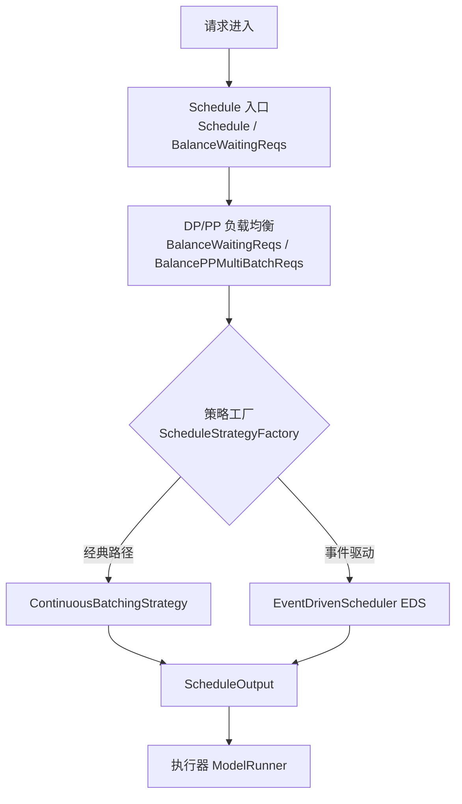
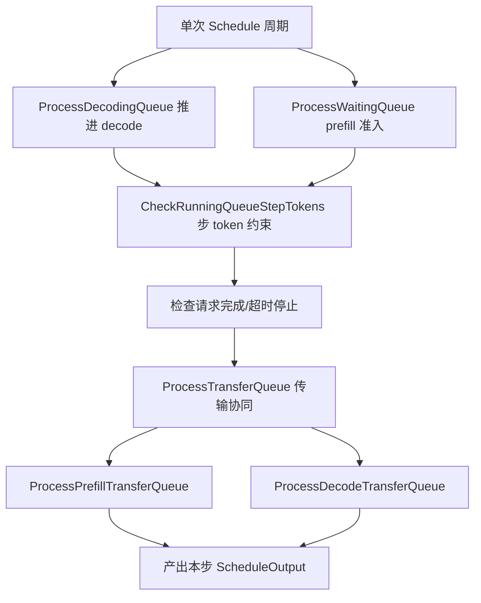
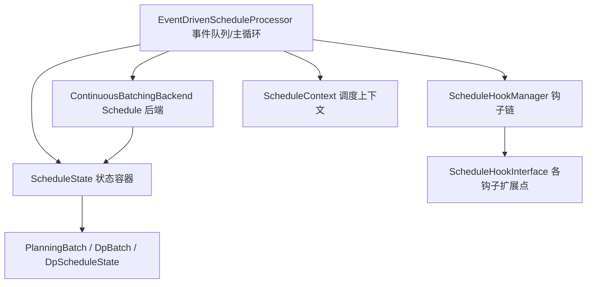
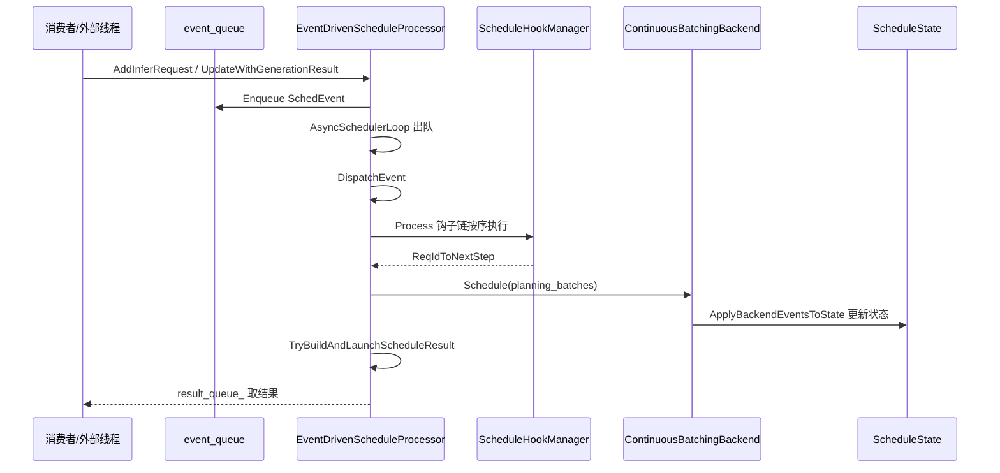
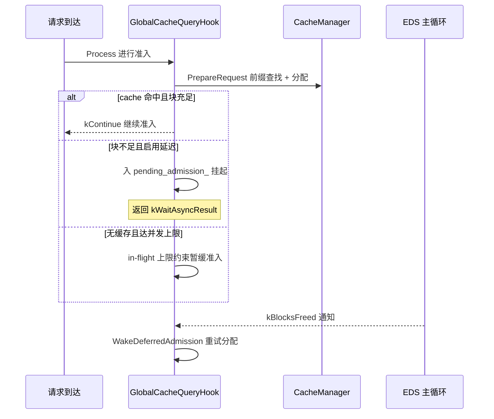
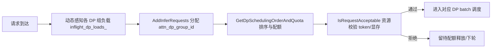
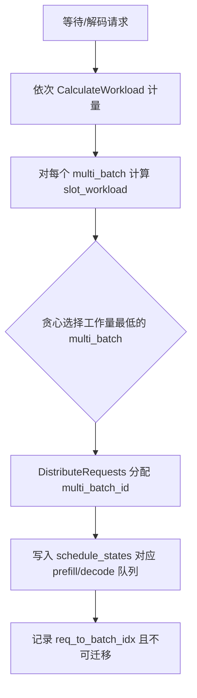

# 调度策略与负载均衡

> 面向 **架构师与性能工程师** 的专题文档，深入剖析 KsanaLLM 批量调度层中「调度策略」与「负载均衡」两大子域。本文预设读者已具备请求准入、等待队列与状态机的认知（见上级文档《调度流程与状态机》），不再重述状态机细节。

---

## 1. 调度策略与负载均衡总览

批量调度层把「请求如何被编排执行」拆成两个正交维度：**策略层**决定单个 batch 内如何排请求（prefill/decode 顺序、资源约束、完成处理），**负载均衡层**决定请求如何跨多个 DP 数据平面与多个 PP 多 batch 分摊。两条路径对应两套实现：经典 `ContinuousBatchingStrategy` 与事件驱动调度器 EDS。

### 1.1 调度入口：strategy × balance 框架

调度入口集中在 `BatchScheduler` 类上。`Schedule()` 是获取下一批可执行请求的统一入口；在执行策略前，调度器先通过 `BalanceWaitingReqs()` 与 `BalancePPMultiBatchReqs()` 完成 DP / PP 两个维度的均衡动作，再委托策略产出 `ScheduleOutput`。

| 阶段 | 职责 | 关键方法 |
| :--- | :--- | :--- |
| 均衡前置 | DP / PP 维度分摊请求 | `BalanceWaitingReqs` / `BalancePPMultiBatchReqs` |
| 策略执行 | 编排单 batch 内步骤 | `Schedule`（委托策略） |
| 结果产出 | 交执行器消费 | `ScheduleOutput` / `ScheduleResult` |

### 1.2 策略工厂：两套实现的选型

`ScheduleStrategyFactory::CreateScheduleStrategy()` 依据配置 `schedule_strategy == ScheduleStrategy::CONTINUOUS_BATCHING` 创建 `ContinuousBatchingStrategy`，是经典路径的选型入口。事件驱动的 EDS 则通过注入 `ScheduleBackendInterface` 后端与 `ScheduleHookManagerInterface` 钩子管理器运行，二者呈现同一调度职责的两套抽象。

- **经典路径**：`ContinuousBatchingStrategy`（状态机式连续批处理，逐周期推进）
- **事件驱动路径**：`EventDrivenScheduleProcessor + ContinuousBatchingBackend + 钩子链`
- **共用边界**：两者最终都产出 `ScheduleOutput` / `ScheduleResult` 供执行器消费

### 1.3 模块地图

| 子域 | 经典路径 | 事件驱动 EDS 路径 |
| :--- | :--- | :--- |
| 策略抽象 | `BaseScheduleStrategy` / `ContinuousBatchingStrategy` | `ScheduleBackendInterface` / `ContinuousBatchingBackend` |
| 事件/钩子 | 状态机内隐式推进 | `EventDrivenScheduleProcessor` + `ScheduleHookManager` 钩子链 |
| DP 负载均衡 | `BatchScheduler::BalanceWaitingReqs` | `BasicWorkloadBalancer` |
| PP 负载均衡 | `PPMultibatchWorkloadBalancer` | `PpBatchDistributor` |

本章仅做全局定位。后续章节先建立经典路径基线认知，再引入事件驱动扩展，最后落到 DP/PP 均衡与性能取舍。

**Sources:** <ref_code path="csrc/batch_scheduler/batch_scheduler.h" /> <ref_code path="csrc/batch_scheduler/strategy/strategy_factory.h" /> <ref_code path="csrc/batch_scheduler/strategy/strategy_factory.cpp" />

---

## 2. ContinuousBatchingStrategy 连续批处理策略

`ContinuousBatchingStrategy` 是经典默认实现，把请求生命周期拆成不依赖事件机制、逐 `Schedule` 周期推进的阶段序列。核心策略：一个周期内协调 prefill 队列与 decode 队列，按 GPU 步级 token 资源约束放行请求，处理完成/超时请求，并通过传输队列协同完成 prefill/decode 分离场景。

### 2.1 策略契约与注入点

`BaseScheduleStrategy` 是抽象基类，定义两个纯虚方法 `UpdateRunningRequests()` 与 `Schedule()`，并通过各 `Set*` 方法注入依赖：`BatchState`、`CacheManager`、`SchedulerSharedCounter`、`DataParaGroupId`、`TransferEngine` 等。`ContinuousBatchingStrategy` 继承它们实现默认批处理。

| 方法 | 职责 |
| :--- | :--- |
| `Schedule(waiting_reqs)` | 单周期主入口，协调各队列 |
| `UpdateRunningRequests(running_reqs)` | 更新缓存、消化处理/超时请求 |
| `CheckRunningQueueStepTokens` | 校验运行队列是否超出 `max_step_token_num`，返回【带/不带 KV cache】步 token |
| `ProcessPrefillTransferQueue` | 检查 prefill 节点传输队列是否已发送完成 |
| `ProcessDecodeTransferQueue` | 检查 decode 节点传输队列是否已接收完成并迁移至运行队列 |
| `CheckRequestFinish` / `StopRequest` | 完成判定（达 max output len / 遇 eos）与停止处理 |

### 2.2 单周期调度流程

单个 `Schedule` 周期内，prefill/decode/传输三条队列被逐一处理，最终汇成本步 `ScheduleOutput`。

> 实际请求的队列位迁移状态机由上级模块《调度流程与状态机》承接，此处不重复；本节只聚焦策略如何编排这些队列。

### 2.3 一个周期内的核心策略

- **批处理协调**：`Schedule` 决定本步纳入 prefill 与 decode 的请求集合，共享同一 `max_step_token_num` 预算。
- **GPU 步资源约束**：`CheckRunningQueueStepTokens` 判出超上限请求并留待后续周期。
- **完成处理**：`CheckRequestFinish` 判定完成，`StopRequest` 收敛 finished / timeout / aborted 状态。
- **传输协同**：prefill/decode 分离（PD）场景，`ProcessPrefillTransferQueue` 处理发送完成，`ProcessDecodeTransferQueue` 处理接收完成并回调度的运行队列。

**Sources:** <ref_code path="csrc/batch_scheduler/strategy/base_strategy.h" /> <ref_code path="csrc/batch_scheduler/strategy/continuous_batching.h" /> <ref_code path="csrc/batch_scheduler/strategy/continuous_batching_process_transfer_queue.cpp" /> <ref_code path="csrc/batch_scheduler/strategy/continuous_batching.cpp" />

---

## 3. 事件驱动调度器 EDS：事件队列与钩子链

EDS（EventDrivenScheduler）区别于经典状态机，以「事件队列 + ScheduleHook 钩子链」实现可扩展调度。它不是另一个策略，而是一个**策略框架**：把调度逻辑通过「事件」与「钩子」插件化，让调度在准入、缓存查询、超时停止、异步任务完成等节点都可以扩展。

### 3.1 组件关系

EDS 以 `EventDrivenScheduleProcessor` 为请求全生命周期中枢并维护事件队列；`ContinuousBatchingBackend` 是实际扫描 prefill/decode 队列的前后端执行体；`ScheduleHookManager` 编排钩子链；`ScheduleState` / `PlanningBatch` / `DpBatch` 承载批次与节点状态。

- **中枢**：`EventDrivenScheduleProcessor` 维护单主线程 + `BlockingQueue<SchedEvent>` 事件队列，单线程消费规避并发共享状态竞争。
- **后端**：`ContinuousBatchingBackend` 实现 `ScheduleBackendInterface`，参考经典策略的 `ProcessDecodingQueue` / `ProcessPrefillingQueue` 处理 `decoding_reqs` 与 `prefilling_reqs`。
- **钩子链**：`ScheduleHookManager` 按 `hook_idx` 从小到大依次调用各 `ScheduleHookInterface::Process`，返回每个请求的下一步指引。
- **上下文**：`ScheduleContext` 在一次调度的 hook 与后端之间传递状态、cache manager 与 multi_batch 索引。

### 3.2 事件类型与钩子点

事件与钩子点定义在 `event_driven_types.h`：

| 事件 / 钩子类型 | 含义 |
| :--- | :--- |
| `SchedEventType::EventAddRequest` | 新请求加入 |
| `SchedEventType::EventUpdateAfterGeneration` | 生成结果回流 |
| `SchedEventType::EventAsyncTaskFinished` | 异步任务完成（如缓存查询回调） |
| `SchedEventType::EventGetScheduleResult` | 消费者请求下一个调度结果 |
| `HookEventType::kBlocksFreed` | KV block 释放，资源可用 |
| `HookEventType::kRequestExited` | 请求彻底离场 |

### 3.3 事件驱动交互时序

一次事件到达后经钩子链 → 后端 → 状态更新的交互流程如下。

钩子链的 `NextStepAction` 决定请求走向：`kContinue`（交给下一钩子）、`kWaitAsyncResult`（等待异步结果）、`kFailAndEnd`（失败结束）。

### 3.4 状态容器

- `ScheduleState`：二维矩阵 `schedule_states_[multi_batch_id][dp_idx]`，全局 `req_to_batch_idx` 映射请求归属的 PP batch，分配后不可迁移。
- `PlanningBatch`：跨多 DP 的已规划 batch，聚合 token/logits 工作量并判定 `IsLaunchable`。
- `DpBatch`：单 DP 内已规划运行集合与步级 token/logits 计数。
- `DpScheduleState`：节点内 prefill/decode 队列及计划调度操作。

**Sources:** <ref_code path="csrc/batch_scheduler/event_driven_scheduler/event_driven_schedule_processor.h" /> <ref_code path="csrc/batch_scheduler/event_driven_scheduler/event_driven_types.h" /> <ref_code path="csrc/batch_scheduler/event_driven_scheduler/continuous_batching_backend.h" /> <ref_code path="csrc/batch_scheduler/event_driven_scheduler/schedule_backend_interface.h" /> <ref_code path="csrc/batch_scheduler/event_driven_scheduler/schedule_hook_manager.h" /> <ref_code path="csrc/batch_scheduler/event_driven_scheduler/schedule_hook_interface.h" /> <ref_code path="csrc/batch_scheduler/event_driven_scheduler/event_driven_state.h" /> <ref_code path="csrc/batch_scheduler/event_driven_scheduler/schedule_context.h" />

---

## 4. GlobalCacheQueryHook 与延迟准入

`GlobalCacheQueryHook` 是 EDS 钩子链中最核心的内置 Hook，把前缀 / KV 缓存查询前置到准入阶段。它让「查询全局缓存」这一数据依赖与「调度时机」解耦，通过 Hook 机制介入请求全生命周期。本节只谈该 Hook 在调度侧的「查询/准入」行为，不深入 CacheManager 内部复用算法。

### 4.1 Hook 在准入阶段的职责

在 `SchedEventType::EventAddRequest` 处理时，`GlobalCacheQueryHook::Process` 对请求执行三步：前缀缓存查找、block 分配、全局缓存异步查询。它通过 `GlobalCacheFetcher` 拉取全局缓存，并把查询做成**异步任务**，避免阻塞调度主线程。

- `PrepareRequest` 对单个请求执行前缀缓存查找 + block 分配，成功返回 true，块不足返回 false。
- 分配失败时依据 `defer_admission_on_block_full_` 走不同路径：默认（非 pd_v2）返回 `kContinue` 回退给后端自行 prefix-match；pd_v2 Decode 场景则把请求挂入 `pending_admission_` 队列并返回 `kWaitAsyncResult`。

### 4.2 延迟准入与唤醒机制

延迟准入（deferred admission）在全局缓存可用性不足时启用，受 in-flight 并发上限约束：

- **挂起**：块分配失败时请求被放入 `pending_admission_` 队列（FIFO），返回 `kWaitAsyncResult` 暂停后续处理。
- **唤醒**：EDS 释放 KV block（`HandleStopRequest` / `HandleRecomputeRequest`）触发 `kBlocksFreed` 事件，`OnEvent` 调用 `WakeDeferredAdmission()`，投递一个 sentinel 异步任务完成事件，让 EDS 主线程在自己的上下文中重跑 `UpdateAsyncResult` 执行 alloc 重试。
- **并发闸门**：pd_v2 Decode 场景维护 `in_flight_admitted_` 集合（准入未离场的 req_id）+ `max_inflight_reqs_` 上限，把 awaiting-prefill backlog 压到约 2× max_batch_size，避免在飞请求预占 KV 块抽干池。

### 4.3 准入决策路径

### 4.4 事件驱动的解耦价值

- `kBlocksFreed` → `WakeDeferredAdmission`：把「资源可用」通知化作事件，让阻塞的准入在资源释放后自动恢复。
- `kRequestExited` → `ReleaseInflightSlot`：请求离场时按 req_id 幂等释放名额，计数不泄漏。
- 通过 `RequestAdmission` 判定准入时机，全局缓存查询对调度时机透明——这是 EDS 相对经典策略的关键扩展点。

**Sources:** <ref_code path="csrc/batch_scheduler/event_driven_scheduler/global_cache_query_hook.h" /> <ref_code path="csrc/batch_scheduler/request_admission.h" /> <ref_code path="csrc/batch_scheduler/global_cache_fetcher.h" /> <ref_code path="csrc/batch_scheduler/event_driven_scheduler/schedule_hook_manager.cpp" />

---

## 5. Data Parallel 负载均衡：BasicWorkloadBalancer

DP 维度负载均衡由 `BasicWorkloadBalancer` 实现动态负载感知，核心是把请求流切成多路并行、在多个 DP 数据平面间保持负载均匀。它维护各 DP 组 in-flight 负载 `inflight_dp_loads_`，按负载为请求分配 DP 组 ID、决定调度顺序与 Token 配额，并通过资源校验保证请求不重不漏、吞吐稳定。

### 5.1 均衡器统一契约

`WorkloadBalancerInterface` 定义均衡器的顶层抽象，四个方法贯穿「分配 → 排序配额 → 记录 → 校验」：

| 方法 | 职责 |
| :--- | :--- |
| `AddInferRequests` | 为新到请求分配 `attn_dp_group_id` |
| `GetDpSchedulingOrderAndQuota` | 更新各 DP batch 配额，返回本轮 DP 调度顺序与 `WorkloadQuota` |
| `RecordInflightBatch` | 在结果投入 `result_queue_` 后记录已 launch 的 DP in-flight 负载 |
| `IsRequestAcceptable` | 校验请求能否被目标 DP batch 接收（token / 显存） |

`WorkloadQuota` 携带 DP 数据面索引与单步 token 限额（`dp_idx` / `step_token_limit`）。

### 5.2 动态负载感知流程

`BasicWorkloadBalancer` 维护 `dp_num_`、`max_batch_size_`、`inflight_dp_loads_` 等状态，请求到达后走如下链路。

- **动态感知**：`inflight_dp_loads_` 记录各 DP 组在飞负载，随 `RecordInflightBatch` 更新。
- **配额分配**：`GetDpSchedulingOrderAndQuota` 依据当前负载决定哪些 DP batch 优先调度及其 step token 配额。
- **资源校验**：`IsRequestAcceptable` 对全局 `max_step_token_num`（kernel/显存步上限）与 per-dp 配额（调度公平）双重校验。prefill 计入整条 seq(含命中 prefix)；decode 只计每步 query。

### 5.3 均衡前后负载对比（示意）

| DP 组 | 均衡前 in-flight | 均衡后 in-flight |
| :---: | :---: | :---: |
| DP-0 | 高 | 中 |
| DP-1 | 低 | 中 |
| DP-2 | 中 | 中 |

动态感知使长尾流量被重分配到低负载 DP 组，避免某一 DP 组的单步 token / 显存被打满而拖慢整体吞吐。

**Sources:** <ref_code path="csrc/batch_scheduler/event_driven_scheduler/workload_balance/workload_balancer_interface.h" /> <ref_code path="csrc/batch_scheduler/event_driven_scheduler/workload_balance/basic_workload_balancer.h" /> <ref_code path="csrc/batch_scheduler/event_driven_scheduler/workload_balance/pp_batch_distributor.h" />

---

## 6. Pipeline Parallel 多 Batch 贪心分配

PP 维度负载均衡的目的是把等待与解码请求分摊到负载最低的 PP 多 batch（`multi_batch_id`），最大化各流水线阶段的利用率。两条路径各有实现：经典路径的 `PPMultibatchWorkloadBalancer`，以及 EDS 路径的 `PpBatchDistributor`（贪心最小工作量）。

### 6.1 经典路径：PPMultibatchWorkloadBalancer

`PPMultibatchWorkloadBalancer` 在多 batch 状态间平衡请求，核心方法如下：

| 方法 | 职责 |
| :--- | :--- |
| `DistributeWaitingReqs` | 按容量把等待请求分摊到多个 batch state |
| `DistributeDecodingReqs` | 按容量分摊解码请求 |
| `OffloadBatchWorkload` | 将过载 batch 的负载动态卸载到轻载 batch（动态策略卸载） |
| `CalculateWorkload` / `CalculateWorkloadForReqs` | 计量单请求 / 请求集的工作量 |

`BalancePPMultiBatchReqs` 是统一入口，依据配置的 `PPMultibatchWBStrategy` 与 `threshold_factor_` 决定是否触发卸载。

### 6.2 EDS 路径：PpBatchDistributor

`PpBatchDistributor` 针对 EDS 的二维 `schedule_states_[multi_batch_id][dp_idx]` 数据布局，用静态贪心最小工作量把请求分到负载最低的多 batch。请求的 `dp_idx` 已由 DP 层 balancer 通过 `attn_dp_group_id` 预先写好。

- `CalculateWorkload(req)`：按配置策略计量单个请求的工作量。
- `CalculateSlotWorkload(batch, dp)`：计量某 `(multi_batch_id, dp_idx)` 槽位总工作量。
- `DistributeRequests`：贪心把请求放入工作量最低的槽位并维护 `req_to_batch_idx`（分配后不可迁移，避免不同 multi_batch 调度的状态干扰）。

### 6.3 两类实现对比

| 维度 | `PPMultibatchWorkloadBalancer` | `PpBatchDistributor` |
| :--- | :--- | :--- |
| 归属路径 | 经典 continuous batching | 事件驱动 EDS |
| 分配策略 | 容量分摊 + 动态卸载（`OffloadBatchWorkload`） | 静态贪心最小工作量 |
| 数据模型 | `BatchState` 列表 | 二维 `schedule_states` |
| 量纲 | 单请求/请求集工作量 | 槽位级负载累计 |

**Sources:** <ref_code path="csrc/batch_scheduler/workload_balance/pp_multibatch_balancer.h" /> <ref_code path="csrc/batch_scheduler/event_driven_scheduler/workload_balance/pp_batch_distributor.h" />

---

## 7. 负载均衡调优与对比思考

站在架构师与性能工程师视角，DP/PP 双层均衡、EDS 与传统策略、各均衡器变体之间存在清晰的工程取舍。本章归纳适用边界与权衡。

### 7.1 均衡视角与适用边界

不同均衡器瞄准不同的问题域：

- **DP 动态负载感知**（`BasicWorkloadBalancer`）：解决「单步 GPU token/显存上限被打满」——按各 DP 组 in-flight 负载动态分配，追求多路并行吞吐稳定。
- **PP 贪心分发**（`PpBatchDistributor` / `PPMultibatchWorkloadBalancer`）：解决「流水线阶段空闲」——把请求分摊到负载最低的 multi_batch，最大化跨阶段利用率。
- **简化透传**（`ModelPerfWorkloadBalancer`）：`attn_dp_group_id` 已由 `ModelPerfBackend` 提前写好，balancer 直接透传不做轮询覆写，`IsRequestAcceptable` 恒 true——用于按 attention DP 直接路由的测量/性能场景。

### 7.2 EDS 与经典 continuous batching 的取舍

- **经典路径**：状态机式逐 `Schedule` 周期推进，逻辑内聚、可预测，适合确定性较强的默认路径，扩展靠改写策略方法。
- **事件驱动 EDS**：通过「事件队列 + 钩子链」把调度逻辑插件化，准入、缓存查询、超时停止、异步完成等节点均可扩展而不改动接口；代价是抽象层更多、单线程事件循环带来框架开销。
- **取舍本质**：EDS 适合需要频繁插入自定义调度行为的场景（如全局缓存复用、pd_v2 抢占重启），经典路径适合简单稳定的默认部署。

### 7.3 Global Cache Hook 延迟准入的影响

- 延迟准入把「块不足」请求挂起在 `pending_admission_`，由 `WakeDeferredAdmission` 在资源释放后重试，提升缓存利用率与吞吐稳定。
- 代价：挂起的请求造成**延迟**，需在「即时执行」与「争取缓存命中」之间折中。
- 并发约束（`max_inflight_reqs_` / `in_flight_admitted_`）防止在飞请求预占 KV 块抽干池，但过小会收窄流水线深度、拖慢吞吐。

### 7.4 架构启示

- 双层均衡（DP + PP）是并行下 GPU 利用率与「请求不重不漏」的关键，均衡器抽象 `WorkloadBalancerInterface` 使变体可插拔。
- EDS 的 Hook 链 + 事件驱动让「缓存查询/分配/背压」闭环在单一 Hook 内，降低下游耦合。
- 工程上按场景组合均衡器：负载波动大选动态感知类，强调确定性可选贪心/透传类。

**Sources:** <ref_code path="csrc/batch_scheduler/event_driven_scheduler/workload_balance/" /> <ref_code path="csrc/batch_scheduler/workload_balance/" /> <ref_code path="csrc/batch_scheduler/event_driven_scheduler/model_perf/model_perf_workload_balancer.h" />