# 执行器与采样解码

本文档深入讲解 KsanaLLM 推理链路中的「执行器与采样解码」核心领域，聚焦于请求完成调度后，如何被转换为设备上的前向计算并最终产出采样 token。覆盖执行器运行时装配（ExecutorRuntime）、ModelRunner 多线程流水线与 build-ahead 双缓冲优化、ModelExecutor 设备前向、Sampler 采样规则管线与投机解码，以及基于 xgrammar 的结构化输出生成。目标读者为内核开发者与性能优化工程师。

## 第 1 章 执行器与采样总览

执行器（Executor）位于推理主链路「接入 → 调度 → 执行/采样 → 回流」的第三段，是把调度结果落地为设备计算的执行入口。其承载者 `ExecutorRuntime` 本身不含线程，由模型运行器（ModelRunner）的线程流水驱动，并随 `ScheduleOutput` 契约从调度侧接收输入。

本章给出执行器与采样解码的模块地图，说明「为什么需要执行器层」，并界定本文档与调度、缓存文档的边界。各模块实现细节自第 2 章起展开。

### 1.1 执行器在推理主链路中的位置

一次请求的推理被划分为四段：接入（Engine）接收请求，调度（BatchScheduler）产出 `ScheduleOutput`，执行（Executor）完成设备前向与采样解码，结果回流（Report）返回采样输出。

```mermaid
flowchart LR
    E["Engine（接入）"]
    BS["BatchScheduler（调度）"]
    SO["ScheduleOutput（调度输出契约）"]
    MR["ModelRunner（线程流水线）"]
    ER["ExecutorRuntime（运行时装配）"]
    MB["ModelBuilder"]
    MEX["ModelExecutor（设备前向）"]
    MS["ModelSampler（采样入口）"]
    SP["Sampler（采样规则管线）"]
    RP["回流报告"]
    E --> BS --> SO -->|契约输入| MR
    MR --> ER
    ER --> MB --> MEX
    MEX -->|logits| MS
    MS --> SP
    SP --> RP
```

- **Engine / BatchScheduler**：负责请求准入、连续批调度与资源分配，其产物是 `ScheduleOutput`（请求量、KV 块与采样参数）。
- **BatchScheduler → 执行器**：`ScheduleOutput` 是调度输出、同时是执行器侧 `ExecutorRuntime.BuildModelInput` 的输入，因此它是两层之间的契约类型。
- **执行器 / Sampler**：执行器把调度输出转换为 `NewModelInput` 并驱动设备前向，Sampler 在 logits 之上完成 token 选择与概率回填。

### 1.2 为什么需要执行器层

- 解耦调度与计算：调度只负责「排哪些请求、用哪些 KV」，设备上「怎么算、怎么采」由执行器决定，二者可独立演进。
- 隔离运行时装配：`ExecutorRuntime` 在 Initialize 阶段即装配 `ModelBuilder / ModelExecutor / ModelSampler`，并把前向、采样、投机路径按 `RunMode` 划分，避免计算逻辑侵入调度线程。
- 承接并发与异步：`ModelRunner` 的 Preprocess / Execute / Postprocess 线程消费调度输出，重叠 H2D 传输与 Forward，执行器层是四队列流水与 build-ahead 双缓冲的宿主。
- 承载生成状态：`GenerationController` 与 `StructuredGeneratorFactory` 在请求生命周期内维护草稿生成器与结构化生成器，使解码不只依赖单步 logits。

### 1.3 执行器与采样模块地图

| 模块 | 所在路径 | 核心职责 |
| --- | --- | --- |
| ExecutorRuntime | `csrc/executor/executor_runtime.h/.cpp` | 中心运行时，`Initialize` 装配 ModelBuilder/ModelExecutor/ModelSampler，聚合 InflightResourceManager、HiddenUnitBufferPool、GenerationController、StructuredGeneratorFactory |
| ModelRunner | `csrc/executor/model_runner.h/.cpp` | 执行线程流水线，四队列 + build-ahead 双 slot 环 |
| ModelBuilder | `csrc/executor/model_builder.h` | 将 `ScheduleOutput` 转换为 `NewModelInput`，KV 解析与 H2D 重叠 |
| ModelExecutor | `csrc/executor/model_executor.h/.cpp` | 设备前向 `Forward`，固化 logits 快照 |
| ModelSampler | `csrc/executor/model_sampler.h/.cpp` | 将执行两路请求转为采样请求并执行 `Sampling`，生成并应用 bitmask |
| Sampler | `csrc/samplers/sampler.h/.cpp` | 采样规则管线（惩罚、grammar、TopK/TopP） |
| GenerationController | `csrc/runtime/generation_controller.h/.cpp` | 协调三类草稿生成器与结构化生成器 |
| DraftGeneratorController | `csrc/runtime/draft_generator/` | 草稿生成中心，`GenerateDraft / FilterDraftTokens` |
| StructuredGeneratorFactory | `csrc/runtime/structured_generation/` | 按约束类型注册、创建结构化生成器 |

`ModelRunner` 把调度输出消费进来，经 `ExecutorRuntime` 的前向与采样，最终通过 `ModelSampler` 落到底层 `Sampler` 打分。采样细节（规则顺序、投机解码、结构化约束）分别在后续章节展开。

### 1.4 阶段边界与本文档定位

- 缓存块分配与动态调度流程不在此文档，属「KVCache 缓存管理」「批量调度与动态 Batching」文档范畴。
- KV Cache 布局（MHA/MLA/DSA）细节不在此文档，属缓存管理文档。
- 分布式 DP/PP/EP 并行策略本身不在此文档，仅保留与执行前向死锁协调必要的说明。

**Sources:** <ref_code path="csrc/executor/executor_runtime.h" /> <ref_code path="csrc/executor/model_runner.h" /> <ref_code path="csrc/executor/model_builder.h" /> <ref_code path="csrc/executor/model_executor.h" /> <ref_code path="csrc/executor/model_sampler.h" /> <ref_code path="csrc/samplers/sampler.h" /> <ref_code path="csrc/runtime/generation_controller.h" /> <ref_code path="csrc/runtime/draft_generator/draft_generator_controller.h" />

## 第 2 章 执行器运行时装配与 ModelRunner 多线程流水线

ModelRunner 用四队列把前向拆成多阶段流水，以 build-ahead 双 slot 环隐藏采样后处理延迟：慢路径下 Sampling 落在独立 Postprocess 线程，build-ahead 下 Sampling 内联进 Execute 线程并与下一步 Forward 重叠。本章先讲 ExecutorRuntime 的运行时装配，再讲 ModelRunner 两套执行模型与双缓冲机制。

### 2.1 ExecutorRuntime：执行器中心运行时

`ExecutorRuntime`（`csrc/executor/executor_runtime.h`）本身不含线程，是装配运行部件的中央对象。`Initialize()` 完成装配，并聚合多个跨线程共享组件。

- 装配的三个核心构件：`ModelBuilder`（ScheduleOutput→NewModelInput）、`ModelExecutor`（设备前向）、`ModelSampler`（采样入口）。
- 聚合并持有的组件：`GenerationController`、`InflightResourceManager`、`ExecutorRequestManager`、`HiddenUnitBufferPool`、`StructuredGeneratorFactory`。
- 对外暴露模型：`GetModelSampler`（build-ahead 同步路径）、`GetGenerationController`、`GetInflightResourceManager`、`GetStructuredGeneratorFactory`。

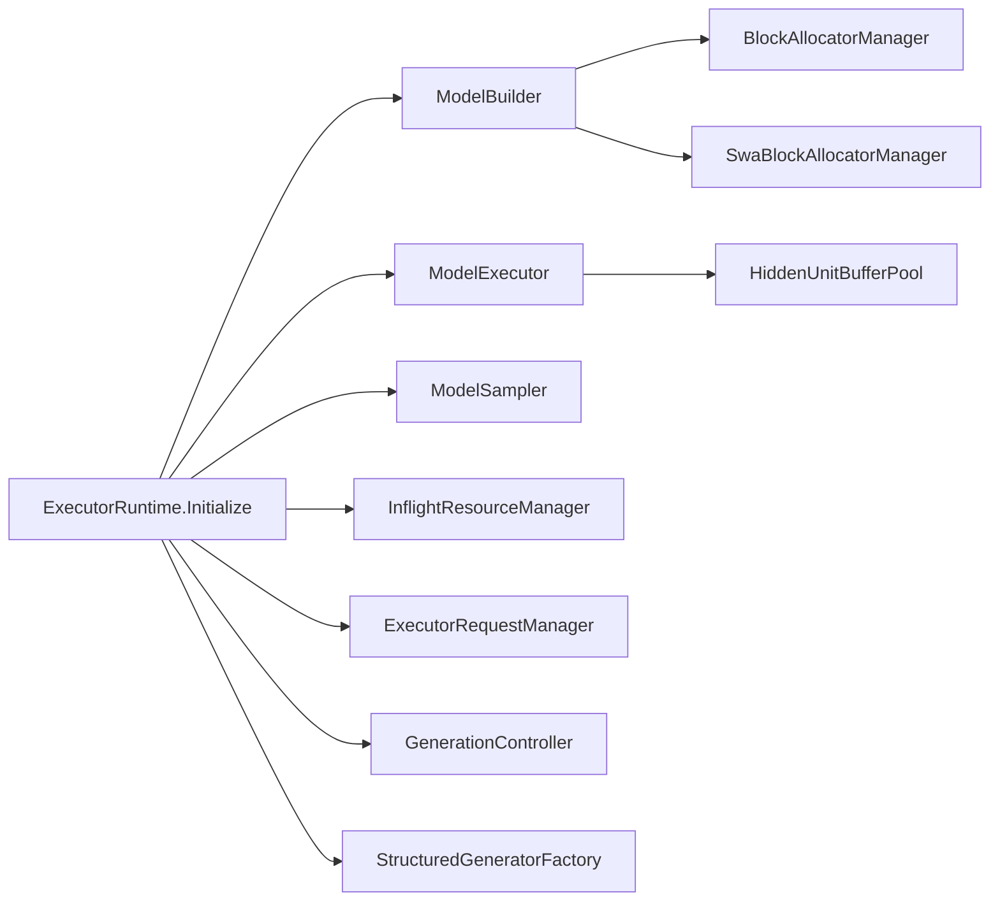

#### 2.1.1 InflightResourceManager：按 req_id 管理飞行资源

`InflightResourceManager`（`csrc/executor/inflight_resource.h`）按 `req_id` 统一管理请求「飞行中」的运行时资源（如压缩器序列槽），是执行器侧资源的自动分配与释放中心。

- `ProcessScheduleOutput` 是核心入口，由 `ModelRunner::HandlePreprocess` 调用（位于 `BuildModelInput` 之前）。
- 释放与分配路径：先对 `finish_req_ids` / `recompute_req_ids` 中的 `req_id` 逐个释放资源，再对 `executor_running_reqs` 逐个分配。
- 释放幂等：重计算请求再次释放不会重复扣减，同一 req_id 同时出现在 finish / recompute 集合也能安全处理。
- 内存与并发：每个资源独立维护互斥锁，读走共享锁、写走独占锁；execute 线程经 `GetUnderSchedulerInvariant` 无锁直读。

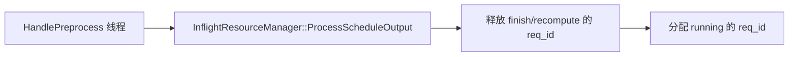

#### 2.1.2 serialize_main_mtp_：MTP 与主前向的死锁规避

`serialize_main_mtp_` 在 `ExecutorRuntime` 构造时按 `(IsSamplingNode && mtp_step_num > 0 && max_pp_batch_num > 1)` 一次性算出，用于规避 TP>1 且 PP 多批次下主前向与其后 MTP 前向在跨 rank 上的 `forward_mutex_` 非一致顺序死锁。

- `HandleExecute` 路径的 `Forward` 先 `prev_mtp_done_->Wait()` 再 `Reset(1)`，阻塞等待上一步 MTP 结束。
- `MtpForward` / `DSparkForward` 末尾 `Notify()` 释放被阻塞的主前向。
- 等待器 `Waiter` 以「就绪」状态起步（`num_wait==0`），首个主前向无需配对通知即可立即返回。

### 2.2 两套执行模型：慢路径 vs build-ahead

ModelRunner 的线程拓扑由 `IsSamplingNode()` 与 `FastPathController.IsEnabledAtStartup()` 两态二选一决定。

- **慢路径**：`preprocess / execute / postprocess` 三线程。Execute 只跑 Forward，产出 `NewModelOutput` 经 `model_output_queue_` 落到独立 postprocess 线程做 Sampling 并在 device 0 上报。
- **build-ahead 路径**：`preprocess / execute / result_report` 三线程。Execute 线程内 `HandlePostprocessInline` 就地采样，经 `sampling_output_queue_` 交独立上报线程异步 IPC，隐藏 postprocess 对下一轮执行的阻塞。

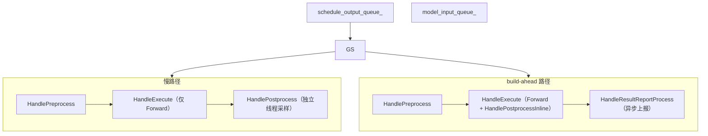

`start()` 依据上述选择拉起线程集。慢路径 Execute 只做前向，写 `model_output_queue_`；build-ahead 下 Sampling 复用 Execute 线程、共享 `PrimaryComputeStream`，保证「先采样后写 ring」的 FIFO 顺序。

#### 2.3.1 build-ahead 内联采样与结果上报的分工

build-ahead 下，Execute 线程在 Forward 后单次调用 `HandlePostprocessInline(model_output)`：把输出写入 `postprocess_one_shot_output_`、置 `postprocess_one_shot_=true` 与 `postprocess_enqueue_report_=true`，再同步执行一轮 `HandlePostprocess`。该轮回在 Execute 线程内完成 Sampling、`WriteBuildAheadRingAfterSampling`（写 ring），随后结果入 `sampling_output_queue_` 交由 `HandleResultReportProcess` 独立上报线程异步 IPC。

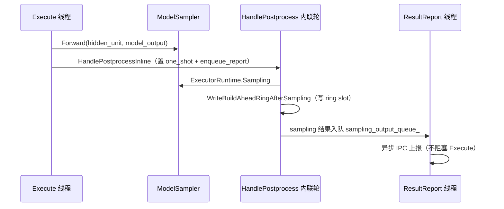

#### 2.3.2 慢路径 vs build-ahead 对照

| 维度 | 慢路径（独立 postprocess 线程） | build-ahead（Execute 内联双 slot ring） |
| --- | --- | --- |
| 线程数 | 3（preprocess/execute/postprocess） | 3（preprocess/execute/result_report） |
| Sampling 归属 | 独立 postprocess 线程 | Execute 线程内 `HandlePostprocessInline` |
| 上报方式 | postprocess 线程 device 0 同步 IPC | `sampling_output_queue_` → ResultReport 线程异步 |
| model_output 出口 | `model_output_queue_` | 不经该队列，直接内联 |
| 双缓冲 | 恒用 slot 0，不翻转 | `cur_ring_slot_` 0/1 交替，读上一步 slot |
| 前置依赖 | 无条件 | `FastPathController.IsEnabledAtStartup()` |

#### 2.3.3 build-ahead 产生的前提（FastPathController）

`FastPathController`（`csrc/runtime/fast_path_controller.h`）是 build-ahead 的启动期硬性判定，配置加载后由 Engine 与执行器各调一次 `InitializeAtStartup`。它有一组硬性阻断条件，任一满足即禁用 build-ahead：

- `enable_speculative_decoding` / `mtp_step_num` 非默认，即投机解码 / MTP 采样启用时禁用。
- `enable_xgrammar` 为 true，即结构化输出 / grammar 约束启用时禁用。
- `enable_prefix_caching` / `enable_flexible_caching` / `separate_prefill_decode` 等缓存与拆分特性启用时禁用。
- 并行配置（`attn_data_parallel_size`、`expert_fuse_parallel_size`、`max_pp_batch_num`）不匹配时禁用。

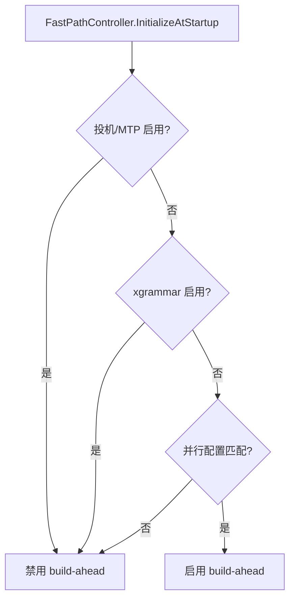

### 2.4 build-ahead 双 slot ring 机制

build-ahead 的核心是在不重叠 batch 的前提下，把「采样 + 写 ring」与「下一步 Forward」重叠起来。这依赖一处双缓冲对齐：Sampler 的 `cur_ring_slot_`（0/1 交替）。

- `cur_ring_slot_` 只有 0 与 1 两个值，每步在 Preprocess 线程 `^= 1u` 翻转。上一步写入的 slot 即 `cur ^ 1`。
- 采样 `WriteRing(slot, cur_pairs_dev, B_cur)` 把本步 `(req_id, token)` 写入 ring（布局 `[count, req0, token0, ...]`），供下一步 Forward 从上一 slot 经 `GetRingSlot(prev_slot)` 读取。
- TP 下仅 rank 0 写有效 token，靠 `BroadcastBuildAheadRingSlot`（向 `sampler->BroadcastRingSlot`）组内广播，保证各 rank 的 `ReplaceLastTokenKernel` 看到一致的 ring。

并行深度与双 slot 对齐：build-ahead 的流水上限 `executor_pipeline_depth == 2`，ModelInput 据此对齐到 0/1 双 slot；慢路径深度退化为 1，仅用 slot 0。`ReplaceLastTokenKernel` 按 `req_id` 回填，把 slot 与具体 batch 解耦，故 prefill/decode 混批一视同仁。

### 2.5 停止与故障处理

`Shutdown` / `Stop` 主动唤醒流水线程：置 `terminated_`，同时对四队列下闸，避免 execute 线程被 MTP Notify 挂起后 join 卡死。三组线程各自读 `terminated_` 与队列停止信号优雅退出。

**Sources:** <ref_code path="csrc/executor/model_runner.h" /> <ref_code path="csrc/executor/model_runner.cpp" /> <ref_code path="csrc/executor/executor_runtime.h" /> <ref_code path="csrc/executor/executor_runtime.cpp" /> <ref_code path="csrc/executor/inflight_resource.h" /> <ref_code path="csrc/executor/inflight_resource.cpp" /> <ref_code path="csrc/executor/model_builder.h" /> <ref_code path="csrc/runtime/fast_path_controller.h" /> <ref_code path="csrc/runtime/fast_path_controller.cpp" /> <ref_code path="csrc/runtime/model_input.h" />

## 第 3 章 ModelExecutor 设备前向与 ModelSampler

ModelExecutor 把 batch 输入推送到设备做前向传播并固化 logits 快照，ModelSampler 再把执行器请求组装成采样请求。本章覆盖 `ExecutorRuntime` 三条前向路径（Forward / MtpForward / DSparkForward）及其死锁规避的 `serialize_main_mtp_` 保护，以及 ModelSampler 如何把 `ExecutorInferRequest` 成型为 `SamplingRequest`，为第 4 章采样管道铺垫。

### 3.1 Forward：设备前向与 logits 快照固化

`ExecutorRuntime::Forward` 负责运行模式的串行化门槛与执行器装配，真正的设备前向由 `ModelExecutor::Forward` 承担。`bool serialize_main_mtp_` 在构造期由 `IsSamplingNode && mtp_step_num>0 && max_pp_batch_num>1` 计算得出；当为真时，main 前向先 `prev_mtp_done_->Wait()` 等待上一步 MTP/跳跃前向结束，再 `Reset(1)` 为下一次 MTP 布防。

`ModelExecutor::Forward` 按以下顺序执行：

- 把 `schedule_output` 与 `run_mode` 透传到输出，再固化本步 `frozen_logits_offsets`。fast path 下共享的 `ExecutorInferRequest` 可能被下一 schedule 覆写，故采样阶段读快照而非 live 字段；slow path 下两者通常相同。
- 依据 `RunMode` 划分profile metrics（`kNextN -> kSpeculative`，其余为 `kMain`），在启用 profile 时记录 forward 耗时。
- 派发设备前向：`ENABLE_CUDA` 下以 `InferStage::kDecode` 经 `model_instance_->Forward` 单次执行；否则按 `kContext`/`kDecode` 分两批各前向一次。
- 除返回状态外，透传本步 `(req_id, last_offset)` 设备指针 `cur_pairs_dev` 供后处理线程写 ring slot。

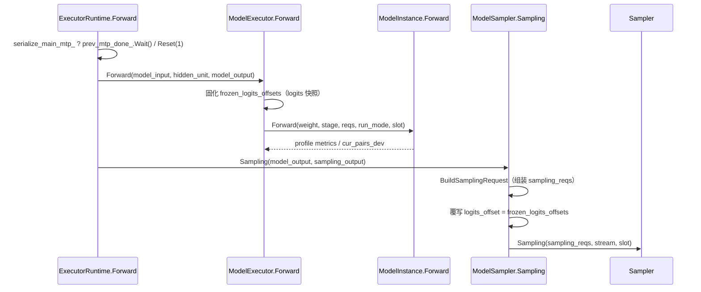

`ExecutorRuntime::Initialize` 内部分别构造 `ModelBuilder`、`ModelExecutor`、`ModelSampler`，经 `SetModelInstance / SetModelWeight / SetBlockAllocatorManager` 注入 `ModelInstance`、`WeightInstanceInterface` 与 `BlockAllocatorManager` 引用，随后在 Forward / Sampling 阶段被依次调用。

### 3.2 MtpForward：多步吞吐预测

`ExecutorRuntime::MtpForward(mtp_step_num, ...)` 实现多步吞吐预测（MTP）。`mtp_step_num == 0` 时直接返回；否则在 `infer_req_mutex_` 保护下循环 `mtp_step_num` 步，每步 `BuildModelInput(RunMode::kNextN)` → `ModelExecutor::Forward` → `ModelSampler::Sampling`，把采样结果写入 `req->draft_tokens.mtp` 供投机解码消费。每步之间把一个新 token 追加进 `forwarding_tokens` 作为下一 jump 的输入。结束后 `prev_mtp_done_->Notify()` 释放等待中的主前向。

### 3.3 DSparkForward：跳跃前向

`ExecutorRuntime::DSparkForward(dspark_block_size, dspark_noise_token_id, ...)` 一次前向整块跳跃。`dspark_block_size == 0` 时直接返回；否则在锁内构造 `RunMode::kDSpark` 输入并执行单次 `ModelExecutor::Forward`。logits 按 step-major `[block_size, B, V]` 排布，随后逐 `step_index` 由 `model_instance_->ForwardHead` 纠偏并采样该 `[B, V]` 行，把 token 回填到 `forwarding_tokens` 的下一位置。

- 与 MTP 不同，DSpark 不做 `erase(begin)`，而是用 `dspark_noise_token_id` 把 generated 之后的部分填充到 `block_size`。
- 每次采样把该行冻结 offset 写为递增偏移，配合 step-major 布局寻址。
- 结束同样经过 `prev_mtp_done_->Notify()` 释放主前向。

### 3.4 三条前向路径对比

| 维度 | Forward | MtpForward | DSparkForward |
| --- | --- | --- | --- |
| RunMode | kMain | kNextN | kDSpark |
| 前向次数 | 单次 | mtp_step_num 次（逐步） | 单次整块 + 逐 star `ForwardHead` 纠偏 |
| 产物 | 主模型 logits 快照 | `draft_tokens.mtp`（多步预测 token） | `draft_tokens.mtp`（回填 + noise padding） |
| 输入构造 | `BuildModelInput(kMain)` | 每步重建 + token 追加 | 单次 `BuildModelInput(kDSpark)` |
| 串行化交互 | 由 `prev_mtp_done_` Wait 门控 | 结束时 `Notify` 释放主前向 | 结束时 `Notify` 释放主前向 |
| 职责 | 主流水线逐 token 生成 | 多步吞吐预测加速 | 跳跃前向整块吞吐预测 |

### 3.5 ModelSampler：成型采样请求

`ModelBuilder::BuildModelInput` 先把 `schedule_output` 装配成 `NewModelInput`（含 KV 解析、`.meta` 与 H2D 重叠），`ExecutorRuntime::BuildModelInput` 再据此生成多路 `ExecutorInferRequest`。随后进入采样：

- `ModelSampler::Sampling` 对每个 `ExecutorInferRequest` 调 `BuildSamplingRequest` 组装 `SamplingRequest`，透传 `sampling_token_num`、`logits_offset`、`grammar_matcher` 等。
- 用 `frozen_logits_offsets` 覆写每一个 `SamplingRequest.logits_offset`，保证读取固化的 logits 快照而非 live 字段。
- 嵌入模型等特殊路径直接构造最小 `SamplingRequest` 返回；常规路径把 `sampling_reqs` 及主计算流、`slot_index` 交给底层 `Sampler::Sampling`。
- `GenerateAndApplyBitmask` 生成结构化/文法门控 bitmask，经 `ApplyTokenBitmaskSelective` 应用到设备 logits。

`ModelSampler::GetSampler` 暴露内部 `Sampler*`，供 `ModelRunner::HandleExecute` 在 build-ahead 同步路径（Forward→Sampling 同线程）直接取上一个 ring slot 的 device 指针，避免重复构建采样器。

草稿侧的连接点在 `DraftGeneratorController`（见第 4 章），`MtpForward / DSparkForward` 的产物写入 `req->draft_tokens.mtp`，与 `draft_tokens.mtp/spec` 经由投机解码的接受逻辑衔接。

**Sources:** <ref_code path="csrc/executor/executor_runtime.h" /> <ref_code path="csrc/executor/executor_runtime.cpp" /> <ref_code path="csrc/executor/model_executor.h" /> <ref_code path="csrc/executor/model_executor.cpp" /> <ref_code path="csrc/executor/model_sampler.h" /> <ref_code path="csrc/executor/model_sampler.cpp" /> <ref_code path="csrc/executor/model_builder.h" /> <ref_code path="csrc/executor/model_builder.cpp" /> <ref_code path="csrc/runtime/executor_infer_request.h" />

## 第 4 章 Sampler 采样规则管线与投机解码

Sampler 按固定顺序对 logits 施加一组规则后再采样，外层 ModelSampler 承接执行器请求并驱动 Sampling；GenerationController 协调三类草稿生成器完成投机解码，采样后按位置对比草稿与真实采样结果做接受/拒绝并回填。

### 4.1 采样规则管线

`Sampler::Sampling` 是采样入口，管线顺序固定如下：

各方法施加的规则如下：

| Sampler 方法 | 作用的位置 / 规则 | 触发条件 |
| --- | --- | --- |
| `PrepareDeviceLogitsAndParameter` | 顶层装配，统计 use_top_k/p/temperature，搬运参数到设备 | 每次 `Sampling` |
| `ApplyRepetitionPenalty` | `repetition_penalty`，对已出现 token 施加惩罚 | `repetition_penalty != 1.0f` |
| `NoRepeatNgramProcessor` / `Encoder..` / `Decoder..` | `no_repeat_ngram_size` 系列，构造 ngram 并 ban 重复 | ngram 大小 > 0 |
| `ApplyGrammarMask` | xgrammar bitmask，仅对带 `grammar_matcher` 的请求置 mask | `enable_xgrammar` |
| `SelectTopKTokens` → `TopkSampling::RunSampling` | TopK/TopP/temperature 采样或 ArgMax | `do_sampling` 且非嵌入模型 |
| `CopyProbsOutputToRequests` | 概率拷贝回报 + token 提交 host | 每次 `Sampling` |
| `UpdateGrammarState` | 接受已采 token，推进 grammar matcher | grammar 请求 |

管线执行规则说明：

- `ApplyRepetitionPenalty` 把 `repetition_penalties_` 初始化为 1.0，仅对输入/前向中已出现 token 位置改写惩罚值，再调 `InvokeRepetitionPenalty`。
- ngram 处理器基于「前缀 → 后继 token 列表」的字典：`GetNgrams` 构建字典，`BanRepeatTokens` 把重复后继位置置 `-inf` 并入 logits。
- `ApplyGrammarMask` 结合 `SelectTopkTokens`，最终由 `TopkSampling::RunSampling` 在 device 上按 `max_topK/topKs/topPs` 采样；`logits_softmax` 决定是否内部先 softmax。

### 4.2 双缓冲与双 slot 避免数据竞争

`Sampler` 用双缓冲 + 双 slot（0/1）避免多个采样调用之间的 device/host 数据竞争：

- `device_output_tokens_`（slot 0）与 `device_output_tokens_slot1_`（slot 1）两套 device/host buffer。
- 慢路径恒用 slot 0；build-ahead（`FastPathController::IsEnabledAtStartup()`）下每步采样落到 0/1 交替 slot，物理隔离 device/host 数据。
- `GetDeviceOutputTokens` / `GetHostOutputTokens` 在 slot 1 未分配时回落 slot 0，`HasDoubleSlot()` 暴露是否双 slot。

`(req_id, token)` 配对 ring buffer（`device_ring_slot0_`/`device_ring_slot1_`）承接 build-ahead 的 `ReplaceLastToken` Kernel：`WriteRing` 把本步采样输出按 slot 写入，TP>1 时 `BroadcastRingSlot` 经 `ncclBroadcast`（root=0）把 rank 0 的整槽 ring 广播组内各卡。

### 4.3 Sampler 核心采样：SelectTopkTokens 与 RunSampling

- `SelectTopKTokens` 当 `do_sampling` 时：rank 0 调 `topk_sampling_->Forward → RunSampling`，结果 `MemcpyAsync` D2H 到 `host_out_tokens`。
- `RunSampling` 双路径：`device_topKs == nullptr`（未启用 top_k）走特化 ArgMax 贪婪取最大 token；否则调 `tensorrt_llm::kernels::invoke_batch_topk_sampling` 按 topKs/topPs 采样，`logits_softmax` 决定是否内部先 softmax。
- `CopyProbsOutputToRequests` 按 `request_target["logits"]` 的 `slice_pos` 逐段取指，在 stream 同步后把 device 概率填入请求。
- `SamplingAndCalcLogprobs` 对非 MTP 请求计算 `logprobs_num`，`max_top_input_logprobs >0` 时另算输入 top logprobs。

### 4.4 投机解码：GenerationController 与草稿生成中心

投机解码的两级控制器：

- `GenerationController`（`csrc/runtime/generation_controller.h`）：按 `ScheduleOutput` 为带约束请求 `CreateGenerators / RestoreGenerators / RemoveGenerator`，`UpdateGenerationState` 先推进结构化生成器、清 split-fuse 残留 `draft_tokens`，再调 `DraftGeneratorController::FilterDraftTokens`；`GenerateDraft` 转发到草稿生成中心。
- `DraftGeneratorController`：`AppendDraftGenerator` 按序登记多个 `DraftGeneratorInterface`，`GenerateDraft` 依次对请求执行每个生成器，`FilterDraftTokens` 委托末位生成器的过滤逻辑（未登记则用默认过滤）。

`DraftTokens`（`csrc/runtime/draft_generator/draft_tokens.h`）聚合三类草稿：`mtp`（MTP 草稿）、`spec`（投机草稿）、`ptp`（并行占位草稿），`GetDraftTokens()` 按 mtp→spec→ptp 拼接顺序，`TruncDraft` 按同序裁剪。`ExecutorInferRequest` 的 `draft_tokens`、`accepted_tokens`、`generated_tokens`、`forwarding_tokens_draft_num` 是投机状态载体。

三类草稿生成器对比如下：

| 生成器 | 数据结构 | 草稿来源 | 过滤逻辑 |
| --- | --- | --- | --- |
| `TrieGenerator` | `TrieTree` 前缀树 | `draft_tokens.spec`：从历史按频率选最优分支 | 默认过滤逻辑 |
| `PtpGenerator` | 常量 `ptp_token_id` 占位 | `draft_tokens.ptp`：重复填占位 token | 纯猜测轮 / 验证轮分别接受 |
| `AsrCustomGenerator` | 用户提供的草稿 | `draft_tokens.spec` 复用自己的草稿 | 跳跃：在范围内找匹配复用 |

- **TrieGenerator**：`TrieTree` 记录 token 序列频率，`Put` 增量建树并 `Prune` 到 `max_nodes_`；`QueryOneBranch` 沿前缀按 `input_freqs*(1-weight)+output_freq*weight` 选最大 score 预测。深度上限 `kMaxDepth=16`，一次匹配最多预测 3 个 token。
- **PtpGenerator（并行占位）**：`GenerateDraft` 按 `ptp_token_num`（或全局 `ptp_step_num_`）在 `draft_tokens.ptp` 填占位 token，供单次采样多 step 并行覆盖；过滤逻辑把纯猜测轮采样结果提升为下一轮 verify token，验收轮逐 token 匹配草稿。
- **AsrCustomGenerator（跳跃）**：`GenerateDraft` 检查 MTP 段是否已完全匹配；若草稿耗尽则清空复用，否则在最近窗口内按下标跳过失败 token、剩余草稿回填复用。

### 4.5 投机解码的草稿生成与接受

投机解码的完整链路如下：

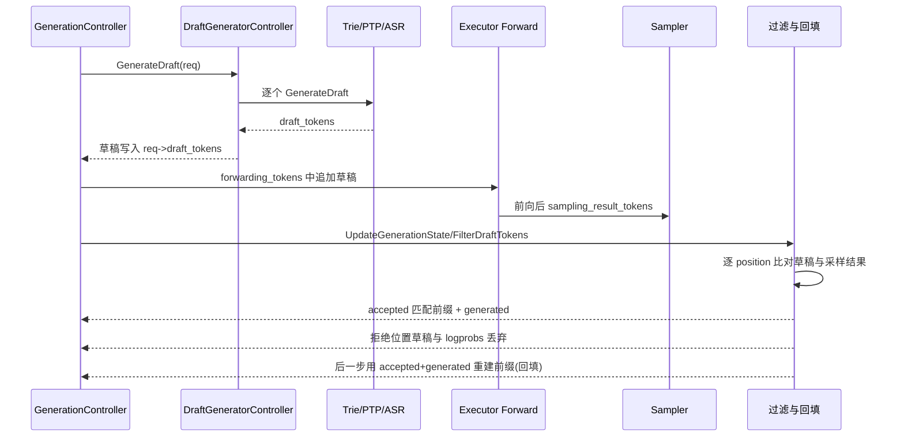

接受机制要点（以 `DefaultFilter` 为例）：

- 前置断言 `sampling_result_tokens.size() - kStepGenerateTokenNum == draft_tokens.size()`。
- 逐 `i` 比较 `sampling_result_tokens[i] == draft_tokens[i]`，遇草稿落到 stop token 或 grammar 约束拒绝即中断。
- `accepted_tokens` 取匹配前缀，`generated_tokens` 置首个未匹配采样 token，未接受位置的 `logprobs` 弹出。
- 拒绝后的草稿不写回 KV，仅移出已验证前缀；后一步用 accepted+generated 重建前缀完成回填。

**草稿数目确定**：`ContinuousBatchingStrategy::DetermineDraftNum`（`csrc/batch_scheduler/strategy/continuous_batching.h`）在解码批达到阈值后停止生成草稿，否则按剩余 slot 给出 `suggested_draft_num`。投机解码中 token 接受率由 per-position `hit_count` 统计上报，供调参。

**Sources:** <ref_code path="csrc/samplers/sampler.h" /> <ref_code path="csrc/samplers/sampler.cpp" /> <ref_code path="csrc/samplers/topk/topk_sampling.cpp" /> <ref_code path="csrc/executor/model_sampler.h" /> <ref_code path="csrc/executor/model_sampler.cpp" /> <ref_code path="csrc/utils/request.h" /> <ref_code path="csrc/runtime/generation_controller.h" /> <ref_code path="csrc/runtime/generation_controller.cpp" /> <ref_code path="csrc/runtime/draft_generator/draft_generator_controller.h" /> <ref_code path="csrc/runtime/draft_generator/draft_generator_controller.cpp" /> <ref_code path="csrc/runtime/draft_generator/draft_tokens.h" /> <ref_code path="csrc/runtime/draft_generator/trie_generator.h" /> <ref_code path="csrc/runtime/draft_generator/trie_generator.cpp" /> <ref_code path="csrc/runtime/draft_generator/ptp_generator.h" /> <ref_code path="csrc/runtime/draft_generator/ptp_generator.cpp" /> <ref_code path="csrc/runtime/draft_generator/asr_custom_generator.h" /> <ref_code path="csrc/runtime/draft_generator/asr_custom_generator.cpp" /> <ref_code path="csrc/batch_scheduler/strategy/continuous_batching.h" /> <ref_code path="csrc/samplers/sampler_test.cpp" />

## 第 5 章 结构化输出与语法约束（xgrammar 生成）

结构化输出由 `SamplingConfig::enable_structured_output` 与 `json_schema` 贯通：请求入队时把约束转成 `StructuredGeneratorConfig`，Executor 侧由 `StructuredGeneratorFactory` 依据约束类型创建 `StructuredGeneratorInterface` 实例，xgrammar 路径将 JSON Schema 编译为 bitmask 约束，施加到采样前 logits 上，保证逐 token 输出符合语法。

### 5.1 出参链路总览

`SamplingConfig` 的 `json_schema` 非空且 `enable_structured_output` 为真时，请求构造期把 `constraint_type=JSON`、`constraint_spec=json_schema` 写入 `structured_generator_config`。该配置被请求对象引用，由其 `structured_generator` 字段持有最终生成器实例。

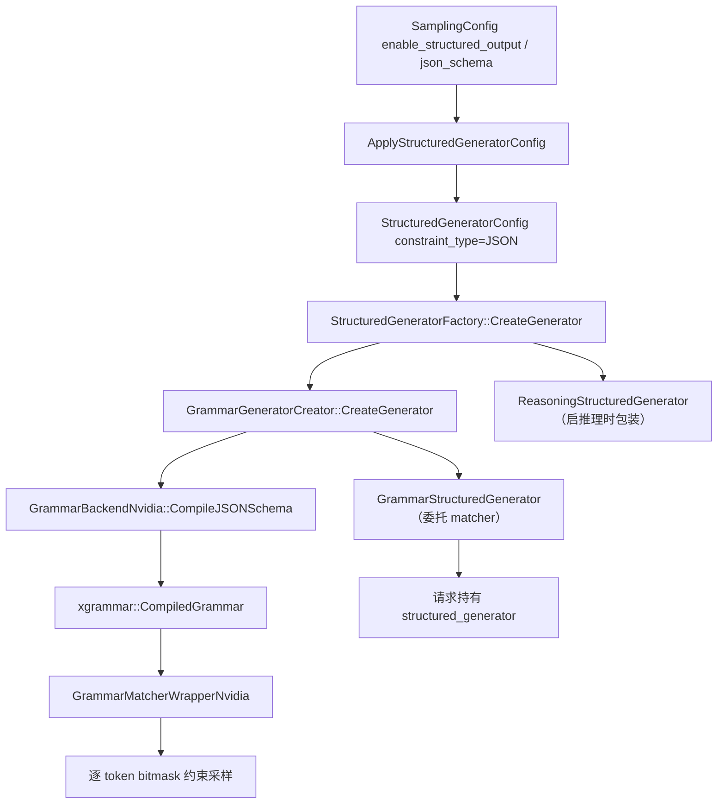

### 5.2 StructuredGeneratorFactory：按约束类型注册与分派

`StructuredGeneratorFactory` 持有以 `StructuredConstraintType`（`NONE / JSON / REGEX`）为键的 `GeneratorCreator` 注册表。`GeneratorCreator` 抽象出 `CreateGenerator(config)` 与 `GetConstraintType()`（`csrc/runtime/structured_generation/structured_generator_factory.h`）。

- `RegisterCreator(type, creator)`：向注册表写入某约束类型的 creator。
- `IsConstraintTypeSupported(type)` / `GetSupportedConstraintTypes()`：查询注册表。
- `CreateGenerator(config, enable_thinking)`：`constraint_type==NONE` 返回 `nullptr`；类型未注册抛异常；否则调用对应 creator 生成内部生成器。

推理包装：当 `vocab_info_.think_end_token_id >= 0` 时，`CreateGenerator` 用内置 `ReasoningStructuredGenerator` 包装内部生成器，思考阶段对全部 token 放行，检测到思考结束标记后截断并转交内部约束生成器。

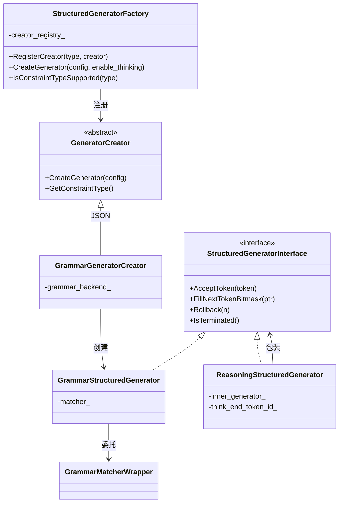

### 5.3 xgrammar 后端：Schema 编译与 Matcher

`GrammarBackendNvidia`（`csrc/utils/nvidia/grammar_backend_nvidia.h`）继承 `GrammarBackend`，把 JSON Schema 编译为 `xgrammar::CompiledGrammar`。

- 构造时以 `VocabInfo` 构建 `xgrammar::TokenizerInfo` 与 `xgrammar::GrammarCompiler`（设置了线程数与缓存开启）。
- `CompileJSONSchema(schema)`：调用 `compiler_->CompileJSONSchema`，返回 `CompiledGrammar`。
- `CreateMatcher(grammar)`：经 `GrammarMatcherWrapper` 的工厂分派到 `GrammarMatcherWrapperNvidia`。

`GrammarMatcherWrapperNvidia`（`csrc/utils/nvidia/grammar_matcher_nvidia.h`）持有 `xgrammar::GrammarMatcher`，提供 `FillNextTokenBitmask` / `AcceptToken` / `Rollback` / `IsTerminated`。

### 5.4 结构化生成器的委托与合法性检查

`GrammarStructuredGenerator`（`csrc/runtime/structured_generation/xgrammar/xgrammar_structured_generator.h`）把全部 `StructuredGeneratorInterface` 操作转发给持有的 matcher：

- `AcceptToken(token_id)` → matcher 逐 token 推进自动机状态。
- `FillNextTokenBitmask(ptr)` → matcher 填充 `(vocab_size + 31) / 32` 个 int32 的 bitmask。
- `Rollback(n)` 回退 matcher 状态；`IsTerminated()` / `IsValid()` 委托 matcher。

### 5.5 bitmask 采样衔接

`ModelSampler::GenerateAndApplyBitmask` 迭代 batch 内请求，对持有 `structured_generator` 且未终止的请求调用 `FillNextTokenBitmask`；当 `need_constraint` 为真时按 bitmask 步长收集 bitmask 与对应 `logits_offset`，交给 device 侧 `sampler_->ApplyTokenBitmaskSelective` 施加到 logits。采样选出 token 后回调 `AcceptToken` 推进 matcher，完成一步闭环。

`SamplingConfig` 链路上传的 `enable_structured_output` / `ptp_token_num` 正是串联这一整条链路的字段：前者开启结构化输出，后者控制采样步数。

### 5.6 build-ahead 禁用原因

`FastPathController::InitializeAtStartup` 以 `enable_xgrammar` 为硬性阻断条件：结构化输出当前不与 build-ahead 双缓冲叠加，启用 xgrammar 即退回慢路径（深度 1），优先保证采样 / grammar 正确性。

**入参衔接表**

| 输入 | 字段 / 类型 | 作用 |
| --- | --- | --- |
| `enable_structured_output` | `bool` | 结构化输出总开关，配合非空 `json_schema` 生效 |
| `json_schema` | `std::string` | JSON Schema 约束规格，转 `constraint_spec` |
| `enable_thinking` | `bool` | `CreateGenerator` 是否起始于推理阶段 |
| `StructuredConstraintType` | 枚举 `NONE/JSON/REGEX` | 约束类型，`JSON` 注册到 `GrammarGeneratorCreator` |
| 后端 | `GrammarBackendNvidia`（CUDA） | `CompileJSONSchema` + `CreateMatcher` |
| 引擎开关 | `enable_xgrammar` | 生效链路开关；为真时禁 build-ahead |

**Sources:** <ref_code path="csrc/runtime/structured_generation/structured_generator_factory.h" /> <ref_code path="csrc/runtime/structured_generation/structured_generator_factory.cpp" /> <ref_code path="csrc/runtime/structured_generation/structured_generator_interface.h" /> <ref_code path="csrc/runtime/structured_generation/reasoning_structured_generator.h" /> <ref_code path="csrc/runtime/structured_generation/reasoning_structured_generator.cpp" /> <ref_code path="csrc/runtime/structured_generation/xgrammar/xgrammar_structured_generator.h" /> <ref_code path="csrc/runtime/structured_generation/xgrammar/xgrammar_structured_generator_creator.h" /> <ref_code path="csrc/utils/grammar_backend.h" /> <ref_code path="csrc/utils/nvidia/grammar_backend_nvidia.h" /> <ref_code path="csrc/utils/grammar_matcher.h" /> <ref_code path="csrc/utils/nvidia/grammar_matcher_nvidia.h" /> <ref_code path="csrc/utils/request.h" /> <ref_code path="csrc/executor/model_sampler.h" /> <ref_code path="csrc/executor/model_sampler.cpp" /> <ref_code path="csrc/runtime/fast_path_controller.h" /> <ref_code path="csrc/runtime/fast_path_controller.cpp" />

## 第 6 章 扩展：多后端子路径、性能与一致性问题

build-ahead 优化优先保证正确性，在投机解码、结构化输出、prefix caching 等场景会被启动期禁用；一致性结论由「汇聚语义 + 测试覆盖 + 时序不变量」共同保障。本章从性能与一致性视角串联前几章的多后端子路径。

### 6.1 build-ahead 双缓冲的开关条件与代价

| 条件 | 启用 | 禁用生效 |
| --- | --- | --- |
| `enable_executor_build_ahead` | true | false（默认关）即整体关闭 |
| `enable_async` | true | build-ahead 前置依赖，缺失即关 |
| 调度器 | DEFAULT（BatchScheduler） | 其它调度器不接入 |
| 并行配置 | TP 任意；DP / EP / PP 排除 | `attn_data_parallel_size != 1`、`expert_fuse_parallel_size != 1`、`max_pp_batch_num != 1` 均拒 |
| 投机/结构化 | 必须关闭 | `enable_speculative_decoding`、`mtp_step_num != 0`、`enable_xgrammar` 均拒 |
| 缓存/调度特性 | 必须关闭 | `enable_prefix_caching`、`enable_flexible_caching`、`separate_prefill_decode` 均拒 |

启用代价是 `HandlePreprocess` 每步 `cur_ring_slot_` 乒乓、Execute 线程在 `Forward` 后内联 `HandlePostprocessInline` 采样并写 ring、TP 下广播 ring slot。禁用代价是回到独立 postprocess 线程模型，损失双 buffer 重叠收益。决策点在启动期一次完成，运行时只读 `IsEnabledAtStartup()`，不做 batch 级拒绝。

### 6.2 采样节点与线程启动策略

`ModelRunner::Start` 以 `IsSamplingNode()` 决定是否拉起采样后端子路径：

- 是：依 `IsEnabledAtStartup()` 二选一——build-ahead 起 `result_report_thread_`（`HandleResultReportProcess` 只消费 `sampling_output_queue_`），慢路径起 `postprocess_thread_`（经 `model_output_queue_` 消费）并在 device 0 上报。
- 否：不启任一，execute 线程同步后直接释放。

`postprocess_one_shot_` / `postprocess_enqueue_report_` 是 Execute 线程经 `HandlePostprocessInline` 写入的跨调用状态，慢路径 postprocess 线程恒为 false，由 `Start` 二选一保证互斥。

### 6.3 GATHER_ALL 多卡一致与数值正确性

采样以 rank0 为准的约定约束了 DP 一致性：

- `SelectTopkTokens` 仅 rank0 跑 Topk；TP>1 且 `mtp_step_num > 0` 时对该 batch 做 NCCL broadcast 同步输出。
- `CopyProbsOutputToRequests` 在 `GATHER_ALL` 模式直接跳过本地拉取，交由 rank 聚合返回。
- 任意随机种子 / 浮点差异不会导致各 rank 样本分叉，进入口与出口在同一组 rank 上一致。

build-ahead 下 `frozen_logits_offsets` 固化于 `ModelExecutor::Forward`，`Sampling` 只读快照，避免共享 `ExecutorInferRequest` 被下一 schedule 覆写造成偏斜。

### 6.4 sampler_test 的覆盖范围与正确性保证

`SamplerTest`（`csrc/samplers/sampler_test.cpp`）覆盖采样相似多条规则路径，是正确性回归防线。

| 用例 | 覆盖 |
| --- | --- |
| `ArgMaxSamplerTest` | 贪心选 token 数值 |
| `NoRepeatNgram` / `DecoderNoRepeatNgram` / `MTP` | encoder/decoder no-repeat ngram、MTP 步重复惩罚 |
| `Temperature` | temperature 近零修正 |
| `GATHER_ALL`（`LogitsTargetGatherAll`） | request_target 汇聚语义 |
| `ApplyGrammarMask*` | 文法门控开 / 关、MTP 跳过、空 matcher 边界 |

用例多数以 `ENABLE_CUDA` 校验数值，logprobs / 位掩码路径用近似断言：gather 语义下任何改变计算顺序或精度的改动都会被固定数值断言捕捉，从而保证一致性由测试兜底。

### 6.5 InflightResourceManager 幂等释放与重计算时序

`InflightResourceManager::ProcessScheduleOutput` 是统一的 Alloc / Free 入口，在 preprocess 线程被 `ModelRunner::HandlePreprocess` 调用。每个资源维护独立互斥锁，读走 shared、写走 unique；execute 线程可无锁直读。

时序约束由跨组件不变量保证：`finish_req_ids / recompute_req_ids` 由调度器在拿到生成结果后填充，故 preprocess 的 `Free(req_id)` 一定晚于 execute 使用过该 slot 的最后一步。释放先于分配，保证 slot 池满时 Alloc 得到已释放槽。`Free` / `Alloc` 均幂等，无需额外 `Has` 守卫，`finish / recompute` 同时出现的 req 也安全。

### 6.6 MTP 序列化的并发一致性约定

`serialize_main_mtp_` 在构造期由 `IsSamplingNode() && mtp_step_num>0 && max_pp_batch_num>1` 计算，为真时 `Forward` 在主前向启动前等待上一步 `MtpForward` 结束，再复位布防；`MtpForward` 结束由调用方释放等待中的主前向。

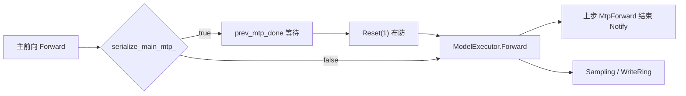

这在同一 rank 上构成「主前向与上一轮 MTP 必须串行」的并发一致约定。若不 gate，TP>1 时各 rank 对 `CommonModel::forward_mutex_` 加锁顺序可能不同，进入不同的 collective 造成死锁。关机时 `ExecutorRuntime::Shutdown` 唤醒阻塞在主前向的 execute 线程，否则队列停止后 MTP 的 Notify 不再到来可致 join 挂死。

**一致性结论**

| 一致性维度 | 机制 |
| --- | --- |
| 采样数值 | rank0 计算 + TP broadcast / 同步 |
| 汇聚语义 | `GATHER_ALL` 交由 rank 聚合返回 |
| logits 归属 | `frozen_logits_offsets` 快照隔离跨一步覆写 |
| 组件资源释放 | InflightResource free-first、幂等 |
| MTP 与主前向 | `serialize_main_mtp_` 等待 / 布防 |
| 回归保障 | sampler_test 数值断言 |

**Sources:** <ref_code path="csrc/runtime/fast_path_controller.h" /> <ref_code path="csrc/runtime/fast_path_controller.cpp" /> <ref_code path="csrc/samplers/sampler_test.cpp" /> <ref_code path="csrc/executor/inflight_resource.h" /> <ref_code path="csrc/executor/inflight_resource.cpp" /> <ref_code path="csrc/executor/executor_runtime.h" /> <ref_code path="csrc/executor/executor_runtime.cpp" /> <ref_code path="csrc/executor/model_runner.h" /> <ref_code path="csrc/executor/model_runner.cpp" /> <ref_code path="csrc/samplers/sampler.h" /> <ref_code path="csrc/samplers/sampler.cpp" /> <ref_code path="csrc/executor/model_sampler.h" /> <ref_code path="csrc/executor/model_sampler.cpp" />