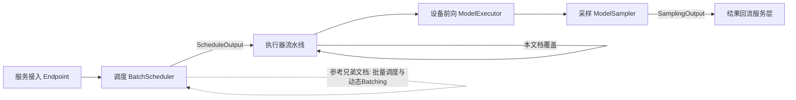
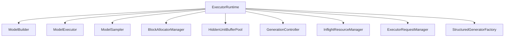
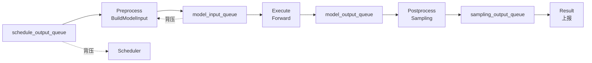
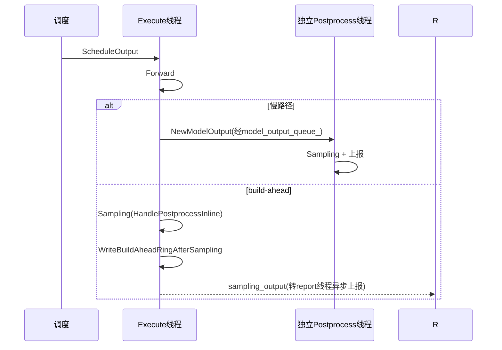
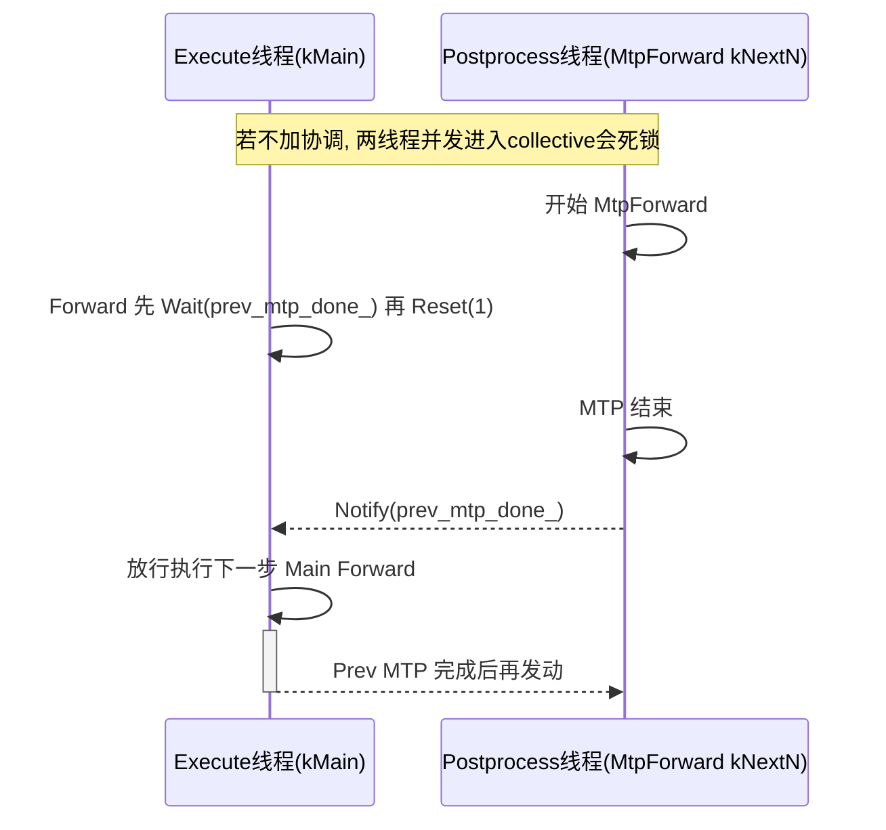
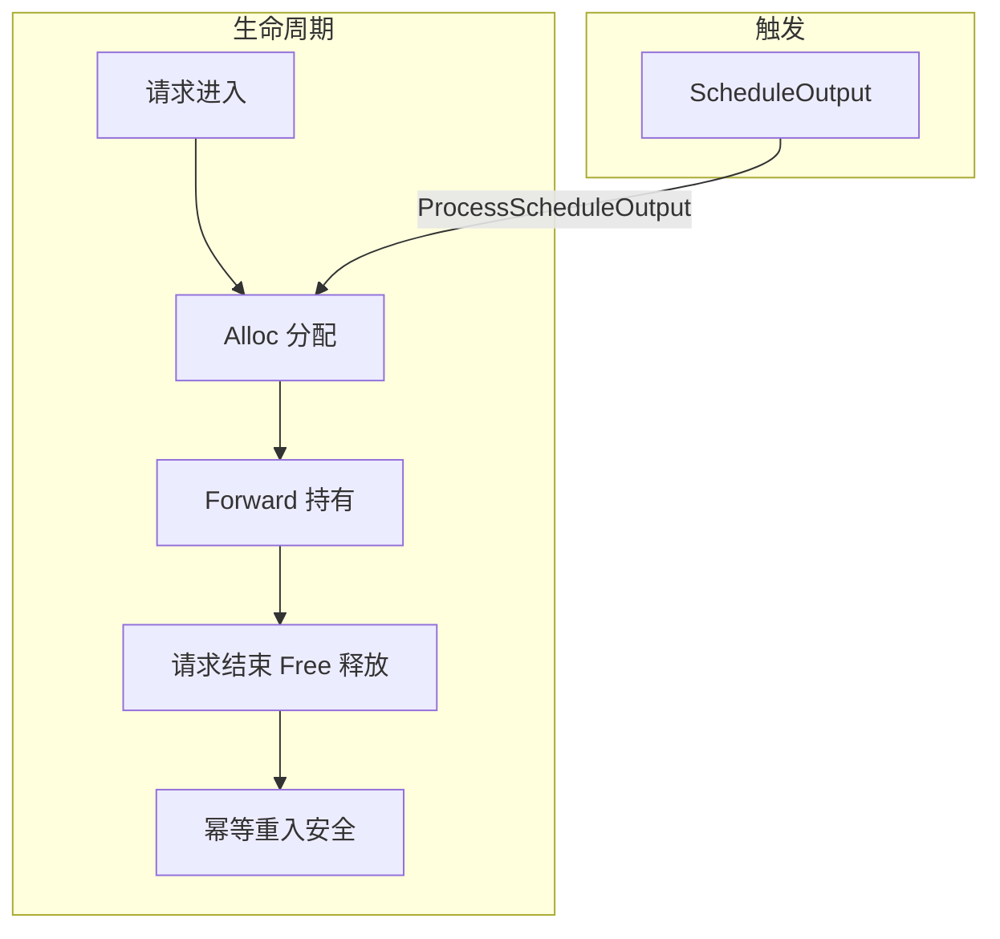

# 执行器流水线

## 1. 执行器流水线概述

本章回答一个核心问题：执行器在「接入→调度→执行→采样→回流」全链路中处于什么位置，它要解决哪三个关键工程问题，本文档各章如何组织。

### 执行器在执行链路中的定位

KSanaLLM 把一次请求从接入到结果的往返切成四段：服务端点接入请求、`BatchScheduler` 调度出每步的 `ScheduleOutput`、执行器把 `ScheduleOutput` 加工为设备前向输入并跑前向与采样、再把 `SamplingOutput` 回流给服务层。执行器正是这段链路里的执行中枢，本文档覆盖它的全部机制。

执行器要长期稳定地在调度与采样之间做高吞吐、低延迟的异步搬运，需要解决三个工程问题：

- **如何把 `ScheduleOutput` 变成设备上前向输入**：调度产出的是契约对象 `ScheduleOutput`，执行器要把它加工成 `NewModelInput`，并完成 KV 块分配与请求重排序。
- **如何高吞吐低延迟地回流结果**：多条线程 + 多条阻塞队列构成流水线，把前向、采样、结果上报拆开并行。
- **多步预测与并发前向下如何避免死锁**：常规模拟前向与 MTP/DSpark 多步预测并发时存在通信死锁风险，需显式协调。

### 文档的四大模块

本文档围绕四个相互咬合的回路展开：

| 模块 | 核心载体 | 职责 |
| --- | --- | --- |
| 运行时统一装配 | `ExecutorRuntime` | 聚合模型构建/前向/采样 + 块分配器 + 缓冲池 + 生成控制器 |
| 四阶段流水线 | `ModelRunner` | 四条阻塞队列串起 Preprocess→Execute→Postprocess→Result |
| 慢路径 vs build-ahead | `ModelRunner` 双路径 | 是否内联 postprocess 与 0/1 双 slot |
| 瞬时资源与死锁协调 | `InflightResourceManager` + `ExecutorRuntime` | 幂等释放飞行中资源、协调前向并发 |

### 与兄弟文档的边界

- 采样规则管线（repetition penalty、TopK/TopP、GATHER_ALL）、投机草稿生成与接受 → 「采样算法与投机解码」
- xgrammar bitmask、`StructuredGeneratorFactory` 注册 → 「结构化输出与语法约束」
- KV 块分配、`BlockAllocatorManager` 物理布局、LFU 驱逐 → 「KVCache缓存管理」
- `BatchScheduler` 准入、等待队列、DP/PP 均衡、`ScheduleOutput` 产出 → 「批量调度与动态Batching」

本文档只说明 `ModelSampler`/`Sampling` 如何被 `ModelRunner` 流水线调用，不展开算法本体。

**Sources:** <ref_code path="csrc/executor/" />

## 2. ExecutorRuntime 统一装配：执行器的运行时容器

本章回答：执行器拿到 `ScheduleOutput` 后需要哪些组件配合才能完成一次前向，`ExecutorRuntime` 如何把这些组件拧成一股绳。

### 装配的核心对象

`ExecutorRuntime` 是执行器中心的运行时容器，本身不持线程，只负责统一构建并持有执行期全部子组件，作为 `ModelRunner` 各线程的公共依赖注入目标（`SetExecutorRuntime` 系列）。

`Initialize()` 完成组件的装配与依赖关系的注入：

- 先初始化 `HiddenUnitBufferPool`，再按 `enable_xgrammar` 决定是否构造 `StructuredGeneratorFactory`。
- 构建 `ModelBuilder`，注入 `ModelInstance` 与 `BlockAllocatorManager`。
- 构建 `ModelExecutor`，注入权重、`ModelInstance`、块分配器。
- 构建 `ModelSampler`，作为前向到采样的桥接层。

### 如何把 ScheduleOutput 变成设备输入

`ModelRunner::HandlePreprocess` 在 preprocess 线程调用 `ExecutorRuntime::BuildModelInput`，后者转调 `ModelBuilder::BuildModelInput`，它负责：

- 把 `ScheduleOutput` 中的 `ExecutorInferRequest` 转为设备侧 `ForwardRequest`。
- 通过 `BuildForwardRequestFromInferRequest` 填充 KV 缓存指针、logits 偏移、前向 token 等字段。
- 通过 `ReorderInferRequests` 把多 token 前向的请求排前、单 token decode 排后，以利用 Attention 层的连续空间加速。

`BuildModelInput` 还负责请求重排序后重置 `logits_offset`。build-ahead 开启时 `forwarding_tokens` 深拷贝隔离，慢路径则用 `shared_ptr` 别名共享，避免并发覆写。

**Sources:** <ref_code path="csrc/executor/executor_runtime.h" /> <ref_code path="csrc/executor/executor_runtime.cpp" /> <ref_code path="csrc/executor/model_builder.h" /> <ref_code path="csrc/executor/model_builder.cpp" />

## 3. ModelRunner 多线程四阶段流水线

本章回答核心问题：`ModelRunner` 用哪几个队列把执行拆成哪几段，一个 `ScheduleOutput` 从入队到结果回流走完怎样的旅程。

### 四条队列、四个阶段

`ModelRunner` 在构造函数中创建四条阻塞队列，由四条工作线程消费，形成 Preprocess → Execute → Postprocess/Sampling → Result 四阶段流水线：

| 线程 | 消费队列 | 处理函数 | 产出的对象 |
| --- | --- | --- | --- |
| preprocess_thread | `schedule_output_queue_` | `HandlePreprocess` | `NewModelInput` |
| execute_thread | `model_input_queue_` | `HandleExecute` | `NewModelOutput` |
| postprocess_thread | `model_output_queue_` | `HandlePostprocess` | `SamplingOutput` |
| result_report_thread | `sampling_output_queue_` | `HandleResultReportProcess` | 上报服务层 |

### Preprocess：把调度输出变成模型输入

`HandlePreprocess` 从 `schedule_output_queue_` 取到 `ScheduleOutput`，依次执行：

- `UpdateCachedRequests`：缓存完整请求信息、更新增量请求（`ExecutorRequestManager`）。
- `RebuildScheduleOutput`：用补丁恢复完整 `ScheduleOutput`。
- `ProcessScheduleOutput`：驱动 `InflightResourceManager` 按调度输出分配/释放飞行中资源。
- `BuildModelInput`：生成 `NewModelInput` 并设 `slot_index`。
- 双 H2D stream 开启时调用 `PrepareModelInputGpu`，在 preprocess 线程完成 `ParseFromRequests`，与上一步 Forward 重叠。

### Execute：设备前向

`HandleExecute` 从 `model_input_queue_` 取 `NewModelInput`，挂上一步 ring slot 指针，从缓冲池取 `HiddenUnitDeviceBuffer`，调用 `ExecutorRuntime::Forward`。Fast path 下 Forward/采样/写 ring 都在 Execute 线程串行；慢路径下把 `NewModelOutput` 放入 `model_output_queue_` 交给独立 postprocess 线程。

四条队列以阻塞语义天然形成背压：上游生产过快时队列会阻塞消费线程，从而把流量控制在管线容量内，同时与调度器通过 `schedule_output_queue_` 的消费速率形成节流。

**Sources:** <ref_code path="csrc/executor/model_runner.h" /> <ref_code path="csrc/executor/model_runner.cpp" />

## 4. 慢路径与 build-ahead 双 slot：两条执行路径

本章回答：为什么要两条路径，build-ahead 的本质是什么，0/1 双 slot 如何交替工作，何时被禁用。

### 两条路径的取舍

执行器提供两种执行模型，由 `FastPathController::IsEnabledAtStartup()` 在启动期裁定：

| 维度 | 慢路径 | build-ahead 路径 |
| --- | --- | --- |
| postprocess 位置 | 独立 `postprocess_thread_` | Execute 线程内联 `HandlePostprocessInline` |
| 队列 | 经 `model_output_queue_` | 不经该队列，走 `one_shot` 单次调用 |
| 结果上报 | postprocess 线程 device 0 同步 IPC | 独立 `result_report_thread_` 异步上报 |
| 意图 | 默认模型，三线程 | 降低端到端延迟 |

build-ahead 的本质：让 postprocess 不再等独立队列消费，而是在 execute 步抢先完成 Sampling 与写 ring，从而让一个 `ScheduleOutput` 的处理尽量压在单个线程内、避免线程切换的延迟。

### 0/1 双 slot 环形缓冲

`ModelRunner` 维护 `cur_ring_slot_`，build-ahead 每步 `cur_ring_slot_ ^= 1u` 在 0/1 交替。`slot_index` 落在 `NewModelInput` 上，Execute 线程取上一步 slot（`slot_index ^ 1u`）的 ring 指针，Forward 内 `ReplaceLastTokenKernel` 按 req_id 回填 placeholder。双 slot 深度对应 `executor_pipeline_depth_` 上限 2，使 Preprocess 与 Execute 可重叠且互不覆写。

Sampling 后 `WriteBuildAheadRingAfterSampling` 把本步 `(req_id, token)` 写入 ring slot，供下一步回填。TP 下 rank 0 写 ring 后全体 rank 经 `BroadcastBuildAheadRingSlot` NCCL 集体同步。

### build-ahead 的启用条件与禁用

`FastPathController::InitializeAtStartup` 只有在总开关 `enable_executor_build_ahead`、`enable_async`、`scheduler_type=DEFAULT`、并行度（DP/EP/PP 均 =1）以及各类高级功能（投机解码、MTP、xgrammar、prefix/flexible caching、PD 分离）全部满足时才启用 build-ahead：这些功能与单线程内联 postprocess 的双 slot 设计不兼容，故保守禁用并记录 `disable_reason`。

**Sources:** <ref_code path="csrc/executor/model_runner.h" /> <ref_code path="csrc/executor/model_runner.cpp" /> <ref_code path="csrc/runtime/fast_path_controller.cpp" /> <ref_code path="csrc/executor/model_sampler.h" />

## 5. ModelExecutor 前向与多步预测死锁协调

本章回答：常规 `Forward` 与 MTP/DSpark 多步预测并发时为何可能通信死锁，设计如何协调；`ModelSampler` 如何在前向与采样之间桥接。

### ModelExecutor.Forward 设备前向

`ModelExecutor::Forward` 是设备前向主链路。它先把本步 logits_offset 固化为快照（fast path 下共享 `ExecutorInferRequest` 可能被下一 schedule 覆写），再按 CUDA/CPU 路径调度：

- CUDA 路径：单次 `model_instance_->Forward` 经 `InferStage::kDecode` 一步跑完。
- CPU 路径：把请求按 `InferStage::kContext`/`kDecode` 分两组分别前向。

前向后透传本步 `(req_id, last_offset)` 设备指针到 `cur_pairs_dev`，供 postprocess 的 `WriteRing` 写入。

### 常规前向与多步预测的并发协调

`ModelExecutor.Forward` 由 `ExecutorRuntime::Forward` 包装。在采样节点上，慢路径三线程模型中，本步的 MTP 前向（`MtpForward`）跑在 postprocess 线程，而下一步常规前向跑在 execute 线程，二者在 TP>1 且 PP batch>1 时可能并发进入不同的 `RunMode`，导致 `CommonModel::forward_mutex_` 在不同 TP rank 上按不同顺序加锁、进入不同的 `TrtAllReduce` 集体而产生通信死锁。

设计通过 `Waiter prev_mtp_done_` 显式串行协调：`ExecutorRuntime::Forward` 顶部 `Wait()` 等候上一次 MTP 完成、再 `Reset(1)` 为即将到来的 MTP 置位；`MtpForward`/`DSparkForward` 结束都 `Notify()` 释放。是否启用由 `serialize_main_mtp_` 在构造期按 `IsSamplingNode && mtp_step_num>0 && max_pp_batch_num>1` 一次算定。`Shutdown` 唤醒 `prev_mtp_done_`，避免停止时 Execute 线程卡在无法到来的 Notify 上。

### ModelSampler 的桥接

`ModelSampler::Sampling` 接收前向产物，`BuildSamplingRequest` 把 logits 转成采样请求，`GenerateAndApplyBitmask` 应用结构化生成器的位掩码：它是前向与采样之间的桥接层。build-ahead 下 `GetSampler()` 暴露 `Sampler` 实例供 Execute 线程同步取上一步 ring slot。

**Sources:** <ref_code path="csrc/executor/model_executor.h" /> <ref_code path="csrc/executor/model_executor.cpp" /> <ref_code path="csrc/executor/executor_runtime.h" /> <ref_code path="csrc/executor/executor_runtime.cpp" /> <ref_code path="csrc/executor/model_sampler.h" />

## 6. 瞬时资源管理：InflightResourceManager

本章回答：为何显存/槽位类瞬时资源需要幂等释放，`InflightResourceManager` 如何按 req_id 注册并按调度输出批量分配/释放。

### 抽象与注册

瞬时资源指请求生命周期内占用、请求结束时必须归还的显存/槽位资源（如压缩器 slot）。`InflightResourceManager` 在 `req_id` 空间内按名称统一注册异构资源，供 `BaseModel` 重写注入。

- `InflightResourceInterface`：非模板基类，统一 `Alloc/Free/Has/Init`，与资源值类型解耦。
- `BaseInflightResource<T>`：类型化中间层，内置 `shared_mutex`。`Get` 走共享锁、`Alloc/Free` 走独占锁；提供无锁读 `GetUnderSchedulerInvariant`——利用调度器保证 `finish_req_ids` 只在结果返回后填充，故 Execute 读时必无并发写。

### 按调度输出分配/释放

`ProcessScheduleOutput(const ScheduleOutput&)` 是分配与释放的统一入口，在 preprocess 线程调用：

- **Alloc**：对 `executor_running_reqs` 中尚未持有某资源的每个请求做分配。
- **Free**：对 `finish_req_ids` 与 `recompute_req_ids` 中的每个 req 做释放。

幂等释放的意义：重计算/请求取消路径上重复释放同一资源不报错，避免路径分支导致的误差。`ModelRunner::Start` 把 `InflightResourceManager` 裸指针缓存到 `inflight_resource_mgr_`，避免热路径上 `shared_ptr` 的原子引用计数开销。

### 执行期请求登记

`ExecutorRequestManager` 与 `ExecutorRequest` 负责登记执行期请求：`AddInferRequest`/`UpdateInferRequest` 用增量补丁维护 `cached_requests_`，`SnapshotInferRequests` 供 pd_v2 的逐层 KV 回调枚举活 batch，`EraseRequest` 在请求结束时移除。

**Sources:** <ref_code path="csrc/executor/inflight_resource.h" /> <ref_code path="csrc/executor/inflight_resource.cpp" /> <ref_code path="csrc/executor/executor_request_manager.h" /> <ref_code path="csrc/executor/model_runner.cpp" />

## 7. 性能调优与注意事项

本章是实践向收尾，面向调优工程师给出执行器流水线的决策建议与易错点清单。

### 双路径选择与深度托盘

| 场景 | 推荐路径 | 说明 |
| --- | --- | --- |
| 高吞吐、低延迟，无投机/xgrammar | build-ahead | postprocess 内联，双 slot 减延迟 |
| 投机解码 / MTP / xgrammar 开启 | 慢路径（被强制禁用） | 与双 slot 不兼容 |
| DP/EP/PP >1、PD 分离 | 慢路径 | build-ahead 仅限 DEFAULT 调度 + 单 DP/EP/PP |

`executor_pipeline_depth_` 上限 2 与 ModelInput 双 slot 对齐：调深会增加并行但牺牲 slot 隔离，一般不超 2。build-ahead 未启用时透明降级到原 `enable_async` 路径，故把 `enable_executor_build_ahead` 打开前应先确认 `FastPathController` 的启用日志。

### 吞吐与延迟的权衡要点

- **背压与队列容量**：四条阻塞队列天然节流；`schedule_output_queue_` 的消费速率决定调度器推进速度，容量是吞吐与内存的托盘。
- **双 H2D stream**：开启后 `PrepareModelInputGpu` 前移到 preprocess，与前一步 Forward 重叠，适合 H2D 传输成为瓶颈的场景。
- **ring 写与 TP 广播**：build-ahead + TP 时 rank 0 写 ring 后全体 rank 必须参与 `BroadcastBuildAheadRingSlot` 集体，`TP<=1` 时跳过以省开销。

### 死锁与幂等的防御写法

- **前向并发协调顺序**：多步预测并发时依赖 `Waiter prev_mtp_done_` 的 Wait/Reset/Notify 顺序，改扰动序直接触发通信死锁；停止时须调用 `Shutdown` 唤起等待线程。
- **瞬时资源释放幂等**：重计算/取消路径上可重复 `Free`，`ProcessScheduleOutput` 统一按 `finish_req_ids`/`recompute_req_ids` 释放，勿在路径分支里手工释放。
- **frozen logits 快照**：fast path 下共享 `ExecutorInferRequest` 可能被下一 schedule 覆写，采样须用 `frozen_logits_offsets` 而非 live 字段。

**Sources:** <ref_code path="csrc/executor/model_runner.h" /> <ref_code path="csrc/runtime/fast_path_controller.cpp" /> <ref_code path="csrc/configure/schedule_config_parser.h" />