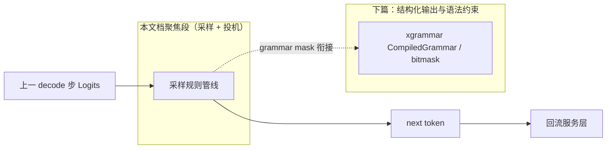
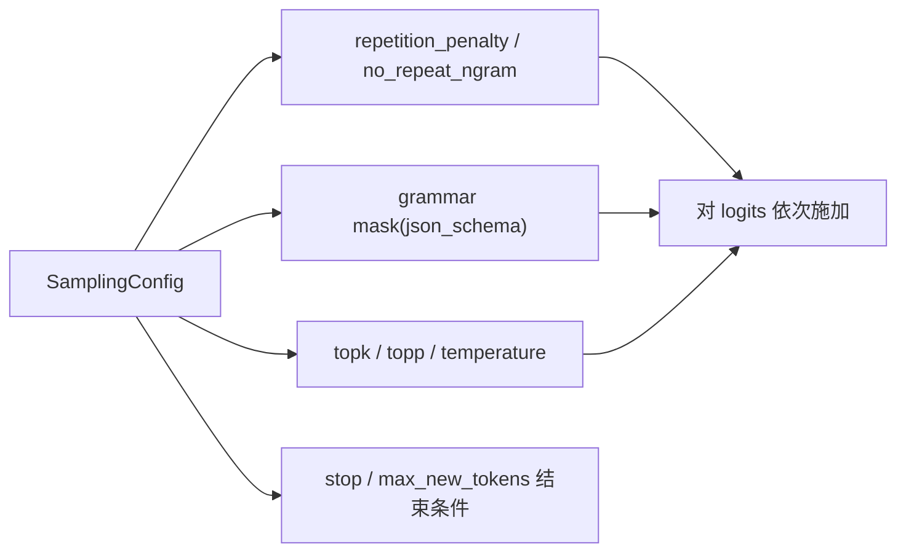
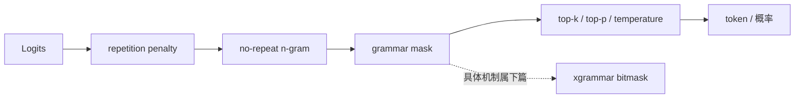
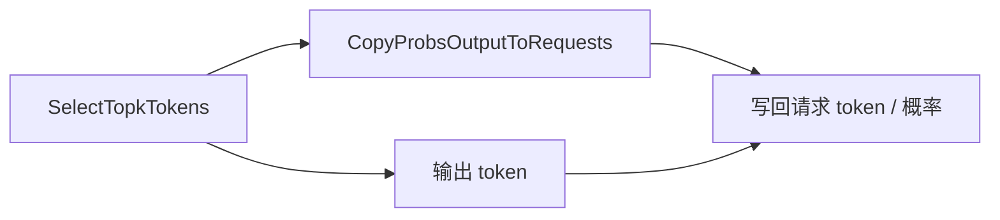
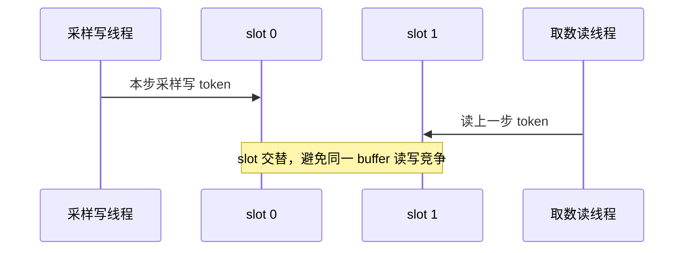
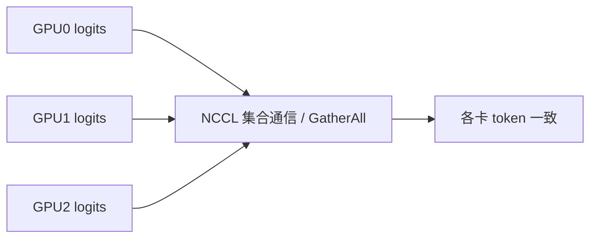
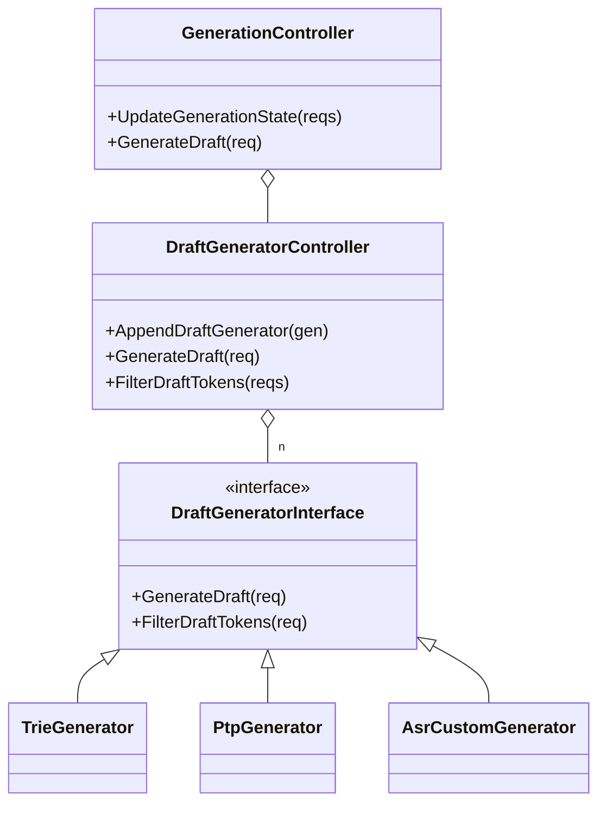
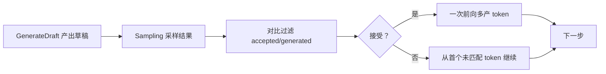
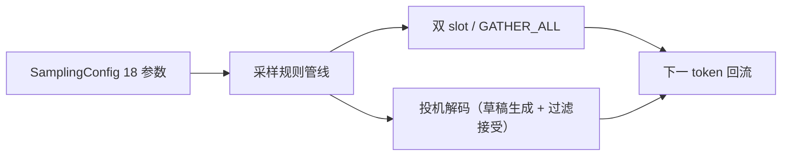

# 采样算法与投机解码

## 1. 概述：从 Logits 到下一个 Token

本文档聚焦 KsanaLLM「执行器与采样解码」领域中**采样算法**与**投机解码**两部分，面向算法与性能工程师。

**核心结论**：采样是给前一个 decode 步产出的 Logits（各 token 的打分）施加一组规则后，选出**下一个 token** 的过程；文档两条主线分别是**确定性**（采样规则管线 + 多卡一致）与**高性能**（双缓冲 + 投机解码）。

### 1.1 采样在流水线中的位置

主链路数据流为：`Endpoint → InferenceService → Channel → InferenceEngine → ModelDriver → BatchScheduler.Schedule → ScheduleOutput → ModelRunner → Sampling → Result`。采样阶段接收前向得到的 Logits，经规则处理选出 token，再回流到服务层。

采样是 Executor 侧入口，由 `ModelSampler` 承担。

| 环节 | 职责 | 关键类 |
| :--- | :--- | :--- |
| 数据入口 | 持有 Sampler、把执行器请求转成采样请求 | `ModelSampler`（`csrc/executor/model_sampler.h`） |
| 采样执行 | 对 logits 施加规则选出 token | `Sampler`（`csrc/samplers/sampler.h`） |

### 1.2 两大主题

- **确定性**：采样规则对 logits 依次施加（第 3 章），多卡下借助 `GATHER_ALL` 保证各卡一致（第 4 章）。
- **高性能**：build-ahead 下双缓冲双 slot 避免数据竞争（第 4 章）；投机解码用轻量草稿一次前向多产 token（第 5 章）。

### 1.3 数据流图

> 结构化解码的具体生成机制（xgrammar `CompiledGrammar`、`StructuredGeneratorFactory` 注册）由下篇《结构化输出与语法约束》覆盖，本文档仅在 grammar mask 环节点到为止。

**Sources:** <ref_code path="csrc/executor/model_sampler.h" /> <ref_code path="csrc/samplers/sampler.h" />

## 2. SamplingConfig：贯穿链路的 18 参数

**核心结论**：`SamplingConfig`（`csrc/utils/request.h`）是采样配置的载体，从服务端一路携带到 `Sampler`，18 个字段按作用分成「采样规则 / 停止控制 / 结构化 / 投机」四类，通过 `VerifyArgs()` 在管线入口做合法性校验。

### 2.1 参数分段与管线定位

`VerifyArgs()` 在每个 `SamplingRequest` 进入 `PrepareDeviceLogitsAndParameter` 时被调用（`sampler.cpp`），校验并调整异常参数。

| 分段 | 参数 | 在管线中的作用 |
| :--- | :--- | :--- |
| 采样规则 | `topk`、`topp`、`temperature` | top-k / top-p / 温度修正，作用于 logits 后 softmax（第 3 章） |
| 采样规则 | `repetition_penalty` | 惩罚高频 token，逐 token 施加 |
| 采样规则 | `no_repeat_ngram_size` / `encoder_no_repeat_ngram_size` / `decoder_no_repeat_ngram_size` | 禁止 n-gram 重复 |
| 采样规则 | `logprobs_num` | 回写请求的 top 概率数量 |
| 结束控制 | `stop_token_ids`、`stop_strings`、`ignore_eos`、`max_new_tokens`、`length_penalty` | 终止生成条件 |
| 结构化 | `json_schema`、`enable_structured_output`、`enable_thinking` | 引导式生成开关（下篇覆盖机制） |
| 投机 | `ptp_token_num` | 每请求 PTP 草稿 token 数：-1 用全局、0 关闭、>0 指定数量 |
| 返回 | `num_beams`、`num_return_sequences` | 束搜索 / 返回序列数 |

### 2.2 参数 → 应用阶段映射

**Sources:** <ref_code path="csrc/utils/request.h" /> <ref_code path="csrc/samplers/sampler.cpp" />

## 3. 采样规则管线：对 Logits 依次施加的规则

**核心结论**：`Sampler` 对每个 step 的 logits 按固定次序施加采样规则——**repetition penalty → no-repeat n-gram → grammar mask → top-k/top-p/temperature**，主执行路径集中在 `Sampler::Sampling`（`sampler.cpp`），最终经 `SelectTopkTokens` 选取 token 并回写请求。

### 3.1 管线总览

各环节在 `Sampling` 内按序调用 `PrepareDeviceLogitsAndParameter` 之后的处理函数。

### 3.2 各规则职责

- **repetition penalty**：对已出现 token 施加惩罚（`ApplyRepetitionPenalty`），`1.0` 表示不惩罚；分两条路径——对 `input_tokens` 与 `forwarding_tokens` 中出现的 token 统一设惩罚值。
- **no-repeat n-gram**：`NoRepeatNgramProcessor` 构建 n-gram 字典后，把续接为重复的 token 的 logits 置为 `-inf`（`BanRepeatTokens`）；按输入 / 编码 / 解码区分 `encoder_`、`decoder_` 变体。
- **grammar mask**：`ApplyGrammarMask` 依 xgrammar 填充 bitmask，仅对带 grammar 约束的 request 剔除非法 token；具体机制属下篇。
- **top-k / top-p / temperature**：`topk_sampling_->Forward`（`TopkSampling::RunSampling`），宏观采样，top-p 与 temperature 在 softmax 之后施加。

### 3.3 结果回写

`SelectTopkTokens` 选出 token 后，`CopyProbsOutputToRequests` 把 top 概率写回请求，供 `logprobs_num` 与投机接受率统计使用；`input_top_logprobs` 路径由 `CalcInputLogprobs` 计算。

**Sources:** <ref_code path="csrc/samplers/sampler.cpp" /> <ref_code path="csrc/samplers/topk/topk_sampling.cpp" /> <ref_code path="csrc/samplers/base/base_sampling.h" />

## 4. 双缓冲双 slot 与多卡一致性

**核心结论**：`Sampler` 在 build-ahead 下用**双缓冲双 slot（ring slot 0/1）**让一条线程写、另一条读同一批设备 buffer，避免 D2H 数据竞争；多卡下以 `TokenReduceMode::GATHER_ALL` 聚合各 GPU，保证各卡采样一致。

### 4.1 双 slot 并发模型

`Sampler::Sampling(..., size_t slot)` 以 slot 参数轮转读写入存。slot 0/1 拥有独立的 device/host buffer（`device_output_tokens_slot1_`、`host_output_tokens_slot1_`），仅当 `FastPathController::IsEnabledAtStartup()` 为真时分配 slot 1。慢路径恒为 slot 0。

双 slot 与 `ModelRunner` build-ahead 的 `executor_pipeline_depth_ = 2`（ModelInput 双 slot）对齐——连续两步采样落独立 buffer，host 数据不被下一步覆盖。

### 4.2 多卡一致性（GATHER_ALL）

`TokenReduceMode` 枚举定义于 `csrc/utils/request.h`，`GetTokenReduceMode()` 从字符串解析出 `GATHER_ALL` / `GATHER_TOKEN_ID`。

- TP>1 时各 GPU 的 logits 经真实时 TP / NCCL 集合通信保证一致（分布式章节）。
- 采样侧 `GATHER_ALL` 使多 GPU 下 token 统一；对带 `request_target["logits"]` 且 `token_reduce_mode == GATHER_ALL` 的请求，`CopyProbsOutput` 跳过逐 token 回写，改为统一聚合。

**Sources:** <ref_code path="csrc/samplers/sampler.cpp" /> <ref_code path="csrc/utils/request.h" /> <ref_code path="csrc/executor/executor_runtime.h" /> <ref_code path="csrc/executor/model_sampler.cpp" />

## 5. 投机解码：草稿生成与接受

**核心结论**：投机解码（Speculative Decoding）用轻量草稿生成器猜测 k 个 token，再用目标模型一次前向验证；`DraftGeneratorController` 协调多类草稿生成器，`GenerationController` 对比采样结果过滤草稿（accepted vs generated），接受则一次前向多产 token。

### 5.1 加速思想

- 用廉价模型预测 k 个「draft 草稿」token。
- 目标模型一次验证这批草稿，被接受的 token 免费获得，不接受则从首个未匹配处继续。
- 收益：每次 decode 步平均产 token 数 >1，称**投机接受率**（每个草稿位置统计 hit/draft）。

`DraftTokens`（`csrc/runtime/draft_generator/draft_tokens.h`）以三类向量承载草稿：`mtp`（多 token 预测）、`spec`（投机）、`ptp`（按需猜测）。

### 5.2 草稿生成器分工

`DraftGeneratorController` 通过 `DraftGeneratorInterface::GenerateDraft` 依注册顺序运行各生成器，`FilterDraftTokens` 委托最后一个生成器做标准验证。

| 生成器 | 草稿来源 | 说明 |
| :--- | :--- | :--- |
| `TrieGenerator` | 前缀树命中 | `TrieTree` 按 n-gram 频率预测分支，match 1 token 可预言多个 |
| `PtpGenerator` | 按需猜测 | 按 `ptp_token_num` 生成占位草稿，`ptp_token_id` 填充 |
| `AsrCustomGenerator` | 用户提供 | 管理 `req->draft_tokens.spec`，skip-ahead 处理小幅不匹配 |

### 5.3 类图关系

### 5.4 验证与接受循环

`GenerationController::UpdateGenerationState` 对比 `sampling_result_tokens` 与草稿，过滤出 `accepted_tokens`（与采样一致的前缀）与首个未匹配的 `generated_tokens`；`DefaultFilterDraftTokens` 为默认实现，并清理未接受 token 对应的 logprobs 记录。草稿接受率经 `FilterDraftTokens` 落成 `spec_draft_hit_num` / `spec_draft_token_num` 指标与日志。

**Sources:** <ref_code path="csrc/runtime/draft_generator/draft_generator_controller.h" /> <ref_code path="csrc/runtime/draft_generator/draft_generator_controller.cpp" /> <ref_code path="csrc/runtime/draft_generator/draft_generator_interface.h" /> <ref_code path="csrc/runtime/draft_generator/draft_tokens.h" /> <ref_code path="csrc/runtime/draft_generator/trie_generator.h" /> <ref_code path="csrc/runtime/draft_generator/ptp_generator.h" /> <ref_code path="csrc/runtime/draft_generator/asr_custom_generator.h" /> <ref_code path="csrc/runtime/generation_controller.h" />

## 6. 注意事项与最佳实践

**核心结论**：采样阶段在性能、并发与正确性三方面存在取舍——多卡必须全卡一致、双 slot 与 build-ahead 对齐有条件、投机/grammar 启用会关闭 build-ahead。

### 6.1 决策建议

| 场景 | 建议 | 理由 |
| :--- | :--- | :--- |
| 多 GPU 推理 | 开启 `GATHER_ALL` | 保证各卡采样 token 一致 |
| build-ahead | 需对齐 `executor_pipeline_depth_ = 2` | 双 slot 与 ModelInput 双 slot 配对 |
| 投机解码 / grammar | `FastPathController` 会关闭 build-ahead | 避免加速路径下双缓冲误用 |
| MTP / swap / draft | 被排除在 build-ahead 之外 | `InitializeAtStartup` 硬条件排除 |

### 6.2 三方面取舍

- **性能**：双 slot 免竞争、投机一次前向多产；但额外分配 device/host buffer 与 ring。
- **正确性**：多卡必须 `GATHER_ALL` 全卡一致；采样参数经 `VerifyArgs()` 校验防止越界。
- **吞吐**：投机接受率决定收益，低命中率草稿应关闭。

### 6.3 调优注意点

- `sampler_test.cpp` 覆盖 `RepetitionPenalty / ArgMax / 温度修正 / GATHER_ALL / Logprobs / NoRepeatNgram / GrammarMask`，可作为规则正确性的调优参照。
- 调试采样参数时，先看 `spec_draft_hit_num` / `spec_draft_token_num` 指标判断草稿命中率。

### 6.4 逻辑链路收束

**Sources:** <ref_code path="csrc/samplers/sampler_test.cpp" /> <ref_code path="csrc/runtime/fast_path_controller.h" />