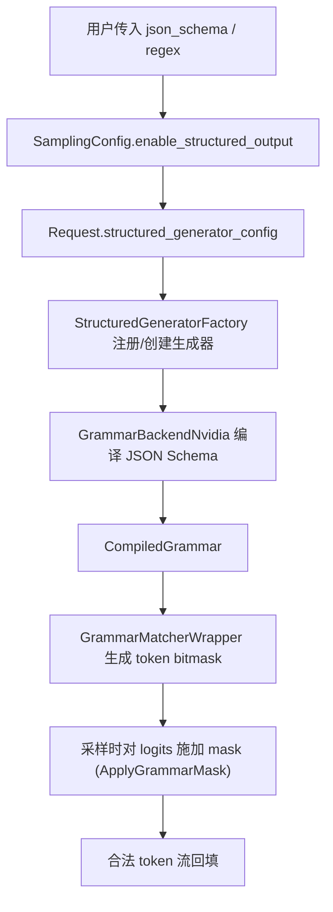
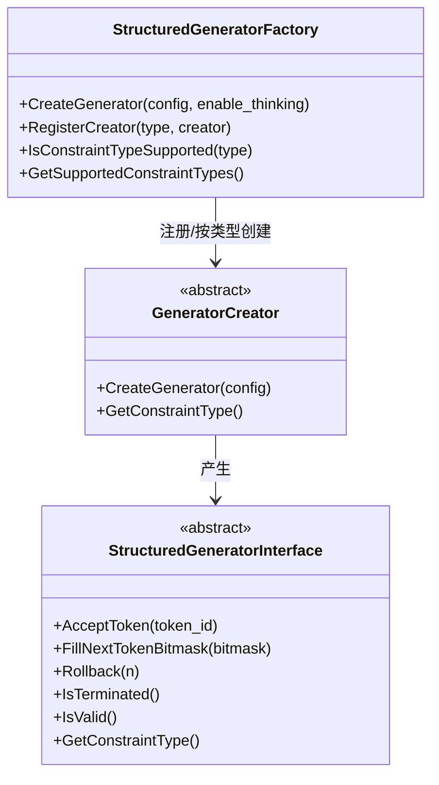
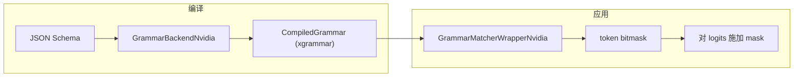
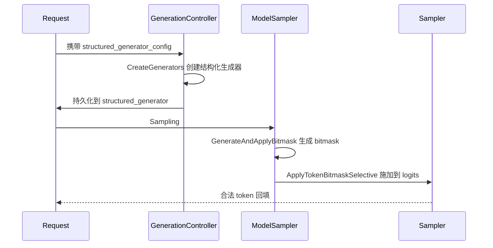

# 结构化输出与语法约束

## 1. 结构化输出与会话背景

结构化输出约束 LLM 生成的 token 流必须符合给定的 JSON Schema、正则等语法，是保证生成结果可被可靠解析的关键能力。本文面向集成开发者与后端工程师，讲解 KsanaLLM 从"用户传入 json_schema"到"生成合法 JSON token 流"的完整链路。

在采样解码阶段施加约束，比事后校验/重试更高效——非法 token 在采样前即被屏蔽。KsanaLLM 通过**约束类型注册 → 后端编译 → bitmask 生成 → 采样 masked**四层机制实现语法感知的解码。

### 1.1 全链路总览

结构化输出贯穿执行器采样与约束生成器两侧：



这条主线即约束类型注册 → 后端编译 → bitmask 生成 → 采样施加约束 **四层结构**，后续章节逐一展开。

## 2. 结构化生成器的接口抽象与工厂注册

本章讲解结构化生成的核心接口与注册机制。核心思想是：把不同约束后端（xgrammar、regex 等）统一到一套抽象接口下，工厂按约束类型动态创建对应生成器，屏蔽底层实现差异。

### 2.1 约束类型与配置

`StructuredConstraintType` 枚举定义三类约束，是注册与创建的主键。定义于 <ref_code path="csrc/runtime/structured_generation/structured_generator_interface.h" lines="10-14" />：

| 约束类型 | 值 | 含义 |
| --- | --- | --- |
| `NONE` | 0 | 无约束，直接返回空生成器 |
| `JSON` | 1 | JSON Schema 约束，由 xgrammar 后端实现 |
| `REGEX` | 2 | 正则约束（接口预留，当前未注册实现） |

`StructuredGeneratorConfig` 把「约束类型 + 约束规格」打包：`constraint_type` 决定走哪个 creator，`constraint_spec` 携带 JSON Schema 或正则字符串。`HasConstraint()` 用于判断是否真正需要约束——当约束规格为空时，配置会退化为 `NONE`。

### 2.2 生成器抽象接口

`StructuredGeneratorInterface` 是所有后端的统一入口，位于 <ref_code path="csrc/runtime/structured_generation/structured_generator_interface.h" lines="55-99" />：

| 方法 | 职责 |
| --- | --- |
| `AcceptToken` | 接收一个已生成 token，更新生成器内部状态，返回是否合法 |
| `FillNextTokenBitmask` | 填充下一步可接受的 token 集合（bitmask），返回是否需要应用约束 |
| `Rollback` | 回滚若干 token，用于推测/纠错场景 |
| `IsTerminated` | 判断生成是否已满足约束并结束 |
| `IsValid` | 判断当前生成状态是否合法 |
| `GetConstraintType` | 返回本生成器对应的约束类型 |
| `FindJumpForwardTokens` | 查找可跳跃前进的 token（架构接口；grammar 后端暂不支持） |

### 2.3 工厂注册与创建流程

`StructuredGeneratorFactory` 采用"注册-创建"模式，把约束类型与生成器 creator 一一绑定。核心流程如下：



`RegisterCreator` 将约束类型与 creator 写入注册表；`CreateGenerator` 依据 `config.constraint_type` 查表创建。见 <ref_code path="csrc/runtime/structured_generation/structured_generator_factory.cpp" lines="16-63" />：

```cpp
auto inner_generator = it->second->CreateGenerator(config);
// 推理模式开启时，用 ReasoningStructuredGenerator 包裹底层生成器
if (IsReasoningModeEnabled() && inner_generator) {
  return std::make_shared<ReasoningStructuredGenerator>(
      inner_generator, vocab_info_.think_end_token_id, enable_thinking);
}
return inner_generator;
```

`CreateGenerator` 在配置为 `NONE` 或未注册类型时返回 `nullptr` 或抛异常。注册发生在 Executor 侧初始化阶段，见 `ExecutorRuntime::InitializeStructuredGeneratorFactory`，它读取 `enable_xgrammar` 开关后创建工厂，并为其注册 `GrammarGeneratorCreator`（类型为 JSON）。

### 2.4 推理模式包装器

`ReasoningStructuredGenerator` 包装底层生成器，处理带思维链（thinking）的模型：当配置了 `think_end_token_id`（推理结束标记）时启用。推理阶段接受所有 token、不施加约束；检测到思考结束标记后，才把后续 token 交给内部生成器严格约束。定义见 <ref_code path="csrc/runtime/structured_generation/reasoning_structured_generator.h" />。

**Sources:** <ref_code path="csrc/runtime/structured_generation/structured_generator_interface.h" /> <ref_code path="csrc/runtime/structured_generation/structured_generator_factory.h" /> <ref_code path="csrc/runtime/structured_generation/structured_generator_factory.cpp" /> <ref_code path="csrc/runtime/structured_generation/reasoning_structured_generator.h" /> <ref_code path="csrc/executor/executor_runtime.cpp" />

## 3. xgrammar 后端编译与 bitmask 生成

本章深入 xgrammar 后端：如何把 JSON Schema 编译为 `CompiledGrammar`，再由 matcher 封装生成 vocab 级 token bitmask，实现严格 JSON 语法约束的逐步解码。整体链路如下：



### 3.1 GrammarBackend 抽象与编译器

`GrammarBackend` 是语法后端抽象基类，定义编译与创建匹配器的统一接口（<ref_code path="csrc/utils/grammar_backend.h" />）。`GrammarBackend::Create` 是跨平台工厂：NVIDIA 平台创建 `GrammarBackendNvidia`，Ascend 平台暂不支持并返回 `nullptr`，见 <ref_code path="csrc/utils/grammar_backend.cpp" />。

`GrammarBackendNvidia` 通过 xgrammar 的 `GrammarCompiler` 编译 JSON Schema，见 <ref_code path="csrc/utils/nvidia/grammar_backend_nvidia.cpp" />：

```cpp
std::shared_ptr<CompiledGrammar> GrammarBackendNvidia::CompileJSONSchema(const std::string& schema) {
  return std::make_shared<CompiledGrammar>(compiler_->CompileJSONSchema(
      schema, true /* any_whitespace */, std::nullopt /* indent */,
      std::nullopt /* separators */, true /* strict_mode */));
}
```

`strict_mode=true` 要求输出严格符合 JSON 规范（如禁止尾逗号、未知键），`any_whitespace=true` 允许任意空白。`GrammarCompiler` 初始化依赖 `VocabInfo`：词表、tokenizer 类型（vocab_type）、`add_prefix_space` 与前缀空格、stop token 集，这些都由 `VocabInfo` 提供（见第 4 章）。

### 3.2 GrammarMatcherWrapper 与 bitmask 生成

`GrammarMatcherWrapper` 是语法匹配器抽象基类，其工厂 `Create` 在 NVIDIA 平台创建 `GrammarMatcherWrapperNvidia`（<ref_code path="csrc/utils/grammar_matcher.cpp" />）。构造时内部初始化 xgrammar 的 `GrammarMatcher`，并依据词表大小计算 bitmask 尺寸——bitmask 形状为 `(vocab_size + 31) / 32` 个 int32，每个 bit 对应一个 token 是否可被接受。见 <ref_code path="csrc/utils/nvidia/grammar_matcher_nvidia.h" />。

核心方法对比：

| 方法 | 作用 |
| --- | --- |
| `FillNextTokenBitmask` | 生成下一 token 的掩码，写到 int32 数组；返回是否需要施加约束 |
| `AcceptToken` | 消费一个 token 推进 matcher 状态，返回该 token 是否合法 |
| `Rollback` | 回滚 N 个 token（用于推测等场景） |
| `IsTerminated` | 判断是否已达到合法终止状态 |

### 3.3 GrammarStructuredGenerator 委托链

`GrammarGeneratorCreator` 将 config 的约束规格编译并创建生成器，见 <ref_code path="csrc/runtime/structured_generation/xgrammar/xgrammar_structured_generator_creator.h" />：

```cpp
std::shared_ptr<StructuredGeneratorInterface> CreateGenerator(const StructuredGeneratorConfig& config) override {
  // 从约束规格编译 JSON Schema
  auto compiled_grammar = grammar_backend_->CompileJSONSchema(config.constraint_spec);
  return std::make_shared<GrammarStructuredGenerator>(compiled_grammar);
}
StructuredConstraintType GetConstraintType() const override { return StructuredConstraintType::JSON; }
```

`GrammarStructuredGenerator` 实现 `StructuredGeneratorInterface`，内部委托给 `GrammarMatcherWrapper` 完成位掩码生成与状态更新，见 <ref_code path="csrc/runtime/structured_generation/xgrammar/xgrammar_structured_generator.cpp" />。终态判断通过底层 matcher 的 `IsTerminated` 承接。

**Sources:** <ref_code path="csrc/utils/nvidia/grammar_backend_nvidia.cpp" /> <ref_code path="csrc/utils/grammar_backend.h" /> <ref_code path="csrc/utils/grammar_backend.cpp" /> <ref_code path="csrc/utils/nvidia/grammar_matcher_nvidia.h" /> <ref_code path="csrc/utils/nvidia/grammar_matcher_nvidia.cpp" /> <ref_code path="csrc/utils/grammar_matcher.h" /> <ref_code path="csrc/runtime/structured_generation/xgrammar/xgrammar_structured_generator_creator.h" /> <ref_code path="csrc/runtime/structured_generation/xgrammar/xgrammar_structured_generator.h" /> <ref_code path="csrc/runtime/structured_generation/xgrammar/xgrammar_structured_generator.cpp" />

## 4. SamplingConfig 串联与采样侧 bitmask 应用

本章说明结构化输出如何经 `SamplingConfig` 串联到采样管线：请求携带约束配置，执行器侧生成并应用 bitmask，采样器在 logits 上完成语法约束。

### 4.1 串联起点：SamplingConfig 与 Request

`SamplingConfig` 提供结构化输出的开关（<ref_code path="csrc/utils/request.h" lines="26-78" />）：

| 字段 | 含义 |
| --- | --- |
| `json_schema` | 约束的 JSON Schema 字符串 |
| `enable_structured_output` | 是否开启结构化输出 |
| `enable_thinking` | 是否开启思考模式（供推理包装器使用） |

`Request` 携带 `structured_generator_config`（`StructuredGeneratorConfig` 类型），以及 `grammar_matcher` 等采样所需字段（<ref_code path="csrc/utils/request.h" lines="325-329" />）。json_schema 字符串从 `SamplingConfig.enable_structured_output + json_schema` 传入请求，构成整条链路的入口。

### 4.2 跨组件交互时序

从开启结构化输出到采样输出的跨组件流程如下：



生成器创建发生在 `GenerationController`：它为需要创建生成器的请求调用工厂 `CreateGenerator`，并将生成器持久化存放到按 req_id 索引的映射中（`RestoreGenerators` 在后续步骤取回），见 <ref_code path="csrc/runtime/generation_controller.cpp" lines="12-80" />。

### 4.3 ModelSampler 生成并应用 bitmask

`ModelSampler` 在采样前调用 `GenerateAndApplyBitmask`：遍历持有生成器的请求，调用 `FillNextTokenBitmask` 生成 bitmask，再通过 `ApplyTokenBitmaskSelective` 施加到设备端 logits。见 <ref_code path="csrc/executor/model_sampler.cpp" lines="80-120" />：

```cpp
bool need_constraint = req->structured_generator->FillNextTokenBitmask(bitmask.data());
if (need_constraint) {
  logits_offsets.push_back(sampling_reqs[i].logits_offset);
  combined_bitmask.insert(combined_bitmask.end(), bitmask.begin(), bitmask.end());
}
```

`vocab_size_` 与 `bitmask_stride_`（`(vocab_size + 31) / 32`）在构造时由模型词表确定，用于批量聚合多个请求的 bitmask。

### 4.4 采样侧施加约束

`Sampler::ApplyGrammarMask` 为带 `grammar_matcher` 的请求填充 bitmask，通过 `ApplyTokenBitmaskSelective` 将掩码施加到对应 logits 偏移处，只处理需要约束的请求，避免影响整批（<ref_code path="csrc/samplers/sampler.cpp" lines="652-763" />）。`UpdateGrammarState` 在 token 选择后消费 token、推进 matcher 状态。注意：本流程只涉及约束掩码的施加，TopK/TopP/temperature 等普通采样规则由采样算法文档另行覆盖。

### 4.5 VocabInfo 的作用

`VocabInfo` 承载词表信息，支撑 GrammarBackend 初始化与推理模式判断（<ref_code path="csrc/configure/environment.h" lines="28-40" />）：`vocab`/`vocab_size` 提供词表，`vocab_type`/`add_prefix_space` 描述 tokenizer 行为，`think_end_token_id` 标记推理结束，用于决定是否启用 `ReasoningStructuredGenerator`。`Environment` 持有一份 `vocab_info_` 供 Engine 与 Executor 共用。

**Sources:** <ref_code path="csrc/utils/request.h" /> <ref_code path="csrc/runtime/generation_controller.cpp" /> <ref_code path="csrc/executor/model_sampler.cpp" /> <ref_code path="csrc/executor/model_sampler.h" /> <ref_code path="csrc/samplers/sampler.h" /> <ref_code path="csrc/samplers/sampler.cpp" /> <ref_code path="csrc/configure/environment.h" />

## 5. 使用注意事项与扩展

本章介绍使用与扩展要点：约束类型支持情况、如何新增后端、与投机解码/build-ahead 的相互限制，以及常见问题与性能考虑。

### 5.1 已有约束类型与选型对照

| 约束类型 | 后端 | 支持状态 | 说明 |
| --- | --- | --- | --- |
| `JSON`（json_schema） | xgrammar（NVIDIA） | 已注册 | `GrammarGeneratorCreator` 注册，编译为语法并生成 bitmask |
| `REGEX` | — | 接口预留 | 枚举已定义，未注册具体实现 |
| `NONE` | — | 恒支持 | 无约束，返回 `nullptr` |

当前仅 JSON 约束有实际实现，且依赖 NVIDIA 平台（Ascend 返回 `nullptr`）。

### 5.2 新增后端的扩展点

扩展新后端只需两步，无需改动采样核心：

1. 实现一个继承 `GeneratorCreator` 的 creator，返回自己的 `StructuredGeneratorInterface` 实现
2. 在初始化处调用工厂的 `RegisterCreator(约束类型, creator)` 注册

注册入口为 `StructuredGeneratorFactory::RegisterCreator`（<ref_code path="csrc/runtime/structured_generation/structured_generator_factory.h" lines="47-61" />）。`IsConstraintTypeSupported` / `GetSupportedConstraintTypes` 用于查询当前注册能力，创建前的查表与此处的注册保持一致。

### 5.3 与投机解码的相互限制

- 结构化输出通过 bitmask 约束主采样 token 的合法性。
- draft token（推测 token）也需经过结构化约束校验：`GenerationController::FilterGeneratorDraftTokens` 在 draft 命中时逐个用 `AcceptToken` 校验新 token，非法则中断接受（<ref_code path="csrc/runtime/generation_controller.cpp" lines="157-219" />）。
- MTP 模式下 `apply_grammar_constraint` 关闭 draft token 的约束、仅对首个验证 token 生效，避免重复推进 matcher 状态。
- `GrammarStructuredGenerator::FindJumpForwardTokens` 返回 `false`（不支持跳跃前进），跳词解码不与结构化约束叠加。

### 5.4 常见问题与性能

- **无法创建生成器**：多为 `VocabInfo` 未初始化或平台不支持（Ascend），会抛错或返回 `nullptr`。
- **token 被拒绝**：若 bitmask 应用正确极少发生；`UpdateGrammarState` 会记录 `Grammar rejected token` 告警。
- **bitmask 开销**：bitmask 长度随词表线性增长（`(vocab_size+31)/32` 个 int32），GrammarBackend 的编译带缓存与线程配置，编译结果可被复用。
- **per-request 复用**：结构化生成器由 `GenerationController` 持久化于 req_id 映射，跨多次采样步骤复用，单请求生命周期内状态得以延续。

**Sources:** <ref_code path="csrc/runtime/structured_generation/structured_generator_factory.h" /> <ref_code path="csrc/runtime/generation_controller.cpp" /> <ref_code path="csrc/runtime/structured_generation/xgrammar/xgrammar_structured_generator.h" /> <ref_code path="csrc/utils/nvidia/grammar_backend_nvidia.cpp" />