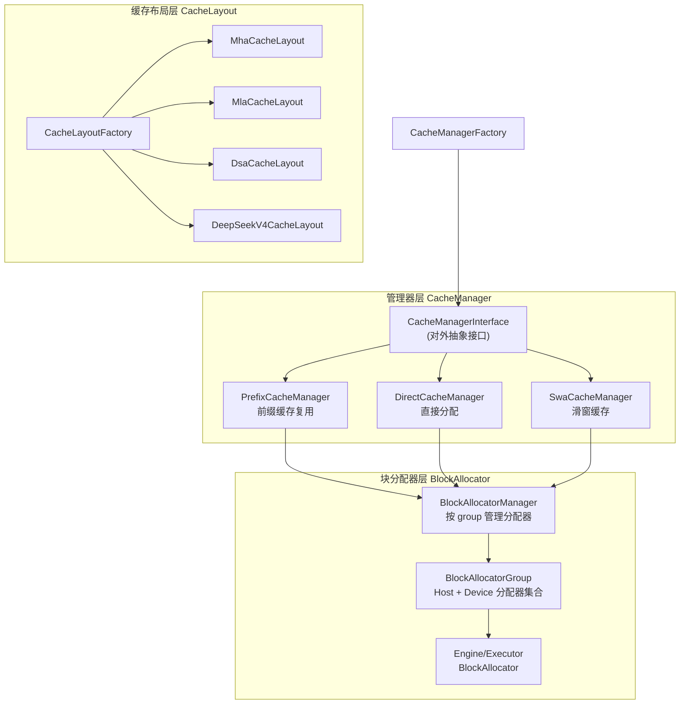
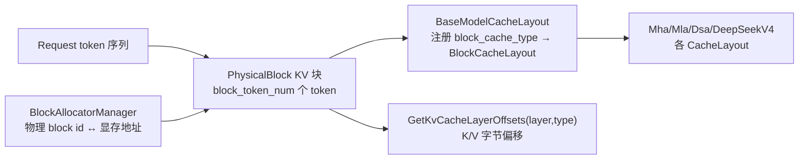
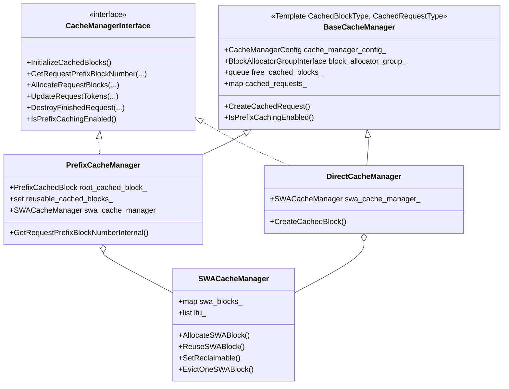
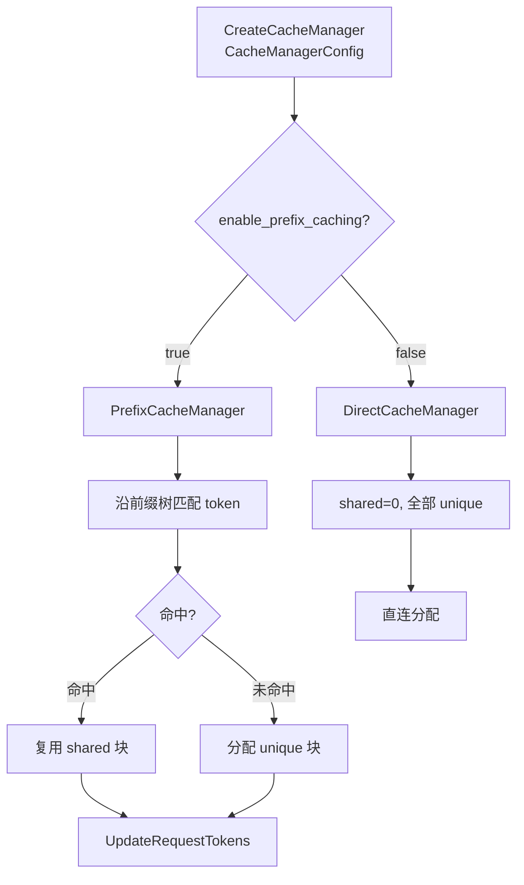
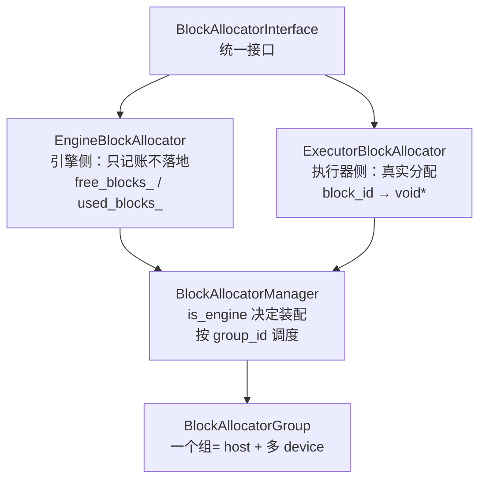
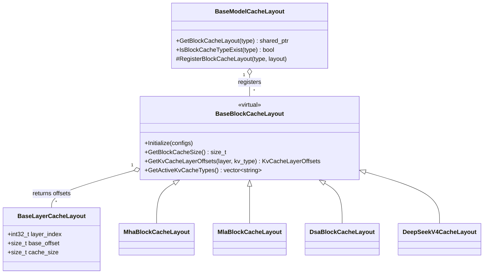
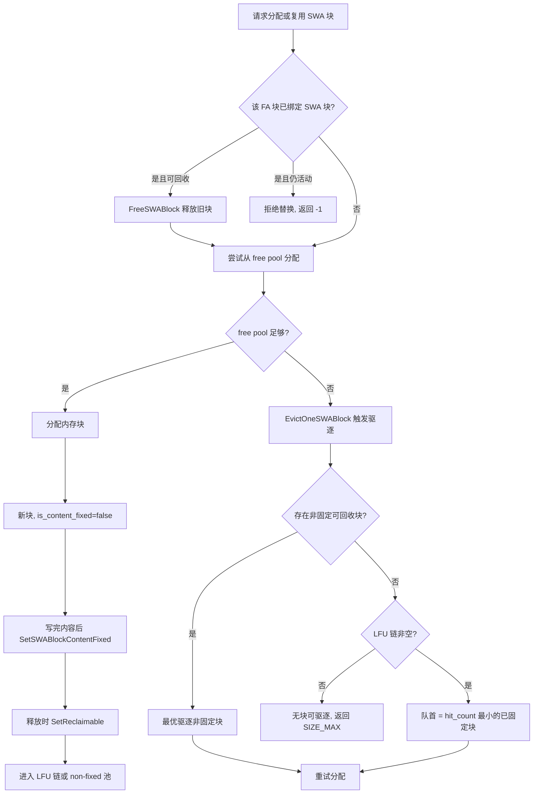

# 1. KV Cache 缓存管理总览

KV Cache 是 LLM 推理显存的第一大户：一次长上下文请求的 K/V 张量往往占据整卡显存过半，是词表/权重/激活之外最值得优化的对象。KsanaLLM 借鉴 PagedAttention 的「块化」思想，把连续 KV 缓存切分为固定大小的物理块（block），用非连续的页表式地址散布在显存中；本章作为全局导航，先建立 csrc/cache_manager 的整体地图：缓存管理器（复用语义）→ 块分配器（物理块）→ 缓存布局（字节排布）三层解耦，并交代缓存管理的核心目标，为后续各章的深入展开标定坐标。

## 1.1 为什么需要专门管理 KV Cache

LLM 推理中，每生成一个 token 都要把历史 token 的 K/V 向量写入缓存，供注意力算子反复读取。KV Cache 的管理方式直接决定推理吞吐与显存利用率。

| 挑战 | 朴素实现的问题 | 块化管理方案 |
| --- | --- | --- |
| 显存占用线性增长 | 按最大序列长度预分配，平均利用率低 | 固定大小块按需分配，更贴近真实需求 |
| 显存碎片 | 变长连续内存申请大量碎片 | 物理上非连续的逻辑块，无外部碎片 |
| 前缀重复计算 | 相同 prompt 前缀每请求都重算 | 前缀树命中复用共享块 |
| 多注意力形态 | MHA/MLA/DSA 排布不同 | 按 model 的 CacheLayoutFactory 分派 |

> 核心目标在本章定调：低 KV 内存浪费、高前缀命中率、滑窗与多注意力形态适配。

## 1.2 csrc/cache 整体分层

`csrc/cache_manager/` 下按「管理器—分配器—布局」三层解耦，保证复用语义、物理分配与显存排布互不耦合、各自演进。



| 层 | 核心实体 | 职责 | 对应小节 |
| --- | --- | --- | --- |
| 管理器 | CacheManagerInterface、BaseCacheManager | 复用语义、请求状态机、前缀命中 | 第 2 章 |
| 块分配器 | BlockAllocatorManager / Group / Interface | 物理块编号与显存地址、空闲/占用 | 第 3 章 |
| 缓存布局 | CacheLayoutFactory、BaseModelCacheLayout | 字节级 K/V 排布、层偏移 | 第 4 章 |

### 三层「依赖方向」

- 管理器依赖块分配器：经 `BlockAllocatorGroupInterface` 获取 Host/Device 分配器，屏蔽物理细节。
- 布局由模型配置决定：`CacheLayoutFactory` 按 `use_dsv4_attn / use_dsa / use_mla` 创建不同 `ModelCacheLayout`。
- 布局与块分配通过固定块大小（`block_token_num`、`block_size`）解耦，彼此互不感知。

## 1.3 管理器 − 分配 − 布局 三角地图

三条互锁的「约定」构成整个缓存的面貌：管理器决策需要多少共享/唯一块，布局决定每个块排多少字节，分配器落地物理块编号与地址。下面以 KV 块与请求、Layout 的对应关系收拢三者。



| 维度 | 管理器（分配语义） | 布局（字节语义） | 分配器（物理语义） |
| --- | --- | --- | --- |
| 决策内容 | 需要多少块、可否复用 | 每个块如何切 K/V、层偏移 | blockId ↔ 显存地址 |
| 输入 | 请求 token 序列、前缀树 | ModelConfig / RuntimeConfig | 剩余空闲块数 |
| 输出 | 共享/唯一块 ID 集合 | 块字节大小、K/V 偏移 | 已分配物理块 |

## 1.4 核心目标与导航

面向「架构师/内核/显存优化工程师」，本章之后各节按如下地图展开：

| 章节定位 | 主题 | 切入的实体 |
| --- | --- | --- |
| 第 2 章 缓存管理 | 前缀复用、直接分配、滑窗缓存 | CacheManagerInterface、Prefix/Direct/SWA |
| 第 3 章 块分配器 | 物理块生命期、free/共用 | BlockAllocatorManager / BlockAllocatorInterface |
| 第 4 章 缓存布局 | 各模型显存排布 | CacheLayoutFactory / 四种 Layout |
| 第 5 章 高级特性 | LFU 驱逐、内容固定、引用计数 | SWACacheManager / PrefixCacheManager |

- 一个 block 同时承载「逻辑可复用语义」（管理器）与「物理地址」（分配器），布局决定其字节排布。
- 命中率优化在管理器层做（前缀树、字典），显存回收在分配器层做（free 队列、引用计数）。
- 低内存浪费由「按 block_token_num 分块 + 按需分配」与「块共享复用」共同达成。

## 1.5 核心类与工厂

管理器对外抽象统一在 `CacheManagerInterface`，实现类由 `CacheManagerFactory` 按是否启用前缀缓存选择，块分配通过 `BlockAllocatorGroupInterface` 注入，互不耦合。

| 类名 | 文件路径 | 作用 |
| --- | --- | --- |
| CacheManagerInterface | cache_manager/cache_manager_interface.h | 缓存管理对外抽象接口 |
| BaseCacheManager | cache_manager/base_cache_manager.h | 管理器公共基类 |
| CacheManagerFactory | cache_manager/cache_manager_factory.h/.cpp | 按配置创建管理器实例 |
| BlockAllocatorManager / GroupInterface | cache_manager/block_allocator/block_allocator_manager.h | 分配器分组管理 |
| BlockAllocatorInterface | cache_manager/block_allocator/block_allocator_interface.h | 分配器统一接口 |
| CacheLayoutFactory | cache_manager/cache_layout/cache_layout_factory.h | 按模型创建布局 |
| Mha/Mla/Dsa/DeepSeekV4Layout | cache_manager/cache_layout/*.h | 各注意力形态布局 |

## 1.6 参考资料

具体数值与参数随配置及运行环境变化，本文不固化，仅给出结构与因果线。

**Sources:**
<ref_code path="csrc/cache_manager/cache_manager_interface.h" />

## 2. 缓存管理器与三类实现

KsanaLLM 通过**三类缓存管理器**实现不同的 KV 块复用语义：`PrefixCacheManager`（前缀树共享复用）、`DirectCacheManager`（直连分配、强制不共享）、`SWACacheManager`（滑窗注意力块绑定，作为辅助模块融入前两者）。由 `CacheManagerFactory` 依据 `enable_prefix_caching` 单选其一，统一向上对外暴露 `CacheManagerInterface`。

### 2.1 统一基类与接口

| 项 | 位置 / 职责 |
| --- | --- |
| `CacheManagerInterface` | cache_manager_interface.h，讲缓存域语义：分配、命中、更新、销毁 |
| `BaseCacheManager<CachedBlockType, CachedRequestType>` | base_cache_manager.h，模板基类 |
| `free_cached_blocks_` | 空闲（可自由复用）块队列 |
| `cached_requests_` | `req_id → CachedRequestType` 请求映射 |

### 2.2 三类实现职责对比

| 维度 | PrefixCacheManager | DirectCacheManager | SWACacheManager |
| --- | --- | --- | --- |
| 复用语义 | 前缀树内容寻址，命中即共享 | 直连分配，强制共享计数归零 | SWA 块绑定 + LFU 驱逐 |
| 数据结构 | `PrefixCachedBlock` 前缀树 + 引用计数 | `DirectCachedBlock` 轻量块列表 | `SWACachedBlock` 绑定 FA，`active_req_ids` 持有集 |
| 命中判定 | 沿树按 token 匹配 | 恒未命中（shared=0） | 仅当 SWA 窗口内全部有效 |
| 共享块 | `shared_block_num>0` | `shared_block_num` 恒 0 | 窗口内块可被多请求共享 |
| 唯一块 | 未命中余量 | 全部视为唯一块 | 窗口外的独立分配 |

### 2.3 类图



### 2.4 CacheManagerFactory 分派逻辑

`CreateCacheManager` 按 `enable_prefix_caching` 二选一实例化，`swa_block_allocator_group` 仅在配置了 SWA 时传入。

```cpp
if (cache_manager_config.enable_prefix_caching) {
  return std::make_shared<PrefixCacheManager>(...);
} else {
  return std::make_shared<DirectCacheManager>(...);
}
```

### 2.5 前缀树复用 / 命中 / 共享（Prefix）

- `PrefixCachedBlock`（前缀块）构成前缀树：含 `block_id`、`parent`、`children`、`hash_code`、`is_shareable`、`active_requests`。
- 命中即共享：请求调用 `GetRequestPrefixBlockNumber`，返回 `shared_block_num` 与 `unique_block_num`。
- 命中块被计入共享，`is_shareable` 标记块含有效缓存可共享。

### 2.6 Direct 强制共享计数归零

- `GetRequestPrefixBlockNumber` 恒置 `shared_block_num=0`，`unique_block_num` 为所需全部块数。
- `AllocateRequestBlocks` 每次从 `free_cached_blocks_` 弹出、直连分配，请求结束时整体归还。

### 2.7 SWA 作为辅助模块融入 PrefixCacheManager

- `SWACachedBlock` 与 FA 块绑定，`active_req_ids` 记录持有者，可回收条件为持有集为空。
- 前缀树查询后 **FA 与 SWA 需对齐**，`need_swa_align=true` 时按有效 SWA 位置截断共享计数。

### 2.8 请求复用命中/未命中流程



**Sources:**
<ref_code path="csrc/cache_manager/cache_manager_interface.h" />
<ref_code path="csrc/cache_manager/base_cache_manager.h" />
<ref_code path="csrc/cache_manager/cache_manager_factory.h" />
<ref_code path="csrc/cache_manager/cache_manager_factory.cpp" />
<ref_code path="csrc/cache_manager/prefix_cache_manager.h" />
<ref_code path="csrc/cache_manager/direct_cache_manager.h" />
<ref_code path="csrc/cache_manager/swa_cache_manager.h" />

## 3. 块分配器与 BlockGroup 调度

KV 块的物理划分由「统一接口 — 两侧实现 — Manager 多组调度」三层完成：`BlockAllocatorManager` 按 group_id 编排一组 `BlockAllocatorGroup`，每个组持有一个主机分配器加多个设备分配器；实现侧按进程角色二分——引擎进程用 `EngineBlockAllocator` 只记账不分配内存，执行器进程用 `ExecutorBlockAllocator` 真正把 KV 块落到显存/主机。

### 3.1 统一抽象接口

`block_allocator_interface.h` 定义纯虚接口 `BlockAllocatorInterface`，是两侧分配器的公共契约。

| 类型 | 方法 | 说明 |
| --- | --- | --- |
| 生命周期 | `PreAllocateBlocks()` / `Clear()` | 预分配全部块 / 释放全部块 |
| 增删与寻址 | `AllocateBlocks()` / `FreeBlocks()` | 批量分配 / 释放，含 ATB |
| 地址映射 | `GetBlockPtrs()` | block id → 内存地址 |
| ATB 投影 | `GetBlocksBasePtr()` / `GetBlocksBaseId()` | 整块 KV 池投影 |
| 统计 | `GetFreeBlockNumber()` / `GetUsedBlockNumber()` | 空闲/占用块数 |

### 3.2 两侧实现对比



| 维度 | EngineBlockAllocator | ExecutorBlockAllocator |
| --- | --- | --- |
| 所在进程 | 引擎侧（虚拟块） | 执行器侧（真实持有显存） |
| 分配方式 | 只做逻辑记账，不触碰物理内存 | 真实调用 `MemoryAllocator` 分配 |
| 内存落地 | 不分配地址 | host/device，取决 `MemoryLocation` |
| 地址映射 | 不支持 | `GetBlockPtrs` 从映射表取地址 |

### 3.3 Manager 多 Group 调度

| 配置 | 说明 |
| --- | --- |
| `BlockAllocatorGroupConfig` | devices、deviceBlockNum、hostBlockNum、blockSize |
| `BlockAllocatorManagerConfig` | group_id → BlockAllocatorGroupConfig |
| `BlockAllocatorGroup` | host + 多 device 分配器集合 |
| `BlockAllocatorManager` | `Initialize(config)` 按组创建，`GetBlockAllocatorGroup(group_id)` 取用 |

- 默认工厂按角色装配 `EngineBlockAllocator` 或 `ExecutorBlockAllocator`。
- 若为执行器且该 rank 的 device 不在本组，则返回空（每进程只服务本 device）。
- `ExecutorRuntime`（装配背景）通过 `SetBlockAllocatorManager` / `SetSwaBlockAllocatorManager` 注入普通 KV 与 SWA KV 分配器链。

> 边界说明：本章覆盖块分配与按组调度；布局内字节偏移（第 4 章）与复用语义（第 2/5 章）不在此重复。

**Sources:**
<ref_code path="csrc/cache_manager/block_allocator/block_allocator_interface.h" />
<ref_code path="csrc/cache_manager/block_allocator/engine_block_allocator.h" />
<ref_code path="csrc/cache_manager/block_allocator/engine_block_allocator.cpp" />
<ref_code path="csrc/cache_manager/block_allocator/executor_block_allocator.h" />
<ref_code path="csrc/cache_manager/block_allocator/executor_block_allocator.cpp" />
<ref_code path="csrc/cache_manager/block_allocator/block_allocator_manager.h" />
<ref_code path="csrc/cache_manager/block_allocator/block_allocator_manager.cpp" />
<ref_code path="csrc/executor/executor_runtime.h" />
<ref_code path="csrc/cache_manager/block_allocator/block_allocator_test.cpp" />

## 4. 缓存布局与多注意力形态

缓存布局（Cache Layout）解决「一个块内、一层内存放什么、字节从哪里开始」的排布问题。核心结论：所有注意力形态共用统一的「Model—Block—Layer」三层布局骨架，区别仅在于每层内部 K/V 的字节排布与是否拆分为 indexer / attention（或 swa / tail）等子段；入口 `CacheLayoutFactory.CreateModelCacheLayout` 按 `ModelConfig` 特性开关选择对应布局。

### 4.1 三层骨架：Model / Block / Layer



### 4.2 工厂分派

`CacheLayoutFactory.CreateModelCacheLayout`（按 ModelConfig 特性）三选一：

| 开关 | 布局 |
| --- | --- |
| `use_dsv4_attn` | DeepSeekV4ModelCacheLayout |
| `use_dsa` | DsaModelCacheLayout |
| `use_mla` | MlaModelCacheLayout |
| 兜底 | MhaModelCacheLayout |

> 所有分支都默认 MHA；当命中 MLA 时按单头 K/V、FP8 计算。

### 4.3 四类布局特性对比

| 布局 | 每层 K/V 段 | 适用注意力 |
| --- | --- | --- |
| `Mha*CacheLayout` | 单段 `[K \| V]` | MHA |
| `Mla*CacheLayout` | 单段，K/V 共享 | MLA（FP8） |
| `Dsa*CacheLayout` | index + attention 两段 | DSA |
| `DeepSeekV4*CacheLayout` | index + attention + 压缩比 | DSv4 |

### 4.4 关键布局要点

- **MHA**：`MhaLayerCacheLayout` 追加每层 `k_offset/v_offset`；`MhaBlockCacheLayout` 注册 `"kv-cache"`，逐层累计 offset。
- **MLA**：`MlaBlockCacheLayout` 注册 `"kv-cache"`，`k_offset=v_offset`（单头共享）；FP8 分支按每 128 token 一组 scale。
- **DSA**：`DsaLayerCacheLayout` 持有 `indexer_k/v_offset` 与 `attention_k/v_offset`。
- **DeepSeekV4**：主 KV 每层仅 `[index|attention]`，SWA 尾部与压缩器状态由独立块布局管理。

> 注：SWA 布局仅当 `sliding_window>0` 时由下游按需启用，但 layout 始终注册；下推方通过 `IsBlockCacheTypeExist("SWA-cache")` 判断是否启用。主 KV 与 SWA/压缩器状态解耦为独立块布局。

**Sources:** <ref_code path="csrc/cache_manager/cache_layout/base_cache_layout.h" /> <ref_code path="csrc/cache_manager/cache_layout/cache_layout_factory.h" /> <ref_code path="csrc/cache_manager/cache_layout/mha_cache_layout.h" /> <ref_code path="csrc/cache_manager/cache_layout/mla_cache_layout.h" /> <ref_code path="csrc/cache_manager/cache_layout/dsa_cache_layout.h" /> <ref_code path="csrc/cache_manager/cache_layout/deepseek_v4_cache_layout.h" />

## 5. LFU 驱逐与内容固定等高级特性

PagedAttention 体系下，SWA（滑窗）缓存并非「分配即永久」，而是通过 LFU（最不常用优先驱逐）、内容固定与引用计数，在有限显存内保留最具复用价值的前缀缓存。核心结论：`EvictOneSWABlock` 优先驱逐无缓存价值的非固定块，再按 `hit_count`（命中次数）升序驱逐已固定块；`SetSWABlockContentFixed` 把写完的块「钉住」使其可被复用。

### 5.1 三机制协同模型

| 机制 | 承载结构 / 字段 | 入口 |
| --- | --- | --- |
| LFU 驱逐 | `reclaimable_content_fixed_lfu_`（hit_count 升序链） | `EvictOneSWABlock` |
| 内容固定 | `SWACachedBlock::is_content_fixed` | `SetSWABlockContentFixed` |
| 引用计数 | `active_req_ids`（FA 侧 `active_requests`） | `AcquireSWABlock` / `SetReclaimable` |

### 5.2 执行决策流程



驱逐优先级（`EvictOneSWABlock` 内自上而下）：

1. 驱逐 `reclaimable_non_content_fixed_` 中的任一非固定块（无前缀缓存价值，最先释放）。
2. 否则驱逐 `reclaimable_content_fixed_lfu_` 队首，即 `hit_count` 最小的已固定块；命中数相同取 `prefix_fa_block_num` 更小的块。
3. 两者皆空则返回 `SIZE_MAX`，分配失败。

### 5.3 LFU 接口清单与代码依据

```cpp
// 把该 FA 块绑定的 SWA 块标记为内容固定（可复用）
void SWACacheManager::SetSWABlockContentFixed(size_t fa_block_id);
// 分配：新块 hit_count=0, is_content_fixed=false, 记 req_id 为首个持有者
int  SWACacheManager::AllocateSWABlock(int64_t req_id, size_t fa_block_id, size_t prefix_fa_block_num);
// 前缀命中复用：reuse 已固定块，累计命中
void SWACacheManager::ReuseSWABlock(int64_t req_id, size_t fa_block_id);
// 引用释放：仅当 active_req_ids 空才进入可回收池
void SWACacheManager::SetReclaimable(int64_t req_id, size_t fa_block_id);
```

- 驱逐安全性：仍被活动请求持有的现有块返回 -1 而非替换，防止破坏其它请求的滑动窗口。
- 测试依据：`prefix_cache_manager_test.cpp`、`cache_layout_test.cpp` 覆盖 DSA/DeepSeekV4/SWA+tail/压缩器多布局。

**Sources:**
<ref_code path="csrc/cache_manager/swa_cache_manager.cpp" />
<ref_code path="csrc/cache_manager/prefix_cache_manager_test.cpp" />
<ref_code path="csrc/cache_manager/cache_layout/cache_layout_test.cpp" />