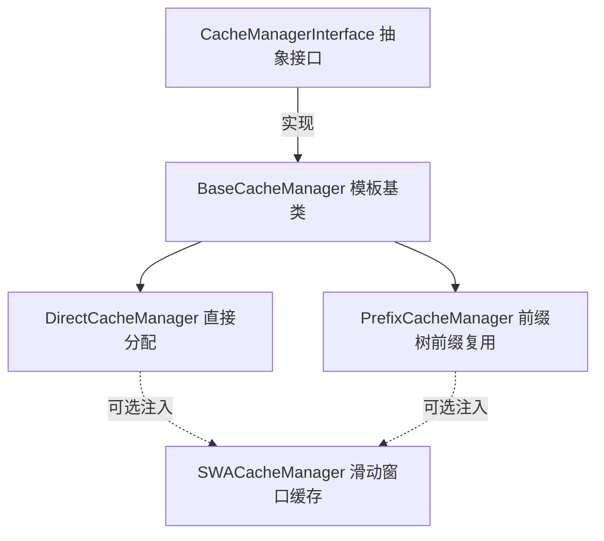
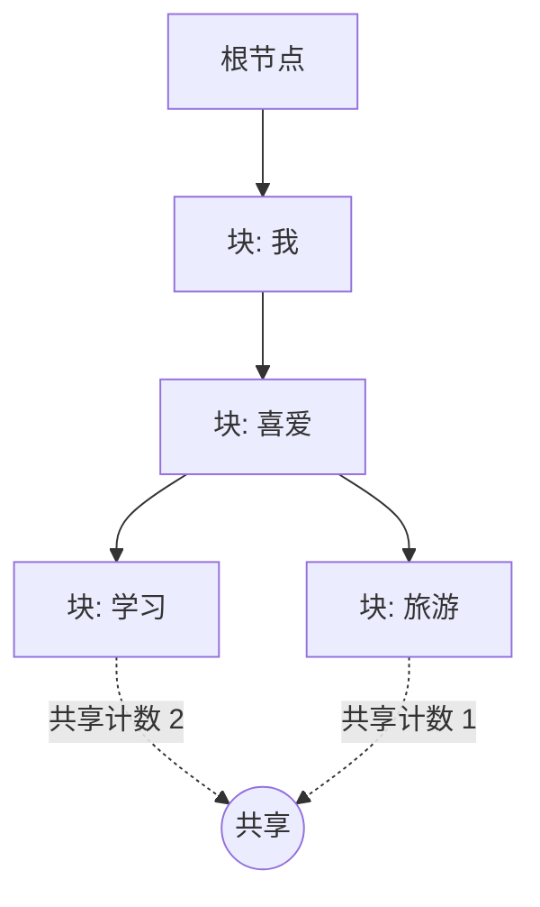
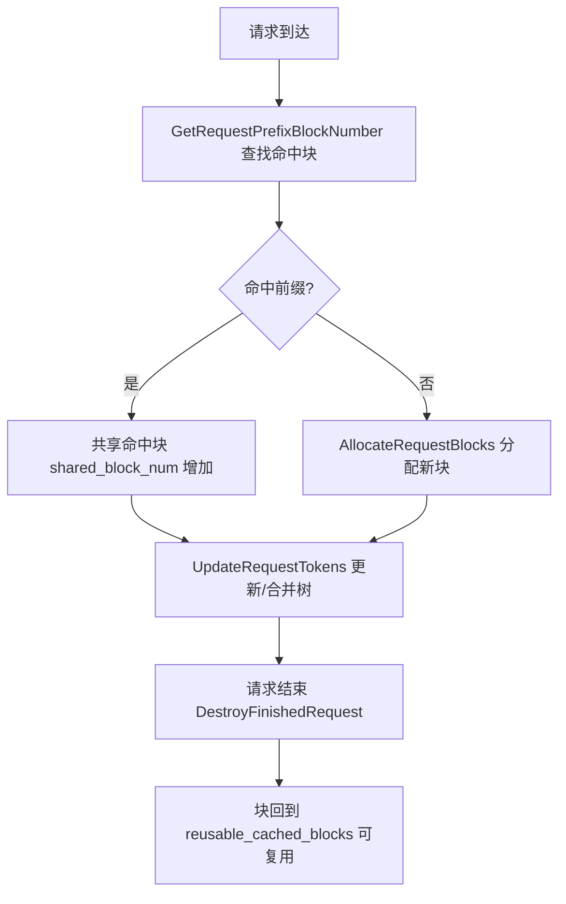
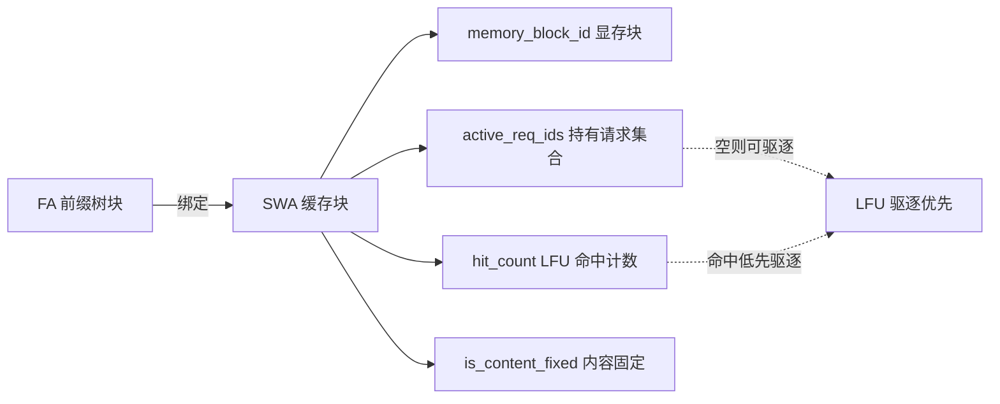

# 缓存管理器与复用

> 本文档介绍 KsanaLLM 中 KV Cache 缓存管理器的整体框架与复用机制。聚焦 `BaseCacheManager` 模板基类、`CacheManagerFactory` 工厂选型，以及 Prefix / Direct / SWA 三种缓存管理实现。

## 1. KV Cache 缓存管理器概述

KsanaLLM 面向 PagedAttention，将注意力计算的 KV（Key-Value）缓存按固定大小的"块"（Block）组织在显存中。每个块承载固定数量的 token 的 K/V 值，请求运行时动态分配块、token 逐代增长时按需追加块。

**核心命题**：缓存管理器在 PagedAttention 之下如何分配、复用、释放 KV 块，以实现显存高效利用。

### 1.1 基础概念

KV Cache 缓存管理涉及以下关键概念：

- **缓存块（Cached Block）**：KV 缓存的基本载体，绑定一块设备或主机显存，承载一段 token 序列的 K/V 数据。
- **共享（Sharing）**：多个请求命中同一段 token 前缀时，共用同一块缓存数据，仅增加引用计数，不重复分配显存。
- **复用（Reuse）**：请求结束后，其不再被引用的缓存块回归空闲池，可被后续请求重新分配使用。
- **FA / SWA 块**：全职注意力（Full Attention, FA）块与滑动窗口注意力（Sliding Window Attention, SWA）块。SWA 块绑定到 FA 块，承载滑动窗口内的缓存。

### 1.2 为什么需要缓存复用

- **显存节省**：共享命中块避免了重复分配与重复计算，显著降低峰值 KV 显存占用。
- **命中率提升**：前缀复用在多轮、多请求场景下让重复前缀直接命中，减少 prefill 计算。
- **长上下文支撑**：滑动窗口缓存只保留窗口内数据，配合 LFU 驱逐控制 SWA 显存上限。

### 1.3 三类缓存实现全景

缓存管理器位于 `csrc/` 内核的 `cache_manager/` 模块，与执行器、块分配器、缓存布局协同。模块以"模板基类 + 工厂"分层：



三类实现的分工：

- **PrefixCacheManager**：用前缀树实现前缀复用，是最完整、默认启用的实现。
- **DirectCacheManager**：不做前缀复用，按请求直接分配，是无前缀场景的兜底。
- **SWACacheManager**：滑动窗口缓存，作为辅助缓存注入前两者，承载 SWA 块。

> 边界：块级物理分配（BlockAllocatorManager 按组调度）与缓存布局（KvCacheLayerOffsets、MHA/MLA/DSA 布局工厂）由 `块分配与缓存布局` 文档覆盖，本文档聚焦管理器层的复用语义。

## 2. 缓存管理器框架：模板基类与工厂

第 2 章切入"三者的公共基座与选型规则"。三种实现共享同一个抽象接口 `CacheManagerInterface` 与同一个模板基类 `BaseCacheManager<Block, Request>`，由 `CacheManagerFactory` 依据一项配置决定实例化哪种缓存。

### 2.1 CacheManagerInterface 抽象接口

`CacheManagerInterface` 定义了三类缓存实现共有的对外契约：块分配、复用判定、token 更新与请求销毁。

核心契约方法：

- `InitializeCachedBlocks`：初始化所有缓存块。
- `GetUsableBlockNumber` / `GetUsedBlockNumber`：查询可用与已用块数量。
- `GetRequestPrefixBlockNumber`：查询请求能复用的共享块数与仍需分配的独有块数，返回后可立即进入推理。
- `AllocateRequestBlocks`：为请求分配新块（仅运行态调用）。
- `UpdateRequestTokens`：更新请求 token，必要时合并缓存块。
- `DestroyFinishedRequest`：请求结束后清理内部状态。
- `GetRequestStepBlockNumber`：按输入长度计算请求所需的块数（预留策略对 V1 与 EDS 统一）。

接口还预留了远程缓存加载契约：`GetRequestPrefixBlockNumberBeforeRemoteCacheLoading`、`AllocateBlocksForRemoteCache`、`ConfirmRemoteCacheLoadingResult`，用于跨机加载预计算 KV 缓存。

### 2.2 BaseCacheManager 模板基类

`BaseCacheManager<CachedBlockType, CachedRequestType>` 是三者的公共基座，持有与缓存类型无关的公共状态与工具方法：

- `block_allocator_group_`：块分配器组，负责物理块读写（内部实现不在此文档展开）。
- `free_cached_blocks_`：无计算数据的空闲缓存块队列，可被自由复用。
- `cached_requests_`：请求映射表的键为请求 ID，值为请求缓存状态对象。
- `CreateCachedRequest`：创建等待态的请求缓存实例并登记进映射。
- `IsPrefixCachingEnabled`：返回是否启用前缀缓存配置。

该类基于 `CacheManagerInterface`，被三个子类分别以对应块模板与请求模板实例化。

### 2.3 CacheManagerFactory 工厂选型

`CacheManagerFactory::CreateCacheManager` 依据 `cache_manager_config.enable_prefix_caching` 决定产出，`swa_block_allocator_group` 为可选参数：

```cpp
std::shared_ptr<CacheManagerInterface> CacheManagerFactory::CreateCacheManager(
    const CacheManagerConfig& cache_manager_config,
    std::shared_ptr<BlockAllocatorGroupInterface> block_allocator_group,
    std::shared_ptr<BlockAllocatorGroupInterface> swa_block_allocator_group) {
  if (cache_manager_config.enable_prefix_caching) {
    return std::make_shared<PrefixCacheManager>(cache_manager_config, block_allocator_group, swa_block_allocator_group);
  } else {
    return std::make_shared<DirectCacheManager>(cache_manager_config, block_allocator_group, swa_block_allocator_group);
  }
}
```

不同配置下的产出：

| 配置 | 产出的缓存管理器 | 复用语义 |
| --- | :--- | --- |
| `enable_prefix_caching=true` | PrefixCacheManager | 前缀树前缀复用 |
| `enable_prefix_caching=false` | DirectCacheManager | 直接分配，无复用 |
| 注入 SWA 块分配器组 | 在 Prefix / Direct 之上可选集成 SWA | 滑动窗口增强 |

当启用前缀缓存时，工厂实例化 `PrefixCacheManager`；否则退回 `DirectCacheManager`。三者均可通过 `swa_block_allocator_group` 参数注入 SWA 块分配器组。

**Sources:** <ref_code path="csrc/cache_manager/cache_manager_interface.h" /> <ref_code path="csrc/cache_manager/base_cache_manager.h" /> <ref_code path="csrc/cache_manager/cache_manager_factory.h" /> <ref_code path="csrc/cache_manager/cache_manager_factory.cpp" />

## 3. PrefixCacheManager 前缀树复用机制

`PrefixCacheManager` 是最完整的前缀复用实现。它以 `PrefixCachedBlock` 构建前缀树，复用命中、共享与远程加载贯穿一条完整生命周期：命中 → 共享 → 维护。

### 3.1 前缀树：PrefixCachedBlock

前缀树节点 `PrefixCachedBlock` 的关键字段：

- `parent` / `children`：父子指针，`children` 以 token 序列为键（哈希表），构成树形前缀关系。
- `token_ids` / `hash_code`：节点内容与内容哈希，用于快速判定前缀相同。
- `is_shareable`：是否含有效缓存数据且可被共享。
- `active_requests`：当前引用该块的所有请求集合，用于计算共享计数。
- `is_root`：标识根节点；根节点不绑定实际显存块。

树状结构示意（父子共享关系）：



同一父节点下不同子节点代表不同后续 token，多条请求可共享同一父路径。`PrefixCachedRequest` 管理单个请求的缓存状态：`req_state`（等待/运行/完成）、`cached_blocks`（关联块，不含根节点）、SWA 窗口字段（`swa_window_fa_block_ids`）。

### 3.2 复用命中与共享判定

`GetRequestPrefixBlockNumber` 是前缀复用的查询入口，输出 `shared_block_num`（命中的共享块数）与 `unique_block_num`（仍需分配的独有块数）。内部借助：

- `FindChildCacheBlock`：在当前块下按 token 序列查找匹配的子节点。
- `CheckSameTokens`：校验节点 token 与给定 token 序列是否一致。

命中判定后，共享块直接复用、只累加引用，独有块等待分配。在 SWA 对齐下输出 FA 与 SWA 一致的命中块数。

### 3.3 请求块生命周期与合并

一次请求的完整流程需以下方法协作：

1. `GetRequestPrefixBlockNumber`：从树中查找命中块，计算共享/独有块数。
2. `AllocateRequestBlocks`：为运行中请求分配新块，挂载到前缀树。
3. `UpdateRequestTokens`：更新请求 token，必要时把填满的块挂入树，否则合并。
4. `MergeFilledCachedBlocks` / `AppendFilledCachedBlock`：将已填满缓存块挂载或合并到树中。
5. `TruncateRequestBlocks`：按需截断请求已关联的缓存块。
6. `DestroyFinishedRequest`：请求结束，块回收到可复用池。



缓存内部维护 `root_cached_block_` 根节点、`reusable_cached_blocks_`（已填满且无请求引用、可复用）、`timed_cached_blocks_`（按加入时间排序）与 `flexible_cache_map_`（灵活缓存映射）。

### 3.4 远程缓存加载状态机

远程缓存加载允许把已计算好的 KV 缓存从远端按块加载到本地，降低 prefill 计算。状态机分三阶段：

- `GetRequestPrefixBlockNumberBeforeRemoteCacheLoading`：以不强制 SWA 对齐的方式查询 FA/SWA 共享块数，请求进入 `kRemoteLoading` 态。
- `AllocateBlocksForRemoteCache`：为远端加载分配 FA 块并把 SWA 块绑定到若干 FA 块上，进入 `kRemoteLoadingBlockAllocated` 子态。
- `ConfirmRemoteCacheLoadingResult`：确认加载结果，将可共享 token 对应的块截断/更新，退出 `kRemoteLoading` 态。

`PrefixCachedRequest` 中以 `is_remote_loading` 与 `is_remote_loading_block_allocated` 编码两个子状态。在 `kRemoteLoading` 期间禁止调用 `AllocateRequestBlocks` 等常规分配方法。

**Sources:** <ref_code path="csrc/cache_manager/prefix_cache_manager.h" />

## 4. DirectCacheManager 直接分配与强制共享

`DirectCacheManager` 不做前缀复用，块按请求直接分配、生命周期简单。作为前缀复用关闭时的兜底实现，其复用语义与 Prefix 差异显著。

### 4.1 直接分配语义

`DirectCachedBlock` 仅携带基本元数据：

- `block_id`：块唯一 ID，创建后与内容无关、不改变。
- `is_device_location`：是否位于设备（否则位于主机）。
- `memory_block_id`：设备间共享的块 ID；被换出时为主机块 ID。

`DirectCachedRequest` 仅维护已缓存 token 数（`kvcached_token_num`）与关联缓存块（`cached_blocks`），并含 SWA 窗口跟踪字段。

**关键差异**：`GetRequestPrefixBlockNumber` 的共享块数恒为 0，即不产生前缀命中共享；请求 token 逐代累积，块按需追加。远程缓存加载在 `DirectCacheManager` 中不受支持，`AllocateBlocksForRemoteCache` 与 `ConfirmRemoteCacheLoadingResult` 直接返回 `RET_RUNTIME_FAILED`。

### 4.2 适用场景与差异对比

三种缓存实现的核心差异：

| 维度 | PrefixCacheManager | DirectCacheManager | SWACacheManager |
| --- | --- | --- | --- |
| 共享语义 | 前缀树共享命中块 | 无共享（共享计数归零） | SWA 窗口复用，LFU 驱逐 |
| 复用结构 | 前缀树（父子指针+哈希） | 无复用结构，按请求直接分配 | SWA 块绑定 FA 块 |
| 远程加载 | 支持（三段状态机） | 不支持 | 通过前缀管理器集成 |
| 适用场景 | 常规 prefix caching | 无前缀复用、简单生命周期 | 长上下文、滑动窗口 |

`DirectCacheManager` 的 `IsPrefixCachingEnabled` 返回 false，对应 `enable_prefix_caching=false` 的兜底场景。

**Sources:** <ref_code path="csrc/cache_manager/direct_cache_manager.h" /> <ref_code path="csrc/cache_manager/direct_cache_manager.cpp" />

## 5. SWACacheManager 与 LFU 集成

滑动窗口注意力（SWA）只在窗口内保留 KV 缓存，显著控制长上下文下的显存占用。`SWACacheManager` 管理 SWA 块与 FA 块的绑定，并实现 LFU 驱逐与内容固定。

### 5.1 SWA 块与 FA 块绑定

`SWACachedBlock` 描述绑定到特定 FA 前缀树块的 SWA 缓存块：

- `fa_block_id`：所绑定的 FA 块 ID。
- `memory_block_id`：SWA 实际设备显存块 ID（-1 表示未分配）。
- `is_content_fixed`：SWA 内容是否固定且可被其他请求复用。
- `hit_count`：前缀缓存命中次数，用于 LFU 驱逐排序。
- `active_req_ids`：当前持有该 SWA 块的请求集合；集合为空才可回收。
- `prefix_fa_block_num`：该块的 FA 块序号，作为 LFU 的次级排序键。

`PrefixCacheManager` 通过 `swa_cache_manager_` 成员持有 SWA 缓存管理器，在查询与分配阶段跟踪 FA/SWA 的共享与唯一块。

### 5.2 LFU 驱逐与内容固定

SWA 采用 LFU（Least Frequently Used）驱逐策略，结合内容固定：

- 可回收块分为两类：非内容固定块（最高驱逐优先级）与内容固定块（按 `(hit_count, prefix_fa_block_num)` 升序排列的 LFU 列表）。
- 驱逐时优先选 `hit_count` 低（从而复用收益低）的块；命中相同时优先驱逐 FA 序号小的块。
- LFU 列表用 `lfu_iters_` 记录迭代器，实现 O(1) 移除。
- `EvictOneSWABlock` 执行驱逐，`InsertIntoLfuList` / `RemoveFromLfuList` 维护有序列表。

### 5.3 SWA 复用决策



SWA 块随 FA 块复用，请求每次分配/更新时通过 `GetAllocatableSWACache`（判断哪些 FA 位置应绑定 SWA 块）、`AcquireSWABlock`（登记块持有）与 `SetReclaimable`（释放块）等接口完成绑定与释放。SWA 的物理块分配由 `块分配与缓存布局` 文档覆盖，本文档只聚焦其与 FA 的绑定与驱逐语义。

**Sources:** <ref_code path="csrc/cache_manager/swa_cache_manager.h" /> <ref_code path="csrc/cache_manager/prefix_cache_manager.h" />

## 6. 边界范围与应用建议

三类缓存作用互补又各有所长，选择由业务场景与配置驱动。

### 6.1 选型决策

实际生效的缓存管理器由 `enable_prefix_caching` 与 SWA 配置共同决定：

| enable_prefix_caching | SWA 配置 | 实际缓存管理器 | 适用场景 |
| --- | --- | --- | --- |
| true | 未注入 | PrefixCacheManager | 常规请求前缀可复用 |
| true | 注入 SWA | PrefixCacheManager + SWA | 前缀复用 + 长上下文滑动窗口 |
| false | 未注入 | DirectCacheManager | 无需前缀复用 |
| false | 注入 SWA | DirectCacheManager + SWA | 直接分配 + 滑动窗口 |

- **启用前缀**：请求存在重复前缀（多轮、多请求共享提示）时开启 `enable_prefix_caching`，显著降 KV 显存与重复计算。
- **启用 SWA**：长上下文场景开启滑动窗口并注入 SWA 块分配器，控制窗口内显存，配合 LFU 驱逐在高命中下保持低占用。

### 6.2 与"块分配与缓存布局"的边界

本文档明确聚焦管理器层的复用语义，以下内容不在此展开：

- 块级物理分配、BlockAllocatorManager / BlockAllocatorGroup 按组调度。
- 缓存布局 KvCacheLayerOffsets 与 MHA / MLA / DSA 布局工厂。
- 执行器流水线、调度策略与采样细节。

缓存管理器关注"复用什么、如何共享"，块分配器关注"物理块怎么分"，两者通过 `BlockAllocatorGroupInterface` 解耦，分层清晰。

### 6.3 性能优化视角

- 前缀复用命中可免去多次 prefill，优先保证前缀树共享块复用路径正确。
- SWA 的 LFU 驱逐应保证内容固定块优先保留、命中高的块迟驱逐，以最大化复用收益。
- 远程加载状态机仅在跨机场景启用，避免常规请求额外状态开销。

**Sources:** <ref_code path="csrc/cache_manager/" />