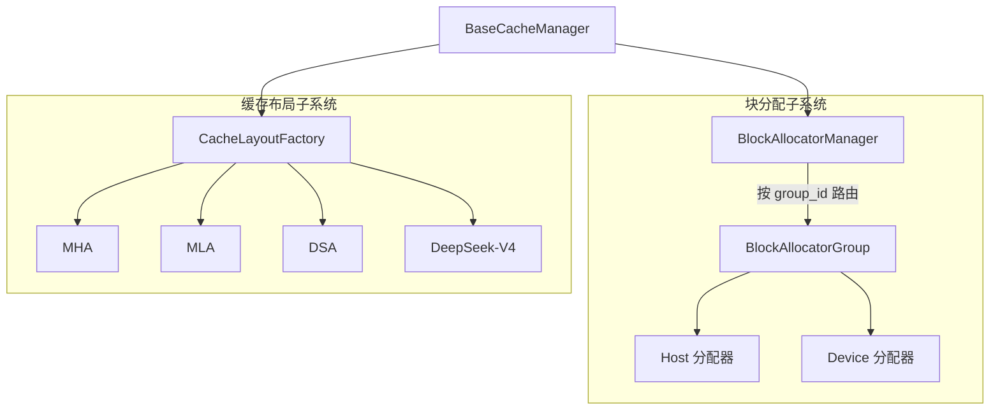
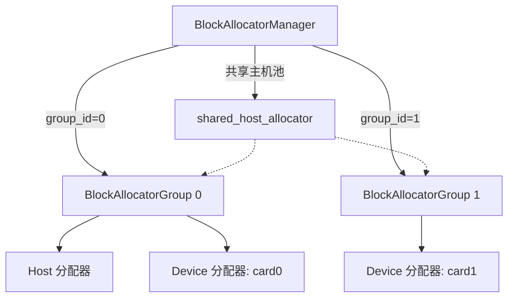
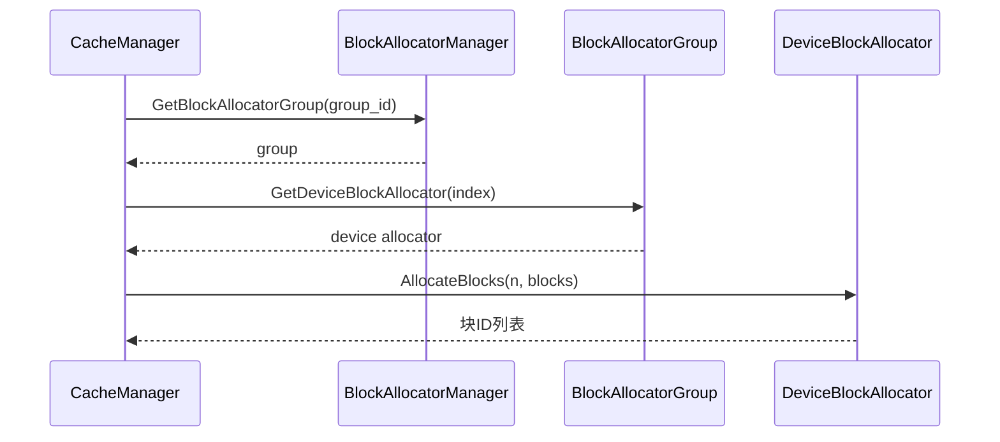
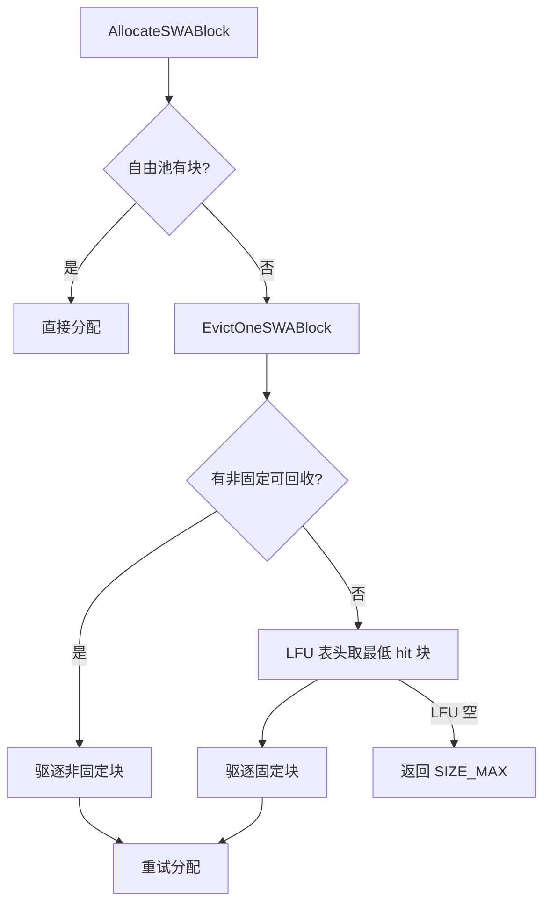
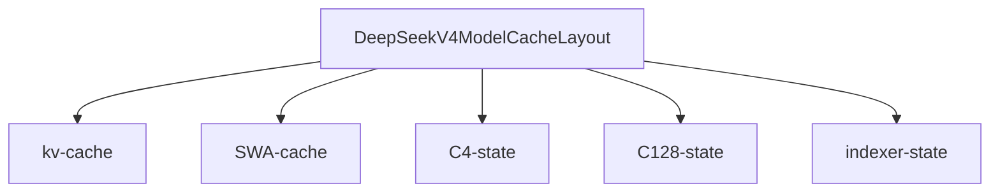

# 块分配与缓存布局

## 1. 概述：KV 块分配与缓存布局的整体定位

KV Cache 在 PagedAttention 下以「KV 块」为物理载体：显存被切成固定大小的块，按需分配给请求。块分配器解决「显存如何按块分配」，缓存布局解决「块内 K/V 数据如何排布」。

本文档聚焦物理层的两大子模块：**块分配器**（`csrc/cache_manager/block_allocator/`）与**缓存布局**（`csrc/cache_manager/cache_layout/`）。它们与《缓存管理器与复用》的关系：缓存管理器负责逻辑复用（前缀树命中、共享、远程加载），本文档负责物理块分配与块内 K/V 布局。

`BaseCacheManager<CachedBlockType, CachedRequestType>` 模板基类持有块分配器组（`BlockAllocatorGroupInterface`）与请求映射表，是块分配器接入缓存管理层的纽带。主要知识点分四大块：

| 专题 | 解决的核心问题 | 关键载体 |
| --- | --- | --- |
| 块分配接口与分层 | 引擎侧 vs 执行器侧如何抽象统一的块分配 | `BlockAllocatorInterface` |
| BlockGroup 调度 | 主机 + 多 GPU 显存按组统一编排 | `BlockAllocatorManager` |
| LFU 驱逐 | SWA 滑动窗口下回收不再需要的 KV 块 | `SWACacheManager` |
| 缓存布局工厂 | 块内每层 K/V 的字节偏移与大小 | `CacheLayoutFactory` |

四个专题依次递进：先有统一分配接口，再讲按组调度，再讲滑动窗口下的驱逐回收，最后讲块内数据的字节排布。

本章结论：块分配负责「显存资源按块切分与回收」，缓存布局负责「块内字节如何排布」，两者由缓存管理器在逻辑之上组织在一起。

**Sources:** <ref_code path="csrc/cache_manager/base_cache_manager.h" /> <ref_code path="csrc/cache_manager/block_allocator/" /> <ref_code path="csrc/cache_manager/cache_layout/" />

## 2. 块分配接口与分层：从抽象接口到两类实现

本章是文档核心。`BlockAllocatorInterface` 定义统一原语，`EngineBlockAllocator` 与 `ExecutorBlockAllocator` 分别从引擎与执行器两个视角实现。

### 2.1 统一抽象：`BlockAllocatorInterface`

接口规定了块分配器的全部原语（不再展示完整源码，仅列方法名）：`PreAllocateBlocks`（预分配全部块）、`Clear`（释放全部块）、`AllocateBlocks` / `FreeBlocks`（按块分配/释放，块以`std::vector<int>`的块 ID 表达）、`GetBlockPtrs`（块 ID → 内存地址）、`GetBlocksBasePtr` / `GetBlocksBaseId`（ATB 连续内存模式下取基址与首块 ID）、`GetFreeBlockNumber` / `GetUsedBlockNumber`。

两个关键抽象：

- 块以整型 **block_id** 标识，不直接暴露地址，上层通过 `GetBlockPtrs` 按需解析。
- `GetBlocksBasePtr` 与 `GetBlocksBaseId` 仅用于 ATB 扁平连续内存模式，非连续实现会直接拒绝调用。

### 2.2 引擎侧实现：`EngineBlockAllocator`

`EngineBlockAllocator` 只持有块数 `block_num`，不分配真实显存。它用两个 `std::unordered_set<int>` 维护空闲块（`free_blocks_`）与已用块（`used_blocks_`），配合 `std::mutex` 保证线程安全。

- `PreAllocateBlocks` 把 `[0, block_num)` 全部填入 `free_blocks_`。
- `AllocateBlocks` 从 `free_blocks_` 头部分出 N 个块移到 `used_blocks_`，不足即返回 `RET_DEVICE_MEM_ALLOCATE_FAILED`。
- `GetBlockPtrs` / `GetBlocksBasePtr` 直接抛出「未实现」，因为引擎侧只管理 ID 分配，不知实际地址。

引擎侧本质是「ID 记账」，服务于 ATB 扁平模式；真实块指针由执行器侧映射。

### 2.3 执行器侧实现：`ExecutorBlockAllocator`

`ExecutorBlockAllocator` 真正拥有显存。构造参数含 `MemoryLocation location`、`block_num`、`block_size`、`rank`，以及 `MemoryAllocatorInterface`（Host 用 `HostAlloc`，Device 用 `MallocAsync`）。内部用 `std::unordered_map<int, void*> allocated_blocks_` 维护块 ID → 地址。

- `PreAllocateBlocks` 尽量做**连续分配**：Device、Host 路径优先一次性 `malloc (block_num+1)*block_size` 再按 `block_id*block_size` 切片，得到 `blocks_base_ptr_` 基址；否则逐个 `malloc block_size`。
- 连续模式开关由 `IsPdV2ContiguousKvEnabled()`（YAML `setting.connector.backend=="v2"`）与 `ENABLE_ACL` / `ENABLE_FLASH_ATTN_WITH_CACHE` 宏门控，PD-v2 要求连续 KV 池以支持对端节点 `block_id*block_size` 定位写。
- `AllocateBlocks` / `FreeBlocks` 此处抛出「未实现」——执行器侧块在 `PreAllocateBlocks` 已全部预分配并常驻 `allocated_blocks_`。
- `GetBlockPtrs` 从映射查地址；`blocks_base_ptr_` 用于把引擎 KV 缓存内存映射到 NPU KV 缓存内存。

### 2.4 两类实现分工对比

| 维度 | `EngineBlockAllocator` | `ExecutorBlockAllocator` |
| --- | --- | --- |
| 职责 | 块 ID 记账（ATB 扁平） | 真正持有块内存地址 |
| 内存形态 | 无真实内存 | 连续（基址切片）或逐块 |
| 核心容器 | `free_/used_` 两个集合 | `allocated_blocks_` 映射 |
| `AllocateBlocks` | 集合搬运 ID | 未实现（预分配完成） |
| 地址来源 | 未实现/抛出 | `GetBlockPtrs` 映射 |
| 基址 | 未实现 | `blocks_base_ptr_` + `block_base_id_` |

结论：引擎侧负责「哪些块空闲」的逻辑分配，执行器侧负责「块对应哪块显存」的物理映射，两层通过 `BlockAllocatorInterface` 解耦。

**Sources:** <ref_code path="csrc/cache_manager/block_allocator/block_allocator_interface.h" /> <ref_code path="csrc/cache_manager/block_allocator/engine_block_allocator.h" /> <ref_code path="csrc/cache_manager/block_allocator/engine_block_allocator.cpp" /> <ref_code path="csrc/cache_manager/block_allocator/executor_block_allocator.h" /> <ref_code path="csrc/cache_manager/block_allocator/executor_block_allocator.cpp" />

## 3. BlockGroup 按组调度：`BlockAllocatorManager` 的宿主与多 GPU 编排

紧接分配器之上是调度层。`BlockAllocatorManager` 把多个「组」按 group ID 统一管理，每个组覆盖一台主机的显存与多卡。

### 3.1 组与配置结构

组配置 `BlockAllocatorGroupConfig` 描述一组分配参数：`devices`（本组设备 ID 列表）、`device_block_num`（每卡块数）、`host_block_num`（主机块数）、`block_size`（单块字节数）。全局用 `BlockAllocatorManagerConfig = unordered_map<int, BlockAllocatorGroupConfig>`（group ID → 配置）表达，例如每个数据并行（DP）占一个组。

`BlockAllocatorGroup` 是分配载体，内部持有：一个 `host_allocator`（主机）+ 以 device_id 为键的 `dev_allocators` 映射。构造时创建并并行 `PreAllocateBlocks`：

- 正常路径：`block_allocator_creation_fn` 为每个 device_id 创建 Device 分配器。
- 共享路径：若管理器判定各 DP 组 `host_block_num` / `block_size` 一致，则注入共享的 `host_allocator`，本组不再重复预分配主机池（`host_allocator_is_shared_=true`）。

`GetDeviceBlockAllocator(index)` 按设备在配置中的次序返回对应分配器，越界返回 `nullptr`；`GetBlockAllocatorDevices()` 返回设备列表。

### 3.2 管理器按组路由

`BlockAllocatorManager`（实现 `BlockAllocatorManagerInterface`）持 `allocator_groups_`（group_id → group）。`Initialize` 遍历配置，为每个 group_id 创建或注入共享主机分配器并注册；`GetBlockAllocatorGroup(group_id)` 按路由返回对应组。

主机显存共享优化：当多个 attn-DP 组的 host 配置一致时，`Initialize` 检测并折叠为**单个共享主机分配器**（`shared_host_allocator_`），避免每个组各预分配一份重复的主机池——共享仅在进程内生效，跨卡进程仍各自持池。

分配请求从缓存管理器发出：按 group ID 调 `GetBlockAllocatorGroup`，再经组的 `GetHostBlockAllocator` / `GetDeviceBlockAllocator` 落到具体物理块。

### 3.3 Allocate 路由时序

结论：`BlockAllocatorManager` 用 group_id 把「主机 + 多 GPU」的分配器组织起来提供给缓存管理器，Host 与多卡协同分配，组间通过共享主机分配器省内存。

**Sources:** <ref_code path="csrc/cache_manager/block_allocator/block_allocator_manager.h" /> <ref_code path="csrc/cache_manager/block_allocator/block_allocator_manager.cpp" />

## 4. LFU 驱逐与内容固定：SWA 块显存的回收策略

`SWACacheManager` 在滑动窗口（SWA）下回收不必再保留的 KV 块，核心是 LFU（Least Frequently Used）驱逐，配合内容固定与引用计数。

### 4.1 块绑定关系与固定状态

`SWACachedBlock` 把前缀树的 FA 块与显存块绑定，关键字段：

| 字段 | 含义 |
| --- | --- |
| `fa_block_id` | 绑定的 Full Attention 块 ID（前缀树节点） |
| `memory_block_id` | 实际显存块 ID，`-1` 表示未分配 |
| `is_content_fixed` | 内容是否固定（写入完成、可被后续复用） |
| `hit_count` | 前缀缓存命中次数，作 LFU 排序键 |
| `active_req_ids` | 当前持有的请求集合，空即可回收 |
| `prefix_fa_block_num` | 该 FA 块在序列中的序号，LFU 次排序键 |

「可回收（reclaimable）」定义为 `active_req_ids` 为空，即无请求正在该块窗口内。每次 `ReuseSWABlock` 先用 `AcquireSWABlock` 注册新持有者并 `IncrementHitCount`；`SetReclaimable` 释放请求持有，当集合清空时加入可回收池。

### 4.2 LFU 驱逐：`EvictOneSWABlock`

可回收块分两类集合：非固定（`reclaimable_non_content_fixed_`，无前缀缓存价值）与固定（`reclaimable_content_fixed_lfu_`，持有可复用前缀数据）。驱逐优先级：

1. 先驱逐非固定可回收块（不损失前缀缓存）。
2. 无可逐时，LFU 列表头即驱逐（最低 `hit_count` 优先，等值再比 `prefix_fa_block_num` 小的在前）。
3. 两者皆空返回 `SIZE_MAX`，`AllocateSWABlock` 收到后分配失败。

LFU 链表按 `(hit_count ASC, prefix_fa_block_num ASC)` 排序，`IncrementHitCount` 命中时先移出再按新计数插入正确位置，`lfu_iters_` 支持 O(1) 移除。`FreeSWABlock` 把 `memory_block_id` 归还宿主分配器并清理跟踪结构。

### 4.3 分配与驱逐流程

`AllocateSWABlock` 分配一个 FA 块绑定的 SWA 块：先尝试从自由池直接分配，池空再调 `EvictOneSWABlock` 收回一块后重试；新块初始 `is_content_fixed=false`，并 `AcquireSWABlock` 把请求登记为首个持有者。`SetSWABlockContentFixed` 在内容写入完成后把块标为固定（可复用）。`IsSWABlockValid` 判断固定且已分配。

结论：SWA 块先固定（写入完成）后进入 LFU 候选；缺块时优先丢非固定块，再按 hit 由低到高驱逐固定块，用引用计数保证使用中的块不被错杀。

**Sources:** <ref_code path="csrc/cache_manager/swa_cache_manager.h" /> <ref_code path="csrc/cache_manager/swa_cache_manager.cpp" />

## 5. 缓存布局工厂与多类布局计算

前三章解决「块怎么分配/回收」，本章回答「KV 数据在块内如何排布」。`CacheLayoutFactory` 按模型注意力类型创建布局，不同布局决定每层 K/V 的字节偏移与块总大小。

### 5.1 布局框架

布局体系由三级基类 + 偏移结构组成：

| 类型 | 职责 |
| --- | --- |
| `BaseModelCacheLayout` | 模型级：注册多个 `BaseBlockCacheLayout`，按类型名查询 |
| `BaseBlockCacheLayout` | 块级：`Initialize` 一次性计算、`GetBlockCacheSize`、`GetKvCacheLayerOffsets`、`GetActiveKvCacheTypes` |
| `BaseLayerCacheLayout` | 层级：`layer_index`、`base_offset`、`cache_size` |
| `KvCacheLayerOffsets` | K/V 字节偏移（绝对，已含层基址） |

`BaseBlockCacheLayout::Initialize` 遍历节点内全部层（含 MTP），逐层 `InitLayerCacheLayout` 计算并累加得到 `block_cache_size_`。`KvCacheLayerOffsets` 用 `k_offset` / `v_offset` 表达一层内 K/V 的绝对字节偏移。

### 5.2 工厂按注意力类型选布局

`CacheLayoutFactory.CreateModelCacheLayout` 依据模型配置逐个判型，选择优先级固定：`use_dsv4_attn` → `use_dsa` → `use_mla` → 默认 MHA。

| 判定开关 | 生成布局 |
| --- | --- |
| `use_dsv4_attn` | `DeepSeekV4ModelCacheLayout` |
| `use_dsa` | `DsaModelCacheLayout` |
| `use_mla` | `MlaModelCacheLayout` |
| 其余 | `MhaModelCacheLayout` |

各 Model 布局构造函数向 `RegisterBlockCacheLayout` 注册具体的 Block 布局（如 MHA 注册 `"kv-cache"`）。

### 5.3 四种布局的偏移与大小计算

**MHA（`MhaBlockCacheLayout`）**：逐层显式 K/V offsets。每层 `[key: block_token_num x kv_head × head_dim]` + `[value: 同尺寸]`，块内 K/V 各占一半（`k_offset = base_offset`，`v_offset = k_offset + cache_size/2`），`GetActiveKvCacheTypes` 仅 `"attention"`。

**MLA（`MlaBlockCacheLayout`）**：只管理单头 K/V。与 MHA 不同，K/V 共用同一偏移（`v_offset = k_offset`）。每层大小按 `kv_lora_rank` 与 `qk_rope_head_dim` 计算；`TYPE_FP8_DS_MLA` 时 key/value 额外携带 FP8 量化（`kv_lora_rank/128` 的 FP32 scale）。

**DSA（`DsaBlockCacheLayout`）**：区分 indexer 与 attention 两段。`GetActiveKvCacheTypes` 返回 `["indexer","attention"]`，indexer 偏移低（base），attention 紧随其后。indexer 恒定量化到 `TYPE_FP8_E4M3`；attention 同 MLA 的 K/V 共用偏移。

**DeepSeek-V4（`DeepSeekV4CacheLayout`）**：多块布局，按 `compress_ratios[layer]` 切分三种结构，主 KV layout 仅持 `[indexer | attention]`：

| `compress_ratio` | indexer 缓存 | attention 缓存 |
| --- | --- | --- |
| 0 | 无 | 无（层大小 0） |
| 4 | 每 token `index_head_dim` 的 FP8 + scale | DSA 大小 ÷ 4 |
| 128 | 无 | DSA 大小 ÷ 128 |

两辅助函数计算字节：`ComputeIndexerCacheSize` 得到未压缩 indexer 块大小，`ComputeKeyValueHeadBytes` 得到 MLA attention 块大小（FP8 或默认路径）。

### 5.4 DeepSeek-V4 多块布局：SWA 与压缩器状态

`DeepSeekV4ModelCacheLayout` 远超单 KV 布局，注册五个 Block 布局：`"kv-cache"`（每层 indexer+attention）、`"SWA-cache"`（SWA+tail）、`"C4-state"` / `"C128-state"` / `"indexer-state"`（压缩器状态），是否启用 SWA 由下游 `IsBlockCacheTypeExist("SWA-cache")` 判断。

`DeepSeekV4SwaWithTailCacheLayout` 的单 SWA 块总布局为每层 `[swa | tail_attn | tail_indexer]`：`swa` 持 full-size MLA 缓存，`tail_attn` / `tail_indexer` 各持固定 4 token 的 FP32 kv_score（c4 overlap），所有层均匀分配以支持「单基址 + 固定 stride」寻址。`GetActiveKvCacheTypes` 返回空表，避免主 KV 循环误插入。

`DeepSeekV4CompressorStateLayout` 为单压缩器状态分配：仅对 `layer_compress_ratio == block_compress_ratio` 的活跃层分配 `ComputeKeyValueHeadBytes` 大小，非活跃层偏移置 0（占位防越界）。

主 KV 布局与 SWA 池解耦，故压缩率越高，attention 缓存越小，这是 DeepSeek-V4 相比朴素逐层 KV 更省显存的核心。

| 布局 | 逐层显式双偏移 | 单头 KV | 含 indexer | 共用 K/V 偏移 |
| --- | --- | --- | --- | --- |
| MHA | 是 | 否 | 否 | 否 |
| MLA | 否 | 是 | 否 | 是 |
| DSA | 是 | 是 | 是 | 是 |
| DeepSeek-V4 | 是（含 SWA/tail） | 是 | 压缩率 4 时是 | 是 |

结论：布局工厂按注意力形态生成对应排布；MLA 用单头压缩 K/V 省显存，DSA/DeepSeek-V4 用 indexer 分离与压缩率换取注意力稀疏，DeepSeek-V4 进一步把 SWA 与压缩器状态拆成独立块池。

**Sources:** <ref_code path="csrc/cache_manager/cache_layout/base_cache_layout.h" /> <ref_code path="csrc/cache_manager/cache_layout/cache_layout_factory.h" /> <ref_code path="csrc/cache_manager/cache_layout/mha_cache_layout.h" /> <ref_code path="csrc/cache_manager/cache_layout/mla_cache_layout.h" /> <ref_code path="csrc/cache_manager/cache_layout/dsa_cache_layout.h" /> <ref_code path="csrc/cache_manager/cache_layout/deepseek_v4_cache_layout.h" />

## 6. 调优与注意事项

显存优化工程师视角：块大小/布局选择、Host 与多 GPU 分配、LFU 固定对性能的影响、多布局显存权衡。

### 6.1 按注意力类型选布局

布局选择是显存规划的第一步，决策顺序固定（工厂内已内置判定优先级）：

- **普通 Dense 注意力**：走 `MhaModelCacheLayout`，逐层 K/V 显式双偏移，结构最直观。
- **MLA 模型**：走 `MlaModelCacheLayout`，单头 K/V 共用偏移，可显著缩减逐层 KV 占用。
- **DSA 稀疏注意力**：走 `DsaModelCacheLayout`，indexer 与 attention 分离，便于稀疏索引复用。
- **DeepSeek-V4**：走 `DeepSeekV4ModelCacheLayout`，用压缩率摊薄 attention 且把 SWA/压缩器状态拆池。

### 6.2 块分配与多 GPU 编排建议

- engine / executor 开关决定分配器类型：引擎侧重 ID 记账，执行器侧重真实内存映射，混用需经 `BlockAllocatorManager` 统一。
- 多 attn-DP 组若 host 配置一致，管理器自动折叠为共享主机分配器，避免重复预分配主机池。
- 设备块始终按 group/device 持有，跨卡进程各自持池，不能共享设备内存。

### 6.3 LFU 驱逐与内容固定的权衡

- 固定块携带可复用前缀，驱逐即丢失缓存价值，故优先驱逐非固定块。
- `hit_count` 高低决定固定块回收次序，命中多/前缀靠前的块先保、低命中块先逐。
- 过度固定会减少可回收候选，导致可用块下降、触发更多驱逐；使用中的块由 `active_req_ids` 引用计数保护，不会被误逐。

### 6.4 多布局下的显存权衡

- DeepSeek-V4 压缩率越高 attention 块越小，但 indexer 与压缩器状态需额外块池，块数配置需均衡。
- MLA FP8 量化以精度换容量，K/V 在 FP8 路径多带一份 scale 开销，需权衡。
- 块越大单次分配越少但内部碎片越多，应按 KV 数据类型与 head 维度配合布局选 block_size。

结论：先按注意力形态定布局，再按 DP/多卡规模定块分配与主机共享，最后结合 LFU 固定与量化/压缩率做显存取舍。

**Sources:** <ref_code path="csrc/cache_manager/block_allocator/block_allocator_test.cpp" /> <ref_code path="csrc/cache_manager/cache_layout/cache_layout_test.cpp" />