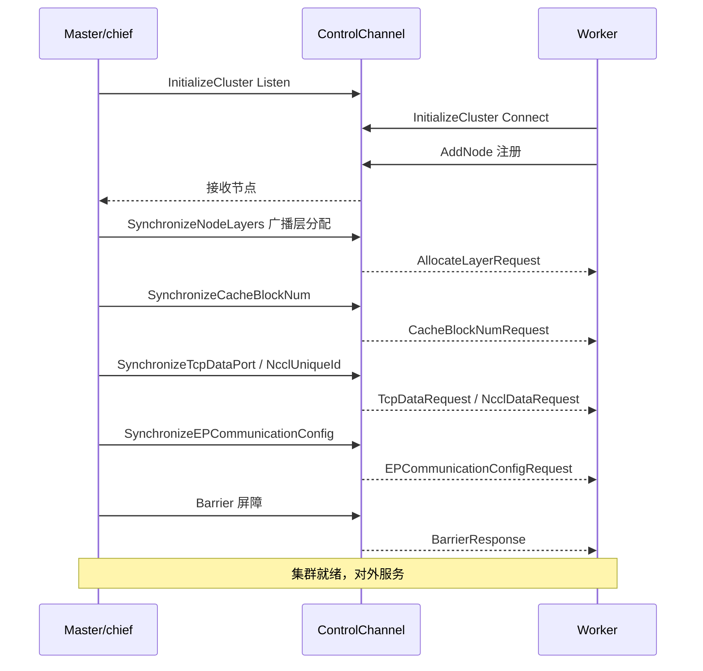
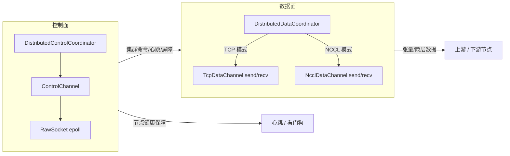
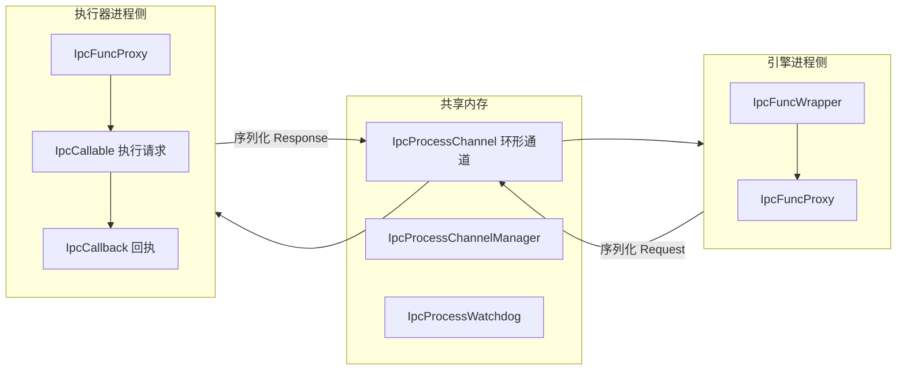
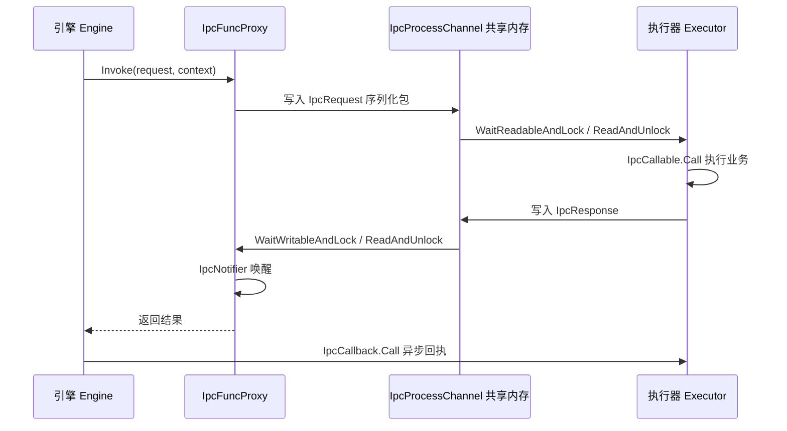
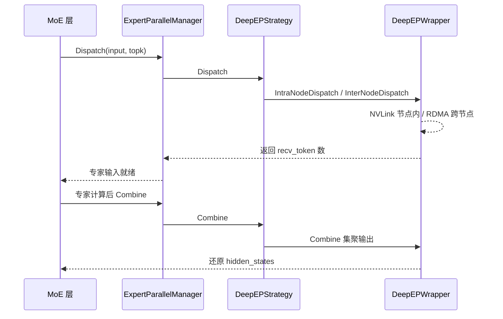

# 分布式并行与集群通信

## 1. 分布式并行体系概述

单个 GPU 的显存与算力有限，无法承载超大模型的权重、超长上下文的 KV Cache 与高并发请求吞吐。KsanaLLM 通过多节点集群把推理拆解到多个进程与多张 GPU 上协同完成，这就是分布式并行。它同时解决两个问题：单机"装不下"（容量）与单机"算不快"（吞吐），并让多台机器像一个整体那样对外提供推理服务。

分布式结构分为四层，各司其职又相互配合：

| 层次 | 核心组件 | 职责 | 典型载体 |
| --- | --- | --- | --- |
| 控制面 Coordination | `DistributedControlCoordinator` + `ControlChannel` | 集群建簇、节点注册、屏障、心跳健康 | 原始 socket |
| 数据面 Data | `DistributedDataCoordinator` | 节点间张量/隐层数据交换 | `TcpDataChannel` / `NcclDataChannel` |
| 跨进程 IPC | `IpcFuncWrapper` + `IpcProcessChannel` | 引擎↔执行器两进程协作 | 共享内存环形通道 |
| 四维并行 | `GlobalContext` 协同 | 张量/请求/层/专家四类维度切分 | NCCL / 多通道 |

实现上控制面与数据面解耦：控制面只管"集群如何对齐、谁是 master、节点是否存活"，不搬运业务数据；数据面只管"张量怎么流过去"。跨进程 IPC 独立于二者，负责同一台机器上引擎进程与执行器进程的分工协作。

四类并行维度各切一样东西，可叠加在一张 GPU 上同时生效：

- **TP 张量并行**：把模型内部张量切分到多 GPU，配合 NCCL 的 AllReduce/AllGather 集合通信。
- **DP 数据并行**：把请求/批次均衡分配到多个节点，各持有完整模型副本。
- **PP 流水线并行**：把模型按层切到不同节点，配合 PpMultibatch 多 batch 流水缩短气泡。
- **EP 专家并行**：把 MoE 的专家切分到不同设备，依赖 DeepEP 低延迟分发。

全篇按"集群如何建起来 → 节点之间怎么通 → 跨进程怎么协作 → 四维并行怎么分工"层层递进。下一章先从最核心的建簇同步入手。整体分层关系如下：

```mermaid
flowchart TB
    subgraph CPLANE["控制面 Coordination"]
        DC[DistributedControlCoordinator]
        CC[ControlChannel / RawSocket]
        DC --> CC
    end
    subgraph DPLANE["数据面 Data"]
        DD[DistributedDataCoordinator]
        Tcp[TcpDataChannel]
        Ncl[NcclDataChannel]
        DD --> Tcp
        DD --> Ncl
    end
    subgraph IPCY["跨进程 IPC"]
        WR[IpcFuncWrapper]
        CH[IpcProcessChannel]
        WR --> CH
    end
    subgraph PAR["四维并行 TP / DP / PP / EP"]
        G[GlobalContext 协同]
    end
    CPL -->|建簇/同步/心跳| DPLANE
    IPCY --> PAR
    DPLANE --> PAR

**Sources:** <ref_code path="csrc/distributed/distributed_control_coordinator.h" /> <ref_code path="csrc/distributed/distributed_data_coordinator.h" /> <ref_code path="csrc/ipc/ipc_func_wrapper.h" /> <ref_code path="csrc/configure/global_context.h" />


## 2. 集群建簇与同步流程

建簇的目标是把多个独立启动的进程组织成一个统一集群，并保证每个节点对同一条信息（层分配、Cache 块数、通道参数、并行度）达成一致。这个流程由控制面完成，核心门面是 `DistributedControlCoordinator`，它把建簇委托给 `ControlChannel`。

各同步点与方法对照如下：

| 同步点 | 协调器方法 | 消息载体 |
| --- | --- | --- |
| 建簇入口 | `InitializeCluster` | `AddNodeRequest` |
| 层数同步 | `SynchronizeNodeLayers` | `AllocateLayerRequest` |
| Cache 块数同步 | `SynchronizeCacheBlockNum` | `CacheBlockNumRequest` |
| TCP 数据端口同步 | `SynchronizeTcpDataPort` | `TcpDataRequest` |
| NCCL UID 同步 | `SynchronizeNcclUniqueId` | `NcclDataRequest` |
| EP 配置同步 | `SynchronizeEPCommunicationConfig` | `EPCommunicationConfigRequest` |
| 屏障 | `Barrier` | `BarrierRequest/Response` |

### 2.1 建簇入口：节点加入与 master 确认

`InitializeCluster()` 先判断当前节点是否为 master：PP 模式（world_size > 1）由 `IsDistributedWorker()` 判定；EP-only 模式（world_size == 1 而专家规模 > 1）则由 `IsExpertParallelChief()` 判定。

- **master/chief**：调用 `ControlChannel::Listen()` 监听 master 端口，最多重试 600 秒（等待上一进程端口的释放）。
- **worker**：调用 `ControlChannel::Connect()` 连接 master，成功后调用 `AddNode()` 注册自己的节点。
- 各节点加入完成后，调用 `Barrier()` 等待所有节点到齐。

消息载体按类型区分：master 到 worker 的方向为 `CONTROL_*` 请求/响应；节点到 master 的方向包括 `AddNodeRequest`、`HeartbeatRequest` 等。建簇主流程如下：

```mermaid
flowchart TD
    A["InitializeCluster 启动"] --> B{是否 chief / master}
    B -->|是| C["ControlChannel Listen 监听"]
    B -->|否| D["ControlChannel Connect 连接"]
    D --> E[AddNode 注册节点]
    C --> F["Barrier 等待全部节点加入"]
    E --> F
    F --> G["SynchronizeNodeLayers 节点层数"]
    G --> H["SynchronizeCacheBlockNum Cache 块数"]
    H --> I["SynchronizeTcpDataPort / NcclUniqueId 数据通道参数"]
    I --> J["SynchronizeEPCommunicationConfig 专家并行配置"]
    J --> K[Barrier 对外服务就绪]
```

### 2.2 逐阶段同步：层数、Cache 块数与通道参数

节点加入后按阶段依次对齐各项参数：

- **节点层数同步** `SynchronizeNodeLayers(layer_nums, layer_indexes)`：把 total 层的分布广播给各 worker。若采样节点配置了 `sampling_node_offload_layer_num > 0`，则从采样节点（node_rank == world_size-1）卸载对应层数并均匀分摊到其它节点。
- **Cache 块数同步** `SynchronizeCacheBlockNum`：master 聚合各节点的设备/主机块数，取一致值后广播，保证全局 KV 布局统一。
- **TCP 数据端口同步** `SynchronizeTcpDataPort`：master 建立从每个节点到下游节点的 HostPort 映射，返回 `executor_downstream_host_ports` 供数据面建链。
- **NCCL UID 同步** `SynchronizeNcclUniqueId`：master 生成 `ncclUniqueId`（平台无关用 `char[]` 传递）广播给所有 worker，供 NCCL 数据通道初始化。
- **EP 配置同步** `SynchronizeEPCommunicationConfig`：engine 收集各 executor 的 `EPCommunicationConfig`（含 nvshmem_id、ipc_handles）→ 发给 master 聚合 → 广播回全部节点，为专家并行初始化做准备。

### 2.3 屏障与节点健康保障

`Barrier()` 作为同步的最后一道闸，保证所有节点完成上述同步后才进入对外服务。控制面底层用 `RawSocket`（epoll 异步监听 + 状态机收包）承载全部控制消息，并用多个后台线程发送心跳、调度输出与采样输出。

- 心跳通过 `HeartbeatRequest/Response` 周期上报，配合 `IpcProcessWatchdog` 与 master 端看门狗兜底，防止节点掉线后集群带着缺员继续推理。
- `Frozen()` 停止接受新连接，用于服务期内的连接收口。

master 与 worker 的完整同步时序如下：



`RawSocket` 是原始 socket 的封装，通过 epoll 监听多个连接的读写事件，内部按"包头 12 字节 → 包体"的状态机拆包，把完整 `Packet` 交给上层回调处理，是控制面与数据面 TCP 通道共用的子网络层。

**Sources:** <ref_code path="csrc/distributed/distributed_control_coordinator.cpp" /> <ref_code path="csrc/distributed/control_message.h" /> <ref_code path="csrc/distributed/packet_type.h" /> <ref_code path="csrc/distributed/raw_socket.h" /> <ref_code path="csrc/distributed/node_info.h" />


## 3. 控制面与数据面双通道

控制面解决"集群怎么对齐"，数据面解决"张量怎么流动"。数据面由 `DistributedDataCoordinator` 作为门面，按配置透明切换两种通道：`TcpDataChannel`（TCP 连接）与 `NcclDataChannel`（NCCL 高速通道，位于 `csrc/distributed/nvidia`）。二者对上层暴露同一套 `SendData`/`RecvData` 接口，交换的是 `HiddenUnitDeviceBuffer` 设备缓冲。

| 维度 | TCP 数据通道 | NCCL 数据通道 |
| --- | --- | --- |
| 底层 | TCP 原始 socket | NCCL 集合通信库 |
| 构建入口 | `InitializeTcpDataChannel` | `InitializeNcclDataChannl` |
| 建链 | `Listen`/`Connect` | `InitializeNcclCluster(nccl_unique_id)` |
| 收发 | `SendData`/`RecvData` | `SendData`/`RecvData` |
| 适用 | CPU/设备间通用、易调 | GPU 场景、高速低延迟 |

### 3.1 通道初始化与切换

`DistributedDataCoordinator` 持有 `TcpDataChannel` 与 `NcclDataChannel` 两个成员（NCCL 仅在 `ENABLE_CUDA` 下编译）。启动阶段按模式调用对应初始化方法，后续所有张量收发都走同一个 `SendData`/`RecvData` 入口，由协调器内部路由到已初始化的通道。

数据面的初始化接入 IPC 层：跨进程建立通道由 `connect_tcp_data_channel`、`connect_nccl_data_channel` 两个 IPC 函数驱动，NCCL 的集合运算协议集中在 `nccl_operations`。

### 3.2 隐层数据的收发流程

数据面承载的是节点间传递的隐层（hidden unit）数据，TCP 通道按 `DATA_REQ_HIDDEN_UNIT`/`DATA_RSP_HIDDEN_UNIT` 消息类型组织：

- `TcpDataChannel` 内部用 server/client 两套 `RawSocket`，配合 send/recv 主机缓冲队列与收发线程，处理 `ProcessHiddenUnitRequest/Response`。
- 收到上游数据后经 `ProcessHostToDeviceLoop` 拷贝到设备缓冲，再经 `ProcessSendPacketLoop` 转发下游，实现跨节点的隐层流水。
- `NcclDataChannel` 通过已初始化的 `ncclComm_t` 通信子直接执行设备间 Send/Recv，无主机拷贝。



**Sources:** <ref_code path="csrc/distributed/distributed_data_coordinator.h" /> <ref_code path="csrc/distributed/tcp_data_channel.h" /> <ref_code path="csrc/distributed/nvidia/nccl_data_channel.h" /> <ref_code path="csrc/ipc/functions/connect_tcp_data_channel.h" /> <ref_code path="csrc/ipc/functions/connect_nccl_data_channel.h" /> <ref_code path="csrc/ipc/functions/nccl_operations.h" />


## 4. 跨进程通信四件套（IPCBus）

控制面与数据面解决的是"进程外"的跨节点通信；同一台机器上引擎进程与服务执行器进程之间，则通过共享内存 IPC 协作。封装门面是 `IpcFuncWrapper`，底层由"请求-响应-可调用-回调"四件套构成，运行在共享内存环形通道之上。

`IpcFuncWrapper` 承担两重职责：注册每个 IPC 函数编号对应的四件套；对外暴露高层次的 `LoadWeight`、`DispatchScheduleOutput`、`ReportSamplingOutput`、`ConnectTcpDataChannel` 等业务方法，内部统一走 `IpcFuncProxy` 执行。

### 4.1 四件套与调用机制

`IpcFuncTypes` 定义了跨进程调用的核心类型：

| 类型 | 职责 |
| --- | --- |
| `IpcRequest` | 调用入参，携带 rank/role，可序列化 |
| `IpcResponse` | 调用返回，携带 rank/role，可序列化 |
| `IpcCallable` | 服务方执行逻辑，`Call(request, response, context)` |
| `IpcCallback` | 调用方异步回执，`Call(response, context)` |

调用上下文 `IpcContext` 描述一次调用的元信息（func_id、exec_seq、from/to rank、is_async、is_oneway、is_heavy、share_callable 等）。每个 IPC 函数对应一个 `IpcFuncInfo`，绑定各自的四件套与互斥锁。

- 通道基于共享内存（`SHARED_MEMORY_NAME="/ksana_llm_shm"`），环形双槽结构，元数据与数据区分离，支持多 executor 并发读写。
- `IpcProcessChannelManager` 统一创建 engine→executor、executor→engine 与 broadcast 三类通道，管理共享内存句柄。
- `IpcFuncProxy` 是远程调用代理，负责序列化、分发、唤醒与结果回收；`IpcProcessWatchdog` 跨进程监控，防止对端进程异常退出后本方阻塞。

### 4.2 一次跨进程调用的完整数据流

engine 侧发起调用，executor 侧执行并通过回调返回。数据流如下：

- engine 端 `IpcFuncWrapper` 调用 `IpcFuncProxy.Invoke(request, context)` 写入通道。
- executor 端线程 `WaitReadableAndLock` → `ReadAndUnlock` 取到包 → `IpcCallable.Call` 执行业务。
- executor 端写回 `IpcResponse` → engine 端 `IpcNotifier` 唤醒等待方返回结果。
- 异步/单向调用（is_async / is_oneway）则直接挂回调，不等返回值。



一次"引擎→执行器"跨进程调用时序：



### 4.3 协议函数集与松耦合

业务协议函数集中定义于 `csrc/ipc/functions/` 目录，每个函数由"头文件 + 实现 + 四件套（Request/Response/Callable/Callback）"构成，覆盖引擎与执行器间的各类协作：

| 协议函数 | 方向 | 用途 |
| --- | --- | --- | --- |
| `IPC_FUNC_LOAD_WEIGHT` / `load_weight` | 引擎→执行器 | 加载模型权重 |
| `IPC_FUNC_LOAD_MODEL` / `load_model` | 引擎→执行器 | 构建模型实例 |
| `IPC_FUNC_DISPATCH_SCHEDULE_OUTPUT` / `dispatch_schdule_output` | 引擎→执行器 | 下发调度输出 |
| `IPC_FUNC_REPORT_SAMPLING_OUTPUT` / `report_sampling_output` | 执行器→引擎 | 回报采样结果 |
| `IPC_FUNC_REPORT_LAYER_PROGRESS` / `report_layer_progress` | 执行器→引擎 | 报告层进度 |
| `IPC_FUNC_GLOBAL_CACHE_QUERY` / `global_cache_query` | 引擎→执行器 | 全局 KV 查询 |
| `IPC_FUNC_GLOBAL_CACHE_QUERY_DONE/PUT_DONE` | 执行器→引擎 | 全局 KV 查询/写入完成 |
| `IPC_FUNC_SET/GET_EP_COMMUNICATION_CONFIG` | 双向 | 设置/获取专家并行通信配置 |
| `IPC_FUNC_CONNECT_TCP/NCCL_DATA_CHANNEL` | 引擎→执行器 | 建立数据面通道 |
| `IPC_FUNC_PD_V2_BARRIER_DONE` / `pd_v2_barrier_done` | 执行器→引擎 | PD v2 屏障完成回报 |
| `IPC_FUNC_CONNECTOR_NCCL_SEND/RECV_DATA/BLOCKS` | 引擎→执行器 | Connector NCCL 数据交换 |

协议通过 IPC 编号统一挂载与注册，上层业务只依赖 `IpcFuncWrapper` 的高层方法，不感知底层共享内存与序列化细节。这种"功能函数按目录组织、管理与框架解耦"的写法，让每个业务的收发逻辑彼此独立、便于扩展。

**Sources:** <ref_code path="csrc/ipc/ipc_func_wrapper.h" /> <ref_code path="csrc/ipc/core/ipc_func_types.h" /> <ref_code path="csrc/ipc/core/ipc_func_proxy.h" /> <ref_code path="csrc/ipc/core/ipc_process_channel.h" /> <ref_code path="csrc/ipc/core/ipc_process_channel_manager.h" /> <ref_code path="csrc/ipc/core/ipc_process_watchdog.h" /> <ref_code path="csrc/ipc/functions/" />


## 5. TP/DP/PP/EP 四类并行策略分工

四类并行从不同维度切分同一个模型或请求，可叠加在同一张 GPU 上。它们共享同一套集群控制面（`DistributedControlCoordinator` 负责各节点并行度协调与 master 聚合），并通过 `GlobalContext` 集中管理并行配置与节点角色。

| 维度 | 切分对象 | 关键协作/实现 | 数据载体 |
| --- | --- | --- | --- |
| TP 张量并行 | 模型内部张量 | `TpCommunicator` AllReduce/AllGather，NCCL 集合通信 | 张量分片 |
| DP 数据并行 | 请求/批次 | 批次均衡分配，各节点完整副本 | 请求流 |
| PP 流水线并行 | 模型层 | `PpMultibatch` 多 batch 流水 | 隐层/梯度中间量 |
| EP 专家并行 | MoE 专家 | `ExpertParallelManager` 分发/集聚 | 专家输入输出 |

四维的异同与叠加关系：

```mermaid
flowchart LR
    subgraph T["TP 张量并行"]
        T1["切分 Attention/FFN 张量"]
        T2["TpCommunicator AllReduce/AllGather"]
    end
    subgraph D["DP 数据并行"]
        D1[请求/批次切分]
        D2[各节点独立副本]
    end
    subgraph P["PP 流水线并行"]
        P1[按层切分"]
        P2[PpMultibatch 多 batch 流水]
    end
    subgraph E["EP 专家并行"]
        E1[MoE 专家切分]
        E2[ExpertParallelStrategy 分发/集聚]
    end
    T --> G[GlobalContext 多维叠加协同]
    D --> G
    P --> G
    E --> G
```

### 5.1 节点角色与并行度管理

`GlobalContext` 集中保存 world_size、node_rank、master 地址、tensor/attention 并行度，并提供节点角色判定：

| 判定方法 | 语义 |
| --- | --- |
| `IsStandalone` | 单机站点模式 |
| `IsDistributedMaster` | 分布式 master 节点 |
| `IsDistributedWorker` | 分布式 worker 节点 |
| `IsDistributedLastWorker` | 最后一个 worker（流水线尾端） |
| `IsDistributedResultReporter` / `IsSamplingNode` | 结果回报/采样节点 |
| `IsExpertParallelChief` | EP 模式下的主导节点 |

TP 集合通信由 `TpCommunicator` 封装，提供 `AllReduce`（把多张量归约）与 `AllGather`（gather 张量）。设备通信的初始化通过 `init_device_communication` 及 `CreateBroadcastContext`/`CreateEngine2ExecutorContext` 等通信上下文创建完成，链条由 `DistributedControlCoordinator` 与 IPC 层衔接。

并行度在不同维度的分工可归纳为：**TP 切模型内的计算单元、DP 切进来的请求、PP 切模型的层、EP 切模型的专家**。它们在同一集群上正交叠加，由 master 统一分裂并行度并广播，各节点按角色执行各自的转发片段。

**Sources:** <ref_code path="csrc/configure/global_context.h" /> <ref_code path="csrc/models/communicator/tp_communicator.h" /> <ref_code path="csrc/distributed/distributed_control_coordinator.h" /> <ref_code path="csrc/ipc/functions/init_device_communication.h" />


## 6. DeepEP 专家并行实现

EP 把 MoE 的专家切分到不同设备，难点在于让每个 Token 快速到达它命中的专家、再把专家输出集聚回来。KsanaLLM 采用策略模式隐藏具体实现：`ExpertParallelStrategyFactory` 当前仅创建 `DeepEPStrategy`，委托 `DeepEPWrapper` 完成低调度的 Dispatch/Combine。

`ExpertParallelManager` 是上层的统一 EP 通信管理器，对 MoE 层暴露 `Initialize`、`Dispatch`、`Combine`、`GetCommunicationConfig`、`GetRecvNumTokens`，内部持有具体的策略实例。

### 6.1 策略模式与单一入口

- `ExpertParallelStrategy` 定义 EP 通信标准接口（GetCommunicationConfig / Initialize / Dispatch / Combine / GetRecvNumTokens）。
- `ExpertParallelStrategyFactory::Create(StrategyType)` 按类型创建策略，枚举当前仅 `DEEPEP`。若后续引入 NCCL 等其它实现，只需扩展枚举与工厂分支。
- `DeepEPStrategy` 把接口委托给 `DeepEPWrapper`，后者在 `KSANA_WITH_DEEPEP` 宏下实际调用 DeepEP 库。

### 6.2 两次通信：Dispatch 与 Combine

- **Dispatch**：把隐藏状态与 topk 索引/权重分发给各专家所在设备。DeepEPWrapper 内分节点内/跨节点两条路径，并按是否低延迟模式选用不同实现。
- **Combine**：把各专家输出集聚回 token 原所在设备，还原 hidden states。



### 6.3 NVLink 与 RDMA 两条低延迟路径

`DeepEPWrapper` 提供节点内（IntraNode）与跨节点（InterNode）两套 Dispatch/Combine，另有 `LowLatencyDispatch/Combine` 低延迟模式：

| 路径 | 通道 | 适用场景 | 要点 |
| --- | --- | --- | --- |
| 节点内 IntraNode | NVLink | Token 命中同节点专家 | 共享内存拷贝、极低延迟 |
| 跨节点 InterNode | RDMA 通道 | Token 流向其它节点专家 | 绕过 CPU，网络低延迟 |
| 低延迟模式 | NVLink+RDMA 组合 | 对延迟敏感的在线推理 | 无轮询忙等，micro-batch 空转 |

底层用 DeepEP 的 `Buffer`/`Config`，配合分发布局张量（`num_tokens_per_rank_`、`num_tokens_per_expert_`、`rdma_channel_prefix_matrix_` 等）实现 token 零拷贝搬移。EP 通信配置（`EPCommunicationConfig` 的 nvshmem_id、ipc_handles）在建簇阶段经 `SynchronizeEPCommunicationConfig` 聚合广播，通过 `set/get_ep_communication_config` 两组 IPC 协议在引擎与执行器间传递。

MoE 具体层的算子实现不属于本文范围，此处以 `ExpertParallelManager` → 策略 → `DeepEPWrapper` 的封装链视角理解 EP 的通信机制即可。

**Sources:** <ref_code path="csrc/distributed/expert_parallel/expert_parallel_manager.h" /> <ref_code path="csrc/distributed/expert_parallel/expert_parallel_strategy.h" /> <ref_code path="csrc/distributed/expert_parallel/deepep_strategy.h" /> <ref_code path="csrc/distributed/expert_parallel/deepep_wrapper.h" /> <ref_code path="csrc/ipc/functions/set_ep_communication_config.h" /> <ref_code path="csrc/ipc/functions/get_ep_communication_config.h" />