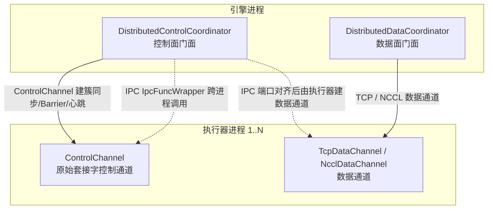
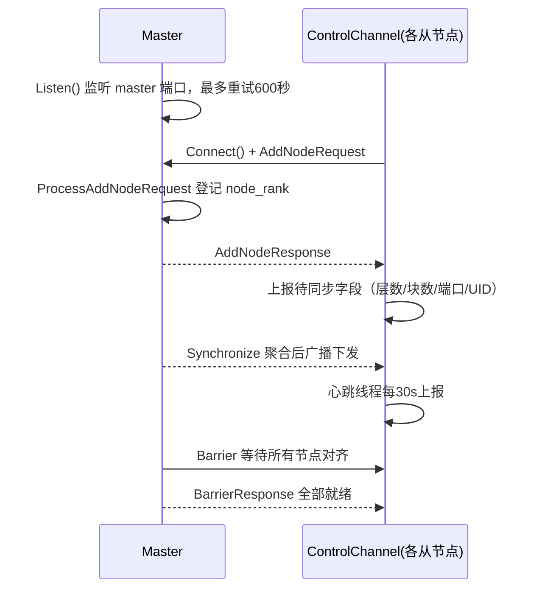
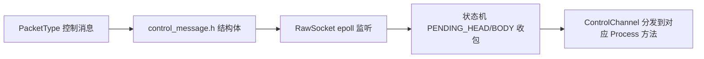
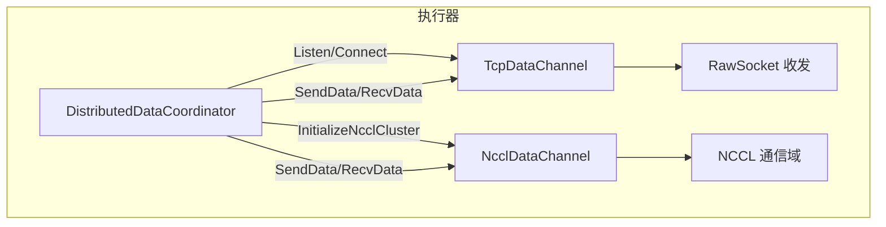
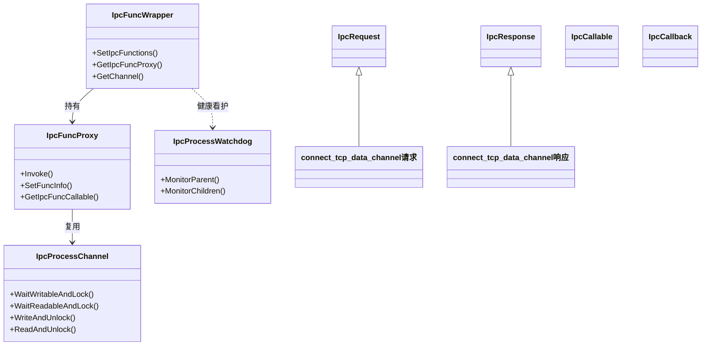
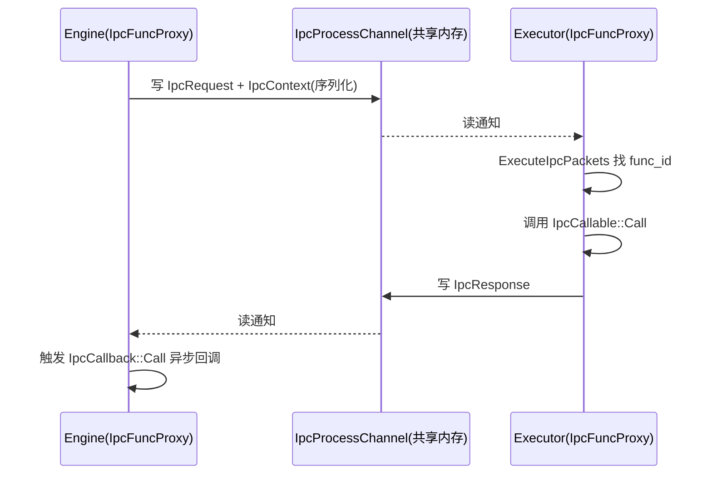

# 集群建簇与通道

## 1. 分布式集群建簇与通道概述

KsanaLLM 的多机推理建立在一条「先打通集群、再传输数据」的分布式链路上。本文聚焦这条链路的前半段：多节点如何从独立进程对齐成一张多图，以及节点间的张量数据如何经 TCP/NCCL 通道传输、引擎与执行器如何跨进程调用并回流结果。

分布式通信整体划分为两个平面，外加一条跨进程封装线：

- **控制面**：`DistributedControlCoordinator` 委托 `ControlChannel` 完成建簇、元数据同步与 Barrier，各 `Synchronize*` 方法在此对齐节点层数、Cache 块数与数据通道端口。
- **数据面**：`DistributedDataCoordinator` 按配置透明切换 `TcpDataChannel` 与 `NcclDataChannel`，负责推理张量（hidden units）在节点间传输。
- **跨进程线**：`IpcFuncWrapper` 封装引擎↔执行器之间跨进程的函数调用，共享内存通道承载请求-响应-回调。

「控制面打通环境、数据面保证请求流动、IPC 打通进程边界」三者彼此衔接：控制面的端口/NCCL UID 同步正是数据通道建连的前提，而 `connect_tcp/nccl_data_channel` 的 IPC 协议又复用了数据通道门面。

并行策略（TP/DP/PP/EP）的分工不在本文展开（见姊妹文档《四类并行策略》），但它们在节点层数、Cache 块数与 EP 通信配置上的对齐，正是依赖本章的控制面同步原语。

**Sources:** <ref_code path="csrc/distributed/distributed_control_coordinator.h" /> <ref_code path="csrc/distributed/distributed_data_coordinator.h" /> <ref_code path="csrc/ipc/ipc_func_wrapper.h" />

## 2. 控制面：集群建簇与节点同步

控制面解决「多机如何从独立进程对齐成一张多图」的问题。`DistributedControlCoordinator` 是集群控制面门面，把建簇各环节全部委托给 `ControlChannel`；`ControlChannel` 基于 `RawSocket`（epoll 异步监听 + 状态机收包）与 master 通信，是多线程心跳、调度、采样输出的承载。

`DistributedControlCoordinator` 全部同步操作都转发给内部持有的 `control_channel_`，自身不直接接触套接字，职责集中在确定本节点角色（chief/worker）与编排调用顺序。

### 2.1 建簇：集群初始化

`InitializeCluster` 依据全局角色决定 Listen 还是 Connect 建连，并在连接建立后完成节点登记与首个 Barrier：

- **chief 节点**：在 master 主机端口 `Listen()`，端口可能未释放，最多重试 600 秒。
- **worker 节点**：向 master `Connect()`，同样重试 600 秒，随后发 `AddNodeRequest` 登记 node_rank。
- 所有节点连接建立后调用 `Barrier()` 等待集群就绪。

时序图中，master 聚合从节点 join 到 Barrier 的完整建簇过程如下。

### 2.2 节点层数与 Cache 块数同步

建簇后进入多个 `Synchronize*` 同步点，各节点上报局部信息到 master，master 聚合后再广播，保证全体节点持有同一视图：

- `SynchronizeNodeLayers`：输入各节点 `[num_layer, num_nextn_predict_layers]`，master 计算各节点层区间 `[lower_layer_idx, upper_layer_idx, ...]`，支持把采样节点的若干层均匀卸载到其他节点。
- `SynchronizeCacheBlockNum`：上报 `[device_block_num, host_block_num]`，master 取一致值后广播，保证各节点 Cache 块数对齐。

### 2.3 数据通道端口 / NCCL UID 同步

对齐层数与块数后，为数据面打通做准备：

- `SynchronizeTcpDataPort`：上报各节点执行器的 `[HostPort]`，master 计算每个执行器的下游 `HostPort` 并回传，形成节点间的 TCP 数据链路。
- `SynchronizeNcclUniqueId`（CUDA 下）：worker/executor 上报，master 生成/聚合 `ncclUniqueId` 广播，供各节点 NCCL 通信域建立。
- `SynchronizeEPCommunicationConfig`、`InitializeResultReporter` 则分别完成 EP 通信配置与结果上报通道的初始化。

这些 `Synchronize*` 方法对应 `PacketType` 枚举中的不同控制消息。

| 同步方法 | 同步内容 | 消息类型（PacketType） |
| :--- | :--- | :--- |
| `SynchronizeNodeLayers` | 各节点层区间 | `CONTROL_REQ/RSP_LAYER` |
| `SynchronizeCacheBlockNum` | device/host 块数 | `CONTROL_REQ/RSP_BLOCKNUM` |
| `SynchronizeTcpDataPort` | 执行器上下行端口 | `CONTROL_REQ/RSP_TCP_DATA` |
| `SynchronizeNcclUniqueId` | NCCL 通信域 UID | `CONTROL_REQ/RSP_NCCL_DATA` |
| `SynchronizeEPCommunicationConfig` | EP 通信配置 | `CONTROL_REQ/RSP_EP_COMMUNICATION_CONFIG` |
| `Barrier` | 全部节点对齐 | `CONTROL_REQ/RSP_BARRIER` |

### 2.4 控制消息与心跳保障

控制协议由 `PacketType` 枚举与 `control_message.h` 结构体承载。消息体（如 `HostPort`、`BarrierRequest/Response`、`CacheBlockNumRequest`）通过序列化原语在套接字上交换，`RawSocket` 用 epoll 异步监听并用状态机（`PENDING_HEAD`/`PENDING_BODY`）分步收包。

健康保障靠心跳与 watchdog：

- `heartbeat_thread_` 每 30 秒上报一次心跳，超时 120 秒视为节点失联被摘除。
- master 侧多线程调度、发送调度输出、发送采样输出；worker 侧上报采样输出。
- watchdog 通过时钟计数记录各 rank 到达情况，全部到齐才推进 `Barrier`。

**Sources:** <ref_code path="csrc/distributed/distributed_control_coordinator.cpp" /> <ref_code path="csrc/distributed/distributed_control_coordinator.h" /> <ref_code path="csrc/distributed/control_channel.h" /> <ref_code path="csrc/distributed/control_message.h" /> <ref_code path="csrc/distributed/packet_type.h" /> <ref_code path="csrc/distributed/raw_socket.h" />

## 3. 数据面：TCP/NCCL 数据通道

数据面解决「推理张量如何在节点间流动」。`DistributedDataCoordinator` 是数据通道门面，`InitializeTcpDataChannel` 与 `InitializeNcclDataChannel` 分别建立 TCP 与 NCCL 数据通道，`SendData`/`RecvData` 完成张量收发。第 2 章同步的头结点端口与 NCCL UID 正是这两条通道打通的前提。

数据面关注通道本身的建立与收发协议，EP/DeepEP 具体策略与集合通信业务语义不在此展开。

### 3.1 数据通道门面与切换

`DistributedDataCoordinator` 持有两组数据通道，按部署配置透明切换：

- **TCP 模式**：`tcp_data_channel_`（`TcpDataChannel`），通过 `Listen`/`Connect` 建立原始套接字链路。
- **NCCL 模式**（CUDA 下）：`nccl_data_channel_`（`NcclDataChannel`，位于 `nvidia/`），通过 `InitializeNcclCluster` 建立 NCCL 通信域。

上层只需调用统一的 `SendData`/`RecvData`（参数为 `HiddenUnitDeviceBuffer*` 与 shape/data_type），无需关心底层走 TCP 还是 NCCL。

### 3.2 TcpDataChannel

`TcpDataChannel` 构建在 `RawSocket` 之上，含 server/client 两套原始套接字：

- `Listen`/`Connect` 建立节点间 TCP 链路，`SendData`/`RecvData` 收发张量。
- `ProcessHiddenUnitRequest` 处理到达的 hidden unit 数据报文。
- 内部用 `send_host_buffer_`/`recv_host_buffer_` 等队列做收发缓冲，`ProcessSendPacketLoop` 发送到下游、`ProcessHostToDeviceLoop` 把收到的报文复制进空闲缓冲。

### 3.3 NcclDataChannel

`NcclDataChannel`（`csrc/distributed/nvidia/`）提供基于 NCCL 的高速数据通道：

- `InitializeNcclCluster` 用第 2 章同步得到的 `ncclUniqueId` 建立本设备通信域 `ncclComm_t`。
- `SendData`/`RecvData` 直接把 `HiddenUnitDeviceBuffer` 中的张量按 shape 在上下游设备间传输，避免 host 中转，带宽更高。
- 内部记录 `upstream_dev_ranks_`/`downstream_dev_ranks_` 以定位对端设备。

### 3.4 通道对比

| 维度 | TcpDataChannel | NcclDataChannel |
| :--- | :--- | :--- |
| 适用场景 | 无 NCCL/CUDA 环境、需通用链路 | 多卡/NVLink 高速传输 |
| 建立方式 | `Listen`/`Connect`（RawSocket） | `InitializeNcclCluster`（NCCL 通信域） |
| 收发方式 | 网络报文 + host 缓冲队列 | GPU 设备内存直接收发 |
| 文件位置 | `csrc/distributed/tcp_data_channel.*` | `csrc/distributed/nvidia/nccl_data_channel.*` |
| 端口/UID 前提 | master 同步的上下行 HostPort | master 同步的 ncclUniqueId |

**Sources:** <ref_code path="csrc/distributed/distributed_data_coordinator.h" /> <ref_code path="csrc/distributed/distributed_data_coordinator.cpp" /> <ref_code path="csrc/distributed/tcp_data_channel.h" /> <ref_code path="csrc/distributed/nvidia/nccl_data_channel.h" />

## 4. 跨进程通信封装：IpcFuncWrapper 与 ProcessChannel

引擎与执行器是不同进程，需要跨进程封装层交换函数调用。`IpcFuncWrapper` 是总入口，`SetIpcFunctions` 注册各 IPC 协议，内部通过 `IpcFuncProxy` + `IpcProcessChannel`（共享内存环形通道）+ `IpcProcessWatchdog` 完成「请求-响应-回调」模型。本节聚焦跨进程通信基础设施，不推导具体模型并行业务。

### 4.1 类结构

### 4.2 请求-响应-回调四件套

跨进程调用由 `ipc_func_types.h` 定义的四件套模型驱动：

- `IpcRequest`/`IpcResponse`：承载调用输入输出，可 `Serialize`/`Deserialize`。
- `IpcCallable`：被调方处理逻辑，`Call(request, response, context)`。
- `IpcCallback`：发起方收到响应后的异步回调。
- `IpcContext`：描述单次调用属性（`func_id`、`exec_seq`、`from/to_rank`、是否异步/单向/重任务）。

各 IPC 协议通过 `SetFuncInfo` 把 request/response/callable/callback 注册到 `IpcFuncProxy`，调用时 `Invoke` 按 `func_id` 分发。

### 4.3 共享内存环形通道与健康看护

底层由 `IpcProcessChannel` 跨进程共享内存承载，`IpcFuncProxy` 是执行引擎：

- `IpcProcessChannel` 封装共享内存环形槽位，`WaitWritableAndLock`/`WaitReadableAndLock` 等待、`WriteAndUnlock`/`ReadAndUnlock` 读写，支持广播与多执行器。
- `IpcFuncProxy` 用线程池执行收到的包（`ExecuteIpcPackets`）、用 `IpcNotifier`/condition_variable 等待同步调用完成，重任务进入独立队列执行。
- `IpcProcessWatchdog` 提供 `MonitorParent`（子看护父）、`MonitorChildren`（父看护子）、`SetMonitoredChildPids`，保障父子进程健康。

一次典型的跨进程「请求-响应-回调」调用流程如下。

### 4.4 通信协议函数集

`csrc/ipc/functions/` 汇集各类 IPC 协议函数，模板统一为「Request/Response/Callable/Callback」：

- **数据通道连接**：`connect_tcp_data_channel`、`connect_nccl_data_channel`（以及 `listen_tcp_data_channel`）。`connect_tcp_data_channel` 的 `Callable` 持有 `DistributedDataCoordinator`，在 connect 侧调用其 `Connect` 打通对端。
- **结果回流**：`report_sampling_output`（执行器→引擎采样结果上报，`ReportSamplingOutputCallable` 把 `SamplingOutput` 写入队列）、`dispatch_schedule_output`（引擎→执行器下发调度输出）、`report_layer_progress`。
- **EP/配置**：`set/get_ep_communication_config`（节点间 EP 通信配置同步），`set_ep_communication_config.cpp` 是跨进程配置入口。
- **模型与资源**：`add_executor`、`load_model`/`load_weight`、`create_executor_runtime`、`get_kv_pool_base_va`、`get_device_memory`。

以 `report_sampling_output` 为例，其 `ReportSamplingOutputRequest` 携带 `SamplingOutput`，`ReportSamplingOutputCallable` 通过注入的接收队列把采样结果回流到引擎侧，体现「结果上报」闭环。

**Sources:** <ref_code path="csrc/ipc/ipc_func_wrapper.h" /> <ref_code path="csrc/ipc/ipc_func_wrapper.cpp" /> <ref_code path="csrc/ipc/core/ipc_func_types.h" /> <ref_code path="csrc/ipc/core/ipc_process_channel.h" /> <ref_code path="csrc/ipc/core/ipc_func_proxy.h" /> <ref_code path="csrc/ipc/core/ipc_process_watchdog.h" /> <ref_code path="csrc/ipc/functions/connect_tcp_data_channel.h" /> <ref_code path="csrc/ipc/functions/connect_nccl_data_channel.h" /> <ref_code path="csrc/ipc/functions/report_sampling_output.h" /> <ref_code path="csrc/ipc/functions/set_ep_communication_config.h" />

## 5. 结合：数据通道、心跳与运维注意事项

本章汇总本专题的工程要点与运维观察，聚焦分布式建簇过程中「为什么没打通、到哪一步断」的排障链路。EP 通信配置的具体数值与部署形态不在本文展开。

### 5.1 控制面心跳与数据通道健康

控制面运维的第一类保障来自心跳与 watchdog：

- 控制面 `ControlChannel` 心跳线程每 30 秒上报一次、120 秒超时剔除失联节点，是「节点是否在集群中」的判断依据。
- `IpcProcessWatchdog` 提供 `MonitorParent`/`MonitorChildren`，让父进程在子执行器退出时得到通知、子执行器在父引擎退出时主动终止，避免孤儿进程占用端口/显存。

### 5.2 EP 通道配置接入

专家并行（EP）的通信配置通过控制面同步与 IPC 协议两处接入：

- 控制面 `SynchronizeEPCommunicationConfig` 对应 `CONTROL_REQ/RSP_EP_COMMUNICATION_CONFIG`，master 聚合各节点 `EPCommunicationConfig` 后广播。
- 引擎侧通过 IPC 协议 `set/get_ep_communication_config.cpp` 与执行器交换聚合后的配置。

两处共同保证专家并行各节点持有相同的 EP 通信配置，其数值与部署形态由《部署配置》与《四类并行策略》覆盖。

### 5.3 状态机收包的控制消息保障

控制消息传输的可靠性依赖 `RawSocket` 状态机收包：

- `RawSocket` 用 epoll 异步监听，按 `PENDING_HEAD`/`PENDING_BODY` 状态机分步收齐包头与包体，杜绝分包、粘包导致的错位。
- `ControlChannel` 收到完整包后按 `PacketType` 分发到对应 `Process*` 方法处理，保证控制消息语义准确。

### 5.4 分布式启动排障核对表

| 检查项 | 核对内容 | 对应同步/保障环节 |
| :--- | :--- | :--- |
| 节点 join | 全部节点监听/连接 master 并登记 rank | `Listen`/`Connect` + `AddNodeRequest` |
| 层数对齐 | 各节点 `SynchronizeNodeLayers` 结果一致 | `CONTROL_REQ/RSP_LAYER` |
| Cache 块一致 | device/host 块数全员对齐 | `SynchronizeCacheBlockNum` |
| 数据端口对齐 | 上下行被 `HostPort` 正确配对 | `SynchronizeTcpDataPort` |
| NCCL UID 一致 | 通信域 UID 广播无差异 | `SynchronizeNcclUniqueId` |
| 心跳健康 | 30s 上报、120s 超时无摘除 | `heartbeat` + watchdog |
| IPC 回调不超时 | `report_sampling_output` 等回调及时回流 | `IpcFuncProxy`/`IpcNotifier` |

排障时按此清单逐项核对：先在控制面确认节点 join、层数与 Cache 块一致，再确认数据端口/NCCL UID 对齐，最后核对 IPC 结果回调是否在该事件超时。

**Sources:** <ref_code path="csrc/distributed/control_channel.h" /> <ref_code path="csrc/distributed/raw_socket.h" /> <ref_code path="csrc/distributed/distributed_control_coordinator.h" /> <ref_code path="csrc/ipc/core/ipc_process_watchdog.h" /> <ref_code path="csrc/ipc/functions/set_ep_communication_config.h" />