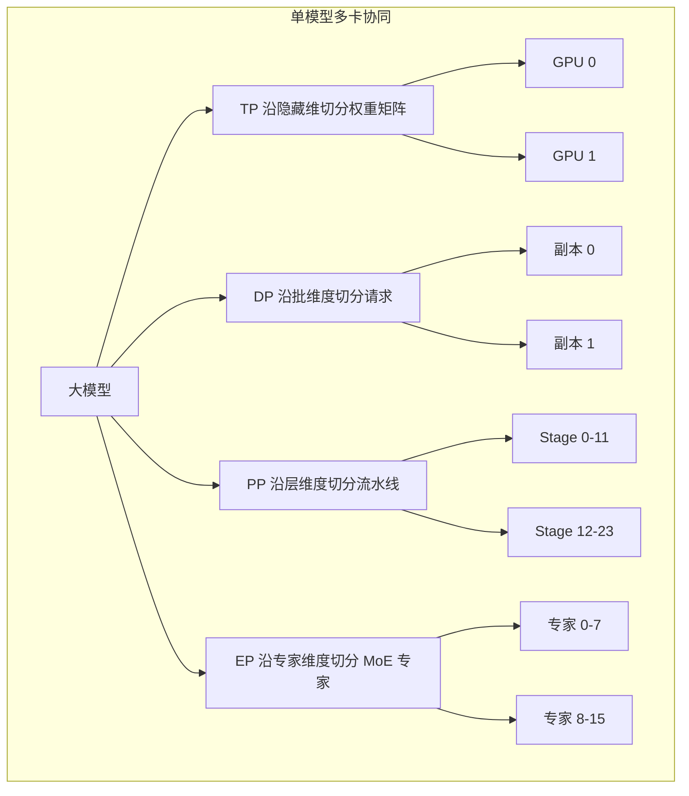
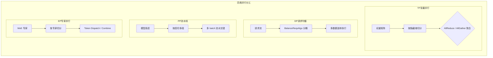
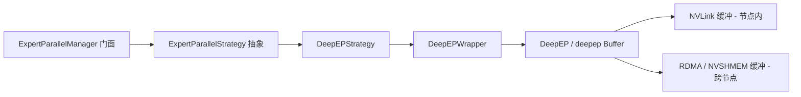
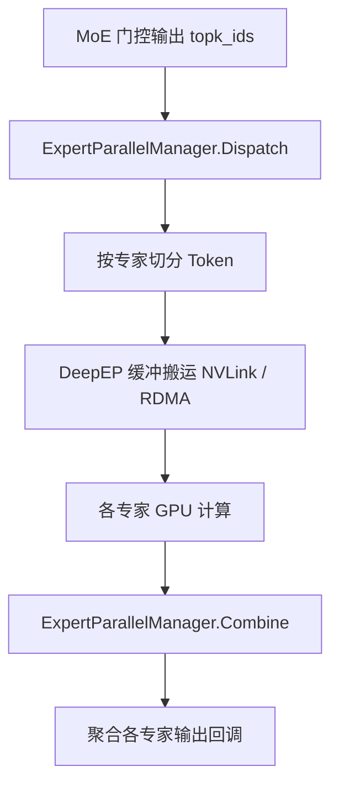
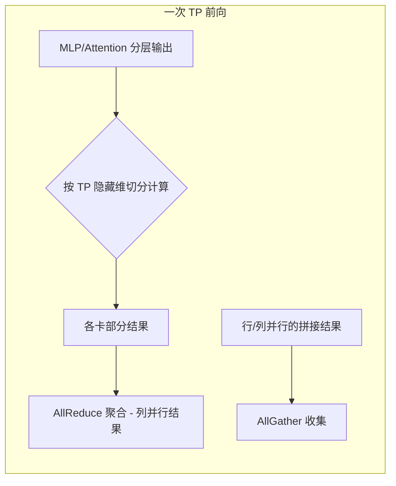
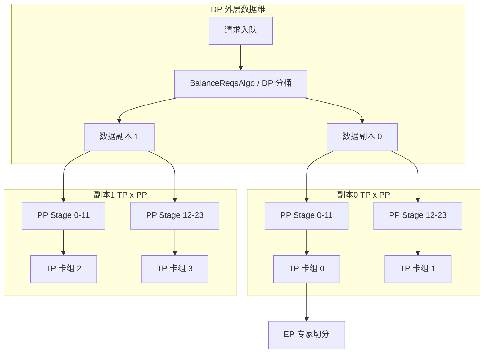

# 四类并行策略

本文聚焦 KsanaLLM 在多维度并行维度的核心设计：Tensor Parallel（TP，张量并行）、Data Parallel（DP，请求均衡）、Pipeline Parallel（PP，流水线并行）、Expert Parallel（EP，专家并行）四类并行策略的分工、分工原理与在代码中的落地。面向架构师与分布式研究者。

主线：并行维度如何切分、又如何在推理链路中协同。先讲清四种并行各自的切分维度与通信代价，再深入 EP 基于 DeepEP 策略模式与 `DeepEPWrapper` 的低延迟实现，落到 NCCL 集合通信（AllReduce / AllGather / collect）这一支撑 TP/EP 的底层原语，最后说明四类并行在推理主链路、调度负载均衡与模型层工厂中的叠加方式。

> 范围说明：本文只讲述各并行策略的分工与含义及其通信承载。集群建簇、控制面/数据面通道（`ControlChannel`、`TcpDataChannel` / `NcclDataChannel`）、IPC 四件套的建簇同步细节属于姊妹篇「集群建簇与通道」，不在本文展开。

## 1. 并行的动机与总览

大模型权重动辄数百 GB，远超单卡显存，同时单卡算力也无法满足低延迟推理。KsanaLLM 必须把模型与请求切分到多机多卡协同推理，这引出多维度并行：不同维度各自回答「沿着哪个轴切」。

四类并行的本质差异，在于它们沿不同的轴切分：

- **TP（张量并行）**：沿张量隐藏维，把单个层内的权重矩阵切到多卡。
- **DP（数据并行 / 请求均衡）**：沿批维度，把不同请求分到不同数据副本，做请求级负载均衡。
- **PP（流水线并行）**：沿层维度，把模型按层切为多段，多 batch 在流水线中交错执行。
- **EP（专家并行）**：沿专家维度，把 MoE 模型的专家切到多卡。

| 并行 | 切分维度 | 切分对象 | 通信对象 | 解决的核心问题 |
| :--- | :--- | :--- | :--- | :--- |
| TP | 隐藏维 | 层内权重矩阵 | AllReduce / AllGather（同类之间） | 单层权重超单卡显存、单卡算力不足 |
| DP | 批维度 | 请求 / token | 多为任务分配（异构） | 请求吞吐、多副本负载均衡 |
| PP | 层维度 | 模型层段 | 层间激活传递 | 全模型超单卡显存、减小单卡驻留 |
| EP | 专家维度 | MoE 专家分组 | 专家间 Token 搬运 | 专家数远超卡数、细粒度负载均衡 |

下面以概念图直观呈现大模型沿 4 个维度切分到多卡的整体结构：

四类并行的切分轴正交互补，可叠加使用：DP 在外层分配请求，每个数据副本内部再用 TP + PP 切模型，MoE 模型再叠加 EP 切专家。这种多维叠加构成 KsanaLLM 的多维并行网络，其配置由 `GlobalContext` 统一承载（见第 5 章）。本章为概述章节，不展开任何一类并行的代码实现，第 2 章起逐类深入。

**Sources:** <ref_code path="csrc/configure/global_context.h" />

## 2. 四类并行策略的分工

本章逐类讲清四类并行各自「在切什么、通信什么、解决什么」：TP 将层内权重沿隐藏维切到多卡并由集合通信聚合，DP 将请求分配到不同副本，PP 将模型按层切多段并做多 batch 流水，EP 把 MoE 专家切到多卡（细节见第 3 章）。

### 2.1 TP：沿隐藏维度切层内权重

TP 把单层内的权重矩阵沿隐藏维切到多个 GPU，各卡计算部分结果后再通过集合通信（AllReduce / AllGather）聚合，实现「模型内并行」——它不增加吞吐副本，而是让单层能放入多卡。KsanaLLM 将 TP 通信封装进 `TpCommunicator`（见第 4 章），其并行规模在 `GlobalContext` 的 `GetTensorParallelSize()` 中承载。TP 适用于超大规模稠密层的场景，代价是每次前向都需要同步中间结果的通信开销。

### 2.2 DP 沿批维度做请求均衡

DP 不切模型，而是把不同请求分到不同数据副本，通过并行执行提升吞吐。KsanaLLM 的请求级均衡由 `BalanceReqsAlgo` 依据各副本 workload 做动态负载感知分桶（详见「批量调度与动态 Batching」兄弟篇）。DP 的通信多为任务分配而非张量级搬运，瓶颈在于副本间负载是否均衡。

### 2.3 PP 按层切分流水线并行

PP 把模型按层切分为多段，每段驻留不同节点，多个 batch 在流水线中交错执行以隐藏气泡等待。KsanaLLM 的多 batch 分配由 `PPMultibatchWorkloadBalancer` 负责（详见兄弟篇调度章节），`GlobalContext` 通过 `GetMaxPpBatchNum()` 控制可并发在途的流水 batch 数。PP 以层间激活传递为通信代价，适合整模型超单卡显存的场景。

### 2.4 EP 沿专家维度切分 MoE

MoE 模型专家数量远大于可用卡，且每个 token 只激活少数专家（稀疏门控），因此把专家分组切到多卡、让 token 在专家间搬运，是 EP 的核心。EP 采用策略模式实现，当前仅注册 DeepEP 一种策略（见第 3 章），`GlobalContext` 通过 `ExpertParallelConfig` 承载专家并行世界配置与专家节点角色。

下表汇总四类并行在 KsanaLLM 中的切分对象、通信原语、对应代码模块与适用规模：

| 并行 | 切分对象 | 通信原语 | 代码模块 | 适用模型规模 |
| :--- | :--- | :--- | :--- | :--- |
| TP | 层内权重矩阵（隐藏维） | AllReduce / AllGather | `TpCommunicator` | 隐层维度超大 |
| DP | 请求 / token（批维度） | 负载分配（非张量搬运） | `BalanceReqsAlgo` | 高并发请求吞吐 |
| PP | 模型层段（层维度） | 层间 P2P 激活 | `PPMultibatchWorkloadBalancer` | 整模型超单卡显存 |
| EP | MoE 专家分组 | Dispatch / Combine | `ExpertParallelManager` | 专家数远大于卡数 |

四类并行各司其职、互斥维度正交，组合叠加后构成完整的多维并行网络（选型视角见第 5 章）。各并行也各有瓶颈：TP 通信最密集、PP 有流水线气泡、DP/EP 依赖负载均衡质量。

> 边界说明：集群同步与通道细节不在本章展开；EP 的 DeepEP 库机制见第 3 章，本章仅定性给出 EP 语义。

**Sources:** <ref_code path="csrc/configure/global_context.h" /> <ref_code path="csrc/models/communicator/tp_communicator.h" /> <ref_code path="csrc/batch_scheduler/batch_scheduler_balance_reqs_algo.h" /> <ref_code path="csrc/batch_scheduler/workload_balance/pp_multibatch_balancer.h" />

## 3. 专家并行（EP）与 DeepEP

本章深入 EP 的实现：先说明 MoE 为何需要专家并行，再剖析策略模式下的 `ExpertParallelManager` 门面与 `DeepEPStrategy`、`DeepEPWrapper` 的分层委托，最后说明 EP 通信配置如何跨进程下发。

### 3.1 MoE 为何需要专家并行

MoE 模型有数十上百个专家，单卡显存无法容纳全部权重。同时稀疏门控使得每个 token 只激活少量专家，专家之间负载天然不均衡。EP 把专家分组切到多卡，让 token 在有权限的专家所在卡之间搬运，从而在专家数与卡数不成比例时获得细粒度并行与负载均衡。

### 3.2 策略模式：门面到 DeepEP

EP 采用「门面 + 策略」分层：`ExpertParallelManager` 作为门面对上层屏蔽策略差异，委托 `ExpertParallelStrategy` 抽象；该抽象定义了 `GetCommunicationConfig` / `Initialize` / `Dispatch` / `Combine` / `GetRecvNumTokens` 一套 EP 标准接口。目前 `ExpertParallelStrategyFactory` 仅注册 `StrategyType::DEEPEP` 一种策略，并据此构造唯一的 `DeepEPStrategy` 实现。

- **`ExpertParallelManager`**：EP 门面，管理策略实例，承接 `Dispatch`/`Combine` 上层调用并透传给策略。
- **`ExpertParallelStrategy`**：EP 策略抽象层，定义标准 EP 通信接口。
- **`DeepEPStrategy`**：EP 唯一策略实现，通过持有 `DeepEPWrapper` 完成实际通信。
- **`ExpertParallelStrategyFactory`**：策略工厂，`StrategyType` 目前仅 `DEEPEP`。

### 3.3 DeepEPWrapper：Dispatch / Combine 的核心封装

`DeepEPWrapper` 是 EP 落地到 DeepEP 库（源自 DeepSeek，`csrc/distributed/expert_parallel/deepep/deep_ep.h`）的薄封装，职责要点：

- 在构造时按 `num_ranks` 分配 NVLink 缓冲（节点内）与 RDMA / NVSHMEM 缓冲（跨节点），初始化 `deepep::Buffer`。
- `Initialize` 聚合各 executor 的通信配置（`ipc_handles`、`nvshmem_id`），调用 `buffer_->sync` 完成多卡握手，并 `nvshmem_barrier_all` 同步。
- `Dispatch` 将 `hidden_states`、`topk_ids`、`topk_weights` 按专家切分、搬运到对应专家的 GPU；`Combine` 将各专家的输出聚合回源 token。
- 支持节点内（intranode，NVLink）与跨节点（internode，RDMA）两种传输，并支持低延迟模式（low-latency）与 Token 零拷贝。

低延迟模式下仅分配 RDMA 缓冲，用 `num_max_dispatch_tokens_` 界定各 rank 的 dispatch token 上限。DeepEPWrapper 内部通过 `intranode_dispatch` / `internode_dispatch`、`intranode_combine` / `internode_combine` 以及 `low_latency_dispatch` / `low_latency_combine` 分组处理不同传输路径。

下图展示 MoE token 先 Dispatch 到各专家、专家计算、再 Combine 聚合的数据流：

节点内与跨节点两种传输模式的差异如下：

| 模式 | 传输介质 | 适用场景 | 缓冲区 | 特点 |
| :--- | :--- | :--- | :--- | :--- |
| intranode（节点内） | NVLink | 同机多卡 | NVLink 缓冲 | 低延迟、卡间直连 |
| internode（跨节点） | RDMA / NVSHMEM | 跨机多卡 | RDMA 缓冲 | 跨节点搬运、需 nvshmem 同步、可配低延迟 |

### 3.4 EP 通信配置的跨进程下发

EP 初始化需要聚合所有 executor 的通信配置（NVLink IPC handle 与 NVSHMEM unique id），KsanaLLM 通过 IPC 函数在进程间下发：`SetEPCommunicationConfigRequest` 携带聚合后的 `aggregated_comm_configs`，对应 `set_ep_communication_config` 下发、`get_ep_communication_config` 取回（详见 IPC 四件套；本文仅定位，不展开通道机制）。

> 边界说明：TCP/NCCL 数据通道本身的建连细节不在本章展开；MoE 层工厂的算子选型与 `weight_method` TP 切分数值细节亦不在本章范围。

**Sources:** <ref_code path="csrc/distributed/expert_parallel/expert_parallel_manager.h" /> <ref_code path="csrc/distributed/expert_parallel/expert_parallel_strategy.h" /> <ref_code path="csrc/distributed/expert_parallel/deepep_strategy.h" /> <ref_code path="csrc/distributed/expert_parallel/deepep_wrapper.h" /> <ref_code path="csrc/distributed/expert_parallel/deepep/deep_ep.h" /> <ref_code path="csrc/distributed/expert_parallel/expert_parallel_strategy.cpp" /> <ref_code path="csrc/ipc/functions/set_ep_communication_config.h" />

## 4. NCCL 集合通信：TP/DP 的底层算子

本章讲解支撑 TP 张量并行与多卡一致性采样的集合通信原语：AllReduce、AllGather 与 collect（Reduce/Broadcast）的语义与用途，以及 `TpCommunicator` 如何面向 TP 场景封装。这些原语的物理承载是 NCCL 数据通道——`NcclDataChannel` 建立在 NCCL 之上，其初始化与 NCCL unique id 同步属姊妹篇「集群建簇与通道」，此处不展开。

### 4.1 集合通信原语语义

NCCL 提供了一组跨卡聚合原语，TP 主要用到：

- **AllReduce**：所有参与卡先各自完成部分归约再广播，使每张卡都得到全局聚合结果，用于 TP 中间结果的同步。
- **AllGather**：每张卡持有自己的一份数据，收集所有卡的份额拼接为完整张量，用于还原被切分的完整结果。
- **collect（collective）**：广义集合操作，包含 Reduce / Broadcast 等，为多卡一致性采样等场景提供支撑。

| 原语 | 语义 | 适用并行维度 | 典型使用点 |
| :--- | :--- | :--- | :--- |
| AllReduce | 各卡部分归约后得到全体结果 | TP 列并行归约 | TP 前向中间结果同步 |
| AllGather | 收集各卡分片拼接完整张量 | TP 行并结果 | 切分结果的重新聚合 |
| collect（Reduce/Broadcast） | 归约 / 广播等集合操作 | 多卡一致性 | 一致性采样等 |

### 4.2 TpCommunicator：TP 场景的集合通信封装

`TpCommunicator`（`csrc/models/communicator/tp_communicator.*`）面向 TP 场景把 NCCL 原语封装成两个方法：

- `AllReduce`：对一组 reduce buffer 张量做归约求和，支持下发 `ReduceSum`，并处理 compute stream 与 comm stream 的事件同步。
- `AllGather`：把一个切分张量收集拼接（`AllGather`），返回完整结果。

`TpCommunicator` 的方法最终落到 `ForwardingContext` 携带的 ModelCommunicator 上，由其调用底层集合原语。每次 TP 前向，各卡用 AllReduce 同步中间结果、用 AllGather 重组被切分的输出。下方示意 AllReduce 与 AllGather 在一次 TP 前向中的放置：

`NcclDataChannel`（`csrc/distributed/nvidia/nccl_data_channel.h`）是 NCCL 数据面承载，提供 `InitializeNcclCluster` / `SendData` / `RecvData` 等接口，其初始化建连细节由 `DistributedDataCoordinator` 在 `InitializeNcclDataChannl` 中触发，属于姊妹篇范围。

> 边界说明：NCCL 通道的监听/连接/收发细节与具体 kernel 算子实现分属兄弟篇与「模型与算子框架」领域，本文不展开。

**Sources:** <ref_code path="csrc/models/communicator/tp_communicator.h" /> <ref_code path="csrc/models/communicator/tp_communicator.cpp" /> <ref_code path="csrc/distributed/nvidia/nccl_data_channel.h" /> <ref_code path="csrc/distributed/distributed_data_coordinator.h" />

## 5. 多并行维度的叠加与协同

回到架构视角，本章讲四类并行如何在 KsanaLLM 中叠加协作，以及 `GlobalContext` 如何统一承载并行度配置与节点角色判断。

### 5.1 多维叠加的拓扑

四类并行在 KsanaLLM 中按「外层数据维、内层模型维、模型内专家维」叠加：

- **DP 在外**：把请求分配到不同数据副本，是请求级均衡的入口（`BalanceReqsAlgo` 分桶）。
- **TP + PP 在内**：每个数据副本内部用 TP 沿隐藏维切权重、用 PP 按层切流水线。
- **EP 再叠加**：MoE 模型在 TP/PP 之上再沿专家维度切分（见第 3 章）。

这样形成「DP × TP × PP × EP」的组合并行网络：DP 负责吞吐与请求均衡，TP/EP 负责显存与通信密集的层内计算，PP 负责将整模型分摊到多段。各维度的通信各司其位：TP 用 NCCL 集合通信同步层内中间结果，EP 用 DeepEP 缓冲搬运 MoE token，PP 用层间通道传递激活，DP 由调度层完成请求分配。各类通信互不干扰，分别在推理链路的不同层级推进。

### 5.2 GlobalContext：并行度配置与角色中枢

`GlobalContext`（`csrc/configure/global_context.h`）集中管理多维度并行的配置与节点角色，是叠加并行与分布式角色判定的中枢：

- **并行规模**：`GetTensorParallelSize`、`GetAttentionTensorParallelSize`、`GetAttentionDataParallelSize` 承接 TP/DP 规模。
- **专家并行配置**：持有 `ExpertParallelConfig`，提供 `GetExpertParallelWorldSize`、`GetExpertParallelExpertNodeRank`。
- **PP 规模**：`GetMaxPpBatchNum` 读取可并发在途的流水 batch 数。
- **节点角色**：`IsStandalone`、`IsDistributedMaster`、`IsDistributedWorker`、`IsSamplingNode`、`IsExpertParallelChief` 等判断当前进程处于 standalone / master / sampling / 专家 chief 等角色。

这些角色判定决定各节点在并行网络中的分工——例如「是否为本批次的 sampling node」「是否为专家并行的 chief/master」——从而衔接调度负载均衡（DP/PP）与模型层执行（TP/EP）及各自通信。

### 5.3 模型规模与组合选型

不同模型规模 / 模型类型对应不同的多维度组合：

| 模型类型 | 主导并行 | 组合结构 | 理由 |
| :--- | :--- | :--- | :--- |
| 超大稠密层 | TP + PP | 副本内 TP 切层、PP 切段 | 单层与整模型均超显存 |
| 高并发小模型 | DP | 多数据副本并行 | 追求吞吐 |
| MoE 稀疏模型 | EP + TP | EP 切专家 + 层内 TP | 专家数 >> 卡数 |
| 整模型超显存 | DP × TP × PP × EP | 全维叠加 | 多维互补最优 |

> 边界说明：各并行度的具体部署数值（`tensor_parallel_size`、`world_size` 等）属「部署配置与使用」领域；调度负载均衡算法细节见兄弟篇，「PD 分离 / 全局缓存」不涉及。

**Sources:** <ref_code path="csrc/configure/global_context.h" /> <ref_code path="csrc/batch_scheduler/batch_scheduler_balance_reqs_algo.h" />