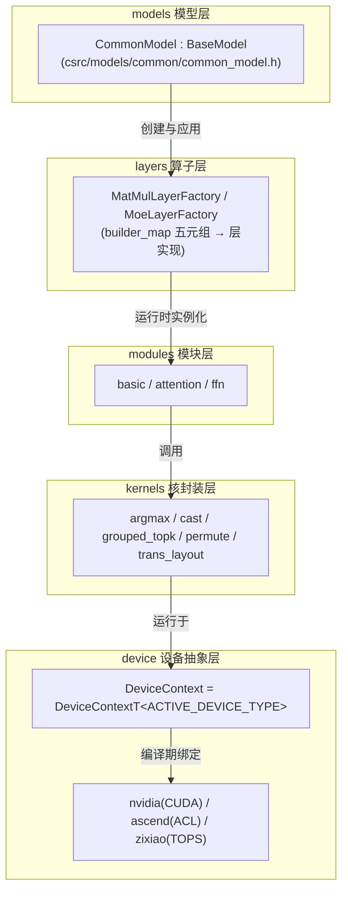
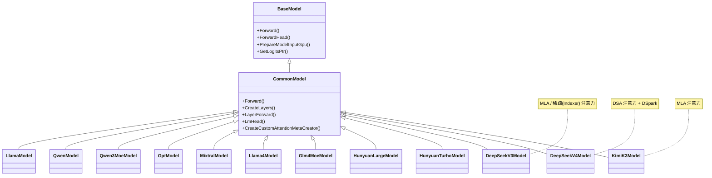
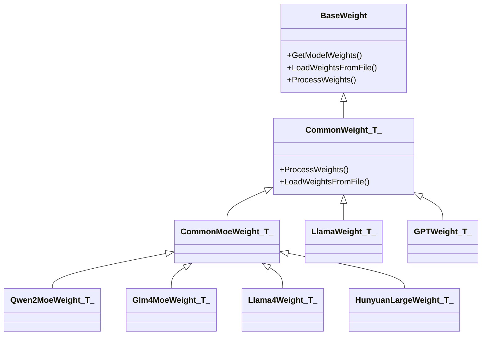
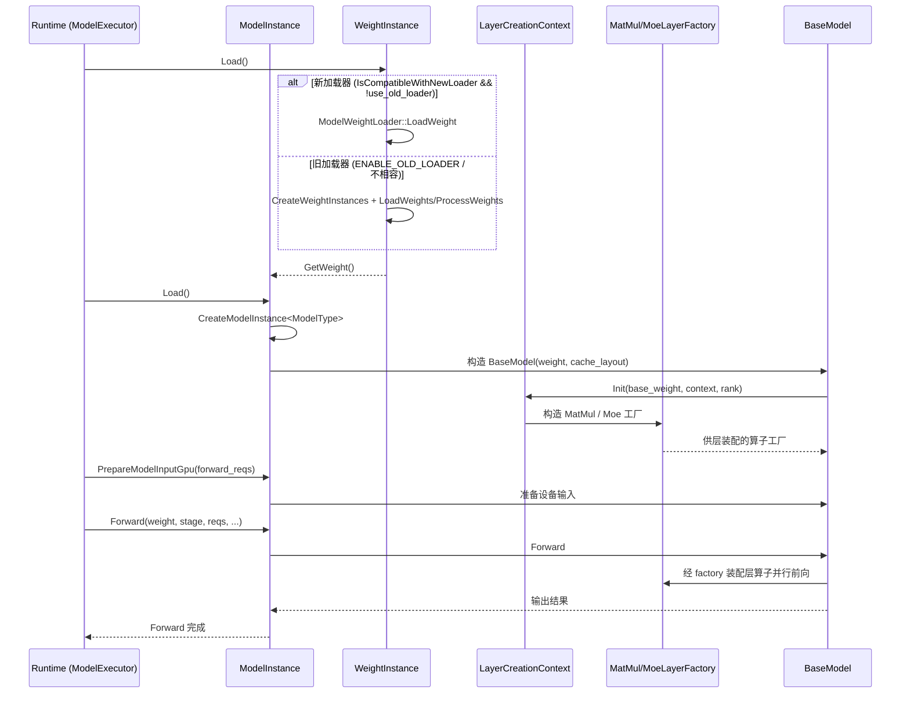
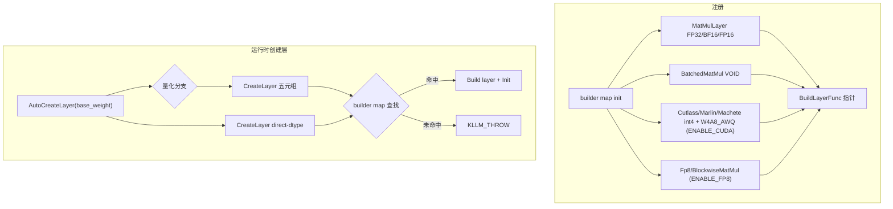
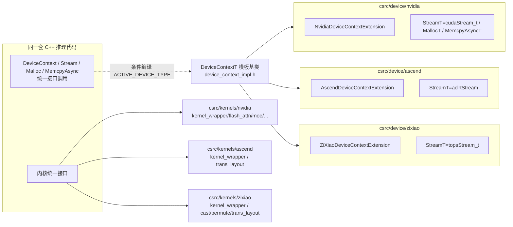
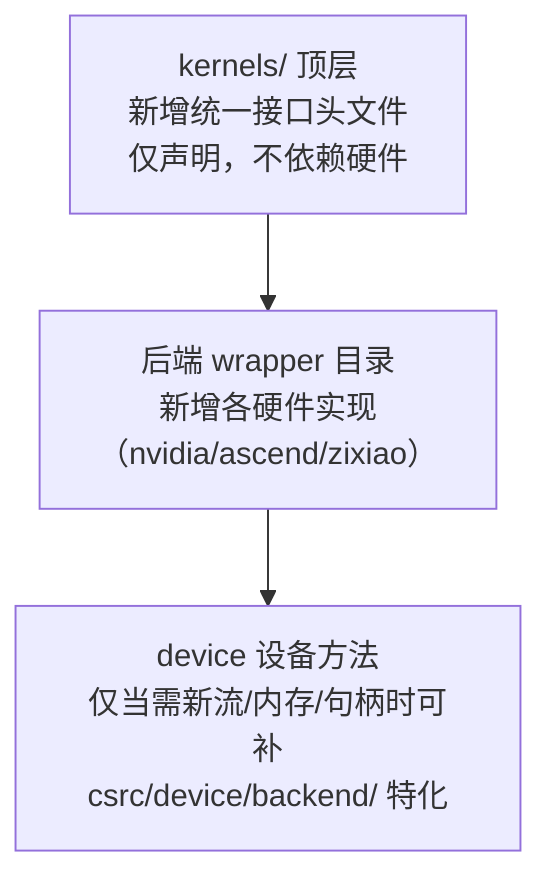
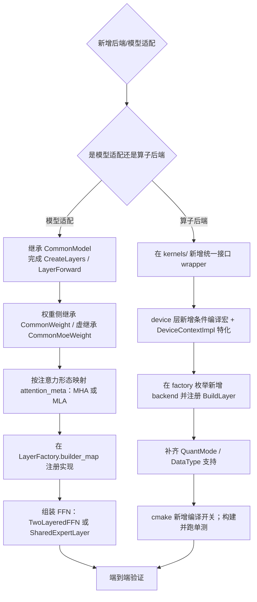

# 1. 模型与算子框架概述

本章介绍 KsanaLLM 引擎的模型与算子框架。该框架位于 LLM 推理主链路的关键位置：向上承接推理调度层下发的前向请求，向下对接底层算子与计算设备，是"模型定义"与"硬件执行"之间的桥梁。

## 1.1 框架定位

KsanaLLM 意在用一套统一的前向定义支撑多个模型族、并在多种硬件上运行。这要求模型定义与具体硬件解耦：

- **前向模型层**：以 `BaseModel` 为抽象基类，`CommonModel` 提供可复用的通用实现，20+ 具体模型（Llama、Qwen、GPT、DeepSeek 等）在其上扩展。
- **底层算子层**：将矩阵乘、注意力、层归一化等计算收敛为可配置、可分发的层与核，由设备抽象层统一调度。

框架的价值在于：新增一个模型，只需聚焦模型特有的前向组织；新增一种硬件，只需补齐底层算子与设备实现，模型层无需改动（详见第 6 章扩展实践）。

## 1.2 五层分层解耦

框架自顶向下分为五层，各层职责单一、只依赖其下一层，形成清晰的依赖链：`models → layers → modules → kernels → device`。

| 层 | 目录 | 核心职责 | 扩展方式 |
| --- | --- | --- | --- |
| models 模型层 | `csrc/models` | 模型前向组织、权重/输入/输出编排 | 继承 `BaseModel`/`CommonModel`，新增模型实现 |
| layers 算子层 | `csrc/layers` | 算子语义与量化/后端维度分发 | 工厂注册新层，`nvidia`/`ascend`/`zixiao` 目录加入口 |
| modules 模块层 | `csrc/modules` | 组合底层算子为可复用计算模块 | 新增 basic/attention/ffn 模块 |
| kernels 核封装层 | `csrc/kernels` | 核语义统一接口与后端分目录实现 | 顶层声明 + 各后端子目录实现 |
| device 设备抽象层 | `csrc/device` | 设备上下文、编译期设备别名 | 新增设备实现 `DeviceContextT` + 编译宏 |

分层解耦的核心收益是**每一层只关注一类变化**：模型想换一种架构只改 models；某块卡想换更快的矩阵乘只改 kernels/device；上层绝不感知底层换了哪块硬件。

## 1.3 各层职责要点

### 1.3.1 models 模型层

`BaseModel` 定义抽象接口（`Forward`、`ForwardHead`、`GetLogitsPtr` 等），不绑定任何具体模型。`CommonModel` 继承 `BaseModel` 并承载 embedding 查找、层前向、LM head 等通用流水线，将模型特有行为收敛到 `CreateLayers`、`LayerForward` 等虚函数，由子类实现。20+ 模型以同一套扩展机制接入。

### 1.3.2 layers 算子层

层是模型最小计算单元的可执行形态。`MatMulLayerFactory` 与 `MoeLayerFactory` 各自维护一个 `builder_map`：以五元组 `(weight_type, input_type, output_type, quant_mode, backend)` 为键，映射到具体的层实现类，从而在运行时按 dtype、量化模式与后端自动挑选层。

### 1.3.3 modules 模块层

模块是"层的组合"与中间抽象，按功能归为 `basic`（Linear、LayerNorm、Add、Mul 等）、`attention`（MHA、MLA 等）、`ffn`（两层 FFN、共享专家）三组。模块不直接感知具体硬件，它在层之上打包"更粗粒度、更多语义"的计算单元。

### 1.3.4 kernels 核封装层

`argmax.h`、`cast.h`、`grouped_topk.h`、`permute.h`、`trans_layout.h` 等文件声明统一的计算语义接口（模板函数与张量/流参数），具体实现按 `nvidia`、`ascend`、`zixiao` 三个后端分目录，通过后端封装实现，是模块/层唯一调用的"核语义合同"。

### 1.3.5 device 设备抽象层

`DeviceContext` 是 `DeviceContextT<ACTIVE_DEVICE_TYPE>` 的别名，`ACTIVE_DEVICE_TYPE` 由编译宏（`ENABLE_CUDA`/`ENABLE_ACL`/`ENABLE_TOPS`）在编译期确定为 NVIDIA、Ascend、Zixiao 之一。设备的选择在编译期完成，运行时只有单一设备分支，天然实现"一套上层代码、多硬件统一执行"。

## 1.4 模型如何被多硬件统一执行

一条前向请求的执行路径贯彻上述分层：

1. 上层调度驱动 `CommonModel::Forward`（models 层），模型按模型相关逻辑列出需执行的子计算。
2. 每个子计算转化为对应模块（modules 层），模块把"做什么"翻译成对若干个基础算子的调用。
3. 算子层到 modules 均不感知具体硬件，只面向形状/量化/后端描述。
4. 真正的硬件执行发生在 kernels 与 device：由编译期选定单一设备别名，下发到 NVIDIA、Ascend 或 Zixiao 后端运行。

对上层来说，"换硬件"只是一个编译时开关，模型、模块、算子语义完全不变，硬件差异全部收敛在 kernels + device 两层。

## 1.5 分层架构图



图中数据流向自顶向下：模型层驱动的算子层实例化模块，模块发起对核语义接口的调用，最终由 device 层在编译期绑定的单一后端上执行。

## 1.6 为什么分层、如何扩展

- **为什么分层**：让模型研究者只关心前向组织，算子/移植开发者只关注各自层面，互不侵入；分层边界即"关注点分离"的边界，降低维护与移植成本。
- **如何扩展**：新增模型时继承模型基类并复用通用流水线；需要新算子时先定义核语义接口、再在目标后端目录实现；接入新硬件时在 device 增加设备实现并以编译宏接入编译。具体操作见第 5、6 章。

**Sources:**
<ref_code path="csrc/models/common/common_model.h" /> <ref_code path="csrc/layers/matmul_layer_factory.h" /> <ref_code path="csrc/layers/moe_layer_factory.h" /> <ref_code path="csrc/device/device_context.h" /> <ref_code path="csrc/kernels/argmax.h" />

## 2. 模型基类与实现（模型如何被定义与注册）

本章介绍模型层的核心体系：如何用统一的 `BaseModel`/`CommonModel` 基类与 `BaseWeight`/`CommonWeight<Ct>` 权重框架承载 20+ 具体模型，以及新增一个模型需要改动哪些文件。本章以「新增模型」为主线，先给出扩展视角，再展开基类、注意力元数据工厂与模型清单。模型内的前向数值算法与权重格式解析不属本章范围。

### 2.1 新增一个模型：扩展主线

在 KsanaLLM 中接入一个新模型，本质上是在既有基类上补齐「差异点」，形成一条固定的扩展路径：

- 模型前向：新建 `XxxModel`，继承 `CommonModel`（链路上溯 `BaseModel`），实现两个纯虚函数 `CreateLayers` 与 `LayerForward`；`CommonModel::Forward`、`LmHead`、embedding 查找、`ForwardingContext` 等通用管线直接复用，无需重写。
- 模型权重：新建 `XxxWeight<Ct>`，继承 `CommonWeight<Ct>`（链路上溯 `BaseWeight`），按需重载 `LoadWeightsFromFile` 与 `ProcessWeights`；稀疏专家模型（MoE）则优先继承 `CommonMoeWeight<Ct>` 复用共享专家/门控等处理。
- 注意力形态：若模型使用 MLA/DSA 等非标准 MHA，通过重写 `CreateCustomAttentionMetaCreator` 返回自定义 `AttentionMetaCreator`，内置在 `csrc/models/<model>/attention_meta/` 中。
- 注册映射：在 `csrc/models/base/model_arch.cpp` 的 `model_type_to_archs` 与 `arch_to_model_type` 两张注册表补充 `model_type ↔ ModelArchitecture` 映射，供配置解析按模型名定位架构。

`LookupEmbedding`、`LayerCreationContext`、`ForwardingContext` 等通用设施由 `CommonModel` 统一提供，模型子类只关注「注册 + 组织特有层」。这一步的细节在第 6 章扩展实践中以清单形式收束。

### 2.2 模型抽象基类：BaseModel 与 CommonModel

`BaseModel`（`csrc/models/base/base_model.h`）是全部模型前向的抽象基类，只声明接口不绑定具体实现。核心虚函数：

- `Forward`：主前向入口，返回下一 token 的概率分布，为纯虚函数。
- `ForwardHead`：DSpark 单步头部修正。
- `PrepareModelInputGpu`：在 build-ahead 场景下于 H2D stream 预构造 `ModelInput`（默认空实现）。
- `GetLogitsPtr`：返回设备侧输出 logits 指针，供采样器零拷贝读取，为纯虚函数。

`CommonModel`（`csrc/models/common/common_model.h`）继承 `BaseModel`，承载所有模型共享的推理管线：embedding 查找（`LookupEmbedding`）、层前向编排（`LayerForward`）、LM head 与 logits 生成（`LmHead`），并持有 `ForwardingContext`、`layer_creation_context_`、`ModelRunConfig` 等共享状态。它把「模型特有」只收敛到两个纯虚函数——`CreateLayers` 与 `LayerForward`，由子类实现。

具体模型通过「继承 `CommonModel` + 实现 `CreateLayers`/`LayerForward`」接入；`ModelRunConfig`（位置编码、pre/post-norm、`emb_scale` 等）声明了各模型可配置的运行语义。模型继承骨架如下（权重部分见 2.3）：



模型中部分模型采用「壳 + 内部 ModelInterface」组合：`XxxModel : CommonModel` 内部聚合一个 `ModelInterface` 派生对象（如 `Qwen2MoeModel` 内含 `Qwen2Moe`），后者负责 `GetModelRunConfig`/`CreateLayers`/`Forward` 的纯逻辑组织，进一步把「模型结构描述」与「CommonModel 流水」解耦。

### 2.3 权重基类：BaseWeight 与 CommonWeight

与模型前向并行，权重体系同样以两级基类承载。`BaseWeight`（`csrc/models/base/base_weight.h`）定义权重抽象接口：`GetModelWeights`（按名查表）、`LoadWeightsFromFile`（加载）、`ProcessWeights`（处理后处理）、`SetEmbeddingsConfig`（即纯虚）。权重以 `weights_map_` 这一「名称 → Tensor」字典承载。

`CommonWeight<Ct>` 继承 `BaseWeight`，提供权重处理的通用实现：`ProcessWeights`、`LoadWeightsFromFile`，以及 QKV 重排、MLP/共享专家权重转换、量化求解器封装等（内含 `QuantWeight<Ct>` 与 `CommonModelWeightLoader` 协作）。它是模型权重扩展的主要基类。

稀疏专家模型（MoE）进一步走 `CommonMoeWeight<Ct>`（`csrc/models/common_moe/common_moe_weight.h`），复用专家并行映射、门控权重置换、共享专家 MLP 转换等逻辑。各类别权重继承关系如下：



`LlamaWeight<Ct>` 与 `BaichuanWeight<Ct>` 等部分早期模型直接继承 `BaseWeight`，其内部聚合一个 `CommonWeight<Ct>` 委托通用权重处理；多数模型则直接继承 `CommonWeight<Ct>` 或 `CommonMoeWeight<Ct>` 扩展。

### 2.4 attention_meta 工厂：按注意力形态构建元数据

注意力输入元数据（`AttentionMeta`）由 `attention_meta` 工厂按注意力形态构建。工厂位于 `csrc/models/base/attention_meta/`，以 `AttentionMetaCreator` 为入口、`*_AttentionMetaBuilder` 为构建器：

- 基类 `AttentionMetaCreator`（`attention_meta_creator.h`）持有全部构建所需配置，提供 `CreateSharedAttentionMeta`/`CreateFlashAttentionMeta`/`CreatePagedAttentionMeta` 三个创建方法与对应的 Builder 工厂。
- `AttentionMeta`（`attention_meta.h`）是所有注意力输入结构的最小基类，持有每批控制字段（`q_seq_len`、`expanded_batch_size`、`dp_reqs` 等），其派生 `StandardAttentionMeta` 承载 flash/paged 共用的共享张量，`FlashAttentionMeta`/`PagedAttentionMeta` 分别为 prefill/decode 路径。
- 注意力形态通过共享张量区分，`SharedAttentionMeta` 基类暴露 `GetStandard/GetMLA/GetDSA/GetIndexer` 等形态访问接口，由 `StandardSharedAttentionMeta`、`MLASharedAttentionMeta`、`DSASharedAttentionMeta`、`IndexerSharedAttentionMeta` 等派生实现。

`CommonModel` 提供一个模板式的 `CreateCustomAttentionMetaCreator`（默认返回空）。需要自定义注意力的模型（如 DeepSeekV3/V4、Kimi K3）覆写它，在 `csrc/models/{model}/attention_meta/` 内置模型特有的 `XxxAttentionMetaCreator`，派生基类并重写创建与构建方法，注入 MLA/DSA 等专用张量分配与路由策略；标准 MHA 模型沿用基类默认创建器即可，无需额外改动。

### 2.5 模型清单与注册

`csrc/models/` 下一级目录即各模型实现。`csrc/models/base/model_arch.cpp` 中的 `model_type_to_archs` 与 `arch_to_model_type` 两张表完成了「模型名 → `ModelArchitecture`」双向映射，`GetModelArchitectureFromString`/`GetModelTypeFromArchitecture` 提供查询接口。主流模型清单及架构类型与注意力形态如下：

| 模型目录 | 架构类型（Dense/MoE） | 注意力形态 |
| --- | --- | --- |
| `csrc/models/llama` | Dense | MHA |
| `csrc/models/llama4` | MoE | MHA |
| `csrc/models/qwen`（qwen2/qwen3） | Dense | MHA |
| `csrc/models/qwen2_moe` | MoE | MHA |
| `csrc/models/qwen3_moe` | MoE | MHA |
| `csrc/models/deepseek_v3` | MoE | MLA + Indexer |
| `csrc/models/deepseek_v4` | MoE | DSA |
| `csrc/models/kimi_k3` | MoE | MLA |
| `csrc/models/mixtral` | MoE | MHA |
| `csrc/models/gpt` | Dense | MHA |
| `csrc/models/baichuan` | Dense | MHA |
| `csrc/models/chatglm` | Dense | MHA |
| `csrc/models/glm4_moe` | MoE | MHA |
| `csrc/models/hunyuan_large` | MoE | CLA（跨层注意力） |
| `csrc/models/hunyuan_turbo` | MoE | CLA（跨层注意力） |
| `csrc/models/internlm2` | Dense | MHA |
| `csrc/models/internlmxcomposer2` | Dense | MHA |
| `csrc/models/arc_hunyuan_video` | Dense | MHA |
| `csrc/models/bge_reranker_minicpm` | Dense | MHA（含 scale_depth） |
| `csrc/models/common_moe` | MoE（公共权重） | —（框架公共件） |

> 上表「注意力形态」中 MHA 指标准多头注意力，MLA 指 Multi-Head Latent Attention，DSA 指依赖稀疏注意力，Indexer 指稀疏 MLA 路由索引，CLA 指跨层注意力。表内为代码中已确认的架构归属；确切的模型名与细节以 `model_arch.cpp` 与各模型配置解析为准。

模型清单覆盖 Dense 与 MoE 两类架构，注意力形态覆盖标准 MHA/MLA/DSA（Indexer 等），体现了基类 + 按形态扩展的统一接入方式。各模型目录通常包含 `*_config.h/_config_parser.h`（配置）、`*_model.h`（前向、继承 `CommonModel`）、`*_weight.h`（权重、继承 `CommonWeight`/`CommonMoeWeight`）、`*_weight_loader.h`（权重加载）等文件。

### 2.6 小结

模型层以 `BaseModel` 为抽象根，`CommonModel` 承载通用前向管线并把差异化收敛到 `CreateLayers`/`LayerForward`；权重侧由 `BaseWeight` → `CommonWeight<Ct>` → `CommonMoeWeight<Ct>` 分级承载。新增模型的路径清晰：模型继承 `CommonModel`、实现两个纯虚函数，权重继承 `CommonWeight`（MoE 走 `CommonMoeWeight`），注意力形态通过 `CreateCustomAttentionMetaCreator` 内置 `attention_meta` 工厂，最后在 `model_arch` 注册映射。20+ 模型一致遵循该扩展约定。

**Sources:**
<ref_code path="csrc/models/base/" />
<ref_code path="csrc/models/common/" />
<ref_code path="csrc/models/common_moe/" />
<ref_code path="csrc/models/llama/" />
<ref_code path="csrc/models/qwen/" />
<ref_code path="csrc/models/qwen2_moe/" />
<ref_code path="csrc/models/qwen3_moe/" />
<ref_code path="csrc/models/deepseek_v3/" />
<ref_code path="csrc/models/deepseek_v4/" />
<ref_code path="csrc/models/kimi_k3/" />
<ref_code path="csrc/models/gpt/" />
<ref_code path="csrc/models/mixtral/" />
<ref_code path="csrc/models/glm4_moe/" />
<ref_code path="csrc/models/hunyuan_large/" />
<ref_code path="csrc/models/hunyuan_turbo/" />


## 3. ModelInstance / WeightInstance 运行时代理

运行时层将「模型加载」与「前向执行」分别交给两个代理对象处理：

| 代理 | 职责 | 持有的核心对象 |
| --- | --- | --- |
| `WeightInstance` | 权重的加载/缓存/处理，对外提供 `GetWeight()` | `BaseWeight` |
| `ModelInstance` | 推理核心执行单元，加载模型并驱动前向 | `BaseModel`、`BaseModelCacheLayout` |

两者的协作关系：`ModelInstance` 持有 `WeightInstanceInterface`，前向前先由 `WeightInstance` 加载好 `BaseWeight`，再由 `ModelInstance` 把权重注入 `BaseModel` 完成推理。

### 3.1 ModelInstance：推理核心执行单元

`ModelInstance` 是运行时对一次模型执行单元的封装，主要方法：

| 方法 | 作用 |
| --- | --- |
| `Load()` | 按 `model_config_.type` 分派到具体模型类（Llama/Qwen/DeepSeek…），创建 `BaseModel` |
| `Forward()` | 驱动 `BaseModel` 执行前向，产出 logits 输出 |
| `PrepareModelInputGpu()` | 将 `ForwardRequest` 整理为设备端输入 |
| `SetBlockCacheLayout()` | 设置模型级缓存布局 |
| `GetCurBatchPairs()` | 透传本步 slot 的 batch pairs 设备指针与 batch 大小 |
| `GetBaseModel()` | 返回底层 `BaseModel` |

- `Load()` 采用模板工厂 `CreateModelInstance<ModelType>(...)`：将 `modelType` 统一小写后按前缀关键字逐一分派到 `LlamaModel`、`QwenModel`、`Qwen3MoeModel`、`DeepSeekV3Model` 等具体模型；构造时注入 `weight_instance->GetWeight()` 与 `block_cache_layout`。
- `Forward()` 同时接收 `WeightInstance` 的权重、`stage`（推理阶段）、一批 `ForwardRequest`，并支持 `gpu_input_already_prepared` 跳过重复准备，以适配多阶段/多头解码场景。

### 3.2 WeightInstance：权重加载管理类

`WeightInstance` 实现 `WeightInstanceInterface`，负责按需挑选新/旧权重加载器完成权重的加载、缓存与处理：

- 入口 `Load()`：先读取环境变量 `ENABLE_OLD_LOADER` 决定是否强制走旧加载器，并由 `ModelConfigParser::ParseModelConfig` 解析出 `BaseModelConfig`。
- 加载器选择策略：

| 条件 | 采用的加载器 | 结果 |
| --- | --- | --- |
| 与旧加载器 `IsCompatibleWithNewLoader` 不相容，或 `ENABLE_OLD_LOADER=1` | 旧加载器 | `CreateWeightInstances()` -> `LoadWeights()` / `ProcessWeights()`，可命中权重缓存 |
| 相容 | 新加载器（公共 `ModelWeightLoader`） | 直接解析权重文件写入 `ModelWeight` |

- `CreateWeightInstances()` 按模型类型创建对应权重类（`LlamaWeight`、`QwenWeight` 等），并通过 `CreateModelWeight` 依据权重数据类型实例化为 `float16/bfloat16/float`。
- 加载结果统一通过 `GetWeight()` 暴露 `BaseWeight`，供 `ModelInstance` 与各模型复用。

### 3.3 运行时如何代理模型完成加载与前向

从加载到前向的完整装配链路：`WeightInstance` 先把权重就绪，`ModelInstance.Load` 创建 `BaseModel`，`BaseModel` 通过 `LayerCreationContext` 聚合权重/配置并预置算子工厂，随后每次 `Forward` 由工厂装配出实际层算子执行。



`LayerCreationContext`（见第一章的 `csrc/models/base/layer_creation_context.*`）在 `Init()` 中一次性聚合 `base_weight`、`context`、`rank`、`pipeline_config` 与 `model/runtime` 配置：

- 按 `is_moe` 是否成立创建 `MatMulLayerFactory`（稠密）与 `MoeLayerFactory`（稀疏专家）双工厂；
- 一并创建 `LayerWorkspaceManager`（含 secondary 工作区）用于各层运行时缓冲。

模型基类与公共加载器详见 `csrc/models/base/base_model_weight_loader.h` 与公共实现。

**Sources:**
<ref_code path="csrc/runtime/model_instance.h" />
<ref_code path="csrc/runtime/weight_instance.h" />
<ref_code path="csrc/models/base/layer_creation_context.h" />
<ref_code path="csrc/models/base/base_model_weight_loader.h" />


## 4. 层算子工厂与 modules 模块组装

本章聚焦 KsanaLLM 算子体系的两层组织方式：

- **layers 层算子**：`MatMulLayerFactory` / `MoeLayerFactory` 用「五元组」把高层配置映射到具体矩乘 / MoE 算子实现，各后端（marlin / cutlass / machete / triton / fp8 / humming）由编译宏与运行时配置选择。
- **modules 粗粒度模块**：把基本算子（矩阵乘、归一化、注意力、MoE）组装为 `basic / attention / ffn` 三层的可复用模块，供模型层直接组合成完整层。

矩乘与 MoE 算子不直接出现在模型前向中：它们由工厂按五元组选择后端实例化，再被 modules 组装为粗粒度单元。

### 4.1 算子层的三层组织

代码按「声明层 / 工厂层 / 实现层」分层：

| 层次 | 目录 | 职责 |
| --- | --- | --- |
| 声明层（接口） | `csrc/layers/*.h` | 定义层算子的抽象接口与统一 `Forward` 签名 |
| 工厂层（选择） | `csrc/layers/*_factory.h/.cpp` | 按五元组注册/查找后端实现，创建层实例并 `Init` |
| 实现层（后端） | `csrc/layers{nvidia,ascend,zixiao,cpu}` | 各硬件平台的具体算子实现 |

各后端实现目录文件（Hub 一致性）：

- `csrc/layers/nvidia/`：CUDA 平台实现，含 `matmul_layer.cpp`、`marlin_matmul_layer.cpp`、`cutlass_matmul_layer.cpp`、`machete_matmul_layer.cpp`、`fp8_matmul_layer.cpp`、`blockwise_matmul_layer.cpp`、`fp8_moe_layer.cpp`、`marlin_moe_layer.cpp`、`marlin_fused_wfp4a16_moe_layer.cpp`、`humming_fused_wfp4a16_moe_layer.cpp`、`humming_fused_wfp4afp8_moe_layer.cpp`、`cutlass_group_wint4afp8_moe_layer.cpp` 等。
- `csrc/layers/ascend/`、`csrc/layers/zixiao/`、`csrc/layers/cpu/`：对应昇腾、紫霄、CPU 后端，`matmul_layer.cpp` 等按平台适配。

### 4.2 五元组 builder_map 机制

`MatMulLayerFactory` 与 `MoeLayerFactory` 各自维护一张以「五元组」为键的注册表：

```text
<weight_type, input_type, output_type, quant_mode, backend>
```

- 键的类型分别为 `tuple<DataType, DataType, DataType, QuantMode, LinearComputeBackend>` 与 `tuple<DataType, DataType, DataType, QuantMode, MoeComputeBackend>`。
- 值为 `BuildLayerFunc`，即指向 `BuildLayer<ClassT>()` 的成员函数指针，构造相应层实例。

#### 4.2.1 后端枚举（LinearComputeBackend / MoeComputeBackend）

后端选择由模型配置（`ModelConfig`/`RuntimeConfig`）传入，见 `csrc/configure/model_config.h`：

| 枚举 | 取值 | 说明 |
| --- | --- | --- |
| LinearComputeBackend | `DEFAULT_LINEAR_BACKEND` | 通用后端（FP16/BF16/FP32 等，内部可用 cublas/cutlass） |
| | `CUTLASS_LINEAR_BACKEND` | int4 后端，GPTQ/AWQ 默认选择 |
| | `MARLIN_LINEAR_BACKEND` | int4 后端，支持 `act_order` |
| | `MACHETE_LINEAR_BACKEND` | int4 后端，限定 SM90（Hopper）与量化编译 |
| MoeComputeBackend | `DEFAULT_MOE_BACKEND` | 通用 MoE（基于 cutlass），Qwen/LLaMA 等 |
| | `MARLIN_MOE_BACKEND` | int4 MoE 后端 |
| | `TRITON_MOE_BACKEND` | DeepSeek 专用，Triton fused-MoE，支持 FP16/BF16/FP8-blockwise/int4 |
| | `CUTLASS_MOE_BACKEND` | DeepSeek 专用，cutlass group-GEMM，w4afp8 |
| | `HUMMING_W4A16_MOE_BACKEND` | DeepSeek FP4 专家权重去量化到 FP16/BF16（W4A16） |
| | `HUMMING_W4A8_MOE_BACKEND` | DeepSeek FP4 专家权重去量化到 FP8 激活（W4A8） |

#### 4.2.2 矩乘五元组与后端实现映射

| weight_type | input_type | output_type | quant_mode | backend | 层实现 | 对应文件 |
| --- | --- | --- | --- | --- | --- | --- |
| FP32/FP16/BF16 | 同 weight | 同 weight | None | DEFAULT | `MatMulLayer` | `nvidia/matmul_layer.cpp` |
| VOID（无权重） | FP32/FP16/BF16 | 同 | None | DEFAULT | `BatchedMatMulLayer` | `nvidia/batched_matmul_layer.cpp` |
| I4_GROUP | FP16 | FP16 | GPTQ/AWQ | CUTLASS | `CutlassMatMulLayer` | `nvidia/cutlass_matmul_layer.cpp` |
| I4_GROUP | FP16/BF16 | 同 | GPTQ/AWQ | MARLIN | `MarlinMatMulLayer` | `nvidia/marlin_matmul_layer.cpp` |
| I4_GROUP | FP16/BF16 | 同 | GPTQ/AWQ | MACHETE | `MacheteMatMulLayer` | `nvidia/machete_matmul_layer.cpp` |
| I4_GROUP | FP16/BF16 | 同 | W4A8_AWQ | CUTLASS | `FinegrainedMixedDtypeGemmLayer` | `nvidia/finegrained_mixed_dtype_gemm_layer.cpp` |
| FP8_E4M3 | FP32/FP16/BF16 | 同 | FP8_E4M3 | DEFAULT | `Fp8MatMulLayer` | `nvidia/fp8_matmul_layer.cpp` |
| FP8_E4M3 | FP32/FP16/BF16 | 同 | BLOCK_FP8_E4M3 | DEFAULT | `BlockwiseMatMulLayer` | `nvidia/blockwise_matmul_layer.cpp` |

#### 4.2.3 MoE 五元组与后端映射

| weight_type | input_type | output_type | quant_mode | backend | 层实现 |
| --- | --- | --- | --- | --- | --- |
| FP32/FP16/BF16 | 同 | 同 | None | DEFAULT | `MoeLayer` |
| I4_GROUP | FP16 | FP16 | GPTQ | MARLIN | `MarlinMoeLayer` |
| FP8_E4M3 | FP32/FP16/BF16 | 同 | FP8_E4M3 | DEFAULT | `Fp8MoeLayer` |
| FP8_E4M3 | FP32/FP16/BF16 | 同 | BLOCK_FP8_E4M3 | TRITON | `MoeLayer` |
| UINT8 | FP16/BF16 | 同 | GPTQ | TRITON | `MoeLayer` |
| INT8 | FP16/BF16 | 同 | GPTQ | CUTLASS | `CutlassGroupWint4Afp8MoeLayer` |
| INT8 | FP16/BF16 | 同 | GPTQ | TRITON | `MoeLayer` |
| FP4_E2M1FN_x2 | FP16/BF16 | 同 | GPTQ | TRITON | `MoeLayer` |
| FP4_E2M1FN_x2 | FP16/BF16 | 同 | GPTQ | MARLIN | `MarlinFusedWfp4A16MoeLayer` |
| FP4_E2M1FN_x2 | FP16/BF16 | 同 | GPTQ | HUMMING_W4A16 | `HummingFusedWfp4A16MoeLayer` |
| FP4_E2M1FN_x2 | FP16/BF16 | 同 | GPTQ | HUMMING_W4A8 | `HummingFusedWfp4Afp8MoeLayer` |

### 4.3 MatMulLayerFactory 注册与运行时创建流程



- `LayerCreationContext::Init` 创建 `MatMulLayerFactory` 与（MoE 模型）`MoeLayerFactory` 单例，并下发 `rank / model_config / runtime_config`。
- `Linear` 模块持有一个 `shared_ptr<MatMulBaseLayer>`，构造时经 `proj_layer_->AutoCreateLayer` 完成创建；`Forward` 经指针调用 `proj_layer_->Forward(&input,&weight,&output)`。
- `MoeLayerFactory` 额外持有 `ExpertParallelManager`，支持 EP 的子层通过 `SetExpertParallelManager` 注入，非 EP 子类继承 `BaseLayer` 的 no-op 默认。

### 4.4 modules 层的 basic→attention/ffn 组装

`modules` 目录下按粒度分三层（`csrc/modules/`）：

| 目录 | 模块 | 示例 |
| --- | --- | --- |
| `basic`（原子算子） | 单算子封装 | `Linear`、`Bmm`、`Add/Mul/AddNorm`、`Layernorm`、`SiluMul`、`FlashAttention`、`PagedAttention`、`PagedMlaAttention`、`MoE` |
| `attention`（注意力聚合） | 多头注意力聚合 | `MultiHeadAttention`、`MultiHeadLatentAttention`、`CrossLayerAttention` 等 |
| `ffn`（前馈聚合） | FFN/共享专家聚合 | `TwoLayeredFFN`、`SharedExpertLayer` |

#### 4.4.1 basic 原子模块

`basic/linear.h` 的 `Linear` 是矩阵乘法在 modules 层的统一封装：

- 成员：`shared_ptr<MatMulBaseLayer> proj_layer_` 与 `Tensor weight_`。
- 构造时调用 `creation_context.matmul_layer_factory->AutoCreateLayer(...)` 创建 MatMul 层，再 `SetWorkspaceBuffer` + `Preprocess`。
- `Forward` 直接透传 `proj_layer_->Forward(&input,&weight,&output)`，权重由 `creation_context.base_weight->GetModelWeights(weight_name)` 取得。

`basic/moe.h` 的 `MoE` 是对稀疏专家的封装：

- 持有 `shared_ptr<BaseMoeLayer> moe_layer_` 与 `up_gate_proj_weight_ / down_proj_weight_`。
- 构造时经 `creation_context.moe_layer_factory->AutoCreateMoeLayer` 创建，同时取 `expert_map`（EPLB 重排表）。
- 支持可选 `e_score_correction_bias`（仅部分 MoE 模型），DeepSeek-V4 hash 路由时传入 `input_ids`。

#### 4.4.2 attention 聚合

`multihead_attention.h` 的 `MultiHeadAttention` 把多头注意力聚合为模块：

- 持有：一个 `Linear`（`attn_qkv_projs_`，融合的 QKV 投影）、一个 `Add`、一个 `CommonAttention` 后端抽象。
- 构造依赖 `ModelCreationConfig`（head 数、stride、缓存 dtype 等，由 `LayerCreationContext::Init` 生成 `attn_config`）与 `LayerCreationContext`。

attention 目录提供多种变体：`multihead_attention`（MHA）、`multihead_latent_attention`（MLA）、`cross_layer_attention`、`common_attention` 与索引器（`c4_indexer`、`sparse_mla_indexer`）。

#### 4.4.3 ffn 组合

`two_layered_ffn.h` 的 `TwoLayeredFFN` 组装稠密 FFN：

- 线性层分为 `gate_up_linear`（融合）或分离的 `gate_`/`up_`，加上 `down_linear`。
- 配合 `SiluMul` 激活、`Add` 残差，`fuse_gate_up_proj`/`fuse_silu_mul` 控制融合粒度。

`shared_expert_layer.h` 的 `SharedExpertLayer` 为 MoE 模型的独立共享专家 FFN（gate_up + silu_mul + down），支持独立 workspace / 多流并行执行（`SetParallelBuffers`）。

### 4.5 组装入口：LayerCreationContext

模型可适配工程师在新增模型时，通过 `LayerCreationContext` 统一获取工厂与运行时上下文：

```text
LayerCreationContext::Init
 ├── matmul_layer_factory ← MatMulLayerFactory
 ├── moe_layer_factory   ← MoeLayerFactory (仅 is_moe 模型)
 └── base_weight / runtime_config / weight_type / input_type / output_type
```

**Sources:**
<ref_code path="csrc/layers/matmul_layer_factory.h" />
<ref_code path="csrc/layers/matmul_layer_factory.cpp" />
<ref_code path="csrc/layers/moe_layer_factory.h" />
<ref_code path="csrc/layers/moe_layer_factory.cpp" />
<ref_code path="csrc/layers/base_layer.h" />
<ref_code path="csrc/layers/base_moe_layer.h" />
<ref_code path="csrc/models/base/layer_creation_context.h" />
<ref_code path="csrc/modules/basic/" />
<ref_code path="csrc/modules/attention/" />
<ref_code path="csrc/modules/ffn/" />
<ref_code path="csrc/layers/nvidia/" />


## 5. kernels 统一接口与多硬件后端

### 5.1 「C++ 统一接口 + 各硬件实现」的分层模式

KsanaLLM 的目标是让同一套 C++ 推理代码只写一遍，就能编译、运行到 nvidia（CUDA GPU）、ascend（昇腾 NPU）、zixiao（TOPs）三类硬件上。实现方式是「三段式」：上层代码只依赖统一入口，设备操作与算子分别由 `csrc/device` 与 `csrc/kernels` 两层向下分派。

- 编译期条件编译选型：三个宏 `ENABLE_CUDA` / `ENABLE_ACL` / `ENABLE_TOPS` 决定当前激活的硬件，任何时刻只有一个生效。
- 统一设备入口 `DeviceContext = DeviceContextT<ACTIVE_DEVICE_TYPE>`（`csrc/device/device_context.h`），其中 `ACTIVE_DEVICE_TYPE` 由设备类型宏收敛成 `DEVICE_TYPE_NVIDIA` / `DEVICE_TYPE_ASCEND` / `DEVICE_TYPE_ZIXIAO` 之一。
- 底层原语（流/事件/内存）用模板特化按设备类型实现，上层通过同名函数（`Malloc`、`MemcpyAsync`、`Stream` ……）编译期绑定到实际后端。



### 5.2 device_types.h：硬件无关的类型收敛

`csrc/device/device_types.h` 把各硬件底层模板类型收敛成统一枚举，并提供互转函数，让上层不再感知具体硬件。

- `DataFormat`：数据布局。ascend 下对齐 ACL 格式 `FORMAT_DEFAULT = ACL_FORMAT_ND`、`FORMAT_ND`、`FORMAT_NZ`；CUDA/TOPS 无 NZ 概念，仅 `FORMAT_DEFAULT`。配合互转函数在引擎 `DataFormat` 与 ACL 原始格式间互换。
- `DataType`：一套统一枚举（`TYPE_FP16`、`TYPE_BF16`、`TYPE_INT8` …），在三种硬件下分别映射到底层类型，配套 `GetTypeSize`、`GetTypeString`。
- 内存收敛：`MemoryDevice`（`MEMORY_HOST` / `MEMORY_DEVICE`）与 `MemoryLocation`（`LOCATION_HOST` / `LOCATION_DEVICE` / `LOCATION_DEVICE_IPC` / `LOCATION_NVSHMEM` / `LOCATION_MULTICAST`）。
- 与 torch 互转：`GetTorchTypeFromDataType` / `GetDataTypeFromTorchType`。

### 5.3 设备抽象与三后端 DeviceContext 实现

`DeviceContextT<T>` 是模板基类，持有流、事件与扩展指针 `ext`，并通过 `DeviceExtensionTypeTraits<T>` 注入各后端的扩展类型；各后端用模板特化定义自己的扩展类与底层 `StreamT` / 内存操作。

| 统一入口 | nvidia（ENABLE_CUDA） | ascend（ENABLE_ACL） | zixiao（ENABLE_TOPS） |
| --- | --- | --- | --- |
| `DeviceContext = DeviceContextT<ACTIVE_DEVICE_TYPE>` | `NvidiaDeviceContextExtension`（`StreamT = cudaStream_t`） | `AscendDeviceContextExtension`（`StreamT = aclrtStream`） | `ZiXiaoDeviceContextExtension`（`StreamT = topsStream_t`） |
| 设备实现文件 | `nvidia_device_context_impl.h/.cpp` | `ascend_device_context_impl.h` | `zixiao_device_context_impl.h` |
| 扩展持有物 | cublas 句柄、nccl、GPU mempool | acl 上下文、HCCLComm | tops 上下文、rank |

要点：

- 扩展注入：`DeviceContextT` 通过 `ext` 指针在基类之外挂载后端额外 handle，仅在自己对应的宏分支编译。
- 统一的 `InitializeExtension` / `DestroyExtension` 由各后端分别实现，构造时依次调用 `InitStreams()` → `InitializeExtension()`。
- 设备原语（`MallocT`、`MemcpyAsyncT`、`MemsetT` …）在后端设备实现中以特化实现，上层用统一函数调用。

### 5.4 InitStreams：多流统一创建

`DeviceContextT<T>::InitStreams()` 在构造时统一创建计算、通信、拷贝各类流，`GetXXXStream()` 按需取用；后端只需实现流创建时所需的底层特化，编排保持一致。

| 分类 | 流/事件 | 用途 |
| --- | --- | --- |
| 计算 | `primary_compute_stream_` / `secondary_compute_stream_` | 主/次计算流，配合 `compute_sync_event_` 做多流并行（如 shared expert） |
| 通信 | `comm_stream_` / `dist_send_comm_stream_` / `dist_recv_comm_stream_` | 节点内通信与分布式收发 |
| 拷贝 | `h2d_stream_` / `d2h_stream_` / `d2d_stream_` | 主机→设备、设备→主机、设备间拷贝 |
| slot 并行 | `h2d_stream_slots_[0/1]` + 双流开关 | build-ahead ping-pong，输入构建与前向并行 |

### 5.5 kernels 统一接口 → 三后端封装映射

`csrc/kernels` 顶层定义统一声明：`argmax.h`、`cast.h`、`grouped_topk.h`、`permute.h`、`trans_layout.h`。实际算法放在后端目录，由 wrapper 文件承接。

| 统一接口 | nvidia 后端 | ascend 后端 | zixiao 后端 |
| --- | --- | --- | --- |
| 转布局 | `nvidia/trans_layout.cpp` | `ascend/trans_layout.cpp` | `zixiao/trans_layout.cpp` |
| 类型转换 | `nvidia/basic_kernel_wrapper` | `ascend/kernel_wrapper.h` | `zixiao/cast.cpp` |
| argmax / grouped_topk | `nvidia/kernel_wrapper.h` | `ascend/kernel_wrapper.h` | `zixiao/kernel_wrapper.h` |
| permute | `nvidia/kernel_wrapper.h` | `ascend/kernel_wrapper.h` | `zixiao/permute.cpp` |
| attention / flash_attn | `attention_kernel_wrapper.h` / `flash_attn_cpp_wrapper.h` | `ascend/kernel_wrapper.h` | `zixiao/kernel_wrapper.h` |
| MoE / 增强 GEMM | `moe_kernel_wrapper.h`、`kda_kernel_wrapper.h`、`triton_wrapper.h` | `ascend/kernel_wrapper.h` | `zixiao/kernel_wrapper.h` |

> 差异：nvidia 后端算子族成熟，每个 wrapper 隔开一个具体算法族（attention/MoE/KDA 等）；ascend 与 zixiao 算子面较窄，统一由 `kernel_wrapper.h` 承接后按算子分派到 `cast.cpp` / `permute.cpp` / `trans_layout.cpp`。

### 5.6 迁移 / 新增一个算子要动哪些文件

按「统一接口 → 后端 wrapper → 设备方法」三层补齐，其余上层调用无需改动。



| 层次 | 改动位置 | 说明 |
| --- | --- | --- |
| 统一接口 | `csrc/kernels/Xxx.h` | 仅声明，不依赖具体硬件 |
| nvidia 后端 | `csrc/kernels/nvidia/Xxx_wrapper.{h,cpp}` | 填 CUDA 实现并挂到 `kernel_wrapper.h` |
| ascend 后端 | `csrc/kernels/ascend/Xxx.{cpp,h}` | 按 ACL 实现 |
| zixiao 后端 | `csrc/kernels/zixiao/Xxx.cpp` | 按 TOPs 实现 |
| 设备支撑（按需） | `csrc/device/backend/…_device` | 补充 Malloc/流/扩展句柄特化 |

**Sources:**
<ref_code path="csrc/device/device_context.h" />
<ref_code path="csrc/device/device_context_impl.h" />
<ref_code path="csrc/device/device_types.h" />
<ref_code path="csrc/device/nvidia/" />
<ref_code path="csrc/device/ascend/" />
<ref_code path="csrc/device/zixiao/" />
<ref_code path="csrc/kernels/" />


## 6. 模型适配与算子扩展实践

收束全篇，把前几章的继承关系、注册表与分层解耦落成两份可直接照做的行动指南：一条是「从框架视角适配一个新模型」的主线，另一条是「为新硬件或新算子添加后端支持」的清单。读者据此即可在不触碰架构骨架的前提下完成扩展。

### 6.1 适配一个新模型：从框架视角的四个落点

新模型的接入不是「写一个模型类」，而是沿框架预置的接线位（extension points）逐点挂接。四个落点覆盖了模型从权重到算子的全链路。

| 落点 | 框架组件 | 动作 | 关键方法 |
| --- | --- | --- | --- |
| 1. 模型逻辑 | `BaseModel` → `CommonModel` | 虚继承并实装 | `CreateLayers`、`LayerForward`、`Forward` |
| 2. 权重加载 | `BaseWeight` → `CommonWeight` / `CommonMoeWeight` | 虚继承并复用 | `ProcessWeights`、`LoadWeightsFromFile` |
| 3. 注意力维度 | `attention_meta` 构建器 | 按注意力形态注册 | `AttentionMetaCreator`、对应 builder |
| 4. 算子落地 | `MatMulLayerFactory` / `MoeLayerFactory` + `modules/*` | 引入层工厂，注册实现 | `AutoCreateLayer`、`builder_map` |

**1) 模型逻辑：搭好 `CommonModel` 的抽象子类。** `CommonModel` 已承担 `Forward`、`ForwardHead`、`PrepareModelInputGpu` 与公共缓冲，仅将层组装与逐层前向留成纯虚接口 `CreateLayers`、`LayerForward`。新模型只需继承 `CommonModel` 实现这两个方法。

**2) 权重：复用 `CommonWeight`，MoE 走 `CommonMoeWeight`。** 稠密模型继承 `CommonWeight<T>`（已含 QKV 重排、LM Head、MLP 张量转换）；MoE 模型继承 `CommonWeight<T>` 后再扩展 `expert_map_`、`num_experts_per_rank_` 等专家切分字段。权重切分、转置、量化求解逻辑全部继承，只补自己独有的加载/重组方法。

**3) 注意力：按 MHA / MLA 选择 `attention_meta` 构建链。** `attention_meta/` 已按形态拆出 builder，统一经 `AttentionMetaCreator` 组装出 `StandardSharedAttentionMeta`（MHA）或 `MLASharedAttentionMeta`（MLA 潜空间缓存）。`CommonModel::CreateCustomAttentionMetaCreator`（默认空）在仅需默认 `ModelInput` 构建器时不重写，特殊情况再返回定制 creator。

**4) 算子落地：借层工厂，不直接 `new` 层。** 层对象统一收敛到两个工厂的五元组注册表 `builder_map_`：`（weight_type, input_type, output_type, quant_mode, backend）→ 层实现`。模型代码只声明含这些因子的 `CreateLayer(...)` 调用，实现/后端可替换而模型层不感知。

### 6.2 新模型类结构对比：Dense vs MoE

两条示例类串给出「到底要继承谁、重写什么」的最直接参照。

| 维度 | 稠密模型（Dense，如 `Llama`） | 稀疏专家模型（MoE，如 `DeepSeekV3` / `common_moe`） |
| --- | --- | --- |
| 模型基类 | `LlamaModel : CommonModel` | `DeepSeekV3Model` 继承 `CommonModel`，按 `is_moe_` 区分解码层 |
| 权重基类 | `LlamaWeight` / `CommonWeight<T>` | `CommonMoeWeight<T>`（专家切分扩展） |
| attention_meta | MHA 系：`StandardSharedAttentionMeta` / flash/paged_attention | MLA 系：`MLASharedAttentionMeta` / mla_attention_meta_builder（专属 creator） |
| FFN 组装 | `TwoLayeredFFN`（gate_up_proj + silu_mul + down_proj 内联） | `SharedExpertLayer`（独立 shared expert）+ Routed Expert 走 `MoeLayerFactory` |

两者在 `attention_meta` 与 FFN 上的差异是确定 MoE 形态的关键开关：

- **MHA vs MLA**：多数稀疏专家模型（DeepSeek 系）采用 MLA 关注 + `is_moe_` 逐层切换，需要独立的 MLA `attention_meta` creator 与专门的注意力类 `MultiHeadLatentAttention`。
- **TwoLayeredFFN vs SharedExpertLayer**：`TwoLayeredFFN` 将门控/上投影线性内联为一次 `fuse_gate_up_proj`；`SharedExpertLayer` 把共享专家拆成独立粒度的 `Linear`，可被多流/多专家并行调度，两者入口均接收 `(hidden_buffer, reduce_buffer, is_multi_token_forward, forwarding_context)`。

### 6.3 决策流程：新增后端 / 模型适配判断

为新硬件 / 新算子添加支持时，先判明「模型适配」还是「算子后端」，再按对应步骤推进。



### 6.4 算子后端 checklist

算子后端支持是第二条扩展轴，按"接口 → 设备 → 注册 → 量化 → 构建"逐步落地：

1. **新增 kernels 目录 wrapper（统一接口）**：`csrc/kernels/{nvidia,ascend,zixiao}/` 各自的 `kernel_wrapper.h` 承接各硬件实现，上层通过统一头文件调用。
2. **device 抽象与条件编译**：在 `device/device_context.h` 按 `ENABLE_CUDA` / `ENABLE_ACL` / `ENABLE_TOPS` 分别包含各后端实现；新增后端需在 `device_types.h` 增加设备类型宏与 `DataType` 定义、补 `ACTIVE_DEVICE_TYPE` 分支。
3. **层工厂 backend 枚举 + 注册**：在 `matmul/moe_layer_factory.h` 的注册表补充新 `LinearComputeBackend` / `MoeComputeBackend` 枚举，并注册 `（weight,input,output,quant_mode,new_backend）→ BuildLayer`，交由 `AutoCreateLayer` 自动分派。
4. **量化与构建闭环**：引入新增 `QuantMode` 时同步补 `builder_map_` 键的组合；CMake 下按后端补充编译开关与编译单元并跑单测。

**Sources:**
<ref_code path="csrc/models/common_moe/common_moe_weight.h" />
<ref_code path="csrc/models/base/base_model.h" />
<ref_code path="csrc/models/common/common_model.h" />
<ref_code path="csrc/models/base/attention_meta/attention_meta_builder.h" />
<ref_code path="csrc/modules/ffn/two_layered_ffn.h" />
<ref_code path="csrc/modules/ffn/shared_expert_layer.h" />
<ref_code path="csrc/layers/matmul_layer_factory.h" />
<ref_code path="csrc/layers/moe_layer_factory.h" />
<ref_code path="csrc/device/device_context.h" />
<ref_code path="csrc/device/device_types.h" />
<ref_code path="csrc/kernels/" />