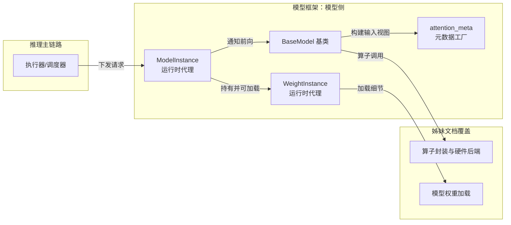
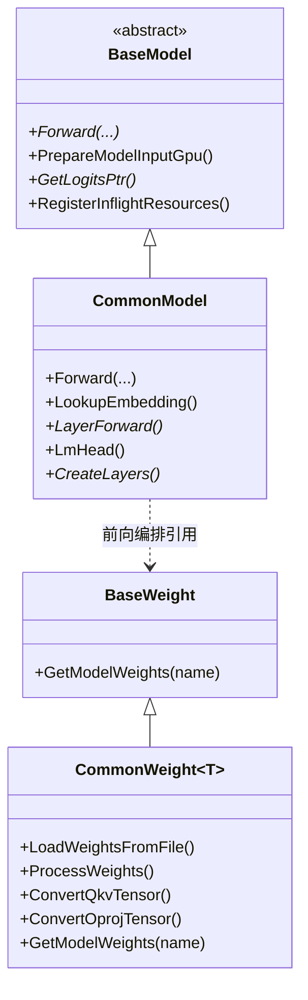
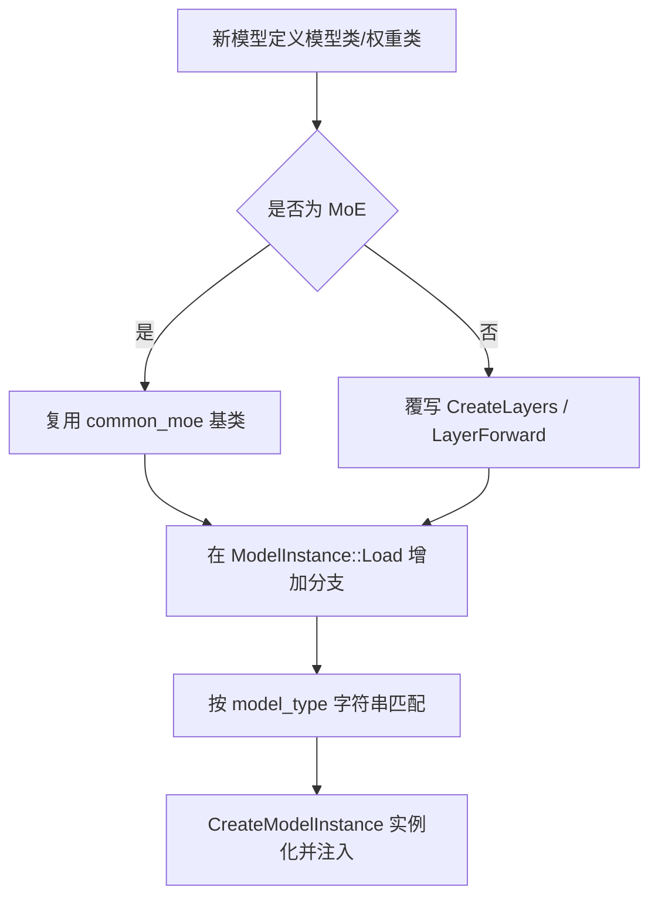
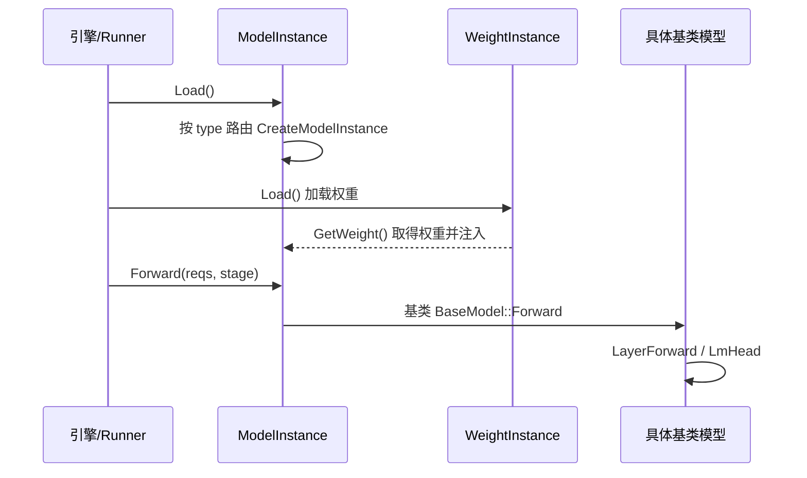
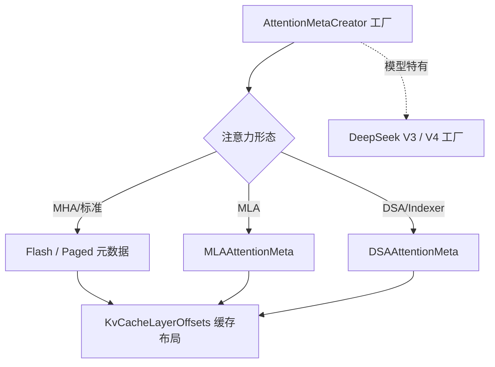

# 模型框架与实现

> 本文档面向模型适配工程师，介绍 KsanaLLM 模型与算子框架中的「模型框架与实现」部分。它聚焦 `csrc/models` 下的基类体系与具体模型、`csrc/runtime` 的运行时代理、以及 `attention_meta` 元数据工厂——三者共同支撑 20+ 主流模型的低成本扩展。算子的具体实现与多硬件后端不在本文范围（见姊妹文档《算子封装与硬件后端》）。

## 1. 模型与算子框架之「模型框架」全景

模型框架位于 KsanaLLM 的模型侧，是承接推理引擎/调度器下发请求、组织模型前向的核心层。本文档结构由三部分组成：`csrc/models/base` 的基类体系、`csrc/runtime` 的 ModelInstance/WeightInstance 运行时代理、以及 `attention_meta` 元数据工厂。它们共同回答"一个新模型如何低成本接入、如何完成一次前向"。

### 1.1 在整体体系中的定位

KsanaLLM 的模型与算子框架共覆盖四大目录：`csrc/models`（模型侧：基类与具体模型）、`csrc/layers`（层封装）、`csrc/modules`（算子上层模块）、`csrc/kernels`（硬件后端）。本文档聚焦其中的**模型侧**。

运行时链路的衔接关系如下：执行器/调度器把前向请求交给 ModelInstance，后者透传给基类 `BaseModel`，再由各模型覆写的 `LayerForward` 等前向步骤完成推理；权重通过 WeightInstance 加载并交给权重实例；`attention_meta` 元数据工厂在模型输入阶段构建注意力输入视图。



### 1.2 三大组成模块

- **基类体系**（`csrc/models/base`、`csrc/models/common`）：`BaseModel` 定义前向契约；`CommonModel` 承接 LLM 公共前向；`CommonWeight` 作为权重复合体基类。这是模型解耦与复用的骨架。
- **运行时代理**（`csrc/runtime`）：`ModelInstance` 与 `WeightInstance` 分别作为模型、权重的「加载 + 前向」代理，衔接上游引擎初始化与下游模型前向。
- **元数据工厂**（`csrc/models/base/attention_meta`）：按 MHA / MLA / DSA 等注意力类型构建元数据，支撑不同注意力架构的前向。

### 1.3 边界说明

本文档不含以下内容，均归姊妹文档：

- 算子封装、MatMul/MoE 工厂、kernels 多硬件后端 →《算子封装与硬件后端》
- 权重加载器、权重方法、权重映射细节 →《模型权重加载》
- KvCacheLayout 的物理分配 →《KVCache 缓存管理》
- 模型前向数值算法、注意力打分推导

**Sources:** <ref_code path="csrc/models/base/base_model.h" /> <ref_code path="csrc/models/common/common_model.h" /> <ref_code path="csrc/runtime/model_instance.h" /> <ref_code path="csrc/runtime/weight_instance.h" /> <ref_code path="csrc/models/base/attention_meta/" />

## 2. 基类体系：BaseModel / CommonModel / CommonWeight

基类体系把「模型结构（Model）」与「权重（Weight）」分离解耦：模型关注前向流程的编排，权重关注张量的加载与转换。通过这一套骨架，具体模型只需按架构覆写少数方法即可完成扩展，同时满足多模型共用公共逻辑的需求。

### 2.1 契约的定义：BaseModel（抽象模型基类）

`BaseModel` 是所有模型的抽象基类，定义推理契约。

- `Forward()`：纯虚函数，实现模型前向主流程。
- `PrepareModelInputGpu()`：在 GPU 上准备模型输入（build-ahead 场景的 H2D 构建，默认空实现）。
- `GetLogitsPtr()`：纯虚函数，返回设备端 logits 指针，供采样器使用。
- `RegisterInflightResources()` 等钩子：供需要每请求资源的模型覆写。

BaseModel 还暴露 `BufferManager` 用于 buffer 张量管理。

### 2.2 LLM 通用的骨架：CommonModel（LLM 通用模型基类）

`CommonModel` 继承 `BaseModel`，是 LLM 模型的通用基类，承载绝大多数模型共用的前向步骤：

- `Forward()`：编排整体前向主流程。
- `LookupEmbedding`：嵌入查找。
- `LayerForward()`：抽象函数，各模型按自身架构覆写层前向。
- `LmHead`：末层生成 logits。
- `CreateLayers()`：抽象函数，构建模型层。

同时它持有公共运行配置 `ModelRunConfig` 以及层间 buffer、`ForwardingContext` 等公共成员。`forward_mutex_` 串行化并发 `Forward()`，保证共享前向上下文不被多线程改写。

### 2.3 权重复合体：CommonWeight（继承 BaseWeight）

`CommonWeight` 是继承 `BaseWeight` 的通用权重基类，负责权重的加载与处理，同时把「模型结构」与「权重张量」解耦分离：

- `LoadWeightsFromFile`：从文件加载权重张量。
- `ProcessWeights`：统一处理权重（QKV / OProj 张量转换、名称映射等）。
- `GetModelWeights(name)`：按名称取权重张量。

其中 QKV 转换由 `ConvertQkvTensor` / `ReshapeQkvTensor` 完成，输出投影由 `ConvertOprojTensor` 处理。这类转换在 Tensor Parallel（TP）下按 `tensor_para_size` 分片。



**解耦设计**：`CommonModel` 通过前向编排引用运行时注入的 `BaseWeight`，模型结构（Model）与权重（Weight）二者显式分离。子类只需覆写 `CreateLayers` / `LayerForward` 等抽象方法，即可快速搭出新模型。

**Sources:** <ref_code path="csrc/models/base/base_model.h" /> <ref_code path="csrc/models/common/common_model.h" /> <ref_code path="csrc/models/common/common_weight.h" /> <ref_code path="csrc/models/base/base_weight.h" />

## 3. 模型注册与 20+ 模型扩展

模型以"继承基类 + 注册路由"的方式接入：具体模型通过继承 CommonModel / CommonWeight（或复用 common_moe 的通用实现）搭建，再在 `ModelInstance::Load()` 中按 `model_type` 字符串路由并实例化。这一机制把新模型的接入成本降到最低。

### 3.1 具体模型如何继承基类

`csrc/models` 下每个模型目录都内含一个模型类与一个权重类，二者分别继承通用基类，并按架构覆写方法。

| 模型目录 | 模型类 | 关键差异 / 覆写点 |
| --- | --- | --- |
| `csrc/models/llama/` | LlamaModel | 标准 MHA，覆写 `CreateLayers` / `LayerForward` |
| `csrc/models/qwen/` | QwenModel | 支持 qkv 偏置、qk norm 开关 |
| `csrc/models/qwen2_moe/` | Qwen2MoeModel | MoE 层，复用 common_moe |
| `csrc/models/qwen3_moe/` | Qwen3MoeModel | MoE 层 |
| `csrc/models/deepseek_v3/` | DeepSeekV3Model | MLA 注意力，独立 attention_meta |
| `csrc/models/deepseek_v4/` | DeepSeekV4Model | DSA 注意力，独立 attention_meta 工厂 |
| `csrc/models/mixtral/` | MixtralModel | MoE |
| `csrc/models/baichuan/` | BaichuanModel | — |
| `csrc/models/chatglm/` | ChatglmModel | — |
| `csrc/models/glm4_moe/` | Glm4MoeModel | MoE |
| `csrc/models/internlm2/` | Internlm2Model | — |
| `csrc/models/gpt/` | GptModel | — |
| `csrc/models/hunyuan_large/` | HunyuanLargeModel | — |
| `csrc/models/llama4/` | Llama4Model | — |
| `csrc/models/common_moe/` | 通用 MoE 权重基类 | MoE 张量处理的公共实现 |

> 各模型类的具体方法名以源码为准，上表仅作方向性说明。

### 3.2 MoE 模型的公共实现

`csrc/models/common_moe/` 提供 MoE 类模型的通用权重实现，封装专家并行、专家权重分片等公共逻辑，Mixtral / Qwen2-MoE / Qwen3-MoE 等沿用。

### 3.3 注册与创建路径

具体模型在 `ModelInstance::Load()` 中按 `model_type` 字符串路由。该方法把模型类型统一为小写后，通过子串匹配（如含 `llama`、`qwen3_moe`、`deepseek` 等）选择具体模板 `CreateModelInstance<ModelType>()` 完成实例化。未匹配到任何分支时，通过可选 `weight_map` 文件决定是否回退到 LlamaModel，否则报「模型类型不支持」。



**Sources:** <ref_code path="csrc/models/llama/" /> <ref_code path="csrc/models/qwen/" /> <ref_code path="csrc/models/qwen2_moe/" /> <ref_code path="csrc/models/qwen3_moe/" /> <ref_code path="csrc/models/deepseek_v3/" /> <ref_code path="csrc/models/deepseek_v4/" /> <ref_code path="csrc/models/mixtral/" /> <ref_code path="csrc/models/common_moe/" /> <ref_code path="csrc/runtime/model_instance.cpp" />

## 4. 运行时代理：ModelInstance 与 WeightInstance

ModelInstance 与 WeightInstance 把「加载 + 前向」从具体模型上抽离出来，作为运行时代理层。它们衔接上游引擎的初始化与下游的模型前向调用，并在 Tensor Parallel 下用线程池并行推进。

### 4.1 ModelInstance：模型前向的执行代理

`ModelInstance` 是模型推理的执行单元，持有权重代理引用、模型配置与一个加载线程池：

- `Load()`：按 `model_type` 路由创建具体基类实例（见第 3 章）。
- `Forward()`：把前向请求透传给基类 `BaseModel::Forward`。
- `PrepareModelInputGpu()` / `GetCurBatchPairs()`：透传输入准备相关调用。
- `SetBlockCacheLayout()`：设置模型级缓存布局。
- 构造函数中按 TP 大小创建 `loader_models_threadpool_` 加载线程池。

ModelInstance 在 `Load()` 完成后还会调用基类的 `RegisterInflightResources` 注册 inflight 资源，供需要每请求资源的模型（如 DeepSeek 压缩器）使用。

### 4.2 WeightInstance：权重运行时代理

`WeightInstance` 实现 `WeightInstanceInterface`，代理权重的加载、缓存、处理与获取，管理权重加载线程池与生命周期。

- `Load()`：权重的加载入口。
- `GetWeight()`：返回底层 `std::shared_ptr<BaseWeight>`。
- 内部流程：`CreateWeightInstances` → `LoadWeights`（可走缓存 `TryToLoadWeightsFromCache` / `SaveWeightsToCache`）→ `ProcessWeights`。
- 同样按 TP 大小创建 `loader_weight_threadpool_`。

### 4.3 职责分工与衔接

| 代理 | 持有对象 | 对外职责 | 对外接口 |
| --- | --- | --- | --- |
| ModelInstance | BaseModel 实例、权重代理、加载线程池 | 模型前向入口、缓存布局 | `Load` / `Forward` / `PrepareModelInputGpu` |
| WeightInstance | BaseWeight、权重加载线程池 | 权重加载 / 缓存 / 处理 | `Load` / `GetWeight` |



**Sources:** <ref_code path="csrc/runtime/model_instance.h" /> <ref_code path="csrc/runtime/model_instance.cpp" /> <ref_code path="csrc/runtime/weight_instance.h" />

## 5. attention_meta 元数据工厂

`attention_meta` 元数据工厂按注意力类型构建模型前向所需的输入元数据（键值 K/V 布局、head 组织、调度张量等）。它位于 `csrc/models/base/attention_meta`，供不同注意力架构使用；DeepSeek V3 / V4 各有独立工厂以适配自身的 MLA / DSA 形态。

### 5.1 元数据体系

`attention_meta` 目录提供按注意力类型构建元数据的基类 `AttentionMeta` 与多形态派生：

- `AttentionMeta`：所有注意力输入类型的最小公共基类，含 per-batch 控制字段。
- `StandardAttentionMeta`：flash / paged 共享的张量字段（input_length、kv_cache_offset、block_table 等）。
- `FlashAttentionMeta`：prefill（flash）路径的注意力输入。
- `PagedAttentionMeta`：decode（paged）路径的注意力输入。
- `MLAAttentionMeta` / `DSAAttentionMeta`：MLA / DSA 专属张量（如 tile_scheduler_metadata、paged_schedule_meta）。

工厂接口为 `AttentionMetaCreator`，通过 `Config` 注入配置，提供创建 Shared/Flash/Paged 元数据的方法与 builder 工厂。

### 5.2 各注意力类型的差异

| 元数据形态 | 适用注意力架构 | 关键字段 |
| --- | --- | --- |
| FlashAttentionMeta / PagedAttentionMeta | MHA 等标准注意力 | input_length、kv_list、block_table |
| MLAAttentionMeta | MLA（DeepSeek-V3 等） | tile_scheduler_metadata、num_splits |
| DSAAttentionMeta | DSA / Indexer（DeepSeek-V4 等） | paged_schedule_meta、store_out_loc、expanded_block_table |

### 5.3 模型级工厂

`AttentionMetaCreator` 的默认实现为模型输入构建标准元数据。需要特殊注意力形态的模型覆写其部分方法：

- **DeepSeek-V3**：`DeepSeekV3AttentionMetaCreator` 创建 MLA 与 DSA 共享张量，并返回专属 Flash/Paged 元数据与 builder。
- **DeepSeek-V4**：`deepseek_v4` 提供 DSA / MQA / Compressor 等多形态 builder，适配自身注意力形态。

元数据与 KVCache 缓存布局（`KvCacheLayerOffsets`）关联：`Config` 注入 `block_cache_layout`，模型特有工厂据此映射各层缓存偏移。



**Sources:** <ref_code path="csrc/models/base/attention_meta/" /> <ref_code path="csrc/models/deepseek_v3/attention_meta/" /> <ref_code path="csrc/models/deepseek_v4/attention_meta/" />

## 6. 模型适配实践与注意事项

从模型适配工程师视角，接入一个新模型可沿「选择基类 → 实现前向 → 选择注意力工厂 → 注册路由 → 设置缓存」的路径进行。以下给出可操作指引。

### 6.1 接入路径与决策

- **选择基类**：通用 LLM 架构继承 `CommonModel` / `CommonWeight` 并覆写 `CreateLayers` / `LayerForward`；MoE 架构复用 `common_moe` 的公共权重实现。
- **选择注意力工厂**：MHA 架构复用默认 `AttentionMetaCreator`；MLA / DSA 架构参考 DeepSeek V3 / V4 实现各自工厂。
- **注册路由**：在 `ModelInstance::Load()` 中按其 `model_type` 子串新增分支，调用 `CreateModelInstance<ModelType>()` 完成实例化并注入权重与缓存布局。
- **设置缓存布局**：通过 `SetBlockCacheLayout` 注入模型级缓存布局，供注意力元数据映射层偏移。

```mermaid
flowchart TD
    A[接入新模型] --> B{注意力架构}
    B -->|MLA/DSA| C[选择独立 attention_meta 工厂]
    B -->|MHA| D[复用标准 AttentionMetaCreator]
    C --> E{是否 MoE}
    D --> E
    E --|是| F[继承 common_moe 权重]
    E --|否| G[覆写 CreateLayers / LayerForward]
    F --> H[注册 type 路由<br/>ModelInstance::Load]
    G --> H
    H --> I[设置缓存布局 SetBlockCacheLayout]
    I --> J[验证 Forward / PrepareModelInputGpu]
```

### 6.2 注意事项

- **前向契约**：必须实现 `Forward` / `GetLogitsPtr` 等抽象接口；构建 build-ahead 时实现 `PrepareModelInputGpu`。
- **TP 并行下线程池**：ModelInstance / WeightInstance 按 TP 大小创建加载线程池，适配时按张量并行度切分权重与加载任务。
- **缓存布局**：模型级 `block_cache_layout` 需在加载前通过 `SetBlockCacheLayout` 注入，供 attention_meta 使用。
- **inflight 资源**：需要每请求资源的模型须在 `Load()` 前调用 `SetInflightResourceManager`，否则注册被跳过。

**Sources:** <ref_code path="csrc/runtime/model_instance.cpp" /> <ref_code path="csrc/runtime/model_instance.h" />