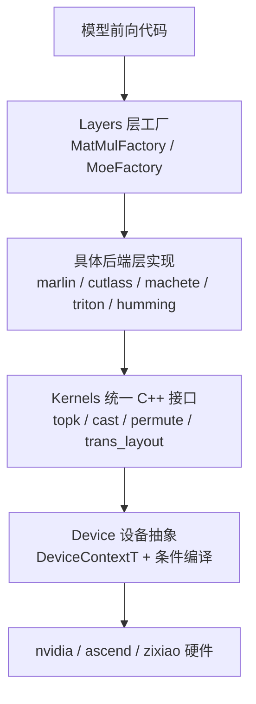
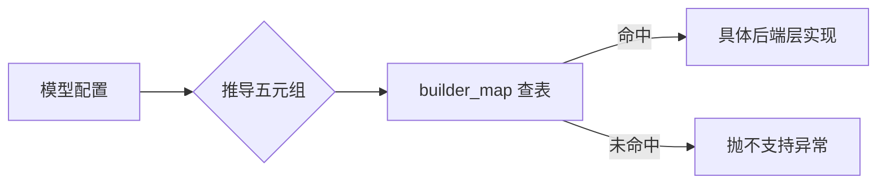
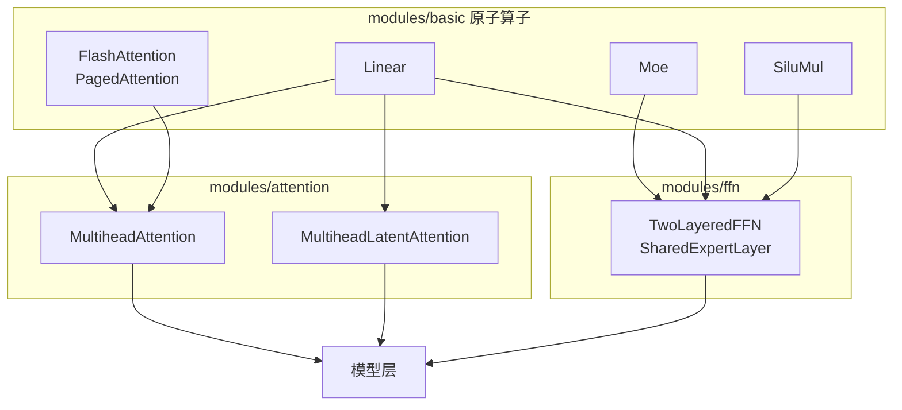
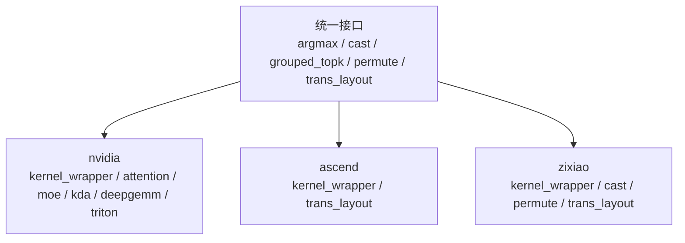
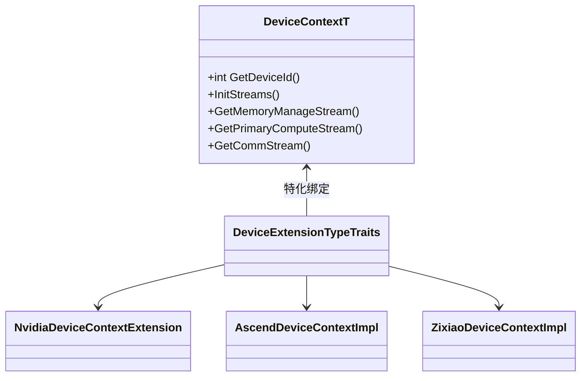

# 算子封装与硬件后端

> 主题：KsanaLLM 推理内核在「模型前向逻辑」与「硬件底层算子」之间的分层封装体系，即以 Layers→Modules→Kernels→Device 四层解耦 + 层工厂五元组后端选择 + 三硬件统一接口为核心。
> 目标读者：算子开发者、移植工程师。

## 1 算子封装与硬件后端全景

本章核心结论：KsanaLLM 用 Layers→Modules→Kernels→Device 四层把「模型前向代码」与「设备底层算子」彻底解耦，硬件切换只落在工厂分发、统一接口、设备抽象三处，上层模型代码无需感知。

### 1.1 为什么需要分层

深度学习推理内核中，模型前向逻辑关注「算什么」，硬件算子关注「怎么算」。若两者耦合，每换一个硬件后端就要改写整条前向链路。KsanaLLM 用四层把变化收敛到固定几点。

四层各自职责与封装形式：

| 层 | 目录 | 核心职责 | 封装形式 |
| --- | --- | --- | --- |
| Layers | `csrc/layers/` | 按配置分发到具体后端层 | 层工厂 + builder 映射 |
| Modules | `csrc/modules/` | 在 basic 之上组装注意力/FFN | 组件类组装 |
| Kernels | `csrc/kernels/` | 提供各后端统一 C++ 接口 | 统一头文件 + 各后端实现 |
| Device | `csrc/device/` | 屏蔽硬件差异的设备抽象 | 模板特化 + 条件编译 |

调用方向自上而下：模型层配置 → 层工厂（Layers）决策 → 后端层实现组装（Modules/Layers）→ 统一算子接口（Kernels）→ 设备流管理（Device）。

### 1.2 支撑多硬件的三个机制

KsanaLLM 支持多种硬件后端，靠三套机制协作：

- **层工厂**：以五元组查表把模型层配置翻译为具体后端层实现（详见第 2 章）。
- **统一接口**：`csrc/kernels/` 顶层头文件定义一致算子签名，各硬件目录给出实现（详见第 4 章）。
- **设备抽象**：`DeviceContextT<DeviceType>` 模板特化 + 条件编译宏收敛硬件差异（详见第 5 章）。

三者分层协作：工厂完成「配置→后端」映射，统一接口完成「调用→实现」绑定，设备抽象完成「逻辑→流」落地。

### 1.3 边界说明

- 四层作为「后端载体 / 接口落点」，不展开任何具体 kernel 的数值与并行实现。
- 模型基类与运行时代理由「模型框架与实现」文档覆盖，本章不展开。
- 权重加载与量化数值细节由「模型权重加载」文档覆盖，本文只引用其接口落点。

**Sources:** <ref_code path="csrc/layers/matmul_layer_factory.h" /> <ref_code path="csrc/layers/moe_layer_factory.h" /> <ref_code path="csrc/layers/matmul_base_layer.h" /> <ref_code path="csrc/layers/base_moe_layer.h" /> <ref_code path="csrc/kernels/grouped_topk.h" /> <ref_code path="csrc/device/device_context.h" /> <ref_code path="csrc/device/device_types.h" />

## 2 层工厂与后端选择：MatMul 与 MoE 工厂的五元组机制

本章核心结论：`MatMulLayerFactory` 与 `MoeLayerFactory` 用「权重类型 / 数据类型 / 量化 / 计算后端 / 硬件」组成的五元组在 builder_map 中查表创建层，实现配置到后端的分发。

### 2.1 五元组与 builder 映射

两个工厂分别持有各自的 builder_map，key 为五元组，value 为对应后端层的构建函数指针。

- MatMul 工厂键：weight_type / input_type / output_type / quant_mode / LinearComputeBackend。
- MoE 工厂键：weight_type / input_type / output_type / quant_mode / MoeComputeBackend。

工厂构造时预填各表；`AutoCreateLayer` / `AutoCreateMoeLayer` 依据配置推导五元组并查表建层，未命中则抛出「不支持」异常。

### 2.2 MatMul 层工厂

MatMul 工厂按五元组构造层，覆盖常规 MatMul 与多种后端：

| 五元组（权重/量化） | 后端 | 生成的层 |
| --- | --- | --- |
| FP16/BF16/FP32 | DEFAULT_LINEAR_BACKEND | MatmulLayer |
| TYPE_VOID 无权重 | DEFAULT_LINEAR_BACKEND | BatchedMatmulLayer |
| I4_GROUP + GPTQ/AWQ | CUTLASS | CutlassMatmulLayer |
| I4_GROUP + GPTQ/AWQ | MARLIN | MarlinMatmulLayer |
| I4_GROUP + GPTQ/AWQ | MACHETE | MacheteMatmulLayer |
| I4_GROUP + W4A8 | CUTLASS | FinegrainedMixedDtypeGemmLayer |
| FP8_E4M3 + FP8 | DEFAULT | Fp8MatmulLayer |
| FP8_E4M3 + BlockFP8 | DEFAULT | BlockwiseMatmulLayer |

各 MatMul 后端层都继承 `MatmulBaseLayer`，暴露统一的 Forward 接口，调用方（Linear、Bmm）持有 `MatMulBaseLayer*` 即可，无需感知具体子类。

### 2.3 MoE 层工厂

MoE 工厂按量化与后端构造 MoE 层，并绑定 `ExpertParallelManager`：

| 量化/权重 | 后端 | 生成的层 |
| --- | --- | --- |
| FP16/BF16/FP32 无量化 | DEFAULT_MOE | MoeLayer |
| I4_GROUP + GPTQ | MARLIN | MarlinMoeLayer |
| FP8_E4M3 | DEFAULT_MOE（普通）/ TRITON（blockwise） | Fp8MoeLayer / MoeLayer |
| INT8 W4A8 | CUTLASS | CutlassGroupWint4Afp8MoeLayer |
| FP4（W4A16） | MARLIN / HUMMING | MarlinFusedWfp4A16 / HummingMoE |
| FP4（W4A8） | HUMMING | HummingFusedWfp4Afp8 |

各 MoE 后端层继承 `BaseMoeLayer`，暴露统一 Forward；层创建后 `SetExpertParallelManager` 绑定专家并行管理器。

**Sources:** <ref_code path="csrc/layers/matmul_layer_factory.cpp" /> <ref_code path="csrc/layers/matmul_layer_factory.h" /> <ref_code path="csrc/layers/moe_layer_factory.cpp" /> <ref_code path="csrc/layers/moe_layer_factory.h" /> <ref_code path="csrc/layers/matmul_base_layer.h" /> <ref_code path="csrc/layers/base_moe_layer.h" /> <ref_code path="csrc/layers/matmul_layer.h" /> <ref_code path="csrc/layers/moe_layer.h" />

## 3 modules：粗粒度模块组装

本章核心结论：`csrc/modules/` 在下层算子之上做中粒度组装——`basic` 提供原子算子，`attention` 与 `ffn` 分别把原子算子组装成注意力与 FFN 两个通用部件。

### 3.1 basic：原子算子层

`csrc/modules/basic/` 提供最基础的算子封装：

| 类别 | 算子 |
| --- | --- |
| 线性/投影 | Linear、Bmm |
| 归一化/残差 | AddNorm、Layernorm、Add、Mul |
| 注意力基础 | FlashAttention、PagedAttention、PagedMlaAttention |
| MoE 与路由 | Moe |
| 其他 | Split、SiluMul、Sigmoid、AllReduceFusedNormAdd |

这些类薄封装下层 Layers 层，是注意力与 FFN 组装的积木。Linear 内部持有层工厂返回的 `MatMulBaseLayer`，对外呈几何无关的线性层语义。

### 3.2 attention：注意力封装

`csrc/modules/attention/` 在 basic 之上组装注意力部件：

| 组件 | 说明 |
| --- | --- |
| MultiheadAttention | 多头注意力，组合 Linear（QKV/O）与 Add 偏置 |
| MultiheadLatentAttention | MLA 注意力封装，配合 FlashMla / PagedMla |
| CrossLayerAttention | 跨层注意力 |
| CommonAttention | 注意力公共骨架，各变体复用 |

以 MultiheadAttention 为例，它持有 CommonAttention、Add、Linear 等成员，构造时接收 layer_idx 与 LayerCreationContext，用层工厂为注意力投影矩阵创建后端层。

### 3.3 ffn：FFN 组装

`csrc/modules/ffn/` 在 basic 之上组装 FFN 部件：

- TwoLayeredFFN：两层 FFN（gate/up + down），融合 gate-up、SiluMul，组合多个 Linear。
- SharedExpertLayer：共享专家层。

组装关系总览——basic 原子算子 → attention / ffn 组件 → 模型层：

**Sources:** <ref_code path="csrc/modules/attention/multihead_attention.h" /> <ref_code path="csrc/modules/attention/multihead_latent_attention.h" /> <ref_code path="csrc/modules/attention/cross_layer_attention.h" /> <ref_code path="csrc/modules/attention/common_attention.h" /> <ref_code path="csrc/modules/ffn/two_layered_ffn.h" /> <ref_code path="csrc/modules/ffn/shared_expert_layer.h" /> <ref_code path="csrc/modules/basic/linear.h" /> <ref_code path="csrc/modules/basic/add.h" /> <ref_code path="csrc/modules/basic/flash_attention.h" /> <ref_code path="csrc/modules/basic/moe.h" />

## 4 kernels：硬件后端统一 C++ 接口

本章核心结论：`csrc/kernels/` 顶层以一组头文件暴露不依赖硬件的 C++ 算子签名，各硬件后端目录实现，遵循「统一声明 + 各后端实现」封装模式。

### 4.1 统一接口头文件

`csrc/kernels/` 顶层提供统一算子声明，签名中传入 `Stream&` 承载流信息：

| 接口头文件 | 声明的算子 | 签名要点 |
| --- | --- | --- |
| argmax.h | ArgMax | 模板化，输入指针 + batch/vocab 尺寸 + 流 |
| grouped_topk.h | InvokeGroupedTopk | 模板化 MoE 分组 top-k 路由 |
| cast.h | CastInplace | 就地数据类型转换 |
| permute.h | Permute | 张量维度置换 |
| trans_layout.h | TransLayout | 数据排布转换（ND/NZ、行主/列主） |

以 TransLayout 为例，其注释点明硬件差异的语义：Ascend NPU 上 NZ 排布优于 ND，做 ND→NZ 转换；NVIDIA GPU 上则是列主序与行主序转换。上层仅传 Tensor 与 Stream。

### 4.2 各后端实现

三个硬件后端目录分别提供对应实现（wrapper 遵循「统一声明 + 后端实现」）：

nvidia 端以多个 wrapper 覆盖不同算子域：

- attention_kernel_wrapper / flash_attn_cpp_wrapper：注意力 / FlashAttention 落点。
- moe_kernel_wrapper：MoE 算子落点。
- kda_kernel_wrapper：KDA 算子落点。
- deepseek_deepgemm_wrapper：DeepSeek DeepGEMM 落点。
- triton_wrapper：Triton 算子落点。

ascend 端由 kernel_wrapper / trans_layout 承载；zixiao 端由 kernel_wrapper、cast、permute、trans_layout 承载。

统一接口 → 后端实现落点：

### 4.3 封装模式小结

「统一声明 + 各后端实现」让数据流单向清晰：上层算子调统一接口 → 编译期条件编译选择当前后端实现 → 绑定到硬件库调用。移植新硬件的算子接入点即第 6 章的 kernels 统一接口实现。

**Sources:** <ref_code path="csrc/kernels/argmax.h" /> <ref_code path="csrc/kernels/cast.h" /> <ref_code path="csrc/kernels/grouped_topk.h" /> <ref_code path="csrc/kernels/permute.h" /> <ref_code path="csrc/kernels/trans_layout.h" /> <ref_code path="csrc/kernels/nvidia/kernel_wrapper.h" /> <ref_code path="csrc/kernels/nvidia/attention_kernel_wrapper.h" /> <ref_code path="csrc/kernels/nvidia/moe_kernel_wrapper.h" /> <ref_code path="csrc/kernels/nvidia/flash_attn_cpp_wrapper.h" /> <ref_code path="csrc/kernels/nvidia/triton_wrapper.h" /> <ref_code path="csrc/kernels/ascend/kernel_wrapper.h" /> <ref_code path="csrc/kernels/ascend/trans_layout.cpp" /> <ref_code path="csrc/kernels/zixiao/permute.cpp" /> <ref_code path="csrc/kernels/zixiao/cast.cpp" />

## 5 设备抽象层与条件编译

本章核心结论：`csrc/device/` 用 `DeviceContextT<DeviceType>` 模板 + 条件编译宏把硬件差异收敛到一处，上层通过统一的 `DeviceContext` 别名操作不同硬件，`InitStreams` 统一创建计算/通信/copy 多流。

### 5.1 条件编译与类型收敛

设备层用编译期开关选择当前激活的硬件后端：

- `ENABLE_CUDA` → DEVICE_TYPE_NVIDIA；`ENABLE_ACL` → DEVICE_TYPE_ASCEND；`ENABLE_TOPS` → DEVICE_TYPE_ZIXIAO。

`ACTIVE_DEVICE_TYPE` 宏依据上者解析当前设备常量，`device_types.h` 统一派生各后端的 DataType、DataFormat。

| 条件编译宏 | 启用后端 | 设备类型常量 |
| --- | --- | --- |
| ENABLE_CUDA | nvidia | DEVICE_TYPE_NVIDIA |
| ENABLE_ACL | ascend | DEVICE_TYPE_ASCEND |
| ENABLE_TOPS | zixiao | DEVICE_TYPE_ZIXIAO |
| 均未定义 | 无 | DEVICE_TYPE_UNKNOWN |

`device_types.h` 收敛三份基础枚举：

- DataFormat：ND / NZ（Ascend 专用 ACL_FORMAT_ND / ACL_FORMAT_FRACTAL_NZ）。
- DataType：统一命名（TYPE_FP16 / TYPE_BF16 / TYPE_FP8_E4M3 / TYPE_I4_GROUP 等），ACL 端映射到 acl 常量。
- MemoryLocation：HOST / DEVICE / DEVICE_IPC / NVSHMEM / MULTICAST。

### 5.2 DeviceContextT 模板与扩展

`DeviceContextT<DeviceType>` 是设备上下文模板，管理流、事件、权重状态；后端差异通过 `DeviceExtensionTypeTraits<T>` 注入扩展类：

- DEVICE_TYPE_NVIDIA 绑定 NvidiaDeviceContextExtension（内存池、NCCL、cublas、all-reduce 缓冲、GEMM 算法助手等）。
- DEVICE_TYPE_ASCEND / ZIXIAO 分别绑定 ascend / zixiao 扩展实现。
- `device_context.h` 用别名把 DeviceContext 收敛为 `DeviceContextT<ACTIVE_DEVICE_TYPE>`。

三后端各自提供 `*_device_context_impl`，实现后端特定的 InitializeExtension / DestroyExtension 与能力查询。

### 5.3 InitStreams 多流管理

`DeviceContextT::InitStreams` 统一创建多条流与同步事件：

| 流类别 | 用途 |
| --- | --- |
| 计算 | primary / secondary compute stream，多流并行 |
| 通信 | comm / dist send / dist recv stream |
| copy | h2d / d2h / d2d stream |
| 管理 | memory manage stream |

同时创建 compute_sync_event，用于主次计算流间的同步（如共享专家与路由专家并行）。上下文构造时自动拉起 InitStreams 与扩展初始化。

### 5.4 抽象如何屏蔽差异

上游只持有 DeviceContext，通过 GetPrimaryComputeStream() 等统一接口取流，无需知道当前是 cuda/acl/tops。具体差异（指针类型、句柄、排布语义）被条件编译与扩展特化吞掉，保证上层调用链单一。

**Sources:** <ref_code path="csrc/device/device_context.h" /> <ref_code path="csrc/device/device_context_impl.h" /> <ref_code path="csrc/device/device_context_impl.cpp" /> <ref_code path="csrc/device/device_types.h" /> <ref_code path="csrc/device/common_device.h" /> <ref_code path="csrc/device/nvidia/nvidia_device_context_impl.h" /> <ref_code path="csrc/device/ascend/ascend_device_context_impl.h" /> <ref_code path="csrc/device/zixiao/zixiao_device_context_impl.h" />

## 6 多硬件迁移与扩展路径

本章核心结论：向新硬件后端接入算子的改动集中在三层——layers 层后端实现、kernels 统一接口实现、device 上下文与条件编译开关，配合构建配置即可完成移植。

### 6.1 三层接入点

新增硬件后端须在三处补充实现，构成移植关键路径：

| 接入点 | 目录 | 改动内容 |
| --- | --- | --- |
| layers 后端实现 | `csrc/layers/<backend>/` | 提供 matmul / attention / layernorm 等层实现 |
| kernels 统一接口实现 | `csrc/kernels/<backend>/` | 提供 topk / cast / permute / trans_layout 等实现 |
| device 上下文 | `csrc/device/<backend>/` | 提供设备抽象与 `*_device_context_impl` |
| 构建配置 | `cmake/` | 增加硬件编译开关与对应 `.cmake` |

### 6.2 现有后端覆盖与占位

| 后端 | layers 覆盖 | kernels 覆盖 | 说明 |
| --- | --- | --- | --- |
| nvidia | 完整（csrc/layers/nvidia/） | attention/moe/kda/deepgemm/triton | 主后端，最全 |
| ascend | 较全（csrc/layers/ascend/） | kernel_wrapper / trans_layout | 覆盖 matmul/attention 等 |
| zixiao | 基础（csrc/layers/zixiao/） | cast / permute / trans_layout | 基础层覆盖 |
| cpu | 仅 emb_lookup（csrc/layers/cpu/） | — | 占位，仅少量算子 |

zixiao 抽象示例：zixiao_device.h 通过 StreamTypeTraits / EventTypeTraits 特化把 topsStream_t / topsEvent_t 绑定到 StreamT / EventT 模板，并提供 MallocT / MemcpyT 等设备操作特化。

### 6.3 移植路径清单

向新硬件后端（如 H）接入的步骤：

1. **device**：在 csrc/device/H/ 实现 H_device.h 与 H_device_context_impl，在 device_types.h、device_context.h 增加条件分支。
2. **kernels**：在 csrc/kernels/H/ 实现统一接口（layout 转换、cast、topk 等）。
3. **layers**：在 csrc/layers/H/ 提供各后端层实现，或在工厂中占位、fallback 默认层。
4. **构建**：在 cmake/ 增加对应 .cmake，接入 ENABLE_* 条件宏。
5. **验证**：以现有后端为基线对拍，检查工厂分发、多流、能力查询是否生效。

此清单来自对现有 nvidia / ascend / zixiao 三后端的目录结构归纳，具体切换脚本与开关命名以构建配置为准。

**Sources:** <ref_code path="csrc/layers/zixiao/" /> <ref_code path="csrc/layers/cpu/" /> <ref_code path="csrc/layers/ascend/" /> <ref_code path="csrc/layers/nvidia/" /> <ref_code path="csrc/device/zixiao/zixiao_device.h" /> <ref_code path="cmake/nvidia.cmake" /> <ref_code path="cmake/ascend.cmake" /> <ref_code path="cmake/zixiao.cmake" />