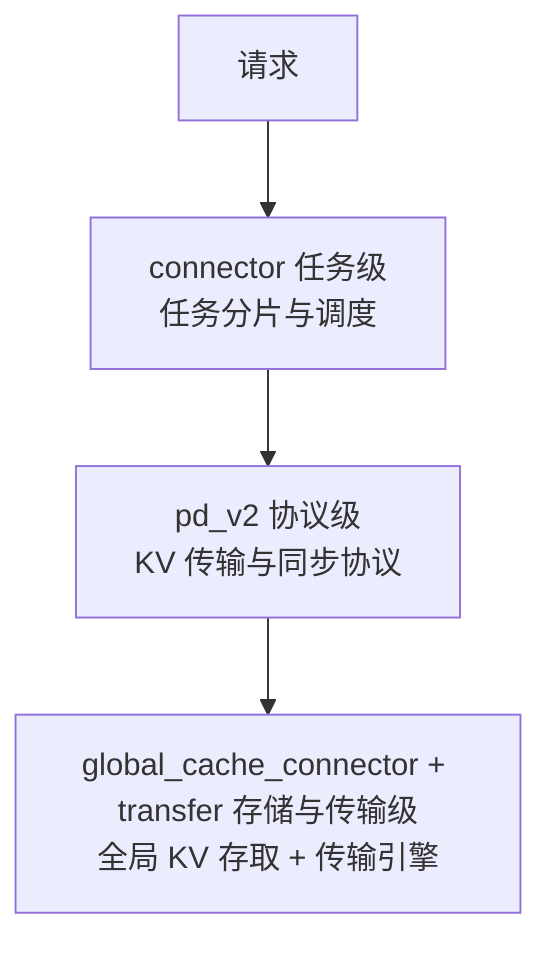
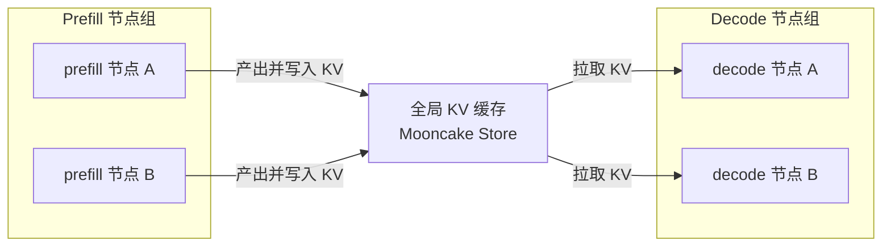
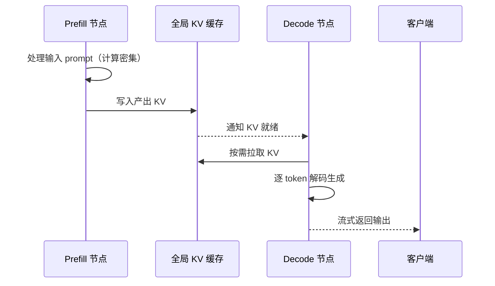
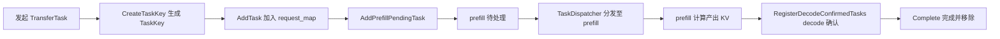
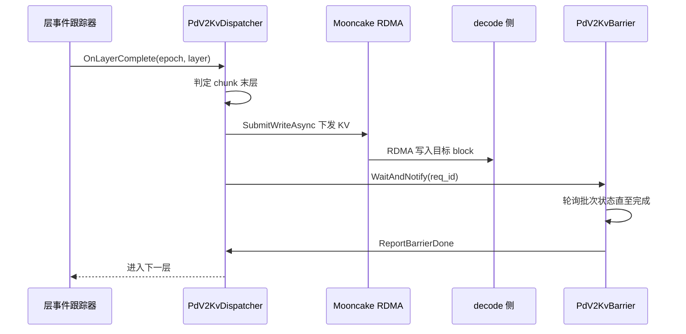
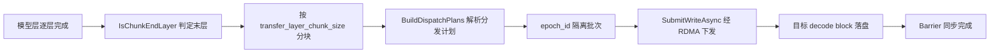
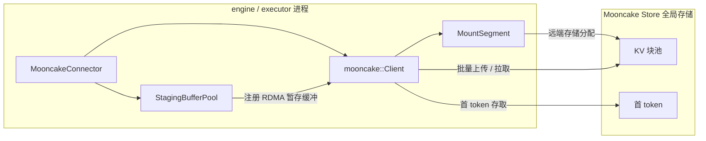
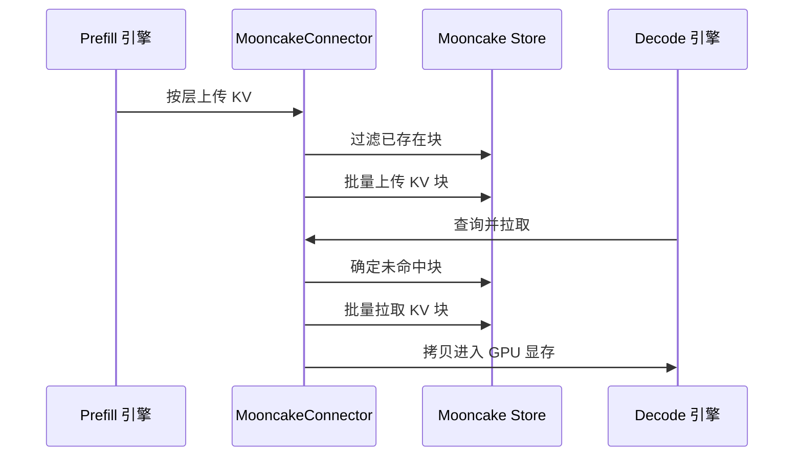
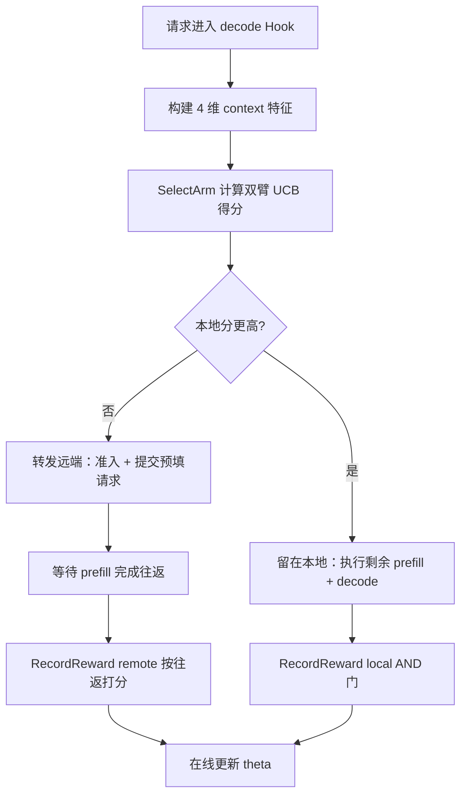

# PD 分离与全局缓存

## 1. PD 分离与全局缓存概述

### 1.1 为什么要把 Prefill 与 Decode 分开

大模型推理的单个请求会先后经历两个计算特征截然不同的阶段：

- **prefill（预填充）**：一次性并行处理整段输入 prompt，计算量大、以矩阵乘为代表，属于**计算密集**阶段；
- **decode（解码）**：逐 token 生成输出，每次只计算一个 token，计算量小但对 KV cache 的读写频次高，受**内存带宽与延迟**约束。

| 对比维度 | prefill | decode |
| --- | --- | --- |
| 计算特征 | 计算密集，并行度高 | 内存带宽 / 延迟受限 |
| 吞吐衡量 | 单位时间处理的 prompt token | 单 token 生成延迟 |
| 扩缩容驱动 | 算力（矩阵乘法） | 显存带宽与接入并发数 |

两种阶段对资源的要求方向不同：prefill 扩容主要在增加算力以降低**首 token 延迟（TTFT）**，decode 扩容则要支撑更多并发会话并降低**单 token 时延（TPOT）**。若将二者耦合在同一批节点上，任一侧负载波动都会互相挤占资源，难以按各自特性独立优化。

因此 KsanaLLM 采用 **PD（Prefill/Decode）分离**：把两类阶段分配到独立的节点组，各自按需扩缩容，让算力分配更贴合每个阶段的实际瓶颈。

### 1.2 全局 KV 缓存的价值

PD 分离后，prefill 节点的产物 **KV Cache**（键值缓存，prefill 计算产生的 K/V 矩阵，供 decode 复用）需要交给 decode 节点复用。若只靠节点内部缓存，被调度的 decode 节点拿不到另一节点计算出的 KV，就必须重复计算或被绑定在单节点。通过**全局 KV 缓存**，KV 可以在跨节点、跨服务器无缝复用：

- 避免同一请求在 decode 侧重新执行 prefill，降低重复计算；
- 支持前缀命中，相同上下文的新请求可直接复用已缓存的 KV；
- cache 与节点解耦，decode 节点可被任意编排，不必绑定到单个 prefill 节点。

### 1.3 三层架构总览

全局 KV 缓存与 PD 协同并非单一模块，而是分层设计。PD 分离架构自顶向下划分为三层职责：

| 层级 | 模块 | 职责 |
| --- | --- | --- |
| 任务级 | connector | 任务分片与调度 |
| 协议级 | pd_v2 | KV 传输与同步协议 |
| 存储与传输级 | global_cache_connector + transfer | 全局 KV 存取与底层传输引擎 |

- **connector（任务级）**：负责任务切分与下发调度，是上层入口；
- **pd_v2（协议级）**：定义 KV 在 prefill 与 decode 之间的传输 / 同步协议；
- **global_cache_connector + transfer（存储与传输级）**：对接全局 KV 存储（如 Mooncake Store），并经底层传输引擎（如 RDMA，即远程直接内存访问）把 KV 送达目标节点。

其中 **global_cache_connector** 负责与全局 KV 存储对接、管理 KV 数据存取，**transfer** 提供底层数据传输能力，二者共同支撑跨节点 KV 复用。各层职责正交、解耦，上层只声明意图，由下层负责具体实现。后续章节将逐层展开这三层。

**Sources:** <ref_code path="csrc/connector/connector.h" /> <ref_code path="csrc/connector/config.h" /> <ref_code path="csrc/pd_v2/configure/pd_v2_runtime_config.h" />

## 2. Prefill/Decode 分离总体架构

### 2.1 节点角色与分组

PD 分离集群中，节点按承担阶段划分为两类角色：

- **prefill 节点**：接收输入 prompt 并完成预填充，产出当前阶段涉及的 KV Cache，是计算密集路径的承载者；
- **decode 节点**：从全局缓存拉取 KV，逐 token 生成输出，是内存带宽 / 延迟受限路径的承载者。

| 角色 | 职责 | 扩缩容依据 |
| --- | --- | --- |
| prefill | 处理输入 prompt、产出 KV Cache | 计算密集，按算力扩容 |
| decode | 逐 token 生成、流式返回输出 | 带宽 / 延迟受限，按并发扩容 |

分组信息由连接器层维护。`ConnectorConfig`（连接器配置）通过 `GroupRole` 标识节点角色，`PREFILL` / `DECODE` / `BOTH` 分别表示仅处理 prefill、仅处理 decode、或两者都承担。各节点依据相同的 `cluster_name` 归属到同一集群，prefill 节点只与同一集群内的 decode 节点协同。

节点加入分组与存活的元数据由 pd_v2 侧的 `RedisAliveStore` 维护：decode 节点在 `pd_v2/decode_alive/<cluster>/*` 命名空间登记并周期性续期，prefill 节点通过轮询发现当前存活的 decode 节点，作为 KV 下发目标的选择依据。

### 2.2 端到端协作链路

一次请求在两类节点与全局缓存之间协同：

1. **Prefill**：prefill 节点接收输入，计算并产出 KV cache；
2. **写入全局缓存**：prefill 节点把产出的 KV 写入全局 KV 缓存（Mooncake Store）；
3. **Decode 拉取**：decode 节点向全局缓存请求，按需拉取对应 KV 到本地；
4. **解码**：decode 节点基于拉取的 KV 逐 token 生成输出；
5. **流式返回**：生成的 token 逐批回流到客户端，形成流式输出。

### 2.3 decode 侧 KV 拉取介入点

decode 侧在解码推进过程中介入 KV 拉取：本地只维护少量上下文，当需要当前 token 的 KV 时，通过连接器路由到对应目标，并从全局缓存中按需拉取对应 KV 数据。

KV 拉取的时机由优先级与目标选择策略驱动，而不是把缓存数据一次搬入：

- 拉取在 decode "准备当前 token 所需 KV"时触发，用到才取、按 token 粒度推进；
- 连接器高层负责把 KV 请求路由到对应 prefill 节点，底层再经存储与传输层完成实际搬运。

由于 KV 已缓存在全局存储，decode 节点可灵活切换拉取来源，prefill 节点的负载可自由调整而不破坏解码过程。

### 2.4 分层职责小结

将本章角色与流程同三层架构对应：

- **connector（任务级）**：确定节点角色分组与任务分片；
- **pd_v2（协议级）**：按传输与同步协议编排 KV 拉取时机与目标选择；
- **global_cache_connector + transfer（存储与传输级）**：对接全局缓存执行 KV 的实际写入与读取搬运。

在整个链路中，decode 节点进入解码前对 KV 的按需拉取，是连接协议层与存储层的关键切入点。

**Sources:** <ref_code path="csrc/connector/connector.h" /> <ref_code path="csrc/connector/config.h" /> <ref_code path="csrc/pd_v2/configure/pd_v2_runtime_config.h" /> <ref_code path="csrc/pd_v2/mooncake/redis_alive_store.h" />

## 3. connector 任务分片与调度

connector 是 PD 分离架构中的「任务级」层，负责在一个请求的存续期内对张量传输任务进行分片、分发与状态管理。它把一次 KV 传输拆成可按 `req_id` 并发的独立 task，并协调 prefill 与 decode 两侧的推进节奏。底层 KV 落盘与存储介质不在本层（见第 4、5 章）。

### 3.1 TaskKey：任务的唯一标识

每次 KV 传输任务由 `TransferTask`（张量传输任务）派生出唯一键 `TaskKey`，它携带请求、张量与路径信息：

- `req_id`：请求 ID，作为分片的主键；
- `block_idx`：计算流水线中的块索引；
- `layer_idx`：神经网络中的层索引；
- `tensor_size`：张量数据字节大小；
- `hash_device_id` / `decode_device_id` / `prefill_device_id`：设备定位维度。

`TaskKey` 由 `TransferTask` 生成，计算张量元素数与数据类型大小得到 `tensor_size`，并支持批量序列化，便于节点间整包传递。后续以 `TaskKey` 为键跟踪任务的失败重试计数等状态。

### 3.2 TaskManager：分片式任务管理

`TaskManager` 是以 `req_id` 分片的高性能任务管理器，采用 TBB 并发容器实现无锁读写。它把全部在途任务按 `req_id % circular_bucket_num` 拆成若干 `TaskShard`（任务分片），每个分片的业务由三张并发哈希表承载。

| 哈希表 | 含义 |
| --- | --- |
| `request_map` | 任务在途存储，`TaskKey → TransferTask`（任务句柄） |
| `prefill_pending_tasks` | prefill 待处理任务，`TaskKey → 时间戳`（等待被激活） |
| `decode_confirmed_tasks` | decode 已确认任务，`TaskKey → 时间戳`（decode 侧登记确认） |

分片化带来两个收益：并发度随 `circular_bucket_num` 提升，且单个分片锁竞争范围小。`CleanupExpiredTasks`（过期任务清理）以 `TASK_MANAGER_DEFAULT_EXPIRE_SECONDS = 900`（15 分钟）为默认阈值，并行扫描各分片回收过期任务。

### 3.3 任务状态流转

任务在 `TaskManager` 内经历「发起 → prefill 待处理 → decode 确认 → 完成」四个阶段：

- `AddTask` 把任务写入 `request_map`；
- `AddPrefillPendingTask` / `TryActivatePendingTask` 在 prefill 侧拾起待激活任务；
- decode 侧返回后由 `RegisterDecodeConfirmedTasks` 写入 `decode_confirmed_tasks`；
- 任一侧处理完成调用 `CompleteTask` 从各表移除任务。

### 3.4 TaskDispatcher：prefill 与 decode 任务分发

`TaskDispatcher` 负责把 `TaskManager` 中的任务批量分发给各通信通道，并建立节点对：

- 通道抽象：上层面向 `Communicator` 抽象，两套实现——`ZmqCommunicator`（ZMQ 通道）与 `NcclCommunicator`（NCCL 通道）；走哪条由连接的组与设备决定；
- 批处理：先把任务按组与设备分组归类，再按组发送；
- 失败重试：以重试计数记录每个任务键的失败次数，超上限后标记失败；
- 连接管理：保证首次连接就绪，通过注册回调建立 prefill / decode 收包路径。

TaskDispatcher 不涉及 KV 落盘，只处理「任务状态」与「把任务送到对端」两件事。

### 3.5 Communicator / CommunicatorManager：通道统一管理

`Communicator` 是所有通信实现的抽象基类，定义发送 / 接收 / 成组收发接口及接收回调。

`CommunicatorManager` 是对外统一的通道入口：

- 持有单个协调器，并把通信组 ID、地址等心跳数据广播给已注册的通信器；
- 按类型名取通道，并提供 ZMQ / NCCL 快捷取用方法；
- 支持动态创建 ZMQ / NCCL 通道，并经由协调器交换通信 ID。

### 3.6 协调与路由：节点注册与心跳保活

`DefaultCoordinator`（默认协调器）实现协调器接口，承担节点注册、心跳保活与通信组信息获取：`RegisterNode` 注册本节点，后台线程定期发出心跳，收到响应后推进通信组建连。

`HTTPRouterClient`（HTTP 路由客户端）是基于 HTTP 的路由服务客户端，向路由服务注册节点、发送心跳并携带通信组信息、登记 NCCL ID。`DefaultCoordinator` 通过注入的路由客户端执行上述请求，无需关心传输协议差异。

**Sources:** <ref_code path="csrc/connector/task_manager.h" /> <ref_code path="csrc/connector/task_dispatcher.h" /> <ref_code path="csrc/connector/task_key.h" /> <ref_code path="csrc/connector/config.h" /> <ref_code path="csrc/connector/communicator/communicator.h" /> <ref_code path="csrc/connector/communicator/communicator_manager.h" /> <ref_code path="csrc/connector/coordinator/default_coordinator.h" /> <ref_code path="csrc/connector/router_client/http_router_client.h" />

## 4. pd_v2 协议与 KV 传输

connector（第 3 章）负责任务分片与分发，pd_v2 是「协议级」层，回答两个问题：prefill 产出的 KV 如何按层分块并经 RDMA 下发到 decode，以及两侧如何同步 KV 写入状态。prefill 侧由层事件驱动下发，decode 侧负责选 peer 与拉取。Mooncake Store 第三方存储介质不在本章（见第 5 章）。

### 4.1 prefill 侧分发：层事件驱动与 KV 下发

**层完成事件驱动**：层事件跟踪器是 pd_v2 专属的逐层事件跟踪器，为每个并发批次分配一个批次槽（EpochSlot），对层粒度事件编号：

- `BeginBatch` 开启一个批次并返回 `epoch_id`（批次号）；
- 记录层进度时，在注意力层写完 K/V 后记入当前槽；
- `Initialize` 分配槽池并启动监控线程；
- `ResetState` 回卷槽位，保证不同批次槽互不干扰。

它独立实现，是为了避免带锁监控阻塞 PD 分离热路径。回调在监控线程触发，同一 `epoch_id` 的批内回调互不混淆。

**KV 下发**：`PdV2KvDispatcher`（KV 分发器）挂在层完成事件上，按层 chunk 切分把 KV 下发到目标 decode：

- `OnLayerComplete`（层完成回调）是入口，收到层完成事件后做快照、判定本 rank 是否参与、再按 chunk 切分触发传输；
- `BuildDispatchPlans`（构建分发计划）在每个批次首次 chunk 结束时，对在途请求解析一次完整分发计划（路由结果、目标地址、本地 block 指针、前缀缓存跳过量），后续逐层只算偏移，避免冗余工作；
- 分块计算：`IsChunkEndLayer`（是否 chunk 末层）、`ChunkStartOffset`（chunk 起始偏移）与 `ChunkSize` 共同决定某一层是否为 chunk 末层，以及本次传输的起始偏移；
- `epoch_id` 隔离：不同批次对应不同 `epoch_id`，分发计划以 `epoch_id` 为键存放，相互隔离，防止不同批次回调互相污染 RDMA 下发状态；
- 下发动作：对每个匹配目标 block 计算源 / 目标地址偏移，提交 RDMA 写；批结束清理本批状态。

配置项 `transfer_layer_chunk_size` 控制 chunk 粒度：`0` 表示仅在模型末层一次性传输全部 KV（一个大批次）；`N>0` 表示每隔 N 层触发一次传输（更小批次、更低内存与延迟）。默认按层逐个传输。

### 4.2 PdV2KvBarrier：KV 写入屏障与请求同步

`PdV2KvBarrier`（KV 屏障）是 prefill 侧发送者侧屏障，负责 KV 写入状态与请求生命周期的同步：

- 入口 `WaitAndNotify` 由模型前行结束路径调用，非阻塞，只把 `req_id`（可带失败标记）入队；
- 单个后台线程排空工作队列，逐个请求读取其「在途批次」并轮询状态，直到全部完成或任一失败；
- 全部完成后触发屏障完成通知，引擎据此向对端 decode 释放完成信号；
- 即便某请求因前缀缓存命中跳过了所有 block 写入，也会上报屏障结果，避免 decode 无限等待。

### 4.3 decode 侧选路：PeerSelector

`PeerSelector`（peer 选择器）是 decode 引擎本地的 peer 路由表，采用「快照驱动」：

- `RegisterPeer`（注册 peer）以 `segment_id` 为键登记 peer，新注册 peer 默认不健康，需首个快照到达后才可选；
- `UpdateSnapshot`（更新快照）由确认 / 完成 / 周期快照刷新健康度；
- `Select`（选择）只基于当前快照返回健康 peer，支持按 `segment_id` 顺序轮询，或 kLinUCB 策略（LinUCB 只决定本地或远端路由，远端 peer 仍走轮询路径）；
- `HealthyPeers`（健康 peer 列表）返回全部健康 peer，供异步提交与回退路由使用。

PeerSelector 不记录 `(req_id, peer_id)` 映射，会话簿记由引擎层持有，选错 peer 通过下一快照重试自愈。

### 4.4 wire 层与端点：请求与采样配置帧

**wire 帧**：pd_v2 的 wire 类型用 msgpack 编码，字段名作键，滚动升级时未知字段被忽略、缺失字段回退默认值。帧头为类型 + 长度 + 字节正文。核心帧类型：

| 帧类型 | 用途 |
| --- | --- |
| `PrefillRequest` | prefill 侧准入请求，含 decode 地址、req_id、stage 槽位、采样配置与目标列表 |
| 阶段载荷 | 承载重负载字段，避免超过 ingress 上限 |
| `PrefillRequestComplete` | prefill 完成消息，回传生成 token 与健康快照 |
| `PrefillSnapshot` | 周期健康推送已订阅 decode，兼负载均衡 |

`SamplingConfig` 的线上镜像含 `topk`/`topp`/`temperature`/`max_new_tokens` 等字段；decode 发送前通过 `max_new_tokens` 覆写，使 prefill 恰好产出 decode 自举所需 token。部分字段（如与传统采样无关的 beam search、logprobs）对 prefill 微批次无意义，故未携带。

**prefill 端点**：prefill 端点（PdV2PrefillEndpoint）是 prefill 侧准入入口：把到来的请求转成内部请求，经本地端点提交进入模型驱动排队；处理完后响应屏障完成。

### 4.5 KV 层下发与同步时序

一次模型前向中，一层 KV 从完成到进入下一层的时序如下：

层 chunk 分块 → RDMA 传输 → 目标 decode block 落盘的整体数据流：

**Sources:** <ref_code path="csrc/pd_v2/prefill/pd_v2_kv_dispatcher.h" /> <ref_code path="csrc/pd_v2/prefill/pd_v2_kv_barrier.h" /> <ref_code path="csrc/pd_v2/prefill/pd_v2_layer_event_tracker.h" /> <ref_code path="csrc/pd_v2/decode/peer_selector.h" /> <ref_code path="csrc/pd_v2/wire/prefill_request_wire.h" /> <ref_code path="csrc/pd_v2/wire/sampling_config_wire.h" /> <ref_code path="csrc/endpoints/pd_v2/pd_v2_prefill_endpoint.h" />

## 5. 全局缓存：Mooncake Store 与 RDMA 存储

全局 KV 缓存构成三层架构中的「存储与传输级」。本地 prefix cache 命中率有限，跨节点复用的 KV 需要落到公共的 Mooncake Store，并由任意节点按需拉取。本层回答两个问题：KV 如何落到全局存储，以及它如何被按需取回。

### 5.1 连接器抽象：两个进程的同一套接口

`GlobalCacheConnectorInterface` 以动态库形式提供，把 KsanaLLM 与全局 KV 存储解耦，被 engine 与 executor 两个进程共用：

| 能力 | 方法 | 职责 |
| --- | --- | --- |
| 查询并拉取 | `QueryAndFetch` | 本地 prefix cache 查询之后补充查询全局；一次调用内完成查询与拉取 |
| 数传 KV 块 | `PutGlobalCacheBlocks` | prefill 完成后按层把 KV block 上传到全局存储 |
| 首 token 存取 | `PutFirstTokens` / `QueryFirstTokens` | 保存 / 读取 prefill 得到的生成 token，decode 全命中时直接获取 |
| 生命周期 | `Initialize` / `Shutdown` | 连接器的初始化和资源释放 |

在 engine 进程，连接器在本地 prefix cache 查询后查询全局 cache、管理拉取生命周期；在 executor 进程，它执行全局 cache 与 GPU 显存之间的实际 KV 数据传输。

`QueryAndFetch` 的 `matched_ranges` 是一组闭区间 `[start, end]`：相邻两元素组成一对 token 位置范围（如 `{0, 127, 256, 383}` 表示拉取 `[0,127]` 与 `[256,383]`）。拉取从本地已缓存长度起算，仅覆盖本地未命中的尾部块。

面向 decode 节点的重试模式会让接口在超时内持续重试仍未命中的 block，按轮推进并只重发未拉取的块，已成功的块不会被重复拉取。

### 5.2 上传路径：KV 如何落到全局

`QueryAndFetch` 与 `PutGlobalCacheBlocks` 都以 token 前缀哈希作为键的来源：对 token 前缀做 SHA256 取其字节摘要，拼接成 `kv_<prefix>_tp<rank>_l<layer>_b<block>` 的块键，并生成对应的首 token 键。

上传时按 token 序列与块范围枚举目标块，先批量过滤已存在的对象，仅对缺失块发起批量上传。`PutFirstTokens` 把生成的 token 及计数打包写入首 token 键，供 decode 全命中时直接获取、跳过 prefill。

### 5.3 Mooncake 后端：暂存缓冲池与段挂载

`MooncakeConnector` 是基于 `mooncake::Client` 的后端实现。`Initialize` 依次做三件事：解析本机地址并绑定临时端口、`Client::Create` 建立连接、为远端分配暂存缓冲。

`StagingBufferPool`（暂存缓冲池）是通过固定数量的 CUDA pinned 内存预分配的暂存缓冲池，用于 RDMA 暂存。它在配置提供块大小时于 `Initialize` 阶段预分配（避免首次请求延迟），否则在首次数传时懒初始化，之后把整块连续内存注册为 RDMA 内存区域。

段的分配由远端存储挂载（MountSegment）完成：先以大页映射分配指定大小的宿主内存，再将其挂载为远端存储段；`Shutdown` 时卸载后解映射。整个连接链如下：

### 5.4 底层传输：TransferEngine 与 pd_v2/mooncake 侧

`transfer` 目录提供跨节点 KV 传输任务管理。`TransferEngine` 维护请求级的传输描述（共享 token 数、首 token 序列、GPU 块位置、待处理 / 已完成队列），支持 prefill 与 decode 节点间的数据交换、层进度上报与收发完成查询。传输任务携带请求、块信息或 token 序列，可被标记为跳过（该块命中 prefix cache）。

`pd_v2/mooncake` 侧承载连接与活性的若干组件：

| 组件 | 侧 | 职责 |
| --- | --- | --- |
| `MooncakeEngineConnector` | engine | 控制面通知、decode 侧准入 / 提交 prefill、prefill 侧快照分发与路由 |
| `MooncakeExecutorConnector` | executor | 注册 KV pool、提交写批、屏障轮询的批次追踪 |
| `EngineTentWrapper` | engine | 封装底层传输，发 / 收通知、注册暂存内存、提交异步 RDMA 写 |
| `PeerCredits` | engine | 每个对端入 stage 槽位环形位图，分配与释放 |
| `HostStagePool` | prefill 侧 | 主存 slot 池，decode 以 RDMA 写入到的控制面暂存缓冲 |
| `RedisAliveStore` | engine | Redis 保活，命名空间下服务发现与 epoch 追踪 |

控制面通知走轻量通道，控制面对大载荷以 RDMA WRITE 写入对端暂存池的槽位，再附条 notify 引用槽位范围。首个 token 与整个 KV 块的全局存取两端时序如下：

### 5.5 小结

本层提供跨 prefill / decode 的公共 KV 对象层。prefill 侧计算 KV 后经段挂载落到 Mooncake Store；decode 侧以前缀哈希为键、配合暂存缓冲池与批量拉取按需取回。RDMA 传输、控制面装载由 `transfer` 与 `pd_v2/mooncake` 侧实现，`RedisAliveStore` 保障对端可见性，槽位额度模块则调节控制面的槽位配额。

**Sources:** <ref_code path="csrc/global_cache_connector/global_cache_connector_interface.h" /> <ref_code path="csrc/global_cache_connector/global_cache_key_utils.h" /> <ref_code path="csrc/global_cache_connector/global_cache_connector_types.h" /> <ref_code path="csrc/global_cache_connector/mooncake_connector.h" /> <ref_code path="csrc/global_cache_connector/mooncake_connector.cpp" /> <ref_code path="csrc/global_cache_connector/staging_buffer_pool.h" /> <ref_code path="csrc/transfer/transfer_engine.h" /> <ref_code path="csrc/transfer/transfer_types.h" /> <ref_code path="csrc/pd_v2/mooncake/mooncake_engine_connector.h" /> <ref_code path="csrc/pd_v2/mooncake/mooncake_executor_connector.h" /> <ref_code path="csrc/pd_v2/mooncake/engine_tent_wrapper.h" /> <ref_code path="csrc/pd_v2/mooncake/peer_credits.h" /> <ref_code path="csrc/pd_v2/mooncake/host_stage_pool.h" /> <ref_code path="csrc/pd_v2/mooncake/redis_alive_store.h" />

## 6. LinUCB 双臂路由决策

### 6.1 背景：decode 节点的「本地 or 转发」抉择

在 PD 分离架构下，decode 节点收到一个请求后，需要决定剩余 prefill 由谁执行：留在本节点自算，还是转发给远端 prefill peer。

- 转发远端：走控制面通知 + RDMA 往返，适合剩余 prefill 较大、本地 TPOT 预算不宽裕的场景；
- 留在本地：只写本地缓存，避免往返开销，适合剩余 prefill 很小或远端往返会击穿 TTFT 预算的场景。

决策挂进引擎的 Hook 链。当选择策略为 `kLinUCB` 时，路由决策交给路由模块；否则等价于只转发、失败即拒。远端 peer 具体选谁仍由 PeerSelector 轮询完成（见第 4 章）。

### 6.2 决策模型：双臂 disjoint LinUCB

核心类是 `LinUCBRouter`，它是一个双臂的 disjoint contextual bandit（上下文多臂赌博机，UCB 即置信上界）：

- 双臂 `{kLocal, kRemotePeer}`；
- 两臂共享同一份 **4 维 context**：`bias`、`idle`、`tpot_headroom`、`remaining_small`；
- 每个臂独立维护自己的参数，数学基元为纯函数、无动态分配，路由临界区保持极短。

`SelectArm` 对两臂求 UCB 得分 `均值 + alpha * 置信项` 并取 argmax。`RecordReward` 用 Sherman-Morrison 更新直接维护逆矩阵与梯度累加，无需每步重做矩阵求逆；正则化系数固定为 1.0。

四维特征由 `BuildFeatures` 从 `LocalArmContext`（运行请求数、当前步延迟等实时负载）构造。

### 6.3 特征构建

`LocalArmContext` 是 decode 节点本地实时负载视图；`BuildFeatures` 将其折算为共享四维特征：

- `bias`：固定 1.0；
- `idle`：节点空转时高；
- `tpot_headroom`：反映每步延迟离 TPOT 目标的余量；
- `remaining_small`：剩余 prefill 小到可塞进本地计算窗口时高。

特征同时驱动臂得分与奖励结算，`SelectArm` 会把实际使用的特征向量回写给调用方，供延迟奖励在 `RecordReward` 时复现同一个 context。

### 6.4 奖励设计：双口互斥的 AND 门

奖励的核心约束是「本地保持 prefill」。三套奖励函数：

- `LocalReward`（TPOT 余量乘法门）：节点空闲为 1.0，每步延迟逼近 TPOT 目标时线性衰减到 0，并取瞬时与 EWMA 的保守值，使突发负载在下一拍立刻动作；
- `TtftCredit`（TTFT 预算信用）：远端往返低于阈值为 0，超过后随时间抬升——「保留在本地值多少」；
- `RemoteReward`：直接以往返延迟打分，零延迟为 1.0、线性降为 0 于 TTFT 阈值；一旦远端超预算记 0，即让位本地臂。

本地臂的延迟奖励为 `TtftCredit * LocalReward` 的乘性 AND 门：只有「远端会慢」且「本地仍有 TPOT 余量」两条件同时成立才奖励留在本地。控制面放弃或提交失败时，对应臂记 0 奖励惩罚。

### 6.5 接入与流程

- `PdV2DecodeHook` 作为引擎 Hook，位于全局缓存查询 Hook 之后；
- 返回本地时本节点执行剩余 prefill + decode；
- 返回远端时走准入流程、remote 提交，完成后在完成回调结算远程奖励；
- 本地臂奖励由调度线程按每步负载结算。

决策流程图：

### 6.6 LinUCB 超参（LinUCBConfig）

`LinUCBConfig` 派出各阈值，仅在 `kLinUCB` 策略下生效：

| 配置项 | 默认 |
| --- | --- |
| `alpha` 探索权重 | 1.0 |
| `tpot_target_us` TPOT 预算 | 50000 us |
| `tpot_safety_factor` TPOT 安全系数 | 0.85 |
| `ttft_threshold_us` TTFT 预算 | 1500000 us |
| `running_ref` 满负荷运行数 | 16 |
| `remaining_ref_tokens` 过大剩余 token 数 | 4096 |

lambda 正则固定为 1.0，奖励为单项项无权重，属 v1 最小化设计；部分旧字段保留仅供配置兼容。

**Sources:** <ref_code path="csrc/pd_v2/decode/linucb_router.h" /> <ref_code path="csrc/pd_v2/decode/linucb_router.cpp" /> <ref_code path="csrc/pd_v2/decode/linucb_math.h" /> <ref_code path="csrc/pd_v2/decode/pd_v2_decode_hook.h" /> <ref_code path="csrc/pd_v2/decode/local_load.h" /> <ref_code path="csrc/pd_v2/public/pd_v2_connector.h" />

## 7. 配置与实践建议

### 7.1 runtime 配置关键项

pd_v2 的运行时配置由 `PdV2RuntimeConfig` 承载，其与 V1 的 `ConnectorConfig` 共享字段由同一解析块成对填充；pd_v2 读取方一律指向 `PdV2RuntimeConfig`，避免 V1 派生标志污染 pd_v2。

关键配置项一览：

| 配置项 | 所在位置 | 取值 / 说明 |
| --- | --- | --- |
| `group_role` | 连接器配置 | PREFILL / DECODE / BOTH / NONE，集群角色 |
| `cluster_name` | 同上 | 同集群两端必须一致 |
| `inference_addr` | 同上 | 本节点身份，作为 server_name 与 wire 键 |
| `router_addr` / `coordinator_addr` | 同上 | 外部路由 / 协调地址 |
| `transfer_layer_chunk_size` | runtime 配置 | 0 = 最终层一次性整批；N > 0 = 每 N 层一批；默认 1 |
| `heartbeat_interval_ms` | runtime 配置 | 默认 5000 ms |
| `pd_v2_selector_policy` | runtime 配置 | 0 = kRoundRobin，1 = kLinUCB |
| `pd_v2_linucb_*` | runtime 配置 | 仅 kLinUCB 生效（见第 6 章） |
| `control_stage_pool_bytes` | runtime 配置 | 默认 2 GB，prefill 侧暂存池大小 |
| `control_stage_max_peers` | runtime 配置 | 分片目标 peer 数 |

### 7.2 KV 传输同步与超时

KV 写路径在 prefill executor 侧由 KV 分发器（逐层 Hook）与 KV 屏障（发送端屏障）协同：

- **整拉取 / 分层**：`transfer_layer_chunk_size == 0` 时只在最终层触发一次传输，默认 1 则每层一批，分块在层末判定中计算；
- **屏障同步**：最终层分发成功后入队等待，后台线程轮询各在途批次状态直至完成，再回报引擎释放完成信号；部分提交失败会作为失败上报，避免 decode 读到半写入 KV；
- **超时**：屏障的单请求超时默认 30s，超过即便有批次在途也报失败；轮询间隔可按慢链路调整；
- **epoch 隔离**：分发计划以 epoch 号为键，不同批次回调互不混写；批结束保证即使前向中途中止也有唯一清理点。

### 7.3 健康 peer 轮询与存活管理

`PeerSelector` 维持 decode 侧的 prefill peer 路由表，快照驱动：

- `RegisterPeer`（默认未健康、未可选中）+ `UpdateSnapshot`：每收到确认 / 完成 / 周期快照刷新健康度；
- `Select` 在健康 peer 上轮询，无健康 peer 返回空并作为背压上抛；
- 发送失败时立刻剔除该 peer，下一份快照再重新注册。

存活信标由 `RedisAliveStore` 承担，命名空间 `pd_v2/decode_alive/<cluster>/*`：

- decode 端 keepalive 周期性写带 TTL 的键，错过一次仍留余量；启动 / 关停时删除使 peer 立即感知；
- prefill 端循环扫描该前缀，diff 出首见 / 重启 / 消失，epoch 值变化触发元数据刷新，并以 cluster_name 隔离不同集群。

### 7.4 缓存键与类型工具

`global_cache_connector` 目录提供类型与键约定：

- `global_cache_connector_types.h`：连接器配置，含后端类型、角色、协议、超时 / 重试、主服务器地址、段 / 缓冲尺寸等；
- `global_cache_key_utils.h`：键构造约定——对 token 前缀做 SHA256 取摘要得到哈希串，拼接成块键与首 token 键；
- `sha256_lite.h`：header-only 的最小 SHA256 实现，供键哈希使用，不依赖外部 OpenSSL。

相关分片过期 / 复用常量集中在连接器配置（如分片大小、分片数量、任务过期秒数）与暂存池（槽大小、默认池大小）等传输侧结构中。

### 7.5 决策建议

不同负载特征下，更倾向本地还是转发：

| 负载特征 | 建议倾向 | 理由 |
| --- | --- | --- |
| 剩余 prefill 很小 | 本地 | 往返固定开销大于收益 |
| 节点空闲、TPOT 余量大 | 本地 | TPOT 余量高，AND 门开放 |
| 远端往返将击穿 TTFT 预算 | 本地 | 远端奖励归 0，本地信用抬升 |
| 每步延迟逼近 TPOT 预算 | 转发 | 本地奖励关闸，防止推高 TPOT |
| 剩余 prefill 大 | 转发 | 本地吸收不划算 |
| 无健康 peer | 失败 / 背压 | 拒接并上抛 |

工程建议：kLinUCB 为可选项，默认 kRoundRobin 行为不变；开启后 peer 选择仍轮询、bandit 只改本地-转发判据。监控注意屏障积压与暂存槽抢占等待，作为背压信号。

**Sources:** <ref_code path="csrc/pd_v2/configure/pd_v2_runtime_config.h" /> <ref_code path="csrc/pd_v2/prefill/pd_v2_kv_dispatcher.h" /> <ref_code path="csrc/pd_v2/prefill/pd_v2_kv_barrier.h" /> <ref_code path="csrc/pd_v2/decode/peer_selector.h" /> <ref_code path="csrc/pd_v2/mooncake/redis_alive_store.h" /> <ref_code path="csrc/connector/config.h" /> <ref_code path="csrc/global_cache_connector/global_cache_connector_types.h" /> <ref_code path="csrc/global_cache_connector/global_cache_key_utils.h" /> <ref_code path="csrc/global_cache_connector/sha256_lite.h" />