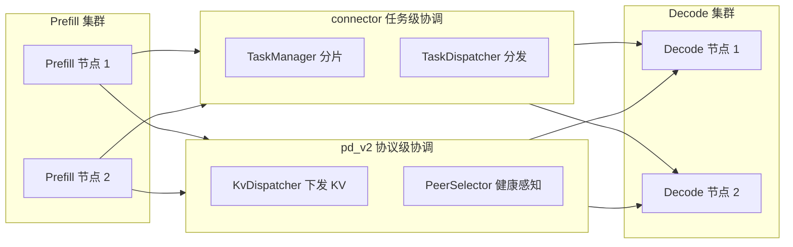
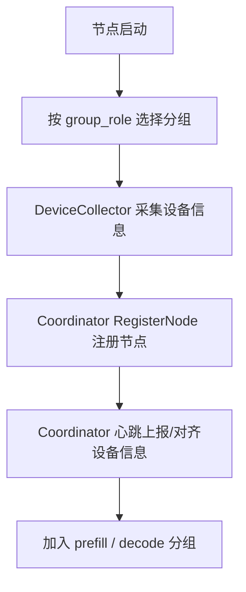
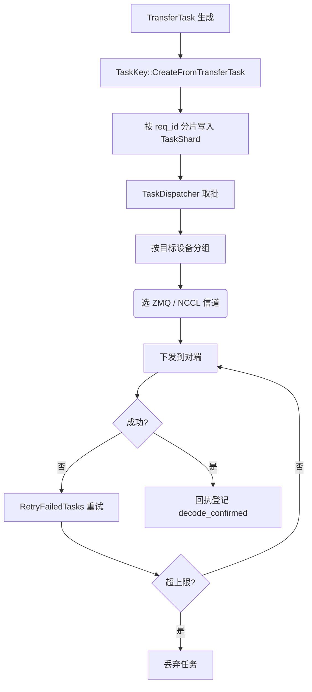
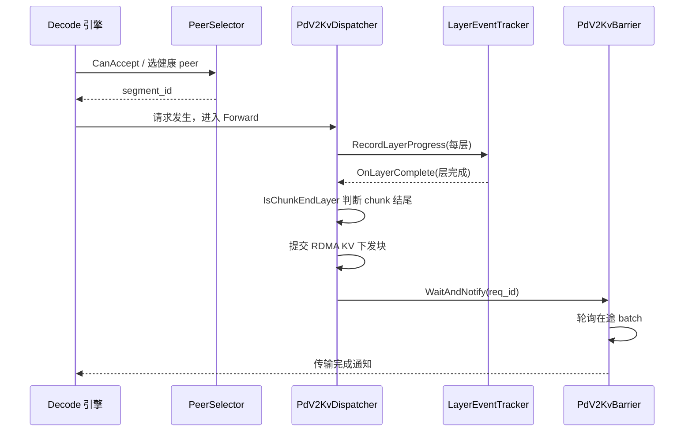
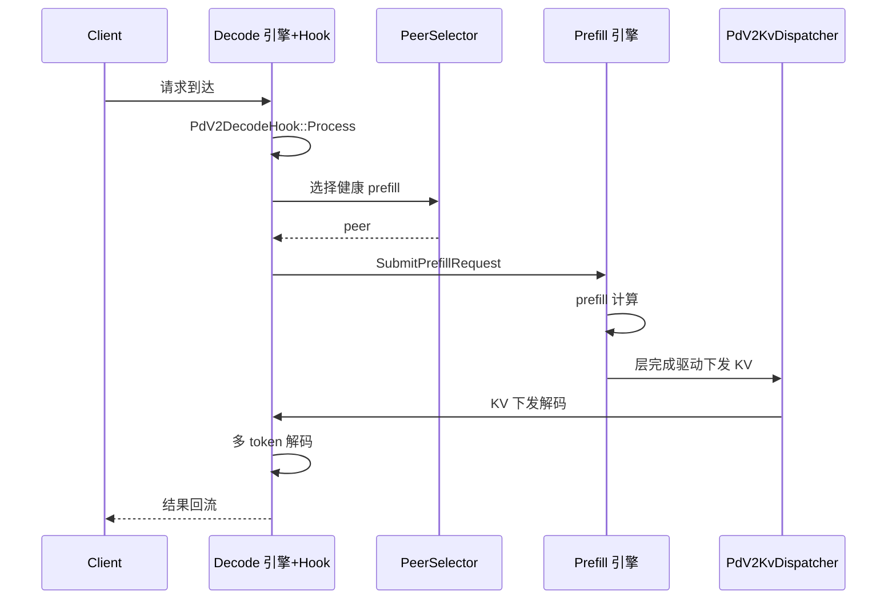

# Prefill 与 Decode 分离

## 1. Prefill 与 Decode 分离概述

Prefill（预填充）与 Decode（解码）是自回归推理的两个阶段，计算特征差异显著。PD 分离将二者拆分到独立节点集群运行，使两阶段可独立横向扩展、独立优化 GPU 利用率。

- **Prefill**：处理 Prompt 上下文，逐层计算并产出完整 KV 块，属于计算密集、可并行度高的任务。
- **Decode**：按已产出的 KV 逐 token 自回归生成，属于访存/带宽密集、串行的任务。

### 节点分组角色

节点通过 `group_role` 划分归属，取值见 `GroupRole` 枚举（`csrc/connector/config.h`）：`prefill` / `decode` / `both` / `none`。同属一个 `cluster_name` 的所有 prefill 与 decode 节点组成同一分组并互相通讯。`KVNodeInfo`（`csrc/connector/node_info.h`）以 `group_role` 字段承载每个节点的角色。

### 双层协作体系

PD 分离由两层协作构成：`csrc/connector` 承担**任务级**协调（TaskManager 分片 + TaskDispatcher 分发），`csrc/pd_v2` 承担**协议级**协调（prefill 侧按层下发 KV、decode 侧健康 Peer 选择与拉取）。

- 任务级：以 `TransferTask` 为粒度，负责任务的登记、分片、跨节点搬运。
- 协议级：以请求生命周期为粒度，负责 KV 传输、批次隔离与远端执行协议。

服务层通过 `InferenceService::HasHealthyPrefillPeer()`（`csrc/service/inference_service.h`）暴露"是否存在健康 prefill Peer"的可用性门控，供 decode 侧做整体可用性判断。

**Sources:** <ref_code path="csrc/connector/config.h" /> <ref_code path="csrc/connector/node_info.h" /> <ref_code path="csrc/connector/connector.h" /> <ref_code path="csrc/pd_v2/public/pd_v2_connector.h" /> <ref_code path="csrc/service/inference_service.h" />

## 2. 节点职责与分组角色

Prefill 节点与 Decode 节点职责相反清晰，二者通过设备信息采集与 coordinator 心跳维护互通。

| 职责维度 | Prefill 节点 | Decode 节点 |
| :--- | :--- | :--- |
| 核心任务 | 计算 Prompt，产出完整 KV 块 | 按 token 解码逐 token 生成 |
| KV 处理 | 生成并提供 KV 块给 decode 消费 | 接收 KV 块用于后续解码 |
| 负载特征 | 计算密集、可并行 | 访存密集、串行依赖 |
| 扩展方向 | 按请求上下文长度/并发扩展 | 按并发 token 流扩展 |

### 节点入组：设备采集与角色登记

节点启动时采集本机设备信息，作为入组准备的依据，`node_info.h` 中的 `DeviceInfo` 承载单设备标识：

- `DeviceCollector::CollectDeviceInformation`（`csrc/connector/device_collector.h`）统一采集 GPU/NPU 设备，生成 `DeviceInfo` 列表；无 GPU 时退回 CPU 设备。
- `DefaultCoordinator`（`csrc/connector/coordinator/default_coordinator.h`）经 Redis/路由注册节点（`RegisterNode`）、周期发送心跳（`SendHeartbeat`），把节点在集群中的在线状态、DP 组与设备数量广播出去。
- `DeviceInfoManager`（`csrc/connector/device_info_manager.h`）在 Prefill 侧保存 decode 节点按 group 分发的 DP 组与设备数信息，供后续按目标设备分配 transfer task；decode 侧则维护本节点分组信息。

节点据此按 `group_role` 对齐到 prefill 组或 decode 组。

### pd_v2 运行配置

pd_v2 路径通过 `PdV2RuntimeConfig`（`csrc/pd_v2/configure/pd_v2_runtime_config.h`）读取角色与运行参数，与 V1 的 `ConnectorConfig` 分离，避免 V1 派生的 `is_decode_only` 误污染 pd_v2 的本地-旁路 prefill 逻辑。其承载 `group_role`、`cluster_name`、`transfer_layer_chunk_size`、`pd_v2_selector_policy` 等配置项。

### 节点健康感知前置面

分组后，decode 需要对 prefill 侧的健康状态做前置感知。相关概念由 `InferenceService::HasHealthyPrefillPeer()` 承接——当 decode 节点看到至少一个健康 prefill Peer 时返回真；具体选择机制在本文档第 4 章展开。

**Sources:** <ref_code path="csrc/connector/node_info.h" /> <ref_code path="csrc/connector/device_collector.h" /> <ref_code path="csrc/connector/device_info_manager.h" /> <ref_code path="csrc/connector/coordinator/default_coordinator.h" /> <ref_code path="csrc/pd_v2/configure/pd_v2_runtime_config.h" />

## 3. TaskManager 分片与 TaskDispatcher 分发

本章是 PD 分离的**任务级协调核心**，回答"任务从哪来、存到哪、怎么发给对端"三个问题。

### 任务分片存储：TaskManager

`TaskManager`（`csrc/connector/task_manager.h`）以 `TaskShard` 分片管理任务，按 `req_id % circular_bucket_num` 切分到多个 `TaskShard`，每个 shard 用三张 TBB `concurrent_hash_map` 维护不同阶段的任务状态：

| 哈希表 | 维护内容 | 作用 |
| :--- | :--- | :--- |
| `request_map` | `TaskKey → TransferTask` | 任务内容存储主表 |
| `prefill_pending_tasks` | `TaskKey → 时间戳` | 待 prefill 处理的任务登记 |
| `decode_confirmed_tasks` | `TaskKey → 时间戳` | decode 已确认任务登记 |

以 `req_id` 为分片键分散到多个 `TaskShard`，提升并发哈希访问的可扩展性。

#### TaskKey：任务键

`TaskKey`（`csrc/connector/task_key.h`）唯一标识一次传输，由 `TransferTask` 派生（`TaskKey::CreateFromTransferTask`），包含以下关键字段：

- `req_id`：请求 ID，也是主分片键。
- `block_idx` / `layer_idx`：计算管线中的块与层索引。
- `tokens`：生成 token 与 draft token。
- `hash_device_id`：决定 key 是否同一定位的设备哈希。
- `decode_device_id / offset` 与 `prefill_device_id / offset`：两端组内设备定位。
- `start_time_us`：任务创建时间，用于优先级与过期判断。

任务键支持序列化/批量序列化，跨节点传输时以原始字节搬运。

### 任务分发：TaskDispatcher

`TaskDispatcher`（`csrc/connector/task_dispatcher.h`）负责在 prefill↔decode 间搬运任务，通过 `CommunicatorManager` 统一管理 ZMQ / NCCL 两类信道。

- `TaskDispatcher` 通过 `SendToPrefill` / `RegisterPrefillRecv` / `RegisterDecodeRecv` 等接口收发任务，`ProcessPrefillReceivedTasks` 处理对端回包。
- `CommunicatorManager`（`csrc/connector/communicator/communicator_manager.h`）持有 Coordinator，为已注册信道分发心跳数据；对外提供 `GetCommunicatorByType` / `GetZmqCommunicator` / `GetNcclCommunicator`。
- ZMQ 用于服务间控制面，NCCL 用于 GPU 大规模数据面（NCCL 路径见 `communicator/nvida/nccl_communicator`）。

#### 分组批处理与失败重试

`TaskDispatcher` 按目标 (group_key, src_dev, dst_dev) 分组 batch（`GroupByGroupKeyAndDevice`），再经对应发送。

任务按 `task_retry_counts_` 记录重试次数，`MAX_TASK_RETRIES` 为单任务重试上限；失败任务经 `RetryFailedTasks` 重新发起，超上限后放弃，避免无限重试。

配置项在 `ConnectorConfig`（`csrc/connector/config.h`）中，含 `communication_type`、`send_thread_num`、`transfer_batch`、`task_expire_sec` 等参数位置。

**Sources:** <ref_code path="csrc/connector/task_manager.h" /> <ref_code path="csrc/connector/task_manager.cpp" /> <ref_code path="csrc/connector/task_key.h" /> <ref_code path="csrc/connector/task_dispatcher.h" /> <ref_code path="csrc/connector/task_dispatcher.cpp" /> <ref_code path="csrc/connector/communicator/communicator_manager.h" /> <ref_code path="csrc/connector/communicator/communicator.h" /> <ref_code path="csrc/connector/config.h" />

## 4. 健康 Peer 选择与 Decode 拉取协同

decode 端需要知道"向谁拉取 KV"，prefill 端需要知道"KV 何时以何粒度对流"。本章覆盖这两点。

### 健康 Peer 选择：PeerSelector

`PeerSelector`（`csrc/pd_v2/decode/peer_selector.h`）维护一张**快照驱动的健康 prefill peer 路由表**，`Select()` 纯按快照选 peer，不维护逐请求状态。

| 关键接口 | 作用 |
| :--- | :--- |
| `RegisterPeer` | 将 peer 加入路由表（未收到快照前不可选） |
| `UnregisterPeer` | 将 peer 移出路由表 |
| `UpdateSnapshot` | 刷新某 peer 的健康快照 |
| `HealthyPeers` | 返回当前健康 peer 的段 ID 排序列表 |
| `Select` | 按策略在健康 peers 中以轮询节奏选取一个 |

健康快照由 `PrefillRequestAck` / `PrefillRequestComplete` / 周期 `PrefillSnapshot` 推送进入。选择策略（`SelectorPolicy`）支持 `kRoundRobin`（默认）与 `kLinUCB`；`kLinUCB` 仅决定"本地 vs 远端"，远端 peer 仍由轮询路径选择。

### KV 下发与生命周期同步：PdV2KvDispatcher + PdV2KvBarrier

prefill 侧由 `PdV2KvDispatcher`（`csrc/pd_v2/prefill/pd_v2_kv_dispatcher.h`）在**层完成事件**驱动下把 KV 分块下发：

- `PdV2LayerEventTracker`（`csrc/pd_v2/prefill/pd_v2_layer_event_tracker.h`）为每个并发 batch 维护独立的 `EpochSlot`，`RecordLayerProgress` 记录层事件，monitor 线程触发 `OnLayerComplete`。
- `PdV2KvDispatcher::OnLayerComplete` 快照活请求，按 `BuildDispatchPlans` 求出本 rank 的转发目标，再经 `IsChunkEndLayer`/`ChunkStartOffset` 判断是否到达 chunk 结尾，逐块提交 RDMA 下发。
- `chunk` 粒度由 `transfer_layer_chunk_size` 决定：0 表示模型最后一层一次性整发，N>0 表示每 N 层发一个批次。

`PdV2KvBarrier`（`csrc/pd_v2/prefill/pd_v2_kv_barrier.h`）负责**KV 传输与请求生命周期同步**：`WaitAndNotify(req_id)` 将请求入队，后台 worker 轮询在途 batch 状态，直到数据完成才放行后续步骤；`epoch_id` 隔离不同批次的传输与回调，避免跨 batch 串台。

**Sources:** <ref_code path="csrc/pd_v2/decode/peer_selector.h" /> <ref_code path="csrc/pd_v2/decode/peer_selector.cpp" /> <ref_code path="csrc/pd_v2/prefill/pd_v2_kv_dispatcher.h" /> <ref_code path="csrc/pd_v2/prefill/pd_v2_kv_barrier.h" /> <ref_code path="csrc/pd_v2/prefill/pd_v2_layer_event_tracker.h" />

## 5. Prefill 与 Decode 整体协作链路与注意事项

### 端到端协作链路

一次 PD 请求的完整跨节点协作如下：

1. 请求到达 decode 节点，`PdV2DecodeHook` 挂入调度链触发。
2. Decode 通过 `CanAccept`/`PeerSelector` 选定健康 prefill peer（或按需本地旁路快速完成）。
3. prefill 节点发起计算，`PdV2KvDispatcher` 因层完成事件按层 chunk 下发 KV。
4. decode 节点按需拉取多 token 解码。
5. 直到结束 token / 停止条件，结果回流输出。

`PdV2DecodeHook`（`csrc/pd_v2/decode/pd_v2_decode_hook.h`）是 decode 端挂在 EDS 调度链上的 `schedule hook`：

- `Process` 选择 peer 并 `SubmitPrefillRequest`，无健康 peer 则 `kFailAndEnd`。
- 完成回调经事件队列回到 `UpdateAsyncResult`，命中时置 `kDecode` 阶段并 `NotifyStep`。

### 协作机制各步骤定位

| 步骤 | 负责模块 | 关键方法 |
| :--- | :--- | :--- |
| 请求触发 | `PdV2DecodeHook` | `Process` / `UpdateAsyncResult` |
| 健康 peer 选择 | `PeerSelector` | `Select` |
| 服务门控 | `InferenceService` | `HasHealthyPrefillPeer` |
| KV 下发 | `PdV2KvDispatcher` | `OnLayerComplete` |
| 生命周期同步 | `PdV2KvBarrier` | `WaitAndNotify` |

### 工程注意事项

- **任务超时清理**：`TaskManager` 对过期分片做并行清理，`CleanupExpiredTasks` 以 `TASK_MANAGER_DEFAULT_EXPIRE_SECONDS` 为超时阈值，任务过期时间配置项位置见 `config.h` 的 `task_expire_sec`。
- **分发失败重试**：`TaskDispatcher` 对失败任务做 `MAX_TASK_RETRIES` 有上限重试，避免无限重放。
- **epoch 分隔批次**：`PdV2LayerEventTracker` 以 `epoch_id` 分隔不同 batch，`PdV2KvBarrier` 按请求隔离在途批次，避免不同批次 KV 传输串台。
- **多节点健康管理**：Coordinator 心跳维护节点在线状态，decode 端 `HasHealthyPrefillPeer` 对健康 prefill 可用性做门控；`PdV2ConnectorBootstrap` 提供 `WaitForHealthyPeer` 等待首个健康 peer 出现。

### 连接器引导

`BootstrapPdV2Connector`（`csrc/pd_v2/public/pd_v2_connector_bootstrap.h`）统一完成 pd_v2 连接器的引导加载：`dlopen` 后端 `.so` → 工厂创建 connector → 绑定 `IpcFuncWrapper` → `Initialize`；decode 端据此在引擎/执行器两侧复用同一套引导链路。

**Sources:** <ref_code path="csrc/pd_v2/decode/pd_v2_decode_hook.h" /> <ref_code path="csrc/connector/task_manager.h" /> <ref_code path="csrc/connector/task_dispatcher.h" /> <ref_code path="csrc/service/inference_service.h" /> <ref_code path="csrc/pd_v2/public/pd_v2_connector_bootstrap.h" />