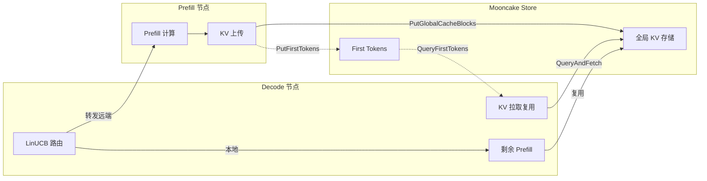
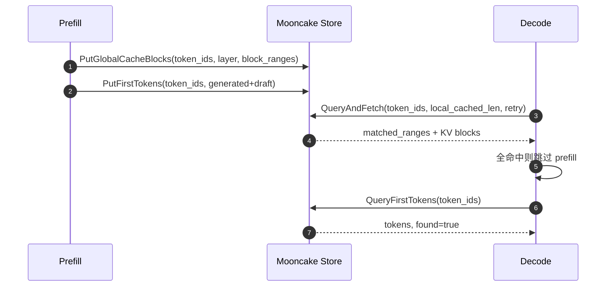
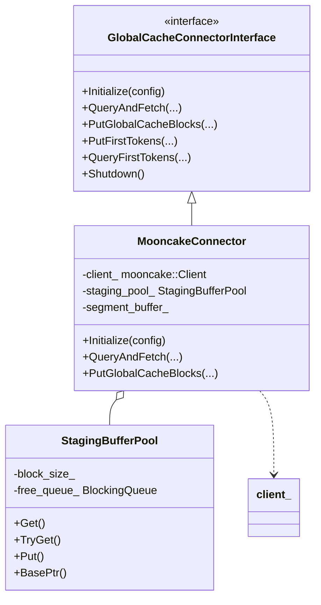
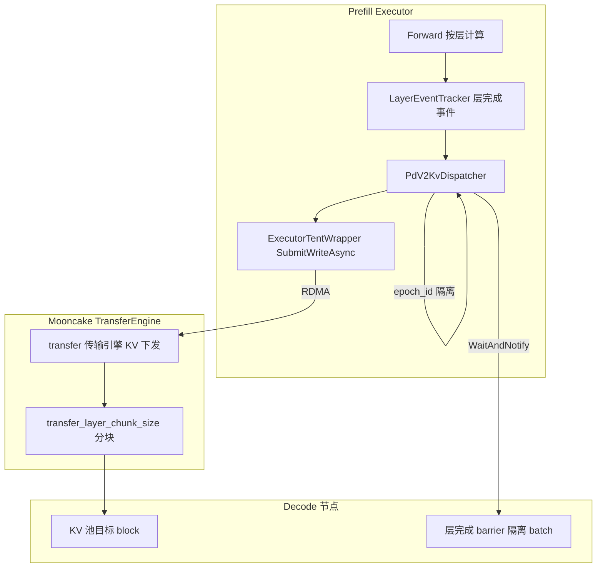
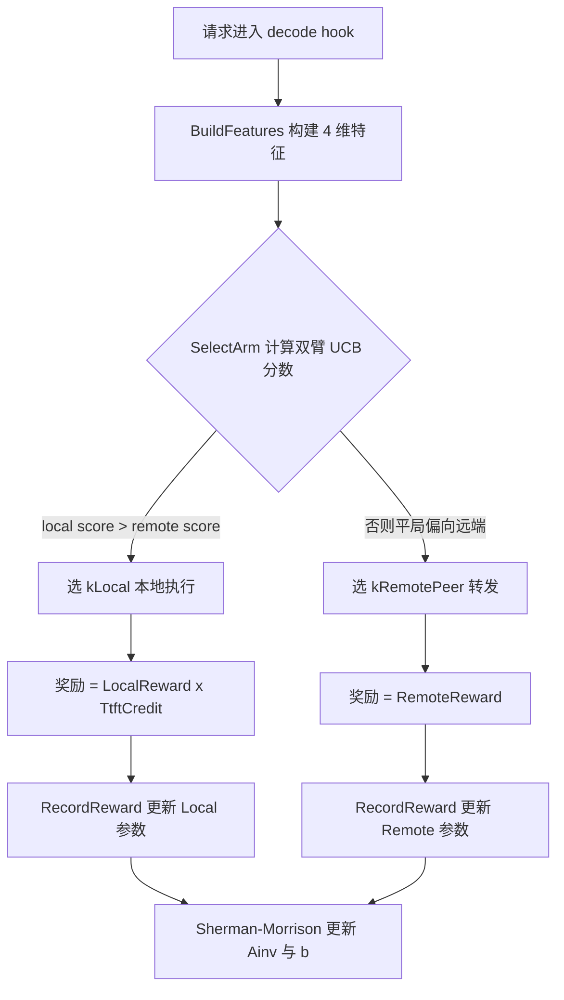

# 全局缓存与LinUCB路由

## 1. 全局缓存与路由决策概览

本文档承接「Prefill 与 Decode 分离」一章之后，聚焦 PD 分离场景下两大关键能力：全局 KV 缓存存取与 decode 侧路由决策。Prefill 节点产出 KV 与首 token 后，经 Mooncake Store 全局共享；decode 节点按需拉取复用，并用 LinUCB（上下文感知 bandit）决策本地执行还是转发远端。

### 1.1 整体定位

PD 分离把 prefill 与 decode 拆到不同节点，资源可独立弹性伸缩。但这也带来跨节点的共享问题：多个 decode 节点可能收到相同前缀的请求，若各自重新 prefill 会造成算力浪费。

全局 KV 缓存解决「跨节点避免重复 Prefill」。prefill 完成的计算产物（每层 K、V block 与生成 token）写入全局缓存，后到的 decode 请求命中相同前缀直接拉取复用，省去重复计算。

- **Prefill 职责**：计算 KV、采样/MTP 生成 token，经 `PutGlobalCacheBlocks` / `PutFirstTokens` 写入全局缓存。
- **Store**：全局共享的 KV 存储层，承载跨节点读写。
- **Decode**：经 `QueryAndFetch` / `QueryFirstTokens` 拉取并复用已有 KV。

路由决策解决「Pre 与 De 资源解耦后的负载均衡」。请求剩余 prefill 工作量小时，PD 往返的开销反而大于本地直接计算，此时应留在本地执行；工作量大或节点忙时则转发远端。decode 侧的 LinUCBRouter 用上下文 bandit 在线做出这一双臂选择。

后续章节由浅入深：先讲顶层能力接口（第 2 章），再深入 Mooncake/RDMA 与 Staging 实现（第 3 章）、transfer KV 下发（第 4 章）、LinUCB 决策算法（第 5 章），最后给出配置与调优参考（第 6 章）。

## 2. GlobalCacheConnector 接口与存取流程

`GlobalCacheConnectorInterface` 是全局 KV 存取能力的抽象接口，把「查询、拉取、上传、token 存取」四类能力收敛为统一语义，与具体后端（Mooncake、mock）解耦。本节先从接口切入，讲清能力原点与核心 API。

### 2.1 接口设计定位

接口由外部动态库实现，编译期通过 `.so` 链接，用于将 KsanaLLM 连接到全局 KV cache 存储。它在 engine 与 executor 两个进程中使用：

- **Engine（引擎）**：本地 prefix cache 查询后补充查询全局 cache，管理拉取生命周期。
- **Executor（执行器）**：执行全局 cache 与 GPU 显存之间的实际 KV 数据传输。

所有方法返回 `Status`，失败时可获得错误码与描述；连接器需先调用 `Initialize` 一次，退出时调用 `Shutdown`。

### 2.2 四大能力 API

接口抽象出四类全局 KV 能力。`QueryAndFetch` 的 `matched_ranges` 是 `vector<int>`，大小始终为 2 的倍数，每两个连续元素构成一个闭区间 `[start, end]`，表示从全局 cache 拉取到的 token 位置范围（如 `{0,127,256,383}` 表示 `[0,127]` 与 `[256,383]` 两个区间）。

| 能力方法 | 方向 | 语义要点 |
| :--- | :--- | :--- |
| `Initialize` | 初始化 | 用配置初始化连接器，必须先于其他任何 API 调用一次 |
| `QueryAndFetch` | 拉取 | 查询全局 cache 并同时拉取匹配 KV；`retry_until_full_hit` 为 true 时（decode 节点）持续重试未命中 block，全部命中或超时返回 |
| `PutGlobalCacheBlocks` | 上传 | 将本地算得的 KV block 上传全局，按 layer 调用，供其他进程复用 |
| `PutFirstTokens` / `QueryFirstTokens` | token 存取 | prefill 采样 + MTP 的生成 token 保存 / 查询；decode 全命中时可跳过 prefill |
| `Shutdown` | 关闭 | 关闭连接器释放全部资源 |

`QueryAndFetch` 的拉取语义以 `local_cached_len` 为起点：本地 prefix cache 已匹配的 token 之前的 KV 无需再拉，`start_block` 从 `local_cached_len / block_size` 开始。`retry_until_full_hit` 开启时，已成功拉取的 block 不会重复拉取。

### 2.3 工厂创建入口

`GlobalCacheConnectorFactory::CreateConnector` 根据 `config.backend_type` 选择并创建具体后端，目前支持两种：

- `"mooncake-mock"`：`MooncakeMockConnector`，基于文件系统的 mock，用于本地测试。
- `"mooncake"`：`MooncakeConnector`，真实 Mooncake Store 后端，基于 `mooncake::Client`。

每次调用返回独立实例，由调用方以 `shared_ptr` 管理生命周期；新增后端只需添加头文件并补充一个 `else if` 分支。工厂只暴露创建入口，隐藏了具体后端实现，使测试与线上用同一套接口契约。

**Sources:** <ref_code path="csrc/global_cache_connector/global_cache_connector_interface.h" /> <ref_code path="csrc/global_cache_connector/global_cache_connector_factory.h" /> <ref_code path="csrc/global_cache_connector/global_cache_connector_types.h" />

## 3. MooncakeConnector 与 RDMA/Staging 缓冲实现

`MooncakeConnector` 是基于 `mooncake::Client` 的真实后端实现，通过 RDMA/TCP 与 Mooncake Store 通信，并用 `StagingBufferPool` 注册主机侧暂存缓冲，实现 KV 的零拷贝收发。本节继承上一章接口语义，深入实现细节。

### 3.1 继承结构与内部组件

`MooncakeConnector` 实现 `GlobalCacheConnectorInterface`，内部持有三个关键成员：

- **`client_`**：`mooncake::Client`，封装与 Mooncake Store 的批量读写（BatchPut / BatchGet / BatchIsExist）。
- **`staging_pool_`**：`StagingBufferPool`，注册 RDMA 的暂存缓冲池，承载主机端与远端之间的 KV 搬运。
- **`segment_buffer_`**：经 `MountSegment` 注册的远端存储段，用于全局存储分配。

映射关系：

| 组件 | 类型 | 职责 |
| :--- | :--- | :--- |
| `GlobalCacheConnectorInterface` | 抽象接口 | 统一能力语义，供 engine / executor 使用 |
| `MooncakeConnector` | 具体实现 | 封装 mooncake::Client、staging 池与 MountSegment 存储 |
| `StagingBufferPool` | CUDA pinned 内存池 | 预分配 block、并发 Get/Put、可整体注册 RDMA |
| `MooncakeMockConnector` | 模拟实现 | 基于 MockStore，便于本地/测试理解行为契约 |

### 3.2 Staging 缓冲池与 RDMA 注册

`StagingBufferPool` 是自包含的 CUDA pinned memory 缓冲池，用于 RDMA staging。构造时通过 `cudaHostAlloc` 预分配固定数量的 pinned memory block，并提供线程安全的 `Get` / `TryGet` / `Put` 接口供并发传输使用。

池耗尽时 `TryGet` 立即返回 `nullptr`，调用方分批处理，避免死锁。

MooncakeConnector 对接时把 staging 池注册为单一 RDMA memory region：

- `RegisterLocalMemory` 把整个连续缓冲注册为一块 RDMA region，用于零拷贝收发。
- 当 `block_byte_size` 配置提供时，`Initialize` 阶段就提前初始化池，避免首次请求延迟；否则回退到首次 Put/Get 时惰性初始化。
- 池大小由 `max_step_tokens` / `block_size` 决定，保证足够容纳一次批量传输。

### 3.3 Initialize 与 MountSegment 存储分配

`Initialize` 建立 Mooncake 客户端并分配远端段存储：

1. **解析本地地址**：优先读 `MC_TCP_BIND_ADDRESS` 环境变量，否则通过 UDP connect 到 master 探测本地 IP。
2. **绑定临时端口**：绑定一个临时 TCP 端口，组成 `local_hostname = resolved_ip:port`。
3. **创建客户端**：`mooncake::Client::Create(local_hostname, service_endpoint, protocol, device_names, master_server_addr)`。
4. **分配段存储**：用 `mmap` + `MAP_HUGETLB`（2MB 大页）分配 `global_segment_size` 缓冲，经 `MountSegment` 注册远端存储。大页把页数从 ~52M 降到 ~100K，避免 RDMA 注册/注销时内核软锁死；`MC_DISABLE_HUGETLB=1` 可回退普通页。
5. **预初始化 staging**：若配置了 block 信息则立即 `InitStagingPool`。

### 3.4 KV 存取的项目路径

KV 写入走 `PutGlobalCacheBlocks`：先 `BatchIsExist` 过滤已存在 block，再用 staging buffer 做 `Memcpy D2H`，最后 `BatchPut`；读取走 `QueryAndFetch`：`BatchIsExist` 找命中、`TryGet` 取 staging、`BatchGet` 拉数据后再 `Memcpy H2D` 拷进 GPU。二者都以 staging 池为桥接，实现 RDMA 通道与设备显存之间解耦。

全局 KV 的 key 由 `global_cache_key_utils` 计算：`HashTokenPrefix` 对 token 前缀做 SHA-256（取前 8 字节转 16 位十六进制）得到 `prefix_hash`，再拼成 `kv_{prefix_hash}_tp{tp_rank}_l{layer_index}_b{block_idx}`，保证相同前缀的请求共享缓存条目。first token 的 key 为 `ft_{prefix_hash}`。

**Sources:** <ref_code path="csrc/global_cache_connector/mooncake_connector.h" /> <ref_code path="csrc/global_cache_connector/mooncake_connector.cpp" /> <ref_code path="csrc/global_cache_connector/staging_buffer_pool.h" /> <ref_code path="csrc/global_cache_connector/mooncake_mock_connector.h" /> <ref_code path="csrc/global_cache_connector/global_cache_key_utils.h" />

## 4. transfer 传输引擎与 KV 下发

transfer 传输引擎负责把 prefill 产出的 KV 按层/层 chunk 跨节点下发。它与 pd_v2 的 `PdV2KvDispatcher` 配合：dispatcher 在层完成事件到达时把 KV 按 chunk 经 RDMA 下发到目标 decode 节点，实现「prefill 产出完整 KV 后能被多个 decode 节点持续复用」。

### 4.1 transfer 引擎定位

transfer 引擎与 GlobalCacheConnector 是两条互补的 KV 通路：

- **GlobalCacheConnector**：面向「按前缀共享」，KV 写入 Mooncake Store 供任意节点按 key 查询复用。
- **transfer 引擎**：面向「PD 分离的直接分发」，选定的 prefill 节点把当前请求的 KV 定向写到目标 decode 节点的 KV 池。

transfer 引擎内维护传输元数据（含 KV 通信组键、GPU block 位置、发送/接收完成状态），并通过 `TransferTask` 描述一次张量传输：请求 ID、源 block、目标 block、完成标志、目标地址等。`MAX_TRANSFER_TOKENS` 预分配了传输 gen/draft token 的容量，与张量传输二选一。

### 4.2 PdV2KvDispatcher 的分层下发

`PdV2KvDispatcher`（executor 侧、per-rank）是 KV 写事件钩子，由 `PdV2LayerEventTracker` 在每层完成时触发。其下发流程：

1. 从 `ExecutorRequestManager` 快照当批活跃请求，跳过非 pd_v2 或不在 kContext 阶段的请求。
2. 用 `ShouldHandleEntry` 判定本 rank 是否处理该 decode 目标（MHA/GQA 按同 rank，MLA 按参分组）。
3. 在 chunk 末层（或模型最后一层）触发 `SubmitWriteAsync`，把块按源/目标 VA 偏移写入。
4. 用 `TrackInflightBatch` 记录返回的 BatchID，供结束 barrier 遍历。

`transfer_layer_chunk_size` 控制每批排放的模型层数：0 表示只在最后一层一次性传输全部 KV（单大批），N>0 表示每 N 层触发一批（更小批量、更低内存与延迟）。`epoch_id` 标识批次，不同 batch 映射到不同的 EpochSlots，避免不同 batch 的 RDMA 下发状态互相串扰。

### 4.3 层级事件与 epoch 生命周期

`PdV2KvDispatcher` 用 `epoch_id` 关联一组 dispatch plans，隔离不同 batch 的 RDMA 状态。`WaitAndNotify` 在末层下发成功后触发 barrier，标识该 batch 的 KV 已全部就位；`OnEpochEnd` 在槽位封口时清理计划，即使 Forward 被中止也保证释放引用与 GPU block。

**Sources:** <ref_code path="csrc/transfer/transfer_engine.h" /> <ref_code path="csrc/transfer/transfer_types.h" /> <ref_code path="csrc/pd_v2/prefill/pd_v2_kv_dispatcher.h" />

## 5. LinUCBRouter 路由决策：本地 vs 转发

decode 侧在调度钩子中对每个请求做 hop-by-hop 决策：剩余 prefill 留在本地执行，还是转发到远端 prefill 节点。`LinUCBRouter` 是一个双臂 disjoint contextual bandit，在 `kLocal` / `kRemotePeer` 间依据上下文特征在线选择。

### 5.1 双臂与 4 维特征

`LinUCBRouter` 双臂共享同一个 4 维上下文，各自学习独立的参数 θ。远程 peer 的挑选不在此处——`PeerSelector` 仍负责远端选择。两臂的奖励量纲一致，可直接对比。

`BuildFeatures` 把 `LocalArmContext`（本节点的实时负载）映射为 4 维特征向量：

| 特征 | 语义 | 计算依据 |
| :--- | :--- | :--- |
| bias | 常数项 | 固定置 1.0 |
| idle | 节点空闲程度 | `1 - min(running_reqs / running_ref, 1)`；越低越空闲 |
| tpot_headroom | 单步延迟余量 | 复用 `LocalReward`，步延迟越低于 TPOT 目标越高 |
| remaining_small | 剩余 prefill 是否为小负载 | `1 - min(remaining_prefill_tokens / remaining_ref, 1)`；负载小则高 |

本地执行会让 decode 节点自己跑剩余 prefill，延长 shared continuous-batching 的单步时延，导致 TPOT 在决策做出之后被推高。因此 `LocalReward` 的目标是 `tpot_target_us * tpot_safety_factor`（默认 0.85），留出裕量吸收这个后置 bump。

### 5.2 奖励与「AND 门」

Local 臂的奖励 = `TtftCredit × LocalReward`，两者构成乘法「AND 门」：只有当远端往返会打破 TTFT 预算（`TtftCredit` 高）**且**本节点还有 TPOT 余量（`LocalReward` 高）时，才留在本地。

- **`LocalReward`**：1.0 表示节点空闲，随单步延迟逼近 TPOT 目标衰减到 0。为守住目标，它取瞬时值与 EWMA 中的更差者（`max`），使负载尖峰在下次决策立即生效。
- **`TtftCredit`**：0 直到远端往返延迟超过 `ttft_threshold_us`，之后线性升到 1.0（在 2 倍阈值处）；即「留下来有多值钱」。
- **`RemoteReward`**：1.0（零延迟）线性降到 0（`ttft_threshold_us`）。远端一旦越限则计 0，把档位让给还有 TPOT 余量的 Local 臂。

### 5.3 选臂与奖励更新

`SelectArm` 用 UCB 分数 `mean + alpha * sqrt(x^T Ainv x)` 取 argmax，平局偏向 `kRemotePeer`（默认路径）。`RecordReward` 用 Sherman-Morrison rank-1 更新对臂的状态：`Ainv` 做 rank-1 更新，`b` 累加 `r*x`。整个流程无需显式求矩阵逆。

线性代数工具收敛在 `linucb_math` 中，特征维度固定为 4，不依赖矩阵库（4×4 矩阵是 `std::array<double,16>` 按行主序存储），所有函数为纯函数，让 router 的临界区极短。

### 5.4 引擎接入与远端选择

`PdV2DecodeHook` 是 engine hook 的接入点。当 `selector_policy` 为 `kLinUCB` 时，hook 注入本节点的 EWMA 负载到 `LocalArmContext`，选臂后带上特征向量，供奖励到达时回填。远端路径由 `PeerSelector` 从健康 peer 快照中挑选（轮询），LinUCB 只决定「是否留在本地」，不做远端 peer 选择。

- `LocalArmContext` 由 `pd_v2_connector.h` 定义：含 running_reqs、步 EWMA 时延、瞬时时延与剩余 prefill token。
- `PdV2DecodeHook::Process` 在 `GlobalCacheQueryHook` 之后纳入调度链（hook_idx=1），完成全局 KV 查询后再做路由。
- 选中远端时调用 `SubmitPrefillRequest`，Prefill 产出 token 后通过 `on_complete` 回调回填 decode 循环。

**Sources:** <ref_code path="csrc/pd_v2/decode/linucb_router.h" /> <ref_code path="csrc/pd_v2/decode/linucb_router.cpp" /> <ref_code path="csrc/pd_v2/decode/linucb_math.h" /> <ref_code path="csrc/pd_v2/decode/pd_v2_decode_hook.h" /> <ref_code path="csrc/pd_v2/decode/peer_selector.h" /> <ref_code path="csrc/pd_v2/public/pd_v2_connector.h" />

## 6. 配置、联动与最佳实践

LinUCB 路由与全局缓存接入有多个可调维度。合理设置可控制「留本地 vs 转发」的偏向，以及缓存的预分配规模。本节给配置维度、联动关系与调优思路，不展开端到端部署步骤。

### 6.1 LinUCB 路由超参与调优倾向

LinUCB 的超参来源于 `EngineConfig` 的 `linucb_*` 字段，控制路由的敏感度与分配平衡：

| 配置 | 默认 | 作用与调优倾向 |
| :--- | :--- | :--- |
| `linucb_alpha` | 1.0 | 探索权重，越大越积极尝试未验证的臂 |
| `linucb_tpot_target_us` | 50000 | TPOT 预算，本地收益的门控依据 |
| `linucb_tpot_safety_factor` | 0.85 | 预留裕量系数，<1 更看重 TPOT、少留本地 |
| `linucb_ttft_threshold_us` | 1500000 | TTFT 预算，决定远端多慢才值得留守本地 |
| `linucb_running_ref` | 16 | idle 特征的「满载」running_reqs 分母 |
| `linucb_remaining_ref_tokens` | 4096 | remaining_small 的「过大」token 分母 |

调节思路：`alpha` 调探索激进度；`tpot_safety_factor` 调 TPOT 与留守本地的权衡；`ttft_threshold_us` 调「远端多慢才留在本地」，对 TTFT 敏感的在线服务可调低阈值，使 small residual 更倾向本地快速完成。

`alpha` 越大模型越会尝试两种臂以探明奖励；`tpot_safety_factor` 越接近 1.0 目标越贴近硬 TPOT，越难留本地。下表给出典型倾向对时延指标的影响：

| 配置倾向 | TTFT | TPOT | 适用场景 |
| :--- | :--- | :--- | :--- |
| 偏本地（低 ttft_threshold、低 remaining_ref） | 更低 | 略高 | Prefill 并发高、远端排队 |
| 偏转发（高 ttft_threshold、高 remaining_ref） | 更稳 | 更稳 | Decode 紧张、RDMA 带宽足 |

### 6.2 缓存行为与 staging 规模

全局缓存的行为受 `GlobalCacheConnectorConfig` 控制，其中 `backend_type`、`role`、`protocol`、`rdma_devices` 决定后端与传输方式，`global_segment_size`、`local_buffer_size`、`max_step_tokens` 决定存储与暂存规模。`block_token_num` 与 `block_byte_size` 若配置，`Initialize` 会提前分配 staging 池，避免首次请求时的初始开销。

- 缓存命中率越高，decode 向 store 拉取越少、时延越低；长公共前缀与高请求复用是提升命中率的关键。
- RDMA 带宽决定拉取吞吐，`protocol=rdma` + 指定 `rdma_devices` 可显著降低 KV 传输耗时。
- staging 池规模由 `max_step_tokens` 决定，需足以容纳单次期望批量，避免高并发下 `TryGet` 频繁返回空。

### 6.3 配套组件与校验手段

全局 KV 路径还依赖若干配套组件保障运行约束：

- `host_stage_pool` / `peer_credits`：prefill 侧的主机暂存池与每 peer 槽位额度，decode 侧先把序列化请求 RDMA-WRITE 到池，再发小额通知引用槽位，避免控制面占用过大。
- `redis_alive_store`：健康存活存储，支撑 prefill 与 decode 的可调度协同。
- `mooncake_engine_connector` / `mooncake_executor_connector`：decode/prefill 与 mooncake 的引擎层/执行器层连接。

测试与 bench 有助于理解其行为契约与性能边界。`linucb_router_test` 校验决策与奖励更新逻辑，`global_cache_connector_test` 验证接口契约与连接行为，`global_cache_bench_test` 以 DeepSeek-R1 W4A8 参数测量 KV 写读吞吐（Put 与 Fetch），只需 mock backend 即可脱离 RDMA 硬件运行，是理解存取路径与调优关注点的直接入口。

### 6.4 排查与调优思路

- **先看命中率**：全局缓存命中率低 → 优化前缀结构调整请求、检查 key 规则（`kv_{prefix_hash}_tp{tp_rank}_l{layer_index}_b{block_idx}`）。
- **再顺延迟**：decode 时延高先看 RDMA 带宽与 staging 池规模，再看 `QueryAndFetch` 的重试窗口（`retry_until_full_hit` + `timeout_ms`）。
- **决策长期偏本地或偏转发**：调 `alpha` 与 `ttft_threshold_us` 平衡探索与目标，配合稳定的 peer 健康快照使路由尽早收敛。

**Sources:** <ref_code path="csrc/global_cache_connector/global_cache_bench_test.cpp" /> <ref_code path="csrc/global_cache_connector/global_cache_connector_test.cpp" /> <ref_code path="csrc/pd_v2/decode/linucb_router_test.cpp" /> <ref_code path="csrc/pd_v2/public/pd_v2_config.h" /> <ref_code path="csrc/pd_v2/public/pd_v2_connector.h" />