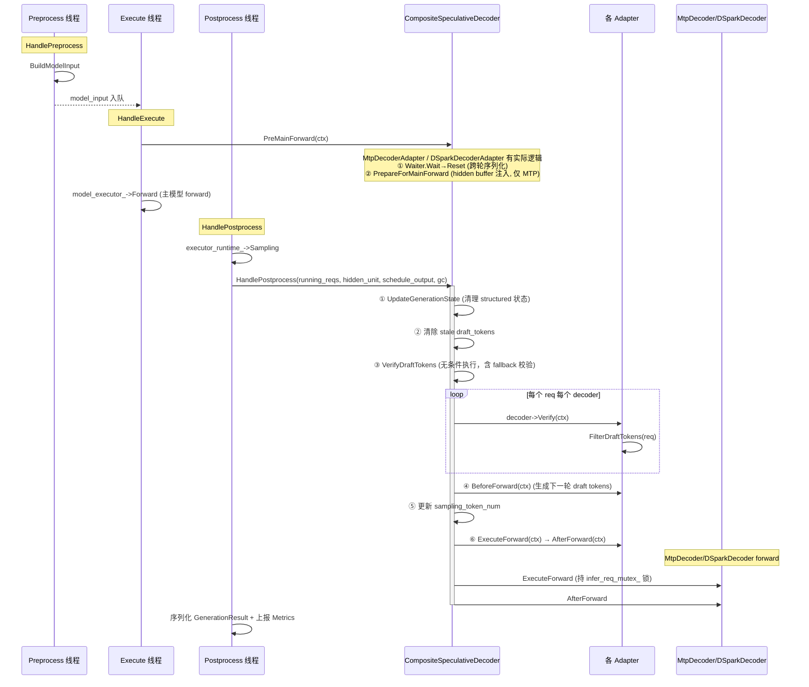
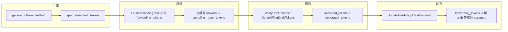
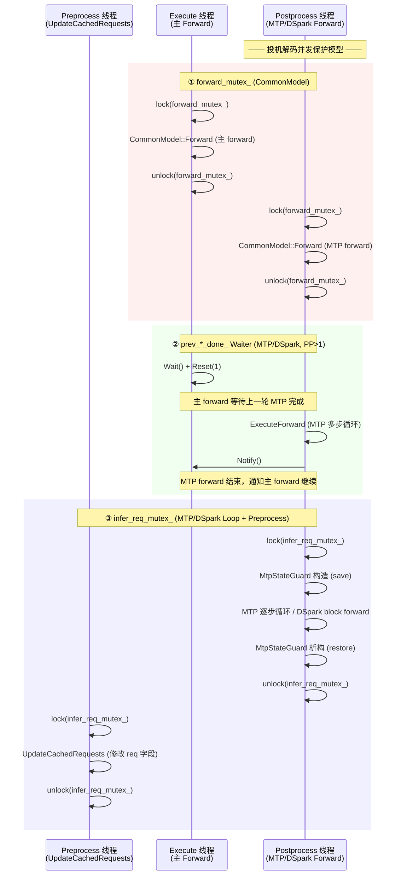

# 投机解码解耦重构方案文档

## 1. 背景与目标

### 1.1 重构前的问题

`[fact]` (`csrc/runtime/generation_controller.h`, `csrc/runtime/generation_controller.cpp`) 重构前，`GenerationController` 承担了投机解码的全部编排职责——包括 draft token 生成、校验、资源估计和请求状态管理。随�� MTP、PTP、Trie、DSpark、ASR 五种投机解码类型陆续加入，该文件成为单一个类的逻辑瓶颈。

具体问题体现在两个维度：

**推理流程耦合**：
- 主推理流程（`ExecutorRuntime::Forward`、`ModelRunner::HandlePostprocess`）直接调用 `GenerationController` 的投机逻辑，新增投机解码类型需要修改主流程代码。
- 不同投机解码类型的生命周期钩子（forward 前准备、forward 后恢复、校验）散落在 `ModelRunner`、`ExecutorRuntime`、`GenerationController` 三个模块中，缺乏统一的调用契约。

**数据面耦合**：
- Draft token 的生成、存储和校验与主推理的 `forwarding_tokens`、`sampling_result_tokens` 等字段混在同一数据结构中，模块边界模糊。
- MTP/DSpark 等 draft-model 类型与 PTP/Trie/ASR 等 no-draft-model 类型的实现差异在代码中通过 if-else 分支处理，而非通过多态分派。

### 1.2 重构目标

`[fact]` (`csrc/runtime/speculative/common/speculative_decoder_interface.h:99-102`) 核心目标：**将投机解码与主流程解耦**，使主推理流程只依赖 `SpeculativeDecoderInterface` 统一接口，绝不与具体投机方法实现耦合。

`[fact]` 重构的工程目标包括：
1. 新增投机解码类型时无需修改主推理流程——只需实现接口并注册即可。
2. 不同投机解码类型可独立开发、测试和维护。
3. 数据流明确定义所有权边界（`SpeculativeState`、`DraftTokens`），避免隐式耦合。
4. 支持多种投机解码类型同时注册（如 MTP + Trie 组合）。


## 2. 整体架构

### 2.1 三层架构

`[fact]` 新架构将投机解码拆分为三个独立的层次：

```
┌─────────────────────────────────────────────────────────────┐
│  编排层 (CompositeSpeculativeDecoder)                        │
│  - 多 decoder 注册/编排/聚合调度信息                           │
│  - HandlePostprocess 主流程封装                               │
│  - 兼容性检查                                                │
├─────────────────────────────────────────────────────────────┤
│  适配器层 (SpeculativeDecoderInterface 实现)                  │
│  - MtpDecoderAdapter / DSparkDecoderAdapter                   │
│  - PtpDecoderAdapter / TrieDecoderAdapter / AsrDecoderAdapter │
│  - 统一接口：BeforeForward / ExecuteForward / Verify / ...    │
├─────────────────────────────────────────────────────────────┤
│  执行层 (executor + generator)                                │
│  - draft-model: MtpDecoder / DSparkDecoder          │
│  - no-draft-model: PtpGenerator / TrieGenerator /             │
│                     AsrCustomGenerator（Generator 层）         │
│  - 抽象：DraftModelInterface / DraftGeneratorInterface        │
└─────────────────────────────────────────────────────────────┘
```

**依赖方向**：主推理流程 → `CompositeSpeculativeDecoder` → 各 adapter → executor 层 decoder / generator。

`[fact]` 注意：`csrc/runtime/speculative/` 目录**零并发原语**，是纯逻辑编排层，其线程安全完全由上层（ExecutorRuntime/ModelRunner/CommonModel）保证。

### 2.2 核心三要素

#### SpecContext — 类型化上下文

`[fact]` (`csrc/runtime/speculative/common/speculative_decoder_interface.h:22-97`) `SpecContext` 为投机解码各生命周期方法提供类型化上下文。每种 decoder 通过专门的工厂方法构造自己实际需要的字段，在编译期强制正确性。

| 工厂方法 | 用途 | 特有字段 |
|---|---|---|
| `ForDraftGen(reqs, output)` | 仅 draft-gen decoder（PTP/Trie/ASR） | `output` |
| `ForMtp(reqs, hu, so, fwd)` | MTP | `hidden_unit`, `schedule_output`, `forwarding_context` |
| `ForDSpark(reqs, hu, so)` | DSpark | `hidden_unit`, `schedule_output` — **无** `forwarding_context` |
| `ForVerify(reqs)` | 仅校验（`VerifyDraftTokens` 内用） | 仅 `reqs` |

MTP 与 DSpark 的关键区别在于 `forwarding_context`。MTP 需要它用于 `PreMainForward` 中的 hidden buffer 注入和 gather index builder 管理；DSpark 不使用这些机制，因此工厂方法中 `forwarding_context` 固定为 `nullptr`。

`[inferred]` 工厂方法在编译期不强制匹配 decoder 类型。若在 draft-model decoder 的 `HandlePostprocess` Step 5 中误用 `ForDraftGen`（缺少 `hidden_unit`/`schedule_output`），投机 forward 将在 `ExecuteForward` 的空指针早期返回处静默跳过，不会产生错误日志。正确用法由 `HandlePostprocess` 内部的工厂方法选择约定保证。

#### SpeculativeDecoderInterface — 统一接口

`[fact]` (`csrc/runtime/speculative/common/speculative_decoder_interface.h:99-149`) 所有投机解码方法的统一抽象。主推理流程**仅与该接口交互**。

接口包含 7 个纯虚方法 + 2 个带默认空实现的生命周期钩子：

| 方法 | 类型 | 用途 |
|---|---|---|
| `GetName()` | 纯虚 | 人类可读名称 |
| `GetSchedulingInfo()` | 纯虚 | 调度资源需求 |
| `BeforeForward(SpecContext&)` | 纯虚 | before-forward 钩子 |
| `ExecuteForward(SpecContext&)` | 纯虚 | 执行 draft forward |
| `AfterForward(SpecContext&)` | 纯虚 | after-forward 钩子 |
| `Verify(SpecContext&)` | 纯虚 | 校验 draft tokens |
| `IsCombinableWith(const ...*)` | 纯虚 | 兼容性判断 |
| `PreMainForward(SpecContext&)` | 钩子（默认空） | 主 forward 前调用 [MTP/DSpark 专用] |
| `Shutdown()` | 钩子（默认空） | 关闭时唤醒阻塞线程 [MTP/DSpark 专用] |

`[fact]` `PreMainForward` 和 `Shutdown` 在生产代码中被实际调用（`executor_runtime.cpp:168` 和 `:179-185`）。

#### CompositeSpeculativeDecoder — 编排器

`[fact]` (`csrc/runtime/speculative/orchestration/composite_speculative_decoder.h:17-22`) 管理多个 `SpeculativeDecoderInterface` 实例，提供注册、执行编排、调度信息聚合和兼容性检查。

`[fact]` **注册顺序即拼接顺序**：注释明确要求注册顺序（mtp → spec → ptp）必须与 `DraftTokens::GetDraftTokens()`（`draft_tokens.h:17-27`）的排序一致，这是正确性的硬约束。

主推理流程当前**只依赖于该类的以下方法**：
- `Register()` — 在初始化时通过静态注册回调注入各 decoder
- `SetGenerationController()` — 依赖注入 `GenerationController` 指针
- `PreMainForward()` — 由 `ExecutorRuntime::Forward` 在主 forward 前调用
- `HandlePostprocess()` — 由 `ModelRunner::HandlePostprocess` 调用，封装投机编码后处理全流程
- `Shutdown()` — 由 `ExecutorRuntime::Shutdown` 调用，唤醒阻塞线程

### 2.3 调用时序

`[fact]` 以下 Mermaid 序列图展示投机解码钩子在主推理流程中的调用时机：



### 2.4 HandlePostprocess 五步流水

`[fact]` (`csrc/runtime/speculative/orchestration/composite_speculative_decoder.cpp:75-130`) `HandlePostprocess` 是投机解码后处理的核心编排方法，包含 5 个步骤：

| 步骤 | 行号 | 内容 | 是否条件执行 |
|---|---|---|---|
| 1 | 80-82 | `generation_controller->UpdateGenerationState(running_reqs)` | gc 非空时 |
| 1.5 | 86-90 | 清除 stale draft_tokens（`forwarding_tokens_draft_num==0` 时清空） | 始终 |
| 2 | 96 | `VerifyDraftTokens(running_reqs)` — 将采样结果与 draft 比对 | **始终**（即使无 decoder） |
| — | 100 | `if (decoders_.empty()) return;` | 仅当有 decoder 时继续 |
| 3 | 102-115 | `BeforeForward` — 生成下一 decode step 的 draft tokens | 有 decoder 时 |
| 4 | 117-121 | `sampling_token_num = kStepGenerateTokenNum + draft_token_num` | 有 decoder 时 |
| 5 | 125-129 | `ExecuteForward` + `AfterForward` — 执行 MTP/DSpark 投机 forward | 有 decoder 时 |

`[fact]` Step 2 强调：即使未注册任何投机 decoder，`VerifyDraftTokens` 也会调用 `DefaultFilterDraftTokens` 完成 `sampling_result_tokens → generated_tokens` 的搬运，因此**必须无条件执行**。

---

## 3. 模块拆分

### 3.1 五类投机解码类型整体对比

`[fact]` 以下表格对比 5 种投机解码类型对各接口方法的实现差异：

| 接口方法 | MTP | PTP | Trie | DSpark | ASR |
|---|---|---|---|---|---|
| `GetName()` | `"MTP"` | `"PTP"` | `"Trie"` | `"DSpark"` | `"ASR"` |
| `GetSchedulingInfo()` | 委托 `MtpDecoder` | 委托 `PtpGenerator` (2×step) | 返回 `{}` | 委托 `DSparkDecoder` | 返回 `{}` |
| `BeforeForward` | no-op | `GenerateDraft` 循环 | `GenerateDraft` 循环 | no-op | `GenerateDraft` 循环 |
| `ExecuteForward` | 委托 `MtpDecoder` | no-op | no-op | 委托 `DSparkDecoder` | no-op |
| `AfterForward` | no-op | no-op | no-op | no-op | no-op |
| `Verify` | `DefaultFilterDraftTokens` | `generator->FilterDraftTokens` | `generator->FilterDraftTokens` | `DefaultFilterDraftTokens` | `generator->FilterDraftTokens` |
| `IsCombinableWith` | 恒 `true` | 排除 MTP/Trie/ASR | 仅排除 MTP | 仅排除 MTP | 仅排除 MTP |
| `PreMainForward` | **有实现** | 默认空 | 默认空 | **有实现** | 默认空 |
| 注册方式 | 资源估计 + PostInitSetup | 资源估计 + RegisterDecoder | 仅 RegisterDecoder | 资源估计 + PostInitSetup | 仅 RegisterDecoder |

### 3.2 两类架构分界

`[fact]` 五种投机解码类型按实现方式自然分为两类：

**draft-model 类型（MTP、DSpark）**：
- `ExecuteForward` 有实际逻辑：`MtpDecoder` 驱动真实 `DraftModelInterface::Forward()` 逐步执行 ，`DSparkDecoder` 执行单次非因果 attention forward + 逐 step 的 head-only 采样。
- `Verify` 均使用全局函数 `DefaultFilterDraftTokens`，位于 `draft_generator_interface.cpp:18-91`。
- `BeforeForward` 为 no-op。
- 通过静态 PostInitSetup 回调在 `ExecutorRuntime::Initialize()` 后延迟创建 decoder，注入 executor/sampler/builder 等真实组件。

**no-draft-model 类型（PTP、Trie、ASR）**：
- `ExecuteForward` / `AfterForward` 均为 no-op —— 不执行任何模型前向。
- `BeforeForward` 有实际逻辑：调用各自 `DraftGeneratorInterface::GenerateDraft()` 生成 draft token。
- `Verify` 走各自 generator 的 `FilterDraftTokens`，其中 `PtpGenerator` 重写了自研校验逻辑，`TrieGenerator` 和 `AsrCustomGenerator` 使用基类默认实现。
- 通过 `RegisterDecoder` 直接注册工厂，不依赖 PostInitSetup。

### 3.3 Decoder 实现对比

#### MtpDecoder — 逐步 draft forward

`[fact]` (`csrc/runtime/speculative/mtp/mtp_decoder.h:31-36`, `csrc/runtime/speculative/mtp/mtp_decoder.cpp:46-207`)

`MtpDecoder` 继承 `DraftGeneratorInterface`，封装 MTP 的逐步 draft 生成循环。其核心是 `ExecuteForward` 中的 `for (size_t mtp_step = 0; mtp_step < mtp_step_num_; ++mtp_step)` 循环，每步执行：

1. Embed draft token（`model_facade_->EmbedTokensUseGpu`）
2. MTP decoder layer（`DraftModelInterface::ForwardLayer`）
3. 保存 MTP hidden（`model_facade_->SaveMtpHiddenBuffer`）
4. MHC 压缩 + 归一化 + LmHead（`DraftModelInterface::ForwardMhcNormLmHead`）
5. Assemble → LmHead → Cast → Sampling（`model_sampler_->Sampling`）

关键设计：
- **gather index 管理**：每步临时 detach gather idx builder（置 nullptr），使 `UpdateMainForward` 成为 no-op，之后重新 attach 并调用 `PrepareMtpDraftGatherIndices`（`mtp_decoder.cpp:124-131`）。
- **`MtpStateGuard` RAII**：构造时保存 4 个字段（`forwarding_tokens`、`kv_cached_token_num`、`prefix_cache_len`、`forwarding_tokens_draft_num`），析构时无条件恢复。即使 MTP 循环中抛异常也能保证状态恢复。
- **依赖注入**：通过非拥有指针持有 `DraftModelInterface*`、`ModelFacade*`、`ModelExecutor*`、`ModelSampler*`、`ModelBuilder*`、`std::mutex*`，全部由 `MtpDecoderAdapter` 在初始化时注入。

#### DSparkDecoder — 单次块 forward + 逐 step 采样

`[fact]` (`csrc/runtime/speculative/dspark/dspark_decoder.h:30-55`, `csrc/runtime/speculative/dspark/dspark_decoder.cpp:56-116`)

与 MTP 的逐步循环不同，DSpark 采用完全不同的执行策略：

1. **准备**：去掉旧 draft，插入 accepted + generated tokens，末尾填充 `dspark_noise_token_id_` 到 `dspark_block_size_`。
2. **单次 DSpark forward**：`model_executor->Forward(model_input, hidden_unit, model_output)`，`run_mode = kDSpark`（非因果 attention），logits tensor 形状为 `[dspark_block_size, batch_size, vocab_size]`。
3. **逐 step 采样循环**：`for (step_index < dspark_block_size_)` → `model_instance->ForwardHead(reqs, step_index)`（markov bias 修正）→ `model_sampler->Sampling()` → 收集到 `draft_tokens.mtp`。

关键差异：
- DSpark 的 `ExecuteForward` 比 MTP 多一个 `ModelInstance* model_instance` 参数，用于调用 `ForwardHead`。
- DSpark 同样实现 `PrevMainForward` 和 `Shutdown`，使用独立的 `prev_dspark_done_` Waiter 进行 PP>1 场景下的跨 collective 串行化（`dspark_decoder.cpp:78-83`, `dspark_decoder_adapter.cpp:43-63`）。
- DSpark 与 MTP 在模型层互斥：`deepseek_v4_model.cpp:432-449` 根据 `dspark_block_size > 0` 二选一，`MtpDecoderAdapter` 的 PostInitSetup 中显式检查 `GetDSparkBlockSize() > 0` 时跳过（`mtp_decoder_adapter.cpp:105`）。

### 3.4 Generator 层对比

| 特性 | PtpGenerator | TrieGenerator | AsrCustomGenerator |
|---|---|---|---|
| 文件 | `ptp_generator.{h,cpp}` | `trie_generator.{h,cpp}` | `asr_custom_generator.{h,cpp}` |
| `GenerateDraft` 逻辑 | 填充 `ptp_token_id_` 占位符 | Trie 树频率匹配 + 分支预测 | skip-ahead 裁剪复用 draft |
| `FilterDraftTokens` | **重写**：自研验证逻辑（占位/验证双轮） | 继承默认 `DefaultFilterDraftTokens` | 继承默认 `DefaultFilterDraftTokens` |
| `GetSchedulingInfo` | `extra_token_capacity = 2×step` | 返回 `{}` | 返回 `{}` |
| 内部状态 | 无（纯占位） | `TrieTree`（频率统计树） | 无（基于 `draft_tokens.spec` 裁剪） |
| 接入 adapter | `PtpDecoderAdapter` | `TrieDecoderAdapter` | `AsrDecoderAdapter` |
| adapter 注册 | 资源估计 + `RegisterDecoder("ptp")` | 仅 `RegisterDecoder("trie")` | 仅 `RegisterDecoder("asr_custom")` |

`[fact]` `DraftGeneratorController` (`csrc/runtime/speculative/orchestration/draft_generator_controller.{h,cpp}`) 未被主流程使用，仅存在于测试文件中。投机解码编排由 `CompositeSpeculativeDecoder` 负责。

### 3.5 DraftModelInterface

`[fact]` (`csrc/models/base/draft_model_interface.h:27-60`) `DraftModelInterface` 定义了 draft 模型的三段式接口：

- `ForwardLayer(start_layer_idx, end_layer_idx, ...)` — 执行 transformer decoder layer
- `ForwardMhcNormLmHead(...)` — MHC 压缩 + RMSNorm + LmHead
- `InterLayerSetup(mtp_step, ...)` / `InterLayerCleanup(mtp_step, ...)` — MTP step 间的状态管理

当前有三组实现：
- `csrc/models/deepseek_v4/deepseek_v4_mtp_draft_model.{h,cpp}` — DeepSeek V4/V4.2
- `csrc/models/deepseek_v3/deepseek_v3_mtp_draft_model.{h,cpp}` — DeepSeek V3/R1
- `csrc/models/glm4_moe/glm4_moe_mtp_draft_model.{h,cpp}` — GLM4 MoE

---

## 4. 数据面解耦

### 4.1 核心数据结构

`[fact]` 数据面解耦的核心是两个独立于主推理流程的数据结构：

**DraftTokens** (`csrc/runtime/speculative/common/draft_tokens.h:13-50`) — 三段独立 vector，按 mtp → spec → ptp 顺序承载不同生成器的产物：

```cpp
struct DraftTokens {
  std::vector<int> mtp;   // MTP/DSpark draft tokens
  std::vector<int> spec;  // Trie/ASR draft tokens
  std::vector<int> ptp;   // PTP placeholder tokens

  std::vector<int> GetDraftTokens() const;  // 按 mtp→spec→ptp 顺序拼接
  size_t size() const;                      // 总大小
  bool empty() const;                       // 是否全空
  void clear();                             // 清空所有段
};
```

`[fact]` `GetDraftTokens()` 的拼接顺序（`draft_tokens.h:17-27`）**必须与 `CompositeSpeculativeDecoder` 的注册顺序一致**，这是正确性的硬约束（头文件注释明确声明）。

**SpeculativeState** (`csrc/runtime/speculative/common/speculative_state.h:16-28`) — 挂载在 `ExecutorInferRequest` 上的投机专有状态，注释明确声明"与主推理流程隔离，提供 spec 与主执行路径的清晰所有权边界"：

```cpp
struct SpeculativeState {
  DraftTokens draft_tokens;                         // 产生的 draft tokens
  std::vector<int> accepted_tokens;                 // 验证通过的 draft 前缀
  std::vector<int> generated_tokens;                // 主模型生成的 token（含首 token）
  size_t forwarding_tokens_draft_num = 0;           // forwarding_tokens 末尾的 draft 数量
};
```

### 4.2 数据生命周期

`[fact]` 投机解码数据在主推理流程中的完整生命周期：



**生成路径** (`csrc/runtime/speculative/` 各 generator)：
- 生成器通过 adapter 被包装成 `SpeculativeDecoderInterface`。
- `CompositeSpeculativeDecoder::HandlePostprocess` Step 3 调用 `BeforeForward`，触发各 adapter 的 `GenerateDraft`，填入 `spec_state.draft_tokens`。

**消费路径** (`csrc/runtime/infer_request.cpp:483-491`)：
- `InferRequest::LaunchPlanningTask` 在 decode 分支将 `generated_tokens + draft_tokens` 拼入 `forwarding_tokens`。
- 按资源预算取 `min(resource_ready_token_num, merged_draft_tokens.size())` 追加 draft。
- 记录 `forwarding_tokens_draft_num`（`infer_request.cpp:503`）。

**校验路径** (`csrc/runtime/speculative/common/draft_generator_interface.cpp:18-91`)：
- `DefaultFilterDraftTokens` 将 `draft_tokens` 与 `sampling_result_tokens` 逐位比对。
- 命中则 `draft_hit_num++`，不匹配即停止。
- 三个提前终止条件：stop_token 命中、grammar_matcher 拒绝、structured_generator 终止或拒绝。
- 回写 `accepted_tokens`（命中前缀）和 `generated_tokens`（首未命中采样结果）。

**回写路径** (`csrc/runtime/infer_request.cpp:330`)：
- `UpdateAfterInflightTaskFinished` 用 `accepted_tokens` 替换 `forwarding_tokens` 末尾的 draft：
  ```
  forwarding_tokens.resize(forwarding_tokens.size() - forwarding_tokens_draft_num + accepted_tokens.size())
  ```

### 4.3 解耦的设计保证

`[fact]` 数据面解耦通过以下机制保证模块边界清晰：
1. **`SpeculativeState` 的所有权隔离**（`speculative_state.h:16-28`）—— 投机专有字段不与主推理字段混在 `ExecutorInferRequest` 的平铺字段中。
2. **接口隔离**：主流程依赖 `DraftGeneratorInterface` / `SpeculativeDecoderInterface` 抽象，不感知具体 generator/decoder 的数据实现。
3. **`DraftTokens` 三段结构**：不同投机类型的产物通过不同字段承载，互不污染；`GetDraftTokens()` 提供统一的聚合视图。

---

## 5. 并发模型

### 5.1 总体原则

`[fact]` 投机解码逻辑**不启动独立线程**，全部挂在 `ModelRunner` 的既有 worker 线程上同步执行：
- `PreMainForward`：在 **Execute 线程**上执行（主 forward 之前）。
- `HandlePostprocess`：在 **Postprocess 线程**（或 build-ahead 模式下的 Execute 线程）上同步执行。

`[fact]` `csrc/runtime/speculative/` 目录**零并发原语**（无 mutex、atomic、condition_variable），说明并发边界已完全收敛到上层（ExecutorRuntime / ModelRunner / CommonModel）。

`[fact]` 关闭流程中的线程唤醒：`ModelRunner::Stop()` 依次调用 `executor_runtime_->Shutdown()` → `CompositeSpeculativeDecoder::Shutdown()` → 各 adapter 的 `Shutdown()`。`MtpDecoderAdapter::Shutdown()` 和 `DSparkDecoderAdapter::Shutdown()` 各自调用其 decoder 的 `Shutdown()`，通过 Waiter 的 `Stop()` 唤醒被 `PreMainForward` 中的 `Wait()` 阻塞的 execute 线程，确保后续的 `thread.join()` 不会死锁。

### 5.2 三处并发保护机制

`[fact]` 投机解码涉及三个独立的并发保护点，各司其职：



#### ① `forward_mutex_` — 主 forward 与 MTP forward 的共享 context 保护

`[fact]` (`csrc/models/common/common_model.h:187`) 主 forward 和 MTP forward 都会驱动 `CommonModel::Forward()`，竞争共享的 `forwarding_context_`。`forward_mutex_` 保证两者不会同时进入前向路径，确保 `ForwardingContext` 的单写者不变量。

#### ② `prev_*_done_` Waiter — PP>1 时的跨 collective 串行化

`[fact]` MTP 和 DSpark 各维护独立的 Waiter（`mtp_decoder.h:100`, `dspark_decoder.h:74`）。各自的 `PreMainForward` 钩子在主 forward 前执行 `waiter->Wait(); waiter->Reset(1)`，等待上一轮投机 forward 完成；投机 forward 结束后调用 `waiter->Notify()`。

`[fact]` 串行化条件为 `IsSamplingNode() && GetMaxPpBatchNum() > 1`，即 PP>1 且存在多 micro-batch 流水线场景。原因是 PP>1 时投机 forward 内部的 `TrtAllReduce` 类 collective 若与下一个 micro-batch 的主 forward collective 重叠会导致死锁。

`[fact]` `Waiter` 基于 `std::mutex` + `std::condition_variable` 实现（`csrc/utils/waiter.h:29-56`），初始计数为 0，`Shutdown()` 时调用 `Stop()` 唤醒所有阻塞线程。

#### ③ `infer_req_mutex_` — MTP/DSpark 多步循环与 Preprocess 线程互斥

`[fact]` (`csrc/executor/executor_runtime.h:94`, `csrc/runtime/speculative/mtp/mtp_decoder.h:102-105`) MTP 的 `ExecuteForward` 在用 `MtpStateGuard` 保存请求状态前先通过 `std::lock_guard` 锁定 `infer_req_mutex_`（`mtp_decoder.cpp:63`）。DSpark 同理（`dspark_decoder.cpp:56`）。

Preprocess 线程的 `ExecutorRuntime::UpdateCachedRequests` 对同一把锁加锁（`executor_runtime.cpp:121`），保护 `running_req_patches` 的更新。

`[fact]` **关键约束**：`infer_req_mutex_` 必须是指向 `ExecutorRuntime::infer_req_mutex_` 的指针，不能是私有 mutex（`mtp_decoder.h:102-105` 注释），否则两个线程无法真正互斥。

### 5.3 `MtpStateGuard` — RAII 异常安全保障

`[fact]` (`csrc/runtime/speculative/mtp/mtp_state_guard.h:25-52`) `MtpStateGuard` 保存/恢复 `ExecutorInferRequest` 的 4 个字段：
- `forwarding_tokens`（转发 token 序列）
- `kv_cached_token_num`（已缓存 KV token 数）
- `prefix_cache_len`（前缀缓存长度）
- `forwarding_tokens_draft_num`（转发序列末尾的 draft token 数）

`[fact]` 析构函数标记为 `noexcept`，即使 MTP/DSpark 循环中抛异常也能保证状态恢复。锁（`infer_req_mutex_`）在 `MtpStateGuard` 构造**之前**获取，利用 C++ 析构逆序保证：释放锁时 guard 已析构，状态已恢复。

### 5.4 `SpeculativeRegistry` — 静态注册的线程安全

`[fact]` (`csrc/runtime/speculative/common/speculative_resource_profile.h:76-77`) 注释明确声明所有注册操作发生在 static init（main 之前，单线程），`Aggregate` 发生在配置解析期（单线程），因此不需要内部加锁。

---

## 6. 资源调度模型

### 6.1 SpecSchedulingInfo — 每 decoder 资源需求

`[fact]` (`csrc/runtime/speculative/common/spec_scheduling_info.h:13-28`) 每个 `SpeculativeDecoderInterface` 通过 `GetSchedulingInfo()` 向调度器上报资源需求：

| 字段 | 语义 | MTP 值 | PTP 值 | DSpark 值 | Trie/ASR |
|---|---|---|---|---|---|
| `extra_kv_tokens` | 每 req 额外预留 KV cache token | `step_num` | 0 | `block_size` | 0 |
| `extra_token_capacity` | 额外预留 token 容量 | `step_num - 1` | `2 × step_num` | `block_size` | 0 |
| `workload_multiplier` | planning 估计倍数 | `step_num` | `2 × step_num` | `block_size` | 0 |

`[fact]` MTP 的 `extra_token_capacity = step_num - 1` 而非 `step_num`，因为 MTP 首个 token 与主 token 共享前缀，不需要额外容量。PTP 需要 `2 × step_num` 来容纳 verify + placeholder 两轮 token。

### 6.2 SpeculativeResourceProfile — 静态全量资源估计

`[fact]` (`csrc/runtime/speculative/common/speculative_resource_profile.h:35-106`) 提供与 `SpecSchedulingInfo` 平行的"上限估计"接口，用于调度器的全量初始化场景：

- `SpeculativeResourceProfile` — `extra_decode_tokens_per_req`、`workload_multiplier`、`extra_token_capacity`、`buffer_decls`
- `SpeculativeRegistry` — 反向静态注册表，各 adapter 通过 `RegisterProfile`、`RegisterDecoder`、`RegisterPostInitSetup` 注册。
- `Aggregate()` — 累加所有已注册 estimator 的值。

`[fact]` 各 adapter 的 estimator 实现：
- MTP: `MtpEstimateProfile`（`mtp_decoder_adapter.cpp:80-89`），三字段均为 `mtp_step_num`（`extra_token_capacity = step_num - 1`）
- PTP: `PtpEstimateProfile`（`ptp_decoder_adapter.cpp:40-49`），三字段均为 `2 × ptp_step_num`
- DSpark: `DSparkEstimateProfile`（`dspark_decoder_adapter.cpp:62-70`），用 `cfg.mtp_step_num` 代理 `dspark_block_size`

`[fact]` DSpark 注释说明 `mtp_step_num` 作为代理值在 `schedule_config_parser.cpp:937-949` 被覆盖，MTP 模型的误报无害。

### 6.3 CompositeSpeculativeDecoder 聚合

`[fact]` (`csrc/runtime/speculative/orchestration/composite_speculative_decoder.cpp:22-31`) `GetAggregatedSchedulingInfo()` 对所有已注册 decoder 的 `GetSchedulingInfo()` 做简单累加：遍历 `decoders_` 累加 `extra_kv_tokens`、`extra_token_capacity`、`workload_multiplier`。

### 6.4 调度器集成

`[fact]` (`csrc/batch_scheduler/strategy/continuous_batching.cpp`) 调度器通过以下方式使用投机资源信息：

- `DetermineDraftNum`（`:177-187`）：按 `decoding_queue` 大小在阈值 16 内反推每 req 的 `suggested_draft_num`。
- `GetMaxRequiredTokenNum`（`:74-77`）：`token_num + info.extra_token_capacity`，用于 token 容量检查。
- `GetAggregatedSchedulingInfo`（`:79-100`）：从 `SpeculativeRegistry::Aggregate` 取值，`:93-98` 做 **MTP+PTP 互斥守卫**（MTP 优先，PTP 资源被忽略，运行时由 `IsCombinableWith` 强制）。
- Prefill 块分配（`:804-805`）：`seq_token_num + extra_kv_tokens`，为 MTP 预留 KV cache。
- Decode 队列 workload 估计（`:582`）：`EstimateRequestPlanningWorkload(req, workload_multiplier)`。

`[fact]` 事件驱动调度器（`csrc/batch_scheduler/event_driven_scheduler/continuous_batching_backend.cpp`）同样通过 `SpeculativeRegistry::Aggregate` 获取资源聚合信息（`:70-85`），并在 prefill/decode 中做对应的 `extra_kv_tokens` 预留（`:533`, `:276`）。

---

## 7. 新投机解码类型接入方式

### 7.1 接入 Checklist

`[fact]` 根据五种已有 adapter 的实现模式，新投机解码类型的接入步骤如下：

#### Step 1: 确定架构类型

根据新方法是否需要执行额外模型前向，选择对应路径：

- **draft-model 类型**（参考 MTP/DSpark）：需要实现 `DraftModelInterface`（或直接在 adapter 的 `ExecuteForward` 中驱动 `ModelExecutor::Forward`），并在 adapter 中持有 `ModelExecutor*`、`ModelSampler*` 等指针。
- **no-draft-model 类型**（参考 PTP/Trie/ASR）：实现 `DraftGeneratorInterface`，在 `BeforeForward` 中调用 `GenerateDraft`。

#### Step 2: 实现 SpeculativeDecoderInterface

`[fact]` (`csrc/runtime/speculative/common/speculative_decoder_interface.h:103-149`) 实现以下方法：

| 方法 | 必须实现 | 说明 |
|---|---|---|
| `GetName()` | **是** | 返回唯一名称（用于日志、metrics、兼容性检查） |
| `GetSchedulingInfo()` | **是** | 返回资源需求；无额外需求可返回 `{}` |
| `BeforeForward(SpecContext&)` | **是** | draft-model 类：no-op 或状态保存；no-draft-model 类：生成 draft |
| `ExecuteForward(SpecContext&)` | **是** | draft-model 类：执行 forward；no-draft-model 类：空实现 |
| `AfterForward(SpecContext&)` | **是** | 当前所有 adapter 均为 no-op |
| `Verify(SpecContext&)` | **是** | 校验 logic；可复用 `DefaultFilterDraftTokens` 或自研 |
| `IsCombinableWith(const ...*)` | **是** | 返回与其他 decoder 的兼容性 |
| `PreMainForward(SpecContext&)` | 可选 | 仅当需要在主 forward 前执行操作时重写（当前 MTP 和 DSpark 使用） |
| `Shutdown()` | 可选 | 仅当需要关闭时唤醒阻塞线程时重写（当前 MTP 和 DSpark 使用） |

#### Step 3: 确定兼容性矩阵

`[fact]` 实现 `IsCombinableWith`，参考现有兼容性矩阵：

| | MTP | PTP | Trie | DSpark | ASR |
|---|---|---|---|---|---|
| **MTP** | Y | Y | Y | Y | Y |
| **PTP** | N | Y | N | Y | N |
| **Trie** | N | Y | Y | Y | Y |
| **DSpark** | N | Y | Y | Y | Y |
| **ASR** | N | Y | Y | Y | Y |

`[fact]` `CompositeSpeculativeDecoder::AreAllCompatible()`（`composite_speculative_decoder.cpp:153-164`）会两两调用 `IsCombinableWith` 做双向校验。

#### Step 4: 静态注册

`[fact]` 在 adapter 的 `.cpp` 文件中使用以下注册方式：

- **draft-model 类型**（参考 `mtp_decoder_adapter.cpp:78-128`）：
  - `SpeculativeRegistry::RegisterProfile()` — 注册资源估计器
  - `SpeculativeRegistry::RegisterPostInitSetup()` — 注册延迟创建回调（在 `ExecutorRuntime::Initialize()` 后执行，可用 `ExecutorsAccessor` 获取 executor/sampler/builder/model_instance 等组件）

- **no-draft-model 类型**（参考 `trie_decoder_adapter.cpp:37-46`）：
  - `SpeculativeRegistry::RegisterDecoder("name", factory)` — 注册 decoder 工厂

- **带资源估计的 no-draft-model 类型**（参考 `ptp_decoder_adapter.cpp:38-69`）：
  - `SpeculativeRegistry::RegisterProfile()` + `RegisterDecoder()`

#### Step 5: 注入到 CompositeSpeculativeDecoder

`[fact]` 静态注册的回调会在初始化时自动创建 adapter 实例并 `Register` 到 `CompositeSpeculativeDecoder`（由 `csrc/executor/inference_executor.cpp:283` 统一设置）。

#### Step 6: 最小实现参考

`[fact]` 最小的 no-draft-model 类型接入参考 `TrieDecoderAdapter`（仅 47 行 `.cpp` + 32 行 `.h`）：

```cpp
// trie_decoder_adapter.cpp
TrieDecoderAdapter::TrieDecoderAdapter(std::shared_ptr<TrieGenerator> generator)
    : generator_(std::move(generator)) {}
const char* TrieDecoderAdapter::GetName() const { return "Trie"; }
SpecSchedulingInfo TrieDecoderAdapter::GetSchedulingInfo() const { return {}; }

void TrieDecoderAdapter::BeforeForward(SpecContext& ctx) {
  for (auto& req : *ctx.reqs) generator_->GenerateDraft(req);
}
void TrieDecoderAdapter::Verify(SpecContext& ctx) {
  for (auto& req : *ctx.reqs) generator_->FilterDraftTokens(req);
}
bool TrieDecoderAdapter::IsCombinableWith(const SpeculativeDecoderInterface* other) const {
  if (!other) return true;
  return strcmp(other->GetName(), "MTP") != 0;
}

// 静态注册
static std::unique_ptr<SpeculativeDecoderInterface> CreateTrieDecoder() {
  return std::make_unique<TrieDecoderAdapter>(std::make_shared<TrieGenerator>());
}
static bool kTrieDecoderRegistered = []() {
  SpeculativeRegistry::RegisterDecoder("trie", CreateTrieDecoder);
  return true;
}();
```

---

## 8. 总结

`[fact]` 投机解码模块通过 `SpeculativeDecoderInterface` 统一接口和 `CompositeSpeculativeDecoder` 编排器，将 MTP、PTP、Trie、DSpark、ASR 五种投机解码类型从主推理流程中解耦。核心设计要点：

1. **推理流程解耦**：主推理流程（`ExecutorRuntime::Forward`、`ModelRunner::HandlePostprocess`）只依赖 `CompositeSpeculativeDecoder` 的公开方法（`Register`、`SetGenerationController`、`PreMainForward`、`HandlePostprocess`、`Shutdown`），新增投机解码类型无需修改主流程。

2. **数据面解耦**：`SpeculativeState` 和 `DraftTokens` 提供了投机数据与主推理数据之间的明确所有权边界，gen → forward → verify → 回写的全链路数据流可追溯。

3. **并发模型清晰化**：三处并发保护机制（`forward_mutex_`、`prev_*_done_` Waiter — MTP 和 DSpark 各自独立、`infer_req_mutex_`）各有明确的职责范围，`csrc/runtime/speculative/` 目录内零并发原语，并发边界收敛到上层。

4. **模块化与可扩展性**：新投机解码类型接入只需 6 步（确定类型 → 实现接口 → 兼容性 → 注册 → 注入），最小实现参考 `TrieDecoderAdapter` 仅 ~80 行代码。

---

