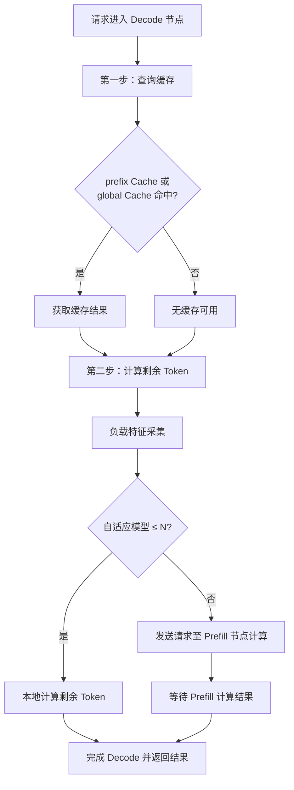
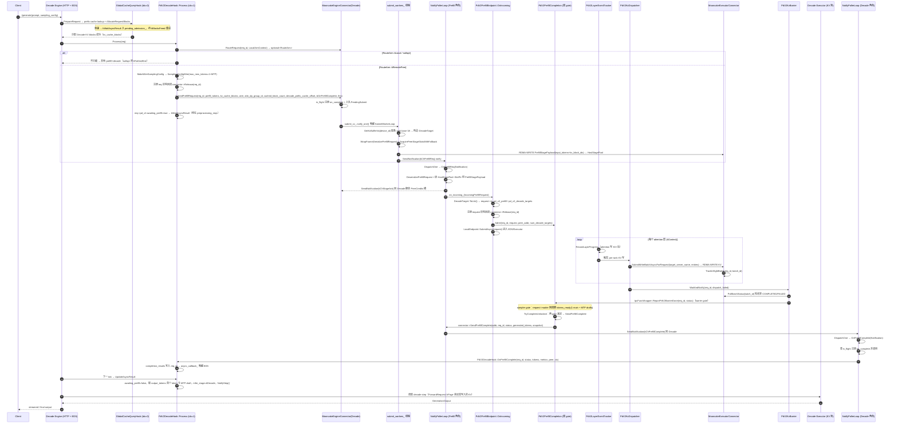
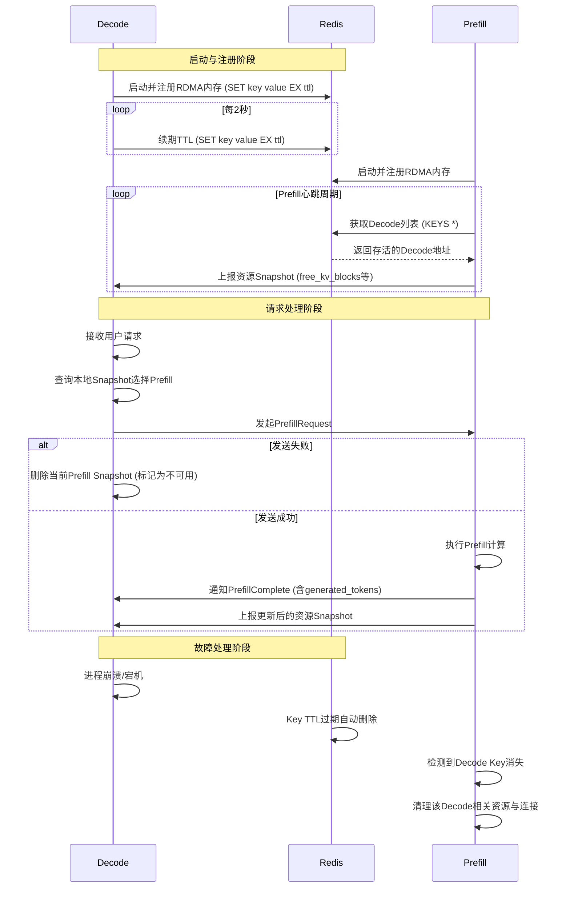

## 1. 设计背景概述

### 1.1 PD V1 现存问题分析

###### 1. 调度逻辑缺陷：高负载下易发死锁
当前 Router 采用双向锁定机制：Prefill 节点锁定 Block 进行计算，Decode 节点锁定 Block 等待 KVCache 传输。然而，由于 Prefill 与 Decode 节点拥有独立的内部调度优先级，在长请求场景或 Block 资源紧张时，极易引发资源死锁：
- **现象**：Prefill 已完成计算的请求，在 Decode 端因资源不足无法分配 Block；反之，Decode 端已分配 Block 的请求，在 Prefill 端因调度优先级低迟迟得不到计算。
- **后果**：两端互相等待，形成“脑裂”，导致请求阻塞甚至系统假死。
###### 2. 通信架构瓶颈：NCCL 依赖过重且交互复杂
**a. 信号唤醒机制冗余**
NCCL 本身不支持事件驱动唤醒，必须依赖 Busy-Waiting 或外部信号通道。PD V1 引入 ZMQ 作为专用信号通道，导致 Prefill 与 Decode 节点间需维持复杂的状态协调逻辑。
**b. 数据传输寻址开销大**
Prefill 与 Decode 节点独立接收请求，Prefill 计算完成后无法确定 KVCache 在 Decode 端的具体存储位置。因此，双方需通过多次 ZMQ 交互协商内存地址，多次握手显著降低了 KVCache 传输效率；交互链路变长，单点消息丢失即可导致整个请求挂起。
###### 3. 容错与运维风险：集群健壮性不足
**a. NCCL 集群容错性脆弱**
现有架构依赖单一 NCCL Communicator（基于同一 UniqueID 初始化）。一旦任意 Prefill 或 Decode 节点发生异常，极易导致整个集群通信链路崩溃。
**b. 状态管理复杂度高**
为解决上述问题，Router 被迫引入复杂的节点状态机管理逻辑（如节点存活检测、重启同步等）。这不仅大幅增加了系统的维护成本，且在节点频繁重启或扩缩容时，状态同步不稳定，易引发隐性 Bug。
###### 4. 性能损耗与异构限制
**a. 计算资源抢占**
即便启用 GPU Direct RDMA (GDR) 模式，NCCL 通信仍会抢占部分 Streaming Multiprocessor (SM) 资源，对 Prefill/Decode 的计算吞吐造成干扰。

**b. 硬件生态绑定**
当前方案强依赖 NVIDIA 的 NCCL 库，仅适用于 NV 设备间通信。随着国产算力卡的引入，急需一套支持异构设备（跨厂商 GPU/NPU）的通用通信中间件。

### 1.2 PD V2 架构设计的改进

| 维度     | 核心机制                | 业务价值                                                               |
| :----- | :------------------ | :----------------------------------------------------------------- |
| 调度零死锁  | 纯生产-消费模型 + 地址预投递    | 彻底消除脑裂风险：Decode发起请求即锁定资源，Prefill仅负责生产写入；接收地址提前告知，省去运行时协商，资源规划清晰可控。 |
| 路径依赖简单 | 单向流式处理架构            | 省去中间复杂协调状态，Prefill与Decode节点逻辑解耦，容量规划与问题排查更加清晰。                     |
| 低侵入性   | GDR 模式远端内存直写        | 无需 CUDA Kernel 参与数据搬运，零占用 SM / Stream 计算资源，实现真正的计算通信解耦。            |
| 异构传输支持 | 统一传输协议（TCP/RDMA）    | 彻底摆脱对 NCCL/CUDA 的生态绑定，完美适配国产算力卡及无 RDMA 的通用云环境。                     |
| 线上稳定性  | Redis 统一元数据 + 心跳注册  | 支持秒级动态扩缩容与故障自动摘除，彻底规避 NCCL Communicator 单点崩溃引发的全局雪崩风险。             |
| 架构统一   | 控制面与数据面统一于 Mooncake | 复用成熟传输底座，避免引入 NCCL 带来的额外通信栈维护成本，显著降低系统长期 TCO。                      |
###### 核心改进详解
**1. 纯生产-消费模式，根治调度死锁**
PD V2 重构了调度范式，将原有的“双向资源博弈”改为“单向流式处理”。Decode 节点作为消费者，在发起请求时已预先锁定本地 Block 资源；Prefill 节点作为生产者，仅负责计算并将 KVCache 写入既定位置。该机制彻底消除了 PD V1 中因资源互锁产生的循环等待（死锁）问题，系统在高负载和长上下文场景下表现更加稳健。

**2. 地址预投递，去除运行时协调**
PD V2 在请求发起阶段即完成传输握手。Decode 节点在向 Prefill 发起推理请求时，同步携带已分配的 KVCache 目标内存地址（Address/Token Range）。Prefill 计算完成后无需询问“写给谁”或“写哪里”，直接进行 DMA 写入。相比 PD V1 的多轮 ZMQ 握手，该机制将控制面交互降至最低（1 RTT），极大降低了传输延迟和因消息丢失导致的请求阻塞风险。

**3. 异构扩展，夯实国产化算力底座**
PD V2 通过抽象统一的传输协议层，摆脱了对 NCCL 的强依赖，为多种国产卡的PD适配打好基础。

---
## 2. 整体架构

### 2.1 请求流程概览



  

### 2.2 单请求全链路时序

  
  

### 2.2 模块目录

```text

csrc/pd_v2/
├── public/ # 公共 ABI 层（跨 .so 边界，不依赖后端实现）
│ ├── pd_v2_connector # PdV2ConnectorInterface 全量虚拟接口 + 工厂声明，跨进程/跨节点类（Notification/PeerHealth/DecodeTargetLite/IncomingPrefillRequest/PdRequestCompleteCb）；
│ ├── pd_v2_config # 顶层配置 PdV2ConnectorConfig
│ ├── pd_v2_types # 运行期类型
│ ├── pd_v2_connector_loader # dlopen libpd_v2_connector_<backend>.so + dlsym 工厂符号
│ └── pd_v2_connector_bootstrap # 创建RDMA链接以及冷启动RDMA预热
├── configure/ # 进程内运行期配置（与 V1 ConnectorConfig 解耦的一些独立配置，方便后续清理V1）
├── wire/ # pd控制信号的序列化反序列化模块msgpack格式
├── decode/ # Decode 侧业务逻辑（EDS 钩子 + 路由）
│ ├── pd_v2_decode_hook # PdV2DecodeHook：EDS 调度调研
│ ├── peer_selector # PeerSelector：快照驱动的 Decode 对等路由表，当前是kRoundRobin模式
│ ├── linucb_router # LinUCBRouter：判断请求是否发往Prefill节点
│ ├── linucb_math # LinUCB 数学原语：向量/矩阵（Ainv、b）、ScoreForTest
│ └── local_load # ReadLocalLoad：从 ScheduleContext 读 Decode 负载视图喂给 LinUCB
├── prefill/ # Prefill 侧 KV 写链路（executor 进程内）
│ ├── pd_v2_layer_event_tracker # PdV2LayerEventTracker：逐层 cudaEvent 跟踪；
│ ├── pd_v2_kv_dispatcher # PdV2KvDispatcher：Event的处理；OnLayerComplete 按 epoch 请求、触发 KvBarrier
│ └── pd_v2_kv_barrier # PdV2KvBarrier：后台线程轮询 BatchID 至 COMPLETED 后 ReportPdV2BarrierDone
├── mooncake/ # libpd_v2_connector_mooncake.so：真实 Mooncake tent 后端
│ ├── factory # 按 DeploymentRole 返回 Engine/Executor 连接器（C 导出）
│ ├── mooncake_engine_connector # engine 角色；主生命周期 + _decode/_prefill/_discovery 拆分
│ ├── mooncake_executor_connector # executor 角色；RegisterKvPool + SubmitWrite*/Track/Poll/EraseInflightBatch
│ ├── engine_tent_wrapper # engine侧RDMA的一些封装，主要收发控制信号
│ ├── executor_tent_wrapper # executor 侧RDMA的封装，KV的传输通道
│ ├── host_stage_pool # Prefill侧的RDMAbuffer，用于接收很长的Inputtokens或多模态的embedding请求
│ ├── peer_credits # 协调请求应该使用哪个Prefill端的 stage pool中的buffer筒地址
│ └── redis_alive_store # Redis的封装，用于服务发现注册等功能
```

  

---

  

## 3. 启动与拓扑发现（Boot & Discovery）
### 3.1 基于 Redis 的存活键 + 快照推送，实现集群拓扑动态感知与故障自愈。
   
   命名空间为 `pd_v2/decode_alive/<cluster>/节点X`，cluster内的所有节点组成完整的Np Md集群

    
