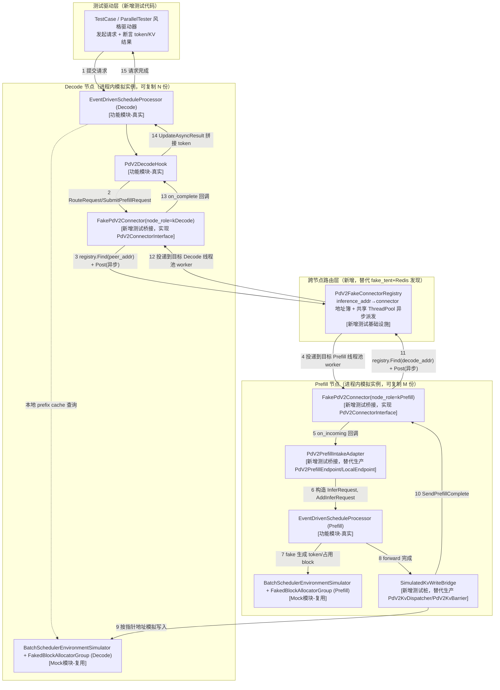

### A. 问题分析与方案总述

**问题分析（代码调研发现）**：

1. **Decode 侧真实调度链路已足够清晰、可直接复用**：`PdV2DecodeHook::Process`（`csrc/pd_v2/decode/pd_v2_decode_hook.cpp`）在 `EventDrivenScheduleProcessor` 的 hook 链（hook_idx=1，紧跟 `GlobalCacheQueryHook`）上调用 `connector_->RouteRequest`/`CanAccept` 选路、`connector_->SubmitPrefillRequest(...)` 发起请求，返回 `kWaitAsyncResult`；`OnPrefillComplete` 回调经 `async_callback_` 唤醒 EDS 主循环执行 `UpdateAsyncResult` 拼接 token、切 `infer_stage=kDecode`。这条链路与调度器测试框架天然契合——`PdV2DecodeHook` 依赖的 `PdV2ConnectorInterface` 是唯一外部边界，测试只需提供一个真实或可控的 connector 实现即可，不需要改动 Decode 侧任何生产代码。

2. **【design 二次迭代，方案改判】跨节点通信不复用真实 `MooncakeEngineConnector`，改为直接实现测试专用的 `PdV2ConnectorInterface` 具体类 `FakePdV2Connector`**：`csrc/pd_v2/public/pd_v2_connector.h::PdV2ConnectorInterface` 是一个纯抽象边界，`PdV2DecodeHook`/`PdV2PrefillEndpoint` 只依赖这个接口，对具体实现无感知；仓库内已有两个先例直接手写实现该接口用于单测——`csrc/pd_v2/decode/pd_v2_decode_hook_test.cpp::MockDecodeConnector`、`csrc/endpoints/pd_v2/pd_v2_prefill_endpoint_test.cpp::FakeConnector`——均不依赖 `MooncakeEngineConnector`/`fake_tent`。本次方案将这一思路升级为"一对（或 M+N 组）互联的 fake connector"，而非最初设想的"真实 `MooncakeEngineConnector` + `fake_tent` mock 传输层"。**改判依据（代码调研新发现，历史背景见下方第 5 点）**：走查 `mooncake_engine_connector_decode.cpp::BuildPrefillRequest`/`AcquirePeerStageSlots`/`StageWriteAndWait` 发现，真实 `SubmitPrefillRequest` 远不止"发一条 wire 通知"，还内嵌了完整的暂存写协议——(a) `GetKvBufferVa` 依赖 `IpcFuncWrapper`（跨进程 RPC 到 executor 查询 KV 地址，本框架无 executor 进程，需额外 fake 一个 `IpcFuncWrapper`，且原方案 §B 未覆盖此依赖）；(b) `HostStagePool`+`PeerCredits` 的 mmap 分配/槽位租约/批次轮询等待；(c) 加上已发现的 Redis 发现死锁（见下方历史记录）。三者叠加后，"真实 connector 路径"的复杂度显著高于最初评估，且这些内部机制（wire 编解码、stage 槽位协议、Redis 发现、`PeerSelector` 真实实现）均落在 `0-clarification.md §C` 明确的非目标范围内（"不做真实 RDMA/网络传输性能测试"、"不做真实 Redis 服务发现/心跳机制的集成测试"、"不验证 PeerSelector/LinUCBRouter 真实路由算法正确性"）——用真实 connector 反而是在测试范围之外的机制上背了额外复杂度，而不是补充了有效覆盖。改用 `FakePdV2Connector` 后：不依赖 `fake_tent`、不依赖 Redis/`libhiredis.a`、不依赖 `IpcFuncWrapper`/`HostStagePool`/`PeerCredits`，也不产生任何后台线程（心跳/keepalive），M/N 拓扑的"发现"退化为测试构造时的一次性显式注册（见下方"节点发现简化"），无需异步等待。**影响面收窄**：`0-clarification.md §D` 预判的 `csrc/pd_v2/mooncake/fake_tent/`、`mooncake_engine_connector.h`/`mooncake_executor_connector.h` 不再是本次依赖（这些文件本次完全不涉及，属于影响面比澄清阶段预判更小，非范围扩大，不属于需要回 `ai-clarify` 升档重做的情形）。

3. **Prefill 侧的生产接入路径 `PdV2PrefillEndpoint` 对本框架过重，不适合直接复用**：`csrc/endpoints/pd_v2/pd_v2_prefill_endpoint.h` 的 `OnIncoming` 依赖 `LocalEndpoint::SubmitAsync → ModelDriver::Enqueue`，这一条链路是为真实 Prefill 进程（含真实 executor/模型前向）设计的，与本框架"调度器级别、fake token 生成"的定位不匹配，若照搬会把测试框架拖回真实推理栈。**方案**：新增一个测试专用的轻量适配器 `PdV2PrefillIntakeAdapter`，直接把 `connector_->RegisterIncomingHook` 收到的 `IncomingPrefillRequest` 转换为 Prefill 侧的 `InferRequest`（`infer_stage=kContext`），调用 Prefill 自己的 `EventDrivenScheduleProcessor::AddInferRequest`，从而完全复用 Prefill 侧真实调度器，而不经过 `LocalEndpoint`/`ModelDriver`。

4. **`PdV2KvDispatcher`/`PdV2KvBarrier`（真实按层 RDMA 写入 + barrier）与调度器级测试的请求模型不兼容，本次不接入**：这两个类操作的是 executor 侧 `ExecutorInferRequest`（`csrc/runtime/executor_infer_request.h`），由真实模型前向的逐层 `cudaEvent`（`OnLayerComplete`）驱动；而 `batch_scheduler_test` 系的调度器测试全程只有引擎侧 `InferRequest` + `BatchSchedulerEnvironmentSimulator` 的 fake token 生成，没有 executor 进程、没有逐层前向事件。虽然 `csrc/pd_v2/prefill/pd_v2_kv_dispatcher_split_fuse_fake_test.cpp` 证明了可以用假 host 指针 `BlockAllocatorManager` 手动驱动 `OnLayerComplete`/`OnEpochEnd`（不需要真实 GPU），但要把它接进调度器测试需要额外桥接"引擎侧 `InferRequest`"与"executor 侧 `ExecutorInferRequest`"两种请求模型，工作量与本次"调度协同"主线目标不匹配。**方案**：本次用一个新增测试桩 `SimulatedKvWriteBridge` 在 Prefill 侧 fake 生成 token 完成时，直接按 wire 请求携带的 `kv_pool_block_ids`/`DecodeTargetLite` 地址信息，把 Prefill `BatchSchedulerEnvironmentSimulator` 生成的 fake KV 内容"写入"（内存拷贝 + 校验）到 Decode 侧对应 block，代替真实 `PdV2KvDispatcher`/`PdV2KvBarrier`。真实按层 RDMA 路径的覆盖留作后续 Phase B（见下方分阶段说明与 §G 风险）。

5. **【历史记录，已被第 2 点方案改判取代】`ai-go` 施工前曾发现真实 `MooncakeEngineConnector` 在 `metadata_addr="P2PHANDSHAKE"` 下 Decode/Prefill 无法完成首次发现（死锁）**：Decode 侧 `CanAccept`/`RouteRequest` 依赖 `peer_selector_` 已注册 Prefill peer，而 `peer_selector_` 只在收到 Prefill 广播的 `PrefillSnapshot` 后才注册；Prefill 侧 `BroadcastSnapshot` 在非 `redis://` 模式下只广播给"已经发过请求给自己"的 Decode 地址，两端互相等待对方先发起，全新进程对永远无法完成首次发现。当时的修正方案是新增 `FakeRedisServer`（自建最小 RESP server）把 `metadata_addr` 切到 `redis://127.0.0.1:<port>` 激活真实 `RedisAliveStore` 发现路径。**该问题与其修正方案随第 2 点的架构改判一并作废**：`FakePdV2Connector` 不使用 `MooncakeEngineConnector` 的发现协议，M/N 拓扑改为测试构造时一次性显式注册对端地址（见下方"节点发现简化"），不存在先有鸡还是先有蛋的死锁问题，也无需 `FakeRedisServer`/`libhiredis.a`。保留本条作为决策记录，说明"真实 connector 路径"在被放弃前已经暴露出比 `fake_tent` mock 传输层本身更深层的问题。

6. **`FakePdV2Connector` 具体设计（本次新增测试类，实现 `PdV2ConnectorInterface`）**：
   - **单类双角色**：一个 `FakePdV2Connector` 类按 `config_.node_role`（`kDecode`/`kPrefill`）分支行为，与生产 `MooncakeEngineConnector` 的组织方式一致（同一类跨文件按角色拆分逻辑），不新增第二套类型。
   - **节点发现简化（替代 `fake_tent`+Redis 发现）**：`FakePdV2Connector` 不实现任何发现协议；`inference_addr → shared_ptr<FakePdV2Connector>` 的映射由一个新增的 `PdV2FakeConnectorRegistry`（测试专用，进程内 `unordered_map<string, weak_ptr<FakePdV2Connector>>` + 互斥锁）持有，测试构造 M+N 个节点时通过其具体类型暴露的 `SetPeerAddrs(vector<string>)`（非接口方法，`MultiNodeTopology` 持有 `shared_ptr<FakePdV2Connector>` 具体类型指针可直接调用）一次性把每个 Decode 节点的 Prefill 对端地址列表显式注入——不存在异步发现、不存在死锁，无需 `WaitAllPeersReady` 轮询等待。`HasHealthyPrefillPeer()` 直接返回 `!peer_addrs_.empty()`。
   - **路由**：`CanAccept`/`RouteRequest` 对 `peer_addrs_` 做简单 round-robin（游标 `std::atomic<size_t>`），与 `0-clarification.md` 已确认的 `SelectorPolicy::kRoundRobin` 一致，不引入 `PeerSelector`/`LinUCBRouter` 真实实现（符合非目标）。
   - **异步派发（保真 "off EDS thread" 契约）**：`PdV2DecodeHook`/`PdV2PrefillEndpoint` 的实现假定 `on_complete`/`on_incoming` 在非调用方线程触发（`pd_v2_decode_hook.h:87-88` 注释"fires on the connector dispatch thread (off EDS), so all member access goes through mu_"）。`FakePdV2Connector::SubmitPrefillRequest`/`SendPrefillComplete` 不同步直调对端回调，而是通过 `PdV2FakeConnectorRegistry` 持有的一个共享 `ksana_llm::ThreadPool`（复用 `csrc/runtime/threadpool.h`，worker 数按节点总数配置，默认与 M+N 同量级）异步投递，保持与生产语义一致，使 T07（完成通知与 KV 写入时序竞争）等场景的验证仍然有意义。
   - **无 wire 序列化**：真实 `MooncakeEngineConnector` 会把 `SamplingConfigWire`/`DecodeTarget[]` 序列化进 `PrefillRequest`/`PrefillStagePayload` 字节流（`pd_v2/wire/prefill_request_wire.h`）用于跨进程/跨机传输；`FakePdV2Connector` 双方在同一进程内，直接构造 `SamplingConfigWire` 对象（堆分配、生命周期绑定到本次异步任务，任务执行完毕后释放）通过 `IncomingPrefillRequest.sampling_config_wire`（`const void*`）传递对象指针，不做 msgpack 编解码——`pd_v2/wire/*` 的编解码正确性不在本次测试范围内（若该目录已有独立单测覆盖，不受本次改动影响）。
   - **KV 地址简化（替代 `GetKvBufferVa`/`IpcFuncWrapper` 跨进程 RPC）**：`DecodeTargetLite.kv_pool_base_va` 不做真实 VA 换算，直接填入指向 Decode 节点 `FakedBlockAllocatorGroup`（或其测试侧包装对象）的指针值（`reinterpret_cast<uint64_t>`）。`SimulatedKvWriteBridge` 收到后 `reinterpret_cast` 回指针直接操作——因为收发双方本就在同一进程地址空间，这一步只是省略了地址的*来源*（真实版靠跨进程 IPC 查询），不改变地址的*使用方式*（仍是"按 wire 携带的地址信息定位写入目标，校验不越界"），T02 的不变量验证逻辑不受影响。
   - **`RegisterKvPool`/`GetLocalKvPoolShape` 等 executor-only 虚函数**：保持接口默认空实现（no-op），本次（Phase A）不需要覆写，与 Phase B 占位说明一致。

**方案总体思路**：

分两个 Phase 落地，本次只做 **Phase A**（对应 `0-clarification.md` 全部 9 个建议测试点 T01~T09，覆盖调度协同的路由/并发/cache/时序竞争等逻辑正确性）；**Phase B**（真实按层 RDMA KV 写入路径）作为后续迭代，本次只在 §G 风险待办中占位，不实现。

- **Phase A（本次实现）**：搭建一个可参数化 M(Prefill)/N(Decode) 的进程内多节点调度协同测试框架，每个"节点"= 一个真实 `EventDrivenScheduleProcessor` + 测试专用 `FakePdV2Connector`（对应角色）+ 各自独立的 `FakedBlockAllocatorGroup`/`BatchSchedulerEnvironmentSimulator`；跨节点通信全部经 `PdV2FakeConnectorRegistry` 的进程内地址簿 + 共享 `ThreadPool` 异步派发完成（同进程直接对象传递，无 RDMA/Redis/fake_tent）；新增 `PdV2PrefillIntakeAdapter`（Prefill 侧请求接入）与 `SimulatedKvWriteBridge`（KV "写入"模拟）两个测试专用桥接类，把 Prefill 端生成的 token 和 KV 内容正确"送回" Decode 端。路由策略使用 `SelectorPolicy::kRoundRobin`（已确认，非 LinUCB）。
- **Phase B（后续迭代，不在本次范围）**：在 Phase A 基础上，参照 `pd_v2_kv_dispatcher_split_fuse_fake_test.cpp` 的手动驱动模式，把真实 `PdV2KvDispatcher`/`PdV2KvBarrier` 接入 Prefill 侧（需要桥接 `InferRequest`→`ExecutorInferRequest`），获得逐层 RDMA 写入时序的真实覆盖。

**模块交互图（Phase A，1P1D 场景，M/N>1 时同构复制多份 DecodeNode/PrefillNode 子图，经 `PdV2FakeConnectorRegistry` 互联）**：

图例：`[功能模块-真实]` = 直接复用生产代码，不做任何改动；`[Mock模块-复用]` = 复用 `batch_scheduler_test` 已有测试基础设施；`[新增测试桥接/测试桩/测试基础设施]` = 本次新增、仅存在于测试代码中，不进入生产路径。

### B. 代码定位

**Phase A（本次实现）**：

- `csrc/batch_scheduler/event_driven_scheduler/pd_v2_multi_scheduler_test.cpp`（新增）— 测试文件本体；`TEST_F` 用例覆盖 T01~T09；`SetUp`/`TearDown` 中调用 `PdV2FakeConnectorRegistry::Reset()`（新增，语义参照 `pd_v2_engine_connector_fake_test.cpp:38-39` 的 `mooncake::TransferEngine::Reset()`，但作用对象是本次新增的进程内地址簿而非 `fake_tent`）避免跨用例状态泄漏；`TearDown` 顺序：先 `registry.DrainAndStopThreadPool()`（确保没有排队中的异步回调残留），再逐个 `Shutdown()`/析构各 `PdV2SimNode`
- `csrc/batch_scheduler/event_driven_scheduler/pd_v2_multi_scheduler_test_helper.h/.cpp`（新增）— 多节点模拟器基础设施：
  - `FakePdV2Connector` 类（新增，实现 `PdV2ConnectorInterface`，见 §A 第 6 点）：按 `config_.node_role` 分支 Decode/Prefill 行为；持有 `PdV2FakeConnectorRegistry*`（构造函数注入，非接口方法，测试直接 `std::make_shared<FakePdV2Connector>(&registry)` 构造后再 `Initialize(config)`，同 `pd_v2_engine_connector_fake_test.cpp` 里直接构造 `MooncakeEngineConnector` 的用法）；额外暴露测试专用方法 `void SetPeerAddrs(std::vector<std::string>)`（Decode 角色用，注入 Prefill 对端地址列表，替代真实发现协议）
  - `PdV2FakeConnectorRegistry` 类（新增）：`std::unordered_map<std::string, std::weak_ptr<FakePdV2Connector>>` + `std::mutex`，`Register(addr, weak_ptr)`/`Unregister(addr)`/`Find(addr) -> shared_ptr`；持有一个共享 `ksana_llm::ThreadPool`（复用 `csrc/runtime/threadpool.h`，见 §A 第 6 点）用于异步投递 `on_incoming`/`on_complete`，`Reset()` 清空地址簿，`DrainAndStopThreadPool()` 供 `TearDown` 调用
  - `PdV2SimNode` 结构：封装一个节点的 `EventDrivenScheduleProcessor` + `FakePdV2Connector` + `FakedBlockAllocatorGroup` + `BatchSchedulerEnvironmentSimulator`，构造函数参数化 `NodeRole`（对齐 `csrc/pd_v2/public/pd_v2_config.h::NodeRole`）与 `inference_addr`
  - `PdV2PrefillIntakeAdapter` 类：`static void OnIncomingTrampoline(const IncomingPrefillRequest&, void* ctx)` + `void OnIncoming(...)`，参照 `csrc/endpoints/pd_v2/pd_v2_prefill_endpoint.cpp` 的 `IncomingPrefillRequest → InferRequest` 字段映射（`input_tokens`/`sampling_config_wire`/`decode_targets_wire`），但目标改为调用 `PEDS->AddInferRequest(...)` 而非 `LocalEndpoint::SubmitAsync`
  - `SimulatedKvWriteBridge` 类：在 Prefill 侧 `InferRequest` 完成 fake 生成（`BatchSchedulerEnvironmentSimulator` 产生 token 后）时被回调触发，读取该请求关联的 `DecodeTargetLite`（`kv_pool_block_ids`/`kv_pool_base_va`，`kv_pool_base_va` 语义见 §A 第 6 点"KV 地址简化"，是指向 Decode 侧 `FakedBlockAllocatorGroup` 的指针值），`reinterpret_cast` 回指针后把 Prefill 侧对应 block 的 fake 内容拷贝到 Decode 侧对应 block，然后调用 `PConn->SendPrefillComplete(...)`
  - `MultiNodeTopology` 辅助函数：按 M/N 构造 `PdV2SimNode` 列表并逐个 `Register` 进同一个 `PdV2FakeConnectorRegistry`；构造完毕后对每个 Decode 节点调用 `SetPeerAddrs(所有 Prefill inference_addr)`——这是同步调用，函数返回时地址簿已生效，**不存在**异步发现窗口，无需轮询等待
- `csrc/batch_scheduler/batch_scheduler_test_helper.h`（复用，不改动）— 复用其 `RequestInfo`/`GenerateRequests` 风格的请求构造方式统一测试用例的请求生成（避免重新发明）
- `csrc/pd_v2/decode/pd_v2_decode_hook.h/.cpp`（只读，不改动）— 被测对象
- `csrc/pd_v2/public/pd_v2_connector.h`/`pd_v2_types.h`/`pd_v2_config.h`（只读，不改动）— `FakePdV2Connector` 实现的接口/类型来源
- `csrc/runtime/threadpool.h`（复用，不改动）— `PdV2FakeConnectorRegistry` 异步派发的线程池实现
- `csrc/batch_scheduler/CMakeLists.txt`（新增 `cpp_test` 目标 `pd_v2_multi_scheduler_test`，`DEPS ${MODELS_TEST_DEPS} LIBS ${MODELS_TEST_LIBS}`，参照同目录现有 `event_driven_scheduler_test` 等目标的标准写法即可；**不需要** `PD_V2_MOONCAKE_*` 静态库、`libhiredis.a`、`USE_TENT` 编译定义、`fake_tent` include 顺序技巧——这些均随"不依赖真实 `MooncakeEngineConnector`"的改判一并移除，依赖 footprint 与已有的 `csrc/pd_v2/decode/pd_v2_decode_hook_test.cpp` 一致）

**已移除（随 §A 第 2/5 点方案改判作废，不再需要）**：`FakeRedisServer` 及其 RESP 协议实现、`libhiredis.a`/`RedisAliveStore` 相关编译期依赖、`metadata_addr` 从 `P2PHANDSHAKE` 改 `redis://` 的改造、`WaitAllPeersReady` 异步轮询等待、`csrc/pd_v2/mooncake/mooncake_engine_connector.h/.cpp`、`csrc/pd_v2/mooncake/fake_tent/*` 依赖。

**Phase B（后续迭代，本次不实现，仅占位）**：

- `csrc/pd_v2/prefill/pd_v2_kv_dispatcher.h/.cpp`、`csrc/pd_v2/prefill/pd_v2_kv_barrier.h/.cpp` — 引入需额外桥接 `ExecutorInferRequest`
- `csrc/executor/executor_request_manager.h/.cpp`、`csrc/runtime/executor_infer_request.h/.cpp` — 参照 `pd_v2_kv_dispatcher_split_fuse_fake_test.cpp` 的手动驱动模式

### C. 调用链影响

- `PdV2DecodeHook::Process`/`UpdateAsyncResult`（`csrc/pd_v2/decode/pd_v2_decode_hook.cpp`）— 调用方：仅 `EventDrivenScheduleProcessor` 的 hook 链（`csrc/engine/inference_engine.cpp:795-798` 生产环境注册，测试直接 `hook_manager->AddHook(...)` 手动注册，同生产用法，不新增调用方分支）
- `PdV2ConnectorInterface::SubmitPrefillRequest`/`RegisterIncomingHook`/`SendPrefillComplete`（`csrc/pd_v2/public/pd_v2_connector.h`）— 现有调用方：`PdV2DecodeHook`（Decode 侧发起）、`PdV2PrefillEndpoint`/生产 `MooncakeEngineConnector`（Prefill 侧回复）；新增调用方（均为该接口的新实现，互不影响）：测试专用 `FakePdV2Connector`（新的接口实现，与生产 `MooncakeEngineConnector`、既有测试 `MockDecodeConnector`/`FakeConnector` 是同一接口的第四种实现）、`PdV2PrefillIntakeAdapter`（作为 `RegisterIncomingHook` 的回调注册方，与生产 `PdV2PrefillEndpoint::OnIncomingTrampoline` 是同一回调签名的两种实现）
- `EventDrivenScheduleProcessor::AddInferRequest`（`csrc/batch_scheduler/event_driven_scheduler/event_driven_schedule_processor.h:60`）— 现有调用方：生产 `LocalEndpoint`/`ParallelTester`（测试）；新增调用方：`PdV2PrefillIntakeAdapter::OnIncoming`（Prefill 侧模拟请求注入），用法与 `ParallelTester` 一致，不改变该接口语义
- `ksana_llm::ThreadPool`（`csrc/runtime/threadpool.h`）— 现有调用方分散在各 executor/调度模块；新增调用方 `PdV2FakeConnectorRegistry`（复用其 `Submit`/`Start`/`Stop` 接口做跨节点异步回调派发），不改变该类实现

### E. 测试要点

来自 `0-clarification.md §G suggested_tests` 的逐条映射（T01~T09 均为 unit，check_type 与来源一致，无需延期说明）：

- T01（1P1D 基础协同）→ `pd_v2_multi_scheduler_test.cpp::BasicOnePOneDCoordinationTest`：断言最终 `output_tokens` 序列与单机 `EventDrivenSchedulerTest`（复用同一套 `BatchSchedulerEnvironmentSimulator` fake token 生成规则）一致
- T02（KV block 地址匹配）→ `KvBlockAddressMatchTest`：断言 `SimulatedKvWriteBridge` 写入 Decode 侧的 block 内容仅落在该请求预分配的 block 范围内，其余请求的 block 内容不受影响（越界写入即测试失败）
- T03（2P2D 并发无死锁）→ `MultiNodeConcurrentNoDeadlockTest`：构造 2 Prefill + 2 Decode，并发提交 N 个请求，断言所有请求在超时窗口内均进入终态（完成或失败），无请求停留在 `kWaitAsyncResult` 状态超时未推进
- T04（并发跨节点不串扰）→ `ConcurrentCrossNodeNoCrossTalkTest`：并发请求断言各自 `output_tokens`/写入 block 内容与请求自身的输入一一对应，不出现张冠李戴
- T05（cache 命中跳过 Prefill）→ `PrefixCacheHitSkipPrefillTest`：预热 prefix cache 后重复请求，断言 `PdV2DecodeHook` 未调用 `SubmitPrefillRequest`（`FakePdV2Connector` 内置 `submit_calls` 计数字段，风格同 `MockDecodeConnector`，直接断言计数不增长）
- T06（Prefill 繁忙退避）→ `PrefillBusyBackoffTest`：限制 Prefill 侧 `FakedBlockAllocatorGroup` 容量制造资源紧张，断言 Decode 侧请求最终完成或明确超时失败，不出现请求丢失
- T07（完成通知与 KV 写入时序竞争）→ `CompletionKvWriteRaceTest`：`SimulatedKvWriteBridge` 引入可控延迟，断言 `SendPrefillComplete` 调用严格晚于 KV 写入模拟完成之后（时序断言 + Decode 侧读取的 token/KV 内容始终正确，不出现读到写入中间态）
- T08（SWA 跨节点协同）→ `SwaCrossNodeCoordinationTest`：参照 `event_driven_scheduler_test.cpp::SwaBasicTokenGenerationTest` 的 `sliding_window_size_` 配置，扩展到 1P1D 场景，断言跨节点后 SWA 窗口内容与单机 baseline 一致
- T09（prefix cache 部分命中组合）→ `PartialPrefixCacheCrossNodeTest`：构造部分命中场景，断言 (1) 未命中尾部仍经 `SubmitPrefillRequest` 转发；(2) Decode→Prefill 携带的 `decode_prefix_cache_offset`/`cached_block_count` 等于本地共享前缀；(3) `SimulatedKvWriteBridge::WriteBack` 写入 token 数 = `prompt_len - decode_prefix_cache_offset`（仅未命中部分 KV）

### G. 风险待办

- **`FakePdV2Connector` 是本次全新实现，需先验证最小 1P1D 回路**：虽然实现原理简单（接口方法 + registry 查找 + 线程池投递），但"配对互联"（Decode `SubmitPrefillRequest` → Prefill `on_incoming` → `SendPrefillComplete` → Decode `on_complete`）是第一次把两个自定义 fake connector 实例接起来跑通整个回路。实现阶段第一步应先写一个最小 1P1D smoke 用例验证该回路可行（不含并发/cache/SWA 等变体），再展开 M/N 参数化，避免在复杂场景里排查基础设施问题
- **异步派发必须真正跨线程，不能退化为同步直调**：`FakePdV2Connector::SubmitPrefillRequest`/`SendPrefillComplete` 若图省事直接同步调用对端回调（而不是通过 `PdV2FakeConnectorRegistry` 的 `ThreadPool::Submit`），会破坏 `PdV2DecodeHook`/`PdV2PrefillEndpoint` 依赖的"off EDS thread"契约（见 §A 第 6 点），进而使 T07（完成通知与 KV 写入时序竞争）失去测试意义——`ai-review` 阶段应重点检查这一点是否被正确实现
- **共享 `ThreadPool` 的生命周期与 `TEST_F` 的 `TearDown` 顺序**：`PdV2FakeConnectorRegistry` 持有的线程池若在某个 `PdV2SimNode`（含其 `PdV2DecodeHook`/`InferRequest` 等）已析构后仍有排队任务被执行，会访问已释放对象（回调 `ctx` 悬空）。`TearDown` 必须先 `registry.DrainAndStopThreadPool()`（等待队列清空 + 停止 worker），确认没有 in-flight 任务后，再析构各 `PdV2SimNode`；`SetUp`/`TearDown` 之间还需 `registry.Reset()` 清空地址簿，避免跨用例状态污染（同一进程内多个 `TEST_F` 复用同一批 `inference_addr` 字符串时尤其重要）
- **线程池 worker 数量影响并发场景的测试意义**：worker 数过少（如 1）会把 T03/T04 的并发请求人为串行化处理，掩盖真正的并发竞态；建议 worker 数与 M+N 节点数同量级或可配置，具体取值在实现阶段结合 T03/T04 用例的断言方式确定
- **KV 地址简化（§A 第 6 点）意味着 T02 验证的是"wire 携带的地址信息被 `SimulatedKvWriteBridge` 正确消费、不越界"，而非真实 Mooncake VA 换算公式的正确性**——这与改判前的方案定位一致（Phase A 本就不做真实 RDMA 地址计算），不是新增风险，只需在 `ai-review`/`ai-verify` 阶段明确避免误读
- **Phase B（真实 `PdV2KvDispatcher`/`PdV2KvBarrier` 按层 RDMA 路径）本次不覆盖**：意味着 T02/T07 的"KV 地址匹配"和"完成通知时序竞争"验证的是调度器/连接器层面的协同正确性，不是真实按层 RDMA 写入的时序正确性；`0-clarification.md §J` 已就此风险做了说明，此处重申以确保 `ai-review`/`ai-verify` 阶段不会误解为"KV 传输路径已全量覆盖"

### Env 执行环境提示

- 本次改动能否在编码环境内做语法/类型级自检？**能，且门槛低于改判前的方案**——纯 C++ 单测代码（新增 `.cpp`/`.h` + `CMakeLists.txt` 目标），不涉及 GPU kernel、不涉及 Python 层；由于不再依赖真实 `MooncakeEngineConnector`，新目标不需要 `PD_V2_MOONCAKE_*` 静态库、`libhiredis.a`、`fake_tent`/`USE_TENT` 编译定义——依赖 footprint 与已有的 `pd_v2_decode_hook_test`（同样只需 `MODELS_TEST_DEPS`/`MODELS_TEST_LIBS`，见 `csrc/pd_v2/decode/CMakeLists.txt:48`）一致，不再有"需预先构建好 Mooncake 第三方依赖"这一前提
- 是否涉及需要容器内才能验证的行为？**运行期不涉及**真实 GPU/RDMA/Redis/网络，跨节点通信全部是进程内直接对象传递 + 标准库线程池，单测可在无 GPU 的环境本地运行
- **本次改判前 `ai-go` 阶段的实测记录**：当时的编码环境无网络（无法拉取 `mooncake_tent.cmake` 外部依赖）、`build/` 目录为空、磁盘剩余不足 1GB，本地完全无法编译（含最基础的 `cpp_test` 目标也需要一个已配置好的 `build/` 目录）。**这一通用构建基础设施问题（无 `build/`、磁盘不足）与本次是否依赖 Mooncake 无关，本次改判缩小的是"额外依赖范围"而非解决了通用构建环境问题**——`ai-go`/`ai-verify` 阶段仍需按当时磁盘/网络实际状况判断能否本地完成编译级自检，如实记录，不预设已解决
- 建议的验证范围（增量单测目标）：`pd_v2_multi_scheduler_test`（新增，覆盖 T01~T09）
- 是否预判需要集成测试：**否**——全部为进程内单测，无外部服务依赖；建议合入后在具备真实多机 PD v2 环境时做一次人工冒烟验证，作为对 Phase A 局限性（不覆盖真实 connector/RDMA 时序）的补充确认，非本次自动化验证范围
